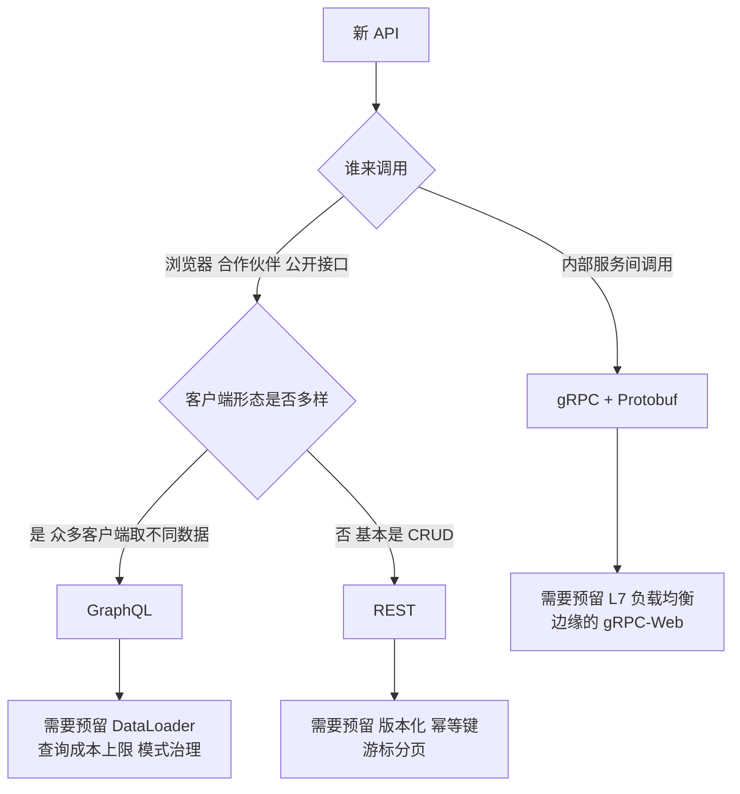
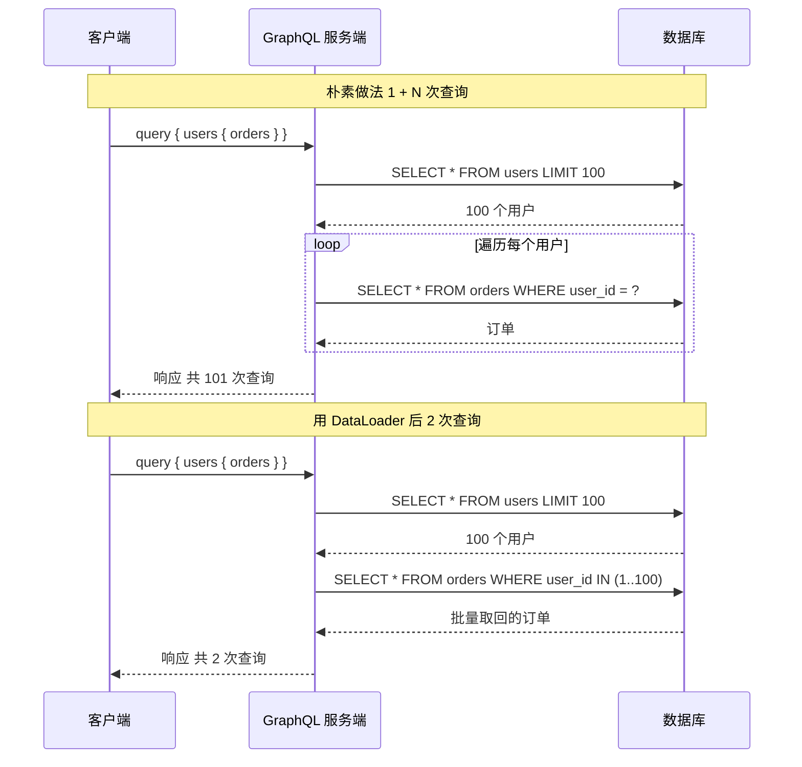
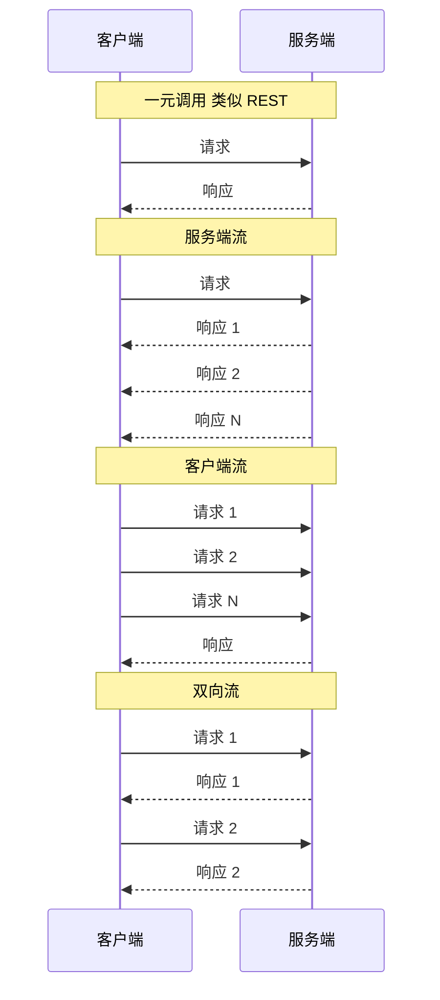
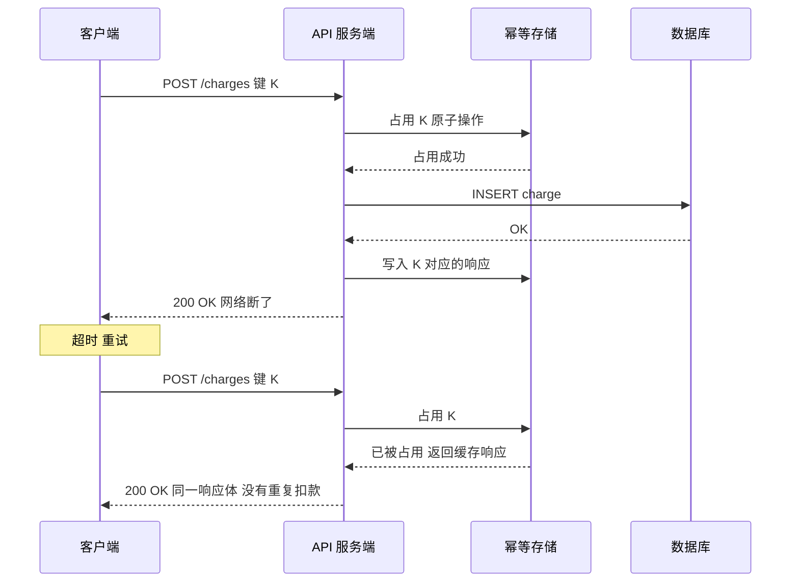

# API 设计基础：REST、GraphQL、gRPC 与那些难点

> **TL;DR**: 对外公开的 API 默认该用 REST。当众多客户端需要各不相同的响应结构时，GraphQL 才显出优势。服务间的内部调用默认该用 gRPC，大负载下吞吐量可达 REST 的 10 倍，典型负载下也有 15-40% 的提升 [^1]。但选哪种范式，远不如那几个横切关注点重要：版本化、幂等性、分页。这三件事在 v1 上做错，往后要跟它们纠缠好几年。Stripe 从 2011 年一路到 2024 年的模型转型，始终与每个 API 版本保持向后兼容 [^2]，原因就是第一天就选对了。

## 学习目标

学完这一模块，你将能够：

- [ ] 从领域模型出发，用资源和 HTTP 动词设计一套干净的 REST API
- [ ] 判断 GraphQL 在什么场景下有用，在什么场景下会带来 N+1 的痛苦
- [ ] 用具体的理由说明内部服务为什么该选 gRPC 而不是 REST
- [ ] 给 API 做版本化，同时不弄坏已有客户端
- [ ] 用幂等键实现安全的重试
- [ ] 在游标分页和偏移量分页之间做出选择，并解释理由
- [ ] 从较高层面描述限流、错误结构和认证

## 直觉理解

把 API 想成墙上的一只电源插座。一旦装上，楼里每台电器都得插进这个形状。你没法挪动插孔、改变电压、或者换掉插脚，除非挨个房间跑一遍，把每个插头都换掉。插座第一天装起来毫不费力，第二天想改就贵得离谱。

Stripe 的工程团队用的正是这个比喻：“像一张连通的电网或一套供水系统，API 一旦接上，就应该尽可能长时间不间断地运行” [^2]。任何一个字段名、任何一个状态码、任何一个分页游标，只要有一个客户端照着它写了代码，从那一刻起它就变成了约束。

这一模块讲三种范式（REST、GraphQL、gRPC），但更重要的是贯穿这三者的那些难点：怎么演进契约，怎么让写操作在重试下依然安全，怎么在数据不断增长时翻页。范式是个 30 分钟的决定，难点是 10 年的承诺。



*图 1：一版初筛的决策树。无论选哪条路，你都得面对虚线下方那些横切关注点；那才是 10 年的承诺。*

## 原理

### REST 资源建模

REST 把服务器状态建模成具名资源，用 URL 标识，用一小组固定的 HTTP 动词操作。资源是个名词：`/users/42`、`/orders/123/line-items`。不是 `/getUser`，也不是 `/createOrder`。动词由 HTTP 方法承担。

| 动词 | 用途 | 安全 | 幂等 |
|------|---------|-------|-------------|
| GET | 读取 | 是 | 是 |
| POST | 创建或执行动作 | 否 | 否 |
| PUT | 整体替换 | 否 | 是 |
| PATCH | 部分更新 | 否 | 视情况而定 |
| DELETE | 删除 | 否 | 是 |

HTTP 规范把 GET、HEAD、PUT、DELETE、OPTIONS 和 TRACE 定义为幂等 [^3]。这对重试很关键：如果一个 PUT 超时，你可以放心重发；如果一个 POST 超时，就不行，除非加上幂等键（下面会讲）。

**状态码把响应空间划成了几块。** 用对它们：

- `2xx` 成功：`200 OK`、`201 Created`（带 `Location` 头）、`204 No Content`
- `4xx` 客户端错误：`400 Bad Request`、`401 Unauthorized`、`403 Forbidden`、`404 Not Found`、`409 Conflict`、`422 Unprocessable Entity`、`429 Too Many Requests`
- `5xx` 服务端错误：`500 Internal Server Error`、`503 Service Unavailable`

Google 的 API 设计指南（AIP-121 到 AIP-136）把 CRUD 到 REST 的映射规范化了，给出标准的 `Get`、`List`、`Create`、`Update`、`Delete` 以及自定义方法 [^4]。如果你在设计新 API，从这里起步。

> [!TIP]
> 先给实体建模，再想 URL。如果你发现自己正在写 `/user/update` 或 `/order/cancel`，停下来想一想：这能不能写成 `PATCH /users/42`，或者 `POST /orders/42/cancellations`（一个动作子资源）？

### GraphQL 与 N+1 问题

GraphQL 是一门查询语言：客户端发一个查询，精确列出它想要的字段，服务端为每个字段用一个专门的解析函数（resolver）求值。

```graphql
query {
  user(id: "42") {
    name
    orders(first: 10) {
      id
      total
      items { name price }
    }
  }
}
```

一次往返。服务端只返回这些字段。移动端很喜欢这一点，因为在慢网络上可以避免取回多余数据。

**以下情况用 GraphQL：** 许多不同的客户端（Web、iOS、Android、合作伙伴）需要同一份数据的不同结构。客户端和服务端都在你手里。你想要跨微服务的单一统一模式（Netflix 在经历了几代 API 演进——先是 OpenAPI，然后是 API.NEXT，然后是 Falcor，然后是 GraphQL 单体，最后是 Federation——之后采用了 GraphQL Federation，目的是拆掉 API 单体，并支持众多产品团队的分布式归属 [^5]）。

**以下情况不要用 GraphQL：** 你只有一个客户端的简单 CRUD API（REST 的活更少），或者是对外公开、查询成本必须可预测的 API（GraphQL 的灵活让限流更难做）。

**N+1 问题。** GraphQL 的解析器是按字段、按父对象逐个跑的。查 100 个用户以及每个用户的订单，会变成 1 + 100 = 101 次数据库查询 [^6]。Shopify 这样描述：“这些额外的解析器意味着 GraphQL 有做出比必要更多的数据库往返的风险” [^6]。



*DataLoader 把 1+N 次数据库往返压成 2 次：它把同一个事件循环 tick 内所有的 `.load(id)` 调用攒成一批。*

**解法：DataLoader。** Facebook 开源的 [DataLoader](https://github.com/graphql/dataloader) 会把一个事件循环 tick 内所有的 `.load(key)` 调用收集起来，发一条批量查询 [^7]。Shopify 用 Ruby 写了等价的 `graphql-batch`，并认为它是“Shopify 所有 GraphQL 工作的通用最佳实践” [^6]。DataLoader 的缓存是请求级的，避免跨用户的数据泄漏。

### gRPC 与 Protobuf 流式模式

gRPC 是契约优先的 RPC 框架。你在 `.proto` 文件里声明服务，编译成 10 多种语言的强类型客户端桩和服务端骨架。传输层是 HTTP/2（HTTP/2 多路复用的细节见 [0.0 网络基础](../part-0-prerequisites/00-networking-fundamentals.md)）。默认序列化是 Protocol Buffers。

```protobuf
service OrderService {
  rpc GetOrder(GetOrderRequest) returns (Order);                    // 一元调用
  rpc ListOrders(ListRequest) returns (stream Order);               // 服务端流
  rpc BatchCreate(stream CreateOrderRequest) returns (BatchResult); // 客户端流
  rpc WatchOrders(stream WatchRequest) returns (stream Order);      // 双向流
}
```

**为什么快：** Protobuf 是二进制，通常比等价的 JSON 小 3 倍左右 [^1]。基准测试显示 gRPC 在较轻负载下吞吐量高出 15% 到 40%，大负载下可达 10 倍 [^1]。HTTP/2 在一条 TCP 连接上多路复用大量并发调用。超时是一等公民：如果没在期限内完成，调用以 `DEADLINE_EXCEEDED` 终止 [^8]。



*gRPC 的四种方法类型，区别在于谁在流、往哪个方向流；每条流内部的消息顺序是有保证的。*

**以下情况用 gRPC：** 两端都在你掌控之中的内部服务间通信。Uber、Google、Netflix、Square 内部都用 gRPC，边缘用 REST。边缘负责把外部 JSON 翻译成内部 Protobuf。这个模式叫“API 网关”或“服务于前端的后端”（完整模式见 [Backend for Frontend](../../../hld/part-5-architecture-patterns/05-backend-for-frontend.md)）。

### 版本化策略

破坏性变更无法避免。版本标识常见有三种放法：

- **URL 路径：** `/v1/users/42`。简单、可见、好路由。公开 API 最常见。
- **自定义请求头：** `API-Version: 2` 或 `Accept: application/vnd.company.v2+json`。URL 更干净，但手工 curl 更麻烦。
- **按日期滚动：** Stripe 把每个账户钉在注册时那个 API 版本上。每次调用都以当前版本渲染响应，再通过“版本变更模块”从当前版本往回逐层套用，直到客户端钉住的那个版本 [^2]。

截至 2017 年，Stripe 自 2011 年以来累计了大约 100 个向后不兼容的变更，而没有任何一个客户端被迫升级 [^2]。自 2024 年 9 月的发布（`acacia`）起，Stripe 改用花名命名的发布模型：每年两次带破坏性变更的大版本，加上每月的向后兼容版本，当前版本是 `2026-04-22.dahlia` [^9]。钉住版本这一原则依然成立。Shopify 则按季度发布日期命名的版本（例如 `2026-04`），每个版本至少支持 12 个月，相邻版本有 9 个月的重叠 [^10]。

**明确的建议：** 能选的话，用基于请求头的版本化（Accept-Version）。如果你的合作伙伴要手工 curl 你的 API、需要简单，那就用 URL 路径版本化。避免那种逼客户端重写 URL 的整数大版本。Stripe 的分析是：URL 大版本升级“几乎和从头重新接入一样痛苦” [^2]。

### 幂等键

客户端生成的一次性令牌，随写请求一起发出，服务端据此识别并去重重试。客户端生成一个 UUID，放进 `Idempotency-Key` 头，遇到网络错误就用同一个 key 重试。

```http
POST /v1/charges HTTP/1.1
Authorization: Bearer ***
Idempotency-Key: 7c9e6679-7425-40de-944b-e07fc1f90ae7

amount=2000&currency=usd&customer=cus_A8Z5MHwQS7jUmZ
```

服务端按 `(api_key, idempotency_key)` 保存响应（状态码和响应体），重复请求时返回缓存副本。Stripe 保留 key 24 小时，长度上限 255 字符 [^11]。如果同一个 key 带着不同的参数到达，Stripe 返回错误，防止误用。



*用同一个幂等键重试时，服务端返回缓存的响应，而不是再执行一次副作用。*

**明确的建议：** 在所有会变更金额或触发副作用的 POST 端点上，一律接受 `Idempotency-Key` 头。把 key 和响应与副作用放在同一个事务里原子写入。否则，“提交扣款”和“写入缓存响应”之间崩一次，重试就会变成重复扣款。

### 游标分页与偏移量分页

**偏移量分页**（`?limit=20&offset=100`）简单，但一上规模就崩。数据库实现 `OFFSET 100` 的方式是扫过并丢掉 100 行。在第 5,000 页、每页 20 条时，数据库要读 100,020 行才返回 20 行 [^12]。更糟的是：如果两次取页之间插入了新行，数据就会被跳过或重复 [^13]。

**游标分页**把最后见到那行的排序键编码成一个不透明令牌。下一页查 `WHERE (created_at, id) > cursor LIMIT 20`，走索引定位。性能与页深无关。Slack 的那些接口最初是按“几百条记录”设计的，长到“几十万条记录”之后，他们就迁到了游标分页 [^13]。

Google 的 AIP-158 强制要求不透明的 `page_token` 字符串：“如果用户能拆解它们，他们就一定会拆。这实际上让你 API 分页的实现细节变成了 API 表面的一部分” [^14]。Stripe 用 `starting_after` 和 `ending_before` 两个参数，取对象 ID 作游标 [^15]。

**明确的建议：** 只要数据量可能达到 1 万行以上，一律用游标（keyset）分页。偏移量留给数据量小且有上界的管理后台。

### 限流、错误与认证（速览）

**限流。** 令牌桶是公开 API 最常用的算法：令牌以速率 R 补充，上限是突发容量 B；每个请求消耗一个令牌 [^16]。返回 `429 Too Many Requests` 时一定要带 `Retry-After` 头。发布 `x-ratelimit-remaining`，让客户端在撞到上限之前自己先限速。GitHub 的 GraphQL API 给每个用户每小时 5,000 点 [^17]。

**错误处理。** RFC 9457（自 2023 年 7 月起取代 RFC 7807）定义了错误的标准化 JSON 结构：`type`（标识问题类别的 URI）、`title`、`status`、`detail`、`instance` [^18]。新 API 都该采用。客户端按 `type` 分派处理，记录 `detail`，按 `instance` 去重。

**认证。** 简单的服务器间调用用 API key。委托用户授权用 OAuth 2.0。无状态令牌校验用 JWT。OAuth 2.0/OIDC 流程见 [Part 7: Security at Scale](../../../hld/part-7-security-at-scale/01-oauth2-oidc.md)，令牌校验模式见 [JWT Deep Dive](../../../hld/part-7-security-at-scale/02-jwt-deep-dive.md)。

## 真实案例

Stripe 的 API 是业界把难点做对的参照。下面是他们的幂等系统端到端怎么跑。

客户端生成一个 v4 UUID，作为 `Idempotency-Key` 头随任意 POST 请求发出。服务端在一个持久化存储里原子地占用这个 key。占用成功就执行副作用（扣款），把响应（状态码和响应体）按 key 存下来，返回给客户端。

如果网络把响应丢了，客户端用同一个 key 重试，服务端发现已有占用记录，返回缓存的响应，卡不会被扣第二次。Stripe 的文档写着：“你可以让系统自动删除超过 24 小时的 key。如果某个 key 在原始记录被清理之后又被使用，我们会生成一个新的请求” [^11]。

参数不匹配的检查至关重要：同一个 key 带着不同的请求体到达时，Stripe 返回错误。这防止了在不相关的请求之间误用同一个 key。

Stripe 把这套机制和按日期滚动的版本化结合起来。每个账户钉在它第一次调用时的 API 版本上。有向后不兼容的变更上线时，它的转换逻辑被封在一个“版本变更模块”里，带一段描述和一个 `run` 块。响应先按当前版本渲染，然后从当前版本往回逐个套用版本变更模块，直到客户端钉住的版本 [^2]。2011 年到 2017 年之间，这让 Stripe 上线了大约 100 个破坏性变更，而没有一个客户端被迫升级；2024 年之后节奏变成每年两次花名大版本（Acacia、Basil、Clover、Dahlia）加每月的兼容更新，但钉住版本这一原则没变 [^9]。

教训是：幂等性和版本化不是事后能补上的功能。它们是必须在第一天就做对的架构决策，因为每个客户端会立刻依赖它们。

## 权衡

| 风格 | 优点 | 缺点 | 适用场景 | 我们的选择 |
|-------|------|------|-----------|----------|
| REST | 通用工具链成熟，按 URL 做 HTTP 缓存，心智模型简单，安全与幂等动词是内置的 | 取多和取少都可能发生，版本升级代价高，嵌套数据要多轮往返 | 公开 API、CRUD、合作伙伴集成、浏览器消费 | 对外 API 的默认选择 |
| GraphQL | 客户端精确指定结构，单一端点，可跨服务联邦，避免取多取少 | 没有 DataLoader 就有 N+1，查询成本难以预测，无法按 URL 做 HTTP 缓存 | 众多异构客户端读同一张数据图（移动端 + Web + 合作伙伴） | 有 50 个以上界面、各自取不同结构时 |
| gRPC | 负载约小 3 倍，大负载下吞吐可达 10 倍，4 种流式模式，生成的强类型桩，HTTP/2 多路复用 | 二进制线格式难以排查，浏览器需要 gRPC-Web，HTTP/2 会让朴素的 L4 负载均衡器失效 | 内部服务间、对延迟敏感的 RPC、流式 | 内部服务的默认选择 |

## 常见陷阱

> [!WARNING]
> **GraphQL 不用 DataLoader 的 N+1。** 一条看起来“便宜”的 GraphQL 查询，可以用 1 + N 次查询把数据库压满。每个 GraphQL 服务从第一天起就必须用 DataLoader（或等价的批量加载器）。Shopify 的 `graphql-batch` 和 Facebook 的 `dataloader` 是标准解法 [^7]。

> [!WARNING]
> **gRPC 负载均衡器的粘连接。** gRPC 跑在 HTTP/2 上，用一条长活的 TCP 连接。Kubernetes 的 L4 Service（kube-proxy、iptables）在连接级别做均衡，所以所有多路复用的 RPC 都被钉在一个 pod 上 [^19]。修法：用带 sidecar 代理的 L7 均衡，比如 Linkerd（p99 开销不到 1 ms，每 pod 内存占用不到 10 MB）或 Envoy。

> [!WARNING]
> **幂等键没有和响应原子存储。** 服务端扣了款，写幂等记录之前崩了，客户端重试，第二次扣款。key 和响应的写入必须与副作用在同一个事务里。对外部下游调用，把你客户端的 key 当作你自己的 key 传给下游。

> [!WARNING]
> **偏移量分页在数据变更时的竞态。** 两次取页之间插入新行，客户端就会看到重复或漏掉行。任何会增长或变化的数据集都用游标分页。Slack 那些接口从“几百条记录”长到“几十万条”时就踩了这个坑 [^13]。

> [!WARNING]
> **URL 路径版本化逼客户端重写 URL。** 上一次 `/v2/` 就要求每个客户端改自己的 HTTP 基础 URL。老客户端永远困在 `/v1/`。优先用按日期的请求头版本化（Stripe），或按季度发布、带自动回退的版本（Shopify）[^10]。

> [!WARNING]
> **缺了 429 或没带 Retry-After。** 客户端撞上限流，立刻在紧循环里重试，把过载放大。429 响应上一定要发 `Retry-After: <seconds>`。同时发布 `x-ratelimit-remaining` 头，让客户端在撞线前自己限速 [^17]。

## 练习

> **Design Challenge**：为一个转账 API 设计幂等键协议，使得同一笔转账即使发生重试也绝不会被执行两次。你的 API 接受 `POST /transfers`，请求体里含 `from_account`、`to_account` 和 `amount`。请说明：客户端发什么头，服务端怎么存和查 key，参数不匹配时怎么办，扣借方与贷记方之间崩溃时怎么办，key 什么时候过期。

<details>
<summary>提示</summary>

关键点在于原子性：幂等记录和副作用必须在同一个事务里提交。想一想，如果服务端在扣了源账户之后、还没给目标账户入账之前崩溃，会发生什么。

</details>

<details>
<summary>参考答案</summary>

**协议：**

1. 客户端生成一个 v4 UUID，在每次 `POST /transfers` 请求上以 `Idempotency-Key: <uuid>` 发出。
2. 服务端开启一个数据库事务。
3. 服务端尝试向 `idempotency_keys (key, api_client_id, request_hash, status)` 插入记录，status 为 `processing`。如果 key 已存在：
   - 若 `status = completed`：返回缓存的响应（状态码 + 响应体）。不产生副作用。
   - 若 `status = processing`：返回 `409 Conflict`（上一次尝试还在进行中）。
   - 若 `request_hash` 与当前请求体的哈希不同：返回 `422 Unprocessable Entity`，错误信息说明参数不匹配。
4. 服务端在同一个事务内从 `from_account` 扣款、向 `to_account` 入账。
5. 服务端把幂等记录更新为 `status = completed`，并写入响应体。
6. 服务端提交事务。任何一步失败，事务回滚，包括幂等占用。
7. 服务端返回响应。

**崩溃安全：** 因为幂等记录、扣款和入账在一个事务里，任何时点崩溃要么三者全提交，要么三者全回滚。重试时，客户端要么拿到缓存的响应（已提交），要么得到一次全新执行（已回滚）。

**过期：** key 24 小时后过期。一个后台任务删除过期 key。如果客户端在 24 小时之后重试，服务端把它当作一个新请求。

**边界情况：** 如果转账涉及外部支付处理商（不在你的数据库事务里），就把幂等键透传给处理商。多数处理商（Stripe、Adyen）本身就接受幂等键，这样你就得到了端到端的去重。

</details>

## 要点回顾

- 对外公开的 API 默认用 REST。客户端取的结构各不相同，用 GraphQL。内部服务间用 gRPC。
- 范式选择（REST 还是 GraphQL 还是 gRPC）没有那些横切关注点重要：版本化、幂等性、分页。
- 每个 GraphQL 服务从第一天起就需要 DataLoader。N+1 问题会把一条“便宜”的查询变成 101 次数据库调用。
- gRPC 在大负载下吞吐可达 REST 的 10 倍，但需要 L7 负载均衡，因为 HTTP/2 在单条 TCP 连接上多路复用。
- 数据集可能超过 1 万行时一律用游标分页。偏移量分页在并发写入下会出错，越翻越深还越慢。
- 所有会变更金额或触发副作用的 POST 端点，都要接受 `Idempotency-Key` 头。key 要与副作用原子地存储。
- Stripe 按日期滚动的版本化让他们上线了 100 个破坏性变更，而没有一个客户端被迫升级。第一天就照这个设计。

## 延伸阅读

- [Stripe: Designing robust and predictable APIs with idempotency](https://stripe.com/blog/idempotency) - 讲幂等键、重试语义、指数退避和惊群效应的经典文章。设计任何支付 API 之前先读它。
- [Stripe: APIs as infrastructure, future-proofing Stripe with versioning](https://stripe.com/blog/api-versioning) - 按日期滚动版本和版本变更模块模式的源头。设计长寿命公开 API 的人必读。
- [Shopify: Solving the N+1 Problem for GraphQL through Batching](https://shopify.engineering/solving-the-n-1-problem-for-graphql-through-batching) - 公开资料里对 N+1 和 graphql-batch 库讲得最全的一篇，带生产环境实例。
- [Linkerd: gRPC Load Balancing on Kubernetes without Tears](https://linkerd.io/2018/11/14/grpc-load-balancing-on-kubernetes-without-tears/) - 对 gRPC 的 HTTP/2 负载均衡失效模式最经典的诊断，有前后对比截图。
- [Slack: Evolving API Pagination at Slack](https://slack.engineering/evolving-api-pagination-at-slack/) - 一手记录：大规模下从偏移量迁到不透明游标令牌的全过程。
- [Google AIP-158: Pagination](https://google.aip.dev/158) - 关于游标不透明性、向后兼容和令牌过期的权威规范。
- [gRPC core concepts](https://grpc.io/docs/what-is-grpc/core-concepts/) - 四种流式模式、元数据和期限的官方参考。
- [GitHub: Rate and query limits for the GraphQL API](https://docs.github.com/en/graphql/overview/rate-limits-and-query-limits-for-the-graphql-api) - 如何用点数和节点上限给不可信的 GraphQL 表面设边界。

## 记忆卡片

**Q:** 哪些 HTTP 动词是幂等的？
**A:** GET、HEAD、PUT、DELETE、OPTIONS 和 TRACE。POST 和 PATCH 一般不是幂等的。这就是 POST 需要显式幂等键才能安全重试的原因。

**Q:** DataLoader 在 GraphQL 里解决什么问题？
**A:** N+1 查询问题。它把同一个事件循环 tick 内所有的 `.load(id)` 调用攒成一条批量查询，把 1 + N 次数据库往返变成 2 次。

**Q:** 为什么偏移量分页对活跃的信息流不安全？
**A:** 两次取页之间插入的新行会让偏移量整体位移，客户端于是看到重复或漏掉行。游标分页锚定在一个确定位置，避开了这个竞态。

**Q:** 什么情况下你会选 gRPC 而不是 REST？
**A:** 两端都在你掌控之中的内部服务间流量，延迟和二进制效率都重要，你想要强类型契约和流式支持。对外部客户端，在边缘用 REST。

**Q:** 哪个请求头能让 POST 安全重试？
**A:** `Idempotency-Key`，值由客户端生成 UUID。服务端缓存这个 key 对应的响应，重试时返回缓存而不是再执行一次副作用。

**Q:** gRPC 为什么会打坏朴素的 L4 负载均衡器？
**A:** gRPC 用 HTTP/2，在一条长活 TCP 连接上多路复用大量 RPC。L4 均衡器在连接级别路由，所以所有 RPC 都钉在同一个后端 pod 上。修法：用 L7（请求级）均衡。

**Q:** Stripe 的 API 版本化是怎么做的？
**A:** 按日期滚动的版本。每个账户钉在注册时的版本上。破坏性变更被封在版本变更模块里，从当前版本往回逐层套用到客户端钉住的版本。

**Q:** 为什么游标必须是不透明的？
**A:** 只要客户端能拆解游标，他们就会去拆。游标的内部结构（排序列、编码方式）一旦暴露就成了 API 表面的一部分，再想改就会弄坏客户端。Google AIP-158 强制要求不透明、URL 安全的令牌。

**Q:** 如果把幂等键和副作用放在不同事务里存，会怎样？
**A:** 在“提交支付”和“写入幂等记录”之间崩一次，重试就找不到这个 key，会再执行一次副作用，造成重复扣款。

**Q:** GitHub 的 GraphQL API 限流和 REST 有什么不同？
**A:** 按每次查询的点数成本算，不按请求数。一次 GraphQL 调用可能替代上千次 REST 调用，所以 GitHub 按预估的最坏情况节点数给每个查询定一个点数成本。用户每小时 5,000 点。

## 参考文献

[^1]: Gorton, Ian. “Scaling up REST versus gRPC Benchmark Tests.” Medium, 2023. https://medium.com/@i.gorton/scaling-up-rest-versus-grpc-benchmark-tests-551f73ed88d4 (archived: https://web.archive.org/web/20241221140629/https://medium.com/@i.gorton/scaling-up-rest-versus-grpc-benchmark-tests-551f73ed88d4)
[^2]: Leach, Brandur. “APIs as infrastructure: future-proofing Stripe with versioning.” Stripe engineering, 2017-08-05. https://stripe.com/blog/api-versioning
[^3]: IETF. “RFC 9110: HTTP Semantics, section 9.2.2 Idempotent Methods.” June 2022. https://www.rfc-editor.org/rfc/rfc9110#section-9.2.2
[^4]: Google. “API Design Guide: Resource-oriented design (AIP-121) and standard methods (AIP-130 through AIP-136).” https://cloud.google.com/apis/design
[^5]: Netflix Technology Blog. “Migrating Netflix to GraphQL Safely.” 2023-06-14. https://netflixtechblog.com/migrating-netflix-to-graphql-safely-8e1e4d4f1e72 (see also: Lokare, Ishwari. “An Unexpected Journey: How Netflix Transitioned to a Federated Supergraph.” Apollo GraphQL blog, 2024-07-10. https://www.apollographql.com/blog/an-unexpected-journey-how-netflix-transitioned-to-a-federated-supergraph)
[^6]: Shapton, Thacker-Smith, Walkinshaw. “Solving the N+1 Problem for GraphQL through Batching.” Shopify engineering, 2018-04-24. https://shopify.engineering/solving-the-n-1-problem-for-graphql-through-batching
[^7]: graphql/dataloader. “DataLoader README.” GitHub. https://github.com/graphql/dataloader
[^8]: gRPC Authors. “Core concepts, architecture and lifecycle.” grpc.io documentation. https://grpc.io/docs/what-is-grpc/core-concepts/
[^9]: Stripe Docs. “Versioning and support policy.” https://docs.stripe.com/libraries/versioning
[^10]: Shopify Developers. “About Shopify API versioning.” https://shopify.dev/docs/api/usage/versioning
[^11]: Stripe Docs. “Idempotent requests.” https://docs.stripe.com/api/idempotent_requests
[^12]: Sentry. “Paginating large datasets in production: Why OFFSET fails and cursors win.” 2025. https://blog.sentry.io/paginating-large-datasets-in-production-why-offset-fails-and-cursors-win/
[^13]: Hahn, Michael. “Evolving API Pagination at Slack.” Slack engineering, 2017-08-15. https://slack.engineering/evolving-api-pagination-at-slack/
[^14]: Google. “AIP-158: Pagination.” https://google.aip.dev/158
[^15]: Stripe Docs. “Pagination.” https://docs.stripe.com/api/pagination
[^16]: Arcjet. “Token Bucket vs Sliding Window vs Fixed Window.” 2026. https://blog.arcjet.com/rate-limiting-algorithms-token-bucket-vs-sliding-window-vs-fixed-window/
[^17]: GitHub Docs. “Rate limits and query limits for the GraphQL API.” https://docs.github.com/en/graphql/overview/rate-limits-and-query-limits-for-the-graphql-api
[^18]: IETF. “RFC 9457: Problem Details for HTTP APIs.” 2023-07. (Obsoletes RFC 7807.) https://www.rfc-editor.org/rfc/rfc9457
[^19]: Morgan, William. “gRPC Load Balancing on Kubernetes without Tears.” Linkerd blog, 2018-11-14. https://linkerd.io/2018/11/14/grpc-load-balancing-on-kubernetes-without-tears/
