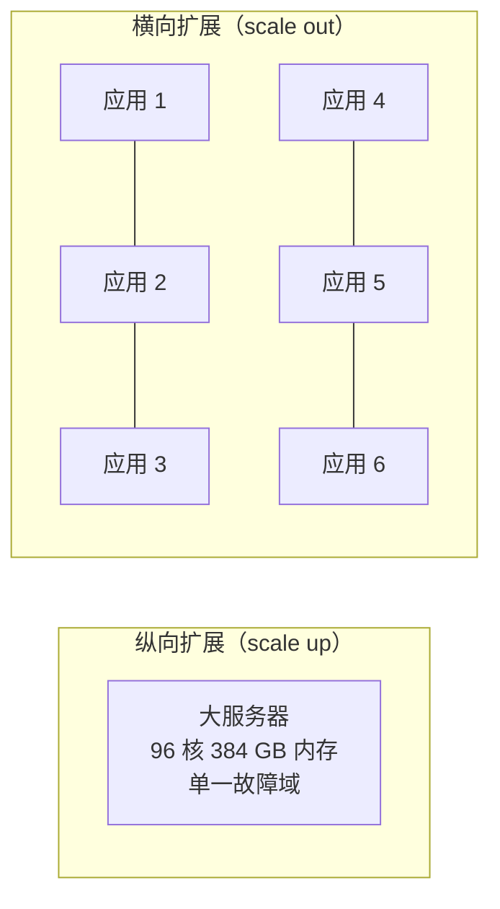
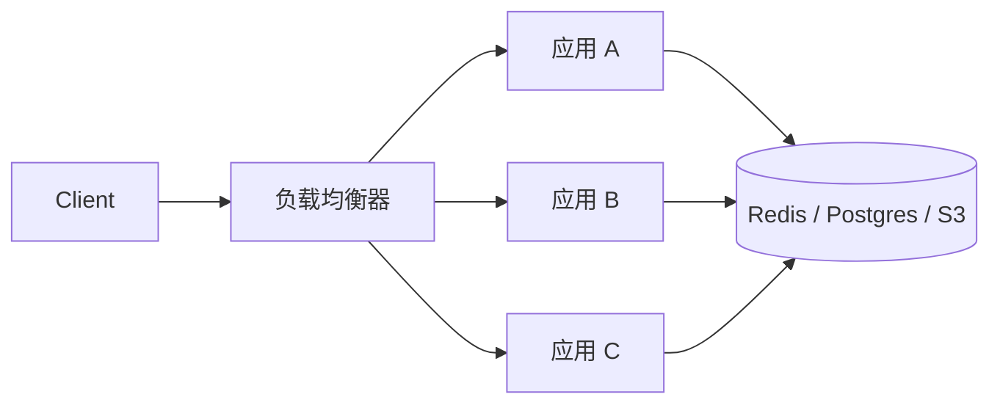
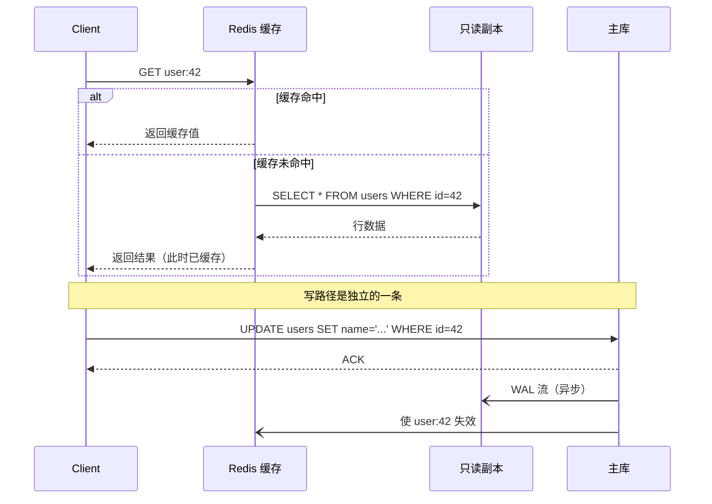
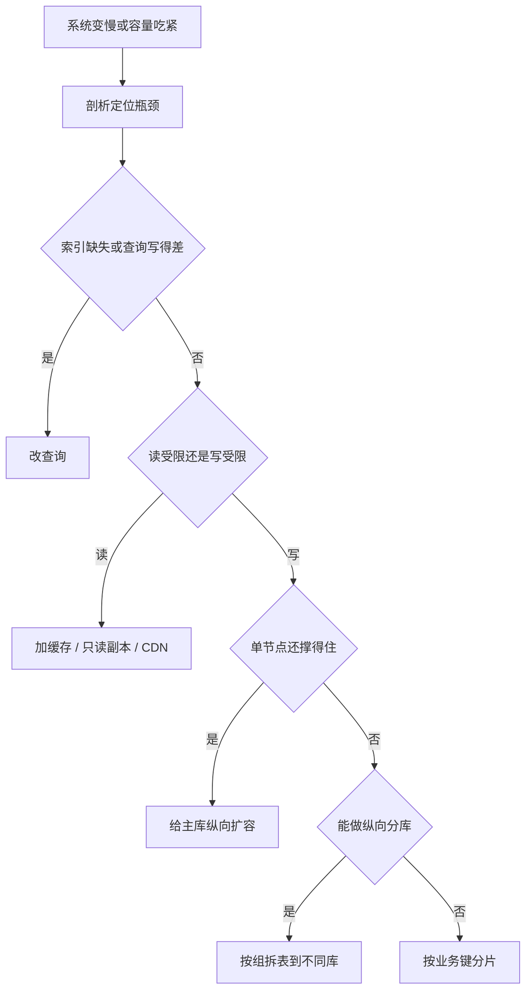

# 可扩展性：让系统在增长中不崩

> **TL;DR**: 可扩展性（scalability）指的是系统撑得住增长，而不用推倒重写。你手里有两根杠杆：纵向扩展（换更大的机器）和横向扩展（加更多机器）。纵向更省事，但会撞上一堵硬墙——AWS 最大的实例也只有 896 个 vCPU[^1]。横向拆掉了天花板，代价是必须做无状态设计，因为任何一个副本都得能处理任何请求[^2]。真正的功夫在于：知道下一步该拉哪根杠杆，也知道什么时候真正的解法是一条更快的查询，而不是更多机器。

## 学习目标

学完这一模块，你将能够：

- [ ] 用具体的成本和天花板数字讲清纵向扩展与横向扩展的区别
- [ ] 识别有状态服务，并知道怎么把它改成无状态
- [ ] 把读扩展（副本、缓存、CDN）与写扩展（分片、批处理）分开看
- [ ] 画出从 1 个用户到 10 亿用户的扩展路线图
- [ ] 判断哪些场景下扩展是错的、做性能剖析才是对的
- [ ] 说明 Shopify、Figma 和 Notion 各自出于什么理由选择了不同的扩展策略

## 直觉理解

想象你开了一家咖啡店。一个咖啡师每小时服务 30 位客人。客流翻倍了。你有两个选择：请一个手法更快、出杯时间减半的咖啡师（纵向扩展），或者再招一个咖啡师（横向扩展）。

快手咖啡师时薪更高，体能有上限，而且她一旦请病假，你就一个客人都服务不了。两个普通咖啡师单位产出更便宜，能吸收更长的排队，走掉一个还能继续营业。但两个咖啡师就需要一套协作机制：下一单谁接？意式咖啡机怎么共用？两人给客人的菜单说法不一致怎么办？

这套协作机制就是横向扩展的价码。你付的是复杂度，不是硬件。每个真实系统都会走到这个岔路口。可扩展性这门手艺，就是知道下一步该拉哪根杠杆，同样重要的是，知道什么时候真正的解法是改配方（补一个索引、改一条烂查询、砍掉一个本不该做的功能），而不是再招咖啡师。

## 原理

### 纵向扩展与横向扩展

**纵向扩展（scale up）**指把负载放到一台更强的机器上跑。代码一行都不用改。Stack Overflow 整个问答网络跑在 11 台 Web 服务器上（9 台主力），背后是配着 384 GB 内存和 4 TB PCIe SSD 的 SQL Server 机器，每天处理 2.09 亿次 HTTP 请求和 58 亿次 Redis 操作[^3]。这是教科书式的纵向扩展，而且管用了十多年。

**横向扩展（scale out）**指把负载并行分散到更多机器上。你的代码必须能应对并发、部分失败和分布式状态。但每多一台机器，单价一样，而且没有上限。

在 `m7i` 这类通用型 AWS EC2 家族内部，从最小实例到最大实例，单 vCPU 成本基本持平[^4]。在甜点区间里，纵向扩展不会额外罚你钱。但最大的高内存实例（U7i 家族，896 个 vCPU、32 TiB 内存）是给 SAP HANA 这类负载准备的特种 SKU，单 vCPU 价格明显高于通用型[^1][^5]。价格曲线拐弯的地方，恰好就是你最需要它的地方。

天花板以三种形式出现：

1. **物理极限。** 你买不到一万核的机器。最大的实例到 896 个 vCPU 就到顶了[^1]。
2. **爆炸半径。** 一台大机器挂掉，100% 的流量跟着没。十台小机器挂一台，损失 10%。
3. **发布风险。** 重启一台纵向巨兽让人心惊胆战。重启一百个小副本中的一个，是日常操作。

*纵向把负载压在一个故障域里；横向把它摊到许多故障域上，代价是协调成本。*

> [!TIP]
> 先纵向，不得不用时再横向。过早横向扩展是早期系统最常见、也最昂贵的错误之一。Figma 在 2020 到 2024 年间，靠纵向扩展、缓存和纵向分库分表，把数据库栈做大了近 100 倍，之后才上线第一个横向分片[^6]。

### 无状态与有状态服务

**无状态（stateless）**服务在两次请求之间不保留任何与特定客户端相关的信息。任何副本都能处理任何请求。Twelve-Factor App 说得很直白：“任何需要持久化的数据都必须存到有状态的后端服务里，通常就是数据库”；会话保持（sticky session）“违反 twelve-factor，永远不该使用，也不该依赖”[^2]。

**有状态（stateful）**服务会记住客户端的某些东西，或者持有一片数据的分区。数据库主库持有写入日志。Kafka broker 持有自己的分区。WebSocket 网关持有与浏览器之间的那条 TCP 连接。

*无状态副本共用一个后端存储；任何副本都能服务任何请求，所以加容量就等于加一个进程。*

在 Kubernetes 里，这条分界线落在两种工作负载资源上。`Deployment` 把 Pod 当作可互换的（无状态）。`StatefulSet` 给每个 Pod 一个稳定的网络标识，以及一个跟着它跨重调度迁移的持久卷，这正是数据库、broker 和分布式 KV 存储需要的能力[^7]。

把服务改成无状态，通常只是把状态搬出去：

- **HTTP 会话**放进 Redis，或者放进签名 Cookie（JWT）。
- **进程内缓存**变成共享缓存（Redis、Memcached）。
- **后台任务状态**搬进队列（SQS、Kafka）或数据库。
- **文件上传**落到对象存储（S3），不落本地磁盘。

> [!IMPORTANT]
> 规则是：让默认路径无状态。把那些不得不有状态的组件（数据库、broker、网关）收拢到少量命名清晰的服务里，集中精力把它们想清楚。

### 读侧扩展与写侧扩展

大多数系统是读多写少。信息流、商品目录、个人主页：读的次数比写多出 10 倍到 10000 倍。这种不对称让你能给两条路径用完全不同的工具。

**读扩展**很直接，因为读是幂等的，可以缓存、可以复制：

- **副本。** 主库把预写日志（WAL）流给从库。读吞吐随副本数线性增长[^8]。
- **缓存。** Redis 或 Memcached 挡在前面，吸收最热的那 20% 键。Stack Overflow 的 Redis 集群每天处理 58 亿次操作，单实例 CPU 占用不到 2%[^3]。
- **CDN。** 把静态内容和可边缘缓存的内容推到离读者更近的地方。Shopify 在 2024 年黑五期间，通过边缘层每分钟推 12 TB[^9]。
- **CQRS。** 把写模型与一个或多个读模型拆开，各自针对自己的查询模式优化。

**写扩展**很难，因为写必须落到某个权威节点上：

- **分片。** 按某个键切分数据集，让不同的写落到不同节点。写吞吐随分片数线性增长，但跨分片查询开始折磨人。Notion 把 Postgres 切成 480 个逻辑分片，分布在 32 个物理数据库上[^10]。Instagram 把 13 位分片 ID 打进每个 64 位主键里，路由时完全不需要外部查表[^11]。
- **批处理。** 把写先攒在 Kafka 或队列里，再批量落库。吞吐上去了，端到端延迟也上去了。
- **LSM 树存储。** ScyllaDB、Cassandra 这类引擎把写先吃进 memtable，再把有序文件刷到磁盘。Discord 从 177 个 Cassandra 节点迁到 72 个 ScyllaDB 节点，同时把 P99 长尾延迟从 40-125 ms 压到 15 ms[^12]。

*读请求经缓存和副本扇出；写请求经主库串行处理，再触发异步复制和缓存失效。*

> [!NOTE]
> 只读副本与主库是最终一致的，通常落后几毫秒。用户在落后的副本上读自己刚写的东西，可能读不到。解法是：把刚写过数据的用户固定路由到主库几秒钟，之后再放回副本[^8]。

### 扩展路线图

真实系统不会一夜之间从一台服务器跳到全球分片集群。Stack Overflow、Shopify、Figma 和 Notion 身上看到的共同规律是分阶段推进，每一步换来 2 到 10 倍的空间：

1. **单机。** 一台应用服务器，一个数据库，都放在能买到的最大的实例上。这是起点。
2. **加缓存。** 数据库前面挡一层 Redis 或 Memcached，吸收重复读。
3. **加只读副本。** 把主库的 WAL 流给从库，读请求走那边。
4. **加 CDN。** 把静态资源和可边缘缓存的 API 响应推到边缘。
5. **纵向分库。** 把表按组迁到专属数据库上（Figma 从 1 个 RDS 实例变成 12 个纵向分区，在分片之前多撑了好几年[^6]）。
6. **横向分片。** 把写入量最大的表按业务上合适的键切开。这是最后的选项。

Shopify 到 2015 年就已经在跑分片的 MySQL 了，却在 2016 年才引入 pods（相互隔离的数据存储切片），因为他们意识到任何一个分片挂掉，都会让对应操作在整个平台上不可用[^13]。Notion 一直用 Amazon RDS 上的单台“壮硕 Postgres”撑到 2021 年，最后之所以分片，是因为 Postgres 的 VACUUM 卡顿威胁到事务 ID 回绕[^10]。

*在加基础设施之前，先找便宜的解法。先扩读，再扩写。分片放最后。*

### 何时扩展是错误答案

有时候正确的动作是把问题变小，而不是把基础设施变大。

- **改查询。** 缺一个索引，能把 100 ms 的查询变成 10 秒。加副本只会把慢查询复制更多份，不会变快。跑 `EXPLAIN ANALYZE` 之前，别急着跑 Terraform。
- **改算法。** 对 100 万个元素做 O(n^2) 的循环是 10^12 次操作，O(n log n) 是 2 * 10^7。5 万倍的差距，堆多少硬件都填不平。
- **改访问模式。** N+1 查询问题（本该一次 join 搞定，却发了 100 次 ORM 查询）不是换个更大的数据库能解决的。
- **主动丢弃（load shedding）。** 接不住、来不及服务的请求就直接拒绝，别排队排到整个系统崩掉。AWS 的 Builders' Library 把 load shedding 列为过载时的第一道防线，因为重试会层层堆积，形成正反馈把问题放大[^14]。
- **质疑云账单。** 37signals 2022 年在 AWS 上花了 320 万美元[^15]。到 2024 年，他们迁出云省下了近 200 万美元[^16]。如果你的负载稳定可预测，最便宜的扩展动作可能就是把硬件买回来。

## 真实案例

### Figma 从单实例 Postgres 走向横向分片

Figma 的数据库流量大约每年涨 3 倍，整个数据库栈在 2020 到 2024 年间涨了近 100 倍[^6][^17]。他们不是第一天就分片的。他们先把所有更简单的路走完了。

**第一阶段：纵向扩展（2020 年）。** 一台 AWS 上最大物理规格的 RDS Postgres 实例。高峰期 CPU 打到 65%[^17]。零代码改动。

**第二阶段：纵向分库（2022 年）。** 把相关的表按组（“Figma 文件”、“组织”、“评论”）迁到各自的物理数据库上。从 1 个库变成 12 个纵向分区。配合缓存和只读副本，这套栈在 2020 到 2024 年间长了近 100 倍，应用层的分片逻辑一行没动[^6]。

**第三阶段：横向分片（2023 年）。** 一个叫 DBProxy 的 Go 服务挡在应用和 PgBouncer 之间，把 SQL 解析成 AST，取出分片键（UserID、FileID 或 OrgID），路由到正确的物理 Postgres[^6]。他们评估过 CockroachDB、TiDB、Spanner 和 Vitess，全部否掉了，理由是时间压力很紧的情况下，“我们得从零重建自己的领域经验”[^6]。

关键的工程决策：

- **不强求统一分片键。** 不同的表组用不同的键分片，靠 “colos”（共享同一分片键的表放在一起）组织[^6]。
- **逻辑分片用 Postgres 视图实现。** 每个逻辑分片是物理表上的一层视图，所以上线可以回滚，回滚粒度到功能开关[^6]。
- **第一张分片表花了 9 个月。** 分片的工程成本是真实存在的。Figma 第一张横向分片的表端到端做了 9 个月，期间主库只有 10 秒的部分可用性受影响[^6]。

教训是：把纵向扩展、纵向分库、缓存都用到尽头，再去分片。每一级都比下一级更便宜、风险更低。

## 权衡

这些杠杆不是让你挑一个的备选项，而是沿扩展路线图依次登上的台阶。把它当成**什么时候该动哪根杠杆**的参照，而不是一份选单。

| 杠杆 | 收益 | 代价 | 什么时候用 |
|-------|-------|-------|----------------------|
| 修瓶颈（先剖析） | 通常免费；能放大后面每一个杠杆 | 需要剖析能力；有时单靠它不够 | 永远排第一，在任何基础设施改动之前 |
| 纵向扩展 | 零代码改动，运维简单，见效最快 | 天花板固定（AWS U7i 约 896 个 vCPU），单一故障域，顶部单 vCPU 有溢价 | 默认的第一步基础设施动作；有状态数据库；短期救火 |
| 缓存（Redis/Memcached） | 延迟降几个数量级；吸收热键 | 缓存失效难做；有陈旧窗口；有缓存击穿风险 | 任何读多、查询重复或读幂等的路径 |
| 只读副本 | 读能力线性扩展；地理就近 | 复制延迟；不增加写容量 | 读多且能容忍几秒陈旧数据的负载；在缓存之后 |
| CDN / 边缘缓存 | 全球用户延迟都低；吸收静态流量 | 缓存失效存在竞态；TLS 在边缘终结 | 任何对公网提供静态或可边缘缓存资源的系统 |
| 横向扩展（无状态层） | 无上限；单位成本低；容错 | 需要无状态设计；每请求多一跳网络；引入分布式故障模式 | 单机已经打满的无状态应用层 |
| 纵向分库 | 简单、渐进、可回滚 | 有上限（最小单位是一张表）；救不了单张热表 | 增长中等、schema 天然能按表组拆开的场景；在分片之前 |
| 分片 | 写能力线性扩展；热点分片相互隔离 | 跨分片查询难写；再平衡复杂；几个月的工程量 | 写多且数据集超出单节点上限的负载 |

上表的顺序就是本章推荐的施用顺序：先剖析，再扩容，然后吸收读（缓存、副本、CDN），接着横向扩无状态层，再分库，最后分片。同一套推进过程在图解形式下见本章前面的决策流程图。

## 常见陷阱

> [!WARNING]
> **用加副本解决写瓶颈。** 副本扩的是读，不是写。每次写仍然要经过主库串行处理，再通过 WAL 流给每个副本。副本越多，主库开销越大，写容量一点没涨[^8]。Notion 在分片之前撞的就是这堵墙[^10]。

> [!WARNING]
> **默认开会话保持。** 会话保持把用户钉在某台特定服务器上。发布期间那台机器一挂，用户的会话就没了。Twelve-Factor App 明确禁止这么做[^2]。把会话状态搬到 Redis，让服务真正无状态。

> [!WARNING]
> **过早分片。** 分片需要跨分片查询规划、分布式事务和再平衡工具，这些东西成熟起来要几个月到几年。Figma 第一张分片表做了 9 个月[^6]。Notion 的警告是：“过早分片会带来更重的维护负担、应用层代码里凭空多出的约束，以及架构上的路径依赖”[^10]。分片放最后，别放最前。

> [!CAUTION]
> **对有状态服务做横向扩展却不上主节点选举。** 两个数据库主库各自为政就是脑裂，会写坏数据。如果确实需要多写，用一个本来就为此设计的系统（DynamoDB、Cassandra）。别硬往 Postgres 上焊[^7]。

> [!WARNING]
> **只按峰值做容量规划。** 按黑五峰值配的系统，一年里其余时间要花 10 倍的钱。弹性负载用自动伸缩，基线用 Reserved Instances 或 Savings Plans（相对按需最高省 72%）[^18]。Shopify 的做法是：全年维持一条基线，加上五次分阶段压测，在 BFCM 临近时逐级抬升容量[^9]。

## 练习

**设计挑战**：你在运营一个 B2B SaaS API，服务 1000 家企业客户。流量平均 5000 RPS，峰值 20000 RPS，70% 是读。目前是一台 PostgreSQL RDS `db.r6i.4xlarge`（16 vCPU、128 GB 内存），加四台挂在 ALB 后面的无状态 API 服务器。峰值时数据库 CPU 80%，API CPU 40%。你预计明年增长 4 倍。请规划扩展路线图。

提示

瓶颈在数据库，不在应用层。但“扩数据库”有三种做法：纵向、只读副本、分片。哪一种能用最小的运维风险解决这个具体问题（70% 读、峰值 CPU 80%）？

参考答案

**第 0 步：剖析。** 动基础设施之前，先找出数据库 CPU 花在哪。`pg_stat_statements` 能列出最耗时的查询。先修缺失索引和 N+1 模式。通常光这一步就白赚 2 倍余量，零基础设施成本。

**第 1 步：只读副本。** 负载 70% 是读。加 2 个只读副本，把读查询导过去，主库 CPU 大致减半，为读路径的 4 倍增长腾出空间。除了“读己之写”的流程（把这些会话固定到主库 5 秒），其余都可以接受复制延迟。

**第 2 步：给主库纵向扩容。** 从 `r6i.4xlarge`（16 vCPU）换到 `r6i.8xlarge`（32 vCPU）。改一次配置，一次故障切换窗口，写余量翻倍。运维上比做分片便宜太多。

**第 3 步：缓存热点读。** 在最热的接口前面（账号查询、功能开关、限流计数器）加 Redis。单个 Redis 节点每秒能扛 10 万次以上的 GET，直接把负载从数据库上搬走。

**第 4 步：应用层横向扩。** API CPU 一旦超过 70%，就加无状态 API 服务器。先确认应用真的无状态（没有进程内缓存、没有本地文件、没有会话保持）。按 CPU 或请求延迟做自动伸缩。

**第 5 步：这时候才考虑分片。** 增长 4 倍后峰值大约 8 万 RPS。如果副本、纵向扩容和缓存都做完，主库还是顶不住，再考虑按 `customer_id` 做多租户分片。这是一个季度的工程量，留到你已经证明简单办法不够用的时候再动。

**你没做的事：** 用 Rust 重写应用、上微服务、换分布式数据库。扩展通常不需要重写。它需要一个瓶颈修复，然后一个副本，然后一台更大的机器，然后缓存，然后（很少见地）一个分片。

## 要点回顾

- 纵向扩展是轻松的第一步；横向扩展是任何持续增长的系统必然的终局。
- 无状态是让横向扩展变便宜的前提。把状态推进数据库、缓存、队列或对象存储，应用层就变成了可丢弃的。
- 读扩展和写扩展是两个不同的问题，用不同的工具解决。别混为一谈。
- 扩展之前，先确认真正的解法是不是一条更快的查询、一层缺失的缓存，或者一个可以砍掉的功能。
- Shopify 在 2025 年 BFCM 期间靠单体应用撑起每分钟 4.89 亿次边缘请求（四天成交 146 亿美元），办法是把故障域隔离进 pods，而不是拆成微服务[^19]。
- Figma 在第一个横向分片落地之前，靠纵向扩展、缓存和纵向分库把数据库栈做大了近 100 倍，而且第一个分片本身就花了 9 个月[^6]。
- 真实系统会把这些策略混着用。目标不是纯粹，而是可用性、延迟和成本。

## 延伸阅读

- [Stack Overflow: The Architecture, 2016 Edition](https://nickcraver.com/blog/2016/02/17/stack-overflow-the-architecture-2016-edition/) - Nick Craver 讲纵向扩展为什么能撑十多年；附每台机器的规格和利用率曲线。
- [A Pods Architecture to Allow Shopify to Scale](https://shopify.engineering/a-pods-architecture-to-allow-shopify-to-scale) - Xavier Denis 讲 Shopify 隔离爆炸半径背后的模式，以及分片之后跨分片故障如何逼他们把每个分片彻底隔离。
- [How We Prepare Shopify for BFCM (2025)](https://shopify.engineering/bfcm-readiness-2025) - 全年压测纪律，附 2024/2025 的规模数字；容量规划的金标准。
- [How Figma's Databases Team Lived to Tell the Scale](https://www.figma.com/blog/how-figmas-databases-team-lived-to-tell-the-scale/) - Sammy Steele 关于 9 个月横向分片的复盘，包括 DBProxy、colos，以及为什么最终留在 Postgres 上。
- [Lessons Learned from Sharding Postgres at Notion](https://www.notion.com/blog/sharding-postgres-at-notion) - 480 个逻辑分片的决策、为什么这个数字好除，以及逼他们动手的 VACUUM 卡顿。
- [How Discord Stores Trillions of Messages](https://discord.com/blog/how-discord-stores-trillions-of-messages) - Bo Ingram 讲热分片、Rust 数据服务，以及把 P99 从 40-125 ms 降到 15 ms 的那次 Cassandra 到 ScyllaDB 迁移。
- [The Twelve-Factor App: Processes](https://12factor.net/processes) - 关于无状态、不共享进程的权威表述；五分钟能读完。
- [Using Load Shedding to Avoid Overload (Amazon Builders' Library)](https://aws.amazon.com/builders-library/using-load-shedding-to-avoid-overload/) - David Yanacek 讲过载为什么自己放大自己，以及怎么在级联之前掐断这个反馈环。
- [Sharding and IDs at Instagram](https://web.archive.org/web/20210112134155/https://instagram-engineering.com/sharding-ids-at-instagram-1cf5a71e5a5c) - 64 位主键里编码分片的模式，让任何应用服务器无需外部查表就能路由。

## 记忆卡片

**Q:** 云上纵向扩展的实际天花板是什么？
**A:** 物理硬件极限（AWS 最大实例到 896 个 vCPU 就到顶）、爆炸半径（一台机器就是一个故障域），以及成本（最大的高内存实例单 vCPU 价格明显高于通用型）。

**Q:** 为什么无状态是横向扩展便宜的前提？
**A:** 任何副本都能处理任何请求，所以加机器减机器都是小事。没有会话保持，没有会话迁移，节点挂掉也不需要再平衡。

**Q:** 为什么只读副本救不了写瓶颈？
**A:** 每次写仍然要过主库，再复制给所有从库。加副本只会增加主库开销（更多 WAL 流），不会增加写容量。

**Q:** 说出三种“把问题变小”而不是横向扩的办法。
**A:** 补一个缺失的索引，修掉 N+1 查询模式，在热读前面加缓存。另外还有：用限流主动丢弃，以及删掉你不需要的功能。

**Q:** Shopify 架构里的 “pod” 是什么？
**A:** 一片自包含的有状态基础设施（MySQL 分片、Redis、Memcached），隔离一组商户。无状态 worker 由所有 pod 共享，按 Sorting Hat 打上的请求头路由。

**Q:** 什么时候该给数据库分片？
**A:** 在纵向扩展、只读副本、缓存、纵向分库和查询优化都用到尽头之后。分片是最后手段，因为它带来跨分片查询的复杂度和再平衡风险。

**Q:** 读扩展和写扩展的区别在哪？
**A:** 读扩展用复制、缓存和 CDN，因为读是幂等的。写扩展需要分片或批处理，因为写必须经过权威节点串行处理。

**Q:** Figma 怎么避免过早分片？
**A:** 2020 到 2024 年间，他们靠纵向扩展、副本、缓存和纵向分库（从 1 个库到 12 个纵向分区）把规模做大了近 100 倍，第一个横向分片才落地；而第一个分片本身就做了 9 个月。

**Q:** 是什么触发了 Notion 在 2021 年做 Postgres 分片？
**A:** 表膨胀导致的 Postgres VACUUM 卡顿，威胁到 20 亿 XID 边界上的事务 ID 回绕。不分片的话，Postgres 会为了保护数据完整性拒绝所有写入。

**Q:** Shopify 为什么在已经分片 MySQL 之后还要引入 pods？
**A:** 2015 年分片 MySQL 之后，任何一个分片故障都会让对应操作在整个平台上不可用。pods 为每个分片复制整套有状态栈，这样一个 pod 故障只影响它自己的商户。

**Q:** 37signals 迁出云省了多少钱？
**A:** 每年近 200 万美元。他们 2022 年在 AWS 上花了 320 万美元；同样负载的自建副本第一年就把大部分成本消掉了。

## 参考文献

[^1]: Jeff Barr, “Amazon EC2 high memory U7i Instances for large in-memory databases”, AWS News Blog, May 28, 2024. https://aws.amazon.com/blogs/aws/amazon-ec2-high-memory-u7i-instances-for-large-in-memory-databases/
[^2]: Adam Wiggins, “The Twelve-Factor App: VI. Processes”, 2017. https://12factor.net/processes
[^3]: Nick Craver, “Stack Overflow: The Architecture - 2016 Edition”, Feb 17, 2016. https://nickcraver.com/blog/2016/02/17/stack-overflow-the-architecture-2016-edition/
[^4]: Economize Cloud, “AWS m7i.large pricing”. https://www.economize.cloud/resources/aws/pricing/ec2/m7i.large/
[^5]: AWS, “Introducing Amazon EC2 High Memory U7i Instances”, What's New, May 2024. https://aws.amazon.com/about-aws/whats-new/2024/05/amazon-ec2-high-memory-u7i-instances
[^6]: Sammy Steele, “How Figma's databases team lived to tell the scale”, Figma blog, Mar 14, 2024. https://www.figma.com/blog/how-figmas-databases-team-lived-to-tell-the-scale/
[^7]: Kubernetes Authors, “StatefulSets”, Kubernetes documentation. https://kubernetes.io/docs/concepts/workloads/controllers/statefulset/
[^8]: AWS, “Troubleshoot replication lags in RDS for PostgreSQL”. https://aws.amazon.com/premiumsupport/knowledge-center/rds-postgresql-replication-lag/
[^9]: Kyle Petroski and Matthew Frail, “How we prepare Shopify for BFCM”, Shopify Engineering, Nov 20, 2025. https://shopify.engineering/bfcm-readiness-2025
[^10]: Notion Engineering, “Lessons learned from sharding Postgres at Notion”, Oct 2021. https://www.notion.com/blog/sharding-postgres-at-notion
[^11]: Instagram Engineering, “Sharding and IDs at Instagram”, Dec 30, 2012. https://web.archive.org/web/20210112134155/https://instagram-engineering.com/sharding-ids-at-instagram-1cf5a71e5a5c
[^12]: Bo Ingram, “How Discord Stores Trillions of Messages”, Discord Engineering, Mar 6, 2023. https://discord.com/blog/how-discord-stores-trillions-of-messages
[^13]: Xavier Denis, “A Pods Architecture To Allow Shopify To Scale”, Shopify Engineering, Mar 2, 2018. https://shopify.engineering/a-pods-architecture-to-allow-shopify-to-scale
[^14]: David Yanacek, “Using load shedding to avoid overload”, Amazon Builders' Library. https://aws.amazon.com/builders-library/using-load-shedding-to-avoid-overload/
[^15]: David Heinemeier Hansson, “We stand to save $7m over five years from our cloud exit”, 37signals / HEY blog, Feb 21, 2023. https://world.hey.com/dhh/we-stand-to-save-7m-over-five-years-from-our-cloud-exit-53996caa
[^16]: Georgia Butler, “37signals claims it saved almost $2m last year from cloud repatriation”, Data Center Dynamics, Oct 19, 2024. https://www.datacenterdynamics.com/en/news/37signals-claims-it-saved-almost-2m-last-year-from-cloud-repatriation/
[^17]: Tim Liang, “The growing pains of database architecture”, Figma blog, Apr 4, 2023. https://www.figma.com/blog/how-figma-scaled-to-multiple-databases/
[^18]: AWS, “EC2 Reserved Instances” and “EC2 Spot Instances”. https://aws.amazon.com/ec2/pricing/reserved-instances/
[^19]: Shopify, “Shopify Merchants Achieve Record-Breaking $14.6 Billion in Black Friday-Cyber Monday Sales”, Shopify Investor Press Release, Dec 2, 2025. https://www.shopify.com/investors/press-releases/shopify-merchants-achieve-record-breaking-146-billion-black
