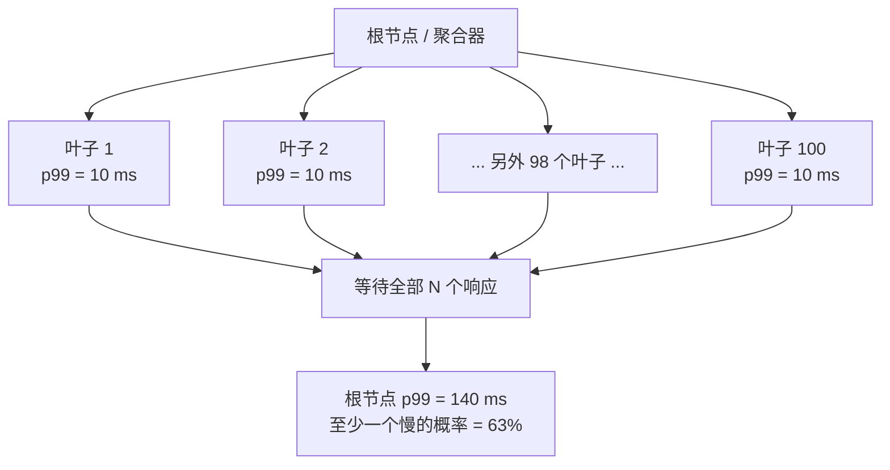
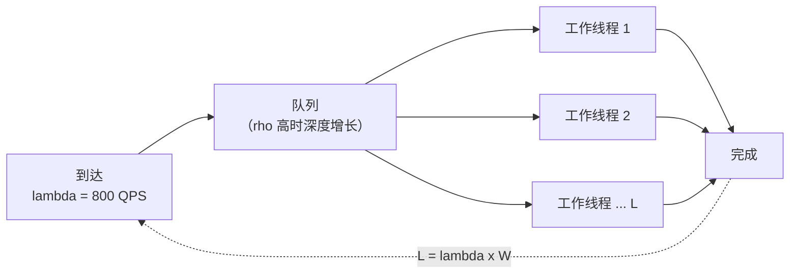
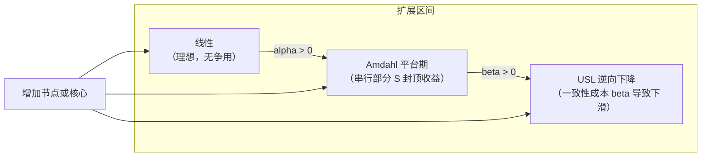
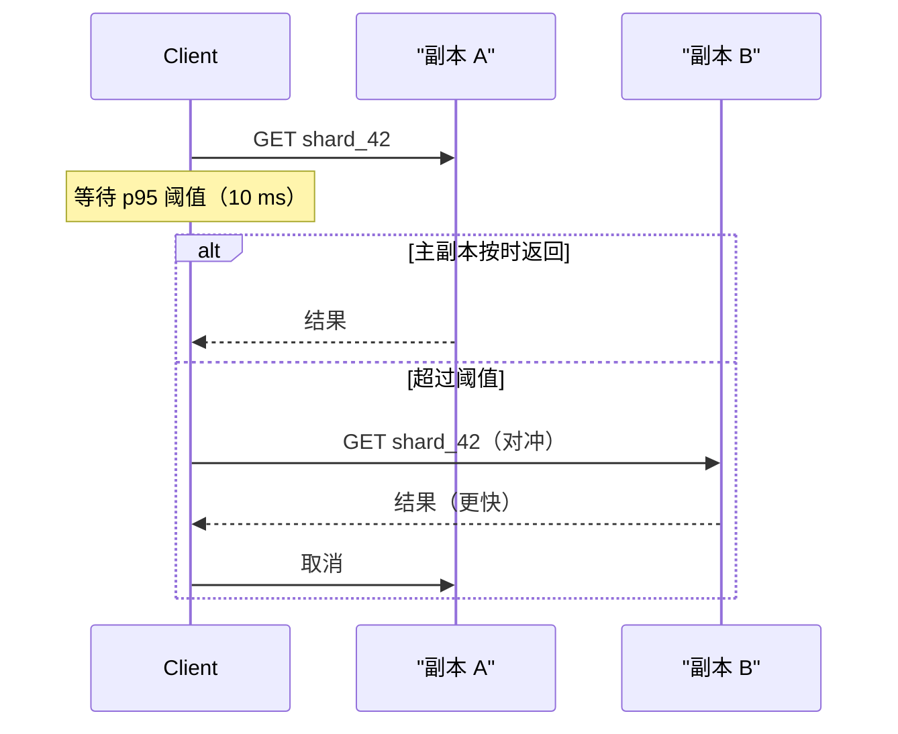

# 延迟与吞吐量：两个真正重要的数字

> **TL;DR**: 延迟是一次请求要花多久，吞吐量是你每秒能处理多少请求。两者通过利特尔定律（L = lambda * W）互相牵制，而平均值会骗人：一次 100 路扇出，每次请求都有 63% 的概率至少撞上一个 p99 离群值 [^1]。Google 验证过，多 400 ms 延迟会让搜索量下降 0.59%，而且延迟撤掉之后这个影响至少持续了 5 周 [^2]；Amazon 据称发现每多 100 ms 延迟，销售额大约掉 1% [^3]。要测分位数，别测均值。延迟预算要端到端地做。长尾要对冲。

## 学习目标

学完这一模块，你将能够：

- [ ] 定义延迟与吞吐量，并解释两者如何通过利特尔定律耦合
- [ ] 背下 Jeff Dean 的延迟层级，从 L1 缓存（0.5 ns）到跨洲往返（150 ms）
- [ ] 解释 p99 为什么比均值更重要，并算出扇出下的长尾概率
- [ ] 在压测中识别协调遗漏，并说出能避开它的工具
- [ ] 用利特尔定律给线程池、连接池和容量定容
- [ ] 描述通用可扩展性定律，并判断什么时候加机器反而有害

## 直觉理解

想象一个高速收费站。**延迟**是一辆车通过要花多久：停靠、缴费、开走。**吞吐量**是所有车道每小时能过多少辆车。

加车道（并行）提高吞吐量，但不改变单车延迟。让每笔交易更快（刷卡代替现金）既降延迟又提吞吐量。可要是在收费站后面加一道强制检查，每辆车的延迟都会变高，哪怕吞吐量一点没变。

陷阱在这儿。假设 99% 的车 5 秒通过，1% 被拦下来做 2 分钟检查。“平均”是 6.2 秒。这个数字谁也描述不了：快的车更快，被拦的车慢得多。而如果你凑一支 20 辆车的车队、要求同时到达，至少一辆被拦的概率是 1 - 0.99^20 = 18%。车队的实际速度由最慢那辆车决定。这就是扇出架构里的长尾放大（tail latency amplification），也是本章的核心问题。

## 原理

### 延迟与吞吐量的区别以及队列的位置

**延迟（latency）** 是单个请求的耗时，在一条时间线上从头量到尾。单位：纳秒、微秒、毫秒、秒。

**吞吐量（throughput）** 是完成工作的速率。单位：每秒查询数（QPS）、每秒请求数（RPS）、每秒字节数。

两者耦合，但不等价。一个延迟 100 ms、只有 1 个 worker 的服务能扛 10 QPS。并行加 100 个 worker：延迟还是 100 ms，吞吐变成 1,000 QPS。但只要有共享资源被打满，再加 worker 就只是让排队变长，排队抬高延迟，吞吐量走平 [^4]。

业务侧的账很具体。Google 2009 年的延迟注入实验显示，多 400 ms 延迟让每人搜索量下降 0.59%；被暴露在延迟下六周的用户，在延迟撤掉后的五周里平均搜索量仍然少 0.21% [^2]。Greg Linden 记录过，Amazon 的 A/B 测试发现哪怕 100 ms 这样小的延迟也会造成可观且昂贵的收入下滑 [^3][^5]。慢不是临时状态。提速修好很久之后，收入的伤口还在。

### 看分位数而不是平均值

平均值是你算的第一个指标，也是你最该最后才信的指标。规模化系统的延迟分布是重尾且多峰的：绝大多数请求很快，很小的比例慢到灾难级。原因包括 GC 停顿、SSD 垃圾回收（能让读延迟飙 100 倍）、后台日志压缩、热降频，以及共享资源争用 [^1]。

Gil Tene 讲了十多年：对延迟数据来说，均值和标准差“往好里说没用，往坏里说极具误导”，因为这类数据根本不满足这两个统计量所要求的正态分布假设 [^6]。

正确的工具是分位数：

- **p50（中位数）：** 一半请求更快，一半更慢。不错的健康信号。
- **p95：** 捕捉常见的慢情况（GC 小停顿、缓存未命中）。
- **p99：** 你的重度用户能感觉到的指标。他们的请求量足够大，会规律地撞上那百分之一的慢路径。
- **p99.9：** GC 大停顿、故障切换、超时、冷缓存都住在这里。

规模化之后，p99 并不罕见。一个页面扇出 100 个后端调用的用户，有 63% 的概率至少撞上一次 p99 事件：1 - 0.99^100 = 0.63 [^1]。聚合后的 p50 会逼近单机的 p99。Marc Brooker 对一个双峰服务（99% 的调用 10 ms，1% 是 100 ms）做的模拟显示，平均值不能准确描述任何一个真实请求 [^7]。

*在 100 个叶子的扇出里，最慢的那个后端决定了响应时间；63% 的请求至少撞上一个 p99 离群值，于是长尾成了典型体验。*

### 协调遗漏

协调遗漏（coordinated omission，CO）是一种测量误差：系统卡住的时候，压测工具就停发请求了，于是分位数被系统性地拉向乐观值，偏差可达几个数量级 [^6]。

设想一个系统平时 1 ms 响应，但周期性卡 100 秒。一个同步压测器要等上一个响应回来才发下一个，它记录到大约 100,000 条 1 ms 的结果和大约 1 条 100 秒的结果。它报告 p99 = 1 ms，而真实用户经历的 p99 大约是 50 秒 [^6]。

Tene 给的具体例子：一个 log4j2 基准报告 p99.99 是 16 微秒。修正 CO 之后，真实 p99.99 至少是 582 ms——35,000 倍的误差，起因是压测器“协同”绕过了 GC 停顿 [^6]。

**检测：** 压测过程中用 `kill -STOP` 手动把被测系统暂停几秒。如果报告的 p99 没变，说明这个工具存在 CO [^6]。

**缓解：** 用从计划发送时间而不是实际发送时间开始计时的压测工具。`wrk2` 是 `wrk` 的修正版，从源头避开 CO。HdrHistogram 提供 `recordValueWithExpectedInterval()`，用线性插值重建被漏掉的样本 [^8]。

> [!WARNING]
> **大多数压测工具默认在骗人。** Apache Bench、同步模式的 JMeter、朴素的 `wrk` 都存在协调遗漏。如果你的基准显示 p99 不到 10 ms，而生产环境是 500 ms，CO 很可能就是原因。永远用 `wrk2` 或异步压测器复验一遍。

### 利特尔定律与排队

利特尔定律（Little's Law）是容量规划里最有用的公式：

**L = lambda * W**

- **L** = 在途请求的平均数量
- **lambda** = 到达速率（每秒请求数）
- **W** = 每个请求在系统中平均停留的时间

它对任何稳定的排队系统都成立，跟到达分布、服务时间分布无关 [^9][^10]。Marc Brooker 称它是“分布式系统里最有用的叙事工具” [^9]。

**应用：**

- **线程池定容。** 1,000 QPS、50 ms 延迟意味着 L = 50 个并发请求。至少要 50 个 worker，再加冗余应付波动。
- **连接池定容。** 500 QPS、20 ms 数据库延迟，平均需要 L = 10 个并发数据库连接。池子按 2 到 3 倍配置以扛峰值。
- **事故复盘叙事。** “lambda 因为重试暴涨，W 因为争用变长，L 顶到连接池上限，请求开始无界排队” [^9]。

*利特尔定律把到达速率、在途工作和系统内停留时间串起来。池子定容直接由此推出：池子 >= L_peak，并留冗余。*

危险的那道边：利用率 rho = lambda / mu。rho = 0.5 时，期望队列深度是 1；rho = 0.99 时，是 99 [^4]。这条曲线是非线性的。平均利用率 80% 的系统看上去很健康；同一个系统到 95%，排队多 5 倍，长尾延迟肉眼可见地变差。80% 时“看着还行”的容量，在秒级突发里就可能被打满。

> [!TIP]
> 利特尔定律不告诉你负载下 W 会变成多少，它告诉你的是平衡态下的关系。一旦超载（rho >= 1），定律依然成立，只是 W 无界增长，然后告警电话就来了。

### 延迟层级

Peter Norvig 在 2002 年前后汇编了“每个程序员都应该知道的数字”；Jeff Dean 在斯坦福的演讲（2007、2012）里把它推广并更新。Colin Scott 维护了一个交互式可视化，把这些数字按年代建模 [^11]。把数量级刻进脑子：每跨 1,000 倍，设计就得换。

| 操作 | 延迟 | 相对 L1 |
|---|---|---|
| L1 缓存访问 | 0.5 ns | 1x |
| 互斥锁加锁/解锁 | 25 ns | 50x |
| 主内存访问 | 100 ns | 200x |
| 压缩 1 KB（Snappy） | 2 us | 4,000x |
| 通过 1 Gbps 网卡发送 1 KB | 10 us | 20,000x |
| NVMe SSD 随机读 4 KB | 16 us | 32,000x |
| 从内存顺序读取 1 MB | 250 us | 500,000x |
| 同机房内一次往返 | 500 us | 1,000,000x |
| 从 SSD 顺序读取 1 MB | 1 ms | 2,000,000x |
| HDD 寻道 | 10 ms | 20,000,000x |
| 从加州发包到荷兰再回加州 | 150 ms | 300,000,000x |

*来源：Norvig 的原始清单（2002）、Dean 2012 年斯坦福演讲 [^12]、Colin Scott 的交互模型 [^11]*

几条关键经验法则：

- **随机读上，内存比 NVMe 快约 100 倍。** 这就是缓存能起作用的原因。
- **机房内一次往返比一次内存访问慢 5,000 倍。** 跟本地计算比，每一跳网络都是天文数字。
- **跨洲比机房内慢 300 倍。** 物理规律：光在光纤里大约 200,000 km/s。光速这件事没法靠工程绕过去。

> [!NOTE]
> 相比 2002 年的原始数字，变化最大的是 NVMe。随机读 4 KB 从 SATA 时代的约 150 us 降到 NVMe 的 16 us，差不多是 10 倍提升 [^11]。现代设计请用 NVMe 那组数字。

### 吞吐量模式

需要更多吞吐量时，你有五个杠杆，每个都有延迟代价。

**批处理（batching）** 把每次调用的固定开销（TCP 握手、系统调用、加解密）摊到 N 条上。Kafka 的 `batch.size` 和数据库批量插入能把吞吐量提高 10 到 100 倍，但单请求延迟平均会恶化半个批次间隔。

**流水线化（pipelining）** 让请求发送和响应处理重叠，把 RTT 藏起来。HTTP/2 多路复用和 Redis pipelining 用的就是这一招。

**零拷贝 I/O**（Linux 的 `sendfile()`、`splice()`）在文件到 socket 的传输里省掉内核到用户态的内存拷贝。Nginx 的 `sendfile` 指令能让单台服务器以很低的 CPU 打满几十 Gbps 的网卡 [^13]。

**Amdahl 定律** 给并行收益封顶：加速比 = 1 / ((1-P) + P/N)，其中 P 是可并行部分，N 是处理器数量。95% 可并行的工作负载（串行部分 = 0.05），无论加多少核，上限都是 1/0.05 = 20 倍 [^14]。

**Gunther 的通用可扩展性定律（USL）** 在 Amdahl 之上多加了一个一致性项：C(N) = N / (1 + alpha*(N-1) + beta*N*(N-1))。alpha 衡量争用（抢共享资源导致的排队），beta 衡量一致性成本（跨节点同步状态的代价）。当 beta > 0 时存在峰值 Nmax = sqrt((1-alpha)/beta)，超过它再加容量反而降低吞吐 [^15][^16]。Gunther 在 2010 年 Velocity 演讲（后来以 arXiv:1105.4301 发表）里展示了 Memcached 在多核平台上的这种逆向扩展 [^16]。

*通用可扩展性定律给出三个区间：线性扩展、争用导致的平台期（Amdahl）、一致性导致的逆向下降。超过 Nmax 再加硬件，事情只会更糟。*

## 真实案例

### Google 搜索用对冲请求驯服长尾

Google 搜索是一个扇出系统。根服务器把用户查询分发给中间层，中间层再扇出到持有索引分片的叶子服务器。每个叶子搜自己的分片并返回 top-k 结果；中间层合并，根节点再合并一次。每一层都必须在严格的截止时间内完成 [^1]。

问题在于：100 台叶子服务器，即使每台单机的 p99 只有 10 ms，根节点等待所有叶子的 p99 也是 140 ms。最慢的 5% 叶子贡献了观测到的根 p99 的一半 [^1]。

**解法：对冲请求（hedged requests）。** 在 Google 那个跨 100 台服务器读 1,000 个 key 的 BigTable 基准里，不对冲时 p99.9 是 1,800 ms；延迟 10 ms（即 p95 阈值）后补发一个对冲请求，p99.9 降到 74 ms，而请求量只多了 2% [^1]。

*对冲请求：只有在主副本超过 p95 阈值之后，才向第二个副本补发一份。额外负载约 2% 到 5%，长尾压缩 10 到 25 倍。*

**其他缓解手段：**

- **绑定请求（tied requests）：** 两个副本同时收到读请求，谁先开始返回，另一个就中止。中位延迟降了 16%，p99.9 降了 40% [^1]。
- **够用就返回（good-enough results）：** 足够比例的叶子返回后就出结果。对典型查询来说，某个特定叶子恰好持有最佳结果的概率不到千分之一 [^1]。

DynamoDB 在另一个层面用了同样的哲学。他们 2022 年的 USENIX ATC 论文把“可预测性优先于效率”列为第一条设计原则：稳定的 p50/p99 比榨干利用率更重要 [^17]。2025 年 Prime Day 期间，DynamoDB 扛住每秒 1.51 亿次请求，1 KB 条目的延迟保持在个位数毫秒 [^20]（2021 年 Prime Day 是 8,920 万，数据出自最初那篇 USENIX 论文 [^17]）。

## 权衡

下面每一行针对的是不同的失效模式（容量不足、吞吐上限、p50 延迟、长尾延迟、网卡打满），所以它们不是可以互相替代的选项。这是一份“看到什么症状该抓哪个杠杆”的指南，按你观察到的现象组织。

| 症状 | 手段 | 对延迟的影响 | 对吞吐量的影响 | 注意事项 |
|---|---|---|---|---|
| 当前 rho 下容量不够 | 加副本 / 加 worker（用利特尔定律定容） | 中性，直到 USL 的一致性成本占主导 | 线性增长直到 Nmax | 只适用于无状态服务；过了 Nmax 加节点反而有害 [^15][^16] |
| 写入 / 生产端吞吐封顶 | 批处理请求 | 单请求变差（半个批次间隔） | 好 10 到 100 倍 | 抬高单次调用延迟；用户在同步等待时不适用 |
| 热点读的 p50 / p95 高 | 加缓存 | p50/p95 大幅改善 | 变好（后端命中减少） | 压不住长尾。GC 停顿、压缩、SSD 垃圾回收照样会尖峰 [^1] |
| 扇出读的 p99 / p99.9 高 | 对冲请求或绑定请求 | p99.9 压缩 10 到 25 倍 | 略差（多 2% 到 5% 负载） | 需要读幂等，且要有第二个能服务的副本 [^1] |
| 文件到 socket 传输打满网卡 | 零拷贝（`sendfile`、`splice`） | 中性 | 低 CPU 打满网卡 | 仅限文件到 socket 路径；对动态响应体没用 [^13] |

这里没有任何一行能替代另一行：缓存治不了长尾延迟，对冲救不了网卡打满，如果瓶颈是超过 Nmax 之后的 CPU 争用，批处理也提不高吞吐量。按症状选，别按偏好选。

## 常见陷阱

> [!WARNING]
> **只报均值。** 如果 p99 是 2 秒，“平均延迟 50 ms”毫无意义。Brooker 的模拟显示，双峰分布的平均值不能描述任何一个真实请求 [^7]。至少把 p50 和 p99 一起报。

> [!WARNING]
> **压测不做协调遗漏修正。** 你的压测工具报 p99 = 5 ms，生产环境是 500 ms。因为在卡顿期间工具停发了，最坏的那段延迟根本没进直方图。用 `wrk2`，别用 `wrk`；用带期望间隔修正的 HdrHistogram [^6][^8]。

> [!WARNING]
> **在扇出路径上忽略 p99.9。** 一个 20 个服务、等全部返回的扇出，P(至少一个慢) = 1 - 0.99^20 = 18%。差不多每 5 个请求就有 1 个踩到慢后端。要对冲、要把依赖做成可选的，或者减少扇出数量 [^1]。

> [!WARNING]
> **设超时时把 p99 当 p50 用。** 如果超时按 p99（200 ms）设，而下游卡住了，你会白烧 200 ms 的线程才放弃。超时应该按你能承受的延迟预算来设，而不是按你观测到的分布来设。从用户侧往回倒推预算。

> [!WARNING]
> **重试风暴把长尾放大成故障。** 一次短暂变慢触发重试，重试放大负载，负载又让系统回不了血。5 层调用栈、每层 3 次重试，对末端数据库的负载放大是 3^5 = 243 倍 [^18]。要用带全抖动的指数退避，并且给重试预算封顶。

> [!CAUTION]
> **跨实例对分位数取平均。** 在多个 Prometheus 实例上算 `avg(http_request_duration_seconds{quantile="0.95"})`，得到的数字不是合并分布的 p95，它在数学上没有意义 [^19]。要用直方图，用 `histogram_quantile(0.95, sum by (le) (rate(..._bucket[5m])))` 聚合。

## 练习

> **Design Challenge**: 你的产品看板 p95 渲染 1.2 秒，p99 是 4.5 秒。链路追踪显示：CDN + TLS 50 ms，API 网关 p95 200 ms / p99 300 ms，后端 p95 700 ms / p99 3.5 秒（后端扇出到 20 个微服务并等全部返回）。问题出在哪，你最有杀伤力的三个修法是什么？

Hint

20 个服务的扇出主导了 p99。用 1 - (1 - p_individual)^N 这个公式算至少撞上一个慢后端的概率。然后套用《The Tail at Scale》里的三个缓解手段。

Solution

**诊断。** 20 路扇出是 p99 的主要来源。如果每个微服务 p99 = 500 ms，等全部返回的 20 路扇出撞上至少一个慢的概率是 1 - 0.99^20 = 18%。差不多每 5 个请求就有 1 个踩到慢后端。实测 3.5 秒的 p99 印证了这一点：你被每个请求里最慢的那个微服务拖住了。

**修法一：关键读路径用对冲请求。** 对长尾贡献最大的 3 到 5 个微服务，超过 p95 阈值（比如 200 ms）就向第二个副本补发一份请求，取消慢的那份。Dean 和 Barroso 证明这能把 p99.9 从 1,800 ms 压到 74 ms，只多 2% 负载 [^1]。预期 p99 从 3.5 秒降到 1 秒以内。

**修法二：让一部分依赖变成可选的。** 不是每个挂件都需要阻塞整页渲染。慢的区块先返回骨架屏，再用异步请求填内容。这把后端 3.5 秒的 p99 变成大约 500 ms 的首屏，组件懒加载。

**修法三：减少扇出。** 一次看板渲染用 20 个微服务是架构上的坏味道。把相关数据合到一起（profile + settings + preferences 合成一次调用），缓存跨服务的 join，或者做一个 BFF（backend for frontend）预计算复合响应。N 从 20 降到 8，P(至少一个慢) 就从 18% 降到 8%。

**预期结果：** p95 降到约 600 ms（BFF 改动贡献），p99 降到约 1.2 秒（对冲和可选依赖贡献）。不增加容量，p99 提升 3 倍。

## 要点回顾

- 延迟是单请求时间，吞吐量是速率。两者通过利特尔定律（L = lambda * W）耦合，并通过批处理、并行和排队互相交换。
- 记住数量级：内存 100 ns、NVMe SSD 16 us、机房内 RTT 500 us、跨洲 150 ms [^11]。每跨 1,000 倍，架构就得变。
- 规模化之后均值是谎言。p99 才是用户能感觉到的指标。100 路扇出每次请求都有 63% 的概率至少撞上一个 p99 离群值 [^1]。
- 协调遗漏会让压测工具报出的 p99 乐观 100 倍到 35,000 倍。用 `wrk2` 或 HdrHistogram 修正 [^6][^8]。
- 对冲请求能大幅压缩长尾（p99.9 从 1,800 ms 到 74 ms），只多 2% 负载 [^1]。
- 通用可扩展性定律说明，当一致性成本占主导时，超过 Nmax 再加硬件反而会降低吞吐 [^15]。
- 延迟是业务指标。Google 验证过多 400 ms 延迟会减少搜索量，而且提速恢复之后影响至少还延续了 5 周 [^2]。

## 延伸阅读

- [The Tail at Scale (Dean and Barroso, CACM 2013)](https://research.google/pubs/the-tail-at-scale/) - 关于规模化下 p99 为何主导、对冲与绑定请求如何修补的经典论文；设计任何扇出架构之前先读这篇。
- [Latency Numbers Every Programmer Should Know (Colin Scott, interactive)](https://colin-scott.github.io/personal_website/research/interactive_latency.html) - Dean 那张表的逐年演进，带滑块；用它校准你对现代硬件的直觉。
- [How NOT to Measure Latency (Gil Tene, InfoQ 2015)](https://www.infoq.com/presentations/latency-pitfalls/) - 给协调遗漏命名的那个演讲；从 33:50 开始看 CO 那一节，它会改变你相信基准测试的方式。
- [Telling Stories About Little's Law (Marc Brooker, 2018)](http://brooker.co.za/blog/2018/06/20/littles-law) - 把利特尔定律当事故分析和容量规划的叙事工具；短、实用、立刻能用。
- [Latency Sneaks Up On You (Marc Brooker, 2021)](https://brooker.co.za/blog/2021/08/05/utilization/) - 利用率与排队的非线性关系；解释了为什么 80% 利用率感觉良好，95% 就是灾难。
- [How to Quantify Scalability (Gunther, USL)](http://www.perfdynamics.com/Manifesto/USLscalability.html) - 三参数的通用可扩展性定律；在说“再加几台服务器就行”之前必读。
- [Histograms and summaries (Prometheus docs)](https://prometheus.io/docs/practices/histograms/) - 为什么不能对分位数取平均、如何正确聚合直方图的权威说明。
- [Timeouts, retries, and backoff with jitter (AWS Builders' Library)](https://aws.amazon.com/builders-library/timeouts-retries-and-backoff-with-jitter/) - 防止重试风暴把长尾延迟放大成故障的生产实践手册。
- [Amazon DynamoDB ATC 2022 (Elhemali et al.)](https://www.usenix.org/conference/atc22/presentation/elhemali) - 把“可预测性优先于效率”当设计原则；Prime Day 期间 8,920 万 QPS 且只有个位数毫秒延迟。
- [The USE Method (Brendan Gregg)](https://brendangregg.com/usemethod.html) - 利用率、饱和度、错误：经典的瓶颈分析清单，能揪出被 CPU 均值掩盖的东西。

## 记忆卡片

**Q:** 一个服务 p50 = 20 ms，p99 = 500 ms。用户加载一个页面会并发发 50 个请求。他至少撞上一次 p99 事件的概率大约是多少？
**A:** 1 - 0.99^50 = 0.395，大约 40%。这就是规模化下长尾延迟主导用户体验的原因。

**Q:** 说出利特尔定律，并给一个应用场景。
**A:** L = lambda * W，L 是在途请求数，lambda 是到达速率，W 是单请求耗时。例：1,000 QPS、50 ms 延迟意味着平均 50 个并发请求。线程池至少要按这个数配，并留冗余。

**Q:** 为什么 100 路扇出对长尾延迟很危险？
**A:** 100 个并行调用里最慢的那个决定响应时间。即使每个后端 p99 = 10 ms（1% 慢），100 路扇出每次请求都有 63% 的概率至少有一个是慢的。

**Q:** Google 的对冲请求基准显示了什么？
**A:** 跨 100 台 BigTable 服务器读 1,000 个 key，p99.9 从 1,800 ms（不对冲）降到 74 ms（延迟 10 ms 后对冲），而请求量只多了 2%。

**Q:** 什么是协调遗漏？
**A:** 一种测量误差：系统卡顿期间压测工具停发请求，把卡顿从直方图里藏掉了。它能让报出的 p99 乐观 100 倍到 35,000 倍。

**Q:** 怎么在压测中检测协调遗漏？
**A:** 用 `kill -STOP` 把被测系统暂停几秒。如果报出的 p99 没变，说明工具存在 CO。改用 `wrk2` 或做 HdrHistogram 修正。

**Q:** 带宽和吞吐量有什么区别？
**A:** 带宽是介质的理论上限（比如 10 Gbps 链路）。吞吐量是你实际达到的速率，通常更低，因为 TCP 窗口、CPU 上限或争用。

**Q:** 现代机房内一次往返和跨洲一次往返大概各要多久？
**A:** 机房内大约 500 微秒。跨洲（加州到欧洲）大约 150 毫秒，慢约 300 倍。这是物理，不是工程。

**Q:** 通用可扩展性定律比 Amdahl 定律多说了什么？
**A:** 多了一个一致性项（beta），代表跨节点同步状态的代价。当 beta > 0 时存在峰值 Nmax，超过之后加容量反而降低吞吐（逆向扩展）。

**Q:** 为什么“CPU 平均使用率挺正常”的时候延迟还会飙？
**A:** 利用率 rho = 0.99 时，期望队列深度是 99。五分钟均值会掩盖秒级的 100% 突发，而正是它造成饱和与排队。要看饱和度（队列长度），不能只看利用率。

**Q:** 为什么不能对多个 Prometheus 实例的 p95 取平均？
**A:** summary 预计算出的分位数是单实例的，无法用代数方式合并。只有桶计数（直方图）能聚合。要在求和后的桶上用 `histogram_quantile()`。

**Q:** 什么是“243 倍重试放大”问题？
**A:** 5 层调用栈、每层 3 次重试，对末端服务的负载放大是 3^5 = 243 倍。修法：只在一层重试，用带抖动的指数退避，并给重试预算封顶。

**Q:** Google 那个 400 ms 延迟实验对搜索行为影响多大？
**A:** 让每人搜索量下降 0.59%，而且延迟撤掉后影响至少持续 5 周（恢复期里用户平均搜索量仍少 0.21%）。延迟的伤害会赖着不走。

**Q:** 按他们 2022 年的论文，DynamoDB 的第一条设计原则是什么？
**A:** “可预测性优先于效率”。稳定的 p50/p99 比榨干利用率更重要。2021 年 Prime Day 期间他们以个位数毫秒延迟扛住了 8,920 万 QPS。

**Q:** 说出扇出架构里三种缓解长尾延迟的手段。
**A:** （1）对冲请求：超过 p95 阈值后补发一份。（2）绑定请求：两个副本，互相取消。（3）够用就返回：足够比例的叶子返回后就出结果。

## 参考文献

[^1]: Dean, J. and Barroso, L.A. “The Tail at Scale,” Communications of the ACM 56, no. 2 (February 2013): 74-80. https://research.google/pubs/the-tail-at-scale/
[^2]: Brutlag, J. “Speed Matters.” Google Research Blog, 23 June 2009. https://research.google/blog/speed-matters/
[^3]: Linden, G. “Marissa Mayer at Web 2.0.” Blog post, November 2006. http://glinden.blogspot.com/2006/11/marissa-mayer-at-web-20.html
[^4]: Brooker, M. “Latency Sneaks Up On You.” Marc's Blog, 5 August 2021. https://brooker.co.za/blog/2021/08/05/utilization/
[^5]: Nielsen, N-O. “100 ms in additional latency cost you 1% revenue, don't they?” 27 October 2018. https://www.niels-ole.com/amazon/performance/2018/10/27/100ms-latency-1percent-revenue.html
[^6]: Tene, G. “Coordinated Omission.” Mechanical Sympathy Google Group, 3 August 2013. https://groups.google.com/g/mechanical-sympathy/c/icNZJejUHfE/m/BfDekfBEs_sJ
[^7]: Brooker, M. “Tail Latency Might Matter More Than You Think.” Marc's Blog, 19 April 2021. https://brooker.co.za/blog/2021/04/19/latency
[^8]: HdrHistogram project. “A High Dynamic Range (HDR) Histogram.” GitHub. https://github.com/HdrHistogram/HdrHistogram
[^9]: Brooker, M. “Telling Stories About Little's Law.” Marc's Blog, 20 June 2018. http://brooker.co.za/blog/2018/06/20/littles-law
[^10]: “Little's law.” Wikipedia. https://en.wikipedia.org/wiki/Little%27s_law
[^11]: Scott, C. “Latency Numbers Every Programmer Should Know (interactive).” https://colin-scott.github.io/personal_website/research/interactive_latency.html
[^12]: Dean, J. “Software Engineering Advice from Building Large-Scale Distributed Systems” (Stanford CS 295, 2007 / 2012 updates). https://static.googleusercontent.com/media/research.google.com/en//people/jeff/stanford-295-talk.pdf
[^13]: “NGINX sendfile, tcp_nopush, tcp_nodelay Explained.” GetPageSpeed, 2024. https://www.getpagespeed.com/server-setup/nginx/nginx-sendfile-tcp-nopush-tcp-nodelay
[^14]: “Amdahl's law.” Wikipedia. https://en.wikipedia.org/wiki/Amdahl%27s_law
[^15]: Gunther, N.J. “How to Quantify Scalability: The Universal Scalability Law.” Performance Dynamics, updated 2020. http://www.perfdynamics.com/Manifesto/USLscalability.html
[^16]: Gunther, N.J., Subramanyam, S., Parvu, S. “Hidden Scalability Gotchas in Memcached and Friends.” O'Reilly Velocity, June 2010. https://www.arxiv.org/abs/1105.4301
[^17]: Elhemali, M. et al. “Amazon DynamoDB: A Scalable, Predictably Performant, and Fully Managed NoSQL Database Service.” USENIX ATC 2022. https://www.usenix.org/conference/atc22/presentation/elhemali
[^18]: Brooker, M. “Timeouts, retries, and backoff with jitter.” AWS Builders' Library. https://aws.amazon.com/builders-library/timeouts-retries-and-backoff-with-jitter/
[^19]: “Histograms and summaries.” Prometheus Documentation. https://prometheus.io/docs/practices/histograms/
[^20]: Channy Yun, “AWS services scale to new heights for Prime Day 2025: Key metrics and milestones”, AWS News Blog, 2025. https://aws.amazon.com/blogs/aws/aws-services-scale-to-new-heights-for-prime-day-2025-key-metrics-and-milestones/
