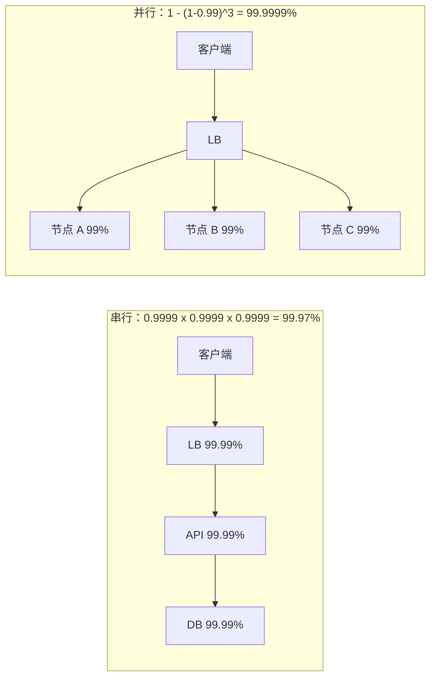
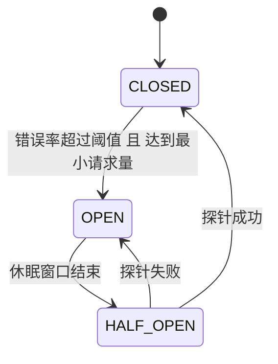
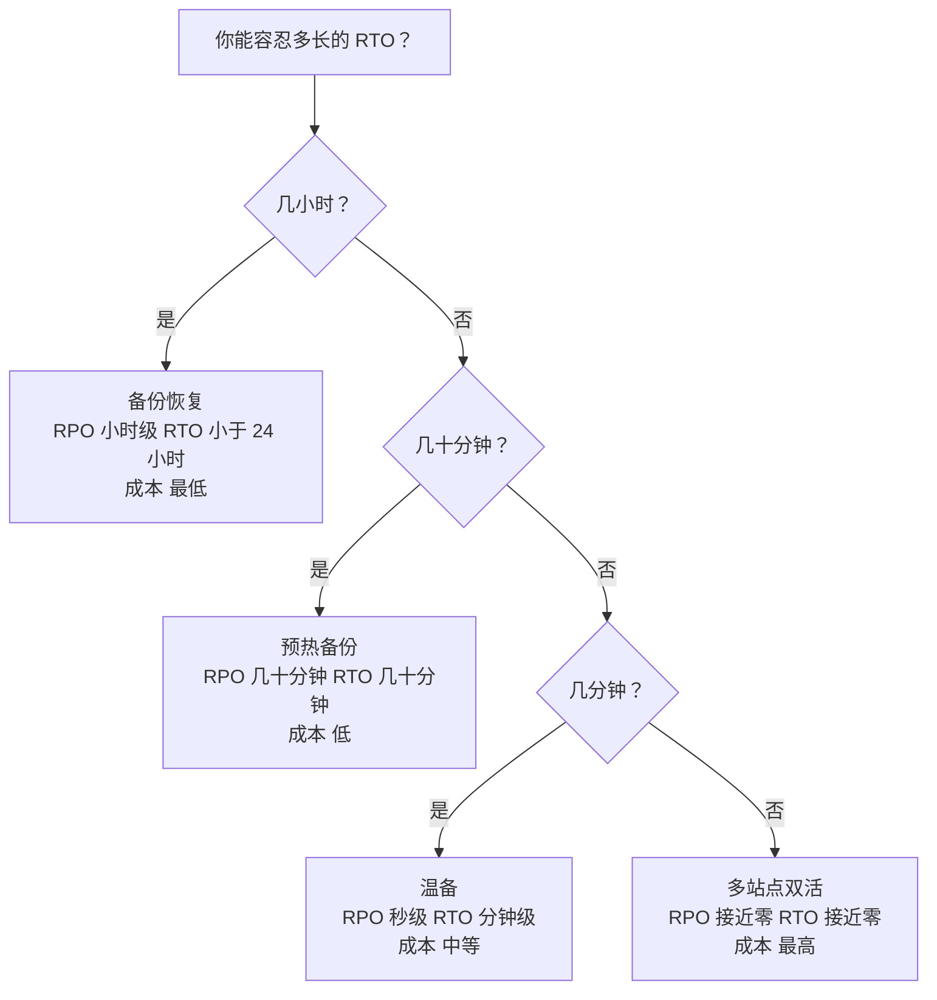
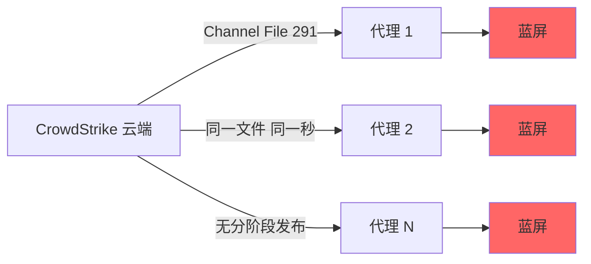

# 可用性与可靠性：几个九、SLO 与持续在线

> **TL;DR**: 可用性是系统成功处理请求的比例。每多一个“九”，工程与基础设施成本都要不成比例地增加[^1]。99.9% 每年允许 8.76 小时不可用；99.99% 只允许 52.60 分钟；99.999% 只剩 5.26 分钟[^2]。九是用冗余、快速故障切换和毫不留情地压缩 MTTR 换来的，但光有冗余救不了你于关联故障，比如一次全局配置推送。

## 学习目标

学完本模块，你将能够：

- [ ] 为任意“九”的目标算出允许的不可用时间
- [ ] 区分可用性、可靠性与持久性
- [ ] 讲清 MTBF、MTTR 的关系，并判断该动哪根杠杆
- [ ] 计算串行与并行依赖的复合可用性
- [ ] 定义 SLI、SLO、SLA 与错误预算，并配上燃烧率告警
- [ ] 针对具体负载在双活与主备之间做出选择

## 直觉理解

想想你家的电网。电力公司承诺大约 99.97% 的在线率。听起来不错，直到你算一下：99.97% 意味着每年约 2.6 小时停电。如果你运营一家医院，这不可接受。于是你加一台柴油发电机（冗余）和一个自动转换开关（快速故障切换）。现在医院的可用性高于电网，但这份额外可用性只对独立故障成立。如果一道闪电同时烧掉电网变压器和你发电机的控制板，两者一起挂。这就是关联故障，再多的冗余也没用。

软件系统同理。你可以把三个副本铺在三个可用区，但一次坏配置推送在同一秒打到三个副本上，你就得到了 2024 年 CrowdStrike 那种事故：850 万台机器同时宕机[^3]。教训是：冗余买到的是对随机、独立故障的防护。关联故障需要另一些手段：分阶段发布、限制爆炸半径、混沌测试。

本模块给你数学、词汇和模式，让你能精确推理“如何一直在线”。

## 原理

### 可用性与可靠性的区别

这两个词经常被混着用，但它们是各自独立失效的。

**可用性（availability）** 是系统成功响应的时间（或请求）比例。经典公式：`Availability = MTBF / (MTBF + MTTR)`。现代 SRE 的视角从按时间度量转向按请求度量：“一个系统一天处理 250 万请求、日可用性目标 99.99%，那么它最多可以错 250 个请求而仍然达标”[^1]。

**可靠性（reliability）** 是系统在运行期间把事做对的概率。一个服务可以响应每一次健康检查（可用），却返回错误数据（不可靠）；也可以只在跑起来时给正确答案（可靠），但一半时间在崩溃（不可用）。

**持久性（durability）** 是已存数据活下来的概率。S3 Standard 按 99.999999999%（11 个九）的持久性设计，意思是你存 1000 万个对象，平均每 1 万年丢一个[^4]。同一个服务的可用性按 99.99% 设计，但合同 SLA 只承诺 99.9%（低于此 AWS 开始发放服务抵扣）[^5]。你可以暂时访问不到它，而数据不丢。

> [!TIP]
> 当有人说“我们的系统 99.99% 可用”，先问他怎么定义“可用”。如果答案是“能 ping 通”，这个数字对用户毫无意义。

### 几个九

每多一个九，工程成本成倍上涨，允许的不可用时间却除以 10。

| 可用性 | 每年不可用 | 每月不可用 | 每周不可用 |
|---|---|---|---|
| 99%（两个九） | 3.65 天 | 7.31 小时 | 1.68 小时 |
| 99.9%（三个九） | 8.76 小时 | 43.83 分钟 | 10.08 分钟 |
| 99.95% | 4.38 小时 | 21.92 分钟 | 5.04 分钟 |
| 99.99%（四个九） | 52.60 分钟 | 4.38 分钟 | 1.01 分钟 |
| 99.999%（五个九） | 5.26 分钟 | 26.30 秒 | 6.05 秒 |

每一档在实践中意味着什么？

- **99.9%**：单个运营良好的服务，人工值班。你可以在工作日重启而不违反 SLO。
- **99.99%**：需要自动故障切换、多可用区冗余和严格的变更管理。AWS EC2 在区域级别承诺这一档[^6]。这是大多数单区域服务的实际上限。
- **99.999%**：需要多区域双活、热路径上没有人工介入、以及彻底的混沌测试。AWS DynamoDB Global Tables 承诺这一档[^7]。到了五个九，一次值班呼叫升级就吃掉你全年预算的大半。

> [!IMPORTANT]
> SRE 书把这笔账算得很直白：一个年收入 100 万美元的服务，从 99.9% 提到 99.99%，带来的是 900 美元的“新增”收入。如果工程成本超过这个数，这个九就不值得买[^1]。

### SLI SLO SLA 与错误预算

**SLI（Service Level Indicator，服务水平指标）：** 一个测量值。"在 1 分钟粒度上，`POST /charges` 请求中 800 ms 内返回 2xx 的比例。"

**SLO（Service Level Objective，服务水平目标）：** 一个内部目标。“滚动 28 天窗口内 99.9% 的请求成功。”没达到会触发工程工作，不是法律后果。

**SLA（Service Level Agreement，服务水平协议）：** 一份带后果的合同。“如果月度可用性低于 99.95%，我们退还当月费用的 10%。”永远设得比内部 SLO 宽松。

**错误预算（error budget）** 是 SLO 的补集。如果 SLO 是 28 天（40,320 分钟）内 99.9%，你的错误预算就是 40.32 分钟的“SLI 不达标”时间。你把它花在发布、试验和功能上线。花完就冻结发布，直到窗口重置[^8]。

**燃烧率（burn rate）** 衡量你相对窗口消耗预算的快慢。燃烧率 1 表示正好用 30 天烧完 30 天的预算。燃烧率 14.4 表示 1 小时就烧掉预算的 2%[^9]。

```mermaid
gantt
    title 错误预算消耗 28 天窗口 99.9% SLO
    dateFormat X
    axisFormat %s min
    section 预算
    预算全额 40.32 分钟        :done, 0, 40
    部署事故之后 减 8 分钟      :active, 0, 32
    配置推送之后 减 12 分钟     :crit, 0, 20
    section 告警阈值
    14.4 倍燃烧率 1 小时烧 2%   :milestone, 39, 39
    1 倍燃烧率 3 天烧 10%       :milestone, 36, 36
```

*每次事故都在消耗错误预算；燃烧率告警在预算耗尽之前就触发，给你留出反应时间。*

Google 的 SRE Workbook 推荐多窗口、多燃烧率的告警组合[^9]：

| 严重级别 | 长窗口 | 短窗口 | 燃烧率 | 消耗预算 |
|---|---|---|---|---|
| 值班呼叫 | 1 小时 | 5 分钟 | 14.4x | 2% |
| 值班呼叫 | 6 小时 | 30 分钟 | 6x | 5% |
| 工单 | 3 天 | 6 小时 | 1x | 10% |

短窗口那个 AND 条件，是为了防止问题早已恢复之后告警还在响。

### 冗余与故障域

冗余意味着每个关键组件都有不止一份。两种形态：

**主备（active-passive）：** 一个实例承接流量，备机待命。出故障时健康检查发现问题并提升备机。一致性更简单（单写者），但切换有用户可见的抖动（数秒到数分钟）。适合强一致性重要的主 SQL 数据库。

**双活（active-active）：** 所有实例同时承接流量，由负载均衡器分发请求。一个挂了，其余的立即吸收。适合无状态层、CDN 和最终一致存储。

关键洞见：任何形式的冗余只防**独立**故障。2021 年 Facebook 事故在所有数据中心都是双活，但一条 BGP 配置命令就把全球拖垮了，因为这次故障是关联的[^10]。

需要显式梳理的**故障域**：

- **可用区（AZ）：** 区域内电力、制冷、网络相互隔离
- **区域（Region）：** 地理隔离（相距数百公里）
- **供应商：** 云厂商本身（CrowdStrike 打穿了所有云上的客户）
- **发布流水线：** 共享的配置推送就是共享的故障域
- **人：** 执行命令的那位操作者

### 依赖链数学

请求串行流过 N 个组件时，可用性相乘：

`A_system = A1 x A2 x A3 x ... x An`

请求可以由 N 个并行冗余组件中的任意一个处理时，故障概率相乘：

`A_system = 1 - (1 - A)^n`

*串行依赖把可用性相乘（越乘越差）；并行冗余把故障概率指数化（越算越好），但前提是故障彼此独立。*

**陷阱：** 串行数学偏悲观，因为它忽略了共享命运。并行数学偏乐观，原因恰恰相同。Fastly 2021 年的事故直接击穿了完整的多 POP 冗余：一个客户的配置变更触发了潜藏 bug，几秒内席卷 85% 的网络[^11]。

### 失效模式

真实系统的失败有可预测的规律：

- **磁盘：** Backblaze 监控 30 多万块硬盘，2024 年的年化故障率为 1.57%[^12]。Google 2007 年的研究发现 SMART 属性与故障相关，但预测不了单块盘的死亡[^13]。
- **网络：** 微软 SIGCOMM 2011 的研究发现负载均衡器是最容易出故障的设备类别，网络冗余能减轻影响但无法消除[^14]。
- **人为与配置错误：** 绝大多数故障由变更触发，而非随机硬件损坏[^1]。2017 年 AWS S3 us-east-1 故障，是一位有权限的工程师按既定剧本操作时输错了参数[^15]。2021 年 Facebook BGP 故障，是一条维护命令加上审计工具本身有 bug[^10]。

### 可用性与恢复模式

**熔断器（circuit breaker）：** 三个状态（CLOSED、OPEN、HALF_OPEN）。当错误率在达到最小请求量之上超过阈值，熔断器跳到 OPEN，所有调用快速失败。等一个休眠窗口过去，它放单个探针进入 HALF_OPEN。探针成功就闭合，失败就重新打开[^16]。

*HALF_OPEN 状态让单个探针验证下游是否恢复，而不会把流量灌回一个不健康的下游。*

**带抖动的重试：** 无抖动的指数退避会产生同步重试波，把正在恢复的服务再压垮。全抖动（`sleep = random(0, min(cap, base * 2^attempt))`）打散这种相关性，是 AWS SDK 的默认做法[^17]。

**主动丢弃（load shedding）：** 一旦过载，服务器因为线程争用、GC 和上下文切换，实际做的有用功会变少。在门口丢掉多余请求（返回 503），能保住已接收请求的有效吞吐（goodput）[^18]。

**容灾层级：** AWS 归纳了四种容灾策略[^19]：

*容灾层级用基础设施成本换更低的 RTO/RPO；选与你业务影响容忍度匹配的那一档。*

**混沌工程（chaos engineering）：** Netflix 在 2011 年公布 Chaos Monkey，在业务时段随机杀掉生产环境的 EC2 实例，逼工程师写出能容忍单实例损失的代码[^20]。它后来演化成 Simian Army（Latency Monkey、模拟可用区故障的 Chaos Gorilla）。今天 AWS Fault Injection Service 和 Gremlin 把这种模式做成了产品。

## 真实案例

**CrowdStrike Falcon 事故，2024 年 7 月 19 日。** UTC 04:09，CrowdStrike 向全球 Windows 机器上运行的 Falcon 终端检测代理推送了 Channel File 291。这个文件里的一条配置更新导致内核态传感器发生越界内存读取，触发无效页错误和蓝屏死机[^3]。

**影响规模：** 约 850 万台 Windows 设备崩溃（按微软的口径，不足全球 Windows 设备的 1%）。全球取消 5,078 架次航班（占计划航班的 4.6%）。仅达美航空 5 天内就取消 7,000 多架次，报告 5 亿美元损失，影响 130 万名乘客。Parametrix 估算，美国前 500 强企业（不含微软）的直接财务损失约 54 亿美元[^3]。

**冗余为什么没救场：** 每台受影响的机器在基础设施层都有冗余：多台服务器、多个可用区、多家云。全都没用。故障是完美关联的：所有客户在同一时刻收到同一个 Channel File，既没有分阶段发布，客户也无法控制更新时机。

**时间线：** CrowdStrike 在 UTC 05:27 回滚了这条内容更新，距首次推送 78 分钟。回滚之后才启动的设备没事。已经在反复重启的设备需要逐台人工处理：进安全模式、删掉出问题的 `.sys` 文件，而企业机器上的 BitLocker 恢复密钥提示让事情更麻烦[^3]。

**后续改变：** CrowdStrike 承诺做分阶段发布、让客户控制更新时机、加强内容校验。那个有问题的文件此前是过了校验的，“原因是 CrowdStrike 内容验证软件中的一个 bug”，Falcon Sensor 解析该文件的方式与校验器不一致[^3]。

**教训：** 先修关联性，再买冗余。850 万台机器，跨不同的云、不同的区域、不同的公司，在同一秒全部失败，因为它们共享同一个故障域：CrowdStrike 的更新流水线。

*一次没有分阶段发布的配置推送，制造出一个关联故障，把所有下游冗余全部作废。*

## 权衡

这三行只描述冗余拓扑。SLO 的设定是另一个决定，本章前面已经讲过（[§ SLI SLO SLA 与错误预算](#sli-slo-sla-与错误预算)）；它不该占一行，因为它和拓扑不是可以互相替换的选项。

| 拓扑 | 收益 | 代价 | 适用场景 |
|---|---|---|---|
| 主备（含热备） | 推理简单，单写者强一致，RTO 从数秒到数分钟，取决于备机有多热 | 闲置容量照付钱却不承接读；提升时有切换抖动 | 主 SQL 数据库；支付、交易、票务这类写语义要求唯一权威节点的场景 |
| 双活（单区域） | 不浪费容量，节点丢失瞬间吸收，无切换抖动 | 写要协调一致性，读要么最终一致要么承担法定人数的开销 | 无状态 Web/API 层与最终一致存储；请求路径的默认选择 |
| 多区域双活 | 能扛住区域级丢失；用户获得就近延迟 | 跨区域写协调成本（提交等待或冲突解决），基础设施账单更高 | 单区域四个九不够的全球级关键服务（例：承诺 99.999% 的 DynamoDB Global Tables [^7]） |

这张表只覆盖拓扑；选对目标（SLO）和选对模式（拓扑）是两个独立的决定，把它们混为一谈正是过去“更紧的 SLO”那一行所犯的错误。

## 常见陷阱

> [!WARNING]
> **在对关联组件上相乘独立可用性。** 你假设各组件独立，算出 0.9999^4 = 99.96%。真实故障是关联的：共享配置、共享控制面、共享发布流水线。真实数字更差。把你的关联故障域显式画出来。

> [!WARNING]
> **恢复之后的惊群重试。** 服务刚从一次短暂中断中恢复，成千上万个排队的客户端在同一毫秒重试，瞬间把它压回故障。退避要加全抖动，并把重试量压到基线流量的 10% 以内[^17]。

> [!WARNING]
> **没有分阶段发布的全局配置推送。** 一条坏配置几秒内到达 100% 的机器。2024 年 CrowdStrike 同时命中 850 万个代理[^3]。2021 年 Facebook 一条命令打掉全球 BGP[^10]。发布先走金丝雀：1% 到 10% 到 50% 到 100%，每一步都配基于 SLI 的自动回滚门禁。

> [!WARNING]
> **从不演练故障切换。** 一个从没承接过生产流量的“温备”，会在真出事的时候给你惊喜。备机会腐坏。每月做切换演练；Netflix 的 Chaos Monkey 把切换变成常态，而不是紧急事件[^20]。

> [!WARNING]
> **把 SLO 设得比用户在乎的还紧。** 一个只在工作时间使用的工具要求 99.999%，属于过度设计。SRE 书的说法是：如果提升一个九的成本超过它带来的增量收入，这笔投资就不值[^1]。SLO 应当从用户影响推导，而不是从行业虚荣心。

> [!WARNING]
> **把冗余拓扑和 SLO 目标混为一谈。** “收紧 SLO”和“加一台热备”是两根互不相干的杠杆：前者改变你承诺什么，后者改变你怎么做到。收紧 SLO 却没有相应的拓扑变化，只是更快烧掉错误预算；改了拓扑却不修订 SLO，只是浪费容量。先定目标（按 SRE 书每个九的成本算 [^1]，从用户影响出发），再选能达到它的拓扑。

## 练习

> **Design Challenge**：你运营一个支付 API。与商户的合同承诺月度可用性 99.95%（每月约 22 分钟不可用）。你刚经历一次事故：一次坏配置同时推送到所有区域，造成 15 分钟中断。团队想设定 SLO。请给出 SLI、SLO、错误预算和处理流程。你会做哪些冗余改造？

提示

SLA 是 99.95%，你的内部 SLO 应该更紧。想想那次配置推送是怎么绕过冗余的：所有区域一起挂。你的冗余是关联的，比看起来更糟。再考虑一点：三个串行依赖、每个 99.9%，系统可用性只有 99.7%。

参考答案

**SLI：** "在 1 分钟粒度上，`POST /v1/charges` 请求中 800 ms 内返回 2xx 的比例。“它把可用性（2xx）和延迟（800 ms）合在一起，因为对商户来说”慢但成功"不算成功。

**SLO：** 滚动 28 天窗口内 99.97%。这比合同 SLA 的 99.95% 更紧，留出内部缓冲。

**错误预算：** 28 天 = 40,320 分钟。99.97% 允许每个窗口 12.1 分钟的 SLI 不达标时间。合同允许大约 20 分钟。这 8 分钟的差额就是你喘气的地方。

**流程：**

- 预算健康：上功能、做试验、跑有风险的迁移。
- 预算用掉一半：冻结功能上线；所有 PR 需要 SRE 评审。
- 预算耗尽：冻结所有非关键工作，直到窗口重置。

**冗余改造：**

1. **分批推送配置。** 一小时内按 1%、10%、50%、100% 推进，SLI 一退化就自动回滚。
2. **按区域隔离。** 一条坏规则不该带倒相邻区域。强制区域级的爆炸半径。
3. **快速回滚。** 对当前部署一键回滚，把 MTTR 从 15 分钟压到 3-4 分钟。
4. **熔断器。** 如果 charges 服务在高错误率下能退化成“先接受、稍后重试”，你就保住了部分可用性。

**你没有做的事：** 再加一个区域。当失效模式是关联的配置 bug 时，更多冗余帮不上忙。先修关联性。

**依赖数学复核：** 如果你的支付 API 依赖三个串行服务、每个 99.9%，系统可用性上限是 0.999^3 = 99.7%，也就是每年 26.28 小时不可用。不提升每个依赖，或者在每一跳内部加并行冗余，你就无法承诺 99.95%。

## 要点回顾

- 每多一个九，成本都不成比例地上升。目标要从用户影响定，不要从行业虚荣心定。
- 可用性（成功响应）和可靠性（正确响应）有重叠，但会各自独立失效。测量之前先定义什么叫“在线”。
- 提升可用性靠缩短 MTTR，而不是靠消灭所有故障。每周出一次故障但 MTTR 30 秒，胜过每月出一次故障但 MTTR 10 分钟。
- 串行依赖要相乘：三个 99.9% 的服务给你 99.7%。每多一跳依赖，系统就更差一点。
- 冗余防的是独立故障。关联故障（配置推送、共享控制面）要靠分阶段发布和限制爆炸半径。
- SLI 是你测量的东西，SLO 是你内部瞄准的东西，SLA 是你对外承诺的东西。三者之间的差距要刻意留。
- 错误预算把可靠性从模糊目标变成一种可花的资源。燃烧率告警告诉你什么时候花得太快。

## 延伸阅读

- [Google SRE Book, Ch. 3: Embracing Risk](https://sre.google/sre-book/embracing-risk/) - 每个九的成本这一视角的原始出处，以及从按时间度量转向按请求度量可用性的论述。
- [Google SRE Workbook, Ch. 5: Alerting on SLOs](https://sre.google/workbook/alerting-on-slos/) - 六种逐步改进的告警设计，终点是多窗口多燃烧率；燃烧率数学的参考来源。
- [Google SRE Workbook: Error Budget Policy](https://sre.google/workbook/error-budget-policy/) - 把错误预算的消耗转成发布冻结策略的模板。
- [AWS Architecture Blog: Exponential Backoff and Jitter](https://aws.amazon.com/blogs/architecture/exponential-backoff-and-jitter/) - Marc Brooker 2015 年的文章，让全抖动成为行业标准；附有仿真结果，显示重试负载能降低 3-5 倍。
- [AWS Builders' Library: Using Load Shedding to Avoid Overload](https://aws.amazon.com/builders-library/using-load-shedding-to-avoid-overload/) - David Yanacek 讲 goodput 与吞吐量的区别，以及为什么每个内存队列都是请求堆积到超时之后的地方。
- [AWS Disaster Recovery Whitepaper](https://docs.aws.amazon.com/whitepapers/latest/disaster-recovery-workloads-on-aws/disaster-recovery-options-in-the-cloud.html) - 四个容灾层级（备份恢复、预热备份、温备、双活），附带明确的 RTO/RPO 对照表。
- [Backblaze Drive Stats 2024](https://www.backblaze.com/blog/backblaze-drive-stats-for-2024/) - 硬盘年化故障率的权威开放数据集：30 万块盘、13 年数据、按型号拆分。
- [Meta: More details about the October 4 outage](https://engineering.fb.com/2021/10/05/networking-traffic/outage-details/) - 2021 年全球 BGP 撤销事件的一份教科书式无指责复盘；展示了依赖同一套基础设施的内部工具如何拖慢恢复。
- [AWS S3 Service Disruption Summary (2017)](https://aws.amazon.com/message/41926/) - 那次“打错一个字”的经典事故，也是爆炸半径控制和容量移除保护机制的范例。
- [Uptime.is Calculator](https://uptime.is/) - 快速把“九”换算成不同时间窗口的不可用预算。

## 记忆卡片

**Q：** 99.99% 可用性每年允许多久不可用？
**A：** 每年约 52.60 分钟，或每月约 4.38 分钟。

**Q：** 用 MTBF 和 MTTR 写出可用性公式。
**A：** Availability = MTBF / (MTBF + MTTR)。缩短 MTTR 通常是杠杆更高的改进，因为它会复利，而且对新出现的失效模式同样有效。

**Q：** 可用性、可靠性、持久性三者的区别是什么？
**A：** 可用性 = 被问到时能响应。可靠性 = 响应得对。持久性 = 存下的数据不丢。S3 Standard 按 11 个九的持久性和 99.99% 的可用性设计，SLA 承诺 99.9%。

**Q：** 三个服务串行，每个 99.9%，系统可用性是多少？
**A：** 0.999 x 0.999 x 0.999 = 0.997 = 99.7%，即每年 26.28 小时不可用。

**Q：** 两个并行节点，每个 99%，合起来的可用性是多少？
**A：** 1 - (1-0.99)^2 = 1 - 0.0001 = 99.99%。并行带来指数级回报，但前提是故障彼此独立。

**Q：** 什么是错误预算？
**A：** SLO 的补集。如果 SLO 是 28 天内 99.9%，错误预算就是该窗口的 0.1% = 40.32 分钟允许的 SLI 不达标时间。你把它花在发布和试验上。

**Q：** 在 Google 推荐的告警设计里，什么燃烧率会触发值班呼叫？
**A：** 14.4 倍燃烧率，在 1 小时和 5 分钟两个窗口上同时持续，意味着 1 小时就消耗掉 30 天预算的 2%。

**Q：** 为什么加冗余有时并不能提升可用性？
**A：** 当失效模式是关联的（坏配置推送到处都是、共享依赖、共同的 bug）。2024 年 CrowdStrike 打中跨不同云的 850 万台机器，因为它们共享同一条更新流水线。

**Q：** AWS 的四个容灾层级按成本从低到高怎么排？
**A：** 备份恢复（最便宜，RTO 小时级）、预热备份（RTO 几十分钟）、温备（RTO 分钟级）、多站点双活（最贵，RTO 接近零）。

**Q：** SLO 和 SLA 的区别？
**A：** SLO 是内部目标，没达到会触发工程工作。SLA 是带财务后果（抵扣、罚款）的合同承诺。内部 SLO 永远应该比 SLA 更紧。

**Q：** 熔断器的 HALF_OPEN 状态是干什么的？
**A：** 它放单个探针请求过去，测试下游依赖是否恢复，而不会用全量流量把它淹掉。探针成功，熔断器闭合；失败，重新打开。

**Q：** 为什么优先压缩 MTTR 而不是抬高 MTBF？
**A：** 抬高 MTBF 的收益递减（你不可能杜绝所有故障）。压缩 MTTR 会复利：更快的发现、定位和恢复，对每一种失效模式都成立，包括你从没见过的新故障。

**Q：** 2021 年 Facebook 的 BGP 故障出了什么问题？
**A：** 一条本想评估骨干网容量的维护命令，意外地在全球撤销了所有 BGP 路由。本该拦住它的审计工具出了 bug，没拦住。内部工具也因为依赖同一套 DNS 而一起失效，把恢复拖到大约 6 小时。

**Q：** 主备冗余和双活冗余的区别？
**A：** 主备让备机一直闲置到切换时刻（一致性更简单，切换有抖动）。双活让所有实例同时承接流量（不浪费容量，故障瞬间消化，但需要为一致性做协调）。

**Q：** AWS DynamoDB Global Tables 承诺的可用性是多少？
**A：** 99.999%（五个九）SLA，而标准单区域 DynamoDB 表是 99.99%。

## 参考文献

[^1]: Marc Alvidrez (Google SRE), “Embracing Risk,” Site Reliability Engineering. https://sre.google/sre-book/embracing-risk/
[^2]: Google SRE Book, Appendix A “Availability Table.” https://sre.google/sre-book/availability-table/
[^3]: Wikipedia, “2024 CrowdStrike-related IT outages”（综述 CrowdStrike 对 Channel File 291 的外部技术根因分析）. https://en.wikipedia.org/wiki/2024_CrowdStrike-related_IT_outages
[^4]: Amazon Web Services, “Amazon S3 Data Durability.” https://docs.aws.amazon.com/AmazonS3/latest/userguide/DataDurability.html
[^5]: Amazon Web Services, “Amazon S3 Service Level Agreement.” https://aws.amazon.com/s3/sla/
[^6]: Amazon Web Services, “Amazon Compute Service Level Agreement.” https://aws.amazon.com/compute/sla/
[^7]: Amazon Web Services, “Amazon DynamoDB Service Level Agreement.” https://aws.amazon.com/dynamodb/sla/
[^8]: Google SRE Workbook, “Error Budget Policy.” https://sre.google/workbook/error-budget-policy/
[^9]: Steven Thurgood et al. (Google SRE), “Alerting on SLOs,” The Site Reliability Workbook, Chapter 5. https://sre.google/workbook/alerting-on-slos/
[^10]: Santosh Janardhan (Meta), “More details about the October 4 outage,” Engineering at Meta, 5 Oct 2021. https://engineering.fb.com/2021/10/05/networking-traffic/outage-details/
[^11]: Nick Rockwell (Fastly), “Summary of June 8 outage” / Reuters coverage, Jun 2021. https://www.reuters.com/business/media-telecom/fastly-blames-software-bug-major-global-internet-outage-2021-06-09/
[^12]: Andy Klein (Backblaze), “Backblaze Drive Stats for 2024,” 11 Feb 2025. https://www.backblaze.com/blog/backblaze-drive-stats-for-2024/
[^13]: Eduardo Pinheiro, Wolf-Dietrich Weber, Luiz Andre Barroso (Google), “Failure Trends in a Large Disk Drive Population,” USENIX FAST 2007. https://research.google/pubs/failure-trends-in-a-large-disk-drive-population/
[^14]: Phillipa Gill, Navendu Jain, Nachiappan Nagappan (Microsoft), “Understanding Network Failures in Data Centers: Measurement, Analysis, and Implications,” SIGCOMM 2011. https://www.microsoft.com/en-us/research/publication/understanding-network-failures-data-centers-measurement-analysis-implications/
[^15]: Amazon Web Services, “Summary of the Amazon S3 Service Disruption in the Northern Virginia (US-EAST-1) Region,” 28 Feb 2017. https://aws.amazon.com/message/41926/
[^16]: Netflix, “Hystrix: HystrixCircuitBreaker.java” (Apache 2.0). https://github.com/Netflix/Hystrix/blob/master/hystrix-core/src/main/java/com/netflix/hystrix/HystrixCircuitBreaker.java
[^17]: Marc Brooker (AWS), “Exponential Backoff And Jitter,” AWS Architecture Blog, Mar 2015 (updated May 2023). https://aws.amazon.com/blogs/architecture/exponential-backoff-and-jitter/
[^18]: David Yanacek (AWS), “Using load shedding to avoid overload,” Amazon Builders' Library. https://aws.amazon.com/builders-library/using-load-shedding-to-avoid-overload/
[^19]: Amazon Web Services, “Disaster Recovery of Workloads on AWS: Recovery in the Cloud.” https://docs.aws.amazon.com/whitepapers/latest/disaster-recovery-workloads-on-aws/disaster-recovery-options-in-the-cloud.html
[^20]: Netflix Technology Blog, “The Netflix Simian Army,” 19 Jul 2011. https://netflixtechblog.com/the-netflix-simian-army-16e57fbab116
