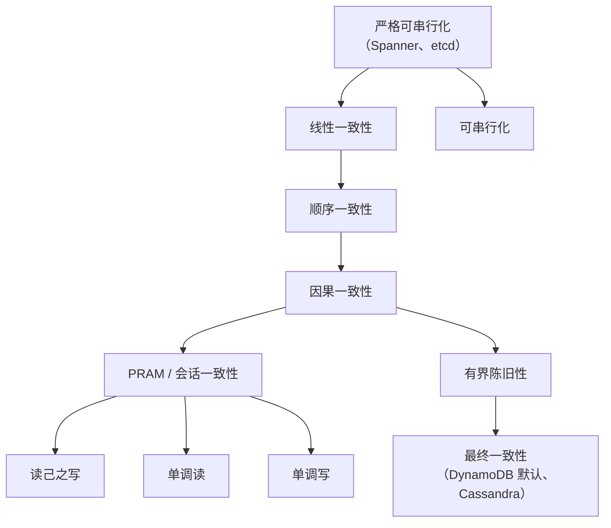
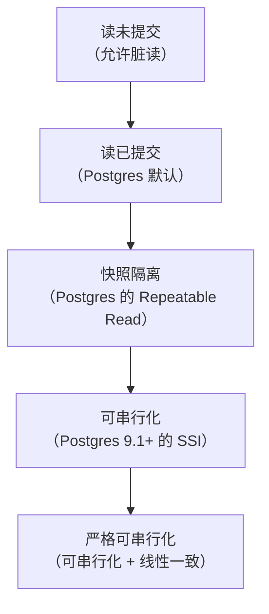
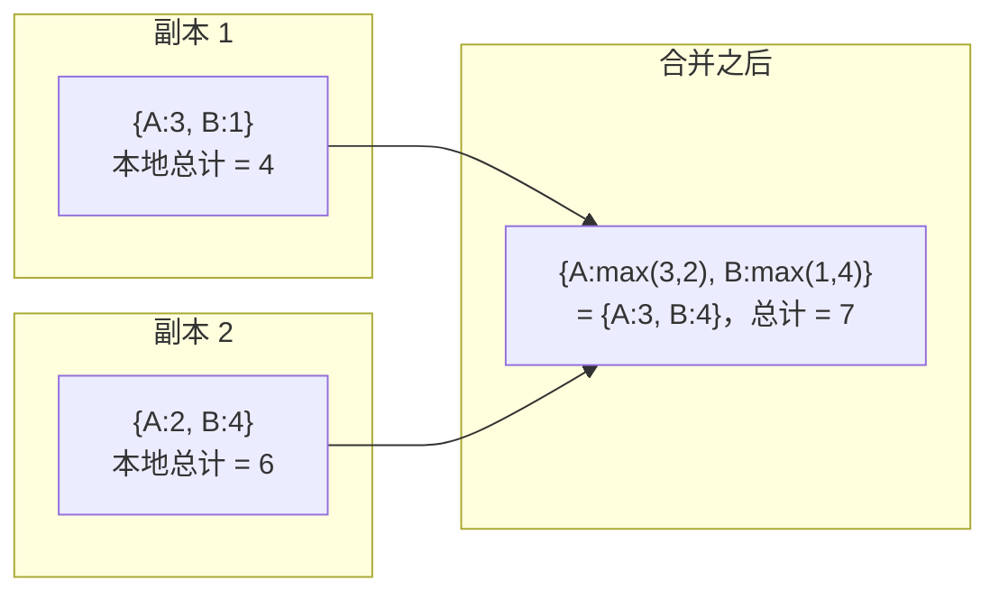
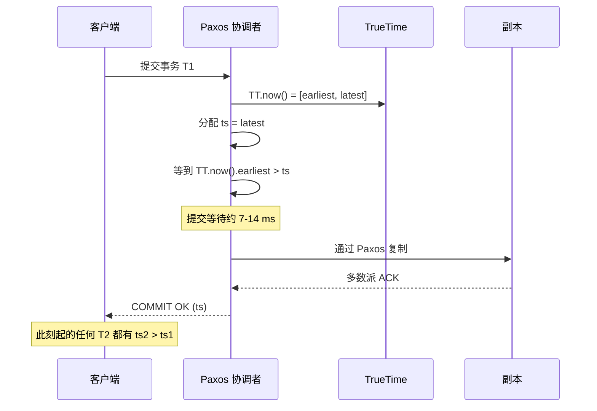

# 一致性模型：读者到底看到什么

> **TL;DR**: 一致性模型是存储系统与它的客户端之间的一份契约，规定哪些顺序、哪些可见性结果是允许的[^1]。线性一致性用起来像一台单机，但每个操作都要付出协调成本。最终一致性很便宜，代价是读到陈旧数据、更新乱序、视图分叉。因果一致性是分区下仍能完全可用的最强模型[^2]，对大多数面向人的应用来说正好落在甜点区。四条客户端保证（读己之写、单调读、单调写、写跟随读）描述的是在单个用户眼里，什么样的“怪异”是可以接受的[^3]。

## 学习目标

学完这一章，你应当能够：

- [ ] 解释为什么一致性是读方属性，而不是写方属性
- [ ] 精确区分线性一致性、顺序一致性、因果一致性与最终一致性
- [ ] 说出四条客户端会话保证，并把它们对应到用户体验行为
- [ ] 把 ACID-C、CAP-C 和副本一致性拆成三个独立概念
- [ ] 识别快照隔离下的写偏斜，并知道何时该升级到可串行化
- [ ] 把一条业务需求翻译成一致性模型的选择，并说清具体权衡

## 直觉理解

你和朋友用不同的流媒体服务看同一场球赛。你看到绝杀进球，发消息说“德国赢了！”，朋友刷新了一下，画面还停在比赛进行中。系统坏了吗？

不一定。朋友的流在从一个还没收到这次更新的副本读数据。系统从来没有承诺过：不同客户端从不同副本读取时，还要保持实时顺序。它只承诺最终所有副本会收敛。

再想象一个有两个 ATM 的银行账户。你在 A 机存了 500 美元，走过马路去 B 机查余额。如果 B 机显示旧余额，你会当场崩溃。银行不能容忍这种情况。它们要求每一次读都反映所有已完成的写，这就是线性一致性，代价是每个操作都要付出协调延迟。

一致性模型把“哪些结果允许、哪些禁止”形式化了。它是和读方签的契约。陷阱在于：工程师讨论一致性时总站在写方视角（“这次写已经落到两个副本上了”）。把思维模型翻到读方来。一致性模型告诉你的是：对于正在读这份数据的人，什么样的怪异算可接受。

## 原理

### 为什么一致性一词被混用

“一致性”这个词在分布式系统里有三种完全不同的含义，把它们混为一谈是设计评审中最大的困惑来源[^4]：

1. **ACID-C**：每个事务结束后，应用层不变量依然成立（外键、唯一约束）。这说的是你的 schema，跟副本无关。
2. **CAP-C**：特指线性一致性。每次读都返回最近一次写完的值。这说的是副本之间实时达成一致。
3. **副本一致性**：描述读方在复制状态上能看到什么的一整族模型（顺序、因果、最终）。

Kleppmann 认为 CAP 的“CP 与 AP”二分法误导性太强，以至于他无法明确地把任何一个真实系统归入其中，包括 ZooKeeper（除非你调用 `sync`，否则它的读默认不是线性一致的）[^4]。所以当有人说“我们的数据库是强一致的”，先反问：你说的是线性一致？可串行化？还是读己之写？答案不同，架构就不同。

### 一致性层级

一致性模型构成一个层级，从最强（约束最多、代价最高）到最弱（最宽松、最便宜）：

*较强的模型蕴含它下方所有较弱的模型；沿层级往下走，网络分区下的可用性逐步升高[^5]。*

**线性一致性**（Herlihy 与 Wing，1990）：每个操作看起来都在其调用与返回之间的某一刻原子生效，并且全部操作排成一个与实时时间相符的全序[^1]。如果操作 A 在 B 开始之前已经完成，那么任何观察者都先看到 A 再看到 B。系统表现得像一台单机。代价是：每次写都要做法定人数协调，全局线性一致至少需要一次跨地域往返（跨大洲约 150 ms），分区期间不可用（CAP 里的 CP）[^4]。

**顺序一致性**（Lamport，1979）：存在一个所有进程都认可的全序，且每个进程自己的程序顺序在这个全序里得到保留，但这个全序不必与实时时间一致[^6]。一次写可以被任意延后看到。像 x86-TSO 这样的 CPU 内存模型接近顺序一致性，但严格来说更弱：它们允许 store 到 load 的重排，经由 store buffer 发生（一条 store 之后对另一个地址做 load，两者可以重排）[^7]。它们同样不是线性一致的。

**因果一致性**：有因果关系的操作（A 先于 B 发生，或 B 读到了 A 的结果）在每个副本上都按相同顺序被看到。并发操作可以按任意顺序出现[^8]。这是分区下仍能完全可用的最强模型[^2]。

**最终一致性**：如果写停止，所有副本最终收敛。对“最终”要多久没有任何上界[^9]。读方可能读到陈旧数据、乱序更新和分叉的视图。

### 会话保证

上面的层级是数据视角的：它描述所有副本合起来保证了什么。客户端视角的一致性描述单个会话观察到什么，而这往往才是终端软件真正关心的[^3]：

1. **读己之写（RYW）**：你写入一个值之后，后续的读能看到这个值或更新的值。没有这一条，用户换完头像、刷新页面，看到的还是旧的。
2. **单调读**：如果你读到了值 v1，之后的读只会返回 v1 或更新的值，绝不回退。没有这一条，收件箱会先显示 10 封邮件，然后 9 封，然后又变回 10 封。
3. **单调写**：你的写按你发出的顺序生效。把名字先设成 “Alex” 再设成 “Alexandra”，最终状态绝不会是 “Alex”。
4. **写跟随读**：如果你先读到一个值再写，那么你的写排在你读到的那个值之后。你对某条帖子的回复，绝不会在帖子本身还看不到的时候就先出现。

这四条互相正交，系统可以提供其中任意子集。“会话一致性”通常指登录会话内这四条全部满足。Cosmos DB 默认的 “Session” 级别正是靠客户端缓存的会话令牌做到这一点[^10]。MongoDB 的因果会话则在客户端会话里带一个混合逻辑时钟[^11]。

> [!NOTE]
> 这些保证符合用户的心理模型。用户几乎总是至少想要读己之写和单调读。破坏其中任何一条，即便后端在技术上完全正确，界面也会让人觉得坏了。

### ACID 隔离级别

隔离级别与副本一致性是正交的两件事，但经常被混为一谈。它们描述的是单个数据库内部，并发事务之间能看到彼此多少未完成的工作[^12]：

*每一级都比它下面一级禁止更多异常现象；“严格可串行化”是可串行化隔离与线性一致副本一致性的交集[^5]。*

关键的细节是：**快照隔离不等于可串行化**。Oracle 的 “serializable” 模式实际上是快照隔离，允许写偏斜[^12]。两个值班医生各自读到“还有别人在值班”，于是各自把自己标记为下班，结果没人在值班。只有真正的可串行化（SSI）能阻止这种情况[^13]。

> [!IMPORTANT]
> PostgreSQL 12.3 的 Serializable 模式带有一个存在了九年的 bug，会让并发插入产生 G2-item 异常[^14]。CockroachDB 在早期 beta 版本出过问题之后，把 Jepsen 集成进了每夜的测试[^15]。教训是：去测你的隔离保证，别只信文档。

### 最终一致性与冲突解决

当副本各自独立接受写（AP 系统），冲突不可避免。主流解决策略有三种：

**最后写入者胜（LWW）**：时间戳最大的写获胜。DynamoDB Global Tables 在 MREC 模式（默认）下就用它做跨地域复制[^16]。简单，但危险：一旦时钟有偏差，因果上更晚的那次写可能时间戳更小，从而被静默丢弃。

**向量时钟**：每次写携带一个按副本计数的向量，用来记录因果历史[^17]。并发写会被识别出来（两者互不支配），再交给应用层合并。Amazon 最早的 Dynamo 购物车就是这么做的[^18]。

**CRDT（无冲突复制数据类型）**：这类数据结构被设计成并发操作可交换、可确定性地合并，不需要协调[^19]。以 G-Counter 为例，它按副本各自计数，合并时逐元素取最大值：

*两个副本并发地对 G-Counter 自增；合并时对各副本计数逐元素取最大，无需协调即可确定性地收敛[^19]。*

### 线性一致性的代价

线性一致性贵，因为它需要协调。生产环境里有三种买单方式：

**Google Spanner 的 TrueTime**：每个数据中心都装 GPS 接收器和原子钟，把时钟不确定性压到几毫秒（epsilon）以内[^20]。写要等过这段不确定区间（“提交等待”，约 2 倍 epsilon）才返回成功，从而保证时间戳全局有序。这让跨大洲的线性一致性变得可行，提交开销约 7-14 ms，而不是一次完整往返的延迟。

**Raft ReadIndex**：主节点在服务读之前，先和多数派交换心跳来确认自己仍然是主节点。etcd 用这个机制提供严格可串行化的读[^21]。代价是：每次强读都要和多数派走一次往返。

**租约读**：主节点持有一个有时间界限的租约。租约期内它可以不协调直接服务读。租约过期（或主节点时钟漂移）时，读会阻塞到重新拿到租约为止。CockroachDB 用基于租约的读，默认最大时钟偏移为 500 ms[^15]。

## 真实案例

**Google Spanner：跨大洲的外部一致性。**

Spanner 是第一个、也是最著名的在全局规模上提供外部一致性（比线性一致性更强，覆盖多行事务）的生产系统[^22][^20]。它的做法是这样的：

Spanner 的每个数据中心都有 GPS 接收器和原子钟。TrueTime API 返回一个有界区间 `[earliest, latest]`，真实时间保证落在其中。正常运行时，epsilon（区间宽度）只有几毫秒[^20]。

事务提交时，协调者分配一个提交时间戳，然后等到 `TT.now().earliest > commit_timestamp`。这段“提交等待”确保任何在本次提交之后开始的事务都会拿到更大的时间戳，从而在跨大洲范围内保住实时顺序。等待大约是 2 倍 epsilon，通常不到 14 ms[^20]。

*Spanner 的提交等待保证：如果 T1 在 T2 开始前提交，那么 T1 的时间戳严格小于 T2 的，即使跨大洲也成立[^20]。*

只读事务在 Paxos 定序的时间戳上做 MVCC 快照读，不阻塞写。读也可以选择有界陈旧性（由任意副本服务，更便宜）或强读（由 Paxos 主节点服务）[^22]。

权衡很清楚：Spanner 为每次写付出约 7-14 ms 的提交延迟，换来的是整个星球看到同一条一致的时间线。对 Google AdWords 计费和 F1 来说这值得，那里的跨地域财务正确性没有商量余地。换成社交信息流或分析管道，这就过度设计了。

## 权衡

| 模型 | 延迟 | 分区下的可用性 | 推理复杂度 | 最适合 | 我们的选择 |
|---|---|---|---|---|---|
| 线性一致性 | 高（每个操作都要协调） | 低（CP） | 简单（像单机） | 银行账本、库存、锁 | 正确性不可妥协时 |
| 因果一致性 | 中等（要跟踪元数据） | 高（完全可用） | 中等（因果链） | 社交信息流、聊天、CRDT | 面向人的应用的默认选项 |
| 会话一致性（最终一致 + 四条保证） | 低 | 很高 | 单用户简单，全局复杂 | 大多数面向用户的应用 | 想低成本保住体验时 |
| 最终一致性 | 最低 | 最高（AP） | 最难推理 | 计数器、分析、DNS | 陈旧数据真的可以接受时 |
| 有界陈旧性 | 低到中等 | 高 | 中等（可量化的 SLA） | 看板、监管类读取 | 需要新鲜度 SLA 时 |

表格按一致性强度从上到下排列（最强在上，最弱在下）；每一行都是真实的生产选择，并且对应一个具名系统（Spanner、Cosmos DB、MongoDB 因果会话、DynamoDB、Cosmos DB 的有界陈旧性）。“我们的选择”这一列回答的是“这个系统该用哪个模型”这一个决策，而不是在暗示某种先后顺序。

## 常见陷阱

> [!WARNING]
> **不加区分地把系统叫作“CP”或“AP”。** CAP 的二分法具有误导性。ZooKeeper 的读默认不是线性一致的。DynamoDB 的 Global Tables 是“AP”，但在单地域内提供强读。Kleppmann 认为你无法明确地把任何真实系统归为 CP 或 AP[^4]。请改用精确的模型名。

> [!WARNING]
> **快照隔离不等于可串行化。** Oracle 的 “serializable” 模式实际上是快照隔离，允许写偏斜[^12]。两个事务各自读一个条件，各自基于它写入，都提交成功，合起来的结果却破坏了不变量。涉及不变量的关键检查，请用真正的可串行化（SSI）或显式 `SELECT ... FOR UPDATE`。

> [!WARNING]
> **LWW 在时钟漂移下会静默丢写。** DynamoDB Global Tables 在 MREC 模式下按时间戳解决冲突[^16]。如果两个地域并发写，而两个时钟相差哪怕几毫秒，因果上更晚的那次写就可能被丢弃。对每次写都重要的数据（金融、医疗），LWW 不够用。从 2025 年 6 月起，DynamoDB Global Tables 也支持 MRSC 模式：它用同步复制，遇到冲突的并发写会直接拒绝，而不是静默丢弃。

> [!WARNING]
> **“最终一致”却没有上界。** 最终一致性对收敛需要多久不作任何 SLA 承诺[^9]。复制出故障期间，“最终”可能意味着几小时。MongoDB 的 Jepsen 2018 测试发现，网络分区期间有 8.9% 已被确认的次多数派写被静默丢失[^11]。永远要问一句：“我们的 P99 陈旧度预算是多少，超了怎么办？”

> [!CAUTION]
> **因果会话必须配多数派确认。** MongoDB 的因果一致性会话只有在写用 `w:majority`、读用 `readConcern:majority` 时才正确。用次多数派确认时，Jepsen 复现出了因果一致性违规[^11]。功能是有的，但默认配置会把它破掉。

## 练习

> **Design Challenge**: 你要做一个多人在线问答游戏。玩家回答问题，排行榜显示分数。每题有 10 秒窗口，时间到后，正确答案和更新后的排行榜会同时闪现在所有玩家屏幕上。玩家提交答案时，自己的分数要立刻更新；揭晓阶段，大家看到的彼此分数要一致。请为（a）单个玩家的分数写入和（b）揭晓与排行榜展示分别选择一致性模型。

提示

自己的分数更新是单用户、单对象的事。揭晓是多用户、有时间边界的事。数据不同，要求不同。想一想四条会话保证里哪一条对（a）关键，以及用什么机制实现（b）。

解答

**单个玩家的分数写入：读己之写，全局最终一致。**

玩家提交答案时，写落到主副本。玩家自己的界面必须立刻显示新分数。在写传播完成之前，把他的读固定到主副本（或者带上会话版本令牌）。其他玩家不需要实时看到这个分数，他们在揭晓时会看到。答题窗口内跨玩家的可见性，最终一致就够了。

实现方式：Redis 集群，每局游戏一个主节点。写同步到主节点。写者自己的读走主节点。其他人的读可以打到副本。

**揭晓与排行榜：一次同步的快照广播。**

到揭晓那一刻（计时归零），把状态冻结，通过 WebSocket 或 SSE 向所有玩家发一份原子的“揭晓负载”。这不是数据库上的一致性模型问题，而是消息投递问题。服务器在计时边界读取最终状态，然后扇出一条消息。所有客户端拿到同一份快照，一致性靠构造方式本身获得。

**为什么这个组合成立：**

- 单个玩家需要读己之写来维持体验的可信度（我按了按钮，我的分数就必须变）。
- 揭晓不是存储一致性问题，而是广播问题。把存储与展示时机解耦，两边都简化了。
- 你避开了每次分数写入都做全局线性一致的成本——按每人每秒 10 次写算，那既昂贵又没必要。

**你没有做的事：** 去搬一个全局线性一致的数据库。对一个问答游戏来说，那是过度设计。

## 要点回顾

- 一致性是跟读方签的契约，不是跟写方。选模型之前先问“读方被允许看到什么”。
- “一致性”有三个不同含义（ACID-C、CAP-C、副本一致性）。请用精确的词：线性一致、可串行化、因果一致、读己之写。
- 线性一致性推理简单，但昂贵且害怕分区。Spanner 为全局线性一致在每次写上付出约 7-14 ms 的提交等待[^20]。
- 因果一致性是分区下仍能完全可用的最强模型[^2]。它是面向人的多用户应用的合理默认。
- 四条客户端保证（读己之写、单调读、单调写、写跟随读）描述的是单个用户绝不该经历的事情。把这四条做对，大多数“界面抽风了”的 bug 就消失了。
- 快照隔离不是可串行化。Oracle 和 Postgres 的 “Repeatable Read” 都允许写偏斜[^12]。
- 几乎每个分布式数据库都在默认配置下出过令人意外的一致性 bug[^23]。信厂商之前，先读 Jepsen 报告。

## 延伸阅读

- [Designing Data-Intensive Applications, Ch. 5 and 9 (Kleppmann)](https://dataintensive.net/) - 复制、一致性模型与共识的权威教材式论述；动手做任何多地域设计之前先读。
- [Linearizability: A Correctness Condition for Concurrent Objects (Herlihy and Wing, 1990)](https://cs.brown.edu/~mph/HerlihyW90/p463-herlihy.pdf) - 正式定义线性一致性的论文；理解实时顺序为何重要必读。
- [Please stop calling databases CP or AP (Kleppmann, 2015)](https://kleppmann.com/2015/05/11/please-stop-calling-databases-cp-or-ap.html) - 解释为什么 CAP 的二分法带来的困惑多于澄清。
- [Session Guarantees for Weakly Consistent Replicated Data (Terry et al., 1994)](https://doi.org/10.1109/PDIS.1994.331722) - 读己之写、单调读、单调写、写跟随读的源头。
- [Eventually Consistent (Vogels, ACM Queue 2008)](https://queue.acm.org/detail.cfm?id=1466448) - Amazon CTO 对最终一致性权衡的经典表述，以及为什么不同负载值得不同保证。
- [Jepsen consistency models reference](https://jepsen.io/consistency) - 所有一致性模型的可交互地图，箭头标出蕴含关系；网上最清晰的一页式参考。
- [Azure Cosmos DB consistency levels](https://learn.microsoft.com/en-us/azure/cosmos-db/consistency-levels) - 少见的把五个具名级别及其权衡讲清楚的商业系统文档。
- [Spanner, TrueTime, and the CAP Theorem (Brewer, 2017)](https://research.google/pubs/spanner-truetime-and-the-cap-theorem/) - Brewer 亲自解释 Spanner 为什么看起来违反 CAP，以及“实际上 CA”在实践中是什么意思。
- [A Comprehensive Study of CRDTs (Shapiro et al., INRIA 2011)](https://inria.hal.science/inria-00555588/en) - CRDT 的权威分类；理解无冲突最终一致性的必备背景。
- [CockroachDB's consistency model (Matei, 2021)](https://www.cockroachlabs.com/blog/consistency-model/) - 精确说明“可串行化但非严格可串行化”以及“因果反转”异常。

## 记忆卡片

**Q:** 线性一致性保证了什么顺序一致性没有的东西？
**A:** 实时顺序。如果操作 A 在 B 开始前完成，线性一致性要求每个观察者都先看到 A 再看到 B。顺序一致性只要求存在一个尊重各进程程序顺序的全局全序，而这个全序可以跟墙上时钟不同。

**Q:** 你换了头像然后刷新页面。系统必须提供哪条客户端保证？
**A:** 读己之写。没有它，你后续的读可能打到还没收到这次写的副本上，于是看到旧头像。

**Q:** 网络分区下仍能完全可用的最强一致性模型是什么？
**A:** 因果一致性。任何更强的（顺序、线性一致）都需要协调，而协调在分区期间会阻塞。

**Q:** 为什么“最终一致性”在没有陈旧度上界时很危险？
**A:** “最终”没有时间限制。复制故障期间，收敛可能花上几小时。MongoDB 的 Jepsen 2018 测试发现，网络分区下有 8.9% 已确认的次多数派写被静默丢失。

**Q:** 什么是写偏斜，哪个隔离级别能防住它？
**A:** 两个事务各自读一个条件，各自基于它写入，都提交成功，合起来的结果破坏了不变量，而单独看谁都没破坏。只有可串行化（SSI）能防住。快照隔离不行。

**Q:** Spanner 如何跨大洲实现外部一致性？
**A:** TrueTime（GPS + 原子钟）把时钟不确定性压到几毫秒。协调者在返回成功前等过这段不确定区间（“提交等待”），从而保证时间戳全局有序。

**Q:** Kleppmann 为什么说“请别再叫数据库 CP 或 AP”？
**A:** 因为 CAP 的二分法太粗。真实系统对不同操作提供不同一致性级别（DynamoDB：默认最终一致，可选用强一致）。没有哪个真实系统是纯 CP 或纯 AP。

**Q:** ACID-C 和 CAP-C 的区别是什么？
**A:** ACID-C 指每个事务结束后应用层不变量依然成立（外键、唯一性）。CAP-C 特指线性一致性：每次读都返回最近一次已完成的写。

**Q:** DynamoDB Global Tables 用什么策略解决冲突，弱点是什么？
**A:** 基于每条目时间戳的最后写入者胜（LWW）。弱点是：有时钟漂移时，因果上更晚的写可能时间戳更小，从而被静默丢弃。

**Q:** Jepsen 在 MongoDB 的因果会话上发现了什么？
**A:** 因果一致性会话只有在写用 `w:majority`、读用 `readConcern:majority` 时才正确。用次多数派确认时，因果保证会被破坏，已确认的写可能在新主节点选举时被回滚。

**Q:** 举出三种实现因果一致性的机制。
**A:** 向量时钟（按副本计数）、版本向量（类似，针对存储优化）、Lamport 时间戳（单个标量，更弱但更便宜）。它们都是在写上附加元数据，描述写者当时观察到了什么。

**Q:** DynamoDB 的强一致读和最终一致读，成本差多少？
**A:** 强一致读每 4 KB 消耗 1 个 RCU；最终一致读每 4 KB 消耗 0.5 个 RCU（半价）。强一致读必须走分片主节点；最终一致读可以走任意副本。

## 参考文献

[^1]: Maurice P. Herlihy and Jeannette M. Wing, “Linearizability: A Correctness Condition for Concurrent Objects,” ACM TOPLAS, 1990. https://dl.acm.org/doi/10.1145/78969.78972
[^2]: Peter Bailis et al., “Highly Available Transactions: Virtues and Limitations,” VLDB 2014. http://www.vldb.org/pvldb/vol7/p181-bailis.pdf
[^3]: Douglas B. Terry, Alan J. Demers, Karin Petersen, Mike J. Spreitzer, Marvin M. Theimer, Brent B. Welch, “Session Guarantees for Weakly Consistent Replicated Data,” PDIS 1994. https://doi.org/10.1109/PDIS.1994.331722
[^4]: Martin Kleppmann, “Please stop calling databases CP or AP,” 2015. https://kleppmann.com/2015/05/11/please-stop-calling-databases-cp-or-ap.html
[^5]: Jepsen, “Consistency” overview (Bailis/Viotti hierarchy). https://jepsen.io/consistency
[^6]: Leslie Lamport, “How to Make a Multiprocessor Computer That Correctly Executes Multiprocess Programs,” IEEE Trans. Computers, 1979. https://dl.acm.org/doi/10.1109/TC.1979.1675439
[^7]: Intel, “Intel 64 Architecture Memory Ordering White Paper,” 2007; Wikipedia, “Memory ordering,” table of reorderings (x86 TSO permits stores reordered after loads). https://en.wikipedia.org/wiki/Memory_ordering
[^8]: Mustaque Ahamad, Gil Neiger, James E. Burns, Prince Kohli, Phillip W. Hutto, “Causal Memory: Definitions, Implementation, and Programming,” Distributed Computing, 1995. https://link.springer.com/article/10.1007/BF01784241
[^9]: Werner Vogels, “Eventually Consistent,” ACM Queue 2008, also CACM 2009. https://queue.acm.org/detail.cfm?id=1466448
[^10]: Microsoft Azure, “Consistency levels in Azure Cosmos DB,” 2026. https://learn.microsoft.com/en-us/azure/cosmos-db/consistency-levels
[^11]: Kit Patella (Jepsen), “MongoDB 3.6.4,” 2018. https://jepsen.io/analyses/mongodb-3-6-4
[^12]: Hal Berenson, Phil Bernstein, Jim Gray, Jim Melton, Elizabeth O'Neil, Patrick O'Neil, “A Critique of ANSI SQL Isolation Levels,” SIGMOD 1995. https://www.microsoft.com/en-us/research/publication/a-critique-of-ansi-sql-isolation-levels/
[^13]: Michael J. Cahill, Uwe Rohm, Alan D. Fekete, “Serializable Isolation for Snapshot Databases,” SIGMOD 2008. https://wiki.postgresql.org/wiki/SSI
[^14]: Kyle Kingsbury (Jepsen), “PostgreSQL 12.3,” 2020. https://jepsen.io/analyses/postgresql-12.3
[^15]: Andrei Matei, “CockroachDB's consistency model,” Cockroach Labs blog, 2021. https://www.cockroachlabs.com/blog/consistency-model/
[^16]: Amazon Web Services, “Using DynamoDB global tables.” https://docs.aws.amazon.com/amazondynamodb/latest/developerguide/bp-global-table-design.html
[^17]: Friedemann Mattern, “Virtual Time and Global States of Distributed Systems,” 1988 (vector clocks). https://jepsen.io/consistency/models/causal
[^18]: Giuseppe DeCandia et al., “Dynamo: Amazon's Highly Available Key-value Store,” SOSP 2007. https://www.amazon.science/publications/dynamo-amazons-highly-available-key-value-store
[^19]: Marc Shapiro, Nuno Preguica, Carlos Baquero, Marek Zawirski, “A Comprehensive Study of Convergent and Commutative Replicated Data Types,” INRIA Research Report 7506, 2011. https://inria.hal.science/inria-00555588/en
[^20]: James C. Corbett et al., “Spanner: Google's Globally-Distributed Database,” OSDI 2012. https://research.google/pubs/spanner-googles-globally-distributed-database-2/
[^21]: Kyle Kingsbury (Jepsen), “etcd 3.4.3,” 2020. https://jepsen.io/analyses/etcd-3.4.3
[^22]: Google Cloud, “Spanner: TrueTime and external consistency.” https://cloud.google.com/spanner/docs/true-time-external-consistency
[^23]: Jepsen Analyses index, Kyle Kingsbury et al. https://jepsen.io/analyses
