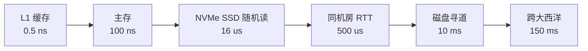
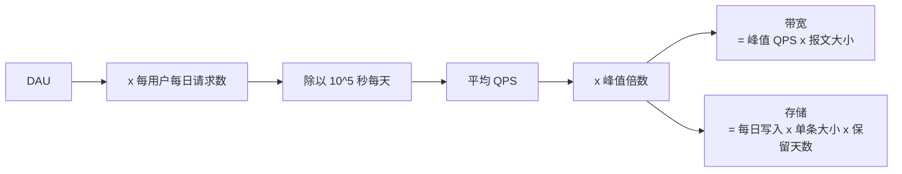
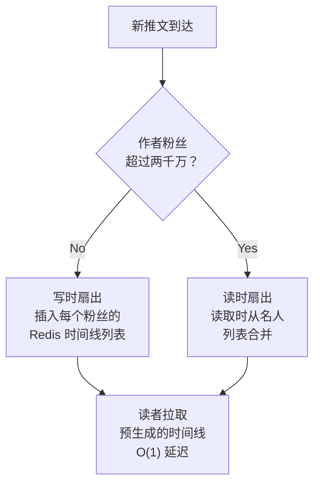

# 量级估算

> **TL;DR**: 你不需要三位有效数字，你要的是三分钟内拿到正确的数量级。背下几个常数（每天 10^5 秒、2^10 = 10^3、峰值是均值的 3 到 5 倍），把它们灌进从 DAU 到 QPS 再到存储的流水线里，你就能知道自己的系统是能塞进一台笔记本、一个机柜，还是一支跨地域集群。Shopify 2024 年 BFCM 在边缘侧峰值每分钟 2.84 亿次请求[^1]，而这个数字几个月前就靠这类算术预测出来了。

## 学习目标

学完本章，你将能够：

- [ ] 背出 2 的幂表直到 2^50，并瞬间换算成十进制近似值
- [ ] 在三分钟内把 DAU 换算成平均 QPS、峰值 QPS、带宽和存储
- [ ] 按服务类别套用合适的峰值倍数（2 倍到 10 倍）
- [ ] 估算存储时把副本、索引和备份都算进去
- [ ] 分清比特与字节，避开带宽估算里那个 8 倍错误
- [ ] 为 Twitter 规模或 WhatsApp 规模的系统给出站得住脚的容量估算

## 直觉理解

上世纪 40 年代，芝加哥大学的恩里科·费米（Enrico Fermi）问过学生一个著名的问题：「芝加哥有多少个钢琴调音师？」[^2] 没人知道答案，而这正是重点。费米演示了：只要把几个合理的假设串起来（芝加哥的人口、有钢琴的家庭比例、每年调音次数、每次调音耗时、每个调音师的工作时长），不到一分钟你就能落在真实值的 2 倍以内。不用查资料，只要乘法。

系统设计里的估算也是同一门手艺。你不是在拿会计的精度做预算，你回答的是：「这东西装得进一台服务器、一个机柜，还是一个数据中心？」这个问题的答案会改变你的架构。10 TB 和 10 PB 的差别，就是「买块更大的盘」和「设计一套分片策略」的差别。10 PB 和 10 EB 的差别，就是「分片」和「推倒重来」的差别。

把每天 86,400 秒粗略当成 10^5，引入 15% 误差。把 2^20 当成 10^6，引入 5% 误差。一路叠下来，在 PB 量级大约累积到 25%[^3]。这没关系。没有任何架构决策会因为 25% 而翻转，但所有架构决策都会因为 10 倍而翻转。

反过来的失误更糟：花 20 分钟精算出 169,722 QPS，而不是说一句「大约 15 万」然后直接进设计。

## 原理

### 必须背下来的 10 的幂

这些常数是估算能快起来的原因。背一次，用一辈子。

| 幂 | 字节数 | 十进制近似 | 单位 |
|-------|-------|----------------|------|
| 2^10 | 1,024 | 10^3 | KB |
| 2^20 | 1,048,576 | 10^6 | MB |
| 2^30 | ~10^9 | 10^9 | GB |
| 2^40 | ~10^12 | 10^12 | TB |
| 2^50 | ~10^15 | 10^15 | PB |

时间常数：

- 1 天 = 86,400 秒。取整成 **10^5**（15% 误差，永远可以接受）。
- 1 年 = 3150 万秒。取整成 **3 x 10^7**。
- 1 个月 = 260 万秒。取整成 **2.5 x 10^6**。

用户量级锚点：

- 全球人口：80 亿。智能手机用户：50 亿。
- Facebook DAU：21 亿[^4]。YouTube MAU：27 亿。
- WhatsApp 每天消息量：1000 亿条（2024）[^5]。

### 延迟阶梯

Jeff Dean 的「每个程序员都应该知道的数字」横跨近九个数量级[^6][^7]。[延迟与吞吐量](../part-1-core-fundamentals/01-latency-and-throughput.md) 有详细展开。做估算，记住这几个锚点就够了：

| 操作 | 延迟 | 数量级 |
|-----------|---------|-------|
| L1 缓存访问 | 0.5 ns | 10^-9 |
| 主存访问 | 100 ns | 10^-7 |
| NVMe SSD 随机读 4 KB | 16 us | 10^-5 |
| 同数据中心 RTT | 500 us | 10^-4 |
| 磁盘寻道 | 10 ms | 10^-2 |
| 加州到荷兰 RTT | 150 ms | 10^-1 |



*延迟阶梯上每一跳都比上一跳慢 10 倍到 1000 倍；这个形状从 2012 年至今几乎没变，因为内存和光速都是物理极限[^8]。*

估算上的关键结论：如果你的设计每个请求都要跨数据中心往返一次，你的延迟下限就是 150 ms。再多优化也改不了物理。

### QPS 估算

公式：

```text
avg_QPS = DAU x requests_per_user_per_day / 10^5
peak_QPS = avg_QPS x peak_multiplier
```

按服务类别划分的峰值倍数（数据来自真实事件）：

| 服务类别 | 峰值与均值之比 | 依据 |
|---------------|---------------|----------|
| 全球消费级（全天候） | 2 到 3 倍 | Twitter 的日周期[^9] |
| 区域消费级（单一时区） | 3 到 5 倍 | Shopify BFCM 2024：边缘 470 万 RPS[^1] |
| B2B（工作时段） | 5 到 10 倍 | 周一上午 9 点到 11 点的尖峰 |
| 事件驱动（体育直播、选举） | 10 到 30 倍 | 超级碗网络流量约 10 倍；选举期间新闻站点 20 到 50 倍；2014 世界杯峰值 61.8 万 TPM[^10] |



*从用户规模到容量预算的五步流水线。每个估算都走这条路；三个倍数（峰值、副本、保留期）正是大多数人漏算的地方。*

**算例：** 2013 年的 Twitter 有 1.5 亿 DAU，时间线读取 30 万 QPS，写入 6000 QPS（读写比 50:1）[^9]。我们来验一遍：

```text
Write QPS check: 400M tweets/day / 10^5 = 4,000 TPS avg
Peak write: 4,000 x 2.5 = 10,000 TPS (matches reported 6K-12K range)
Read QPS: 150M x 200 reads/day / 10^5 = 300,000 QPS (exact match)
```

> [!TIP]
> 除非你有更靠谱的依据，就假设峰值是均值的 5 倍。它是 2 倍到 10 倍区间的几何中值，很少让你翻车。

### 存储估算

公式：`records_per_day x bytes_per_record x retention_days x replication_factor x 1.3 (indexes)`

容易被忘掉的几个倍数：

- **副本因子：** 对 Cassandra、ScyllaDB、DynamoDB、HDFS 来说，3 倍是起步价[^11]。
- **索引开销：** 二级索引、布隆过滤器、墓碑标记会额外带来 1.3 到 1.5 倍[^11]。
- **备份：** 视保留策略，是主存储的 2 到 5 倍[^1]。

Discord 把每个倍数都演示了一遍。2022 年他们的数万亿条消息跑在 177 个 Cassandra 节点上。迁到 RF=3 的 ScyllaDB 之后，落在 72 个节点、每节点 9 TB，复制后的消息数据总计约 650 TB[^11]。

**单对象大小参考：**

| 对象类型 | 典型大小 | 说明 |
|-------------|-------------|-------|
| 推文与短消息 | 200 B 到 1 KB | 正文 + 元数据 + 指针 |
| 聊天消息（WhatsApp） | ~1 KB | 端到端加密载荷 |
| 用户资料行 | 1 到 5 KB | 姓名、邮箱、偏好、头像 URL |
| GPS 上报 | 50 B | lat、lng、timestamp、trip_id |
| 照片元数据 | 5 到 10 KB | EXIF、标签、权限 |
| 照片文件（已压缩） | 2 到 5 MB | JPEG/WebP |
| 1 分钟视频（720p） | 10 到 15 MB | H.264 编码 |

### 带宽估算

公式：`peak_QPS x avg_payload_size`

要命的单位陷阱：**1 Gbps = 125 MB/s，不是 1 GB/s。** 网络工程师用比特，存储工程师用字节，把两者混起来会把容量估算放大 8 倍[^7]。

AWS 出网价格（us-east-1，2025 年）：每月前 100 GB 免费，之后 10 TB 以内 $0.09/GB，超过 150 TB 后阶梯下调到 $0.05/GB[^12][^13]。跨可用区流量按 $0.01/GB 双向计费，在微服务架构里这笔钱涨得很快，服务间调用很容易大幅超过对外出网[^12]。

**YouTube 验算：** 27 亿 MAU，约相当于 10 亿 DAU，每人每天看 30 分钟、平均码率 2 Mbps，约等于 2000 万路平均并发。按 3 倍峰值，6000 万并发 x 2 Mbps，估出峰值出网 **120 Tbps**[^14]。这就是为什么 Google Edge Network 要在全球都市区铺 100 多个 CDN 缓存点，另外还有一大批对等互联的边缘 PoP[^15]。

### 内存与 CPU 容量规划

**Redis 单键开销：** 每个键除了值本身，还要背 50 到 100 字节的元数据（指针、类型标记、过期时间）[^16]。1000 万个小键，数据还没存进去就已经有 500 MB 到 1 GB 的开销。Redis 的哈希编码（listpack）对小集合最多能省 10 倍内存，常见的也有 5 倍[^17]。

**缓存容量规则：** working_set x 1.2 是标准的 LRU 目标。如果淘汰率超过 1%，就加内存或者降低键基数。

**线程数经验法则：** CPU 密集型任务用 N_cores 个线程；I/O 密集型用 N_cores 的 2 到 4 倍（经典的 `CPU x (1 + wait_time/compute_time)` 公式）。


*把天真估算变成真实容量的一摞倍数。漏掉任何一个，都会低估 2 到 5 倍；漏掉两个，就差一个数量级。*

## 真实案例

### 2013 年 Twitter 时间线的扇出

Raffi Krikorian 2013 年在 QCon 的那场演讲[^18]，是「估算撞上生产」的经典算例。我们把全部算术走一遍，看它怎么推动了架构。

**已知数字（2013 年）：**

- 1.5 亿 DAU，每天 4 亿条推文[^9]
- 时间线读取 30 万 QPS，写入 6000 QPS（读写比 50:1）[^9]
- firehose 22 MB/s（全部公开推文）[^9]
- 主页时间线每天 300 亿次投递[^9]

**存储估算：**

```text
Tweets/day: 400M = 4 x 10^8
Bytes/tweet: ~1 KB (280 chars + metadata + media pointers)
Raw/day: 4 x 10^8 x 10^3 = 4 x 10^11 B = 400 GB/day
Per year: 400 GB x 365 = 146 TB/year
Replicated (3x): ~450 TB/year
With indexes (1.3x): ~585 TB/year. Round to 600 TB/year.
```

**扇出成本（难点在这里）：**

每条推文都要投递到每一个活跃粉丝的时间线缓存里。Twitter 把时间线 ID 存在 Redis：每用户 800 条，每条 12 字节（8 字节推文 ID + 4 字节标志位）[^9]。

```text
Avg followers: ~200 (median much lower, but celebrities skew)
Fanout writes/tweet: 200 Redis list inserts (average case)
Total fanout writes/day: 400M tweets x 200 = 80 billion Redis inserts
Fanout QPS: 80B / 10^5 = 800K Redis writes/sec
```

这个量级非常恐怖，遇上名人还会更糟。一个有两千万粉丝的用户发一条推文，就是两千万次 Redis 插入。面向 100 万粉丝的 p50 投递时间是 3.5 秒，名人推文造成的队列深度会是灾难性的[^9]。

**这套算术逼出来的架构决策：**

- 普通用户走写时扇出（预先算好时间线，读取 O(1)）
- 头部名人群体走读时扇出（读取时合并，避免两千万次写入）
- 只有活跃用户（30 天内登录过）才缓存时间线[^9]



*Twitter 的混合扇出：对普通用户用写放大换取 O(1) 的读延迟；名人则切到读取时合并，避免每条推文两千万次以上的 Redis 插入。*

「fail whale」时代可以直接追溯到名人扇出：回复比原推先到，因为扇出队列还没排完[^9]。2014 年转向对头部账号做读取时合并，正是量级估算早就预测出来的解法。

## 权衡

本章讲的是方法，不是一份可替换设计的菜单，所以这里没有可比的备选方案表。两个看起来像表格的决策（**写时扇出 vs 读时扇出**，以及两个主要的**估算启发式**）都在上文正文里讲过了：

- **写时扇出 vs 读时扇出** 是 § 真实案例 里 Twitter 那个例子走过的架构选择，切换阈值取名人粉丝数这条经验规则[^9][^18]。
- **估算启发式**（早期不确定性大时向上估约 10 倍；为了速度取 10 的幂，接受 PB 量级约 25% 的累积误差）贯穿 § 原理 和 § 存储估算。

把这两件事当成方法，而不是二选一的选项。

## 常见陷阱

> [!WARNING]
> **忽略峰值与均值的差别。** 除以 86,400 得到的是平均 QPS。峰值视服务类别要高 2 到 10 倍。Shopify BFCM 2024 在边缘侧打到 470 万 RPS[^1]，而它的日均值低得多。永远乘一个峰值因子。

> [!WARNING]
> **忘掉副本因子。** Cassandra RF=3、HDFS 存 3 份、DynamoDB 跨 3 个可用区。漏了这一步，你的原始存储估算就低了 3 倍。Discord 的 650 TB 已经是 3 副本之后的数据[^11]。

> [!WARNING]
> **忘掉备份。** 主存储还要再乘 2 到 5 倍才是备份保留占用的空间。Shopify 在 BFCM 2024 那个周末，全部系统一共写了 57.3 PB[^1]。这些数据都有备份副本。

> [!WARNING]
> **把 Mbps 和 MBps 搞混。** 10 Gbps = 1.25 GB/s，不是 10 GB/s。一个 8 倍的错误就毁掉整条带宽估算。单位永远写清楚。

> [!WARNING]
> **假设访问模式是均匀的。** 真实流量服从 Zipf 与幂律分布。Justin Bieber 一条推文要扇出到两千万条以上的时间线；Discord 里一句 @everyone 就能让某个分片惊群[^9][^11]。要按热点键设计，不是按平均键。

> [!WARNING]
> **忘掉索引开销。** OLTP 系统里，二级索引、布隆过滤器、墓碑标记会在原始数据之上再压 30% 到 50%[^11]。100 TB 的原始估算，落盘就是 130 到 150 TB。

> [!CAUTION]
> **假设动态 API 也有 CDN 命中率。** 静态内容命中率 90% 以上。个性化信息流接近 0%，因为每个响应都是按用户单独生成的。除非你有具体的按用户缓存方案，否则动态 API 流量按 CDN 命中率 0% 估算[^14]。

> [!WARNING]
> **把 MAU、DAU 和并发用户混着用。** MAU 通常是 DAU 的 3 到 5 倍。峰值并发是 DAU 的 1% 到 10%。用错基数，估算就会差一个数量级。

> [!WARNING]
> **干脆不估。** 不做 60 秒的容量过一遍就开工，等于在还不知道负载类型之前先把架构类别定死。选错类别的代价（读多的负载配了个写优化的 LSM 存储、全球分布的用户配了单地域集群）是按工程师季度算的，不是按分钟算。哪怕你以为自己已经知道答案，也先估一遍。

## 练习

> **设计挑战**：为一个类似 WhatsApp 的即时通讯应用估算存储、带宽和服务器数量：30 亿 MAU，每天 1000 亿条消息，平均每条 1 KB。把算术一步步写出来。

<details>
<summary>提示</summary>

从写路径开始：每秒消息数、每秒字节数、每日存储。然后套上倍数堆栈（峰值、副本、索引）。带宽方面记住，消息类应用读通常多于写（每条消息至少被一个收件人读，群消息被很多人读）。服务器数量用单节点吞吐假设（例如写优化的数据库每节点每秒 5 万次写）。

</details>

<details>
<summary>解答</summary>

**第 1 步：QPS**

```text
Messages/day: 100B = 10^11
Avg write QPS: 10^11 / 10^5 = 10^6 = 1M messages/sec
Peak write QPS (3x): 3M messages/sec
```

验算：WhatsApp 公布的每天 1000 亿条消息[^5]对应 116 万 TPS 的持续写入。我们的 100 万在 15% 误差内，可以。

**第 2 步：存储（每日）**

```text
Raw bytes/day: 10^11 messages x 1 KB = 10^14 B = 100 TB/day
Replicated (RF=3): 300 TB/day
With indexes (1.3x): 390 TB/day. Round to 400 TB/day.
```

**第 3 步：存储（年度）**

```text
Per year: 400 TB/day x 365 = 146 PB/year. Round to 150 PB/year.
5-year retention: 750 PB = 0.75 EB
```

**第 4 步：带宽**

```text
Write ingress: 3M msg/sec x 1 KB = 3 GB/s = 24 Gbps peak
Read egress (assume each message read 1.5x on average for group chats):
  = 3M x 1.5 x 1 KB = 4.5 GB/s = 36 Gbps peak
Total: ~60 Gbps peak, distributed across regions.
```

**第 5 步：服务器数量（存储节点）**

```text
Assume 8 TB usable per node (ScyllaDB/Cassandra class):
Daily growth: 400 TB/day / 8 TB = 50 new nodes per day just for growth
Steady-state for 1 year of hot data: 150 PB / 8 TB = ~18,750 nodes
```

这个数字非常大。实际上 WhatsApp 用了消息过期（端到端加密会话在两端都投递成功后即删除），把保留期大幅压短。如果保留期是 30 天而不是 365 天：

```text
30-day hot storage: 400 TB/day x 30 = 12 PB
Nodes: 12 PB / 8 TB = 1,500 nodes (much more reasonable)
```

**架构影响：**

- 写密集（100 万 TPS 以上）：需要写优化的存储（基于 LSM 树：Cassandra、ScyllaDB）
- 带宽在区域层面可控（约 60 Gbps 分摊到 5 个以上地域）
- 真正的约束是存储增长速度，所以保留策略才是最重要的业务决策
- 服务器数量对保留期极其敏感：30 天 = 1500 个节点；1 年 = 18750 个节点

</details>

## 要点回顾

- 永远先估。哪怕只花 60 秒，也能避免选错架构类别（单机、分片集群、跨地域集群）。
- 三分钟内估完。目标是数量级。15 万 QPS 和 17 万 QPS 什么都不改变；15 万对 150 万则改变一切。
- 背熟常数：每天 10^5 秒、每年 3 x 10^7 秒、2^10 = 10^3、2^40 = 1 TB。
- 走流水线：DAU 到 QPS 到带宽到存储。每次都从头走到尾。
- 永远套上倍数堆栈：峰值（3 到 5 倍）、副本（3 倍）、索引（1.3 倍）、备份（2 到 5 倍）。漏掉一个就是最常见的估算失误。
- 峰值倍数都有实证依据：Shopify BFCM 470 万 RPS[^1]、Twitter 世界杯 61.8 万 TPM[^10]。
- 比特与字节是 8 倍的差距。把单位写上，永远。
- 估算的任务是选出架构类别（单机、分片集群、跨地域集群），不是出一张采购单。

## 延伸阅读

- [Jeff Dean, \“Building Software Systems at Google and Lessons Learned\”](https://research.google.com/people/jeff/stanford-295-talk.pdf) - 斯坦福 CS295 那场演讲，延迟数字最早就是从这里广泛传开的；你见过的每一张估算表都源自它。
- [Jonas Boner, \“Latency Numbers Every Programmer Should Know\”](https://gist.github.com/jboner/2841832) - 那份经典 gist，最后更新于 2024 年，评论区讨论了哪些数字发生了漂移。
- [Colin Scott, Interactive Latency](https://colin-scott.github.io/personal_website/research/interactive_latency.html) - 动态可视化，展示 Dean 的数字如何随时间漂移；也证明了内存访问和跨洲 RTT 被物理规律钉死。
- [Raffi Krikorian, \“Timelines at Scale\” (InfoQ 2013)](https://www.infoq.com/presentations/twitter-timeline-scalability/) - 关于 Twitter 扇出的经典演讲，给出了精确的 QPS、存储和投递时间数字。
- [Discord, \“How Discord Stores Trillions of Messages\”](https://discord.com/blog/how-discord-stores-trillions-of-messages) - 在生产中验证过的存储量级估算：节点数、延迟、副本因子和迁移速度。
- [Shopify Engineering, \“How we prepare Shopify for BFCM\”](https://www.shopify.engineering/bfcm-readiness-2025) - 现代峰值容量规划，带 2024 年数字（边缘 2.84 亿 RPM、每分钟 12 TB、总计 57.3 PB）。
- [Sirupsen, Napkin Math](https://sirupsen.com/napkin/) - 每月一期的估算练习题，配第一性原理的代码校验；练估算肌肉最好的方式。
- [Brendan Gregg, The USE Method](https://www.brendangregg.com/usemethod.html) - 利用率、饱和度、错误的三项清单，用来拿生产瓶颈校验你的估算。
- [Redis Memory Optimization](https://redis.io/docs/latest/operate/oss_and_stack/management/optimization/memory-optimization/) - listpack 编码阈值和哈希模式，用来定缓存容量；当你的估算说「Redis 里要放 5000 万个键」时，这是必读。

## 记忆卡片

**Q:** 一天有多少秒？做量级估算时用什么近似值？
**A:** 精确是 86,400 秒。为速度取整成 10^5（15% 误差，做估算永远可以接受）。

**Q:** 某服务有 5 亿 DAU，每人每天 20 次请求。估算平均 QPS 和峰值 QPS。
**A:** 5 亿 x 20 / 10^5 = 平均 10 万 QPS。按 5 倍峰值 = 50 万 QPS。

**Q:** 2^40 字节有多大？
**A:** 约 10^12 字节 = 1 TB。

**Q:** Cassandra、ScyllaDB、DynamoDB 的典型副本因子是多少？
**A:** 3 倍。你存的每个字节在磁盘上都占 3 个字节。这是存储估算里最常被忘掉的那个倍数。

**Q:** 区域消费级应用该用多大的峰值倍数？
**A:** 3 到 5 倍。依据：Shopify BFCM 2024 边缘侧打到 470 万 RPS，远高于日均值。

**Q:** 10 Gbps 和 10 GB/s 差在哪里？
**A:** 10 Gbps = 1.25 GB/s（除以 8）。把两者搞混，带宽估算会放大 8 倍。

**Q:** 你要存每天 1000 亿条消息，每条 1 KB，RF=3，索引开销 1.3 倍。每日存储多少？
**A:** 1000 亿 x 1 KB = 100 TB 原始。x 3 副本 = 300 TB。x 1.3 索引 = 每天 390 TB。

**Q:** 2013 年 Twitter 的读写 QPS 比是多少？
**A:** 30 万读对 6000 写 = 50:1，严重读多。这个比例直接决定了写时扇出的架构。

**Q:** Twitter 为什么给名人改成读时扇出？
**A:** 一个两千万粉丝的用户发推，需要两千万次 Redis 列表插入。扇出队列在下一条名人推文到来前排不空，于是就有了「fail whale」。

**Q:** 存储估算的标准公式是什么？
**A:** records_per_day x bytes_per_record x retention_days x replication_factor x 1.3（索引开销）。

**Q:** AWS 在 us-east-1 的互联网出网价格是多少（2025 年）？
**A:** 前 100 GB 免费，之后 10 TB 以内 $0.09/GB，超过 150 TB 阶梯降到 $0.05/GB。

**Q:** WhatsApp 每天发 1000 亿条消息，持续写入 TPS 是多少？
**A:** 1000 亿 / 86,400 = 116 万 TPS。做估算时取整成 100 万 TPS。

**Q:** 给 Redis 缓存定容量，工作集规则是什么？
**A:** working_set x 1.2，留出 LRU 余量。每个键再加 50 到 100 字节，覆盖 Redis 内部元数据开销。

**Q:** 2014 年世界杯决赛在 Twitter 上产生了多大峰值流量？
**A:** 每分钟 618,725 条推文，约为日均 34.2 万 TPM（基线 5700 TPS）的 1.8 倍。

**Q:** 什么时候可以跳过量级估算？
**A:** 永远不行。哪怕 60 秒的估算也能避免盲设计。选错架构类别的代价（读多的负载做成写密集设计）远远超过三分钟的算术。

## 参考文献

[^1]: Kyle Petroski and Matthew Frail, “How we prepare Shopify for BFCM,” Shopify Engineering, 2025 年 11 月（讨论 2024 年数据）。https://www.shopify.engineering/bfcm-readiness-2025
[^2]: Wikipedia, “Fermi problem”（钢琴调音师估算，出自恩里科·费米 1942 至 1954 年在芝加哥大学的授课）。https://en.wikipedia.org/wiki/Fermi_problem
[^3]: Simon Eskildsen (sirupsen), “Napkin Math” 通讯与练习题。https://sirupsen.com/napkin/
[^4]: Meta Platforms / Statista, “Number of daily active Facebook users worldwide as of 4th quarter 2023”（21.1 亿 DAU）。https://www.statista.com/statistics/346167/facebook-global-dau/
[^5]: Educative / GetStream, “How WhatsApp delivers 100 billion messages every single day.” https://www.educative.io/newsletter/system-design/whatsapp-100-billion-messages
[^6]: Jeff Dean, “Software Engineering Advice from Building Large-Scale Distributed Systems,” Stanford CS295, 2009. https://research.google.com/people/jeff/stanford-295-talk.pdf
[^7]: Jonas Boner (ed.), “Latency Numbers Every Programmer Should Know”（gist，经 Peter Norvig 转述自 Jeff Dean，最后修订于 2024 年）。https://gist.github.com/jboner/2841832
[^8]: Colin Scott, “Latency Numbers Every Programmer Should Know”（交互版）。https://colin-scott.github.io/personal_website/research/interactive_latency.html
[^9]: HighScalability, “The Architecture Twitter Uses to Deal with 150M Active Users, 300K QPS, a 22 MB/S Firehose, and Send Tweets in Under 5 Seconds,” 2013. https://highscalability.com/the-architecture-twitter-uses-to-deal-with-150m-active-users/
[^10]: CNBC, “FIFA's World Cup final breaks social media records”（618,725 TPM），2014 年 7 月。https://www.cnbc.com/2014/07/14/fifas-world-cup-final-breaks-social-media-records.html
[^11]: Bo Ingram, “How Discord Stores Trillions of Messages,” Discord Engineering Blog, 2023. https://discord.com/blog/how-discord-stores-trillions-of-messages
[^12]: Wring.co, “AWS Data Transfer Pricing: The Hidden Cost”（2025 年出网阶梯价格汇总）。https://wring.co/blog/aws-data-transfer-pricing-guide
[^13]: RedressCompliance, “AWS Data Transfer and Egress Cost”（前 10 TB 为 $0.09/GB，跨可用区双向 $0.01/GB）。https://redresscompliance.com/aws-data-transfer-egress-negotiation-download.html
[^14]: BlazingCDN, “How YouTube CDN works” 及 YouTube 公开统计（每分钟上传 500 小时，2026 年约 27 亿 MAU）。https://blog.blazingcdn.com/en-us/how-youtube-cdn-works
[^15]: Google Cloud, “Cache locations”（Cloud CDN 在 100 多个都市区部署缓存；此外还有大量对等互联边缘 PoP）。https://cloud.google.com/cdn/docs/locations
[^16]: Microsoft Azure, “Best practices for memory management for Azure Managed Redis”（单键 50 到 100 字节开销）。https://learn.microsoft.com/en-us/azure/redis/best-practices-memory-management
[^17]: Redis, “Memory optimization” 文档（listpack 编码，最多可省 10 倍内存）。https://redis.io/docs/latest/operate/oss_and_stack/management/optimization/memory-optimization/
[^18]: Raffi Krikorian, “Timelines at Scale,” InfoQ（QCon SF 2012/2013）。https://www.infoq.com/presentations/twitter-timeline-scalability/
