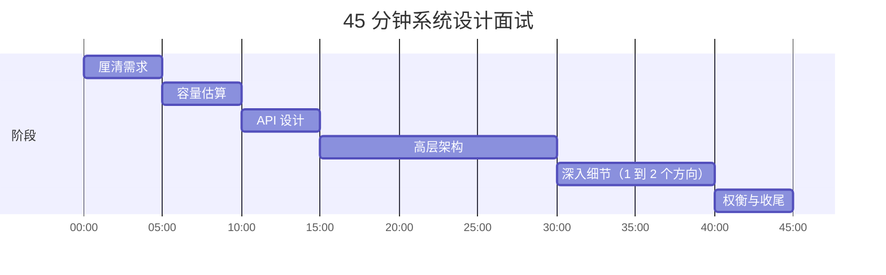
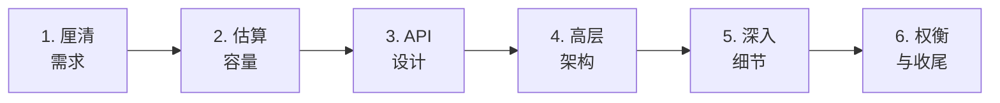
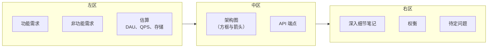
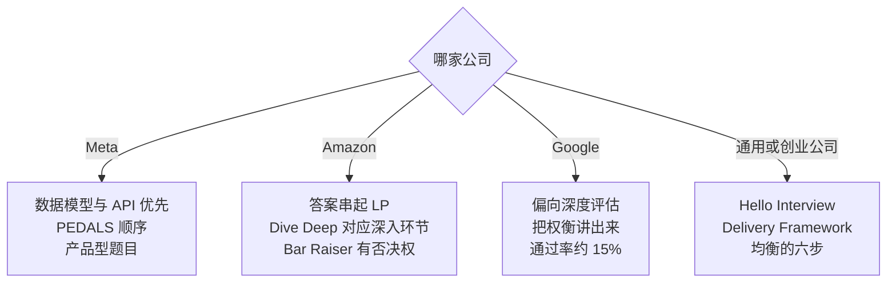

# 如何拆解一道系统设计题

> **TL;DR**: 系统设计面试是一场 45 分钟的开放式对话，过程比最后那张图更重要[^1]。用一套六步框架（厘清需求、量级估算、API 设计、高层设计、深入细节、权衡收尾），给每一步配上严格的时间预算（5+5+5+15+10+5 分钟）。失败的面试里，大约 50% 都能追到同一个错误：还没厘清需求就开始画图[^2][^3]。框架不是台词本，它是认知脚手架——让你保持冷静、该覆盖的地方一个不漏，也让面试官跟得上你的推理。

## 学习目标

学完本章，你将能够：

- [ ] 用六步框架组织任何一场系统设计对话
- [ ] 把 45 分钟分配到各个阶段，时间预算站得住脚
- [ ] 在前 5 分钟里把功能需求和非功能需求分开
- [ ] 选出一个能体现高级工程师判断力的深入方向
- [ ] 认出最常见的三种失败模式，并绕开它们
- [ ] 按公司偏好调整框架（Meta、Amazon、Google）

## 直觉理解

急诊医生不会盯着病人想「我该干什么」。他们走流程：气道、呼吸、循环、意识、暴露。流程并没有把他们变成机器人，恰恰相反——顺序自动执行了，脑子才能腾出来做真正困难的临床判断。

系统设计面试是同一回事。题目（「设计 Twitter」）是病人，你是医生。没有流程，你会慌，会扑向脑子里蹦出的第一个东西（数据库！），然后在一个组件上耗掉 30 分钟，剩下的系统一眼都没看。有了流程，每一分钟都有已知的用途，你的脑力预算花在真正的工程问题上，而不是花在「下一句该说什么」的元规划上。

高级工程师在真实的设计评审里用的也是同一套流程。唯一的区别是：面试里你要把过程说出来，生产环境里你默默做完。框架不是面试技巧，它就是优秀工程师的思考方式。

## 原理

### 45 分钟的时间拆解

各大科技公司的系统设计轮次基本都是 45 分钟[^4]。这点时间短得不讲道理，你不可能面面俱到。框架的职责，就是把固定时间格分给每个阶段，让这段时间变得可控。



*5+5+5+15+10+5 的切分在第 5、10、15、30、40、45 分钟各给你一个检查点。如果你在第 10 分钟还停在需求阶段，你已经落后了。*

这个形状是有意为之：前三分之一用来框定问题（需求、估算、API），中间三分之一画架构，最后三分之一往下钻并收尾。ByteByteGo 的经典分配收敛到同一个形状：需求 3-10 分钟，高层设计 10-15 分钟，深入细节 10-25 分钟，收尾 3-5 分钟[^1]。Hello Interview 的 Delivery Framework 切得更细，把核心实体和 API 各自单列成阶段[^5]。

> [!IMPORTANT]
> 如果第 15 分钟你的白板上还是空的，你的时间预算已经失败了。砍掉前面的内容，说明假设，开始画。「这个话题我先假设 X，如果不对请纠正我」，永远好过完美但零设计的需求分析。

### 六步框架

所有叫得出名字的框架（Alex Xu 的四步、RESHADED、PEDALS、Hello Interview 的 Delivery Framework），都是同一副骨架的变体[^1][^5][^6]。下面是合并后的版本：



*六步框架。每一步为下一步供料：需求约束估算，估算决定架构的量级，架构又会暴露值得深挖的候选方向。*

**第 1 步：厘清需求（5 分钟）。** 问 3 到 5 个锋利的问题，每个问题的答案都要能改变架构。把需求拆成功能需求（「用户应该能……」）和非功能需求（「系统应该扛住……」）。非功能需求要量化：「p99 下 500 ms 内返回搜索结果」，而不是「低延迟」[^5]。

**第 2 步：量级估算（5 分钟）。** 按 [量级估算](../part-1-core-fundamentals/04-back-of-envelope-estimation.md) 那条流水线，把 DAU 换算成 QPS、存储和带宽。只有当这些数字不会改变设计时才可以跳过（比如创业公司量级的 CRUD 应用）。跳过就明说[^5]。

**第 3 步：API 设计（5 分钟）。** 为核心用例定义 3 到 5 个端点。默认用 REST。为最有意思的那个端点写出请求和响应的形状。这会逼你在画方框之前先想清楚数据契约。

**第 4 步：高层架构（15 分钟）。** 画出组件图：客户端、负载均衡器、应用层、数据存储、缓存、队列、异步 worker。带着面试官把主用例的请求流程从头到尾走一遍。

**第 5 步：深入细节（10 分钟）。** 挑 1 到 2 个真正藏着有趣权衡的组件。高级别的判断力就体现在这里：你选了哪个方向去深挖，本身就暴露了你认为什么才重要[^7]。

**第 6 步：权衡与收尾（5 分钟）。** 总结你建了什么、放弃了什么、如果时间更多会改什么。点名那个你没解决的瓶颈。这是最后的印象分。

### 面试官在评什么

面试官评三条维度，权重随职级变化[^7]：

| 维度 | 中级 | 高级 | Staff+ |
|------|-----------|--------|--------|
| 广度 | 必须覆盖所有主要组件 | 默认具备，快速带过 | 默认具备，几乎不提 |
| 深度 | 浅，靠面试官引导 | 两个方向，带具体例子 | 多个方向，甚至可以反过来教面试官 |
| 主动性 | 需要被催着才深入 | 主动推进深入方向 | 主导整场面试 |

面试准备资料里有一句：「架构无懈可击却挂掉的候选人，问题都在于讲不清自己的推理」[^8]。按第三方估算，大约 15% 的候选人能通过 Google 的系统设计轮[^8]。拉开差距的不是知识，是结构化的表达。

在 Amazon，每位面试官会被分配 2 到 3 条 Leadership Principle 来考察。「Dive Deep」直接对应深入细节那个环节。讲不清某一个组件细节的候选人，这一维度就挂了[^9]。Amazon 的 Bar Raiser 制度（1 万多名 Bar Raiser 与在训 Bar Raiser，1999 年设立）会派一位来自其他团队、受过专门训练的面试官，对每一个录用决定握有一票否决权[^10]。

> [!TIP]
> 面试官不是你的对手，是协作方。当他们把你拉回正轨（「跳过分布式设计，重点讲 API 层」），立刻跟上。无视这种引导是第 6 常见的失败模式[^3]。

### 白板布局

把白板（或共享文档）划成三个区：



*三区白板布局。左边是你和面试官之间的契约（双方约定要建什么），中间是设计本身，右边用来展示深度和判断力。*

左区是你的锚。面试官问「你为什么选 Cassandra」，你指回左区：「因为我们约定写 QPS 是 50 万，而且最终一致性可以接受。」中区是设计本身。右区收集权衡和你打算在收尾时回答的待定问题。

### 沟通技巧

**边想边说。** 沉默不要超过 10 秒。正在思考就把思考说出来：「我在考虑这里用推模型还是拉模型，让我把权衡过一遍……」沉默会让面试官不安[^1]。

**转折处打路标。** 「需求这部分我讲完了，接下来做估算。」这句话告诉面试官你走到框架的哪一步，也给了他们在你投入时间之前纠正方向的机会。

**显式声明假设。** 「除非你有别的设定，我假设 DAU 是一亿。」这比提问再等回答更快。如果面试官不同意，他会纠正你。

**把「看情况」这句话说完。** 永远不要只说一句「看情况」就停住。一定要补完：「取决于读写比。如果读占主导（100:1），我会用写时扇出；如果写占主导，我会用读时扇出」[^3]。

**在转折处要反馈。** 「这个高层设计看起来合理吗？然后我再往下讲信息流的生成组件。」这是协作，不是示弱，它说明你重视面试官的输入。

### 各公司风格差异

不同公司对各步骤的权重不一样。要适配，不要重新发明：



*公司风格决策树。Meta 强调数据建模，Amazon 把 Leadership Principles 串进答案，Google 奖励深度和讲述。*

**Meta** 在产品型题目（「设计 Instagram」）里，要求先讲数据模型和 API，再讲基础设施。PEDALS 框架（Process Requirements、Estimate、Design the Service、Articulate the Data Model、List the Architectural Components、Scale）正好对应这个顺序[^11][^4]。Meta 的面试流程包含两轮系统设计（一轮在技术初筛，一轮在现场），按 Exponent 的说法，表达混乱是失败的第一预测因素[^4]。

**Amazon** 会把 Leadership Principles 串进每一个回答里。「Ownership」意味着你要为整个系统负责，不只是某一个组件。「Dive Deep」意味着深入环节必须真的深。Bar Raiser 主持复盘会（通常在面试后一周内），一份「不录用」就能毙掉整个候选人包[^10][^12]。

**Google** 偏重深度。L5 候选人要能在界定清晰的领域里独立主导系统设计；L6 候选人必须能化解深层的模糊性，并影响跨团队的技术方向[^13]。题目偏向 Google 真实规模的系统：YouTube、Google Maps、网页爬虫[^8]。

想看成体系的各公司差异，见 [各公司风格差异](../../../hld/part-11-interview-framework/04-company-specific-flavors.md)。

## 真实案例

下面用六步框架，逐分钟走一遍「设计 TinyURL」。这就是一个强候选人在每个检查点上该说的话、该画的东西。

**第 0-5 分钟：厘清需求。** 「两个问题。第一，这是全球服务还是单区域？第二，预期规模多大？」面试官：「全球，存 10 亿条 URL，DAU 一亿。」你在左区写下：功能需求——缩短 URL、跳转、可选过期。非功能需求——跳转延迟低于 100 ms、读可用性 99.99%、最终一致性可接受。

**第 5-10 分钟：量级估算。** 「DAU 一亿，假设每人每天创建 1 条 = 每天 1 亿次创建。跳转按读多写少 100:1，即每天 100 亿次跳转。QPS：创建 = 1 亿/10^5 = 平均 1K，峰值 5K。跳转 = 100 亿/10^5 = 平均 10 万，峰值 50 万。存储：10 亿条 × 500 字节 = 500 GB。一个分片集群装得下，还有余量。」

**第 10-15 分钟：API。** 你写下三个端点：`POST /urls {long_url, expiry?} -> {short_code}`、`GET /{code} -> 302 redirect`、`DELETE /urls/{code}`。备注：用 API key 鉴权，每用户限流每分钟 100 次创建。

**第 15-30 分钟：高层架构。** 你画：客户端 -> CDN（静态资源）-> 负载均衡器 -> API 网关（限流）-> 创建服务 / 跳转服务 -> Redis 缓存 -> PostgreSQL（按 short_code 前缀分片）。再加 Kafka 做异步分析。然后走跳转路径：GET /abc123 -> 负载均衡器 -> 跳转服务 -> 查 Redis（命中？返回 302）-> 回落到 DB -> 回填缓存 -> 302。

**第 30-40 分钟：深入短码生成。** 「真正有意思的问题是大规模下无冲突的短码生成。四个方案：（1）哈希后截断（有冲突风险），（2）自增计数器（可预测，协调点成瓶颈），（3）随机生成 + 唯一性校验（多一次 DB 往返），（4）预生成码池。我选第 4 个：由 Ticket Server 向每台应用服务器发放 1 万个码的批次，每台服务器从本地批次里发放，零协调。批次快用完时再申请一段。好处：每次创建不需要协调、吞吐高、格式可预测（64 位整数转 base62）。权衡：服务器中途崩溃会浪费一批码（可以接受，码很便宜）。」

**第 40-45 分钟：权衡与收尾。** 「我选 PostgreSQL 而不是 Cassandra，因为读模式是按 short_code 做点查，PostgreSQL 用哈希索引处理得很好。权衡是单分片写入吞吐上限大约 5 万 TPS，而我们的峰值只有每秒 5 千次创建。如果时间更多，我会补上多区域复制策略和滥用检测流水线。」

## 权衡

本章只教一套框架，所以现实的选项不是「换哪套框架」，而是**在这套框架内部偏重哪一段**。下面三种侧重跑的都是同一副六步骨架，它们只改变你把这 45 分钟花在哪里，取决于面试官所在公司的语境。这张表的上一个版本里还有一行「自由发挥式设计」，标注着「我们的选择：首次尝试绝不用」，另有一行「自顶向下（架构优先）」被写成应当避免的做法；这两行都是反面模式，不是可替代的选项，已经从表格移到下面的陷阱提示框里。

- **默认六步（刚性框架）。** 5 分钟厘清、5 分钟估算、5 分钟 API、15 分钟高层、10 分钟深入、5 分钟收尾。前 5 次模拟面试和每一场高压面试，就照这个原样执行。它把每个角落都覆盖到，压力下也好跟[^1][^5]。
- **数据模型优先（PEDALS）。** 还是那六步，但把数据模型的讨论提到架构图之前。这对应 Meta 的产品型题目，评估重点在领域建模[^11][^4]。
- **偏重深度。** 还是那六步，但把广度那一段压到 10 分钟左右，剩下的时间全给深入环节。只适合 L6 以上或 staff+ 的候选人——他们的广度已经被默认信任[^7][^13]；而且要先得到面试官认可，不要单方面这么干。

这几种侧重不是互斥的选项，六步骨架在三种做法下面都在跑。

## 常见陷阱

> [!WARNING]
> **没厘清需求就开画（自顶向下 / 架构优先）。** 头号失败模式，约 50% 的失败面试里都能看到[^2][^3]。第 2 分钟就画方框，等于把自己钉死在一个你辩护不了的架构上。强迫自己先问 5 分钟问题，哪怕题目看起来毫无歧义。

> [!WARNING]
> **脱离六步脚手架自由发挥。** 自由发挥看起来自信，实际常常跑偏：候选人在第 30 分钟又回头讲需求，跳过估算，或者画完数据层才发现还有 API 这回事。Exponent 2026 年的复盘把表达混乱列为 Meta 失败的第一预测因素[^4]。在有 20 场以上模拟面试且评分稳定之前，把框架当认知脚手架用。

> [!WARNING]
> **堆名词式设计。** 张口就是 Kafka、Elasticsearch、服务网格、CQRS，却不为任何一个给出理由，这传递的是焦虑，不是资深。每个组件都得靠左区里的一条需求换来自己的位置。ByteByteGo 把过度设计称为「许多工程师身上的一种真实病症」[^1]。

> [!WARNING]
> **在创业公司量级的题目上按 Google 规模过度设计。** 如果估算说 1000 QPS，就按 1000 QPS 设计，再附一个扩展路径。不要为一个塞得进单台 PostgreSQL 的短链服务，去设计 16 分片的 Cassandra 集群[^3]。

> [!WARNING]
> **用「多加机器就行」糊弄规模问题，导致设计不足。** 反方向的失败：只说「我们到时候多加点服务器」，却讲不出怎么加。泛泛的扩展答案在 Meta、Amazon、Google 都过不了[^4]。

> [!WARNING]
> **说「看情况」却不给维度。** 每一个「看情况」都必须补完：「取决于 X。如果 X 是 A，我会做 P，因为 Y。如果 X 是 B，我会做 Q，因为 Z。」不补完，你听起来就是在躲[^3]。

> [!WARNING]
> **不问故障模式。** 高级候选人会主动提：「这个缓存挂了会怎样？这个队列积压了会怎样？」如果你全程不提故障，面试官会怀疑你到底有没有跑过生产系统[^7]。

## 练习

> **设计挑战**：你有 45 分钟。面试官说「设计一个像 Bitly 那样的短链服务」。用六步框架来做。要求包含：按 10 年保留期估算的 QPS 与存储、API 端点、高层架构图，以及对无冲突短码生成的深入分析。

<details>
<summary>提示</summary>

按六步框架一分钟一分钟地走。估算用每年新建 5 亿条 URL、读写比 100:1。深入环节至少比较三种短码生成策略（哈希截断、计数器 + base62、预生成池），选一个并给出明确理由。码池方案避开了逐请求的协调。

</details>

<details>
<summary>参考答案</summary>

**第 1 步：厘清需求（第 0-5 分钟）**

提的问题：

- 「全球还是单区域？」-> 全球，多区域读。
- 「规模目标？」-> 每年新增 5 亿条 URL，保留 10 年 = 总共 50 亿条。
- 「支持自定义别名吗？」-> 付费用户支持；默认自动生成。
- 「延迟目标？」-> 跳转 p99 低于 50 ms。

写下的需求：

- 功能：缩短 URL、跳转（302）、可选过期、统计分析。
- 非功能：50 亿条 URL、跳转 p99 低于 50 ms、读可用性 99.99%。

**第 2 步：估算（第 5-10 分钟）**

```text
Creates: 500M/year = 1.4M/day = 14 QPS avg, 70 QPS peak (5x)
Redirects: 100:1 ratio = 1,400 QPS avg, 7,000 QPS peak
Storage: 5B URLs x 500 B = 2.5 TB raw
  x 3 replication = 7.5 TB
  x 1.3 indexes = ~10 TB total
Bandwidth: 7,000 QPS x 1 KB response = 7 MB/s peak (trivial)
```

结论：一个分片 PostgreSQL 集群就能舒舒服服装下，不需要 Cassandra。

**第 3 步：API（第 10-15 分钟）**

```http
POST   /v1/urls         {long_url, expiry?, custom_alias?} -> 201 {short_code, short_url}
GET    /{short_code}    -> 302 Location: {long_url}
DELETE /v1/urls/{code}  -> 204
GET    /v1/urls/{code}/stats -> 200 {clicks, referrers, geo}
```

限流：每个 API key 每分钟 100 次创建。鉴权：Bearer token。

**第 4 步：高层架构（第 15-30 分钟）**

组件：客户端 -> CDN（热门跳转的边缘缓存）-> 负载均衡器 -> API 网关（限流、鉴权）-> 创建服务 -> 短码生成器（基于码池）-> PostgreSQL（按码前缀分片，3 副本）。跳转服务 -> Redis 集群（LRU，100 GB 工作集）-> 回落到 PostgreSQL。分析链路：Kafka -> Flink -> ClickHouse。

**第 5 步：深入短码生成（第 30-40 分钟）**

| 方案 | 优点 | 缺点 |
|----------|------|------|
| MD5 哈希 + 取前 7 位 | 简单，天然去重 | 50 亿个键下有冲突风险（约 0.1%），可预测 |
| 自增 + base62 | 连续，无冲突 | 协调点是瓶颈，URL 可预测 |
| 预生成码池（Ticket Server） | 逐请求零协调，吞吐高 | 服务器崩溃会浪费码（可接受） |

**选择：预生成码池。** Ticket Server 向每个创建服务实例发放 1 万个码的区间。每个实例在内存里从自己的区间发放。用到 80% 时，异步申请新区间。码是 64 位整数的 base62 编码（7 个字符 = 62^7 = 3.5 万亿种可能，远超所需的 50 亿）。

故障处理：某台服务器崩溃，它手里剩余的码就丢了（最多 1 万个），Ticket Server 发下一个区间。不丢数据，也不冲突。

**第 6 步：权衡与收尾（第 40-45 分钟）**

「我选 PostgreSQL 而不是 Cassandra，因为这个负载是按短码做读多的点查，而峰值 70 QPS 的写完全不值一提。热工作集交给 Redis。码池式生成器避开了分布式协调。如果时间更多，我会设计：（1）多区域双活，每个区域用互不冲突的码区间；（2）基于 Google Safe Browsing API 的滥用检测流水线；（3）Redis 不可用时的优雅降级（直接查 DB，接受更高延迟）。」

</details>

## 要点回顾

- 框架是认知脚手架，不是台词本。用它保持冷静、覆盖到位，然后跟着对话走。
- 把 45 分钟安排好：5 分钟厘清、5 分钟估算、5 分钟 API、15 分钟架构、10 分钟深入、5 分钟收尾。第 15 分钟白板还是空的，你就落后了。
- 大约 50% 的失败面试都能追到「没厘清需求就画图」[^2][^3]。逼自己先提问。
- 在深入环节，深度胜过广度。一个有充分论证的组件，比十个浅尝辄止的提及更能说明你的判断力[^7]。
- 每个「看情况」都要补上维度和结论。高级工程师做选择，初级工程师列选项。
- 面试官引导你时立刻跟上。他们是在告诉你评分信号在哪里。
- 同一套框架在所有公司都适用，只是重心会挪（Meta：数据模型优先；Amazon：串 LP；Google：偏重深度）。

## 延伸阅读

- [Alex Xu, “A Framework for System Design Interviews” (ByteByteGo)](https://bytebytego.com/courses/system-design-interview/a-framework-for-system-design-interviews) - 现代最经典的入门篇；第 1 卷第 4 章定义了那套四步骨架，后来所有框架都是在它上面做扩展。
- [Hello Interview, “Delivery Framework”](https://www.hellointerview.com/learn/system-design/in-a-hurry/delivery) - Evan King 从真实面试里总结的流程，有明确的时间预算，以及「API 之前先定核心实体」这个创新点。
- [Hello Interview, “What is Expected at Each Level”](https://www.hellointerview.com/blog/the-system-design-interview-what-is-expected-at-each-level) - 按职级划分的广度、深度、主动性矩阵；用来校准你深入环节的野心，非常必要。
- [Donne Martin, system-design-primer](https://github.com/donnemartin/system-design-primer) - 最热门的开源系统设计面试资料；其中「How to approach」一节与 Xu 的四步一致。
- [Lewis Lin, “PEDALS Method”](https://lewis-lin.com/posts/pedals-method/) - Meta 风格变体，数据模型优先；面 Meta 之前读一遍。
- [Arslan Ahmad, “10 Mistakes That Cost You the Offer” (Design Gurus)](https://www.designgurus.io/blog/system-design-interview-mistakes) - 从 500 多位受辅导工程师身上汇总的失败分类，是框架的补充。
- [Ryan Peterman, “The Peterman Post”](https://www.developing.dev/) - Instagram 前软件工程师的通讯，讲设计面试里的沟通技巧和边想边说的纪律。
- [Exponent, “Meta System Design Interview 2026”](https://www.tryexponent.com/blog/meta-system-design-interview) - 较新的候选人复盘，含岗位相关细节，以及「表达混乱」这个失败信号。
- [SwiftPrep, “Google System Design Interview”](https://web.archive.org/web/20260515065541/https://swiftprep.io/blog/system-design/google-system-design-interview/) - 2026 年的评分细则拆解，含通过率数据和「结构胜过聪明」的原则。
- [Gaurav Sen, System Design YouTube Channel](https://www.youtube.com/c/GauravSensei) - 经典题目的可视化讲解；在读详细框架之前先建立直觉，最合适。

## 记忆卡片

**Q:** 系统设计框架的六个步骤是什么？
**A:** 厘清需求、估算容量、API 设计、高层架构、深入细节、权衡与收尾。

**Q:** 45 分钟该怎么分给这六步？
**A:** 5 分钟厘清、5 分钟估算、5 分钟 API、15 分钟架构、10 分钟深入、5 分钟收尾。

**Q:** 系统设计面试里第一位的失败模式是什么？
**A:** 没厘清需求就画图。大约 50% 的失败面试里都有它。

**Q:** 面试官评哪三个维度，它们随职级怎么变？
**A:** 广度（随职级下降）、深度（上升）、主动性（上升）。中级候选人要靠催，staff 候选人主导整场面试。

**Q:** Meta 的评估和 Google 有什么不同？
**A:** Meta 要求基础设施之前先讲数据模型和 API（PEDALS 顺序）。Google 偏重深度，明确奖励把权衡讲出来，而不是画出一张正确的图。

**Q:** Amazon 的 Bar Raiser 是什么，为什么它对系统设计重要？
**A:** 一位来自其他团队、受过专门训练的面试官，对每个录用决定有否决权。「Dive Deep」这条 Leadership Principle 直接对应深入细节那个环节。

**Q:** 面试官把你引到别处时你该怎么做？
**A:** 立刻跟上。无视引导说明协作差。面试官是在告诉你评分信号在哪里。

**Q:** 系统设计面试里怎么处理「看情况」？
**A:** 把话说完：「取决于 X。如果 X 是 A，我会做 P，因为 Y。如果 X 是 B，我会做 Q，因为 Z。」永远不要停在「看情况」。

**Q:** 白板的三区布局是什么？
**A:** 左区：需求和估算（你的契约）。中区：架构图和 API。右区：深入细节笔记、权衡、待定问题。

**Q:** 什么时候该跳过容量估算？
**A:** 只有当数字不改变设计时（比如创业公司量级的 CRUD 应用）。跳过了就明说。其他情况一律要估算。

**Q:** Google 系统设计轮的大致通过率是多少？
**A:** 按第三方估算大约 15%。结构和讲述，比原始技术知识更能区分通过者和失败者。

**Q:** 短码生成的「预生成码池」方案是什么？
**A:** Ticket Server 向每台应用服务器发放成批的码（比如 1 万个）。每台服务器从本地批次里发放，逐请求零协调。批次快用完时再申请新区间。

**Q:** Amazon 有多少在任 Bar Raiser？
**A:** 超过 1 万名（含在训 Bar Raiser），截至 2024 年该项目 25 周年。

**Q:** 在 staff 级别，「主动性」意味着什么？
**A:** staff 候选人主导整场面试，不用催就主动推进深入方向，还可能引出面试官不熟悉的技术。

**Q:** 最后 3 分钟里最重要的一件事是什么？
**A:** 总结：你建了什么、放弃了什么、时间更多会改进什么。一个有力的总结能拉高最终印象，也展示出 ownership。

## 参考文献

[^1]: Alex Xu, “System Design Interview: An Insider's Guide, Volume 1, Chapter 4: A Framework For System Design Interviews”. ByteByteGo. https://bytebytego.com/courses/system-design-interview/a-framework-for-system-design-interviews
[^2]: Arslan Ahmad, “100+ System Design Interviews Later, These Are the Only 4 Mistakes That Matter”. Design Gurus Substack, May 2026. https://designgurus.substack.com/p/100-system-design-interviews-later
[^3]: Arslan Ahmad, “10 System Design Interview Mistakes That Cost You the Offer”. Design Gurus Blog, April 2026. https://www.designgurus.io/blog/system-design-interview-mistakes
[^4]: Exponent Team, “Meta System Design Interview (2026 Guide)”. Exponent Blog, 2026. https://www.tryexponent.com/blog/meta-system-design-interview
[^5]: Evan King / Hello Interview, “Delivery Framework: System Design in a Hurry”. https://www.hellointerview.com/learn/system-design/in-a-hurry/delivery
[^6]: Donne Martin, “The System Design Primer: How to approach a system design interview question”. GitHub. https://github.com/donnemartin/system-design-primer
[^7]: Evan King, “The System Design Interview: What is Expected at Each Level”. Hello Interview Blog. https://www.hellointerview.com/blog/the-system-design-interview-what-is-expected-at-each-level
[^8]: SwiftPrep, “Google System Design Interview” (rubric details and pass-rate data). https://web.archive.org/web/20260515065541/https://swiftprep.io/blog/system-design/google-system-design-interview/
[^9]: kindatechnical.com, “Amazon Software Engineer Interview Process and Loop”. 2025. https://www.kindatechnical.com/technical-interview-preparation/amazon-software-engineer-interview-process-and-loop.html
[^10]: Amazon / AWS Careers, “Raising the bar: How Amazon hires for long-term growth and innovation” (Bar Raiser program at 25 years). https://aws.amazon.com/careers/life-at-aws-amazons-bar-raiser-program-hiring-for-long-term-growth-and-innovation/
[^11]: Lewis C. Lin and Shivam P. Patel, “Intro the PEDALS Method Framework for System Design”. lewis-lin.com, September 2020. https://lewis-lin.com/posts/pedals-method/
[^12]: leonstaff.com, “Amazon Interview Response Time 2026: 5-14 Days + How the Bar Raiser Debrief Works”. 2026. https://leonstaff.com/blogs/amazon-interview-response-time/
[^13]: Tech Grind, “Google System Design Interview L5 Guide 2026”. https://www.techgrind.io/prep/google-system-design-interview-l5-guide-2026
