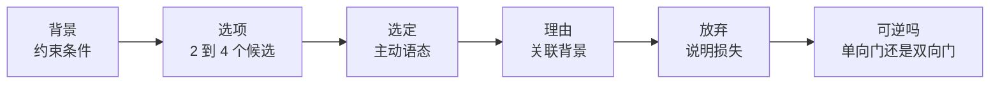
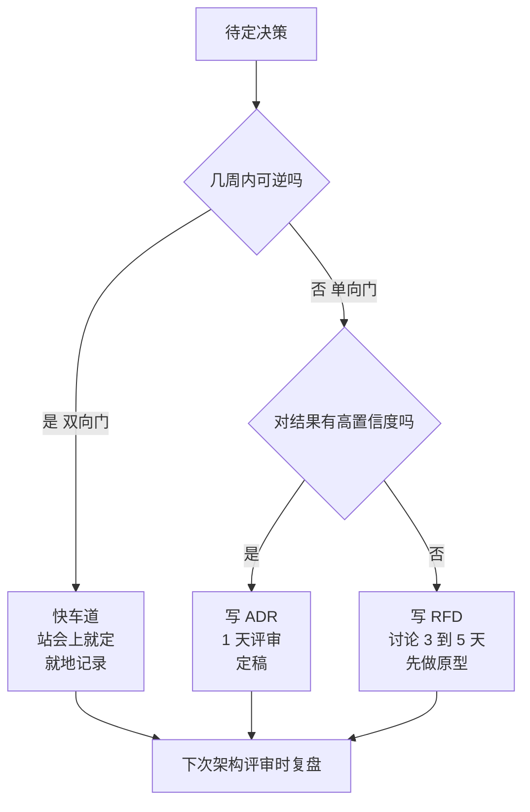
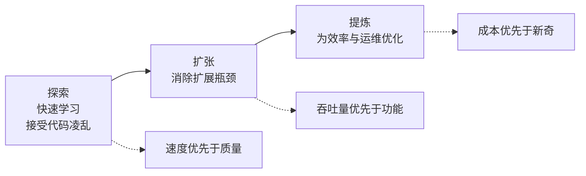
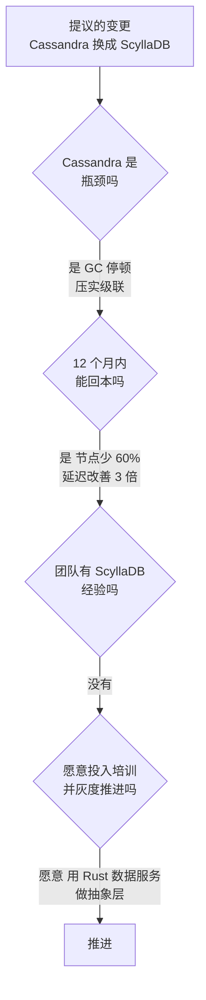

# 权衡思维

> **TL;DR**: “视情况而定”在技术上完全正确，也完全没用——除非你把这句话说完。每个设计选择都买到了一种属性，代价是另一种属性。资深工程师会把两边都说清楚，给出绑定具体约束的理由来做决定，并记录下自己放弃了什么，好让未来的自己可以回头复盘。Jeff Bezos 的 70% 法则认为，大多数决策应该在你只掌握了理想信息的 70% 时就做出[^1]。等到 90% 再动手，几乎总是太慢。

## 学习目标

学完本章，你将能够：

- [ ] 给每一个“视情况而定”补上明确的依赖条件、阈值和推荐方案
- [ ] 用六段式表述模板（背景、选项、选定、理由、放弃、可逆与否）组织任何设计决策
- [ ] 把决策分成单向门和双向门，并按门的类型匹配流程的轻重
- [ ] 识别会污染架构决策的认知偏差（沉没成本、简历驱动、幸存者偏差、NIH）
- [ ] 用 Kent Beck 的 3X 模型判断某个过去正确的决策何时变成了今天的错误
- [ ] 写一份轻量的架构决策记录（ADR），让它在团队换人之后依然有效

## 直觉理解

你在买车。你想要安全、省油、能装、加速快，还想要月供低。这五样不可能同时拉满。MPV 把空间和安全性做到最大，牺牲了加速。跑车把加速做到最大，牺牲了空间和价格。紧凑型轿车把油耗和价格做到最优，放弃了空间和加速。

没人觉得这算“难”。你列出当下生活里最要紧的那一两项，挑一台合适的车，然后接受自己放弃的东西。你不会假装 MPV 也很快。

系统设计是同一回事。你有一致性、可用性、延迟、吞吐量、成本、简单性、开发迭代速度。你不可能把它们全都拉满。工程师要做的是：说清楚在这个规模下、对这个系统而言哪几项最重要，选出匹配的架构，并大声讲出牺牲了什么。

本章剩下的部分，就是教你怎么把“说清楚、选出来、讲出口”这三件事做得让人信服，让记录在团队换人后依然管用，在面试里听起来像个资深工程师。

## 原理

### 权衡的本质

权衡是这样一种设计决策：提升系统某一项可度量的属性，必然会让另一项属性变差。“必然”这个词是关键。如果某个选择提升了 X，却没有让任何东西变差，那不是权衡，而是白吃的午餐；在一个成熟的设计评审里，听到“白吃的午餐”式的主张，第一反应就是去找那个被藏起来的成本。

这种机制来自物理、算法或经济：

- **物理层面：** 光速把洲际往返时间锁在 80 到 150 ms 左右（例如美欧之间约 80 ms，美亚之间约 150 ms），所以跨地域的强一致是用延迟买来的。
- **算法层面：** 每个让读变快的索引都会让写变慢，因为每次写既要更新行，也要更新索引。
- **经济层面：** 招一个能运维 PostgreSQL 的人，比招一个能运维 Spanner 这类系统的人便宜，所以自建强一致是用运维成本买来的。

Fred Brooks 的《No Silver Bullet》（1986）给出了更高一层的分类：本质复杂度来自问题本身的要求，偶然复杂度来自工具强加给你的负担[^2]。你可以一整天拿偶然复杂度去换偶然复杂度（选 Kafka 还是 RabbitMQ，选 Go 还是 Rust），系统一点也不会变好。只有拿偶然成本去换本质进展，才是真正的推进。

### 主要权衡维度

大多数系统设计决策都沿着少数几个反复出现的维度移动：

| 维度对 | 你买到的 | 你付出的 |
|-----------|-------------|-------------|
| 一致性 vs 可用性 | 正确的读 | 分区期间不可用 |
| 一致性 vs 延迟 | 线性一致性读 | 协调等待（PACELC） |
| 读性能 vs 写性能 | 快速查询（索引、反范式） | 写放大 |
| 空间 vs 时间 | 更快的读（缓存、预计算） | 存储成本 |
| 简单 vs 灵活 | 运维轻松、上手快 | 功能更少、演进更难 |
| 成本 vs 性能 | 更低的账单 | 更高延迟或更低吞吐量 |
| 开发速度 vs 可维护性 | 今天就能上线 | 明天用技术债偿还 |
| 耦合 vs 解耦 | 协调容易 | 共享故障域 |

> [!TIP]
> 权衡会叠加。选了“一致性”，往往同时也意味着“更高延迟”“更复杂的运维”和“更高成本”。把下游的连锁后果都点出来，别只说第一层。

### 视情况而定的正确说法

“视情况而定”是对的。它同时也是一句让人干瞪眼的话。修法是补上一句三段式：

1. **点明依赖条件。**“这取决于我们是否需要跨地域一致性。”
2. **说清分支。**“如果需要，就用同步复制，接受 150 ms 的写延迟。如果不需要，就用异步复制，接受最多 2 秒的陈旧读。”
3. **针对当前场景给建议。**“考虑到我们的写 SLO 是 200 ms、且只部署在单地域，我会先用同步复制。”

这就是六段式表述模板的口语压缩版。完整的书面版本提炼自 Michael Nygard 的 ADR 格式[^3] 和 Bezos 的可逆性主张[^1]：

*六段式表述模板：每个架构决策都能套进这个形状。如果你填不出“放弃”这一栏，说明你想得还不够狠。*

在 ADR、设计文档、面试回答和 Slack 讨论串里都用它。这是工程里听起来最资深的一种口头表达形状。

### 毁掉决策的认知偏差

人在压力下做权衡分析的能力很差。Kahneman 的《思考，快与慢》记录了那些会劫持设计评审的系统 1 启发式[^4]：

- **沉没成本。**“这次迁移已经做了 6 个月，现在停不下来。”停得下来。那 6 个月无论如何都已经花掉了。
- **可得性偏差。**最近一次故障会主导风险评估。刚经历过 Kafka 故障的团队会高估“Kafka 不可靠”，哪怕根因是配置错误。
- **确认偏误。**你会为已经偏好的选项找证据。想上 Rust 的工程师找到的是 benchmark，想上 Go 的工程师找到的是招聘数据。
- **简历驱动开发。**工程师挑的是能推进自己职业的技术，不是能推进系统的技术。Kelsey Hightower 公开讲过，Kubernetes 是“构建平台的平台”，不是终局；这句话常被引用来讨论那些为了简历好看、把并不需要它的负载搬上去的团队[^5]。

解药是制度性的：架构决策记录强制你写下理由、延后承诺[^3]。事前验尸（pre-mortem）强制你在上线之前先想象失败。加权决策矩阵强制你把争论放在权重上（这是可以讨论的话题），而不是放在选项上（那只是个人偏好）。

### 单向门与双向门

Bezos 在 2015 年致股东信里提出了单向门与双向门的分类，把它们叫做“Type 1”（后果重大、不可逆）和“Type 2”（可更改、可逆）决策[^6]。在 2016 年的信里他重提这个概念，说得更让人记得住：“很多决策是可逆的，是双向门。这类决策可以用轻量流程。就算错了又怎样？”[^1] 他把这个和 70% 法则、“不同意但执行”配成一套，用来在意见不一致时解开双向门决策的僵局。

他描述的典型失效模式是：大型组织把原本可逆的双向门决策，默认套上重量级的 Type 1 流程，结果是“迟缓、不加思考的避险、实验不足，创新因此被削弱。”[^6]

*Bezos 的可逆性检验：流程的轻重应该匹配决策的可逆程度。双向门在 Slack 上投个票就行，单向门要写 ADR 或 RFD。*

对工程师来说：给一个新服务选编程语言，通常是单向门（重写成本极高）。选缓存淘汰策略，通常是双向门（改配置、重启）。选数据库引擎则介于两者之间，真正的手艺是判断它在你这个具体系统里落在哪一侧。

### 诚实性检验

Dan McKinley 的《Choose Boring Technology》（2015）给每个团队大约三枚“创新币”的预算[^7]。每引入一项新技术就花掉一枚。新工具的好处通常被大声宣传；运维成本（维护、凌晨三点的 on-call、未知的未知）在采用时看不见，到第二年却压得人喘不过气。

McKinley 的原话：“软件这条法则的残酷悖论是：你大概应该用那个你最讨厌的工具。你讨厌它，是因为你对它了解得最多。”[^7]

诚实性检验是：每列出的一条优点，都必须写出与之对应的缺点。如果你的设计文档对偏好的方案列了 7 条优点、0 条缺点，那你写的是推销材料，不是架构决策。

按条数比大小是典型的反模式——这是团队用数子弹的方式代替称弹药重量时会发生的事。7 条优点对 5 条缺点，并不意味着 7 条那边的方案赢。一条缺点（“一个地域故障我们就丢光所有数据”）可以压过 7 条优点。用加权决策矩阵把真正的分歧暴露出来：分歧在权重上，不在选项上[^8]。

### 权衡随时间变化

Kent Beck 的 3X 模型给出了产品演进的三个阶段，每个阶段的最优权衡都不同[^9]：

*探索、扩张、提炼：同一个技术权衡在这个阶段是对的，到下一个阶段可能就是错的。Discord 从 Mongo 到 Cassandra 再到 ScyllaDB 的路径就是标准案例。*

- **探索：** 规模小、不确定性高。优化学习速度。接受凌乱的代码，多做实验，用你熟悉的工具。
- **扩张：** 产品跑通了，增长把瓶颈暴露出来。工程投入转向消除那些限制增速的资源。
- **提炼：** 成熟阶段。优化效率、盈利能力和运维稳定性。

一个在探索期最大化学习速度的权衡（手写的 Rails 应用、只用一个数据库），到了扩张期、当增长曲线变成非线性时，就变成了负债。3X 模型提供了“去年对的判断，今年是错的”这种说法的词汇，而且不需要任何人被判为错[^9]。

## 真实案例

**Discord：从 Cassandra 到 ScyllaDB（2017 到 2023）**

Discord 的消息存储走完了 3X 的全部三个阶段，每一次迁移都是一次被重新审视的权衡[^10]。

**探索（2015 到 2017）：** MongoDB 副本集。搭建快，团队熟悉。放弃的是：写入的横向扩展能力。

**扩张（2017 到 2022）：** 迁到复制因子为 3 的 Cassandra。从 12 个节点长到 177 个节点，存下数万亿条消息。这次权衡买到的是：写吞吐量和横向扩展。付出的是：JVM 垃圾回收停顿造成延迟尖峰（历史读的 p99 在 40 到 125 ms）、需要手工重启节点，以及压实期间那种“gossip 舞”式的运维苦活[^10]。

**提炼（2022 到 2023）：** 迁到 72 个 ScyllaDB 节点，每节点 9 TB 磁盘。结果：历史读 p99 降到 15 ms；插入 p99 稳定在 5 ms；集群规模从 177 个节点降到 72 个[^10]。

几个关键工程决策很好地体现了权衡思维：

1. **保留数据模型，只换引擎。** Cassandra Query Language 的兼容性，让这件事在 schema 层是双向门（应用代码几乎不用改），尽管在运维层是单向门（新的 C++ 数据库、新的失效模式）。
2. **用 Rust 重写 Spark 迁移器。** 最初基于 Spark 的迁移方案估算要 3 个月。团队花了工程时间写了一个 Rust 迁移器，9 天跑完，速率 320 万条消息每秒[^10]。典型的权衡：开发时间换墙上时钟的见效时间。
3. **接受那扇单向门**——离开一个容易被 JVM GC 拖累的数据库，换成分片即核心（shard-per-core）的 C++ 数据库，动机是多年的 on-call 苦活。

Discord 放弃的是：JVM 生态兼容性、Cassandra 更大的社区、团队已有的运维肌肉记忆。换来的是：延迟改善 3 倍、节点减少 60%、GC 引发的故障被彻底消除。

*把 Discord 的迁移决策套进“什么时候不该改”的框架。每一道关卡都靠一个具体、可量化的答案通过。*

## 权衡

下面这几行描述的是决策*方法*，不是可以互相替代的方案。读者按门的类型和场景来挑，也就是本章前面那张单向门与双向门的流程图所编码的同一个维度。这里不需要“我们的选择”这种框架，每一行本身就已经是一条什么时候该用的建议。

| 做法 | 适用场景 |
|----------|----------------|
| 总是把两边都写清楚（ADR / 六段式模板） | 单向门；跨团队的高风险决策，书面记录必须在团队换人后依然存活[^3] |
| 先定再迭代（Bezos 70% 法则） | 双向门；探索期的工作，决策速度比决策完备性更值钱[^1] |
| 正式的加权矩阵 | 多维决策、团队谈不拢，而真正的分歧在权重而不在选项上[^8] |
| 凭直觉（模式匹配） | 熟悉的领域、爆炸半径小。*只有*同时写下“为什么”，让未来的维护者或新人能还原推理过程，才可接受[^4] |
| 寻求共识 | 全组织范围的平台选型，认同比速度更重要；配一个“不同意但执行”的截止时间，免得求共识无限期拖下去[^1] |

用哪种方法，是可逆程度和风险大小的函数，不是偏好问题。流程的轻重应该匹配门的类型，以及一个错误答案会带来多大的爆炸半径。

## 常见陷阱

> [!WARNING]
> **只说“视情况而定”就完。** 在设计评审里，这三个字后面没有下文，是最没用的话。永远把句子说完：“这取决于 X；如果是 X，那就选 Y；结合我们的场景，我建议 Z。”

> [!WARNING]
> **简历驱动的技术选型。** 3 个人、2 个服务的团队上 Kubernetes，每秒 100 个事件上 Kafka，只因为工程师想把它写进 LinkedIn。McKinley 的创新币预算是解药[^7]。

> [!WARNING]
> **忽视双向门。** 为一个改个配置开关就能换掉的缓存淘汰策略，在委员会里耗掉 3 周。流程的轻重请匹配可逆程度。

> [!WARNING]
> **藏起你放弃的东西。** 7 条优点、0 条缺点的设计文档就是推销材料。诚实性检验：每主张一项收益，就点出对应的代价。做不到，说明你没分析过备选方案。

> [!WARNING]
> **单维度打分。** 只因为“它更快”就做选择，不权衡成本、运维复杂度、团队能力和灵活性。真实决策是多维的。任何有争议的事，都要一份加权矩阵。

> [!WARNING]
> **用沉没成本为坏决策辩护。**“我们已经投了 6 个月”不是继续下去的理由。那 6 个月已经没了。真正的问题是：从今天所在的位置出发，往哪走最好？

## 练习

> **Design Challenge**：你的团队在 EC2 上运维一个 Python 单体应用。它以 p99 600 ms 扛着 10k RPS（SLO：300 ms）。一位初级工程师提议用 Go 微服务重写、跑在 Kubernetes 上。高层领导要你给建议。请用六段式表述模板呈现权衡，并给出一个站得住脚的推荐。

提示

这不是一个技术选型题，而是性能、成本、风险和团队能力之间的权衡。考虑中间路线（不是只有“全部重写”和“什么都不做”两个选项）。用表述模板：背景、选项、选定、理由、放弃、可逆与否。

答案

**背景：** Python 单体应用差了 2 倍才达到 p99 SLO（600 ms 对 300 ms 目标）。团队 8 人，都熟 Python，没有生产环境的 Go 或 Kubernetes 经验。

**选项：**

1. 对 Python 单体做性能剖析并优化（找 N+1 查询、慢的第三方调用、GC 停顿）。
2. 把最热的 2 到 3 个接口抽成 Go 服务，挂在同一个负载均衡器后面。
3. 全面重写成 Go 微服务，跑在 Kubernetes 上。
4. 对 I/O 密集的路径改用异步 Python（FastAPI/uvicorn）。

**加权矩阵：**

| 评估项 | 权重 | 性能剖析 | 抽取热点路径 | 全面重写 | 异步 Python |
|-----------|--------|---------|-------------------|--------------|--------------|
| 见效时间 | 25% | 5 | 3 | 1 | 3 |
| 延迟改善 | 25% | 3 | 4 | 5 | 3 |
| 风险 | 20% | 5 | 3 | 1 | 3 |
| 运维复杂度 | 15% | 5 | 3 | 1 | 4 |
| 团队能力 | 15% | 5 | 4 | 2 | 4 |
| **加权总分** | | **4.50** | **3.40** | **2.15** | **3.30** |

**选定：** 先做性能剖析，必要时再抽取热点路径。

**理由：** SLO 未达标是紧急问题。性能剖析通常能找到 2 到 3 个具体瓶颈（数据库查询、同步的第三方调用），几周内就能带来 2 到 3 倍提升，而不是几个月。全面重写得分很低，因为它那点延迟改善，补不上 12 到 18 个月的交付风险——何况团队没有任何生产环境的 Go 或 Kubernetes 经验。

**放弃：** 全面重写能到达的天花板（5 倍改善、语言层面的并发、按服务独立扩展）。我们用更低的天花板换更快的见效速度和更低的风险。

**可逆与否？** 性能剖析是双向门（零风险）。抽取热点路径是 1.5 向门（回退要费点劲，但单体还能跑）。全面重写是单向门（12 到 18 个月的承诺）。流程轻重照此匹配。

**对领导怎么说：** “SLO 未达标这个问题不重写也能处理。第一步是两周的性能审计。如果还不够，我们就精准地把最热的 2 到 3 个接口抽成 Go 服务。如果 12 个月后我们的增长已经超过优化的上限，或者我们招到了资深 Go 工程师，我会重新考虑全面重写。”

## 要点回顾

- 每个“视情况而定”后面都要有明确的依赖条件、阈值和推荐。把句子说完。
- 每个重要决策都用六段式模板（背景、选项、选定、理由、放弃、可逆与否）。它装得进一份 ADR、一条 Slack 消息，或者一段 30 秒的口头回答。
- 把决策分成单向门和双向门。双向门用快速轻量的流程，单向门用审慎书面的流程[^1]。
- 说清楚你放弃了什么。如果你的设计文档只有优点，那你写的是营销材料，不是工程判断。
- 认知偏差（沉没成本、简历驱动、幸存者、确认偏误）是组织层面的事实，不是道德缺陷。用书面产物和显式的权重去对抗它们。
- 权衡会随时间变化。Beck 的 3X 模型（探索、扩张、提炼）提供了“去年对的判断，今年是错的”这种说法，而且不必追责[^9]。
- 有时最好的决策是空决策：保留现状。“我们凌晨三点能运维的技术”通常比“对我们很新的技术”更值钱。

## 延伸阅读

- [Choose Boring Technology（Dan McKinley，2015）](https://boringtechnology.club/)——提出“创新币”的那篇文章；每年读一次，当作对抗求新偏好的校准练习。
- [Documenting Architecture Decisions（Michael Nygard，2011）](https://www.cognitect.com/blog/2011/11/15/documenting-architecture-decisions)——ADR 的原始文章；1200 字，改变了团队记录决策的方式。
- [2016 Letter to Shareholders（Jeff Bezos）](https://www.aboutamazon.com/news/company-news/2016-letter-to-shareholders)——单向门与双向门分类法以及 70% 法则的出处。
- [How Discord Stores Trillions of Messages（Bo Ingram，2023）](https://discord.com/blog/how-discord-stores-trillions-of-messages)——关于一次跨越多年、被重新审视的基础设施权衡，讲得最清楚的一篇文章，数字具体。
- [RFD 1: Requests for Discussion（Oxide Computer，2020）](https://oxide.computer/blog/rfd-1-requests-for-discussion/)——一套嵌在上市公司工程文化里、真实运转的 RFD 流程；给 ADR 补上了生命周期。
- [An Elegant Puzzle（Will Larson，Stripe Press，2019）](https://press.stripe.com/an-elegant-puzzle)——从工程经理视角讲权衡、加权矩阵，以及什么时候该把决策正式化。
- [Under Deconstruction: Shopify's Monolith（Philip Muller，2020）](https://shopify.engineering/shopify-monolith)——模块化单体作为“微服务”和“一团泥”之间的第三种选择；280 万行 Ruby，仍然一次部署[^11]。
- [Spanner, TrueTime and the CAP Theorem（Eric Brewer，2017）](https://research.google/pubs/spanner-truetime-and-the-cap-theorem/)——CAP 定理的作者，面对一个用美元（原子钟）换更强一致性的系统，重新审视自己的定理。
- [Fast/Slow in 3X: Explore/Expand/Extract（Kent Beck，2018）](https://medium.com/@kentbeck_7670/fast-slow-in-3x-explore-expand-extract-6d4c94a7539)——三阶段模型，用来识别一个过去正确的决策何时变成了今天的错误。

## 记忆卡片

**Q：** 在设计讨论里回答“视情况而定”，问题出在哪？
**A：** 如果你把句子说完，就没有问题。答案需要点明依赖条件、每个分支的后果，以及一个绑定具体场景的推荐。光说“视情况而定”，传递的是回避，不是资深。

**Q：** 权衡表述模板的六个部分是什么？
**A：** 背景（约束条件）、选项（2 到 4 个候选）、选定（主动语态）、理由（关联背景）、放弃（损失）、可逆与否（单向门还是双向门）。

**Q：** 什么是单向门决策？举个例子。
**A：** 回退代价极高或根本不可能回退的决策。例如：为一个大服务选编程语言（重写成本是几个月到几年）。单向门值得用审慎、书面的流程。

**Q：** 什么是双向门决策？举个例子。
**A：** 能低成本回退的决策。例如：选缓存淘汰策略（改配置、重启）。双向门应该用轻量流程快速定下来。

**Q：** 什么是简历驱动开发？
**A：** 工程师选的是能推进自己职业的技术，而不是能推进系统的技术。例如：为 2 个服务上 Kubernetes，因为写在 LinkedIn 上好看，而不是负载真的需要容器编排。

**Q：** McKinley 的“创新币”是什么？
**A：** 出自《Choose Boring Technology》的一条启发式：每个团队大约有 3 枚币可以花在新奇、陌生的技术上。每引入一个新工具就花掉一枚。要把它们花在能让产品差异化的地方，而不是花在通用基础设施上。

**Q：** 说出 Kent Beck 3X 模型的三个阶段。
**A：** 探索（优化学习速度）、扩张（消除扩展瓶颈）、提炼（优化效率与运维）。在一个阶段正确的权衡，到下一个阶段就变错了。

**Q：** 针对一个设计决策的诚实性检验是什么？
**A：** 每列一条优点，就必须写出对应的缺点。如果你的设计文档只有收益没有代价，那你写的是推销材料，不是架构决策。

**Q：** 按条数比大小这个反模式是什么？
**A：** 靠数优点和缺点的条数来做决定，而不是称它们的重量。一条关键缺点（“一个地域故障我们就丢光所有数据”）可以压过 7 条小优点。请改用加权矩阵。

**Q：** 什么时候该保留现状而不是迁移？
**A：** 当现有系统并不是真正的瓶颈、团队对目标系统缺乏运维经验、迁移成本在合理时间跨度内超过低效的代价，或者这个系统反正要被下线的时候。

**Q：** Discord 从 Cassandra 迁到 ScyllaDB 时放弃了什么？
**A：** JVM 生态兼容性、Cassandra 更大的社区、团队已有的运维肌肉记忆。换来的是延迟改善 3 倍、节点减少 60%，以及 GC 引发的故障被消除。

**Q：** Bezos 的 70% 法则是什么？
**A：** 大多数决策应该在你只掌握了理想信息的 70% 时就做出。等到 90% 几乎总是太慢。配合双向门检验使用：如果可逆，哪怕只有 50% 的信息也该快速定。

## 参考文献

[^1]: Jeff Bezos, “2016 Letter to Shareholders,” Amazon, April 2017. https://www.aboutamazon.com/news/company-news/2016-letter-to-shareholders
[^2]: Frederick P. Brooks, Jr., “No Silver Bullet: Essence and Accidents of Software Engineering,” Proceedings of IFIP 1986; reprinted IEEE Computer 20(4), April 1987. http://www.cgl.ucsf.edu/Outreach/pc204/NoSilverBullet
[^3]: Michael Nygard, “Documenting Architecture Decisions,” Cognitect Blog, November 15, 2011. https://www.cognitect.com/blog/2011/11/15/documenting-architecture-decisions
[^4]: Daniel Kahneman, “Thinking, Fast and Slow,” Farrar, Straus and Giroux, 2011. ISBN 978-0374533557. https://us.macmillan.com/books/9780374533557/thinkingfastandslow
[^5]: Kelsey Hightower (widely-quoted talks and tweets, 2019 to 2023), “Kubernetes is a platform for building platforms, not the endgame.” https://news.ycombinator.com/item?id=31584451
[^6]: Jeff Bezos, “2015 Letter to Shareholders,” Amazon, April 2016. https://www.sec.gov/Archives/edgar/data/1018724/000119312516530910/d168744dex991.htm
[^7]: Dan McKinley, “Choose Boring Technology,” 2015. https://boringtechnology.club/
[^8]: Will Larson, “An Elegant Puzzle: Systems of Engineering Management,” Stripe Press, 2019. https://press.stripe.com/an-elegant-puzzle
[^9]: Kent Beck, “Fast/Slow in 3X: Explore/Expand/Extract,” Medium, 2018-2019. https://medium.com/@kentbeck_7670/fast-slow-in-3x-explore-expand-extract-6d4c94a7539 (archived: https://web.archive.org/web/20250110215816/https://medium.com/@kentbeck_7670/fast-slow-in-3x-explore-expand-extract-6d4c94a7539)
[^10]: Bo Ingram (Discord Engineering), “How Discord Stores Trillions of Messages,” March 6, 2023. https://discord.com/blog/how-discord-stores-trillions-of-messages
[^11]: Philip Muller (Shopify Engineering), “Under Deconstruction: The State of Shopify's Monolith,” September 16, 2020. https://shopify.engineering/shopify-monolith
