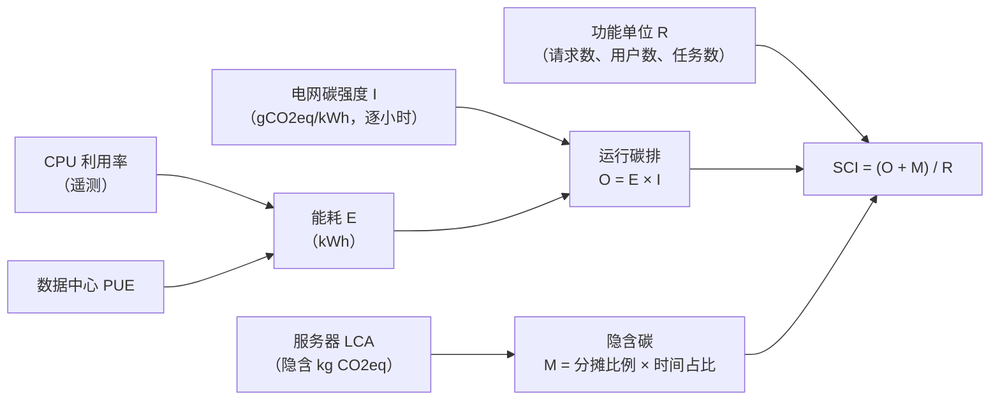
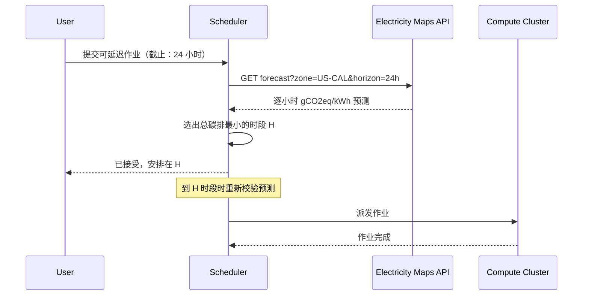
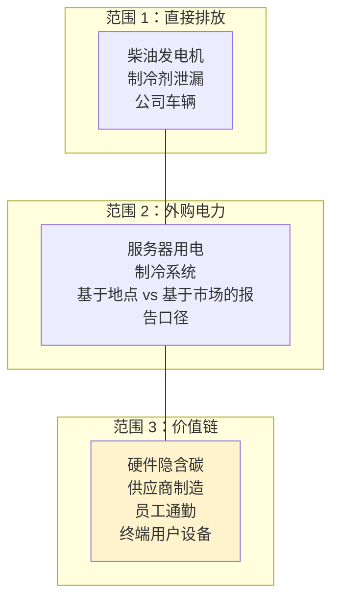

# 绿色计算

> **TL;DR**：碳排是工程约束里的一等公民，和延迟、成本、可靠性并列。IEA 预测全球数据中心用电量将从 2024 年的 415 TWh 大致翻倍，到 2030 年达到 945 TWh[^1]。压低它有三个杠杆：能源效率（单位工作量少用 kWh）、硬件效率（机器更少、用得更久）、碳感知（把工作的运行时间与地点挪向更清洁的电网）。绿色软件基金会（Green Software Foundation）的 SCI 公式 `SCI = ((E * I) + M) per R` 如今已是 ISO/IEC 21031，它给工程师一个自己直接负责的指标[^2]。与企业碳中和抵消记账不同，SCI 只认可能源、碳强度与隐含碳的真实下降。

## 学习目标

完成本模块后，你将能够：

- [ ] 应用碳感知调度，把批处理负载挪到碳强度低的时段
- [ ] 解读 PUE（Power Usage Effectiveness）与 WUE（Water Usage Effectiveness）这两个数据中心指标
- [ ] 用 GSF 公式算出某项服务的 SCI（Software Carbon Intensity）
- [ ] 在厂商的承诺里分辨抵消、REC、PPA 与 24/7 无碳能源（CFE）
- [ ] 判断隐含碳在什么场景占主导，以及硬件生命周期决策如何影响总排放

## 直觉理解

你开了一家自助洗衣店。电价按时段波动，但你还在意电从哪来。晴天的下午两点，电网里 80% 是光伏和风电。晚上八点，燃气调峰机组点火，每一度电背着的 CO2 是白天的五倍。你的工业洗衣机不在乎什么时候转。聪明的老板会给它们编程，让它们在清洁电网的窗口里启动，赶在晚间客流高峰之前洗完——那时候进店的客人马上就要用机器。

现在加一个维度。你的连锁店在冰岛（几乎 100% 地热和水电）和孟买（煤电为主的电网）都有门店。大宗商用负载——酒店布草、制服——可以运到今天电力最干净的那家店去洗。散客仍然就近去本店，因为延迟（路上时间）是硬约束。

这就是碳感知计算。交互式流量（搜索查询、API 调用）留在本地，因为延迟没得谈。可延迟的批处理（ML 训练、视频转码、分析回填）则在时间和空间上挪到电网最干净的地方。你优化的“价格”不是每 kWh 多少美元，而是每 kWh 多少克 CO2。就像[成本优化与 FinOps](../part-6-reliability-and-operations/09-cost-optimization-finops.md)教你跟踪每请求成本一样，绿色计算要求你跟踪每请求碳排。

本章余下部分把每个杠杆讲精确：怎么衡量设施效率、怎么读电网强度信号、怎么算软件的碳足迹、以及行业的承诺与现实差多远。

## 原理

### 度量：PUE、WUE、CUE 与 SCI

**PUE**（Power Usage Effectiveness，电能使用效率）是设施总能耗与 IT 设备能耗之比。PUE 为 1.0 是理论理想值；2.0 意味着设施在开销（制冷、电力转换、照明）上花的电和在算力上一样多。Google 2024 年全 fleet 滚动十二个月的 PUE 是 1.09，最佳单一园区（俄亥俄州兰开斯特）为 1.04[^3]。2025 年行业自报的平均值是 1.54[^4]。

**WUE**（Water Usage Effectiveness，水使用效率）衡量每 kWh IT 能耗消耗多少升水。2024 年亚利桑那和弗吉尼亚的 AI 制冷用水引来公众审视，它因此成了头条指标。

**CUE**（Carbon Usage Effectiveness，碳使用效率）是每 kWh IT 能耗对应的 kg CO2eq。它把设施效率与电网碳强度压成一个数，是跨区域比较时最好用的单指标。

**SCI**（Software Carbon Intensity，软件碳强度）是面向工程师的指标。PUE 是你从云厂商那里继承来的，SCI 则是你在代码和部署拓扑里能掌控的东西。

*SCI 是一个速率：运行碳排加上摊销后的隐含碳，再除以一个功能单位，例如“每 1,000 次请求”。*

值得注意的模式是：逐小时的电网碳强度项 `I`，正是碳感知调度能压小的那个数。规格调优（right-sizing）缩小 `E`。硬件续用（延长服务器寿命）缩小 `M`。SCI 规范明确不把抵消额、REC 或市场化 PPA 计入评分改善[^2]。这让 SCI 成为工程师无需依赖采购部门就能负责的第一个指标。

### 碳感知调度

碳感知调度（carbon-aware scheduling）用实时电网碳强度信号，把可延迟的计算挪到时间上（时间平移）或区域上（空间平移）电网最清洁的地方。

**数据来源：** Electricity Maps、WattTime、英国国家电网 ESO 和 CAISO 按电网分区提供逐小时实测值与预测[^5]。绿色软件基金会发布开源的 Carbon Aware SDK（C#、Node、Python），把这些 API 包成统一接口。

**时间平移**把批处理作业（ML 训练、视频转码、夜间 ETL）推到截止窗口内最干净的时段。Google 2020 年上线的碳智能计算管理平台（Carbon-Intelligent Compute Management），会把非紧急任务挪到 Electricity Maps 预测碳强度更低的时段[^6]。

**空间平移**把工作路由到电网强度更低的区域。Google 在 2021 年扩展这套系统，在自有骨干网内跨区域搬运批处理。约束是：数据引力、数据主权与延迟要求限制了哪些负载能搬。

*碳感知调度器在派发可延迟批处理作业之前先查电网预测，预测更新后再校验一次。*

> [!IMPORTANT]
> 碳感知调度只对可延迟的工作有效。面向用户的流量（搜索、API 服务、实时聊天）等不起更干净的时段。这项技术对增长最快的那几类负载最管用：ML 训练、数据管道、媒体转码。

### 24/7 CFE 与 REC、PPA 的区别

清洁能源采购的这套词汇，正是识别“漂绿”（greenwashing）的地方。工程师需要分清三个层级：

**可再生能源证书（REC）**代表同一套年度核算电网上某处的 1 MWh 可再生能源发电。它与物理电子解绑、价格便宜，且广受批评，因为它并不带来新增发电。SCI 规范把 REC 排除在评分改善之外[^2]。

**购电协议（PPA）**是与发电方签的长期直购合同，电力确实送进买方所在的那张电网。它带来真实的发电装机，但仍然只按年度匹配。

**24/7 无碳能源（CFE）**意味着每一小时的用电都由同一张本地电网上的无碳发电匹配。这需要可稳定出力的低碳电源（核电、地热、水电），或电池储电来覆盖夜间。Google 每年公布分区域的 CFE 比例：2024 年 europe-north2（斯德哥尔摩）是 100% CFE，而 us-east1（南卡罗来纳）只有 31%[^7]。

实际含义：当云厂商宣称“100% 可再生能源”时，要问清那是年度 REC 匹配还是逐小时 CFE 匹配。两者在实际排放上的差距巨大。

### 硬件与软件效率

**硬件：** 基于 ARM 的服务器 CPU（AWS Graviton、Ampere Altra）在同等请求下比同类 x86 实例最多省 60% 能耗[^8]。AI 加速器的效率提升更快：Google 称 Trillium TPU 的碳效率是 TPU v4 的 3 倍。但 AI 机柜密度朝反方向猛冲：一台 Nvidia GB200 NVL72 机柜总系统功耗达 120 kW（36 颗 Grace CPU + 72 颗 Blackwell GPU + NVLink 交换机），而传统 CPU 机柜约 15 kW，这逼着行业转向液冷与浸没式冷却。

**软件：** 规格调优（right-sizing，[成本优化与 FinOps](../part-6-reliability-and-operations/09-cost-optimization-finops.md)里按美元讲过的同一个杠杆）直接降低能耗。Pereira 等（2017）在十个基准上横跨 27 种语言测试，发现 C、Rust、C++ 是最节能的语言；而 CPU 密集型负载上，Python 解释器的能耗约为等效 C 的 75 倍[^9]。AI 方面，Luccioni 等估算 BLOOM 全生命周期训练排放约 50.5 吨 CO2eq，其中已含制造开销[^10]。

务实的结论：规模化时语言选择确实重要，但重写能跑的代码几乎从来不是杠杆最大的动作。规格调优、压缩、模型量化、高效数据格式（列式、压缩）是更便宜的收益。

### 隐含碳、GHG 范围与监管

运行碳排来自硬件运转时消耗的电。隐含碳（embodied carbon）来自采矿、制造、运输与报废。在极清洁的电网（europe-north1 为 39 gCO2eq/kWh）上，隐含碳能占到生命周期排放的近 50%[^7]。Apple 称产品全生命周期碳排约 76% 来自制造。Google 估算数据中心生命周期排放约 30% 来自硬件制造。

GHG Protocol 把排放分成三个范围：

*GHG Protocol 的三个范围；对科技公司来说，范围 3（图中高亮）通常占大头。Microsoft 称其总足迹超过 95% 属于范围 3（FY2024 约为 96%）。*

**监管正在快速落地。** 欧盟企业可持续发展报告指令（CSRD）要求大型公司从 2024 年起披露全部三个范围。加州 SB 253 要求年收入超过 10 亿美元、在加州经营的公司于 2026 年披露范围 1 和 2，2027 年披露范围 3（这是法定日期；CARB 的规则制定可能调整实际报告期）。这把碳数据管道从“可持续发展团队的问题”变成“平台团队的问题”。

## 真实案例

### Google 碳智能计算管理

Google 的碳智能计算系统跑在它的集群管理器内部，自 2020 年起就在生产上运行[^6]。架构大致如下：

碳智能平台每天拉两份预测：未来 24 小时按电网分区的 Electricity Maps 碳强度，以及未来 24 小时各数据中心的预测算力需求。它据此算出逐小时的虚拟容量曲线（VCC），在“脏”时段对非紧急计算限流，在清洁时段释放容量。

**会搬的：** 批处理负载，包括 ML 训练、YouTube 转码、搜索索引、翻译模型刷新。这些的截止时间以小时计，不以秒计。

**不会搬的：** 面向用户的在线服务（搜索、地图、YouTube 播放）。延迟敏感的流量不管电网状况都得跑。

**规模：** 2021 年 Google 把这套系统扩展成在自有骨干网内跨区域搬工作。它的“central fleet”计划把原先归各产品团队所有的硬件归并成一个共享的可互换配额池，调度器可按需迁移。Google 表示，碳感知调度加上改进的 CFE 采购带来了数据中心能源排放的显著下降，尽管总能耗也在大幅增长。

**分区透明度：** Google 公布每个 Cloud 区域的 CFE 比例。斯德哥尔摩为 100% CFE（电网强度 3 gCO2eq/kWh），孟买为 9% CFE（679 gCO2eq/kWh）。电网强度 200 倍的差距意味着，对能容忍延迟的负载，单靠选区域就能主导你的碳足迹。

工程上的教训：碳感知调度不是研究原型。它以 Google 的规模跑在生产批处理负载上，用的是公开可用的 API，不需要改任何硬件。

## 权衡

| 方案 | 碳减排 | 成本 | 最佳适用 | 我们的选择 |
|---|---|---|---|---|
| 规格调优与自动扩缩容 | 20-40% | 净负（省钱） | 任何时候；第一步 | 每个团队的默认起点 |
| 碳感知批处理调度 | 批处理上 10-30% | 中等工程投入 | ML 训练、转码、分析 | 截止余量超过 2 小时的作业都该上 |
| 高效硬件（Graviton、TPU） | 20-60% | 重构成本 | 新服务、托管运行时 | 新负载的默认实例族 |
| 绿色区域选择 | 20-80% | 延迟与主权约束 | 数据驻留灵活的工作负载 | 批处理必用；无状态服务可评估 |
| 24/7 CFE 采购 | 最大、真实 | 最高，基建级押注 | 超大规模厂商、大型企业 | 北极星；选正在往这走的供应商 |

## 常见陷阱

> [!WARNING]
> **把抵消当成减排的替代品。** SCI 规范明确禁止用抵消额和 REC 降低 SCI 评分[^2]。如果你的范围 2 按“市场化”口径报出来接近零，而“基于地点”口径高出 10 到 100 倍，那这家组织靠的是纸面记账，不是运行减排。请把基于地点的范围 2 与市场化的并列跟踪。

> [!WARNING]
> **只盯 PUE，无视电网碳强度。** 在 600 gCO2/kWh 的煤电区域，PUE 1.10 的排放高于在 30 gCO2/kWh 的水电区域 PUE 1.4 的排放（同样 IT 负载）。要跨区域比 CUE，而不是孤立地比 PUE。先去用 Google 的分区域 CFE 比例表选区域，再去优化现有脏电网站点的 PUE。

> [!WARNING]
> **在换机周期里忽略隐含碳。** 用略微高效的新机器替换 3 年前的服务器，如果隐含碳份额超过运行端的收益，生命周期碳排反而上升。向厂商索取每个 SKU 的生命周期评估（LCA）。在运行端节省不占主导时，延长换机周期。

> [!WARNING]
> **相信“云天生就是绿色的”。** 营销话术把年度 REC 匹配和逐小时无碳运行混为一谈。us-east-1 坐落在 576 gCO2eq/kWh 的电网上，europe-north1 是 39[^7]。延迟允许的话，无状态负载请选低碳区域。

> [!WARNING]
> **侵蚀可靠性的效率收益。** 2021 年 3 月的 OVH SBG2 数据中心火灾烧毁了整栋设施（约 3 万台物理服务器），并部分损毁了相邻的 SBG1 楼；OVH 估计损失约 1.05 亿欧元[^11]。事后报告认为，效率优先的设计取向——自动灭火能力有限、高密度建造——助推了火势蔓延。效率与可靠性必须协同优化，不能相互交换。

## 练习

你的夜间 ML 训练流水线在 us-east-1 用 100 块 GPU 跑 8 小时。设计一个碳感知调度器，能把该作业跨区域、跨时间窗迁移，最多可接受 6 小时延迟。用三个区域的公开电网强度数据算出预期碳减排。注意约束：数据引力（训练数据在 us-east-1）、工程投入，以及为证明减排确实发生所需的、相当可观的监控。

提示

查一下 us-east-1（平均约 520 gCO2eq/kWh）、europe-north1（约 39 gCO2eq/kWh）、us-west-2（约 200 gCO2eq/kWh）的电网强度。空间平移带来的碳减排与强度比值成正比。但训练数据在 us-east-1 时，你必须把数据传输的时间和成本算进去。

解答

**设定：** 100 块 GPU *每块 300W* 8 小时 = 240 kWh（仅 IT 能耗）。按 PUE 1.1 计，设施能耗 = 264 kWh。

**基线（us-east-1，固定午夜窗口）：**
碳排 = 264 kWh × 520 gCO2eq/kWh = 137,280 g ≈ 每次运行 137 kg CO2eq。

**方案 A：在 us-east-1 内做时间平移（6 小时弹性）。**
如果 us-east-1 最干净的 8 小时窗口平均为 430 gCO2eq/kWh（正午光伏贡献），碳排 = 264 × 430 = 113,520 g ≈ 114 kg。节省约 17%。

**方案 B：空间平移到 europe-north1（39 gCO2eq/kWh）。**
碳排 = 264 × 39 = 10,296 g ≈ 10 kg。节省约 93%。但你要跨区复制约 2 TB 训练数据（10 Gbps 下传输约 30 分钟，出网费约 40 美元）。6 小时的余量轻松吸收这些。

**方案 C：空间平移到 us-west-2（200 gCO2eq/kWh）。**
碳排 = 264 × 200 = 52,800 g ≈ 53 kg。节省约 61%。出网费更低（20 美元），同大陆延迟。

**推荐设计：** 用 Carbon Aware SDK 查 Electricity Maps 对三个区域的预测。若 europe-north1 有 GPU 容量且截止时间容得下传输，就路由过去；否则退回 us-west-2；再不行就在 us-east-1 内做时间平移。用 Kepler（按 Pod 能耗）乘以电网强度来监控并证明减排。

**要承认的约束：** 数据主权（训练数据可能不许出境）、目标区域的 GPU 可用性、跨区网络成本，以及一条能证明碳减排是真的而非纸面推演的监控管道。

## 要点回顾

- 效率胜过抵消。在买可再生能源证书之前，先把机队规格调对、迁到高效硬件。SCI 明确把抵消排除在外。
- PUE 和 WUE 是你继承来的设施指标。SCI 才是面向工程师、由代码/部署拓扑/调度掌控的指标。
- 碳感知调度已经可用于生产。Google 在机队规模上跑它；开源工具（Carbon Aware SDK、Kepler、KEDA）让它唾手可得。
- 选区域可能主导你的碳足迹：斯德哥尔摩与孟买之间 200 倍的电网强度差，说明架构选择比微优化更重要。
- 24/7 CFE 是可信的北极星。年度 REC 匹配不等于逐小时无碳运行。向供应商要逐小时 CFE 比例，而不是年度总量。
- 隐含碳占生命周期排放的 30% 到 76%，取决于电网清洁程度。延长硬件寿命是减排策略，不只是省钱策略。
- 监管（欧盟 CSRD、加州 SB 253）正把范围 1、2、3 的披露变成强制要求。碳数据管道正在成为平台团队的职责。

## 延伸阅读

- [SCI Specification v1.1](https://sci.greensoftware.foundation/) - 权威公式与排除规则；工程师无需依赖采购部门就能负责的第一个指标。
- [Principles of Green Software](https://principles.green/) - SCI 背后的八条原则；如果你刚接触绿色软件基金会，从这里开始。
- [Google 2024 Environmental Report](https://sustainability.google/reports/google-2024-environmental-report/) - 机队 PUE、分区域 CFE 比例、碳智能计算的进展；超大规模厂商里披露最透明的一份。
- [IEA Energy and AI report](https://www.iea.org/reports/energy-and-ai) - 全球数据中心用电的 2024 基线与 2030 预测；任何容量规划讨论的必备背景。
- [Electricity Maps API](https://portal.electricitymaps.com/docs/getting-started) - 使用最广的实时与预测电网碳强度 API；把它接进你的调度器。
- [Google: Our data centers now work harder when the sun shines and wind blows](https://blog.google/inside-google/infrastructure/data-centers-work-harder-sun-shines-wind-blows/) - Google 规模下碳智能计算管理的首次公开描述。
- [Luccioni et al., “Estimating the Carbon Footprint of BLOOM” (JMLR 2023)](https://jmlr.org/papers/v24/23-0069.html) - 被引最多的 LLM 训练碳核算论文；训练大模型的人都该读。
- [Kepler project (CNCF sandbox)](https://github.com/sustainable-computing-io/kepler) - 基于 eBPF 的 Kubernetes 按 Pod 能耗归集；配合电网强度 API 可产出按容器的 SCI。

## 记忆卡片

**Q:** PUE 衡量什么，当前行业平均值是多少？
**A:** PUE = 设施总能耗 / IT 设备能耗，衡量数据中心的配套开销效率。2025 年行业平均值为 1.54；Google 机队平均为 1.09。

**Q:** SCI 的公式是什么？
**A:** SCI = ((E * I) + M) / R。E = 消耗的能源（kWh），I = 电网碳强度（gCO2eq/kWh），M = 按硬件寿命摊销的隐含碳，R = 功能单位（请求数、用户数、任务数）。

**Q:** SCI 为什么排除碳抵消和 REC？
**A:** SCI 只认可能源、碳强度与隐含碳的真实下降。抵消和 REC 是纸面工具，不减少单位工作量实际排放的碳。

**Q:** 时间平移与空间平移的区别是什么？
**A:** 时间平移把工作拖到同一电网上更干净的时段。空间平移把工作路由到电网强度更低的另一个区域。两者都要求负载可延迟、截止时间有余量。

**Q:** 什么是 24/7 CFE，它和年度 REC 匹配有何不同？
**A:** 24/7 CFE 让每一小时的用电都由同一张本地电网上的无碳发电匹配。年度 REC 匹配只在一年总量上做平衡，允许脏电网时段不被匹配。Google 的 europe-north2 达到 100% CFE，us-east1 只有 31%。

**Q:** 生命周期碳排里，隐含碳（制造）与运行碳排各占多少？
**A:** 取决于电网清洁程度。Apple 称产品碳排约 76% 来自制造。Google 估算数据中心生命周期约 30% 是隐含碳。清洁电网上隐含碳占主导，脏电网上运行碳排占主导。

**Q:** 举三个测量或降低软件碳排的工具。
**A:** Kepler（CNCF，基于 eBPF 的 Kubernetes 按 Pod 能耗）、Carbon Aware SDK（绿色软件基金会，封装电网强度 API）、云厂商看板（AWS Customer Carbon Footprint Tool、GCP Carbon Footprint、Azure Emissions Impact Dashboard）。

**Q:** 在 Google Cloud 上，斯德哥尔摩与孟买的电网强度差多少？
**A:** 斯德哥尔摩（europe-north2）：3 gCO2eq/kWh，100% CFE。孟买（asia-south1）：679 gCO2eq/kWh，9% CFE。每 kWh 碳强度相差约 200 倍。

**Q:** 哪些监管正在把碳披露变成强制要求？
**A:** 欧盟 CSRD 要求从 2024 年起披露范围 1、2、3。加州 SB 253 要求年收入超 10 亿美元的公司 2026 年披露范围 1 和 2、2027 年披露范围 3。这把碳核算从可持续发展团队推给了平台工程。

**Q:** 训练一个大语言模型要耗多少电？
**A:** BLOOM（176B 参数）含制造开销排放约 50.5 吨 CO2eq。一台 Nvidia GB200 NVL72 机柜功耗 120 kW。IEA 预测到 2030 年 AI 相关数据中心用电需求将增至三倍。

**Q:** 在碳感知调度之前，降低软件碳排的第一步是什么？
**A:** 规格调优与自动扩缩容。它省 20% 到 40% 的能源，零成本（往往还省钱），不需要改调度器。这和 FinOps 成本优化是同一个杠杆，只是换了指标。

**Q:** OVH SBG2 火灾为什么与绿色计算相关？
**A:** 它说明效率优先的设计取向（无灭火系统、高密度、最低冗余）可能灾难性失败。绿色计算必须协同优化效率与可靠性，不能在两者之间做交换。

## 参考文献

[^1]: International Energy Agency，“Energy and AI” 报告，2025 年 4 月。https://www.iea.org/reports/energy-and-ai
[^2]: Green Software Foundation，“Software Carbon Intensity (SCI) Specification v1.1”。https://sci.greensoftware.foundation/
[^3]: Google Data Centers，“Power usage effectiveness”，2024 年 PUE 报告，机队滚动十二个月 1.09。https://www.google.co.uk/about/datacenters/efficiency
[^4]: Statista，“Data center average annual PUE worldwide 2025”，1.54。https://www.statista.com/statistics/1229367/data-center-average-annual-pue-worldwide/
[^5]: Electricity Maps，开发者门户与信号参考。https://portal.electricitymaps.com/docs/getting-started
[^6]: Google，“Our data centers now work harder when the sun shines and wind blows”，2020 年 4 月。https://blog.google/inside-google/infrastructure/data-centers-work-harder-sun-shines-wind-blows/
[^7]: Google Cloud，“Carbon free energy for Google Cloud regions”，2024 年 CFE 比例与电网强度表。https://cloud.google.com/sustainability/region-carbon
[^8]: AWS，“AWS Graviton - Sustainability”，最多降低 60% 能耗。https://aws.amazon.com/ec2/graviton/graviton-sustainability/
[^9]: Pereira 等，“Energy Efficiency Across Programming Languages”，SLE 2017。https://dl.acm.org/doi/10.1145/3136014.3136031
[^10]: Luccioni、Viguier、Ligozat，“Estimating the Carbon Footprint of BLOOM, a 176B Parameter Language Model”，JMLR 24，2023。https://jmlr.org/papers/v24/23-0069.html
[^11]: Wikipedia，“OVHcloud”，事故章节，引用 Reuters、The Register 与 Data Center Dynamics 关于 2021 年 3 月 SBG2 火灾的报道（3 万台服务器、全损、损失约 1.05 亿欧元）。https://en.wikipedia.org/wiki/OVHcloud
