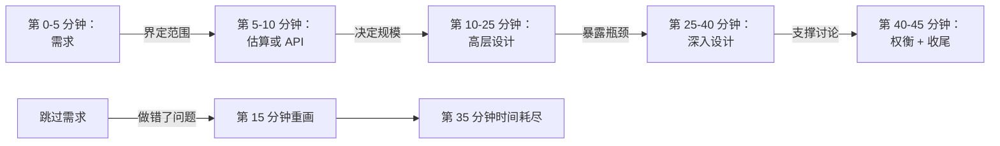
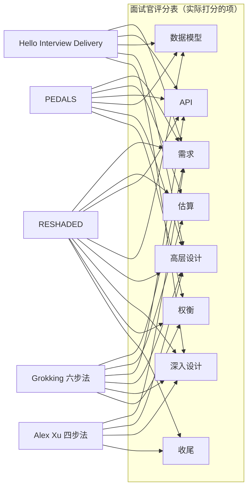

# 主流面试框架对比（RESHADED、PEDALS、ADEPT）

> **TL;DR**: 所有系统设计面试框架覆盖的都是同一批判分项（需求、估算、API、数据模型、架构、深入设计、权衡、收尾），差别只在于字母数量、步骤顺序和侧重点。挑哪个是顺手问题，不是策略问题。选一个，练到成为条件反射，面试中途绝不换。候选人挂掉最常见的原因不是知识缺口，而是“表达散乱”，而框架正是治这个的[^1]。按 Exponent 的教练数据，用同一个框架做五场模拟面试，通过率大约能比纯被动学习翻一倍[^2]。

## 学习目标

学完本章，你将能够：

- [ ] 凭记忆说出 RESHADED、PEDALS、ADEPT 和 Alex Xu 四步法的各个步骤
- [ ] 从时间分配、步骤粒度、侧重点三个维度对比这些框架
- [ ] 选出一个框架，并针对目标公司和职级为你的选择给出理由
- [ ] 把你选定的框架适配到 45 分钟和 60 分钟两种面试形式
- [ ] 识别并避开三个最致命的反模式：把框架当检查清单、跳过需求、一上来就画高层架构

## 直觉理解

你是一名飞行员，正准备降落一架客机。这套动作你做过几百次。可每一次落地仍然要过检查单：放起落架、设襟翼、核对速度、确认跑道。检查单不会把你变成机器人，它把你的脑子腾出来去应付侧风、大雾、以及塔台突然给的避让指令。没有它，你早晚会忘放起落架；有了它，你永远忘不了。

一场系统设计面试就是一次 45 分钟的降落。题目是跑道，评分表是检查单，框架则是你排列检查单条目的顺序——保证一项不落，还能提前接地。老飞行员从不争论哪种检查单版式更好。他们挑一种，练到成为肌肉记忆，然后在真正进近时忘掉它的存在。注意力留给那些难的判断，而不是“下一步该干啥”。

本章这些框架都是合格的检查单，都能把飞机落下来。你要做的是挑一个，练到它消失，然后走进面试时脑子里想的是工程问题，而不是框架。

## 原理

### 为什么框架胜过即兴发挥

[如何应对系统设计题](../part-1-core-fundamentals/05-how-to-approach-design-questions.md) 介绍了 6 步骨架和 45 分钟的时间预算。本章把视角拉远，对比实现这套骨架的几个有名有姓的框架。

面试的计时器是你的敌人。大多数轮次是 45 分钟，有些还要花 5 到 10 分钟做面试官介绍，真正能用来设计的时间只剩 35 到 40 分钟[^1]。而评分项很多：功能需求、非功能需求、估算、API、数据模型、高层架构、至少一次深入设计、权衡、收尾[^3][^4]。如果没有事先定好的时间预算，候选人会在估算上花掉 25 分钟，然后在深入设计之前就用光了跑道——而高级别信号恰恰住在那里[^5]。

框架还能治“压力下退化”。压力一上来，工程师会退回自己最熟的技能，通常是“画个方框图”。Alex Xu 把话说得很直：“在对需求没有透彻理解的情况下就开始答题，是一个巨大的红旗”[^4]。每个框架都把需求放在第一步，原因很简单：那正是最多人跳过的一步。

*前 5 分钟的需求决定了后面整整 40 分钟的走向。跳过它，会累积成一场时间危机。*

### 各个框架详解

所有框架覆盖的是同一张评分表。那些字母只是面试官实际打分的八个项目（需求、估算、API、数据模型、高层设计、深入设计、权衡、收尾）的不同标签。下面看每个框架到底说了什么：

*每个框架覆盖的都是同一张评分表，字母只是同一批项目的不同标签。RESHADED 是唯一把八个评分项全部点名的框架。那些缺口（Alex Xu 没有独立的 API 步骤、PEDALS 没有独立的权衡步骤、Hello Interview 没有独立的估算步骤）就是候选人得自己手动补上的部分。*

**RESHADED（Educative.io，Fahim ul Haq）。** 8 个字母，出自 Educative.io 的“Grokking Modern System Design Interview”课程：Requirements、Estimation、Storage schema（可选）、High-level design、API design、Detailed design、Evaluation、Distinctive component/feature[^6]。特色：明确留出最后一步给题目特有的那个点（Uber 的欺诈检测、Google Docs 的并发编辑），逼候选人跳出通用架构。弱点：没有公开的分分钟时间预算，而且 8 个字母的缩写压力一大就想不起来。

**Hello Interview Delivery Framework。** 由 Hello Interview（成员是前 FAANG 的资深工程师和管理者）发布的 6 阶段框架，带明确的时间预算：需求约 5 分钟、核心实体约 2 分钟、API 或系统接口约 5 分钟、[可选] 数据流约 5 分钟、高层设计 10 到 15 分钟、深入设计约 10 分钟[^1]。它没有简称，Hello Interview 自己就叫它“Delivery Framework”。特色：把容量估算当作可选，只有当某个计算会改变设计时才做。Hello Interview 明确建议候选人“提前告诉面试官你打算跳过估算”，除非数字会影响某个设计选择[^1]。

**PEDALS（Lewis Lin，2020）。** 6 个字母的检查单：Process requirements、Estimate（可选）、Design the service、Articulate the data model、List architectural components、Scale[^7]。Lin 把它定位成检查单，而不是时间预算框架。特色：“Articulate the Data Model”是一个独立命名的步骤，逼候选人在画基础设施之前先把 schema 定下来。

**ADEPT（社区演化而来）。** 5 个字母的变体：Ask clarifying questions、Define requirements、Estimate、Propose design、Tune with trade-offs。它不是有权威原始出处的框架。Alex Xu 的书讲的是下面的四步法，Grokking 讲的是下面的六步法。ADEPT 是社区的改良版，把估算和权衡提升为独立的字母。特色：以“Tune with trade-offs”作为最后一个命名的步骤，逼你明确收口。

**Alex Xu 四步法（ByteByteGo）。** 认知度最高的框架：（1）理解问题并确定设计范围（3 到 10 分钟），（2）提出高层设计并获得认可（10 到 15 分钟），（3）深入设计（10 到 25 分钟），（4）收尾（3 到 5 分钟）[^4]。特色：四步差不多是大多数人在压力下能记住的上限。弱点：没有独立的 API 或数据模型步骤。

**Grokking 六步法（Arslan Ahmad）。** 时间切分最细的框架：澄清（0 到 5 分钟）、估算（5 到 10 分钟）、API（10 到 15 分钟）、高层设计（15 到 25 分钟）、深入设计（25 到 40 分钟）、扩展与权衡（40 到 45 分钟）[^8]。特色：每一步都有开始分钟和结束分钟。弱点：对规模相关的重题目来说，5 分钟估算太挤。

**interviewing.io 三步法（Kevin Landucci）。** 最短的框架：（1）需求，（2）数据类型 / API / 规模，（3）设计[^3]。它刻意不给时间预算。特色：每一步都有明确的输入和输出类型，方便拆开单独练。弱点：三步对需要节奏感的候选人来说太粗。

**老派口诀：SNAKE、CRASH、4S。** SNAKE（Scenario、Necessary data、API、Keystone components、Evolve）、CRASH（Constraints、Requirements、API、Scale、High-level）、4S（Scenarios、Service、Storage、Scale）都早于当下的教练生态。它们和现代框架几乎完全重合，也没有单一权威出处。在现代框架之外再学一个是纯重复。

### 时间分配：45 分钟与 60 分钟

45 分钟是 Meta 的标准时长[^2]，其他大厂也普遍如此。据说 Amazon 和 OpenAI 给高级岗位 60 分钟。Google 的系统设计轮通常是 45 分钟。60 分钟轮次多出来的那 15 分钟几乎全部投进深入设计阶段，而不是平均摊开。

```mermaid
gantt
    title 时间分配：45 分钟与 60 分钟面试
    dateFormat X
    axisFormat %M

    section 45 分钟（Meta、Apple）
    需求              :a1, 0, 5
    估算/API          :a2, after a1, 7
    高层设计          :a3, after a2, 13
    深入设计          :a4, after a3, 15
    权衡与收尾        :a5, after a4, 5

    section 60 分钟（Amazon、Google、OpenAI）
    需求              :b1, 0, 7
    估算/API          :b2, after b1, 8
    高层设计          :b3, after b2, 15
    深入设计          :b4, after b3, 25
    权衡与收尾        :b5, after b4, 5
```

*在 60 分钟的轮次里，多出的 15 分钟给深入设计。需求和收尾的时间保持不变。高级别信号就住在这里。*

> [!TIP]
> 如果你拿到 60 分钟的轮次，不要把多出的时间平均摊开。把它投进第二次深入设计，或者一次更彻底的扩展性讨论。面试官多给你时间，是想看深度，不是想看更广的覆盖面。

### 职级差异：L4、L5、Staff+

你用的框架不随职级变化。变的是你主动推进框架的比例，还是等提示再动[^5]：

| 行为 | 中级（L4） | 高级（L5） | Staff+（L6/L7） |
|----------|----------------|-------------|-----------------|
| 需求 | 被问到才问 | 主动抛出 3-5 个尖锐问题 | 未经提示就能识别隐藏约束 |
| 估算 | 被要求时才做 | 主动做，无关时跳过 | 用估算排除选项 |
| 深入设计 | 被引导才深入 | 挑得准该深入哪个组件 | 深入 2-3 个方向，甚至反过来给面试官讲 |
| 权衡 | 罗列选项 | 给出理由并做决断 | 说清放弃了什么、什么条件下回头重议 |
| 主动性 | 需要提示 | 带动对话 | 主导整场面试 |

Hello Interview 的 Evan King 认为，Staff+ 层面最主要的区分点是主动性和深度[^5]，而非框架选择。一个用 Alex Xu 四步法的 Staff 候选人和一个用 RESHADED 的 Staff 候选人，只要主动带节奏都能过。一个中级候选人无论用哪个框架，如果在每个环节切换时都等着被提示，都会挂掉。

### 虚拟白板的影响

2026 年，每一场现代 FAANG 系统设计轮都跑在虚拟白板上：带 Excalidraw 绘图模式的 CoderPad、Google Docs，或者类似的网页工具。线下白板已经很少见。这对框架的执行有三点影响：

1. **你可以提前做好白板模板。** 面试官进来之前就打开文档，划出三个区（左边需求、中间架构、右边权衡）。这本身就是准备充分的信号。
2. **打字比画图快。** API 端点和数据模型写成文字，别画成一堆框。画图只留给架构图。
3. **面试官看得见你的光标。** 你安静地停着不动，他们是会注意到的。思考的时候也保持打字。把思路说出来：“我想一下这里用推还是拉更合适……”

> [!WARNING]
> **不要在图的颜值上过度投入。** 花 3 分钟画一张干净的手绘方框图，胜过多花 8 分钟做一张像素级完美的 Excalidraw 杰作。面试官打的是推理分，不是美术分。

## 真实案例

**Meta 的系统设计轮：框架执行如何决定结果。**

Meta 的系统设计面试是一轮 45 分钟、跑在共享虚拟白板（CoderPad）上的面试，在多数流程里出现两次：一次技术初筛，一次现场[^2]。Exponent 的教练数据指出，“表达散乱”是失败的最大单一预测因子，而不是技术知识缺口[^2]。

看一个强候选人如何在 Meta 的题目（“设计 Instagram Stories”）上使用 Hello Interview Delivery Framework：

- **第 0-5 分钟（需求）：**“功能上：用户创建 15 秒的视频/图片故事，故事 24 小时后过期，观看者看到所关注账号的故事流。非功能上：5 亿 DAU，故事加载延迟低于 200ms，浏览数可以接受最终一致性。”
- **第 5-7 分钟（核心实体）：**“User、Story、StoryView、FollowerGraph。”
- **第 7-12 分钟（API）：**三个端点：`POST /stories`、`GET /feed/stories`、`GET /stories/{id}/viewers`。分页用游标。
- **第 12-27 分钟（高层设计）：**画架构：Client -> CDN（视频分片）-> 负载均衡器 -> Story Service -> 媒体走对象存储（S3），故事元数据走 Cassandra，故事流缓存走 Redis。把写路径和读路径各走一遍。
- **第 27-40 分钟（深入设计）：**两个深挖：（1）故事流生成：粉丝少于 1 万的用户走写时扇出，名人走读时扇出。（2）故事过期：Cassandra 里设 TTL，再加一个后台清扫任务负责 CDN 缓存失效。
- **第 40-45 分钟（权衡与收尾）：**“浏览数我选了最终一致性，因为强一致要为这个非关键指标做跨区域协调。如果时间更多，我会去设计滥用检测流水线和多区域故障切换策略。”

这位候选人覆盖了每一个评分项，主动带着对话走，最后以明确的权衡收尾。框架隐形了，工程能力看得见。

```mermaid
gantt
    title 45 分钟 Meta 系统设计轮（Hello Interview Delivery Framework）
    dateFormat mm
    axisFormat %M
    section 框架
    需求                :a1, 00, 5m
    核心实体            :a2, after a1, 2m
    API                 :a3, after a2, 5m
    高层设计            :a4, after a3, 15m
    深入设计            :a5, after a4, 13m
    权衡与收尾          :a6, after a5, 5m
```

*一位强候选人在 45 分钟 Meta 现场轮里的分分钟时间分配。每个评分项都拿到了发言时间，环节切换顺滑，最后五分钟留给权衡和一句明确的“如果时间更多我会做什么”。*

## 权衡

这六个框架是真正可以互相替换的选择：候选人练熟一个，然后在每一场面试里用它。“不用框架”不是第七个选项，它是本章写出来要防的那个失败模式，而且已经由下面常见陷阱里的“把框架当检查清单”和“跳过需求”两条警示覆盖了。

| 框架 | 优点 | 缺点 | 适用场景 | 我们的选择 |
|-----------|------|------|-----------|----------|
| RESHADED（Educative.io） | 八个评分项全部点名；明确的“Distinctive component”步骤逼出题目特有的深度 | 8 字母缩写在压力下难回忆；没有公开的时间预算 | 正在学 Educative 的 Grokking Modern System Design 课程的候选人 | 你想要最完整的评分项清单时 |
| Hello Interview Delivery Framework | 每个阶段有明确时间预算；把估算视为可选；作者是前 FAANG 资深工程师/管理者 | 没有好记的缩写；八个评分项里只有 5 个被命名为独立阶段 | Meta、Amazon、Google 的高级/Staff 面试流程 | 瞄准 FAANG 的候选人的默认选择 |
| PEDALS（Lewis Lin） | 短、好记、数据模型是独立步骤 | 没有独立的权衡步骤；FAANG 面试官认知度较低 | 创业公司面试、跨岗位（PM/TPM） | 当你更看重数据建模时 |
| ADEPT（社区） | 5 个字母，明确点名权衡 | 作为原始出处证据不足；设计阶段结构偏弱 | 通用型面试、L5/L6 | 你想要一个极简口诀时 |
| Alex Xu 四步法 | 经典、认知度最广、最好记 | 没有独立的 API 或数据模型步骤 | 你把 Alex Xu 的书从头到尾读过 | 记不住长缩写的候选人的兜底选择 |
| Grokking 六步法 | 时间盒最明确，有分分钟计划 | 没有好记的缩写；5 分钟估算太挤 | 第一个要学的框架；需要节奏感的候选人 | 最适合初学者的入门框架 |

## 常见陷阱

> [!WARNING]
> **把框架当检查清单。** 机械地宣布“现在我要做 PEDALS 里的 E 了”，会毁掉对话质量。最好的候选人让框架隐形，而不是缺席[^1]。把它当内部的脚手架，不要当表演脚本。

> [!WARNING]
> **时间压力下跳过需求。** 听到“设计 Instagram”就在第 2 分钟开始画框，面试官根本不知道你是在做信息流、私信系统还是 Stories。每个框架都把需求放第一步，因为这是最多人跳过的一步[^8]。

> [!WARNING]
> **估算之前直接跳到高层设计。** 先画了一个 PostgreSQL 数据库，再一算每天 1 亿次写入，发现它扛不住。重画要花 8 分钟，而你没有这 8 分钟。先估算，或者明确说明为什么不需要估算。

> [!WARNING]
> **“几个九”表演。** 开场就说“我们要 99.999% 可用性”，却说不清设计上因此改了什么。interviewing.io 的 Kevin Landucci 提醒：“在真实面试里谈‘我们要六个九’，反而可能让人显得像个冒充者”[^3]。只有当设计真的会因为那个数字而改变时，才去报具体数字。

> [!WARNING]
> **过度拘泥框架步骤，忽略面试官的信号。** 因为“我们还在第 3 步”而拒绝深入某个具体方向。当面试官用三种不同方式问同一个问题时，他们是在把你往评分信号所在的地方引。立刻跟着走[^1]。

## 练习

录下自己用三个框架分别回答“设计 Instagram Stories”：RESHADED、Alex Xu 四步法、Grokking 六步法。每一遍都掐到 45 分钟。记下你在哪里时间不够、丢掉了哪些评分项。挑那个收尾最干净的框架，接下来 10 次练习就锁定它。

提示

注意环节切换。在切换点上（需求到估算、估算到 API、API 到架构）感觉最自然的框架，就是匹配你思维习惯的那一个。不要挑字母最多的框架。挑那个你从来不需要停下来想“下一步是什么”的框架。

解答

没有唯一正确答案。但下面是强候选人做完这个练习后常有的反馈：

**如果你总在深入设计阶段时间不够：** 说明你的框架对前几个阶段的时间盒不够狠。换成 Grokking 六步法，它给了明确的分钟边界，然后练习在边界上一刀切——哪怕话说到一半。

**如果你忘了数据模型或 API：** 说明你的框架没把它们列为独立步骤。换成 RESHADED 或 PEDALS，它们逼你在架构之前先过 API 和数据模型。

**如果录音听起来像机器人：** 你是在表演框架，而不是使用框架。练到切换变成对话：“给定这些需求，我先估一下规模……”而不是“第二步：估算”。

**如果你提前结束、还剩 5 分钟以上：** 你在深入设计上投入不足。把深入设计阶段拉长，填满剩余时间。第二次深入设计永远好过一次尴尬的提前收场。

元层面的教训：真正有用的框架，是你练到它消失的那个。用同一个框架做十次模拟面试之后，你根本不会再想到它。那才是目标。

## 要点回顾

- 所有框架覆盖同一张评分表。选择是顺手问题，不是策略问题。选一个，然后锁定。
- 时间分配比步骤顺序更重要。深入设计阶段（最后 10 到 25 分钟）才是高级和 Staff 信号所在。
- 用同一个框架做五场模拟面试，通过率大约能比纯被动学习翻一倍[^2]。练习比选框架更重要。
- 前 5 分钟（需求）决定后面整整 40 分钟。跳过它是所有教练来源公认的头号失败模式。
- 60 分钟轮次里，把多出的 15 分钟投进更深的深入设计，而不是更广的覆盖面。
- 让框架隐形。面试官应该看到结构化的工程思考，而不是背下来的检查单。
- 面试官改方向时立刻跟。他们是在告诉你评分信号在哪里，跟他们的引导较劲会扣分。

## 延伸阅读

- [Hello Interview Delivery Framework](https://www.hellointerview.com/learn/system-design/in-a-hurry/delivery) —— 现代框架的标杆，每一步都有明确时间预算；刚开始准备的人看这一个 URL 就够。
- [Alex Xu: A Framework For System Design Interviews (ByteByteGo)](https://bytebytego.com/courses/system-design-interview/a-framework-for-system-design-interviews) —— 四步法的原始出处，附带完整示例；FAANG 面试官认知度最高的一套。
- [Lewis Lin: Intro to the PEDALS Method](https://lewis-lin.com/posts/pedals-method/) —— PEDALS 的原始出处；短小直接，对 PM/TPM 候选人同样适用。
- [interviewing.io: A 3-Step Framework for System Design](https://interviewing.io/guides/system-design-interview/part-three) —— Kevin Landucci 的输入-输出框架；在“讲原理而非背套路”这件事上做得最好。
- [Grokking System Design Interview Guide](https://www.grokkingsystemdesign.com/system-design-interview-guide) —— Arslan Ahmad 的六步法，时间盒最明确，还附了十种常见错误的分类。
- [Hello Interview: What is Expected at Each Level](https://www.hellointerview.com/blog/the-system-design-interview-what-is-expected-at-each-level) —— 从中级到 Staff+ 的广度/深度/主动性矩阵；用来校准自己的目标定位。
- [Jackson Gabbard: Architecture and Systems Design Interviews](https://jg.gg/2016/07/31/architecture-and-systems-design-interview/) —— 前 Meta Staff 工程师的长文，讲面试官到底在看什么；关于面试心态写得最好的一篇。
- [Exponent: Meta System Design Interview 2026 Guide](https://www.tryexponent.com/blog/meta-system-design-interview) —— 对 Meta 45 分钟系统设计轮怎么跑、以及为什么“表达散乱”是头号失败信号，讲得最清楚的一份材料。
- [Educative.io: The RESHADED Approach for System Design](https://www.educative.io/courses/grokking-the-system-design-interview/the-reshaded-approach-for-system-design) —— Fahim ul Haq 的 8 字母框架（Requirements、Estimation、Storage schema、High-level design、API design、Detailed design、Evaluation、Distinctive component），出自 Grokking Modern System Design 课程。

## 记忆卡片

**Q:** RESHADED 的 8 个步骤是什么？
**A:** Requirements、Estimation、Storage schema（可选）、High-level design、API design、Detailed design、Evaluation、Distinctive component/feature。由 Fahim ul Haq 在 Educative.io 的“Grokking Modern System Design Interview”课程中讲授。

**Q:** Hello Interview 的 Delivery Framework 有哪些阶段？
**A:** 需求（约 5 分钟）、核心实体（约 2 分钟）、API 或系统接口（约 5 分钟）、[可选] 数据流（约 5 分钟）、高层设计（约 10-15 分钟）、深入设计（约 10 分钟）。Hello Interview 把容量估算视为可选。

**Q:** PEDALS 的 6 个字母分别是什么？
**A:** Process requirements、Estimate（可选）、Design the service、Articulate the data model、List architectural components、Scale。Lewis Lin 于 2020 年提出。

**Q:** Alex Xu 框架的 4 个步骤是什么？
**A:** （1）理解问题并确定设计范围（3-10 分钟），（2）提出高层设计并获得认可（10-15 分钟），（3）深入设计（10-25 分钟），（4）收尾（3-5 分钟）。

**Q:** 45 分钟和 60 分钟面试的时间分配差在哪？
**A:** 60 分钟轮次多出的 15 分钟几乎全部给深入设计阶段。需求和收尾各自保持在 5-7 分钟。深入设计从约 15 分钟扩到约 25 分钟。

**Q:** 在 Meta，系统设计面试失败的最大单一预测因子是什么？
**A:** 表达散乱。懂对概念但讲得零散的候选人，得分会低于深度一般但结构清晰的候选人。

**Q:** L4 和 Staff+ 候选人在主动性上有什么区别？
**A:** L4 候选人在环节切换和深入设计时需要提示。Staff+ 候选人主导整场面试，主动发起深入设计，甚至可能引入面试官不熟悉的技术。

**Q:** 什么是“几个九表演”，为什么危险？
**A:** 声称“我们要 99.999% 可用性”却不说明这个级别会让设计改什么。面试官会把它看成背了套话却没理解。只有当设计真的会改变时才报具体数字。

**Q:** 为什么每个框架都把需求放在第一步？
**A:** 因为跳过需求是头号失败模式。没有对齐全的范围，候选人会设计错系统，然后在第 15 分钟重画，丢掉 8 分钟以上再也补不回来的时间。

**Q:** “把框架当检查清单”这个反模式是什么？
**A:** 向面试官机械宣布每个框架步骤（“现在我要做 PEDALS 里的 E 了”），而不是把框架当成隐形的内部脚手架。它会毁掉对话质量，并暴露“背过”多于“理解”。

**Q:** 大约要做多少场模拟面试，才能让通过率翻倍？
**A:** 按 Exponent 针对 Meta 系统设计轮的教练数据，五场，对比的是纯被动学习。用同一个框架练习，比选哪个框架更重要。

**Q:** 应该根据目标职级换框架吗？
**A:** 不应该。框架不变。变的是你多主动推进每一步、挖多深，以及你是主导对话还是等着被提示。

**Q:** 当面试官把你从当前框架步骤引开时，你该怎么做？
**A:** 立刻跟上。面试官是在把你往评分信号所在的地方引。跟他们的引导较劲、或者说“但先让我把第 3 步讲完”，都会扣分。

## 参考文献

[^1]: Hello Interview. “Delivery Framework”（System Design in a Hurry）。https://www.hellointerview.com/learn/system-design/in-a-hurry/delivery
[^2]: Exponent. “Meta System Design Interview (2026 Guide)”。https://www.tryexponent.com/blog/meta-system-design-interview
[^3]: Kevin Landucci and Aline Lerner, interviewing.io. “A 3-Step Framework to Crush Any System Design Interview”。https://interviewing.io/guides/system-design-interview/part-three
[^4]: Alex Xu and Sahn Lam, ByteByteGo. “A Framework For System Design Interviews”（“System Design Interview: An Insider's Guide”免费章节）。https://bytebytego.com/courses/system-design-interview/a-framework-for-system-design-interviews
[^5]: Evan King, Hello Interview. “The System Design Interview: What is Expected at Each Level”。https://www.hellointerview.com/blog/the-system-design-interview-what-is-expected-at-each-level
[^6]: Fahim ul Haq, Educative.io. “The RESHADED Approach for System Design”（Grokking Modern System Design Interview）。https://www.educative.io/courses/grokking-the-system-design-interview/the-reshaded-approach-for-system-design
[^7]: Lewis C. Lin. “Intro the PEDALS Method Framework for System Design”。2020 年 9 月 22 日。https://lewis-lin.com/posts/pedals-method/
[^8]: Arslan Ahmad, Design Gurus. “The Complete System Design Interview Guide (2026)”。https://www.grokkingsystemdesign.com/system-design-interview-guide
