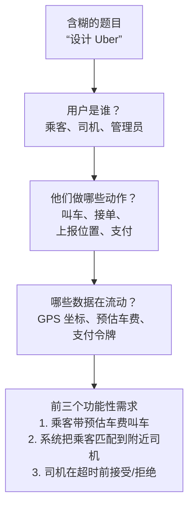
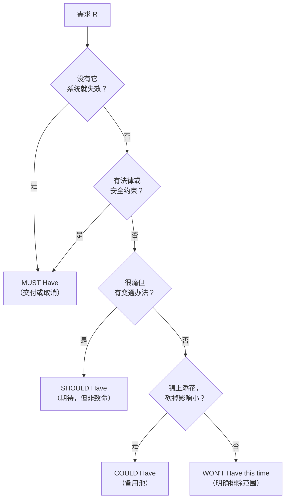
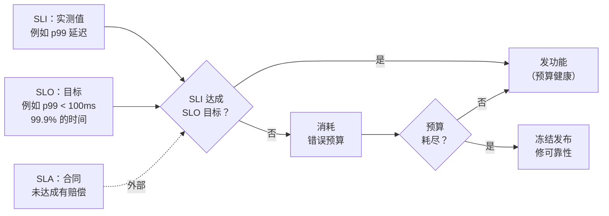
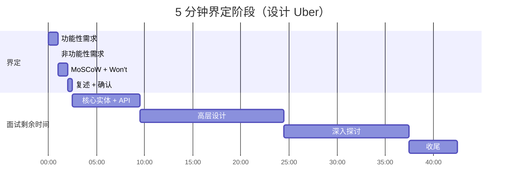

# 需求界定：功能性需求、非功能性需求与 MoSCoW

> **TL;DR**：系统设计面试的头五分钟决定了后面四十分钟。需求界定把一道含糊的题目拆成三份产物：功能性需求（系统做什么）、非功能性需求（做得多好），以及一份 MoSCoW 优先级排序——它让你承诺一个在剩余时间里真能画完的范围。跳过需求界定的候选人往往交不出完整设计，这也是中级候选人挂掉这类面试最常见的原因[^1]。有三个问题永远值得花时间：规模（DAU、QPS）、延迟 SLO、一致性模型。其余都是备用项。

## 学习目标

学完本章，你将能够：

- [ ] 区分功能性需求与非功能性需求，并各举出例子
- [ ] 用 MoSCoW（Must、Should、Could、Won't）在 60 秒内给一道模糊题目分诊
- [ ] 把需求界定压进 5 分钟时间盒，同时不遗漏关键澄清
- [ ] 找出几乎每道题都值得问的那三个澄清问题
- [ ] 把非功能性需求对应到具体的架构决策（CAP 取舍、缓存、分片）
- [ ] 用结构化检查清单避开隐藏需求陷阱

## 直觉理解

你走进一家餐厅，说“我要吃饭”。服务员盯着你。你没给出任何可执行的信息。你吃素吗？对贝类过敏吗？在过生日？有预算限制？赶时间吗？

现在想象你说：“我要一份牛排，三分熟，配一份蔬菜沙拉，40 美元以内，20 分钟内上。”服务员就能行动了。他知道要端什么（功能性），要做到多好（非功能性），以及什么是你不能接受的（约束）。如果厨房忙不过来，他能给你一个更快的替代方案，因为你已经告诉他优先级了：速度优先于花样。

系统设计面试是同一回事。“设计 Uber”就是“我要吃饭”。它没有告诉面试官你究竟要建什么。你头五分钟的任务，就是把这道含糊的题目变成一份可验证的契约：三个用户可见的动作、三个可度量的质量目标，外加一份明确列出“不做什么”的清单。这份契约就是你接下来 40 分钟的锚点。每个架构决策都指向它。每个权衡都由它来辩护。

[如何应对系统设计题](../part-1-core-fundamentals/05-how-to-approach-design-questions.md)介绍过 6 步框架，并给澄清阶段分配了 5 分钟。本章聚焦这 5 分钟，给你让它真正起作用的内部结构。

## 原理

### 功能性需求：系统做什么

功能性需求是对用户可见行为的陈述。它回答：“用户能用这个系统做什么？”IEEE Std 830-1998 把它固化为对每个功能的输入、行为和输出的描述。ISO/IEC 25010 称之为功能适合性：产品提供的功能满足明示与隐含需求的程度。

好的功能性需求是动词：创建、发送、读取、搜索、通知、匹配、投递。差的功能性需求是名词：“一个聊天系统”（对什么数据做什么动作？）。

面试里的启发式很简单：抽出前三个功能性需求，用“用户应能……”或“系统应……”的句式写下来[^1]。三是个神奇数字。更少，设计受到的约束不足；更多，你就造出了 40 分钟内覆盖不了的范围。

**功能性需求的三个标准问题：**

1. 用户是谁？（乘客、司机、管理员、API 调用方）
2. 有哪些动作？（发布、读取、搜索、订阅、匹配）
3. 数据长什么样？（文本、图片、地理坐标、时序数据）

*三个问题把一道含糊的题目变成可执行的功能性需求。每个问题都在收窄设计空间。*

### 非功能性需求：做得多好

非功能性需求约束功能性需求的实现方式。它们是决定系统在生产里能用、还是只在纸面上正确的质量属性。

FURPS 模型（Grady 与 Caswell，HP，1987）把它们分为功能性、易用性、可靠性、性能与可支持性。ISO/IEC 25010（2023 年修订）列出九项质量特性，包括性能效率、可靠性、安全性、可维护性与安全防护。就面试而言，一张更短的清单更好用[^1]：

1. **CAP 取舍** —— 一致性还是可用性？
2. **延迟** —— 哪些操作需要低延迟，低到什么程度？
3. **吞吐量** —— 读写比、峰值 QPS
4. **可用性** —— 几个九？
5. **持久性** —— 数据允许丢吗？
6. **安全与合规** —— GDPR、HIPAA、PCI-DSS？

关键规则：不量化就不算数。“系统应该很快”是噪音。“搜索在 p99 下 500 ms 内返回结果”是可验证的目标，它逼出架构决策（内存索引，而不是扫盘）[^1]。

**可用性-停机时间对照表**是面试中被引用最多的非功能性需求（NFR）材料：

| 可用性 | 年停机时间 | 月停机时间 | 常见叫法 |
|---|---|---|---|
| 99% | 3.65 天 | 7.3 小时 | 两个九 |
| 99.9% | 8.76 小时 | 43.8 分钟 | 三个九 |
| 99.99% | 52.6 分钟 | 4.38 分钟 | 四个九 |
| 99.999% | 5.26 分钟 | 26.3 秒 | 五个九 |

每多一个九，工程投入大约要多一个数量级[^2]。给一个并不需要五个九的系统宣称五个九，只会抬高复杂度，用户一点好处也没有。

*每多一个九，年停机时间降为十分之一，但工程成本大致以同样的倍数上升。*

**读写比**是最直接决定拓扑的那一项非功能性需求。100:1 的读多写少系统（商品目录、社交信息流）靠缓存、CDN 和只读副本扩展。写多的系统（指标采集、IoT 遥测）需要分片、异步写路径或列式存储。这个问题要早问。它决定了后面的一切。

**一致性谱系**是第二个塑造拓扑的非功能性需求。[CAP 与 PACELC](../part-3-distributed-systems-theory/03-cap-and-pacelc.md)介绍过这个根本权衡。在界定阶段要问：“如果用户发了一条消息，他刷新页面必须立刻看到吗？其他用户必须立刻看到吗？”这是两个不同的（读己之写 vs 线性一致性），成本差得很远。

**地理分布**在需求层面就改变了设计。单区域系统可以用同步复制。全球系统必须在高延迟（跨区域同步）和弱一致性（异步复制）之间选一个。光在光纤里的速度大约是每 200 km 1 ms（玻璃折射率约 1.5，光速降到约 200,000 km/s）。从加州到西欧的大圆距离约 9,000 km，所以物理下限约 90 ms 往返；实践中，光纤并不走直线，加上交换设备开销，真实 RTT 通常落在 140–160 ms 附近。物理下限无法用工程手段消除；路由开销能减少，但消除不了。

**合规**在界定阶段值 30 秒。GDPR 第 17 条（被遗忘权）会把软删除加硬删除管道逼进数据模型。HIPAA 要求审计日志和静态加密。PCI-DSS 约束支付数据能放在哪里。如果系统要处理欧盟用户数据、金融交易或健康记录，在界定阶段就说出来。它从根基上改变架构，不是事后补丁。

### MoSCoW 优先级排序

MoSCoW 由 Oracle UK 的 Dai Clegg 于 1994 年提出，后被 DSDM 敏捷框架采纳[^3]。它把每条需求归入四档：

- **Must Have（必须有）** —— 没有它交付就没有意义；没有它不合法；没有它不安全；没有它就交不出可用方案
- **Should Have（应该有）** —— 重要但不致命；去掉很痛，但有变通办法
- **Could Have（可以有）** —— 想要但没那么重要；这是备用项的主要来源
- **Won't Have this time（这次不做）** —— 明确排除在范围外；记录下来，免得它悄悄爬回来

DSDM 建议 Must Have 占总工作量的比例不超过 60%，Could Have 约占 20%，这样估算失准时还有缓冲[^3]。MoSCoW 里的字母“o”只是为了让缩写能读出来，没有含义。

Must Have 的判定问题是：“如果这条需求没满足，会怎样？”如果答案是“项目取消”，那就是 Must Have。如果存在变通办法（手工的、痛苦的、或临时的），那就是 Should 或 Could[^3]。

*把每条需求都沿这棵决策树走一遍。Must Have 的判定是二元的：“缺了就取消项目吗？”是就是 Must。其余都是备用项。*

面试里，MoSCoW 花 60 秒。你说出三个功能性需求，标成 Must，然后点名两件明确不覆盖的事（Won't Have）。这守住了你的时间盒。20 分钟后面试官问起推送通知，你指向 Won't 清单：“这个我划出去了，不过如果你想换点别的东西聊，我可以展开。”

Won't Have 和 Must Have 一样有价值。它们守住时间盒，也展示出你对“现在重要”和“以后重要”的判断力。

### SLI、SLO、SLA：可度量质量的那套词汇

[SLI、SLO、SLA 与错误预算](../part-6-reliability-and-operations/01-sli-slo-sla-error-budgets.md)深入讲过这个主题。界定阶段需要的最小词汇量如下：

- **SLI（Service Level Indicator，服务水平指标）** —— 好事件占总事件比例的实测值。例：“100 ms 内完成的请求占比”[^4]。
- **SLO（Service Level Objective，服务水平目标）** —— 该 SLI 在一段时间窗口上的目标值。例：“28 天内 99.9% 的请求在 100 ms 内完成”[^4]。
- **SLA（Service Level Agreement，服务水平协议）** —— 带明确后果（退款、抵扣、法律赔偿）的合同，SLO 没达成就要付出代价[^4]。

启发式：如果没有合同后果，那就是 SLO，不是 SLA。面试里说 SLO，除非你明确在模拟一份对付费客户的合同。

**错误预算**是 `1 - SLO`。99.9% 的 SLO 给出 0.1% 的预算：四周内每一百万请求允许 1,000 次失败。预算耗尽，发布冻结，直到窗口重置[^5]。这就把一个非功能性需求（可用性）通过一个可度量的量，接到了运维策略（发布节奏）上。

*SLI 负责度量，SLO 给出目标，错误预算控制发布节奏。SLA 则为外部客户加上合同约束力。*

在界定阶段，每条关键路径上承诺一个 SLO。“叫车匹配在 60 秒内完成，99.9% 的情况下”就是一条完整的非功能性需求。它可验证，它约束了架构（匹配路径上不能有跨区域同步调用），也给面试官一个可以用来对照你最终设计的数字。

### 时间盒与隐藏需求陷阱

45 分钟的面试里，界定阶段占 5 分钟[^1]。内部分配：

- 60 秒：功能性需求（前三个）
- 90 秒：非功能性需求（3–5 条，量化）
- 60 秒：MoSCoW 分类与 Won't Have
- 30 秒：复述并与面试官确认

界定阶段的每一分钟，都靠砍掉死路为后面省下好几分钟设计时间。但在界定上过度投入会饿死设计阶段。规则是：到第 7 分钟你还在问问题，就停下来，说出你的假设，往前走。

**隐藏需求陷阱**是这样一种失败模式：候选人漏掉那些不在题目里、却会改变架构的需求。常见的隐藏需求：

- **幂等性** —— 支付处理、消息投递
- **顺序保证** —— 聊天消息、事件流
- **多租户** —— SaaS 平台、共享基础设施
- **数据保留与删除** —— GDPR 被遗忘权
- **限流** —— 公开 API、防滥用
- **审计日志** —— 金融系统、医疗

你没法在 5 分钟里全问一遍。解法是一张脑内清单，10 秒扫一遍，挑出适用于当前题目的 1–2 条。支付系统：幂等性和审计日志。聊天系统：顺序和投递保证。多租户 SaaS：隔离和限流。

**量级估算作为需求输入。**[量级估算](../part-1-core-fundamentals/04-back-of-envelope-estimation.md)教过算法。在界定阶段，估算不是独立环节；它用来验证你的非功能性需求。如果你宣称“低延迟”，但量级估算显示跨区域往返要 500 ms，那你的需求和物理规律矛盾。好用的换算：1 请求/秒等于每月 250 万请求。40 请求/秒等于每月 1 亿请求。用它在你承诺规模之前先做个体检。

### 对照框架：RICE 与 Kano

MoSCoW 适合 60 秒的面试窗口。另外两个框架值得了解，用于设计完成后的讨论：

**RICE**（Sean McBride，Intercom，2018）用 `(Reach × Impact × Confidence) / Effort` 给功能打分。Reach 是每周期受影响的用户数；Impact 是序数刻度（3 = 巨大，2 = 高，1 = 中，0.5 = 低，0.25 = 极小）；Confidence 是百分比；Effort 是人月。RICE 产出可排序的分数，适合季度规划，但对界定那一分钟来说太慢。

**Kano**（狩野纪昭，1984）把功能分为必备型（基线；缺失导致不满）、期望型（与满意度线性相关）、兴奋型（意外的惊喜）、无差异型、反向型（用户反感）。Kano 能解释为什么某些非功能性需求（可用性、持久性）属于必备型，而另一些（实时协作、离线模式）属于兴奋型。当你要解释为什么把某个非功能性需求排在另一个前面时，这是一套好用的词汇；但它需要满意度数据，候选人在面试现场很少有。

界定用 MoSCoW。设计完成后，如果面试官问“你会怎么给这些功能相互之间排优先级？”，再提 RICE 或 Kano。

## 真实案例

下面是用这套框架界定“设计 Uber”的过程，基于 HelloInterview 的经典题目拆解[^6]。

**第 0:00 至 1:00 —— 功能性需求：**

“我先识别核心用户动作。这里有两类用户：乘客和司机。”

1. 乘客输入上车点和目的地，得到预估车费
2. 乘客按预估车费叫车；系统把他匹配到附近的司机
3. 司机在超时窗口内接受或拒绝叫车请求；接受的司机导航到上车点

“我明确不覆盖：动态调价算法、支付处理、司机入驻、管理后台。这些是本次的 Won't Have。”

**第 1:00 至 2:30 —— 非功能性需求：**

- **延迟：** 匹配在 1 分钟内完成，否则优雅失败[^6]
- **一致性：** 匹配需要强一致（不能把一个司机同时派给两个乘客）[^6]
- **吞吐量：** 单个地理区域内承受 10 万并发请求（体育场、机场）[^6]
- **可用性：** 叫车请求优先保可用性；匹配可以重试

“这里读写比很特殊。司机每 5 秒上报一次位置，约 1,000 万司机，也就是每秒约 200 万次位置写入[^6]。但叫车请求相对稀疏。所以这是一个写多的定位系统，在给一个读多的匹配系统供数。”

**第 2:30 至 3:30 —— MoSCoW：**

| 优先级 | 需求 |
|---|---|
| Must | 车费预估、叫车匹配、司机接受/拒绝 |
| Should | 行程中的实时位置跟踪 |
| Could | 行程历史、评分 |
| Won't | 动态调价、支付、司机入驻、GDPR 合规 |

**第 3:30 至 4:00 —— 复述：**

“确认一下：我要设计一个叫车匹配系统，每秒处理 200 万次位置写入，在 60 秒内以强一致把乘客匹配到司机，并能扛住 10 万并发请求的地理热点。这个范围你认可吗？”

面试官点头。你有了契约。接下来 40 分钟的每个架构决策都指向这份清单。

*5 分钟界定阶段拆成若干子阶段。剩下的 40 分钟由这里建立的契约定调。*

## 设计决策

**范围立场：广度还是深度。**

| 立场 | 优点 | 缺点 | 适用场景 | 我们的选择 |
|--------|------|------|-----------|----------|
| 范围宽、设计浅 | 覆盖多个功能；展示广度 | 没有深度技术信号；面试官无法评估严谨性 | 探索性轮次或初级面试，评分标准看重广度 | 面试官明确要求广度时 |
| 范围窄、设计深 | 在所选子系统上给出强技术信号；清晰的 Won't Have 守住时间盒 | 缺少广度；面试官可能中途把你引向别处 | Staff、Principal 级别的面试，评分标准是深度优先于广度 | 高级及以上默认 |

**优先级方法：MoSCoW 还是 RICE。**

| 方法 | 优点 | 缺点 | 适用场景 | 我们的选择 |
|--------|------|------|-----------|----------|
| 开场用 MoSCoW | 强制显式排优先级；Won't Have 守住时间盒；能塞进 60 秒窗口[^3] | 要花 60–90 秒，有些面试官会觉得你在拖时间 | 标准 45 分钟面试的界定阶段 | 现场界定默认 |
| RICE 打分 | 用 `(Reach × Impact × Confidence) / Effort` 量化功能价值；跨功能排序时有现成词汇 | 需要 Reach 和 Confidence 数据，候选人在现场很少有；对界定那一分钟来说太慢 | 设计完成后，面试官问“你会怎么给这些功能相互排序？” | 只在设计完成后被问到时用 |

## 常见陷阱

> [!WARNING]
> **需求还没清就先画架构。** 这是中级候选人挂掉最常见的原因。第 2 分钟就开始画方框，等于把自己绑在一个你辩护不了的架构上。逼自己一句：“在画任何东西之前，我先把功能性需求和非功能性需求写下来。”

> [!WARNING]
> **把所有非功能性需求当成同等重要。** 同时宣称 99.999% 可用性、p99 低于 10 ms、全球强一致、完整 GDPR 数据驻留，按 CAP 和 PACELC 就是自相矛盾。每个子系统在 CAP 上选定一边。把延迟目标量化，一致性选择自然就落定了。

> [!WARNING]
> **漏掉读写比。** 设计 Twitter 信息流却不问是读多还是写多，你就没法论证扇出读还是扇出写。把读写比放进你最先问的三个问题里。它决定拓扑。

> [!WARNING]
> **把 SLA 和 SLO 搞混。** 你说“99.999% 的 SLA”，面试官问违约的赔偿是多少，你就答不上来了。用 SLO，除非你明确在模拟一份带后果的付费客户合同[^4]。

> [!WARNING]
> **先估算后澄清规模。** 用编出来的 DAU 算 QPS，然后面试官抛出一个不同的规模，3 分钟就白费了。先就 DAU 和读写比达成一致。然后再估算。如果那些数字并不改变设计，干脆跳过估算[^1]。

## 练习

挑三道你从没设计过的题目：一道地理空间题（例如“设计 Google Maps 的附近搜索”）、一道信息流题（例如“设计 Twitter 的主页时间线”）、一道金融题（例如“设计 Stripe 的支付处理”）。每题严格花 5 分钟写下：(1) 三条功能性需求，(2) 三到五条量化的非功能性需求，(3) 一份至少包含两个 Won't Have 的 MoSCoW 分类。把你写的东西和公开的拆解对照。留意你漏掉的问题，把它们加进你的个人清单。

提示

对每道题，都从三个标准问题开始：用户是谁、有哪些动作、数据长什么样。然后过一遍非功能性需求清单：CAP 取舍、延迟目标、读写比、可用性九数、合规。地理空间题有一个隐藏的非功能性需求（地理分布）。金融题有隐藏需求（幂等性、审计日志）。信息流题的关键非功能性需求是读写比，它决定扇出策略。

参考答案

**地理空间：“设计 Google Maps 的附近搜索”**

功能性：(1) 用户搜索自己位置周边一定半径内的商家，(2) 用户查看商家详情与评价，(3) 商家更新自己的店铺信息。

非功能性：搜索延迟 p99 低于 200 ms；读操作可用性 99.99%；店铺更新可以接受最终一致性（5 分钟内传播完成）；地理空间索引要能承载 1 亿以上 POI。

MoSCoW：Must = 半径搜索 + 商家详情。Should = 评价、照片。Could = 路线导航集成。Won't = 实时路况、预订、支付。

关键洞察：隐藏的非功能性需求是地理分布。东京的用户需要低延迟访问东京的商家。单区域设计会让跨太平洋用户多付 150 ms 以上。这就逼出两种选择：地理分片的数据，或者 CDN 缓存的读路径。

**信息流：“设计 Twitter 的主页时间线”**

功能性：(1) 用户发推，(2) 用户读自己的主页时间线（关注账号的推文），(3) 用户关注/取关账号。

非功能性：信息流渲染 p99 低于 200 ms；DAU 1 亿以上；读写比约 100:1（读占绝对多数）；可用性优先于一致性（信息流可接受最终一致性，自己的推文要读己之写）。

MoSCoW：Must = 发推 + 读信息流 + 关注。Should = 点赞、转推。Could = 搜索、热门。Won't = 私信、广告、分析。

关键洞察：100:1 的读写比是架构分叉点。它驱动扇出写 vs 扇出读的决策。大 V 账号（1,000 万以上粉丝）会击穿扇出写；混合方案是对普通用户扇出写，对名人读时拉取。

**金融：“设计 Stripe 的支付处理”**

功能性：(1) 商户针对客户的支付方式发起一笔扣款，(2) 系统通过支付网络处理该扣款并返回成功/失败，(3) 商户查看交易历史并发起退款。

非功能性：支付状态强一致（不能重复扣款）；所有写操作幂等；p99 延迟低于 2 秒（支付网络本身慢）；可用性 99.99%；PCI-DSS 合规（卡数据绝不落明文）；完整审计链路。

MoSCoW：Must = 扣款 + 幂等 + PCI 合规。Should = 退款、webhook。Could = 订阅计费、多币种。Won't = 欺诈检测机器学习、争议处理、商户入驻。

关键洞察：隐藏需求是幂等性（商户与 Stripe 之间的网络故障绝不能造成重复扣款）和审计日志（每次状态迁移都必须留痕以备合规）。这些不在题面里，但从根本上改变数据模型。

## 要点回顾

- 界定阶段是面试里最短、杠杆最高的一段。界定阶段每分钟都靠砍掉死路为设计省下好几分钟。
- 功能性需求是动词（创建、发送、匹配）。非功能性需求是可度量的质量属性（p99 低于 200 ms、99.9% 可用性、10:1 读写比）。
- MoSCoW 不是可选项。没有明确的 Won't Have，你会想覆盖太多，最后一件事都讲不完。Must Have 占 60% 的上限就是你的缓冲。
- 有三个问题永远值得问：规模（DAU 和 QPS）、延迟 SLO、一致性模型。它们比任何其他输入都更影响拓扑。
- 不量化就不算数。“高可用”是噪音。“99.99% 可用性（每年停机 52.6 分钟）”是可验证的约束。
- 读写比决定拓扑。读多意味着缓存和副本。写多意味着分片和异步路径。
- Won't Have 守住你的时间盒。面试官问到你划出去的功能时，指向清单，并主动提出交换。

## 延伸阅读

- [HelloInterview Delivery Framework](https://www.hellointerview.com/learn/system-design/in-a-hurry/delivery) —— 5 分钟需求预算、功能性与非功能性需求的划分，以及如今大多数 FAANG 候选人已经内化的非功能性需求清单。
- [DSDM MoSCoW Prioritisation](https://web.archive.org/web/20260128040714/https://www.agilebusiness.org/dsdm-project-framework/moscow-prioririsation.html) —— MoSCoW 定义的原始来源、Must Have 占 60% 工作量的规则，以及那个标准判定问题（“缺失会怎样？”）。
- [Google SRE Book, Chapter 4: Service Level Objectives](https://sre.google/sre-book/service-level-objectives/) —— SLI、SLO、SLA 之间的经典区分，附完整算例；量化可用性非功能性需求的必读材料。
- [Google SRE Book, Appendix A: Availability Table](https://sre.google/sre-book/availability-table/) —— 从 99% 到 99.999% 的停机时间参考表，任何严肃的可用性讨论都会用到。
- [Intercom: RICE Prioritization](https://www.intercom.com/blog/rice-simple-prioritization-for-product-managers/) —— Sean McBride 2018 年的文章，定义了 `Reach × Impact × Confidence / Effort` 公式；面试官问“你会怎么给这些功能排序？”时很好用。
- [Jeff Dean's Latency Numbers](https://gist.github.com/jboner/2841832) —— 每个设计者都背下来的经典表格；用来验证你的延迟非功能性需求在物理上是否可达。
- [HelloInterview Uber Problem Breakdown](https://www.hellointerview.com/learn/system-design/problem-breakdowns/uber) —— 本章真实案例引用的经典“设计 Uber”走查；可以看到界定阶段实战。
- [ISO/IEC 25010 Quality Model (arc42 summary)](https://quality.arc42.org/standards/iso-25010) —— 九项产品质量特性的简明总结；非功能性需求分类的学术基础。

## 记忆卡片

**Q：** 界定阶段产出哪三份产物？
**A：** 功能性需求（系统做什么）、非功能性需求（做得多好），以及 MoSCoW 优先级排序（什么在范围内、什么在范围外）。

**Q：** 功能性需求应该用什么形式写？
**A：** 动词开头的陈述句：“用户应能[动作]。”好的功能性需求是动词（创建、发送、匹配）。差的功能性需求是名词（“一个聊天系统”）。

**Q：** MoSCoW 代表什么？字母“o”是什么意思？
**A：** Must have、Should have、Could have、Won't have this time。字母“o”只是为了让缩写能读出来，没有含义。

**Q：** DSDM 对 Must Have 的判定标准是什么？
**A：** “如果这条需求没满足，会怎样？”如果答案是“取消项目，没有它交付就没意义”，那就是 Must Have。如果存在变通办法，那就是 Should 或 Could。

**Q：** 按 DSDM 的说法，Must Have 应该占总工作量的多少？
**A：** 不超过 60%。剩下的 40%（分给 Should 和 Could）在估算失准时提供缓冲。

**Q：** SLO 和 SLA 的区别是什么？
**A：** SLO 是内部目标（例如 28 天内 99.9% 可用性）。SLA 是带明确后果（退款、抵扣、法律赔偿）的合同，目标没达成就得承担。没有后果，就是 SLO。

**Q：** 什么是错误预算，怎么算？
**A：** 错误预算 = 1 - SLO。99.9% 的 SLO 给出 0.1% 的预算（4 周内每一百万请求允许 1,000 次失败）。预算耗尽，发布冻结。

**Q：** 界定阶段永远值得问的三个问题是什么？
**A：** 规模（DAU 和 QPS）、延迟 SLO（哪些操作、要多快）、一致性模型（每个子系统是强一致还是最终一致）。

**Q：** 读写比如何影响架构？
**A：** 读多（100:1）的系统靠缓存、CDN 和只读副本扩展。写多的系统需要分片、异步写路径或列式存储。这个比例决定拓扑。

**Q：** 在 45 分钟的面试里，界定阶段应该花多久？
**A：** 总共 5 分钟：功能性 60 秒、非功能性 90 秒、MoSCoW 60 秒、复述 30 秒。

**Q：** 什么是隐藏需求陷阱？
**A：** 题目里没写、却会改变架构的需求：幂等性（支付）、顺序（聊天）、多租户（SaaS）、数据保留（GDPR）、限流（公开 API）。用一张脑内清单，挑出适用的 1–2 条。

**Q：** RICE 公式是什么？面试里什么时候该用它？
**A：** RICE = `(Reach × Impact × Confidence) / Effort`。只在设计完成后的讨论里用，也就是面试官问你会怎么给功能相互排序时。对界定那一分钟来说它太慢。

## 参考文献

[^1]: HelloInterview, "Delivery Framework" (System Design in a Hurry). https://www.hellointerview.com/learn/system-design/in-a-hurry/delivery
[^2]: Google SRE Book, "Chapter 3: Embracing Risk" (Managing Risk section). https://sre.google/sre-book/embracing-risk/
[^3]: DSDM / Agile Business Consortium, "Chapter 10: MoSCoW Prioritisation" (DSDM Project Framework). https://web.archive.org/web/20260128040714/https://www.agilebusiness.org/dsdm-project-framework/moscow-prioririsation.html
[^4]: Chris Jones, John Wilkes, Niall Murphy, Cody Smith, "Service Level Objectives" (Google SRE Book, Chapter 4). https://sre.google/sre-book/service-level-objectives/
[^5]: Steven Thurgood, "Example Error Budget Policy" (Google SRE Workbook, Appendix B). https://sre.google/workbook/error-budget-policy/
[^6]: HelloInterview, "Uber" problem breakdown. https://www.hellointerview.com/learn/system-design/problem-breakdowns/uber
