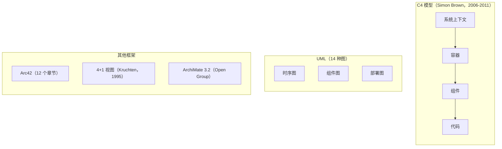
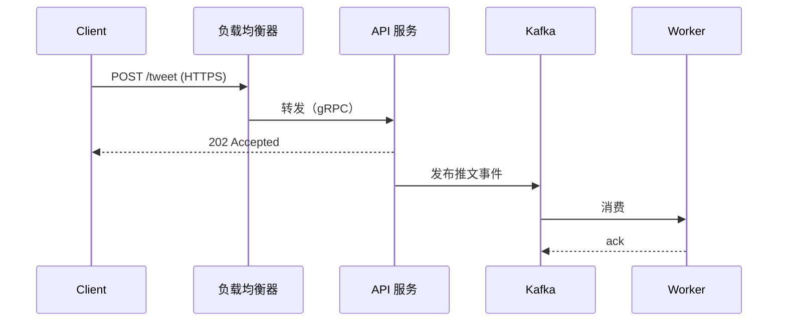
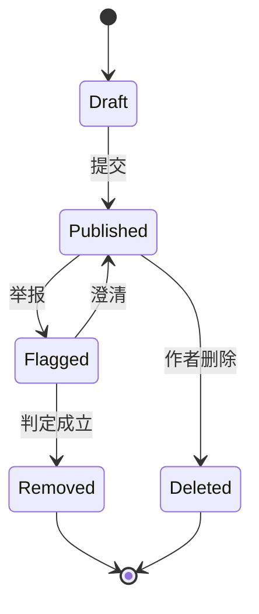
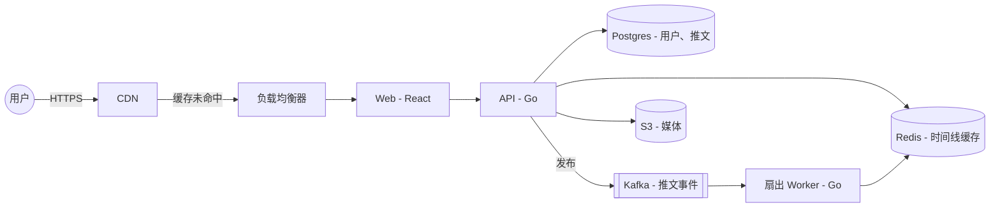

# 系统设计面试中的画图能力

> **TL;DR**: 你的图是面试官用来判断你脑子里那套架构是否自洽的共同载体。图画得干净不保证录用，但图画得读不懂经常直接导致不录用——因为面试官无法判断图背后的推理站不站得住脚[^1]。只用 C4 模型中 Container（容器）这一层的严格子集[^2]，借用 UML 时序图里同步/异步箭头的语义，然后在 Excalidraw（GitHub 123K stars，已嵌入 CoderPad[^3]）里反复练，直到你能在 5 分钟内画出一张带标注的架构图。

## 学习目标

学完本章，你将能够：

- [ ] 画出图例一致的架构图，清晰区分客户端、服务、数据存储与队列的边界
- [ ] 用有向箭头和协议标注表达数据流，不留任何歧义
- [ ] 在物理白板和 Excalidraw 之间自如切换，速度不打折
- [ ] 认得出并复用五种高频图型，应对任意一道面试题
- [ ] 避开“八个方框”和“巨石团块”这两类暴露思维浅薄的反模式

## 直觉理解

想想地铁图是怎么工作的。伦敦地铁图在地理上并不准确。它拉伸距离、拉直曲线，用颜色区分线路。但任何游客都能在几秒内规划出路线，因为图例是统一的：圆圈是车站，彩色线是线路，换乘站是带多种颜色的白圈。没人需要看图例说明，因为词汇量极小，每个元素都遵循同一套规则。

你面试时画的图，就是一套架构的地铁图。面试官是游客。他们只有 45 分钟，要理解你的系统、试探它的弱点，并判断你能不能把它建起来。如果你的图图形混乱、箭头没有标注、布局随意，面试官就得把认知预算花在解析你的画面上，而不是评估你的推理。这部分时间他们本来可以给你加分。

好消息是：你只需要大约六种图形、两种箭头样式和一条布局约定，就能画出可以瞬间扫读的图。剩下的是练习。本章给你词汇、给你工具、也给你肌肉记忆的训练，让画图变成本能，把脑子留给真正困难的工程决策。

## 原理

### 便于扫读的图例

一张可扫读的图，用的是受约束的图形词汇，读者永远不会疑惑“那个圆角矩形到底是什么意思？”

最小集合：

- **矩形**表示服务或进程（标注为名称 + 技术栈：“API | Go”）
- **圆柱**表示数据库和持久化存储
- **平行四边形或双方括号框**表示队列和消息中间件
- **圆角矩形或火柴人**表示外部参与者和客户端
- **圆圈**表示你不拥有的外部系统

每条线都是有方向的（只有一个箭头），每条线都有标注说明协议或操作（“POST /tweet”、“gRPC”、“CDC”），并且每条线要么从左到右表示请求流，要么从上到下表示分层依赖[^2][^4]。这跟英文读者扫读页面的习惯一致：从左到右、从上到下。

颜色是可选项。如果要用，就按职能分组（蓝色算力、绿色存储、橙色异步），并确保分组对色盲友好。永远不要把颜色当作唯一信号。

> [!TIP]
> 在画布一角加一个小图例。三种图形、两种箭头，就这么点。花 15 秒，就能帮面试官消除所有歧义。

### 值得了解（但不必背下来）的正式图例规范

描述软件架构的正式方法有五种。面试中你不需要完整使用其中任何一种，但了解它们的词汇，当面试官问“你这用的是什么图例法”时，你就能给出站得住脚的说法。

*C4 模型的四个缩放层级，是与面试关系最密切的正式图例法。UML 贡献了三种有用的图。Arc42、4+1 和 ArchiMate 属于文档级框架，实际面试中几乎用不到。*

**C4 模型**是一种分层缩放：系统上下文（你的系统及其用户）、容器（应用、数据存储、运行时）、组件（容器内部的逻辑模块）、代码（类图，可选）[^2]。C4 与具体图例无关：它只要求每个元素都带上类型、简短描述和技术标注，每条线都是单向且有标注的[^4]。容器层基本上就是带标注的 HLD 面试产物。

**UML** 有 14 种图，但面试中只有三种有意义：时序图（生命线、同步/异步消息）、组件图（逻辑模块与接口）、部署图（节点与执行环境）[^5]。

**Arc42** 是 12 个章节的文档模板。第 5 到第 7 章（构建块视图、运行时视图、部署视图）直接对应面试产物[^6]。

**4+1 视图模型**（Philippe Kruchten，1995）用五个并行视图：逻辑视图、开发视图、进程视图、物理视图，再加上把前四者串起来的场景[^7]。

**ArchiMate 3.2** 把企业架构分成三个核心层（业务层、应用层、技术层）加四个扩展。它的词汇有 50 多个元素，对任何 45 分钟的面试来说都太过[^8]。

> [!IMPORTANT]
> Gergely Orosz（前 Uber、前 Skype）指出，Uber、Facebook、Amazon、Netflix 和 Google 的工程师在日常设计工作中并不使用 UML、4+1 模型、ADR、C4，也不用依赖关系图[^9]。完整保真的形式化只是组织文化的信号，不是正确性的信号。用它们的词汇，跳过它们的仪式。

### 流向与箭头语义

影响最大的一条习惯：让每个箭头都毫无歧义。

*实线箭头（`->>`）表示调用方会阻塞的同步调用。虚线箭头（`-->>`）表示异步返回，或者发出后不管的消息。这条约定与 UML 时序图的语义以及 Mermaid 的语法一致。*

三条规则：

1. **请求流从左到右。** 客户端在左，下游服务在右。
2. **分层从上到下。** 负载均衡器在最上，数据存储在最下。
3. **每个箭头都要有标注。** 协议 + 操作：“POST /login | HTTPS”、“gRPC | GetUser”、“Kafka | order.created”。没有标注的箭头就是有歧义的箭头。

同步/异步的区分，能告诉面试官你有没有想过背压（backpressure）、重试和故障模式。指向数据库的实线箭头意味着调用方会一直阻塞到写入完成。指向队列的虚线箭头意味着调用方不等下游处理就继续往下走。这不是装饰，这就是架构。

### 工具选择与练习

**Excalidraw**（GitHub 123K stars，MIT 协议）是远程面试事实上的电子白板[^3]。它通过 Rough.js 刻意做出手绘质感，降低了心理门槛：手绘的图形传达的是“这只是草图，还能改”，而不是“这是最终版”[^10]。Google Cloud、Meta、Notion 和 Replit 都在内部使用它[^11]。CoderPad 把 Excalidraw 嵌为 Drawing Mode，于是它成了很大一部分美国技术面试的画布[^12]。

**Mermaid** 是基于文本的图表 DSL，在 GitHub 上原生渲染（2022 年 2 月起），大多数 markdown 流水线也支持。写作型设计文档选它最合适，因为它能和代码一起干净地做版本管理。它不适合在面试官面前现场画，因为你没法迭代式地涂抹修改。

**Miro**（1 亿多用户）和 **Lucidchart** 是更重的协作白板。加载慢、菜单深；新手在面试中光是找图形就要浪费 2 到 3 分钟。它们适合公司内部多轮的设计评审，不适合面试。

**tldraw** 和 **diagrams.net**（draw.io）是免费替代品。Diagrams.net 是画架构图时常见的拖拽式选择。tldraw 更轻，但用户群更小。

**物理白板**技巧：练大字号（字母至少 3 厘米高），在右上角留一块“草稿区”做估算计算，落笔时始终朝调用的方向移动马克笔，这样箭头自然落在终点位置。

**AWS / GCP / Azure 图标集**：AWS 发布官方架构图标集（SVG、PowerPoint、Visio），每年发布三次（1 月底、4 月和 7 月；第四季度不发）[^13]。这些图标在面试中是可选的。一个写着“S3”的普通矩形，和官方桶图标得分一样。

> [!TIP]
> 就选 Excalidraw。把同一套“设计 Twitter”的架构画十遍，直到 3 分钟内能画完。肌肉记忆比工具功能更重要。

### 五类高频图型

五种图几乎覆盖所有面试题。把它们当作练习科目反复练：

1. **高层架构图（流程图）** 用一张图展示客户端、边缘、服务、存储和外部依赖。这是你最先画的那张锚点图。

2. **时序图** 展示某条关键路径（例如“发布一条推文”）跨生命线的有序同步/异步消息。它把顺序、重试和失败语义暴露出来。

3. **数据流图** 展示经过异步流水线的写路径和读路径（Kafka 到 Flink 到 Postgres），与请求图分开画。

4. **部署图** 展示物理拓扑：区域、可用区、分片、副本。用 Mermaid 的 subgraph 或 Excalidraw 里的色块分区来表示。

5. **状态机** 展示资源生命周期（订单：待处理到已发货到已送达到已退款）或连接状态（WebSocket 打开/关闭/重连中）。

*推文审核的状态机。状态迁移暴露了面试官可以追问的故障模式（如果 `upheld` 触发时有一个并发的 `author_delete` 正在处理中，会怎样？）。时序图做不到一眼看出这些迁移。*

多数候选人在第 1 类图上过度用力，从不切换模式。当面试官问“如果队列堆积了会怎样”，就切到时序图。当他们问“这套东西怎么跨区域部署”，就切到部署图。能在面试中途切换图型，是资深级沟通能力的信号。

## 真实案例

Gergely Orosz 记录了 Uber 的工程组织（数百名工程师、数十个被依赖系统）在支付系统重写期间是怎么处理架构图的[^9]。这些发现对面试准备很有启发：

**没有正式图例法。** 不用 UML、不用 C4、不用 Arc42、不用 ADR 模板。工程师用的是 Google Docs 里 RFC 风格模板中记录的“老式方框加箭头”。同一份设计文档里的两张图经常布局不同，因为它们是不同工程师在不同时间加进去的。

**简洁是第一品质。** 指导原则是：“系统越简单，就越容易理解，也越容易发现问题。”图里不用术语，好让经验最浅的工程师也能读懂文档。

**迭代式白板会议。** 设计先过白板会议，然后写成 RFC，再广泛分发给约 2000 名工程师做异步评审。白板草图是种子，RFC 里的图是打磨后的版本。

*一个 Twitter 类系统的容器级架构。每个方框都带技术标注，每个箭头都写明协议或操作。这个细度在面试中能拿满分。*

教训是：即便在 Uber 这样的规模上，胜出的画图风格依然是有纪律、带标注的方框加箭头，而不是正式图例法。正是这份纪律，把录用候选人的图和被拒候选人的图区分开来。

## 设计决策

**画图策略：一次画全还是层层迭代。**

| 策略 | 优点 | 缺点 | 适用场景 | 我们的选择 |
|----------|------|------|-----------|----------|
| 一次画全 | 面试官早早看到全貌；显得准备充分 | 需求演进时难以修改；容易变成套模板而不是推理 | 你练得滚瓜烂熟的题（URL 短链、top-K） | 只用于排练充分的问题 |
| 分层迭代 | 把推理过程画在纸上；范围变化时容易调整 | 时间不够时有可能画不完 | 新颖或混乱、范围要在面试中途澄清的问题 | 多数面试的默认做法 |

**画布选择。**

| 工具 | 优点 | 缺点 | 适用场景 | 我们的选择 |
|------|------|------|-----------|----------|
| 白板（现场） | 物理感能培养肌肉记忆；画布大；擦得快 | 事后难以分享；只有一个缩放层级 | 仍在用白板的公司的现场轮 | 公司要求时使用 |
| Excalidraw（远程） | 干净、可分享、可撤销；手绘质感降低心理门槛[^10]；嵌入 CoderPad Drawing Mode[^12] | 要练才能快；自动布局能力有限 | 2025-2026 年远程面试的默认画布 | 远程面试的默认选择 |
| Mermaid（文本） | 可版本控制；GitHub 和 markdown 流水线可渲染；PR 里可 diff | 无法在面试官面前实时绘制 | 写作型设计文档和异步跟进产物 | 用于设计文档，不用于现场面试 |
| Miro / Lucidchart | 模板丰富；有 AWS/GCP 图标包；支持多人协作 | 界面重；深菜单找图形要花 2-3 分钟 | 公司内部多轮设计评审 | 用于内部评审，不用于现场面试 |

## 常见陷阱

> [!WARNING]
> **先画后说。** 最常见的失败行为：听完题目 60 秒内就开始画方框[^14]。前 5 分钟什么都别画。把这段时间用在澄清问题和容量估算上。每加一个新方框，都应该由你已确认的某条具体需求来支撑。

> [!WARNING]
> **八个方框，没有箭头。** 候选人画了六到十个矩形（“API”、“服务 A”、“缓存”、“DB”、“队列”），却没有箭头也没有标注。面试官追问一句“这个为什么在这儿”，候选人就卡住了。DesignGurus 把这列为 500 多名受训候选人中最常见的失败行为之一[^14]。

> [!WARNING]
> **巨石团块。** 一个巨大的“服务”矩形，挂着五根线，内部没有结构，也没有技术标注。当面试官凑近问（“里面的搜索是怎么做的”），候选人就开始重画。修法：如果一个方框在讨论中存活超过 5 分钟，就把它拆成至少两个带技术标注的容器[^2]。

> [!WARNING]
> **重好看，轻沟通。** 在 Excalidraw 里花好几分钟调对齐和配色，箭头却还没标注。标注永远优先于对齐。一张对不齐但有标注的图，得分高于一张漂亮却没标注的图[^15]。

> [!WARNING]
> **忽略方向性。** 箭头画成没有箭头的线段，或者两头都有箭头。每一根裸线都是风险；每一个双头箭头都是故障模式。笔杆和箭头要一笔画成。

## 练习

从 Alex Xu 的案例中挑一个（URL 短链、限流器或新闻流）。打开 Excalidraw。设一个 5 分钟计时器。画出完整架构，箭头要有标注、要有技术标注，并且至少清楚标出一处异步边界。保存图片。隔一天，不看上一张图再做一遍。比较两张图。反复迭代，直到第二遍在结构上与第一遍一致、在布局上更干净。

提示

从左侧的客户端开始。加上负载均衡器。然后问自己：“第一个处理这个请求的服务是什么？”画出来。对每个服务问：“它要访问数据库吗？缓存？队列？”把这些画在右边或下面。给每个箭头标上协议和操作。异步边界（队列）要用虚线箭头或者不同的图形。

参考答案

这是一份 5 分钟内画完的 URL 短链参考架构：

1. **布局**：客户端在最左，然后 CDN，然后负载均衡器，然后两个服务方框（创建服务、跳转服务），再往右是数据存储（Redis 缓存、PostgreSQL），Kafka 放在下方用于分析。

2. **标注**：客户端到 CDN：“HTTPS”。CDN 到 LB：“cache miss”。LB 到创建服务：“POST /urls”。LB 到跳转服务：“GET /{code}”。跳转服务到 Redis：“GET code”。Redis 未命中到 PostgreSQL：“SELECT”。创建服务到 PostgreSQL：“INSERT”。创建服务到 Kafka：“publish (async)”。

3. **图形**：服务用矩形，Redis 和 PostgreSQL 用圆柱，Kafka 用双方括号，客户端用圆圈。

4. **异步边界**：创建服务到 Kafka 的箭头是虚线，标注“async”。其余都是实线（同步）。

5. **技术标注**：每个方框都带技术栈：“Create Service | Go”、“Redis | LRU cache”、“PostgreSQL | sharded by code prefix”。

关键洞见：这张图一眼就表达了同步/异步的分界、读路径（跳转服务到 Redis，未命中再回落到 PostgreSQL）和写路径（创建服务到 PostgreSQL 加 Kafka）。面试官可以指着任意一个箭头追问，你能答得上来，因为你标注过了。

## 要点回顾

- 图就是面试的交付物。用对待一个 pull request 的态度对待它。
- 六种图形、两种箭头样式、从左到右的布局。整套图例就这些。
- 每个箭头都标上协议和操作。没有标注的箭头就是有歧义的箭头。
- Excalidraw 是远程面试的默认工具。练到能在 5 分钟内画出一张带标注的架构图。
- 五种图型（架构图、时序图、数据流图、部署图、状态机）覆盖 90% 的面试题。把它们当科目反复练。
- 没开口之前不要画。前 5 分钟花在需求上；每个方框都要由一条需求换来它的位置。
- 正式图例法（C4、UML、Arc42）是有用的词汇，不是必须的仪式。在 Uber、Meta 和 Google 真正落地的是有纪律、带标注的方框加箭头。

## 延伸阅读

- [The C4 model for visualising software architecture](https://c4model.com/) - Simon Brown 的免费指南；重点读 Notation 和 Review Checklist 两页，那套标注纪律可以直接迁移到面试里。
- [Gergely Orosz: Software Architecture - Clear and Simple Design is Underrated](https://dev.to/gergelyorosz/software-architecture-clear-and-simple-design-is-underrated-2bj9) - “Uber/FAANG 实践中不用正式图例法”这个论点，附有 Uber 支付重写的具体例子。
- [Excalidraw](https://excalidraw.com/) 和 [Excalidraw Libraries](https://libraries.excalidraw.com/) - 工具本体，以及社区贡献的系统设计模板，可用于练习。
- [Mermaid.js documentation](https://mermaid.js.org/) - flowchart、sequenceDiagram、stateDiagram、erDiagram 的语法；先读 flowchart 和 sequenceDiagram 两页。
- [CoderPad Drawing Mode](https://coderpad.io/using-drawing-mode/) - 你在现场面试中可能遇到的 Excalidraw 画布；面试前先熟悉它的工具栏。
- [Hello Interview: System Design in a Hurry](https://www.hellointerview.com/learn/system-design/in-a-hurry/introduction) - 你的图会被归入的评分维度（Problem Navigation、Solution Design、Technical Excellence、Communication）。
- [AWS Architecture Icons](https://aws.amazon.com/architecture/icons/) - 官方云图标包，每年发布三次（Q1、Q2、Q3；Q4 不发）；面试可选，写设计文档时有用。
- [Arc42 Documentation](https://docs.arc42.org/home/) - 12 章节模板的权威参考；想搞清楚面试用的图在生产级设计文档里处于什么位置，可以看这里。

## 记忆卡片

**Q:** 面试画图的六种基本图形是什么？
**A:** 矩形（服务）、圆柱（数据库）、平行四边形或双方括号（队列）、圆角矩形或火柴人（客户端/参与者）、圆圈（外部系统）、subgraph（部署边界）。

**Q:** 带实心箭头的实线表示什么？
**A:** 同步调用，调用方会阻塞直到收到响应。

**Q:** 带开放箭头的虚线表示什么？
**A:** 异步消息或返回，调用方不阻塞。

**Q:** 请求路径的标准流向是什么？
**A:** 从左到右。客户端在左，下游服务在右。

**Q:** 分层结构的标准流向是什么？
**A:** 从上到下。负载均衡器在最上，数据存储在最下。

**Q:** 面试中的五类高频图型是什么？
**A:** 高层架构图（流程图）、时序图、数据流图、部署图和状态机。

**Q:** “八个方框”反模式是什么？
**A:** 在前 90 秒内画出六到十个矩形，没有箭头也没有标注，把题目套到通用模板上，而不是从需求出发推理。

**Q:** “巨石团块”反模式是什么？
**A:** 一个巨大的“服务”矩形挂着多根线，内部没有结构，也没有技术标注，用单个方框把不确定性藏起来。

**Q:** 远程系统设计面试事实上的标准工具是什么？
**A:** Excalidraw（GitHub 123K stars，MIT 协议，嵌入 CoderPad 的 Drawing Mode）。

**Q:** C4 模型的四个层级是什么？
**A:** 系统上下文、容器、组件、代码。容器层与 HLD 面试产物最接近。

**Q:** 面试图里的每个箭头都应该包含什么？
**A:** 一个标注，写明协议和操作（例如“POST /tweet | HTTPS”、“gRPC | GetUser”、“Kafka | order.created”）。

**Q:** 系统设计面试中应该什么时候开始画？
**A:** 在 5 分钟的澄清问题和容量估算之后。每个方框都应该由你已经确认的某条具体需求来支撑。

## 参考文献

[^1]: Hello Interview, "System Design in a Hurry: Introduction". https://www.hellointerview.com/learn/system-design/in-a-hurry/introduction
[^2]: Simon Brown, "The C4 model for visualising software architecture". https://c4model.com/
[^3]: GitHub, "excalidraw/excalidraw repository (123k stars, MIT license)". https://github.com/excalidraw/excalidraw
[^4]: Simon Brown, "C4 model: Notation". https://c4model.com/diagrams/notation
[^5]: GeeksforGeeks, "Top UML Interview Questions". https://www.geeksforgeeks.org/system-design/top-uml-interview-questions/
[^6]: arc42 Documentation, "144 tips and 35 examples how to use the arc42 template (12 sections)". https://docs.arc42.org/home/
[^7]: Philippe Kruchten, "Architectural Blueprints: The 4+1 View Model of Software Architecture"（作者早期草稿，arXiv 2020；原文发表于 IEEE Software，1995 年 11 月，DOI: 10.1109/52.469759）. https://arxiv.org/abs/2006.04975
[^8]: The Open Group, "ArchiMate 3.2 Specification"（概览与规范）. https://en.wikipedia.org/wiki/ArchiMate
[^9]: Gergely Orosz, "Software Architecture: Clear and Simple Design is Underrated". https://dev.to/gergelyorosz/software-architecture-clear-and-simple-design-is-underrated-2bj9
[^10]: Ritza, "excalidraw vs. draw.io vs. tldraw vs. miro vs. lucidchart vs. figma". https://ritza.co/articles/gen-articles/excalidraw-vs-drawio-vs-tldraw-vs-miro-vs-lucidchart-vs-figma/
[^11]: GitHub, "excalidraw/excalidraw - Who's integrating Excalidraw"（README 中列出 Google Cloud、Meta、Notion、Replit 的章节）. https://github.com/excalidraw/excalidraw#whos-integrating-excalidraw
[^12]: CoderPad, "Drawing Mode Documentation"（由 Excalidraw 驱动的面试白板）. https://coderpad.io/using-drawing-mode/
[^13]: AWS, "AWS Architecture Icons"（官方图标包；仅在 Q1、Q2、Q3 末发布，Q4 不发）. https://aws.amazon.com/architecture/icons/
[^14]: Arslan Ahmad (DesignGurus), "100+ System Design Interviews Later, These Are the Only 4 Mistakes That Matter". https://designgurus.substack.com/p/100-system-design-interviews-later
[^15]: Arslan Ahmad, "Why Your System Design Diagrams Confuse Interviewers (and How to Fix Them)". https://designgurus.substack.com/p/youre-drawing-system-design-diagrams
