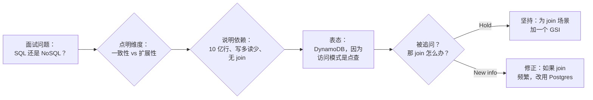
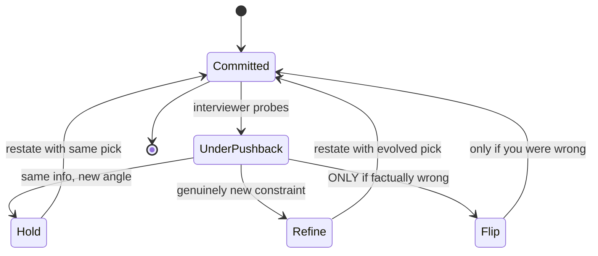

# 权衡表达：把“看情况”说清楚

> **TL;DR**: “看情况”是系统设计面试里被滥用得最多、单独说出来时又最没用的一句话。解法是把回答拆成三段：**取决于 X**（权衡维度）、**因为 Y**（需求里的依赖条件）、**所以我选 Z**（明确表态）。面试官不会因为你在 Redis 和 Memcached 之间选了哪个给你打分，他们看的是你有没有点出权衡、有没有把它和需求挂上钩、以及在压力下敢不敢拍板[^1]。Jeff Bezos 的规则：手上只有你想要的信息的 70% 时就该做决定[^2]。等攒到 90%，几乎总是太慢了。

## 学习目标

学完本章，你将能够：

- [ ] 把权衡类回答拆成三段结构：维度、依赖、表态
- [ ] 说出最常用的 10 个权衡维度（一致性与可用性、延迟与吞吐量、简单与灵活，等等）
- [ ] 面对面试官的追问能守住立场，而不是立刻改口
- [ ] 避开“选项自助餐”这个反模式（列五个方案却不做选择）
- [ ] 用“如果反着做会坏在哪”这一问检验自己的表态
- [ ] 在框定权衡时，区分本质复杂度和附带复杂度

## 直觉理解

你走进一家餐厅，问服务员：“我该点什么？”服务员说“看情况”。你们对视无言，什么也没发生。

现在换一位服务员。你问同样的问题。他说：“这要看你想吃清淡的还是扎实的。你刚提到饭后要去听音乐会，那我建议三文鱼。它出餐快、不油腻，配店里的白葡萄酒很合适。如果你时间充裕，我会推荐牛小排。”

开场那句话一模一样，传递的信号天差地别。第二位服务员点明了维度（清淡还是扎实）、说明了依赖条件（你要去听音乐会，所以出餐速度和饱腹感很关键），并且给了结论（三文鱼）。第一位只是在踢皮球。

系统设计面试是同一个道理。当面试官问“用 SQL 还是 NoSQL？”，最差的回答是“这个嘛，看情况”。最好的回答是：“这取决于访问模式。我们有一个 10 亿行、写多读少、不需要 join 的负载，所以我选 DynamoDB，因为访问模式是点查，而且写入速率超出单个 Postgres 能承受的上限。如果我们需要临时查询或者 join，我会换成 Postgres。”

这一整章的内容，就浓缩在这段话里。剩下的部分教你怎么在每一个维度上、在压力下，稳定地把这套动作做出来。

## 原理

### 三段式公式

[权衡思维](../part-1-core-fundamentals/06-trade-off-thinking.md) 里介绍过六段式表达模板（上下文、选项、所选、理由、放弃了什么、可否回退）。本章把它压缩成一个能在面试中 15 秒内说出口的口头形态：

1. **维度（Axis）**——我们在交换什么？点出此刻处于张力中的那个方向。
2. **依赖（Dependency）**——需求里的哪条约束决定了这个选择？
3. **表态（Commitment）**——我们到底选了什么，用陈述句说出来。

口语版公式：“这取决于 **[维度]**。考虑到 **[需求里的依赖条件]**，我选 **[方案]**，因为 **[理由]**。如果 **[依赖条件变了]**，我会改用 **[替代方案]**。”

最后那句“如果依赖条件变了”才是把 senior 级回答抬到 staff 级的关键。它表明你清楚这个选择是依赖上下文的，而不是教条[^3]。

*senior 级的权衡回答是一条三节点链条：点明维度、绑定到需求里的依赖条件、对某个方案表态。追问只会让它更精细，不会让它翻盘。*

### 你最常用的十个维度

每一场系统设计面试都从一小撮反复出现的权衡维度里取材。你不需要每次重新推导。把维度本身、它两端的极值、以及每端的一个真实系统例子背下来就够了。

```mermaid
flowchart TD
    subgraph CAP["一致性与可用性"]
        S1["Spanner、etcd<br/>CP"] --- D1["Cassandra AP；<br/>DynamoDB 默认 AP，<br/>可选强读"]
    end
    subgraph LT["延迟与吞吐量"]
        S2["在线服务<br/>优化延迟"] --- D2["Kafka、Flink<br/>优化吞吐量"]
    end
    subgraph RW["读多与写多"]
        S3["Postgres B-tree<br/>读优化"] --- D3["Cassandra LSM<br/>写优化"]
    end
    subgraph MM["单体与微服务"]
        S4["Shopify 模块化单体<br/>简单、一次部署"] --- D4["Netflix 微服务<br/>独立扩展"]
    end
    subgraph PP["推送与拉取"]
        S5["推送扇出<br/>预计算信息流"] --- D5["读时拉取<br/>分散聚合"]
    end
    subgraph EA["精确一次与至少一次"]
        S6["Flink 2PC<br/>精确一次"] --- D6["Kafka 3.0+ 默认<br/>幂等生产者<br/>（acks=all）"]
    end
```

*每个维度都有两个经典的真实系统端点。把端点背下来，面试话术会自动填进去。*

下面是完整速查表，每个维度配一句面试可用的话术：

| 权衡维度 | 端点 A | 端点 B | 面试话术 |
|------|-----------|-----------|-------------------|
| 一致性与可用性 | CP（Spanner、etcd） | 默认 AP（Cassandra；DynamoDB 最终一致读，可选强读和 ACID 事务） | “发生分区时，这个系统是支付系统，我为正确性牺牲可用性。” |
| 延迟与吞吐量 | 低延迟在线服务 | 高吞吐批处理 | “结账要求 p99 低于 200 ms，所以我用同步 RPC，不用队列。” |
| 读性能与写性能 | B-tree（Postgres） | LSM-tree（Cassandra、RocksDB） | “读写比 100:1，所以 B-tree 索引划得来。” |
| 范式化与反范式化 | 范式化（单一事实来源） | 反范式化（读得快、不用 join） | “信息流的读是写的 1 万倍，所以我把时间线反范式化。” |
| 单体与微服务 | 单体（简单、事务一致） | 微服务（独立扩展） | “三个人，一个服务。在团队规模逼着我们拆之前，就是单体。” |
| 同步与异步 | 同步 RPC | 异步消息（Kafka、SQS） | “面向用户的写入走同步，好让用户立刻看到结果；扇出走异步。” |
| 推送与拉取 | 写时扇出 | 读时扇出 | “普通用户走推送；大 V 走读时拉取。” |
| 精确一次与至少一次 | 事务性精确一次（Flink 2PC） | 幂等的至少一次（Kafka 生产者自 3.0 起默认幂等并带 acks=all；3.0 之前的默认是至少一次） | “计数器需要精确一次；通知能容忍至少一次。” |
| SQL 与 NoSQL | 关系型（join、ACID、查询灵活） | NoSQL（易扩展、延迟可预期、无固定 schema） | “访问模式是 100 万 QPS 的键值查询，选 DynamoDB，不需要 join。” |
| gRPC、REST 与 GraphQL | gRPC（二进制、内部低延迟） | REST（可缓存、通用）/ GraphQL（客户端决定形状） | “内部服务间调用用 gRPC；对外 API 用 REST，方便缓存。” |

### 理论支撑

这些维度不是随便列的，它们背后是一条形式化结论的链条：

- **CAP（Brewer 2000，Gilbert-Lynch 2002）：** 在异步网络里，发生分区时一致性和可用性在数学上无法兼得[^4]。[CAP 与 PACELC 定理](../part-3-distributed-systems-theory/03-cap-and-pacelc.md) 有深入讨论。
- **PACELC（Abadi 2012）：** 即使没有分区，每一次分布式写入也在用一致性换延迟[^5]。而 99.9% 的时间里真正起作用的是这个维度，因为分区很少发生。
- **Harvest/Yield（Fox 与 Brewer 1999）：** 可用性不是二值的。你可以返回部分数据（降低 harvest），也可以少服务一些请求（降低 yield）[^6]。优雅降级是一等设计选项。
- **BASE 与 ACID（Pritchett 2008）：** 只要业务不变量能容忍，用严格一致性换可用性能换来巨大的可扩展性[^7]。
- **没有银弹（Brooks 1987）：** 本质复杂度来自问题本身，附带复杂度由工具带来[^8]。大多数所谓的“权衡”其实是附带动附带，真正的进步来自削减附带复杂度。
- **Gall 定律（1975）：** 能跑起来的复杂系统，都是从能跑起来的简单系统演化来的。从零设计出来的复杂系统从来跑不起来[^9]。先做简单版，然后为每一次添加给出理由。

### 不确定时如何表态

Bezos 在 2016 年致股东信里把“不同意但执行”（disagree and commit）正式化：手上只有你想要的信息的 70% 时就做决定，决定之后全力执行，错了再纠正[^2]。技术侧的版本是：Amazon 的 Dynamo 论文把 (R, W, N) 这组法定人数参数暴露给应用开发者，让权衡按操作显式呈现，而不是藏在存储层里[^10]。

Tanya Reilly 在 *The Staff Engineer's Path*（2022）里给出了 Staff+ 的视角：能点明维度、选定方向并为之辩护的工程师，才是团队愿意跟随的人[^11]。区分 staff 和 senior 的那道测试是：**“如果反着做，会坏在哪？”** 如果你对自己的选择答不上来这个问题，说明你想得还不够狠。

### 应对追问

面试官会故意抛出质疑，看你如何应对。一个提问往往是在测深度，而不是让你改道[^1]。面对追问的正确反应：

*面对追问，候选人的选项只剩两个：用新的论证守住（默认），或者根据真正的新信息修正。仅仅因为社交压力就改口，等于宣告自己没有定见。*

套路是：停一下，复述原来的理由，把面试官的观点作为补充吸收进来。“这个问题问得好。因为写入模式的关系，我仍然选 DynamoDB，但你提到的 join 场景，我会额外加一个反范式化的 GSI。”

## 真实案例

同一个面试题，三个水平的回答。题目是：“大规模场景下，聊天应用的消息该怎么存？”

**不录用的回答：**
> “这个嘛，看情况。你可以用 SQL 也可以用 NoSQL。Postgres 一致性比较好，Cassandra 写性能好，MongoDB 比较灵活……真的要看具体场景。”

面试官的记录：“没有表态。只列选项没做选择。看不出深度。”

**录用的回答（senior）：**
> “这取决于写入量和访问模式。我们每天 5 亿条消息，只有追加写，读是按会话倒序读。这是个写多、好分片、不需要 join 的负载。我选 Cassandra，分区键用 (conversation_id, bucket)，因为它扛得住这个写入速率，而读取模式正好是单分区扫描。”

**强录用的回答（staff）：**
> “这取决于写入量和一致性模型。每天 5 亿条消息，只追加写，按会话分区。我选 Cassandra。权衡是：我放弃了强一致性和临时查询。我能接受最终一致性，因为聊天消息写入后就不再变更，所以不可能产生冲突。如果面试官担心的是发送者的读己之写，我会在写路径用 LOCAL_QUORUM、读路径用 LOCAL_ONE，这样既得到会话级一致性，又不需要跨区域协调。如果反着做会坏在哪？单个节点上的 Postgres 很难撑住每天数亿次插入（吞吐量随硬件和配置差别很大），而把 Postgres 做水平分片，对一个只追加写的负载来说运维成本太高。”

差别在于：staff 级的回答点明了放弃了什么、提前化解了最可能的反对意见，还回答了“如果反着做会坏在哪”。

Twitter 的时间线架构是推送与拉取之争的经典案例。在早期架构（2012 年之前）里，时间线靠 Redis 在写入时扇出来物化。这个方案在大 V 发帖时崩了（一个 1 亿粉丝的账号发一条推文，理论上最多要写 1 亿次）。2012 到 2013 年前后采用的解法是：普通用户走推送，大 V 走拉取，读时合并[^12]。诚实的结论是：不要教条地只选一种模型。纯推送被大 V 这一类用户打垮，纯拉取被不活跃粉丝造成的浪费打垮。混合方案才是 senior 的答案。

## 设计决策

**回答的广度：要摆出几个选项。**

| 做法 | 优点 | 缺点 | 适用场景 | 我们的选择 |
|----------|------|------|-----------|----------|
| 只提一个方案并表态 | 信号清晰，容易辩护；最快进入深度 | 面试官可能追问你没展示的广度 | 你确信约束条件只能推出一个答案 | 多数问题的默认做法 |
| 提三个方案、选一个 | 既显示广度又做了表态；体现 staff 级推理 | 有可能在辩护所选方案前就没时间了 | 明确奖励广度的 Staff+ 面试轮次 | 当你能在对比上花至少 90 秒时使用 |

**追问的回应：面试官质疑时怎么反应。**

| 姿态 | 优点 | 缺点 | 适用场景 | 我们的选择 |
|--------|------|------|-----------|----------|
| 带着论证守住 | 显示主人翁意识和深度；把追问当成对你推理的提问，而不是判决 | 如果你事实上错了还拒绝更新，就有风险 | 面试官从新角度追问同一个决策，且没有给出新事实 | 面对追问的默认姿态 |
| 用新事实修正 | 吸收真正的新约束，同时不放弃已做的承诺 | 需要实时区分“新信息”和“新的社交压力” | 面试官提出了你没考虑过的约束或量级 | 当面试官抛出你漏掉的事实时，而不是当他更大声地重复问题时 |

## 常见陷阱

> [!WARNING]
> **选项自助餐。** 列出五个数据库（Postgres、MySQL、DynamoDB、Cassandra、MongoDB）然后就走，一个都不选。面试官的记录会写“没有表态”。把“你可以用 X 或者 Y”换成“用 X，因为 Z；如果 Z 变了，Y 是我的第二选择”[^1]。

> [!WARNING]
> **被追问就翻烧饼。** 候选人选了 DynamoDB，面试官问“那 join 怎么办”，候选人立刻改 Postgres；面试官又问“那扩展性怎么办”，候选人又改回去。这传达的是毫无定见。在真正的新信息到来之前守住立场——新问题不算新信息[^1]。

> [!WARNING]
> **假两难。** 把决策框成 SQL 对 NoSQL，而真正的答案是混用：核心用 Postgres，缓存用 Redis，搜索用 Elasticsearch，大对象用 S3。当你点出一个维度时，也要同时问一句“我能不能两个都要，每个子问题各用一个？”[^13]

> [!WARNING]
> **只讲好处。** 列五条 DynamoDB 的优点，一条缺点都不提。说完两条优点后，逼自己在同一口气里说出两条缺点，并且框成“选它我放弃了什么”。Brewer 2012 年的回顾文章是范本：它一边支持走 AP 路线，一边明确点出“放弃一致性的隐性成本”[^10]。

> [!WARNING]
> **违背 Gall 定律的过度设计。** 一个问题一个 Postgres 就装得下，却提出微服务加 Kafka、Redis、Elasticsearch 和 service mesh。先给出能跑起来的最小设计，然后为每一处添加挂上一条具体的非功能需求作为理由[^9]。

## 练习

找出十场你曾在权衡问题上卡住的过往面试（或模拟面试）。把每个决策按三段式写下来（维度、依赖、表态）。拿给同伴看，问他：如果你是面试官，这里面哪一个你会追问？把追问的来回练一遍，每次控制在 90 秒内。

提示

把重点放在依赖上。大多数弱回答之所以失败，是因为点出了维度却漏掉了依赖。对每个决策问自己：“是哪条具体的需求或约束让它成为正确选择？”如果你说不出是哪一条，这个表态就是随意的。

参考答案

这里是十个里的一个完整示例：

**问题：**“会话状态（session state）你会怎么处理？”

**弱版本：**“看情况。你可以用会话保持、分布式缓存，或者存在数据库里。”

**三段式版本：**

- **维度：** 会话数据的延迟与一致性。
- **依赖：** 我们有 5 万并发用户，API 服务器无状态、挂在负载均衡器后面，会话数据很小（每用户不到 1 KB）。SLO 是鉴权请求的 p99 低于 100 ms。
- **表态：** 我选 Redis 做集中式会话存储。1 KB 的值能拿到亚毫秒级读取，数据放得进内存，而且把会话状态和任何单台服务器解耦。我放弃了什么：Redis 是一个额外的故障域。缓解措施：用 Redis Sentinel 做故障切换，万一 Redis 挂了，会话可以在 2 秒内从鉴权令牌重建。

**追问来回：**

面试官：“如果 Redis 挂了怎么办？”

你：“好问题。会话可以从 JWT 声明加上一次数据库查询重建。用户会在下一个请求上一次性承担 200 ms 的额外开销，等会话重建完就恢复。我能接受这个，因为 Redis Sentinel 在 5 秒内就能恢复，窗口很小。如果我们需要零中断的会话，我会在另一个可用区再加一个 Redis 副本，但那是为了一个只持续几秒的故障模式把成本翻倍。”

关键点：你守住了选择（Redis），回应了顾虑（故障切换），还点出了替代方案的成本（基础设施翻倍）。

## 要点回顾

- “取决于 X，因为 Y，所以我选 Z”就是三段式公式。每次都用它。
- 列选项却不做选择，是面试里最常见的单一反模式。要表态。
- 如果你有充分理由，就在追问下守住立场。翻烧饼比带着定见犯错更难看。
- staff 级的测试是：“如果反着做，会坏在哪？”答不上来，说明你没分析透这个权衡。
- 把十个维度和它们的真实系统端点背下来。练熟了，话术会变成本能。
- Brooks 对本质复杂度和附带复杂度的区分，能分出真权衡和假权衡。多数“SQL 对 NoSQL”的争论其实是附带动附带。
- Gall 定律：先做简单版，为每一次添加给出理由。从零设计出来的复杂系统从来跑不起来。

## 延伸阅读

- [CAP Twelve Years Later: How the "Rules" Have Changed](https://www.infoq.com/articles/cap-twelve-years-later-how-the-rules-have-changed/)（Brewer，2012）——这篇回顾文章终结了“三选二”的说法，把 C 和 A 重新解释为连续维度。
- [Consistency Tradeoffs in Modern Distributed Database System Design](https://www.odbms.org/2012/01/consistency-tradeoffs-in-modern-distributed-database-system-design/)（Abadi，2012）——PACELC 论文，用正常运行时的延迟权衡把 CAP 补全。
- [Life Beyond Distributed Transactions](https://queue.acm.org/detail.cfm?id=3025012)（Helland，2007/2016）——大规模下用异步消息替代跨实体事务的论证。
- [No Silver Bullet](https://web.archive.org/web/20240722094346/http://sunnyday.mit.edu/16.355/BrooksNoSilverBullet2.html)（Brooks，1986）——本质复杂度与附带复杂度的元框架；解释了为什么大多数权衡是工具对工具，而不是问题对问题。
- [2016 Letter to Shareholders](https://www.aboutamazon.com/news/company-news/2016-letter-to-shareholders)（Bezos）——“不同意但执行”、70% 规则、单向门与双向门的出处。
- [What Your System Design Interviewer Is REALLY Judging You On](https://hellointerview.substack.com/p/what-your-system-design-interviewer)（Hello Interview，2025）——那张看不见的评分表：权衡的驾驭能力是隐藏的头号评估维度。
- [The Staff Engineer's Path](https://www.oreilly.com/library/view/the-staff-engineers/9781098118723/)（Reilly，2022）——把权衡表达视为 staff-plus 的承重技能。
- ["Strong Opinions, Weakly Held" Doesn't Work That Well](https://commoncog.com/blog/strong-opinions-weakly-held-is-bad/)（Chin，2022）——为什么 Saffo 那句箴言常被误用成随意改变立场的许可；表态需要更多东西。

## 记忆卡片

**Q:** 三段式权衡公式是什么？
**A:** 维度（我们在交换什么？）、依赖（哪条约束决定这个选择？）、表态（我们选了什么、为什么？）。说出来就是：“取决于 X。考虑到 Y，我选 Z。”

**Q:** “选项自助餐”反模式是什么？
**A:** 列出多个选项（Postgres、MySQL、DynamoDB、Cassandra、MongoDB）却一个都不选。面试官会记“没有表态”。永远以一句明确的陈述句收尾。

**Q:** 面试官追问时该怎么回应？
**A:** 停一下。复述原来的理由。把面试官的观点作为补充吸收进来，而不是替换掉原方案。守住你的选择，除非真正的新信息推翻了它。

**Q:** 检验权衡表态的 staff 级测试是什么？
**A:** “如果反着做，会坏在哪？”如果你对自己的选择答不上来，说明这个权衡你分析得还不够深。

**Q:** PACELC 在 CAP 之上补了什么？
**A:** 即使没有分区，每一次分布式写入也在用一致性换延迟。这是 99.9% 的时间里真正起作用的维度，因为分区很少发生。

**Q:** Gall 定律是什么，它怎么用在系统设计上？
**A:** 能跑起来的复杂系统，都是从能跑起来的简单系统演化来的。从零设计出来的复杂系统从来跑不起来。先做能跑起来的最小设计，再为每一次添加给出理由。

**Q:** Brooks 的本质复杂度与附带复杂度之分是什么？
**A:** 本质复杂度来自问题本身，附带复杂度由工具带来。大多数“权衡”其实是附带动附带（Kafka 对 RabbitMQ）。真正的进步来自削减附带复杂度。

**Q:** Bezos 的 70% 规则是什么？
**A:** 手上只有你想要的信息的 70% 时就做决定。等攒到 90%，几乎总是太慢。配合双向门测试使用：可回退的事，快速决定。

**Q:** 说出系统设计权衡里三个常见的维度。
**A:** (1) 一致性与可用性（CAP），(2) 延迟与吞吐量（批处理与在线），(3) 读性能与写性能（B-tree 与 LSM-tree）。每个都有经典的真实系统端点。

**Q:** 在“SQL 还是 NoSQL”这个问题上，不录用和录用的回答差在哪？
**A:** 不录用：“看情况，两个都行。”录用：“10 亿行、写多读少、无 join、点查访问模式，所以选 DynamoDB。我放弃了临时查询和强一致性。”

**Q:** 面试中什么时候可以改口？
**A:** 只有当真正的新信息推翻了你的原始推理时。绝不因为单纯的社交压力改口。没有新事实就改口，说明缺乏定见。

**Q:** “不同意但执行”在实践中是什么意思？
**A:** 说出你的不同意见，说明理由，然后承诺执行这个决定。一旦承诺，就当成自己的想法去执行。只有事实变了才纠正方向，不要因为观点变了就纠正。

## 参考文献

[^1]: Hello Interview. "What Your System Design Interviewer Is REALLY Judging You On". Substack, April 2025. https://hellointerview.substack.com/p/what-your-system-design-interviewer
[^2]: Bezos, J. "2016 Letter to Shareholders". Amazon, April 2017. https://www.aboutamazon.com/news/company-news/2016-letter-to-shareholders
[^3]: King, E. "The System Design Interview: What is Expected at Each Level". Hello Interview blog. https://hellointerview.com/blog/the-system-design-interview-what-is-expected-at-each-level
[^4]: Gilbert, S. and Lynch, N. "Brewer's Conjecture and the Feasibility of Consistent, Available, Partition-Tolerant Web Services". SIGACT News, 2002. https://mwhittaker.github.io/papers/html/gilbert2002brewer.html
[^5]: Abadi, D. "Consistency Tradeoffs in Modern Distributed Database System Design". IEEE Computer, Feb 2012. https://www.odbms.org/2012/01/consistency-tradeoffs-in-modern-distributed-database-system-design/
[^6]: Fox, A. and Brewer, E. "Harvest, Yield and Scalable Tolerant Systems". HotOS 1999. https://paperswelove.org/papers/harvest-yield-and-scalable-tolerant-systems-dd4f89bf/
[^7]: Pritchett, D. "BASE: An ACID Alternative". ACM Queue, 2008. https://web.archive.org/web/20241111141336/https://queue.acm.org/detail.cfm?id=1394128
[^8]: Brooks, F. "No Silver Bullet: Essence and Accidents of Software Engineering". IEEE Computer, April 1987. https://web.archive.org/web/20240722094346/http://sunnyday.mit.edu/16.355/BrooksNoSilverBullet2.html
[^9]: Gall, J. "Systemantics: How Systems Really Work and How They Fail". 1975. Gall's Law summary: https://www.deviq.com/laws/galls-law/
[^10]: Brewer, E. "CAP Twelve Years Later: How the 'Rules' Have Changed". IEEE Computer, Feb 2012, reproduced at InfoQ. https://www.infoq.com/articles/cap-twelve-years-later-how-the-rules-have-changed/
[^11]: Reilly, T. "The Staff Engineer's Path". O'Reilly, 2022. https://www.oreilly.com/library/view/the-staff-engineers/9781098118723/
[^12]: Kindatechnical. "Designing a Twitter/X News Feed: Fan-Out and Ranking". 2025. https://www.kindatechnical.com/system-design-interview/designing-a-twitter-x-news-feed-fan-out-and-ranking.html
[^13]: Mai, S. "SQL vs NoSQL: How to Answer This Interview Question in 2025". Hello Interview blog. https://hellointerview.com/blog/sql-vs-nosql
