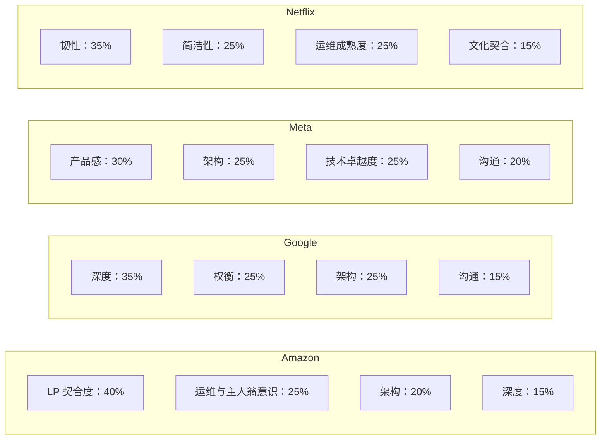
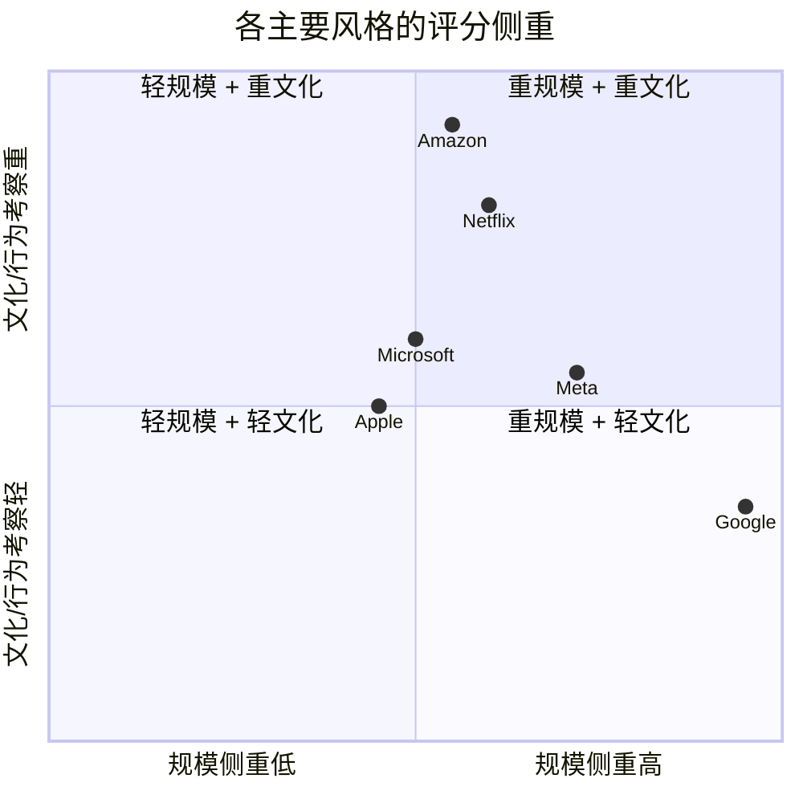

# 各家公司的面试风格差异

> **TL;DR**: 同一道“设计一个共享购物车”的题，在四家公司会拿到四个不同的分数，原因不是你的技术内容变了，而是每家公司给评分表的权重不同。Amazon 按 16 条领导力准则打分，还有一位握有否决权的 Bar Raiser[^1]。Google 奖励能层层递进五级的深度论证[^2]。Meta 要求先讲产品推理，再谈基础设施[^3]。Netflix 要求每位候选人都具备 staff 级别的韧性思维[^4]。你的框架不变；变的是侧重点、词汇，以及你把深挖时间花在哪里。

## 学习目标

学完本章，你将能够：

- [ ] 识别四种主要的面试风格（Amazon、Google、Meta、Netflix）及其评分机制
- [ ] 针对每家公司调整框架的侧重点，同时不牺牲正确性
- [ ] 使用与公司对齐的语言（Amazon 讲 LP，Google 讲深度防守，Meta 讲用户故事，Netflix 讲爆炸半径推理）
- [ ] 辨认次要风格（Microsoft、Apple、Uber/Lyft、Stripe、Databricks、OpenAI/Anthropic）及其区分性信号
- [ ] 为每个目标公司准备一页“风格小抄”

## 直觉理解

想象你是一名爵士乐手，要去四支不同的乐队试音。你用的还是那件乐器、那些音阶、那些和弦进行。但第一支乐队更看重即兴而不是精准；第二支要你牢牢咬住节奏组、绝不抢戏；第三支最在意你有没有在听歌手；第四支想听你把一段独奏砍到只剩三个音，而这三个音还得站得住。

你不需要学四件不同的乐器。你要弄清楚的是每支乐队在听哪三样东西，然后把这三样东西摆到试音的最前面。你演奏的音符，在四场试音里 90% 是一样的。那不同的 10%，是侧重点、是乐句处理、是你选择在哪发光。

系统设计面试就是这么运作的。评分维度（需求、架构、权衡、深度、沟通）是通用的。但每家公司的评分函数会放大不同的维度。同一个人在四家公司给出完全一样的答案，会拿到四个不同的分数。本章教你的就是那 10% 的调整，把“刚够线”变成目标公司的“强烈推荐录用”。

## 原理

### 通用评分维度与各家不同的权重

每家大型科技公司都用同一套核心维度评估系统设计：需求澄清、高层架构、权衡推理、技术深度、沟通表达。差别在于每个维度在最终得分中占多大权重。

*四种主要风格的评分维权重近似分布。这些数字并非官方公布，但反映了面试指南与面试官复盘记录中一致的规律。*

### Amazon：领导力准则织进每一轮

Amazon 用 16 条领导力准则（Leadership Principles，下称 LP）来评估候选人，这些准则是显式的评分维度，而不是背景文化[^5]。每位面试官会被预先分配 2 到 3 条具体的 LP，整轮面试加起来正好覆盖全部 16 条[^6]。对 L5（SDE II）来说，一场典型的系统设计“一小时”实际上是 20 到 30 分钟 STAR 格式的行为追问，加上 30 分钟的架构讨论[^6]。

Bar Raiser 是结构上的差异化设计。这个人来自招聘团队之外、经验丰富，对录用结果握有否决权。Bar Raiser 一句“不行”，就能推翻招聘经理的“行”。[^1] 这个项目已经运行了 25 年以上，全球有 10,000+ 名在职与在训的 Bar Raiser[^1]。

**要强调什么：**

- 用 LP 的语言组织设计决策：“这件事我会端到端负责”（主人翁意识），“我先从能跑通的最简方案开始”（行动偏好），“这个故障对客户的影响是……”（客户至上）。
- 永远准备好回答“凌晨三点谁被叫起来？”和“运维手册长什么样？”这两问对应的是深入细节和主人翁意识。
- 准备 10 到 12 个 STAR 故事，每个映射 2 到 3 条 LP。Bar Raiser 会揪住一个故事挖 15 到 20 分钟；例子太浅，几层追问就塌了。

**级别对应：**

- L4（SDE I）：通常没有设计轮，以编码为主。
- L5（SDE II）：一轮系统设计；能独立处理基本功（缓存、分片、故障）。
- L6（Senior SDE）：组织级系统、成本权衡、多服务可靠性。
- L7+（Principal）：多年期的架构押注、跨组织的技术方向。

### Google：深度、规模与招聘委员会的校准

Google 的系统设计只有一轮 45 分钟，但对定级影响很大[^2]。最终决定由招聘委员会做出，而委员会从不见候选人。面试官产出按评分表打分的书面反馈；委员会成员根据反馈的强度和一致性争论定级。

Google 明确偏好去推敲底层机制、而不是直接抓某个现成产品的候选人。只说“我会用 Spanner”，却讲不清外部一致性、TrueTime 和 Paxos，在深度维度上就是低分[^2]。

**要强调什么：**

- 从最简单且正确的设计开始。只有当规模追问逼着你加的时候，才加复杂度。
- 面试官问“为什么”时，要准备好“为什么背后的为什么”。Google 奖励递归深度：“因为 Paxos 需要多数派法定人数，这意味着……”而不是“因为它是强一致的”。
- 估算的严谨性很重要。数字要站得住，不能是挥手估的。

**级别对应：**

- L3/L4：以编码为主，设计轮很轻或没有。
- L5（Senior）：系统设计是主要的定级信号；能独立负责大型组件。
- L6（Staff）：没人提示也能为 10 倍到 100 倍的规模重新设计，预判失效模式，推理多团队影响[^2]。
- L7+（Senior Staff）：通常期待你已有公开的技术影响力。

**Googleyness（行为面）：** 常被提到的六项特质：在模糊中如鱼得水、看重反馈、挑战现状、用户优先、做正确的事、在意团队[^2]。

### Meta：产品感、两条设计赛道与严格的时间盒

Meta 在 E5+（Senior）把设计拆成两类面试：面向基础设施方向工程师的系统设计（System Design），和面向产品方向工程师的产品架构（Product Architecture）[^3]。E6（Staff）的现场面试有 5 到 6 轮：1 到 2 轮编码、2 轮设计、1 轮行为面，以及 0 到 1 轮项目复盘[^7]。

每轮设计 40 到 45 分钟。产品架构围绕用户可感知的产品（Instagram、Uber、Ticketmaster），更看重 API 设计、数据建模和客户端与服务端的交互。系统设计则允许纯基础设施题目，从后端架构角度展开[^3]。

**要强调什么：**

- 先讲一个用户故事，再画任何图：“一个回访用户期待自己的信息流在 2 秒内加载完，内容不超过 30 秒旧。”
- 时间要抠得紧。在 40 分钟的时间盒里花 15 分钟聊需求，是 E6 被拒的常见原因[^7]。
- 预期中途变题：“如果输入变成 10 倍呢？”或“如果我们需要实时更新呢？”Meta 的面试官会现场改题，并期待你当场重构。

**级别对应：**

- E3/E4：编码权重大，设计没有或很轻。
- E5（Senior）：一轮设计；直接的技术贡献加上项目负责。
- E6（Staff）：两轮设计；跨团队技术领导力加项目复盘。
- E7+（Senior Staff）：组织级技术方向；无授权的影响力。

**五项行为胜任力：** 解决冲突、推动结果、拥抱模糊、持续成长、有效沟通[^7]。

### Netflix：只招资深、韧性优先、现场面试最长

Netflix 有内部职级（按公开薪酬数据是 L3 到 L7[^8]），但招聘门槛统一地高，即便是入门级别也要求资深级别的成熟度。它的面试流程是 FAANG 里最长的：大约 8 轮面试，常常拆到两天[^4]。Netflix 也是 FAANG 中唯一惯例性安排 1 到 2 位总监进现场面试的公司，据说是为了减少偏见。

录用决定是二元的通过/不通过，在现场面试后的实时讨论中力求达成共识，而不是走评分表式的委员会[^4]。由总监主持的“梦之队（Dream Team）”轮，相当于最后一道文化契合闸门。

**要强调什么：**

- 每个组件都要给出理由。讲不出理由的多余方框，读起来就是“这人将来会制造运维债”。
- 永远主动说出失效模式、爆炸半径，以及“这东西挂掉时监控面板长什么样”。
- 熟悉 Netflix 开源（OSS）词汇：Eureka（服务发现）、Zuul（边缘路由）、Spinnaker（部署）、Chaos Monkey（故障注入）。
- 为“反向系统设计”轮做准备：深入讲一个你真正上线过的系统，包括其中的取舍与遗憾[^4]。

**守门人测试（keeper test）：** 主管会问“如果 X 想走，我会不会拼命留他？”或者“以我今天所知的一切，我还会再招 X 吗？”如果答案是否，Netflix 认为“快点分开对所有人都更公平”[^9]。

### 其他风格速览

**Microsoft（职级 59 到 67+）：** 四轮面试，最后一轮是“As Appropriate”面试官，由他做出录用或不录用的决定。文化信号：成长型思维、从失败中学习、智识上的谦逊。云相关岗位会考 Azure、Kubernetes 和身份（Entra ID）设计。

**Apple（ICT2 到 ICT6）：** 保密是结构性的。团队之间常常不知道彼此在做什么。面试流程因组织而异：Apple Silicon 偏底层系统；服务线（iCloud、Apple Music）像传统后端 SDI；ML 岗位看重端上推理和隐私保护设计。端到端加密是一等一的设计约束。

**Uber / Lyft：** 实时系统风格。地理空间索引（H3 六边形网格）[^10]、每天 4000 万+ 单量下在严苛延迟预算内做实时匹配[^11]、每秒数百万事件的 GPS 流接入。面试官期待你推理司机状态的新鲜度和过期数据的处理。

**Stripe / Square / Shopify：** 支付正确性是组织原则。面试强调幂等键、恰好一次语义、不可变的复式记账账本、重试与部分失败下的状态机安全，以及 PCI-DSS 合规。Shopify 另有一轮独特的一小时“人生故事”（非技术职业叙事）。

**Databricks / Snowflake：** OLAP 与数据湖仓风格。面试会考查询引擎内部、存储与计算分离、列式格式（Parquet、Iceberg、Delta）和分布式 SQL 规划。

**OpenAI / Anthropic：** ML 基础设施风格。设计要懂 LLM：异构硬件下的 GPU 调度、带延迟与成本权衡的多租户推理服务、作为一等层的安全审核，以及跨数百节点的分布式训练协调。

### 面试轮次结构对比

现场面试的形状，决定了设计与行为信号藏在哪里：

```mermaid
flowchart TD
    subgraph Amazon["Amazon L5（4-5 轮）"]
        direction LR
        A1["编码 + LP"] --> A2["编码 + LP"] --> A3["系统设计 + LP"] --> A4["LLD + LP"] --> A5["Bar Raiser"]
    end
    subgraph Google["Google L5（5 轮）"]
        direction LR
        G1["编码"] --> G2["编码"] --> G3["系统设计"] --> G4["RRK"] --> G5["Googleyness"]
    end
    subgraph Meta["Meta E6（5 轮）"]
        direction LR
        M1["编码"] --> M2["设计 1"] --> M3["设计 2"] --> M4["行为面试"] --> M5["项目复盘"]
    end
    subgraph Netflix["Netflix（约 8 轮）"]
        direction LR
        N1["招聘经理初筛"] --> N2["技术电话面"] --> N3["SDI ×3"] --> N4["行为面试 ×2"] --> N5["Dream Team"]
    end
```

*各主要风格的现场面试轮次结构。Amazon 把行为面织进每一轮；Google 把它单独拎出来；Meta 在设计上加倍投入；Netflix 流程最长，还有总监参与。*

注意结构上的含义：Amazon 每轮只给你 30 分钟纯设计时间，因为 LP 吃掉了剩下的。Google 给你干净的 45 分钟，但对深度毫不留情。Meta 给你两次设计机会，可每次只有 40 分钟。Netflix 总体上给你的设计时间最多，但要求你每一分钟都表现得像 staff。

### 创业公司 vs. 大厂

创业公司（A 轮到 C 轮）的流程通常更短：一轮电话面，加半天现场 3 到 4 轮。设计轮常常是一份带回家的设计文档加一次现场评审，或者一场 60 分钟的白板。评估偏好从规模（“能撑 10 亿用户吗？”）转向务实（“3 个工程师 6 周能上线吗？”）。

在大厂，设计轮是资深以上候选人的定级决定。在创业公司，设计轮是文化契合与速度信号。两者都重要，准备时的侧重不同。

## 真实案例

设想同一道题“为电商平台设计一个共享购物车”，在四家主要公司各面一次。同一个候选人，同样的技术知识，四种不同的最优答法：

**在 Amazon（30 分钟设计时间）：** 你开口就是“客户至上驱动这件事：用户在手机上加购、在桌面端结账，必须在 2 秒内看到一致的购物车。”每个决策你都用 LP 框住：“节俭意味着这里我会选 DynamoDB，而不是自研方案。”收尾是“主人翁意识：这个服务的值班轮转由我负责，购物车同步失败时运维手册是这样。”

**在 Google（45 分钟）：** 你先做估算：“5 亿 DAU，10% 每天加购，等于每天 5000 万次写入，平均每秒 580 次，峰值 3K。”面试官问“为什么用 DynamoDB？”，你讲 LSM 树的写入路径、分区键分布，以及为什么最终一致性对购物车读取可以接受、对结账不行。你一路把“为什么”答到第五层。

**在 Meta（40 分钟）：** 你先讲用户故事：“一个回访用户在 Instagram Shopping 上期待已保存的商品跨会话保留、200ms 内加载出来，并反映实时价格变化。”你先画 API 和数据模型，再画基础设施方框。面试官中途变题（“如果加上拼团协同购物车呢？”），你当场重构数据模型。

**在 Netflix（staff 级，60 分钟）：** 你先讲失效模式：“购物车服务在结账关键路径上。它一挂，收入就停。我需要爆炸半径隔离、下游库存服务上的熔断器，以及一个从本地缓存提供陈旧购物车数据的降级模式。”你为每个组件给出理由，并主动删掉一个自己刚画上去的：“这个消息队列我不需要，写入量撑不起它的运维开销。”

同一道题。同一个候选人。四种侧重模式。四个分数。

*各风格在“规模”与“文化”两个维度上的位置。Amazon 极重 LP，但接受中等规模的方案；Google 要求在极端规模上给出深度，文化考察较轻；Netflix 既要 staff 级的规模推理，也要很强的文化契合；Microsoft 平衡地落在中间。*

## 权衡

公司不是候选人可以在其间挑选的可替代选项。目标公司是输入条件，不是权衡对象。本章真正支持的决策是：目标定下之后，如何*分配准备权重*——哪些评分维度要超额投入，哪些标准框架的产出可以砍掉，哪些信号要放大。

上面按公司分的小节（Amazon、Google、Meta、Netflix 以及其他风格）已经给出了比表格一行能容纳的更详细的准备指导，真实案例里的 `quadrantChart` 则把六种主要风格画在真正区分它们的两个维度上（规模侧重 vs 文化/行为侧重）。把它们合起来，当作本章的对比产物：

- **Amazon：** 侧重 LP 与运维主人翁故事；预期 LP 密集的轮次之后只剩约 30 分钟设计时间；准备 10-12 个 STAR 故事，每个映射 2-3 条 LP[^6]。
- **Google：** 侧重深度与估算严谨性；练熟用“分片 MySQL 加 Redis”这种常规答案顶住递归的“为什么”追问，而不是去抓新奇架构[^2]。
- **Meta：** 侧重产品框架与严格的时间管理；画任何图之前先写一段用户故事；为 40 分钟的时间盒练 35 分钟的限时演练[^3]。
- **Netflix：** 侧重简洁性、爆炸半径推理与运维成熟度；按“每一轮都是 staff 级”来准备；拿你最大的真实系统练“反向 SDI”[^4][^9]。
- **Microsoft：** 侧重成长型思维与协作故事，配合务实的 Azure 设计；预期不同标准职级带之间的团队差异较大。

上面的 quadrantChart 是跨公司对比；按公司的三级小节是分公司的准备计划。两者合起来，替代了一张“以公司为行”的表格无法诚实表达的东西。

## 常见陷阱

> [!WARNING]
> **一套准备打天下。** 在四家公司给出完全一样的框架答案，结果三家“刚够线”、一家挂掉。为每个目标公司做一页小抄，覆盖三句话术、三个价值观、三个深挖话题。模拟面试时把小抄摊在面前练。

> [!WARNING]
> **在 Amazon 忽视 LP。** 把行为问题当成走过场，结果 Bar Raiser 用整整一小时只聊两条 LP、还层层追问，直接被打懵。在 Amazon，LP 占信号量的 50% 以上；每位面试官都背着自己那几条具体的 LP[^6]。

> [!WARNING]
> **在 Meta 缺产品感。** 把一个纯后端的 Instagram（分片、缓存、信息流排序）设计得很漂亮，却一上来没讲“用户为什么想要这个”。画任何图之前先写一段用户故事；把非功能需求落在用户体验上讲。

> [!WARNING]
> **在 Google 过度追求新奇。** 明明“分片 MySQL 加 Redis”这种标准答案得分更高，却去抓一套奇技淫巧的架构。Google 要的是对常规机制的深刻理解，不是新奇架构。从简单开始；只有当规模追问逼着你加的时候才加复杂度。

> [!WARNING]
> **在 Netflix 设计不足。** 拿一份 L5 水准的答案（一个数据库、只读副本、一个 CDN）去面 Netflix，而对方期待的是爆炸半径推理、混沌测试钩子、多地域故障切换，以及明确的值班运维手册设计。Netflix 虽然有内部职级（L3-L7），但招聘门槛统一地高；按“每一轮都是 staff 级”来准备。

## 练习

从本章列出的公司里挑三个目标公司。为每家公司写一页小抄，包含：

1. 三句能引起该公司文化共鸣的话术（例如对 Amazon 说“这件事我会端到端负责”）
2. 三个随时能接 STAR 故事的价值观或 LP
3. 三个该公司喜欢往深里问的话题
4. 时间预算的调整（例如“Amazon 只有 30 分钟设计时间，因为 LP 吃掉了剩下的”）

带着小抄各做一次模拟面试。留意你表达上发生了什么变化。

提示

对 Amazon，你的三句话术应该对应主人翁意识、客户至上和深入细节。对 Google，准备好为你选的数据库、你选的一致性模型、你选的分区方案，把“为什么”答到五层。对 Meta，在打开画图工具之前先把用户故事写出来。

参考答案

**Amazon 小抄示例：**

- 话术：“这件事我会端到端负责”，“这个故障对客户的影响是……”，“我先做能跑通的最简版本，然后迭代”。
- 带故事的 LP：主人翁意识（在没有 PM 的情况下主导一次迁移）、客户至上（根据用户数据推翻自己的决定）、深入细节（把一次 P99 延迟尖刺追到 GC 停顿）。
- 深挖话题：运维手册、成本优化（DynamoDB 容量模式）、故障爆炸半径。
- 时间预算：每轮 30 分钟设计，20-30 分钟 LP 行为面。

**Google 小抄示例：**

- 话术：“因为底层机制要求……”，“在 10 倍规模下这会失效，因为……”，“这里的权衡是读放大与写放大”。
- 价值观：深度优先于广度、机制优先于产品名、估算严谨。
- 深挖话题：共识协议内部、存储引擎权衡（LSM vs B 树）、分布式事务模型。
- 时间预算：整 45 分钟都用于设计；Googleyness 单独一轮。

**Meta 小抄示例：**

- 话术：“一个回访用户期待……”，“这里优化的产品指标是……”，“我先画出 API 契约”。
- 胜任力：推动结果（在模糊中交付了 X）、解决冲突（和 PM 意见不一致，最后数据说话）、拥抱模糊（把模糊问题切分成可交付项）。
- 深挖话题：面向移动端的 API 设计、个性化数据模型、实时更新下发。
- 时间预算：总共 40 分钟；需求不超过 8 分钟；第 25 分钟前必须进到深挖。

关键洞察：三份小抄背后，你的技术知识是同一套。变的是框架、词汇和时间分配。

## 要点回顾

- 评分维度是通用的，权重不是。要调整的是表达，不是内容。
- Amazon 的 16 条领导力准则是显式的评分维度，不是背景文化。握有否决权的 Bar Raiser 负责执行它们。
- Google 更奖励在一个话题上的递归深度，而不是横跨十个话题的广度。把“为什么”答到五层。
- Meta 把产品感当成资深工程师的基本门槛。纯系统视角的答案，即便在系统设计赛道也会失分。
- Netflix 惩罚过度设计。最强的答案往往方框最少，而每个方框都对应一个具体的失效模式。
- 次要风格（Uber：实时地理；Stripe：支付正确性；Databricks：OLAP 内部；OpenAI：GPU 调度加安全）要求你在通用框架之上再掌握领域词汇。
- 为每个目标公司做一页小抄。三句话术、三个价值观、三个深挖话题。带着它练，直到侧重变成肌肉记忆。

## 延伸阅读

- [Amazon Leadership Principles](https://www.aboutamazon.com/about-us/leadership-principles)：16 条 LP 的权威清单，每条一段说明；面 Amazon 之前的必读。
- [Amazon Bar Raiser 项目介绍](https://aws.amazon.com/careers/life-at-aws-amazons-bar-raiser-program-hiring-for-long-term-growth-and-innovation/)：Bar Raiser 如何运作、评估什么、以及否决权为什么重要。
- [Netflix Culture Memo](https://jobs.netflix.com/culture)：梦之队、守门人测试、有知情的船长（informed captain）、先反对后执行（disagree-then-commit）；Netflix 面试官会直接考这些说法。
- [Hello Interview: Google L5 guide](https://www.hellointerview.com/guides/google/l5)：逐轮拆解 Google 资深 SWE 流程，含评分维度与深度期望。
- [Hello Interview: Meta System Design vs Product Architecture](https://www.hellointerview.com/blog/meta-system-vs-product-design)：前 Meta Staff 工程师 Evan King 讲同一道题在两条赛道为何得分不同。
- [Interviewing.io: Netflix interview guide](https://interviewing.io/netflix-interview-questions)：Netflix 独一无二的超长现场面试、总监参与、反向系统设计和梦之队轮。
- [Pragmatic Engineer: 8 家公司面试对比](https://blog.pragmaticengineer.com/comparing-interviews-at-8-large-tech-companies/)：有数据支撑的跨公司对比，覆盖流程长度、行为面权重和决策架构。
- [Stripe: designing idempotent APIs](https://stripe.com/blog/idempotency)：金融科技面试所期待的支付正确性词汇的一手来源。

## 记忆卡片

**Q:** 是什么结构性机制让 Amazon 的面试在 FAANG 中独树一帜？
**A:** Bar Raiser：一位来自招聘团队之外、经验丰富的面试官，对录用结果握有否决权。Bar Raiser 一句“不行”，就能推翻招聘经理的“行”。

**Q:** Amazon L5 的系统设计轮里，有多大比例被领导力准则的行为问题占掉？
**A:** 60 分钟里大约 20 到 30 分钟，只留下 30 分钟做架构。

**Q:** Google 的招聘委员会做什么，为什么对候选人重要？
**A:** 委员会只看面试官的书面反馈包，从不见候选人。这减少了单个面试官的偏见，但也意味着你的“书面信号”（面试官能否把你的答案总结好）和现场对话一样重要。

**Q:** Meta 在 E5+ 的两条设计面试赛道是什么？
**A:** 系统设计（偏基础设施）和产品架构（面向用户、API 优先）。同一道题可能出现在两条赛道，但按不同维度打分。

**Q:** 为什么过度设计在 Netflix 是负信号，在 Google 却不是？
**A:** Netflix 的文化看重简洁和运维成熟度。每个讲不出理由的组件都是未来的运维债。Google 看重深度，所以只要能就机制把“为什么”答到五层，加复杂度是可以接受的。

**Q:** Netflix 的“守门人测试”是什么，它如何影响招聘？
**A:** 主管会问“如果 X 想走，我会不会拼命留他？”或者“以我今天所知的一切，我还会再招 X 吗？”如果答案是否，Netflix 认为“快点分开对所有人都更公平”。这个测试让所有职级（L3-L7）的招聘门槛统一地高。

**Q:** 与其他 FAANG 公司相比，Netflix 的现场面试有多长？
**A:** 大约 8 轮，常常拆到两天。这是 FAANG 中最长的，并且惯例性安排 1 到 2 位总监参与。

**Q:** 在 Stripe/Square 的面试里，你应该使用哪些不同于通用系统设计的词汇？
**A:** 幂等键、恰好一次语义、不可变的复式记账账本、重试下的状态机安全、PCI-DSS 合规，以及对账（reconciliation）。

**Q:** Amazon 与 Google 做录用决策的关键差别是什么？
**A:** Amazon 在实时复盘会上由握有否决权的 Bar Raiser 定夺。Google 由招聘委员会只看书面反馈包定夺，从不见候选人。

**Q:** 在 Meta E6，现场面试有几轮设计，每轮多长？
**A:** 两轮设计，每轮 40 到 45 分钟。时间管理至关重要，因为在需求上花掉 15 分钟以上是常见的被拒原因。

**Q:** 面 Netflix 的“反向系统设计”轮，你该准备什么？
**A:** 深入讲你亲自上线过的最大规模系统，包括架构决策、接受的权衡、遇到的失效模式，以及遗憾。

**Q:** Uber/Lyft 的面试与通用后端系统设计有何不同？
**A:** 它们强调实时系统：地理空间索引（H3 六边形网格）、严苛延迟预算下的匹配、每秒数百万事件的 GPS 流接入，以及司机状态的新鲜度。

## 参考文献

[^1]: AWS Careers, "Raising the bar: How Amazon hires for long-term growth and innovation"（Bar Raiser 25 周年回顾）, 2024. https://aws.amazon.com/careers/life-at-aws-amazons-bar-raiser-program-hiring-for-long-term-growth-and-innovation/
[^2]: Hello Interview, "Google L5 (Senior) Software Engineer Interview Guide". https://www.hellointerview.com/guides/google/l5
[^3]: Evan King, "Understanding the Differences between Meta's SWE Product Architecture and System Design Interviews", Hello Interview. https://www.hellointerview.com/blog/meta-system-vs-product-design
[^4]: Interviewing.io, "A Senior Engineer's Guide to Netflix's Interview Process and Questions". https://interviewing.io/netflix-interview-questions
[^5]: Amazon, "Leadership Principles". https://www.aboutamazon.com/about-us/leadership-principles
[^6]: Hello Interview, "Amazon L5 (SDE II) Software Engineer Interview Guide". https://www.hellointerview.com/guides/amazon/l5
[^7]: Hello Interview, "Meta E6 (Staff) Software Engineer Interview Guide". https://www.hellointerview.com/guides/meta/e6
[^8]: Levels.fyi, "Netflix Software Engineer Salaries"（列出 L3 至 L7 职级）, 访问于 2026-05-08. https://www.levels.fyi/companies/netflix/salaries/software-engineer
[^9]: Netflix, "Culture Memo". https://jobs.netflix.com/culture
[^10]: Uber Engineering, "H3: Uber's Hexagonal Hierarchical Spatial Index", 2018. https://www.uber.com/blog/h3/
[^11]: Uber, "Uber Announces Results for Fourth Quarter and Full Year 2025"（CEO 原话：“more than 40 million trips every day”）, February 2026. https://investor.uber.com/news-events/news/press-release-details/2026/Uber-Announces-Results-for-Fourth-Quarter-and-Full-Year-2025/
