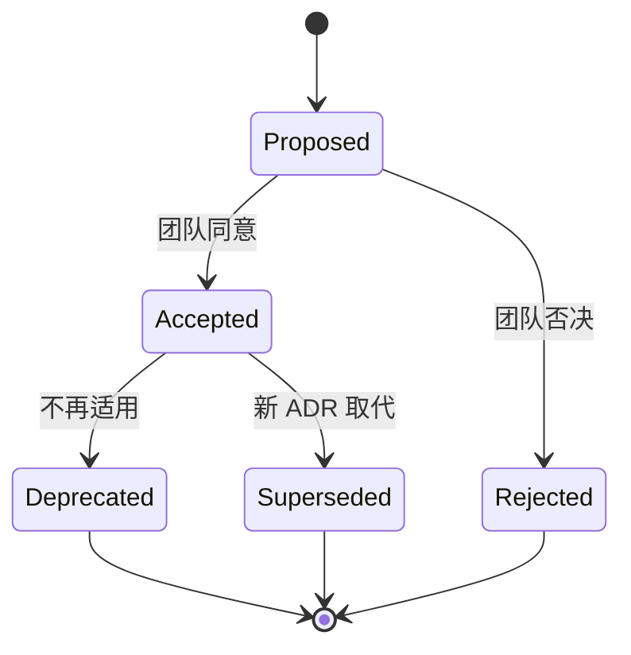
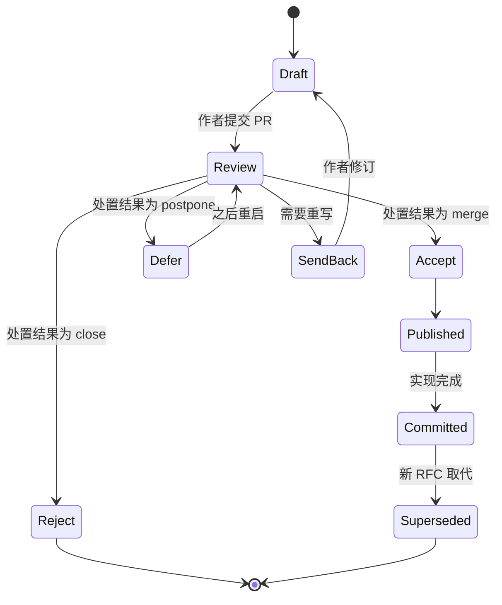
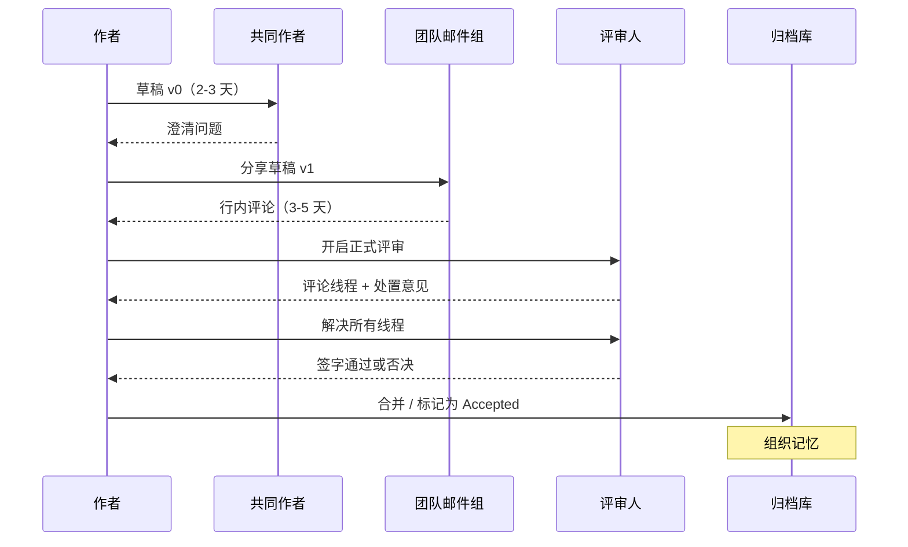
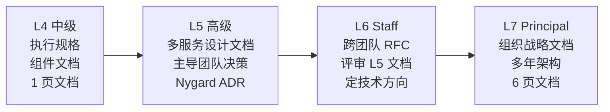

# 设计文档撰写

> **TL;DR**: 白板上的东西会蒸发，设计文档会留下来。对 Staff+ 工程师来说，书面产出才是主要的杠杆：ADR 用不到一页的篇幅记录单个决策，设计文档用 10-20 页让跨团队架构达成一致[^1]，RFC 用显式的生命周期状态来把关提案。Google 分析了 141,652 份获批的设计文档，发现结构化的评审干预把批准时间的中位数缩短了 25%[^2]。把格式、评审文化和生命周期练熟，你的决策就会复利式累积，而不是消失。

## 学习目标

学完本模块，你将能够：

- [ ] 在 30 分钟内写出 Nygard 格式的 ADR
- [ ] 按九个标准章节（含非目标与已考虑的替代方案）组织设计文档
- [ ] 推动一个 RFC 走完生命周期，并给出“提问而非下结论”的反馈
- [ ] 按决策范围选对格式（ADR、设计文档、RFC、6 页文档）
- [ ] 把文档产出对应到 L4 到 L7 的职级预期

## 直觉理解

你搬进一间新公寓。上一个租客什么说明都没留。恒温器有三个没标注的模式。配电箱有 20 个开关，一个标签都没有。花园水管接到一个你找不到的阀门上。第一个月你全耗在逆向工程别人几年前做过的决定上。

现在想象上一个租客留下了一个活页夹。第一页写着：“我们把恒温器设成模式 2，因为模式 3 在空调同时开机时会让断路器跳闸。我们考虑过换配电箱，房东不同意。”这就是一条架构决策记录（Architecture Decision Record，ADR）。它很短，点明了背景、决策和后果，替你省下一周的调试。

设计文档是你在改造厨房之前画的蓝图。它写清你要建什么、不建什么、否决了哪些方案、以及怎么判断做成了。RFC 就是这份蓝图在动手拆墙之前，提交给楼里的委员会做正式评审。

格式各不相同，目的完全一样：把一个决策序列化成文字，让评审人能异步表示同意，让后来的人能还原当初的意图。本章讲主流格式、让它们真正起作用的评审文化，以及把它们变成走过场的那些反模式。

## 原理

### 设计文档为什么重要

设计文档是动手实现之前写下的产物，记录背景、目标、拟议设计、已考虑的替代方案和横切关注点。它的价值有三重。

第一，写作就是思考。把计划序列化成文字的过程，会暴露图和时间线里口头讨论掩盖掉的逻辑漏洞。Malte Ubl 把这称为“在做改动还很便宜的时候，尽早发现设计问题。”[^1]

第二，异步评审能突破会议的带宽上限。东京的评审人可以在纽约的作者醒来之前就开始看。Uber 的 RFC 流程在两个月内，为小费功能的上线协调了“几十个系统和远超二十个工程团队”。[^3]

第三，文档能扛过人事变动。在 Google，遇到不熟悉的系统时，第一个标准问题就是“设计文档在哪？”[^4] 白板草图撑不过一次团队重组，文档可以。

代价是真实的：显而易见的实现也要额外花时间写；团队如果等每周固定的评审时段，评审就有延迟；文档不跟代码一起更新就会漂移。真正的技能是判断什么时候该写（单向门、跨团队改动），什么时候不该写（双向门、琐碎改动）。[权衡思维](../part-1-core-fundamentals/06-trade-off-thinking.md) 介绍过单向门/双向门的框架；设计文档正是单向门配得上的那套书面流程。

### ADR 格式及其变体

Michael Nygard 在 2011 年提出架构决策记录，针对的是那些没人维护的大部头规格文档：“大文档从来不会被更新……小而模块化的文档至少还有被更新的可能。”[^5]

原始模板有五节：

```markdown
# ADR-NNN: Use Postgres as primary operational store

## Status
Accepted

## Context
We need ACID transactions for payment flows. Our team has 5 years
of Postgres operational experience. DynamoDB was considered but
lacks cross-item transactions without Streams workarounds.

## Decision
We will use PostgreSQL 18 with logical replication for read replicas.

## Consequences
Positive: familiar tooling, strong consistency, rich ecosystem.
Negative: vertical scaling ceiling around 100K TPS write;
we accept this given current 2K TPS volume.
```

关键性质：ADR 一旦被接受就不再改动。如果决策被推翻，你写一条新的、取代它的 ADR，并把旧的那条标记为已被取代（superseded）。历史本身就是价值。[^5]

**Nat Pryce 的 `adr-tools`**（2016 年首次提交，2017 年 2 月的 2.0 版确立了现在这套 CLI 接口）用命令行把这套流程自动化：`adr new Use Rust for performance-critical paths` 会在 `doc/adr/` 下生成一个带编号的文件。[^6]

**MADR**（Markdown ADR，Zimmermann 与 Kopp，2017）在 Nygard 的基础上扩展：YAML frontmatter 元数据（status、date、deciders、consulted、informed）、决策驱动因素一节、逐项列出带优缺点的备选方案，以及用来验证合规性的确认一节。[^7] 微软的 Well-Architected Framework 现在正式推荐 ADR，并强调不可改动原则：“写一条新记录取代原来的记录，再把两条互相关联。”[^8]



*ADR 一旦被接受就不再改动；推翻一个决策意味着写一条取代它的新 ADR，从而保留完整的决策历史。*

### 设计文档的结构（Google 风格）

一份完整的设计文档，大项目 10-20 页，增量工作 1-3 页。[^1] 标准章节如下：

1. **TL;DR** - 高管 20 秒读完的 2-3 句话。
2. **背景与范围** - 现状是什么、要改什么、谁受影响。
3. **目标与非目标** - 文档要明确达成的结果，以及刻意排除在外的部分。
4. **设计** - 系统上下文图、API、数据存储、约束程度讨论。
5. **已考虑的替代方案** - 2-4 个真实选项，逐个做权衡分析。
6. **横切关注点** - 安全、隐私、可观测性、上线、迁移。
7. **未决问题** - 已知的未知项，以及明确的决策请求。
8. **上线计划** - 分阶段部署、成功指标、回滚触发条件。
9. **文档历史** - 用修订链接，而不是直接改正文。

有两个章节区分了资深与初级的写作。**非目标**一节点明那些本来可以算目标、但被明确排除的东西。Ubl 说：“非目标不是把目标反过来否定（比如‘系统不应该崩溃’），而是那些本来可以合理地成为目标、但被明确选择不做目标的事。”[^1] **已考虑的替代方案**一节，是你证明自己真的探索过设计空间的地方：“这一节是最重要的章节之一。”[^1]

[权衡表达](./03-trade-off-articulation.md) 讲的是替代方案分析本身怎么组织；[画图能力](./02-diagramming-skills.md) 讲的是该放进设计一节的那些图形产物。

### 各家组织的 RFC 流程

RFC（Request for Comments）在设计文档之上加了流程治理：编号标识、显式的生命周期状态，以及由具名决策机构做出的正式处置。

**IETF（源头）：** RFC 2026 定义了互联网标准轨道（Internet Standards Track），在 Proposed Standard 阶段至少要沉淀六个月，晋级还要求“至少两个来自不同代码库、彼此可互操作的独立实现”。[^9] 流程之所以这么重，是因为它管的是成千上万家厂商在用的协议。

**Rust RFC：** fork 仓库、复制模板、提 PR。某个子团队发起最终评论期（Final Comment Period，FCP）并给出处置意见（merge、close、postpone）；子团队所有成员都要签字；FCP 持续十个自然日。[^10] 模板强制把“缺点（Drawbacks）”一节排在“理由与替代方案”之前，逼作者先反驳自己的提案。[^11]

**Python PEP：** 分三类（Standards Track、Informational、Process），由 PEP-Delegate（或指导委员会）做决策。必填章节包括“How to Teach This”和“Rejected Ideas”。[^12]

**Go 提案：** 先开一个 GitHub issue；讨论之后归结为接受、拒绝，或者要求补一份设计文档。设计文档模板增加了“兼容性（Compatibility）”一节，与 Go 的向后兼容承诺绑定。[^13]

**Oxide Computer 的 RFD：** 全称“Request for Discussion”，六个状态（prediscussion、ideation、discussion、published、committed、abandoned）。每条 RFD 在发布之前都待在自己的分支上。短链（`42.rfd.oxide.computer`）、聊天机器人的模糊搜索和自动维护的 CSV 索引，让它们容易被找到。官方建议是：“合并你的 RFD 之前，留 3-5 个工作日让人评论，看起来是合理的。”[^14]



*RFC 在若干具名状态之间推进；作者最容易忘记规划的，就是退回重写（Send-Back）这条路径。*

### Amazon 的 6 页文档、2 页文档与 PR/FAQ

Amazon 禁掉 PowerPoint，改用散文式叙述。Jeff Bezos 认为完整句子比要点更能逼出清晰的思考，因为要点可以用含糊的短语把混乱的逻辑藏起来。[^15]

**PR/FAQ** 从一份模拟新闻稿开始（标题、副标题、问题、解决方案、客户引言、如何上手），接着是外部 FAQ（价格、怎么用）和内部 FAQ（TAM、竞争、“这个产品不会成功的前三大原因”）。最后这个问题就是求真式的强制机制。Amazon 为最初的 AWS PR/FAQ 迭代了一年多。[^16]

用于战略规划的 **6 页文档** 有六节：引言、目标、信条（tenets）、业务现状、经验教训、战略优先级。信条用“好过 / 差过”的句式：“我们更看重迭代速度，而不是规格的完备性”——逼作者点明自己牺牲了什么。

会议形式：开头 15-20 分钟静读，然后 40 分钟讨论。[^16] 静读确保每个评审人真的读了文档，消灭“我只扫了一眼邮件”这种失效模式。

[各家公司的风格](./04-company-specific-flavors.md) 在面试语境下介绍 Amazon 的写作文化，本章则深入讲机制。

### 评审文化与异步规范

文档能做到多好，取决于评审。三条原则让评审真正起作用：

1. **提问，而不是下结论。** 把反馈写成问题，去挖出作者的真实意图。Oxide 的建议是：“如果你正要写下的那条评论，换成别人写在你自己的 RFD 上你会不高兴，那就别写。”[^14]
2. **线程的关闭权属于作者。** 作者决定接受哪些评论，但必须处理每一条线程：同意、给出理由反驳，或者上报。
3. **给评审窗口设时限。** Rust 的 FCP 是 10 个自然日。[^10] Oxide 建议 3-5 个工作日。[^14] 没有截止时间，文档会无限期停在那里。

Uber 的扩展教训：到 2,000 多名工程师时，每周几百份 RFC 把资深评审人压垮了。解法是分层模板（团队范围用轻量版，组织范围用重量版），加上一个专门做的工具，把搜索和审批人跟踪集成进 Phabricator。[^3]



*评审阶段是文档赚回成本的地方；跳过它或者盖个橡皮图章，是工程上最贵的一种省事。*

### 按工程职级看文档产出

书面产出随范围扩展。L4 执行规格，写组件级的说明和 1 页文档。L5 用设计文档和 ADR 推动团队决策。L6（Staff）的跨团队 RFC 成为主要杠杆，评审别人的文档是核心职责。L7（Principal）的文档定的是多年的架构方向，形式常常是 Amazon 6 页文档或战略文档。



*文档产出与工程职级正相关；L6 是拐点，从这里开始，写覆盖多个团队的 RFC 成为主要杠杆。*

## 真实案例

**Google 规模化的设计文档文化**

在 Google，设计文档是写代码的前提条件，不是并行产出的交付物。[^1] 2023 年的一项研究分析了 41,030 名作者在四年间写出的 141,652 份获批设计文档。[^2] 结论是：

- **典型长度：** 重大项目 10-20 页；增量工作 1-3 页的“迷你设计文档”。[^1]
- **失效模式：** 评审人列表不清楚、批准状态含糊、评论线程停滞，都是系统性问题。结构化干预（预填元数据、自动指派评审人）把批准时间的中位数缩短了 25%。[^2]
- **没有强制模板。** 章节清单是文化惯例，不是工具强制的。团队会收敛到相似的结构，因为问题是普遍的。[^1]
- **隐私与安全评审是强制关卡**，任何碰用户数据的项目都要过，还要单独写一份隐私设计文档。[^1]
- **文档会计入绩效。** 这带来一个双刃剑式的激励：工程师为了让影响力可见而写文档，但这个激励也会催生只描述现状、不记录决策的文档。[^4]

“美国宪法加修正案”模式是 Google 自己承认的失效模式：团队不去更新原设计文档，而是外链到新的“修正案”文档，给后来的维护者留下考古难题。[^1] 解药就是 Nygard 的不可改动原则：接受原文档只是一份快照，后续决策另写新的 ADR。

## 权衡

| 格式 | 优势 | 劣势 | 最适合的场景 | 我们的选择 |
|---|---|---|---|---|
| Nygard ADR（短） | 1-2 页；git 版本化；不可改动；30 分钟写完 | 深度有限；没有替代方案一节 | 小的、但有架构意义的决策 | 团队范围内单向门的默认选项 |
| MADR（扩展版 ADR） | 结构化的替代方案带优缺点；RACI 元数据 | 仪式感更重；有照抄模板的风险 | 有 2-5 个真实备选的中等决策 | 当你需要展示推理过程时 |
| 完整设计文档（Google 风格） | 全面；能对齐多个团队；暴露横切关注点 | 10-20 页；评审疲劳；会议延迟 | 重大的跨团队架构；新系统 | 跨团队或涉及隐私的改动 |
| Amazon 6 页文档 / PR/FAQ | 业务与技术合一；强制以客户为先 | 难写（几周到几个月）；以会议为中心 | 新产品；战略；高管决策 | 受众里有非工程师时 |
| RFC（仓库内 markdown） | 版本可控；异步 PR 评审；显式的生命周期状态 | 没有工具就容易漏掉评审人；FCP 对创业公司太慢 | 开源项目；平台改动；用 Git 工作流的组织 | 当你需要公开承诺和书面记录时 |

## 常见陷阱

> [!WARNING]
> **事后补的理由书。** 代码都上线了才写 RFC，流程就成了表演。评审人无法真正影响结果。要求重大实现开工之前必须先有 RFC 状态。

> [!WARNING]
> **缺了非目标一节。** 不写明确的非目标，评审人会把每一种能想到的范围扩张都问一遍，浪费好几周。非目标不是把目标反过来否定（“系统不应该崩溃”），而是那些本来可以合理地成为目标、却被刻意排除的事（“ACID 合规”、“多区域支持”）。

> [!WARNING]
> **列了替代方案却没有真的评估。** 摆几个稻草人选项，一句话打发掉，而选中的方案写上好几段。每个替代方案都该有优点、缺点，以及让它落选的那个具体权衡。MADR 把这件事结构化了：每个选项都要写“Good, because... / Bad, because...”。[^7]

> [!WARNING]
> **没有可观测性和上线计划。** 文档写到“实现”就收了，不回答“我们怎么知道它跑对了”和“怎么回滚”。Uber 的模板明确要求测试、上线、指标和监控几节。[^3]

> [!WARNING]
> **Wiki 腐烂与文档漂移。** 文档说一套，代码做另一套。缓解手段：ADR 不可改动（只取代、不编辑）、文档贴近代码（和代码放在一起）、每年重读一次的惯例。[^1]

## 练习

用 Nygard 模板为“从 MongoDB 迁移到 Postgres”写一条 ADR：背景、决策、状态、后果。一页。加分项：再起草一条取代它的 ADR，假设 18 个月后 Postgres 成了瓶颈。

<details>
<summary>提示</summary>

背景一节要点明各种作用力：为什么 MongoDB 不再够用（事务需求、一致性要求、运维熟悉度）。后果一节必须同时写出正面结果（ACID、生态）和负面结果（迁移风险、纵向扩展的天花板）。至于取代它的那条 ADR，想想背景里发生什么变化会让 Postgres 变成错误选择。

</details>

<details>
<summary>参考答案</summary>

**ADR-0012：用 PostgreSQL 作为主要业务存储**

**状态：** 已接受（2024-03-15）

**背景：** 我们的支付服务需要跨表事务。MongoDB 的多文档事务带来 30% 的延迟开销，还要小心管理会话。团队有 5 年 Postgres 运维经验。当前写入量 2K TPS；预计 12 个月后的峰值是 8K TPS，远在 Postgres 单机容量之内。

**决策：** 我们把支付服务从 MongoDB 8.0 迁到 PostgreSQL 18，用逻辑复制支撑只读副本。迁移采用双写策略，历时 4 周，并用影子流量做校验。

**后果：**

- 正面：原生 ACID 事务简化了支付逻辑。生态丰富（pg_stat_statements、pgBouncer、逻辑复制）。团队熟悉，减少值守负担。
- 负面：纵向扩展的天花板大约在 50-100K 写入 TPS。schema 迁移比无模式的 MongoDB 更讲纪律。非支付类的集合失去了 MongoDB 灵活的文档模型。
- 中性：运维手册要重写。监控面板要重建。

---

**ADR-0019：把支付数据分片到多个 Postgres 实例（取代 ADR-0012）**

**状态：** 已接受（2025-09-20）

**背景：** 支付量增长到 45K TPS（ADR-0012 当时预计 8K）。单机 Postgres 在峰值时 CPU 已达 85%。我们考虑过三条路：(1) 纵向扩展（换更大的实例），(2) 用 Citus 做透明分片，(3) 在应用层按 merchant_id 分片。纵向扩展最多再撑 6 个月。Citus 增加运维复杂度，但保住了 SQL 语义。

**决策：** 我们部署 Citus，按 merchant_id 分片。这既保住了我们的 Postgres 经验，又把写入摊到 4 个协调节点上。

**后果：**

- 正面：写入可以横向扩展到 200K+ TPS。SQL 接口不变。团队保住了 Postgres 的运维能力。
- 负面：跨分片查询（跨商户的报表）需要仔细规划查询。Citus 的升级路径不如原版 Postgres 那样久经战场。

</details>

## 要点回顾

- 设计文档就是决策本身。白板草图会蒸发，写下来的产出会复利式累积成组织记忆。
- ADR 不可改动。永远不要编辑过去的 ADR，写一条取代它的。历史才是价值。
- 非目标与已考虑的替代方案，是区分资深与初级写作的两个章节。时间主要花在这里。
- 格式要匹配范围：团队决策用 ADR，跨团队架构用设计文档，公开承诺用 RFC，高管对齐用 6 页文档。
- 评审文化比模板选择更重要。提问而非下结论、限时窗口、由作者关闭线程，这三件事让任何格式都能成立。
- 文档产出与工程职级正相关。到 L6/Staff，写跨团队的 RFC 成为主要杠杆。
- 求真胜过推销。只有优点的文档是路演材料，不是架构决策。

## 延伸阅读

- [Documenting Architecture Decisions (Nygard, 2011)](https://web.archive.org/web/20241019152849/https://www.cognitect.com/blog/2011/11/15/documenting-architecture-decisions) - 最初的 ADR 文章；1,200 字，改变了团队记录决策的方式。先读这篇。
- [Design Docs at Google (Malte Ubl, 2020)](https://www.industrialempathy.com/posts/design-docs-at-google/) - 现代设计文档实践被引用最多的单一来源；涵盖章节、反模式和评审文化。
- [RFD 1: Requests for Discussion (Oxide Computer, 2020)](https://oxide.computer/blog/rfd-1-requests-for-discussion/) - 公开网络上最清晰的现代 RFC 流程之一；包含工具、状态和文化规范。
- [Engineering Planning with RFCs, Design Documents and ADRs (Gergely Orosz, 2022)](https://newsletter.pragmaticengineer.com/p/rfcs-and-design-docs) - Uber 的文档流程如何从 DUCK 演进到 2,000+ 工程师时的分层 ERD。
- [Improving Design Reviews at Google (Ziftci and Greenberg, 2023)](https://research.google/pubs/improving-design-reviews-at-google/) - 数据驱动的论文，分析了 14.1 万份设计文档，给出把批准延迟降低 25% 的具体干预措施。
- [About MADR](https://adr.github.io/madr/) - Markdown ADR 模板，每个可选章节都附了理由；当你觉得 Nygard 太简时用它。
- [Working Backwards PR/FAQ Instructions and Template](https://workingbackwards.com/resources/working-backwards-pr-faq/) - Amazon 那本书的作者给出的完整模板和会议形式。
- [rust-lang/rfcs README](https://github.com/rust-lang/rfcs) - Rust 的 RFC 流程，含 FCP 机制和强制的缺点章节。

## 记忆卡片

**Q:** Nygard ADR 的五个章节是什么？
**A:** 标题、状态（proposed/accepted/deprecated/superseded）、背景（当时起作用的各种力）、决策（用主动语态写：“我们将……”）、后果（正面、负面、中性）。

**Q:** 为什么 ADR 一旦被接受就不可改动？
**A:** 不可改动保留了决策当时的真实样子。如果决策被推翻，就写一条取代它的新 ADR，把完整历史留给后来的读者。

**Q:** 按 Ubl 的说法，设计文档里最被低估的章节是哪个？
**A:** 非目标。这类内容是本来可以合理地成为目标、却被明确排除的。它们挡住范围蔓延，省下评审人好几周的提问。

**Q:** Rust 的 RFC 模板怎么逼人保持理智上的诚实？
**A:** 它把缺点一节排在理由与替代方案之前，要求作者先反驳自己的提案，再为它辩护。

**Q:** Amazon PR/FAQ 里那个求真的强制机制是什么？
**A:** 内部 FAQ 包含“这个产品不会成功的前三大原因”，逼作者直面失败模式，而不是推销想法。

**Q:** Google 2023 年的研究在设计评审中发现了哪三种失效模式？
**A:** 评审人列表不清楚、批准状态含糊、评论线程停滞。结构化自动化把批准时间的中位数降低了 25%。

**Q:** Uber 怎么把 RFC 流程支撑到 2,000 名工程师以上？
**A:** 分层模板（团队范围轻量、组织范围重量）、专门做的带审批人跟踪的搜索工具，以及关键改动由资深工程师做的每周正式评审。

**Q:** “美国宪法加修正案”反模式指的是什么？
**A:** 团队不去更新原设计文档，而是外链到新的修正案文档，制造出考古难题。解法是 ADR 式的不可改动：接受原文档是快照，后续决策另写新记录。

**Q:** ADR 和 RFC 有什么区别？
**A:** ADR 记录单个决策（短、不可改动、没有生命周期）。RFC 是受流程把关的提案，有编号标识、显式的生命周期状态（draft、review、accept/reject/defer），以及由具名决策机构做出的正式处置。

**Q:** Staff（L6）级别期待什么样的文档产出？
**A:** 定技术方向的跨团队 RFC、对 L5 设计文档的评审，以及能对齐多个团队的架构文档。在这个级别，书面产出而不是代码，才是主要杠杆。

**Q:** 什么时候不该写设计文档？
**A:** 双向门的决策（容易回退）、代码本身就能说明问题的琐碎实现，以及完全落在单个工程师领域内、没有横切关注点的改动。

**Q:** Amazon 的信条框架里，“好过 / 差过”是什么意思？
**A:** 每条信条都明确写出自己牺牲了什么。“我们更看重迭代速度，而不是规格的完备性”，等于承诺团队接受不完备的规格，以换取更快的学习。它逼你对权衡保持诚实。

## 参考文献

[^1]: Malte Ubl, "Design Docs at Google", 2020. https://www.industrialempathy.com/posts/design-docs-at-google/
[^2]: Celal Ziftci and Ben Greenberg, "Improving Design Reviews at Google", IEEE/ACM International Conference on Automated Software Engineering, 2023. https://research.google/pubs/improving-design-reviews-at-google/
[^3]: Gergely Orosz, "Engineering Planning with RFCs, Design Documents and ADRs", The Pragmatic Engineer Newsletter, June 21, 2022. https://newsletter.pragmaticengineer.com/p/rfcs-and-design-docs
[^4]: Ryan Madden, "Things I Learned at Google: Design Docs", September 4, 2024. https://ryanmadden.net/things-i-learned-at-google-design-docs/
[^5]: Michael Nygard, "Documenting Architecture Decisions", Cognitect blog, November 15, 2011. https://web.archive.org/web/20241019152849/https://www.cognitect.com/blog/2011/11/15/documenting-architecture-decisions
[^6]: Nat Pryce, `npryce/adr-tools`. https://github.com/npryce/adr-tools
[^7]: Olaf Zimmermann, "The Markdown ADR (MADR) Template Explained and Distilled", November 22, 2022. https://ozimmer.ch/practices/2022/11/22/MADRTemplatePrimer.html
[^8]: Microsoft, "Maintain an architecture decision record (ADR)", Azure Well-Architected Framework. https://learn.microsoft.com/en-us/azure/well-architected/architect-role/architecture-decision-record
[^9]: Scott Bradner, "RFC 2026: The Internet Standards Process, Revision 3", BCP 9, October 1996. https://www.rfc-editor.org/rfc/rfc2026.html
[^10]: rust-lang/rfcs, README.md (RFC process description). https://github.com/rust-lang/rfcs/blob/master/README.md
[^11]: rust-lang/rfcs, `0000-template.md`. https://github.com/rust-lang/rfcs/blob/master/0000-template.md
[^12]: Barry Warsaw, Jeremy Hylton, David Goodger, Alyssa Coghlan, "PEP 1 - PEP Purpose and Guidelines", created 13 June 2000. https://peps.python.org/pep-0001/
[^13]: Go project, design doc template. https://github.com/golang/proposal/blob/master/design/TEMPLATE.md
[^14]: Jessie Frazelle, "RFD 1 Requests for Discussion", Oxide Computer blog, July 24, 2020. https://oxide.computer/blog/rfd-1-requests-for-discussion/
[^15]: Colin Bryar and Bill Carr, "Working Backwards: Insights, Stories, and Secrets from Inside Amazon", St. Martin's Press, 2021, Chapter 4. See also Bezos's 2017 shareholder letter on six-page narratives: https://www.aboutamazon.com/news/company-news/2017-letter-to-shareholders
[^16]: Bill Carr and Colin Bryar (via Working Backwards LLC), "Working Backwards PR/FAQ Instructions & Template". https://workingbackwards.com/resources/working-backwards-pr-faq/
