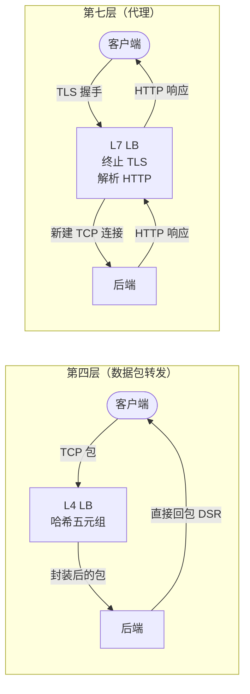
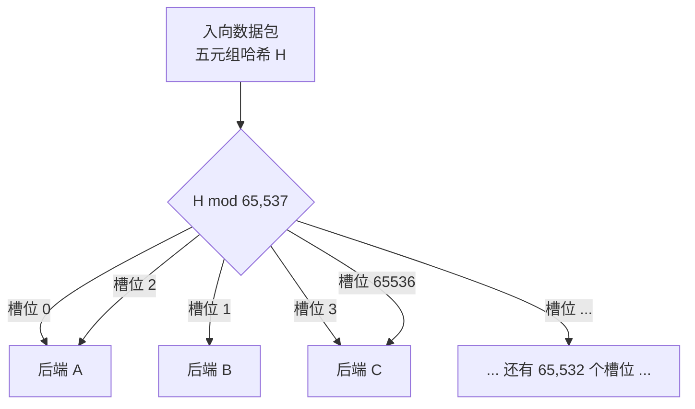
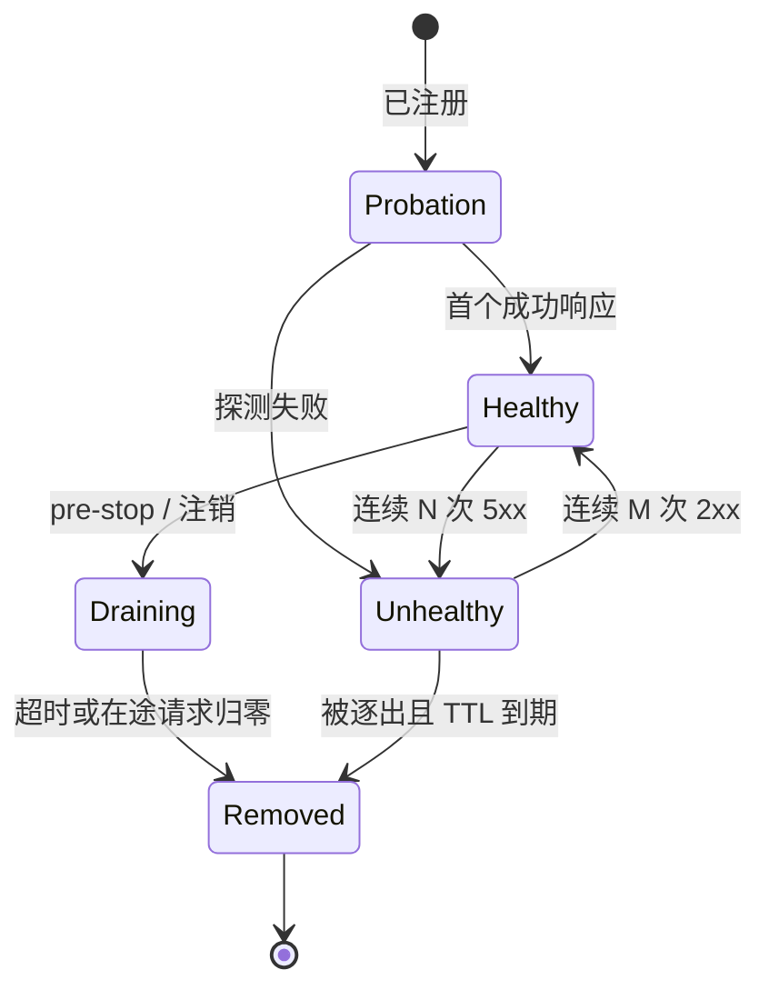
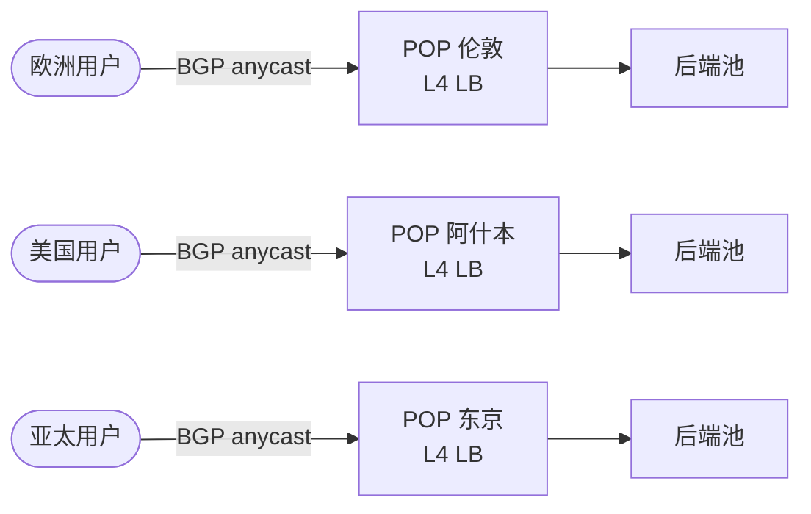

# 负载均衡器：分散流量，吸收故障

> **TL;DR**: 负载均衡器接住一个虚拟 IP，挑一台后端，然后悄悄把不再响应的后端摘掉。第四层按五元组以线速转发数据包：Google Maglev 单机就能打满 10 Gbps 链路[^1]。第七层终止 TCP、解析 HTTP、按头部路由，代价是每个请求都要烧 CPU。多数生产栈两层都上：无状态的 L4 层吃掉原始包量，L7 层补上路由、重试和可观测性[^2]。

## 学习目标

学完本模块，你将能够：

- [ ] 针对给定负载在 L4 与 L7 负载均衡之间做出选择
- [ ] 讲清轮询、最少连接、一致性哈希和两次随机选择这几种算法的权衡
- [ ] 设计既能抓住真实故障、又不会来回抖动的健康检查
- [ ] 推理会话保持、连接排空和优雅发布
- [ ] 描述 anycast 和基于 DNS 的 GSLB 如何在全球范围内引导流量
- [ ] 从功能、吞吐量和成本三方面比较 HAProxy、NGINX、Envoy 与云负载均衡器

## 直觉理解

想象你走进一个机场航站楼，里面有 20 个登机口。一位登机口工作人员检查每位乘客的登机牌，给他分配登机口，并把登机口已关闭的人引导到别处。没有她，乘客会全挤在 1 号口，而 2 到 20 号口空着。

她干三件事。第一，把乘客分散到各个登机口，不让任何一个口被压垮。第二，她盯着登机口状态：如果某个口的廊桥坏了，她就不再往那边送人。第三，她处理文书：扫登机牌、核验证件，然后递回一张简化过的凭条，让下游的登机口工作人员少干点活。

负载均衡器对网络流量做的正是这三件事：分散、跟踪健康、终止（TLS、协议解析）。最简单的版本只读你票上的目的地（五元组），把你指到一个登机口。更聪明的版本会先读你的常旅客等级、你的值机时长和你的行李重量，再做决定。简单版本更快，聪明版本决策更好。生产环境的机场两个都用：在航站楼入口做一次快速初筛，到了登机口集群再来一次更聪明的复筛。

这就是 L4/L7 之分，一个类比讲完了。本章剩下的部分把它落到实处。

## 原理

### 第四层与第七层

L4 负载均衡器工作在 TCP/UDP 数据包层面。它把五元组（源 IP、源端口、目的 IP、目的端口、协议）哈希到一个后端槽位，然后转发数据包，全程不读载荷。响应通常通过直接服务器返回（Direct Server Return，DSR）完全绕过 LB，所以 LB 只碰入向流量[^1][^3]。

L7 负载均衡器终止 TCP 连接、解密 TLS、解析 HTTP（或 gRPC、WebSocket、HTTP/2），再向选中的后端开一条新连接。这让它能按路径、头部、Cookie 或方法路由，重试失败的请求，注入可观测性头部，并按租户执行限流[^4][^5]。

代价是 CPU。每解析一个请求，LB 都得缓冲、解密、重新序列化。同样的硬件上，L7 代理的每秒请求数上限比 L4 转发器低一个数量级。

*L4 转发数据包，根本看不到 HTTP，回程走 DSR；L7 终止连接，双向代理。*

需要原始吞吐量、与协议无关的转发，或者一层抗 DDoS 的能力时，选 L4。需要按路径路由、重试、鉴权或按请求的指标时，选 L7。多数生产栈两层都用：Cloudflare 把 Unimog（L4，XDP）放在 Pingora（L7）前面[^2][^23]；AWS 客户把 NLB 放在 ALB 或 Envoy 前面[^6]。

### 调度算法

**轮询（round robin）** 沿一个有序列表挨个走。简单到不能再简单，在同构主机之间分得很匀。但它不看真实负载：一台卡住的主机在健康检查把它摘掉之前会一直收流量[^7]。

**加权轮询（weighted round robin）** 按权重比例重复高权重主机。后端容量不一致时（比如混代硬件）用它。

**最少连接 / 最少未完成请求（least-connections / least-outstanding-requests）** 挑在途请求最少的那台主机。朴素版本会“聚群”：多个 LB 实例同时挑中同一个“最闲”后端时，那台后端瞬间飙高。

**两次随机选择（power of two choices，P2C）** 修掉了聚群问题。随机挑两台后端，把请求发给在途请求更少的那台。Mitzenmacher 2001 年的结果证明，d=2 相对 d=1（随机）是指数级改善，而 d=3 只再带来常数因子级的改善[^8]。这就是 Envoy、NGINX（通过 `random two` 指令）、Netflix Zuul 和 Finagle 都把 P2C 作为负载均衡选项的原因[^4][^7]。

**一致性哈希（consistent hashing）** 把稳定的键（用户 ID、缓存键、五元组）哈希到某个服务器槽位来路由请求。N 台后端摘掉一台时，大约 1/N 的键会迁移。Google 的 Maglev 哈希用一个置换算法填满 65,537 个槽位的查找表；包路径上的选择只是一次取模加一次数组查表[^1][^9]。

*Maglev 风格的查找表用置换把 65,537 个槽位映射到后端；五元组以 O(1) 哈希进一个槽位。*

同构的无状态服务用轮询。异构或者对延迟敏感的负载，默认用 P2C 最少请求。只有需要缓存亲和或流固定时才用一致性哈希，并且接受热键可能把某一台后端压垮[^10]。

### 健康检查与异常点检测

**主动健康检查（active health checks）** 按计划探测后端：一次 TCP 连接、一次对 `/healthz` 的 HTTP GET，或者一次 gRPC 健康检查 RPC。即使流量很低，它们也能很快发现死掉的后端[^11]。

**被动（异常点）健康检查（passive / outlier health checks）** 观察真实请求流量。Envoy 默认的异常点检测器在连续 5 次 5xx 之后把主机逐出，基础逐出时间 30 秒，重复逐出时按线性退避[^11][^12]。被动检查能抓住主动检查漏掉的灰色故障（响应变慢、部分报错）。

**连接排空（connection draining）** 停止向后端发新连接，同时让已有请求跑完。在 Kubernetes 里，`preStop` 钩子会先睡过 LB 的注销延迟，容器才收到 SIGTERM[^13][^14]。

**慢启动（slow start）** 在可配置的时间窗口内把流量逐步加到新启动的后端上。Netflix 用 90 秒，免得把冷 JVM 打爆[^7]。

*后端会在观察期、健康、不健康、排空几个状态之间流转；LB 只把新流量路由到健康的后端。*

### 会话保持

会话保持（sticky session）用 Cookie、头部或源 IP 哈希把客户端绑到某台后端上。AWS ALB 用 `AWSALB` Cookie[^15]；NLB 通过一个额外纳入 TCP 序列号的六元组流哈希把每条 TCP 连接钉住，所以同一个客户端的多条连接可能落到不同目标上[^24]。

> [!WARNING]
> **会话保持是一种坏味道。** 它破坏横向扩展（一个明星用户就能把某台后端打成热点），破坏发布（滚动后端会让会话失效），在移动网络上也会破（漫游时 IP 变了）。该修的是有状态这件事本身：把会话状态外置到 Redis，或者编码进 JWT。只在缓存亲和场景用一致性哈希 LB，那里丢掉亲和只是延迟变差，不影响正确性[^15]。

### 全局负载均衡

单个数据中心之上，流量靠两种机制在全球范围内引导：

**BGP anycast** 从每个 POP 宣告同一个 VIP。互联网路由器收敛到离每个客户端最近的位置。Cloudflare 在 330+ 个城市运营，外部容量 500 Tbps[^16]。某个 POP 变黑时，它撤回自己的 BGP 路由，流量在几秒内重新收敛，没有 DNS TTL 延迟[^2]。

**基于 DNS 的 GSLB**（Route 53、NS1）按客户端子网、RTT 或加权策略返回不同的 A 记录。它更粗：ISP 上的过期缓存可能把用户钉在已经死掉的区域好几分钟。只有新的 DNS 查询会受影响；已建的 TCP 连接原地不动[^17]。

*一个 anycast VIP 会到达众多 POP 中最近的那个；在每个 POP 内部，无状态 L4 LB 再扇出到后端。*

需要亚秒级故障切换、并且能运营 BGP 时用 anycast。需要在没有 BGP 基础设施的情况下做地理引导、又能接受过期缓存带来的分钟级切换时，用 DNS GSLB。

### TLS 终止

三种模式占主流：

1. **在 LB 终止。** LB 解密、检查 HTTP，再重新起一条到后端的连接（明文或重新加密）。这是 AWS ALB、Cloudflare 的 L7 层和 Envoy ingress 的默认做法。它带来头部路由、WAF 和重试能力，但把所有私钥都放在 LB 上[^18]。
2. **透传（passthrough）。** LB 原样转发加密字节（L4，或基于 SNI 的路由）。AWS NLB 的 TLS 监听器和 Istio 的 `PASSTHROUGH` 模式属于这一类。没有 HTTP 路由，但端到端加密保住了[^19]。
3. **服务网格里的 mTLS。** Istio 和 Linkerd 在 sidecar 终止外层 TLS，再向上游 sidecar 重新发起 mTLS。证书自动轮转，服务之间零信任[^19]。

需要 L7 能力时用终止。合规要求端到端加密时用透传。需要经过认证的服务间通信时用 mTLS。

## 真实案例

### Cloudflare Unimog：每台服务器都是负载均衡器

Cloudflare 的 Unimog 是一个 L4 负载均衡器，部署在他们整个边缘网络上：330+ 个城市，500 Tbps 容量[^16]。它最关键的设计选择是：数据中心里的每台服务器同时既是负载均衡器又是应用服务器。没有独立的 LB 层。

**怎么工作的。** 路由器把数据包 ECMP 到任意一台服务器。一条 XDP 程序链逐包运行：先 `l4drop`（DDoS 缓解），然后 Unimog。Unimog 哈希五元组，查一张有几万个桶的转发表（大约是服务器数量的 100 倍），再用 GUE 把数据包封装到目标服务器[^2]。

**连接保持。** 转发表变化时（服务器增删），Unimog 使用从 Beamer 论文借来的“菊花链”：每个桶有两个槽位（当前和上一个）。如果当前服务器上没有匹配的 TCP socket，就转发给上一个服务器。只有不到 1% 的数据包会走这一“第二跳”[^2]。

**CPU 开销。** 每台服务器花在负载均衡工作上的 CPU 不到 1%。XDP 在 Linux 内核网络栈碰到数据包之前就运行，所以这份开销接近于零[^2]。

**那次振荡事故。** 早期 Cloudflare 撞上一个反馈回路问题：当一个数据中心过载、控制面（`conductor`）把新连接改派到负载较轻的服务器时，那些服务器随后也退化了，而原来那台又恢复了，于是来回振荡。修法是：教会 conductor 区分单台服务器退化和整个数据中心饱和[^2]。

**抗 DDoS。** 2025 年，Cloudflare 通过 l4drop/Unimog 这条链路缓解了一次 31.4 Tbps 的 DDoS 攻击，全程没有人工介入[^16]。

教训：一个跑在每台服务器上的无状态 L4 LB，把“LB 层”这个独立的容量规划问题消掉了。LB 随整个集群一起扩展。

## 权衡

### 负载均衡器放在哪

| 方案 | 优点 | 缺点 | 适用场景 | 我们的选择 |
|---|---|---|---|---|
| L4（NLB、Maglev、Katran） | 线速吞吐、与协议无关、靠一致性哈希做流固定 | 没有 HTTP 能力，没有头部路由，没有重试 | 高吞吐、非 HTTP、抗 DDoS 前置层 | **永远做前置层** |
| L7（ALB、Envoy、NGINX、HAProxy） | 路由丰富、TLS 终止、重试、鉴权、限流 | 每请求都有 CPU 开销，增加延迟，TLS 私钥放在 LB 上 | HTTP 服务、微服务网格、多租户入口 | **HTTP 场景放在 L4 之后** |
| 客户端负载均衡（gRPC、Finagle） | 不多一跳网络，能按延迟选 | 客户端复杂，需要服务发现，每种语言都得实现 | 自己服务之间的内部 RPC 网格 | 两端都由你掌握时 |

### 用哪种算法挑后端

| 算法 | 优点 | 缺点 | 适用场景 | 我们的选择 |
|---|---|---|---|---|
| 轮询 / 加权轮询 | 简单到不能再简单，无状态 | 不看真实负载；慢后端会一直收流量，直到健康检查把它摘掉 | 同构无状态服务 | 起步默认，随后换成 P2C |
| P2C 最少请求 | 便宜、自平衡、抗聚群[^8] | 需要每个后端的在途请求计数 | 异构后端、延迟敏感 | **L7 的默认选择** |
| 一致性哈希（环、Maglev） | 缓存亲和的分配稳定；成员变化时约 1/N 重分配[^4] | 对键倾斜敏感；热键会压垮一台后端 | 缓存路由、流固定 | 只在需要亲和时用 |

## 常见陷阱

> [!WARNING]
> **把 LB 当成单点故障。** 单主备的 VRRP 对在心跳被阻断时会脑裂（比如两台 VM 在同一台 ESXi 主机上，组播被挡住）[^20]。修法：用 anycast + ECMP + 无状态 L4，让任一 LB 实例都能服务任一条流。容量按 N+1 准备，故障时自动撤回路由[^21]。

> [!WARNING]
> **健康检查做太深，引发级联故障。** 如果健康检查一路打到数据库，而数据库慢了，每个后端会同时检查失败。LB 把整个池子全摘掉。liveness 用浅检查（TCP 连接，或者只测进程本身的 `/healthz`），深检查留给 readiness，并配上恐慌阈值，保证不会摘掉超过 50% 的后端[^11]。

> [!WARNING]
> **发布时连接排空没做好。** Kubernetes 在标记 pod 待删除后立刻发 SIGTERM，但端点传播到 LB 要好几秒。在途请求会吃到 TCP RST。修法：加一个 `preStop` 钩子，在容器收到 SIGTERM 前先睡 30 秒，并把 LB 的注销延迟设成匹配的值[^13][^14]。

> [!WARNING]
> **故障切换时 DNS TTL 太长。** TTL 5 分钟的 DNS GSLB 意味着切换之后用户还会被钉在死区域 5 分钟以上。ISP 的解析器经常完全无视 TTL。修法：TTL 压到 30-60 秒并接受 DNS 查询成本，或者改用 BGP anycast，几秒内就能重新收敛[^17][^2]。

> [!WARNING]
> **没去调 `SO_REUSEPORT`。** 不开 `reuseport`，所有 NGINX worker 会在共享的 accept 队列上一起被唤醒，争锁争到爆。F5/NGINX 在 36 核实例上的基准：RPS 提升 2-3 倍（localhost 测试），另一组分主机测试里延迟标准差从 26.59 ms 降到 3.15 ms[^22]。一行配置，巨大改善。

> [!WARNING]
> **会话保持把有状态问题盖住了。** 一个明星用户被钉在某台后端上，把它打成热点，其余机器闲着。发布让会话失效。移动用户漫游换 IP 就丢了绑定。修法：把状态外置到 Redis 或 JWT。彻底放弃会话保持[^15]。

## 练习

为一个公共 API 设计负载均衡层：20 万 RPS，横跨 80 个无状态 pod，需要 TLS 终止、按路径路由到四个服务、按租户限流，以及零停机发布。在 ALB、NLB + Envoy、NGINX 之间做决定，并从成本、功能匹配度和运维负担三方面论证。

提示

按路径路由和按租户限流都需要 L7。TLS 终止可以放在 L4（透传），也可以放在 L7（终止）。零停机发布需要连接排空。哪种组合能同时给你这三样，又不过度设计？

参考答案

**架构：NLB + Envoy sidecar 集群。**

1. **NLB（L4 前置层）。** 提供静态 IP，在数百万 RPS 下处理 TCP/TLS 透传，保留客户端源 IP。没有按请求的 CPU 开销。吸收连接风暴和基础 DDoS。

2. **Envoy（L7 层）。** 以 pod 集群（或 DaemonSet）形式运行。终止 TLS、解析 HTTP，按路径前缀把请求路由到四个后端服务。Envoy 的路由配置支持通过外部限流服务（或本地令牌桶）做按路由限流。P2C 最少请求算法在 80 个后端 pod 之间分发。

3. **零停机发布。** Envoy 的异常点检测在几秒内逐出不健康的 pod。后端 pod 使用 30 秒的 `preStop` 睡眠。Envoy 的健康检查会在 SIGTERM 到达之前把正在排空的 pod 标为不健康。

**为什么不能只用 ALB？** ALB 能处理路径路由和 TLS，但按租户限流需要自己写逻辑（Lambda@Edge 或 sidecar）。ALB 的限流很粗（按目标组的固定速率，不是按租户）。20 万 RPS 下，ALB 成本大致是每 LCU-小时 $0.008 乘以峰值 LCU，在大型集群上可能超过自管 Envoy 集群。

**为什么不能只用 NGINX？** NGINX 能做 Envoy 能做的一切，但缺少在 Kubernetes 里做动态服务发现的原生 xDS 集成。你需要 NGINX Plus（商业版）或自建控制面。Envoy 的 xDS 协议原生对接 Istio、Consul 或自建控制面。

**接受的权衡：** 管理 Envoy 集群的运维复杂度，换托管 ALB 的简单。在 20 万 RPS 加按租户限流的前提下，可控性和成本节省值得这份复杂度。

## 要点回顾

- L4 快而笨，L7 聪明而贵。多数生产栈两层都用：L4 在前吃包量，L7 在后提供路由智能。
- P2C 最少请求是最好的默认算法。它自平衡、抗聚群，面对异构后端零配置也能处理。
- 负载均衡算法的重要性不如好的健康检查和连接排空。算法再完美，健康检查坏了照样把流量送到死服务器上。
- 会话保持是一种坏味道。把状态外置到 Redis 或 JWT；只在缓存亲和场景用一致性哈希，那里丢掉亲和只是延迟变差，不是正确性变差。
- 无状态 L4 加 anycast 能给出亚秒级的全球故障切换。基于 DNS 的 GSLB 更简单，但因为 TTL 缓存要几分钟才能切完。
- 每台服务器都可以是负载均衡器。Cloudflare 的 Unimog 证明，消掉独立的 LB 层等于消掉一个容量规划问题，代价是不到 1% 的 CPU 开销[^2]。
- 在任何多核代理上打开 `SO_REUSEPORT`。一行配置，消掉 accept 队列争用，吞吐量可能翻倍[^22]。

## 延伸阅读

- [Maglev: A Fast and Reliable Software Network Load Balancer (Eisenbud et al., NSDI 2016)](https://www.usenix.org/conference/nsdi16/technical-sessions/presentation/eisenbud) - 大规模 L4 的奠基论文；提出 Maglev 哈希，讲清 Google 如何在无共享 LB 状态的情况下承载全部生产流量。
- [Unimog: Cloudflare's Edge Load Balancer (2020)](https://blog.cloudflare.com/unimog-cloudflares-edge-load-balancer/) - 关于全球 L4 LB 最详细的公开文章，包括为保持连接而做的菊花链，以及那次振荡事故。
- [Open-sourcing Katran (Meta Engineering, 2018)](https://engineering.fb.com/open-source/open-sourcing-katran-a-scalable-network-load-balancer/) - 讲 XDP+eBPF 如何让 L4 LB 与后端应用同机部署，单核跑到 1000 万+ pps。
- [Rethinking Netflix's Edge Load Balancing (2018)](https://netflixtechblog.com/netflix-edge-load-balancing-695308b5548c) - P2C 加上服务器自报利用率，配真实生产事故数据；关于轮询为何会失效，最好的公开论证。
- [The Power of Two Random Choices: A Survey of Techniques and Results (Mitzenmacher, 2001)](https://www.eecs.harvard.edu/~michaelm/postscripts/handbook2001.pdf) - 每个主流现代 LB 都在引用的理论基础；证明 d=2 比 d=1 好一个指数级。
- [Envoy Load Balancer Documentation](https://www.envoyproxy.io/docs/envoy/latest/intro/arch_overview/upstream/load_balancing/load_balancers) - 参考级 L7 LB 的算法清单（环哈希、Maglev、P2C、加权轮询），以及每种算法为什么存在。
- [Socket Sharding in NGINX 1.9.1 (F5/NGINX, 2015)](https://www.f5.com/fr_fr/company/blog/nginx/socket-sharding-nginx-release-1-9-1.html) - 释放多核扩展能力的 SO_REUSEPORT 基准测试；任何代理上 ROI 最高的调优改动之一。
- [HAProxy Forwards Over 2M RPS on a Single Arm Instance (2021)](https://www.haproxy.com/user-spotlight-series/how-we-achieved-2-million-rps-haproxy-on-arm-processors/) - 接近单机极限的公开软件 LB 基准；做容量规划时有用。
- [Consistent Hashing and Random Trees (Karger et al., STOC 1997)](https://dl.acm.org/doi/10.1145/258533.258660) - 一致性哈希的原始论文；理解 Maglev、环哈希和 jump hash 的前置阅读。
- [GLB: GitHub's Open Source Load Balancer (2018)](https://github.blog/engineering/infrastructure/glb-director-open-source-load-balancer/) - 会合哈希和无状态连接保持的“第二次机会”技巧；Unimog 之外很好的补充读物。

## 记忆卡片

**Q:** L4 与 L7 负载均衡的根本区别是什么？
**A:** L4 按五元组转发数据包，不检查载荷（快、与协议无关）。L7 终止连接、解析应用层协议、按内容路由（聪明、吃 CPU）。

**Q:** 为什么生产栈经常在 L7 前面再放一层 L4？
**A:** L4 以线速、极低 CPU 吃掉原始包量和 DDoS。它后面的 L7 只对穿过 L4 层的那部分流量做路由、重试和可观测性。

**Q:** “两次随机选择”是什么意思，为什么 d=2 特别？
**A:** 随机挑两台后端，发给在途请求更少的那台。Mitzenmacher 证明 d=2 相对 d=1（随机）是指数级改善，而 d=3 只再带来常数因子级的改善。两次就是那个甜点。

**Q:** Maglev 如何在集群范围内做到无状态的一致性哈希？
**A:** 每台 Maglev 机器都用一个确定性置换算法独立算出同一张 65,537 槽位的查找表。后端集合相同时，每台机器对“哪个五元组归哪台后端”的判断都一致，不需要共享状态。

**Q:** 什么是直接服务器返回（DSR），为什么重要？
**A:** 后端直接回复客户端，回程绕过 LB。这意味着 LB 只处理入向流量，回包带宽不受 LB 容量约束。

**Q:** 为什么说会话保持在负载均衡里是一种“坏味道”？
**A:** 它破坏横向扩展（明星用户把一台后端打成热点），破坏发布（滚动后端让会话失效），在移动网络上也会破（IP 会变）。该做的是把状态外置，而不是在 LB 上盖住有状态这件事。

**Q:** 主动健康检查和被动健康检查有什么区别？
**A:** 主动检查按计划探测后端（TCP 连接、HTTP GET）。被动检查观察真实流量，把连续报错的主机逐出。主动检查能快速发现死后端；被动检查能抓住主动检查漏掉的灰色故障。

**Q:** BGP anycast 的故障切换为什么比基于 DNS 的 GSLB 快？
**A:** 某个 POP 变黑时，它撤回自己的 BGP 路由，流量在几秒内通过路由器网络重新收敛。基于 DNS 的切换依赖 TTL 过期，而 ISP 的过期缓存可能让这拖上几分钟。

**Q:** 什么是连接排空，为什么发布时离不开它？
**A:** 连接排空停止向后端发新连接，同时让已有在途请求跑完。没有它，滚动发布就会丢请求，因为后端在 LB 停止向它路由之前就收到了 SIGTERM。

**Q:** Cloudflare Unimog 的振荡事故给 LB 控制面上了什么课？
**A:** 控制面把流量从过载服务器上挪走后，接收流量的服务器又过载了，于是来回振荡。修法：重新平衡之前，先区分单台服务器退化和整个数据中心饱和。

**Q:** `SO_REUSEPORT` 对 NGINX 这类多核代理做了什么？
**A:** 它让每个 worker 拥有自己专属的内核 accept 队列，消掉共享队列上的锁争用。F5/NGINX 在 36 核实例上的基准：localhost 测试里 RPS 提升 2-3 倍，分主机测试里延迟标准差从 26.59 ms 降到 3.15 ms。

**Q:** 什么时候用一致性哈希，什么时候用 P2C 最少请求？
**A:** 需要缓存亲和或流固定时用一致性哈希（丢掉亲和只是延迟变差，不影响正确性）。其余场景默认用 P2C 最少请求，因为它零配置就能自平衡。

**Q:** Cloudflare 的 Unimog 在每台服务器上增加多少 CPU 开销？
**A:** 不到 1%。XDP 程序在 Linux 内核网络栈碰到数据包之前就运行，让单包开销接近于零。

**Q:** 保持连接用的“菊花链”技巧是什么？
**A:** 转发表的每个桶有两个槽位：当前后端和上一个后端。如果当前服务器上没有匹配这个包的 TCP socket，就转发给上一个服务器。这样在表变化时仍能保住已有连接。

**Q:** 举出 Netflix Zuul 2 选后端时用的三个信号。
**A:** 客户端观测到的健康度（上一次请求成功了吗？）、服务器自报的利用率（放在 `X-Netflix.server.utilization` 响应头里），以及客户端观测到的在途请求数。三者通过 P2C 组合。

## 参考文献

[^1]: Eisenbud et al., "Maglev: A Fast and Reliable Software Network Load Balancer", NSDI 2016. https://www.usenix.org/conference/nsdi16/technical-sessions/presentation/eisenbud
[^2]: David Wragg, "Unimog - Cloudflare's edge load balancer", Cloudflare Blog, 2020-09-09. https://blog.cloudflare.com/unimog-cloudflares-edge-load-balancer/
[^3]: Shirokov and Dasineni, "Open-sourcing Katran, a scalable network load balancer", Meta Engineering Blog, 2018-05-22. https://engineering.fb.com/open-source/open-sourcing-katran-a-scalable-network-load-balancer/
[^4]: Envoy Project, "Supported load balancers", Envoy documentation. https://www.envoyproxy.io/docs/envoy/latest/intro/arch_overview/upstream/load_balancing/load_balancers
[^5]: Envoy Project, "What is Envoy", Envoy documentation. https://www.envoyproxy.io/docs/envoy/latest/intro/what_is_envoy
[^6]: Jeff Barr, "New Network Load Balancer: Effortless Scaling to Millions of Requests per Second", AWS News Blog, 2017-09-07. https://aws.amazon.com/blogs/aws/new-network-load-balancer-effortless-scaling-to-millions-of-requests-per-second/
[^7]: Mike Smith, "Rethinking Netflix's Edge Load Balancing", Netflix TechBlog, 2018-09-28. https://netflixtechblog.com/netflix-edge-load-balancing-695308b5548c
[^8]: Michael Mitzenmacher, "The Power of Two Random Choices: A Survey of Techniques and Results", Handbook of Randomized Computing, Kluwer Academic Publishers, 2001. https://www.eecs.harvard.edu/~michaelm/postscripts/handbook2001.pdf
[^9]: Paper Trail, "Network Load Balancing with Maglev", 2020. https://www.the-paper-trail.org/post/2020-06-23-maglev/
[^10]: Vahab Mirrokni, Mikkel Thorup, and Morteza Zadimoghaddam, "Consistent Hashing with Bounded Loads", Google Research Blog, 2017（论文：arXiv:1608.01350, SODA 2018）. https://research.google/blog/consistent-hashing-with-bounded-loads/
[^11]: HashiCorp Help Center, "Troubleshooting Consul Envoy 503 Error: No Healthy Host for HTTP Connection Pool", 2025. https://support.hashicorp.com/hc/en-us/articles/20777919636115-Troubleshooting-Consul-Envoy-503-Error-No-Healthy-Host-for-HTTP-Connection-Pool
[^12]: Envoy Project, "Outlier detection", Envoy v1.25 docs. https://www.envoyproxy.io/docs/envoy/v1.25.0/intro/arch_overview/upstream/outlier
[^13]: Kubernetes, "Explore Termination Behavior for Pods And Their Endpoints". https://kubernetes.io/docs/tutorials/services/pods-and-endpoint-termination-flow/
[^14]: AWS, "How to rapidly scale your application with ALB on EKS (without losing traffic)", 2023. https://aws.amazon.com/blogs/containers/how-to-rapidly-scale-your-application-with-alb-on-eks-without-losing-traffic/
[^15]: AWS, "Sticky sessions for your Application Load Balancer". https://docs.aws.amazon.com/elasticloadbalancing/latest/application/sticky-sessions.html
[^16]: Tanner Ryan, "500 Tbps of capacity: 16 years of scaling our global network", Cloudflare Blog, 2026-04-10. https://blog.cloudflare.com/500-tbps-of-capacity/
[^17]: AWS, "Choosing a routing policy", Amazon Route 53 Developer Guide. https://docs.aws.amazon.com/Route53/latest/DeveloperGuide/routing-policy.html
[^18]: AWS, "Create an HTTPS listener for your Application Load Balancer", Elastic Load Balancing User Guide. https://docs.aws.amazon.com/elasticloadbalancing/latest/application/create-https-listener.html
[^19]: Istio, "Ingress Sidecar TLS Termination". https://istio.io/latest/docs/tasks/traffic-management/ingress/ingress-sidecar-tls-termination/
[^20]: Broadcom KB, "VRRP Split-Brain Condition When Multiple Nodes Reside on the Same ESXi Host". https://knowledge.broadcom.com/external/article/427472/vrrp-virtual-router-redundancy-protocol.html
[^21]: Keepalived Project, "Failover using VRRP". https://web.archive.org/web/20260518190226/https://keepalived.org/doc/case_study_failover.html
[^22]: Andrew Hutchings, "Socket Sharding in NGINX Release 1.9.1", NGINX Blog, 2015-05-26. https://www.f5.com/fr_fr/company/blog/nginx/socket-sharding-nginx-release-1-9-1.html
[^23]: Yuchen Wu, "How we built Pingora, the proxy that connects Cloudflare to the Internet", Cloudflare Blog, 2022-09-14. https://blog.cloudflare.com/how-we-built-pingora-the-proxy-that-connects-cloudflare-to-the-internet/
[^24]: AWS, "What is a Network Load Balancer?"（TCP 流哈希包含协议、源/目的 IP+端口，以及 TCP 序列号）. https://docs.aws.amazon.com/elasticloadbalancing/latest/network/introduction.html
