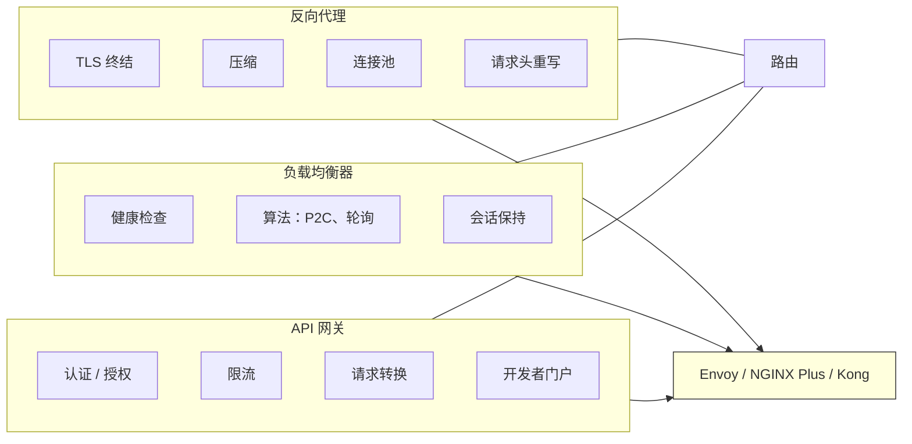
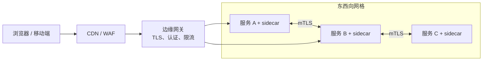
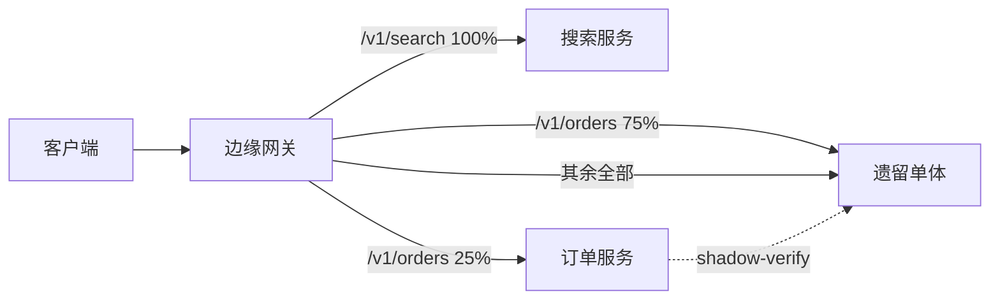
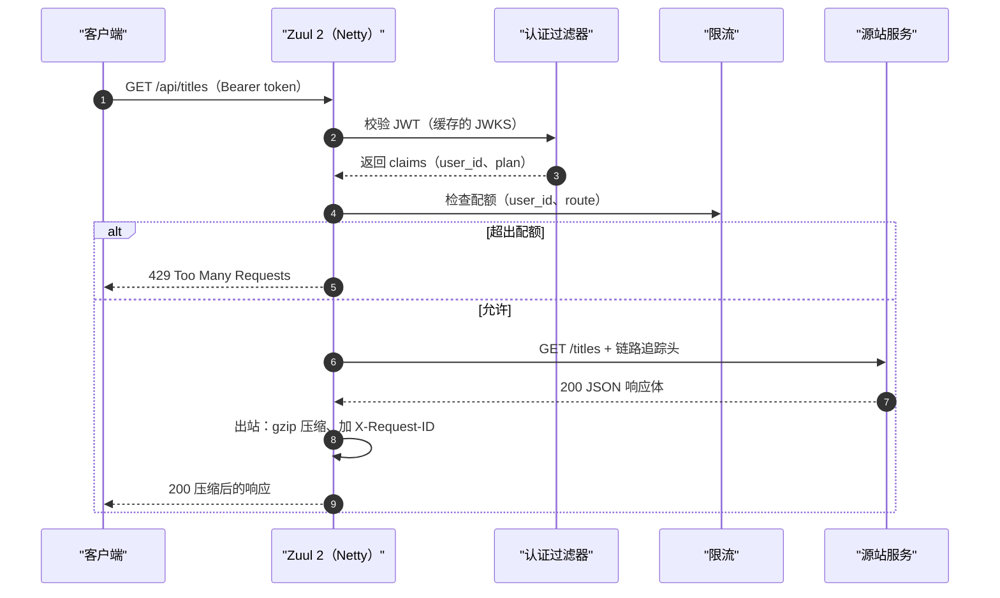

# 反向代理与 API 网关：智能边缘

> **TL;DR**: 反向代理终结客户端连接、隐藏源站拓扑，并补上 TLS、压缩和重试。API 网关则是带产品策略的反向代理：认证、限流、配额、开发者门户。Netflix Zuul 2 在 80+ 个集群上扛住每秒 100 万+ 请求[^1]，而 Envoy 作为 sidecar 代理通常只增加个位数毫秒的 P99 延迟开销[^2]。需要路由和 TLS 时，先用薄薄一层反向代理（Envoy 或 NGINX）。只有在需要按消费者做认证、配额和开发者门户时，才上完整的 API 网关。别把业务逻辑塞进网关，否则它就变成分布式单体。

## 学习目标

学完本章，你将能够：

- [ ] 分清反向代理、负载均衡器和 API 网关，并为场景选对工具
- [ ] 设计 TLS 终结，以及网关与服务之间的 mTLS
- [ ] 在边缘实现按路径和按请求头的路由、金丝雀发布与 A/B 分流
- [ ] 在网关的过滤器链里配置认证（JWT、OAuth2、API key）和按租户的限流
- [ ] 说明南北向与东西向流量模式，以及为什么一个网关无法同时服务好两者
- [ ] 避开“分布式单体”这个反模式——让网关持有业务逻辑

## 直觉理解

你去一家大饭店办入住。前台礼宾不会帮你提行李、不会下厨、也不会打扫房间。但你提出的每个请求都要经过她。她核对你的预订（认证），检查你的房型是否允许使用泳池（授权），告诉你哪组电梯到你的楼层（路由），还会客气地限制你每天能拿几条毛巾（限流）。前台后面，几十号员工在干实际的活。厨房、洗衣房、维修班你一个都见不到。你只跟礼宾说话。

反向代理就是那位礼宾。它站在每个客户端和每个后端服务之间。它终结 TLS，后端就不用管证书。它压缩响应，后端就不用为 gzip 烧 CPU。它为慢客户端做缓冲，后端就不会被涓涓细流的字节拖住。它还按路径、请求头或主机名把请求转发到正确的上游。

API 网关则是同一位礼宾，同时还管着会员体系：她发房卡（API key），记录每位客人这个月下了多少单（配额），还发布一份饭店服务目录（开发者门户）。礼宾的角色没变，职责范围更宽了。

本章余下的部分会把这条界线说清楚，并告诉你在什么情况下一位薄礼宾就够了，什么时候你需要那张完整的会员服务台。

## 原理

### 反向代理、负载均衡器与 API 网关的对比

这三个角色重叠很多，同一个二进制往往三种都干。区别在于主要职责：

- **负载均衡器**把流量分散到 N 个同构后端上。它的活是均匀分摊和健康跟踪。参见[负载均衡器](./00-load-balancers.md)。
- **反向代理**终结客户端连接，再转发给上游。它的活是协议处理：TLS、HTTP/2、压缩、缓冲、请求头重写、连接池。
- **API 网关**执行 API 的产品策略。它的活是业务层关注点：认证、授权、按消费者的限流、请求转换、schema 校验、开发者门户。

实际上，NGINX、Envoy、HAProxy 和 Caddy 三种角色都能扮演。Kong、Apigee、AWS API Gateway 则把网关角色往上层推，附加更丰富的业务功能。问题从来不是“我的工具属于哪一类”，而是“我的部署承担了哪些职责”。

*三个角色以路由为共同交集；Envoy、Kong 这类工具三者兼备，而更简单的工具各有专攻。*

### 反向代理做什么

反向代理负责六个协议层关注点，这些活你不想让每个后端都实现一遍：

1. **TLS 终结。** 代理持有证书、协商 TLS 1.3，对后端说明文（或重新加密的 mTLS）。这样证书轮换集中在一处，昂贵的握手套接也被卸载掉[^3]。
2. **边缘侧的 HTTP/2 与 HTTP/3。** 代理对客户端说多路复用协议，后端则可以停留在简单的 HTTP/1.1 加 keepalive 连接池上。
3. **压缩。** 响应路径上做 Gzip 或 Brotli，省带宽又不占后端 CPU。
4. **请求缓冲。** 代理吸收慢客户端（3G 上的手机），后端不会因为等字节而被卡住。这是对 slowloris 一类攻击的防线[^4]。
5. **连接池。** 不必让每个客户端都对每个后端开 TCP 连接，代理为每个上游维护一小池 keepalive 连接。Netflix 的 Zuul 2 通过给连接池加上 HTTP/2 多路复用和确定性子集化，把整个集群的连接总数降了 10 倍[^5]。
6. **请求头重写与请求路由。** 按路径、按请求头、按主机名路由到不同的上游集群。金丝雀分流、A/B 测试、蓝绿部署，本质上都是代理上的一条路由规则。

### API 网关的能力

API 网关在反向代理之上再加产品层关注点：

**认证与授权。** 对 JWKS 端点校验 JWT、OAuth2 token introspection、API key 查找、mTLS 客户端证书校验。把认证集中到网关，单个服务就不用各自（且糟糕地）重新实现一遍 JWT 校验[^6]。

**限流与配额。** 按消费者、按端点、按套餐设限。免费用户每分钟 100 个请求，付费用户 10,000 个。网关在请求到达后端之前就执行，被拒的流量不消耗计算。

**请求与响应转换。** 重写路径、注入请求头、转换协议（REST 转 gRPC、JSON 转 Protobuf）、按 OpenAPI 规范校验请求 schema、把多个后端调用聚合成一个客户端响应。

**开发者门户与 key 管理。** 签发 API key、展示文档、跟踪用量分析、管理订阅套餐。Kong、Apigee、Tyk 与原生 Envoy 的差别就体现在这里。

核心矛盾在于：胖网关把这些关注点集中起来（对一致性有好处），但它同时成了一个共享依赖——每个团队都要排队等它发版，一次糟糕的部署会炸掉所有消费者[^6]。

### 南北向与东西向

**南北向**流量跨越信任边界：浏览器、移动 App、合作伙伴的 API 打到你的边缘。它需要重度安全：WAF、DDoS 防护、TLS 终结、地理路由、机器人识别、按 IP 限流。

**东西向**流量在内部服务之间流动。它关心 mTLS、服务发现、重试、熔断器、感知位置的负载均衡。威胁模型不同：你（大体上）信任网络，但你需要经过认证的服务身份。

*南北向网关面对不可信客户端，安全措施重；东西向 sidecar 在可信服务之间说 mTLS，策略较轻。*

一个网关不可能对两者都调优。Lyft 用不同配置让 Envoy 同时扮演两种角色：一个集中的前置代理负责出入口，每个服务一个 Envoy sidecar 负责东西向[^2]。Envoy Gateway（CNCF，2024 年 GA）是南北向的 Kubernetes 原生控制平面；Istio 是东西向的控制平面[^7]。

**经验法则：** 东西向默认用 Envoy（sidecar 或 ambient 网格）。南北向在团队规模小时用托管 API 网关（AWS API Gateway、Cloudflare）。当按请求计的成本或功能需求超出托管产品时，再迁移到自建 Envoy 或 Kong。

### 模式：BFF、绞杀者模式与请求合并

**Backend for Frontend（BFF）。** 不做一个通用网关，而是给每种客户端（Web、iOS、Android）配一个专属边缘服务，把下游微服务聚合成客户端形状的响应[^8]。Web BFF 把四次调用拼成一个匹配 Web 视图模型的响应；移动 BFF 返回更小、更省电的形状。每个 BFF 由拥有那个客户端的团队负责。

**绞杀者模式（strangler fig）。** 网关同时挡在遗留单体和新的服务前面，就绪的请求路由到新服务，其余留在单体上。单体一条路由一条路由地缩水，直到可以下线[^9]。Shopify 正是用 NGINX+OpenResty 里的 Lua 做的：规则在遗留 Rails 店面与新的 Storefront Renderer 之间分流，并配有 render、forward-verify、reverse-verify、self-verify 的比率[^10]。

*网关把路径逐步从遗留单体迁到新服务；回滚就是把某个百分比改回 0。*

**请求合并（request coalescing）。** 大量客户端同时请求同一份资源时（缓存击穿），网关把重复的在途请求折叠成一次上游调用，再把响应扇出给所有等待的客户端。NGINX 里这叫 `proxy_cache_lock`；Envoy 通过其 cache filter 配置达到类似效果。

### 典型配置

**NGINX。** 单二进制的 C 守护进程，每核一个 worker，事件循环驱动。在静态文件服务和简单反向代理上表现出色。配置基于文件，改动需要 reload（或用 NGINX Plus 支持动态上游）。社区基准测试报告：双路 Xeon 硬件上做简单反向代理能跑到 50K 到 80K rps（与实际负载强相关）[^11]。防 slowloris 需要显式调超时[^4]。

**Envoy。** C++ 代理，单进程多线程。一等公民的 xDS API，可以不停机改动态配置。内置 HTTP/2、gRPC、熔断器、异常点检测、分布式追踪支持。服务网格 sidecar 的默认选择（Istio、Consul Connect）。在典型的 sidecar 部署中只增加个位数毫秒的 P99 延迟开销[^2]。

**Traefik。** Go 二进制，原生集成 Kubernetes。通过 IngressRoute CRD 自动发现服务。通过 ACME 自动申请 Let's Encrypt 证书。中间件（限流、重试、熔断）以声明式组合。最适合中小规模 Kubernetes 部署——那里简单性比裸性能更重要。

**Caddy。** 默认就是 HTTPS 的 Go 二进制。自动签发 Let's Encrypt 证书，包括为 SaaS 自定义域名做按需 TLS[^12]。配置起来最不容易出错的反向代理。想要零配置 TLS、又不需要网格级功能时就用它。

**Kong。** 基于 NGINX/OpenResty 的 Lua API 网关。插件生态覆盖认证、限流、日志和转换。企业版增加开发者门户、RBAC 和分析。对需要网关产品功能但不想从零自建的团队，这是甜点区。

## 真实案例

### Netflix Zuul 2：每秒 100 万+ 请求的异步网关

Netflix 的所有外部流量都经由 Zuul 2，这是一个基于 Netty 的异步网关。截至 2018 年，这套集群包含 80+ 个 Zuul 2 集群，路由到约 100 个源站集群，为 1.25 亿+ 流媒体会员支撑每秒 100 万+ 请求[^1]。

**架构。** Zuul 2 用三段式过滤器流水线处理请求：入站过滤器（路由、认证、装饰），端点过滤器（直接返回静态响应或代理到源站），出站过滤器（压缩、指标、响应整形）。过滤器逻辑用 Groovy/Java 写，由功能团队负责；Netty 那套管道（连接处理、代理、记账）由平台团队负责[^1]。

**为什么要异步？** Zuul 1 用的是每请求一个 servlet 的模型。在 Netflix 的体量下，连接成本压过 CPU 成本。一个慢源站占住 10,000 个 servlet 线程就能堵死整个网关。Zuul 2 的 Netty 事件循环处理连接时不必为每个请求专用一个线程，这换来了连接数的可扩展性和对慢源站的韧性[^3]。

**连接数爆炸问题。** 每个源站在每个事件循环上有一个连接池，算式立刻炸开：16 核 × 800 台源站 × 100 个 Zuul 实例 = 128 万条连接。mTLS 上线后，每条连接都要一次昂贵的握手。解法是：HTTP/2 多路复用，加上 Google 的 Ringsteady 确定性子集化算法，按事件循环分别施加。结果是峰值连接数少了 10 倍，负载均衡公平性没损失，还顺带省了约 4% CPU、约 15% 堆内存，延迟降了约 3%[^5]。

**自助路由。** 团队发布路由规则（路径/请求头谓词映射到百分比和源站），网关实例动态拉取。这样不用碰网关代码就能做金丝雀发布、粘性金丝雀、分片和暗测[^1]。

*一个请求穿过 Zuul 2 的过滤器流水线：认证和限流可以在请求到达源站之前就短路，省下后端计算。*

结论是：把过滤器逻辑（功能团队负责）和数据面管道（平台负责）分开。让团队自助配置路由规则。当连接数算式爆炸时，用协议多路复用和子集化去解，而不是堆硬件。

## 权衡

| 方案 | 优点 | 缺点 | 适用场景 | 我们的选择 |
|---|---|---|---|---|
| 薄反向代理（NGINX、Envoy、Caddy） | 快、轻、容易推理 | 认证、限流、门户都要自己造 | 要路由 + TLS + 健康检查，不要产品功能 | **内部服务的默认选择** |
| 完整 API 网关（Kong、Apigee、Tyk） | 开箱即用：开发者门户、插件、分析 | 供应商锁定、成本、共享单点故障 | 面向大量外部消费者的公开 API 产品 | **有 SLA 的公开 API** |
| 云托管（AWS API Gateway、GCP） | 零运维，按请求付费 | 上规模后按请求计费不便宜，冷启动（不开 Provisioned Concurrency 时 100 ms 到数秒）[^13] | 中低流量、后端在 Lambda 上的 API | 小团队，持续 < 100 rps |
| 服务网格 sidecar（Envoy + Istio） | 每个服务都有网关能力，处处 mTLS | 运维负担重，sidecar 占 CPU/内存 | 东西向为主的大型微服务集群 | **东西向默认选择** |
| GraphQL 网关（Apollo Router、Cosmo） | 一次客户端查询，子图扇出最优，吞吐量是 Node.js 的 8 倍[^14] | 工具较新，N+1 陷阱，schema 治理开销 | 团队多、客户端多、共享领域模型 | 组织上做得动联邦时 |
| 边缘计算（Cloudflare Workers） | Anycast 网络覆盖 120+ 国家的 330+ 城市[^18]，几乎零冷启动（isolate 在 TLS 握手期间预加载）[^15] | 运行时受限（V8/Wasm），受限于供应商的 API 面 | 对全球延迟敏感的 API、自定义边缘逻辑 | 延迟关键的全球 API |

## 常见陷阱

> [!WARNING]
> **上游超时级联。** 一个慢源站拖垮网关，再拖垮所有客户端。当网关的读超时长于客户端的，连接就堆积起来，事件循环被打满，p99 在毫不相干的路由上一起爆掉。修法：超时时间必须自下而上递减（客户端 > 网关 > 源站）。加上按源站的并发上限和熔断器。用 `retry_on: connect-failure,reset`，绝不要盲重试 `5xx`[^3]。

> [!WARNING]
> **Slowloris 耗尽连接。** 攻击者开一小撮连接，每条一次只吐一个字节的请求头，就能吃光 `worker_connections`，代理不再接受正常客户端。修法：把 `client_header_timeout`、`client_body_timeout`、`send_timeout` 设为 10 秒。按 IP 用 `limit_conn`。在上游放 CDN 或 L4 DDoS 防护层[^4]。

> [!WARNING]
> **未纳入缓存键的请求头导致缓存投毒。** 攻击者构造一个请求，其中某个影响响应内容的请求头没进缓存键（例如 `X-Forwarded-Host`）。代理缓存下这个恶意响应，之后发给每一个客户端。修法：缓存键要包含 `Host` 以及任何可能改变响应的请求头。正确设置 `Vary`。除非明确允许，绝不缓存已认证的响应[^16]。

> [!WARNING]
> **请求头注入与请求走私。** 代理和源站对“一个请求在哪里结束、下一个在哪里开始”的理解不一致（`Content-Length` 与 `Transfer-Encoding: chunked`）。攻击者把第二个请求走私到别人的连接上。修法：用现代 HTTP 解析器，拒绝有歧义的消息，绝不把 `Connection` 相关请求头透传到上游[^16]。

> [!WARNING]
> **聚合型 GraphQL 的 N+1。** 联邦网关要在各子图间规划子查询。朴素的规划会对列表里的每个元素发一次下游调用，一次客户端查询变成几百次后端调用。修法：在子图里用 DataLoader 式批处理，启用持久化查询，监控查询计划的深度[^14]。

> [!WARNING]
> **业务逻辑悄悄渗进网关。** 网关是每个请求必经的唯一位置，于是团队往里塞“就再加一条”的转换。很快网关就持有产品逻辑，任何改动都要发网关，网关一挂就是产品挂。修法：网关只留给横切策略（认证、限流、可观测性），把转换推回服务自己的代码。Uber 和 Netflix 都专门投入自助工具，就是为了把归属权推回功能团队[^1][^6]。

## 练习

你要为一款金融科技产品发布公开 API：50 个端点、OAuth2 加按客户端限流、网关与服务之间的 mTLS、审计日志，以及一个开发者门户。请比较 AWS API Gateway + Lambda authorizer、Kubernetes 上的 Kong，以及手写 Envoy 配置三种方案，给出推荐并说明成本与归属权方面的理由。

提示

从三个维度考虑：上线时间（几周还是几个月）、在你预期规模下的按请求成本（从 1,000 rps 起步，一年内涨到 50,000 rps）、运维归属（你有几个基础设施工程师？）。开发者门户这一项需求直接排除裸 Envoy，除非你自己造一个。

解决方案

**推荐：Kubernetes 上的 Kong。**

**为什么不用 AWS API Gateway + Lambda authorizer？**

- 持续 1,000 rps（约每月 25.9 亿请求）时，AWS API Gateway 的 REST API 按阶梯价大约每月 $6.8K（3.33 亿 × $3.50 + 6.67 亿 × $2.80 + 15.92 亿 × $2.38）[^17]；HTTP API 便宜些，约每月 $2.4K。到 50,000 rps（你的第一年目标），仅网关费用 REST API 就是每月约 $309K，HTTP API 约每月 $117K。与自建的成本交叉点大致落在 5,000 到 15,000 rps 之间，取决于你选哪种 API 形态。
- Lambda 的冷启动会给 authorizer 这条路径增加 100 ms 到数秒[^13]。对 p99 延迟敏感的金融科技产品，不开 Provisioned Concurrency（额外成本）是不可接受的。
- 供应商锁定：以后想迁出 API Gateway，所有路由配置都得重写。

**为什么不用手写 Envoy？**

- Envoy 开箱就给 TLS、mTLS、路由和限流。但它没有开发者门户、没有 API key 管理、没有用量分析看板。这些你都得从零做。
- 建议：只有当你至少有三名专职基础设施工程师、且没有门户需求时，才选裸 Envoy。

**为什么是 Kubernetes 上的 Kong？**

- Kong 提供 OAuth2 插件、限流插件（滑动窗口、按消费者）、mTLS 上游、通过日志插件做审计日志，以及开发者门户（企业版）或开源替代（集成 Backstage）。
- 跑在你现有的 Kubernetes 集群上。成本是算力（3 到 5 个 Kong pod）加上需要门户时的企业版授权。50,000 rps 下，5 个各 4 vCPU 的 Kong pod 能从容承载。
- Kong 与上游服务之间的 mTLS 是原生的，通过 `mtls-auth` 插件和服务网格集成实现。
- 运维负担：中等。你要管 Kong 升级、插件兼容性和 Kubernetes manifest。但省掉了按请求的云费用和冷启动延迟。

**接受的权衡：** 你用运维复杂度（Kong 升级、插件测试）换取成本可控、延迟可预测和门户功能。如果团队里基础设施工程师少于两人，先上 AWS API Gateway，等成本逼你动的时候再迁到 Kong。

## 要点回顾

- 反向代理管路由和 TLS。API 网关再加产品功能：认证、配额、key、门户。多数工具（Envoy、NGINX、Kong）能同时扮演多个角色。
- 别把业务逻辑放进网关。它该执行横切策略，而不是实现功能。如果网关配置的增长快过你的服务集群，说明你把本该属于服务的逻辑集中起来了。
- 南北向和东西向流量的威胁模型不同，最优工具也不同。不要强迫一个网关同时服务两者。
- BFF 模式让每个客户端团队拥有自己的网关，消除共享网关的协调瓶颈。当你有形状差异明显的客户端（Web、移动、合作伙伴）时用它。
- 绞杀者模式把网关当作迁移期的流量分流器。回滚就是把某个百分比改成 0。
- 持续流量低于约 5,000 rps 时云网关更划算。再往上，按请求计费占主导，自建胜出。
- Netflix Zuul 2 证明了把过滤器逻辑（团队负责）和数据面管道（平台负责）分开，可以扩展到 80+ 集群、100 万+ rps[^1]。

## 延伸阅读

- [Zuul 2: The Netflix Journey to Asynchronous, Non-Blocking Systems](https://netflixtechblog.com/zuul-2-the-netflix-journey-to-asynchronous-non-blocking-systems-45947377fb5c) - 关于 Netflix 为什么转投 Netty、异步究竟换来了什么（连接数扩展，而非 CPU）的诚实复盘。
- [Curbing Connection Churn in Zuul](https://netflixtechblog.com/curbing-connection-churn-in-zuul-2feb273a3598) - 2023 年深入讲解 HTTP/2 多路复用 + Ringsteady 子集化如何把连接数降到 1/10；任何管理代理连接池的人都该读。
- [Designing Edge Gateway, Uber's API Lifecycle Management Platform](https://www.uber.com/en-US/blog/gatewayuberapi/) - Uber 如何把自助网关做成 40+ 个独立服务、支撑 1,600 个 API（40% 的工程师贡献过代码），而网关没有变成分布式单体。
- [Apollo Router: our GraphQL Federation runtime in Rust](https://www.apollographql.com/blog/apollo-router-our-graphql-federation-runtime-in-rust) - 基准测试显示吞吐量是 Node.js 网关的 8 倍；在挑 GraphQL 组合层之前先读这篇。
- [Eliminating Cold Starts 2: shard and conquer](https://blog.cloudflare.com/eliminating-cold-starts-2-shard-and-conquer/) - Cloudflare 在每个数据中心内用一致性哈希环做到 99.99% 热请求率的手法；这是 Lambda 冷启动的反面参照。
- [Pattern: Backends For Frontends (Sam Newman)](https://samnewman.io/patterns/architectural/bff/) - BFF 模式的经典出处；在按客户端类型拆分网关之前先读。
- [Strangler fig pattern (AWS Prescriptive Guidance)](https://docs.aws.amazon.com/prescriptive-guidance/latest/cloud-design-patterns/strangler-fig.html) - 通过网关路由做单体到微服务的渐进迁移；当“推倒重写”不是选项时最安全的路径。
- [Envoy Proxy documentation](https://www.envoyproxy.io/docs) - 过滤器链、xDS 动态配置、HTTP connection manager 的权威参考；任何 Envoy 部署的必读材料。

## 记忆卡片

**Q:** 反向代理和 API 网关的根本区别是什么？
**A:** 反向代理处理协议层关注点（TLS、压缩、路由、连接池）。API 网关在反向代理之上再加产品层关注点（认证、限流、配额、开发者门户）。

**Q:** 为什么一个网关无法同时很好地服务南北向和东西向流量？
**A:** 南北向面对不可信客户端，需要 WAF、DDoS 防护和重度认证。东西向在可信服务之间流动，需要 mTLS、服务发现和重试。两者的威胁模型和优化目标不同。

**Q:** Netflix 从 Zuul 1（servlet）换到 Zuul 2（Netty）解决了什么问题？
**A:** 连接数的可扩展性。一个慢源站占住 servlet 线程就会堵死整个网关。Netty 事件循环处理连接时不必每请求专用一个线程，避免单个慢源站级联到所有路由。

**Q:** Netflix 如何把 Zuul 2 集群的连接数降了 10 倍？
**A:** HTTP/2 多路复用（一条连接上跑多个请求）加上 Ringsteady 确定性子集化（每个事件循环只连一部分源站，而不是全部）。

**Q:** BFF 模式是什么，什么时候该用？
**A:** Backend for Frontend 给每种客户端（Web、iOS、Android）配专属边缘服务，把下游调用聚合成客户端形状的响应。当各客户端的数据形状差异明显、并且你希望每个客户端团队独立发版时用它。

**Q:** 在网关语境下，绞杀者模式是什么？
**A:** 网关同时挡在遗留单体和新服务前面，就绪的请求路由到新服务。单体一条路由一条路由地缩水。回滚就是把百分比改成 0。

**Q:** 上游超时级联这个陷阱是怎么回事？
**A:** 当网关的读超时长于客户端的，一个慢源站会让连接在网关连接池里堆积，打满事件循环，所有路由的 p99 一起爆掉。修法：超时时间自下而上递减。

**Q:** Envoy 增加的延迟和它带来的收益怎么比？
**A:** 在典型 sidecar 部署中 Envoy 增加个位数毫秒的 P99 延迟开销。换来的是 xDS 动态配置、内置可观测性、熔断和 mTLS，全都不用重启。

**Q:** 托管 API 网关与自建的成本交叉点在哪里？
**A:** 大约持续 5,000 到 10,000 rps。低于此，托管（按请求付费）更便宜。高于此，自建（按主机付费）胜出，因为按请求的费用会复利式叠加。

**Q:** 为什么业务逻辑渗入是 API 网关最常见的反模式？
**A:** 网关是每个请求必经的唯一位置，很容易让人想“就再加一条”规则。结果网关变成分布式单体：每个产品改动都要发网关，网关一挂，无关功能也跟着停摆。

**Q:** 什么是请求走私，怎么防？
**A:** 代理和源站对请求边界理解不一致（Content-Length 与 Transfer-Encoding）。攻击者把第二个请求走私到他人的连接上。防法是使用现代 HTTP 解析器、拒绝有歧义的消息、绝不向上游透传与 Connection 相关的请求头。

**Q:** Cloudflare Workers 如何做到几乎零冷启动，而 Lambda 要 100 ms 到数秒？
**A:** Workers 用 V8 isolate（轻量 JavaScript 沙箱）而不是容器。数百个 isolate 共享一个进程，省掉容器启动成本。此外 Workers 在 TLS 握手期间就预加载，把不足 5 ms 的 isolate 加载时间完全藏起来。代价是沙箱更弱、运行时 API 受限。

**Q:** Apollo Router 相比 Node.js 的 Apollo Gateway 强在哪？
**A:** 吞吐量大约 8 倍，每操作开销低于 10 ms，延迟抖动少 90%。它用 Rust 写，以单个多线程二进制运行。

**Q:** 什么时候该选 Kong 而不是裸 Envoy？
**A:** 当你需要网关的产品功能（开发者门户、API key 管理、用量分析、插件生态）且不想从零自建时。如果你有专职基础设施工程师，只需要路由、TLS 和可观测性，裸 Envoy 更合适。

**Q:** Netflix 用的 Ringsteady 子集化算法是什么？
**A:** 一种确定性算法，给每个 Zuul 事件循环分配一份公平的源站子集去连接，而不是连所有源站。这把总连接数从 N×M（全连接）降到可控的子集规模，同时保持负载均衡的公平性。

## 参考文献

[^1]: Netflix Technology Blog, "Open Sourcing Zuul 2" (2018). https://netflixtechblog.com/open-sourcing-zuul-2-82ea476cb2b3
[^2]: D. Liu, "Internet Egress Filtering of Services at Lyft", Lyft Engineering (2022). Describes Lyft's Envoy-based architecture with front proxy and per-service sidecars. https://eng.lyft.com/internet-egress-filtering-of-services-at-lyft-72e99e29a4d9
[^3]: Netflix Technology Blog, "Zuul 2: The Netflix Journey to Asynchronous, Non-Blocking Systems" (2016). https://netflixtechblog.com/zuul-2-the-netflix-journey-to-asynchronous-non-blocking-systems-45947377fb5c
[^4]: NGINX Trac #2590, "Nginx is not able to withstand with pwnloris DoS attack" - official mitigation guidance (2024). https://trac.nginx.org/nginx/ticket/2590
[^5]: A. Gonigberg and Argha C., "Curbing Connection Churn in Zuul", Netflix Tech Blog (2023). https://netflixtechblog.com/curbing-connection-churn-in-zuul-2feb273a3598
[^6]: M. Thangavelu et al., "Designing Edge Gateway, Uber's API Lifecycle Management Platform", Uber Engineering (2020). https://www.uber.com/en-US/blog/gatewayuberapi/
[^7]: CNCF, "Announcing Envoy Proxy 1.31.0 and Envoy Gateway 1.1" (2024). https://www.cncf.io/blog/2024/08/27/announcing-envoy-proxy-1-31-0-and-envoy-gateway-1-1/
[^8]: S. Newman, "Pattern: Backends For Frontends". https://samnewman.io/patterns/architectural/bff/
[^9]: AWS Prescriptive Guidance, "Strangler fig pattern". https://docs.aws.amazon.com/prescriptive-guidance/latest/cloud-design-patterns/strangler-fig.html
[^10]: D. Stride, "How Shopify Dynamically Routes Storefront Traffic", Shopify Engineering (2021). https://shopify.engineering/dynamically-route-storefront-traffic
[^11]: E. Ahmed / denji, "NGINX tuning for best performance" GitHub gist (2017). https://gist.github.com/denji/8359866
[^12]: Caddy, "Automatic HTTPS" documentation. https://caddyserver.com/docs/automatic-https
[^13]: AWS, "Creating low-latency, high-volume APIs with Provisioned Concurrency" (2020). https://aws.amazon.com/blogs/compute/creating-low-latency-high-volume-apis-with-provisioned-concurrency/
[^14]: J. Rosenberger, "Apollo Router: our GraphQL Federation runtime in Rust", Apollo GraphQL Blog (2021). https://www.apollographql.com/blog/apollo-router-our-graphql-federation-runtime-in-rust
[^15]: Cloudflare, "Eliminating cold starts with Cloudflare Workers" (2020). https://blog.cloudflare.com/eliminating-cold-starts-with-cloudflare-workers/
[^16]: SentinelOne vulnerability database entries for Apache CVE-2024-24795, Node.js CVE-2023-30589 (HTTP header injection, request smuggling, cache poisoning). https://www.sentinelone.com/vulnerability-database/cve-2024-24795/
[^17]: AWS, "Amazon API Gateway pricing" (accessed 2026-05-08). REST API tiered pricing: first 333M at $3.50/M, next 667M at $2.80/M, next 19B at $2.38/M. HTTP API tiered pricing: first 300M at $1.00/M, next 300M+ at $0.90/M. https://aws.amazon.com/api-gateway/pricing/
[^18]: Cloudflare, "Peering Policy" (accessed 2025). "Cloudflare AS13335 operates a global anycast network, spanning over 330 cities, in more than 125 countries." https://www.cloudflare.com/partners/peering-portal/
