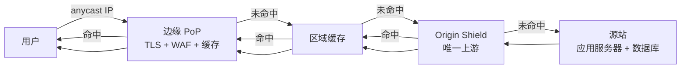
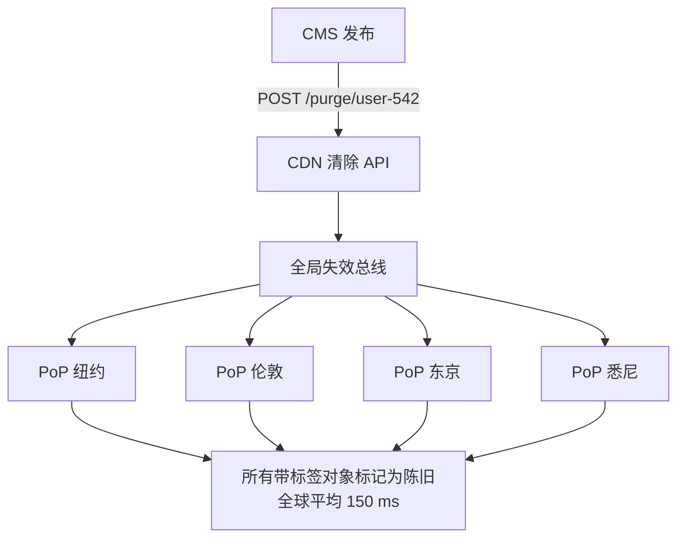
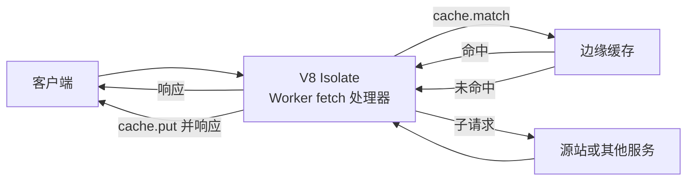
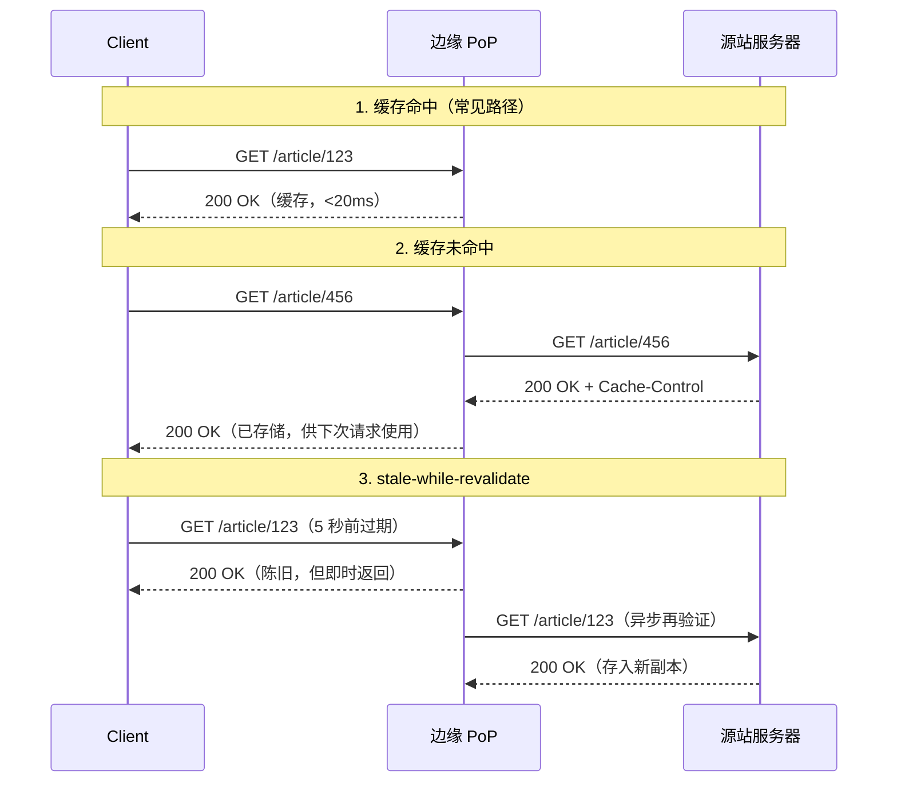

# 内容分发网络：把字节搬到离用户更近的地方

> **TL;DR**: CDN 是一个全球分布的缓存层，也是一道安全前门。它在离用户很近的地方终结 TLS，从边缘直接吐出可缓存的内容，只把未命中的请求转发回源站。Cloudflare 在 330 多个城市运营，总容量 500 Tbps [^1]。Netflix Open Connect 把视频内容预先推到 1,000 多台部署在 ISP 机房里的设备上 [^2]。调优良好的 CDN 能做到 90% 到 99% 的缓存命中率 [^3]，也就是说你的源站只承接 1% 到 10% 的流量。往前推，越激进越好；静态资源的门槛是 95% 以上的命中率。

## 学习目标

学完本章，你将能够：

- [ ] 解释 anycast 路由与 GSLB 如何把用户导向最近的边缘节点
- [ ] 为动态内容和静态内容设计缓存键与 TTL
- [ ] 用 stale-while-revalidate、stale-if-error 和软清除来掩盖源站故障
- [ ] 对缓存命中率、源站卸载和出网成本做出判断
- [ ] 决定什么该放在边缘、什么该放在源站、什么该放在客户端
- [ ] 评估边缘计算平台及其执行限制

## 直觉理解

想象一家连锁书店，只在堪萨斯有一个巨型仓库。每一笔订单都从这个仓库发货。纽约的顾客等两天，东京的顾客等两周。解决办法显而易见：在每个大城市开一家小店，摆上畅销书，只有冷门书才从仓库发。

CDN 对 HTTP 流量做的就是这件事。请求不再全都跑到你的源站服务器（仓库），每个用户连的是最近的接入点（PoP，相当于本地门店）。PoP 在内存和磁盘里备着热门内容，只有缓存未命中才回源。结果是：纽约到悉尼原本 200 ms 的一次往返，变成到最近城市 PoP 的 20 ms 以内。这个延迟收益不需要改一行代码，是任何 Web 应用能拿到的最大一笔性能提升。

张力和零售业一模一样：怎么让本地门店备对货（新鲜度），又不过度囤货（内存成本），还不至于卖昨天的报纸（陈旧数据）？这就是本章的实质内容。

## 原理

### CDN 为什么存在

有三股力量让 CDN 对任何面向公众的应用都不再是可选项：

**光速。** 纽约到悉尼在理想光纤上的一次往返约 200 ms。TCP 三次握手加上 TLS 1.3，在响应的第一个字节出现之前就已经消耗了两次往返。把这条路径缩短到最近的城市，通常 20 ms 以内，就能消掉延迟里占主导的那部分。Cloudflare 的数据中心分布在 125 多个国家的 330 多个城市 [^1][^5]，目标是让 95% 的互联网用户延迟低于 50 ms [^4]。

**源站卸载。** 静态资源重的站点在边缘通常能做到 90% 到 99% 的缓存命中率 [^3][^6]。这意味着源站只处理 1% 到 10% 的入站请求量。正是这个倍数，让规模不大的源站集群能扛住突发爆款，而不必惊慌地自动扩容。

**DDoS 吸收。** 容量 500 Tbps 的 CDN 能吸收那种足以打满任何单一源站的流量型攻击。2024 年 10 月，Cloudflare 在 80 秒内自动缓解了来自 Mirai 变种僵尸网络的 5.6 Tbps UDP 洪水，全程无人工介入 [^7]。整个 2024 年，Cloudflare 拦截了 2,130 万次 DDoS 攻击，平均每小时 4,870 次 [^7]。

### 架构：anycast、PoP 与 Origin Shield

PoP（point of presence，接入点）是一组物理上集中部署的缓存服务器，放在互联网交换点之内或附近。用户流量通过两种机制之一抵达正确的 PoP：

**BGP anycast** 让每个 PoP 都宣告同一个 IP。路径上的路由器通过 BGP 选出拓扑上最近的那条宣告。Cloudflare 和 Fastly 主要依赖 anycast [^8]。某个 PoP 挂了，BGP 撤回路由，流量在几秒内转移，完全不依赖 DNS TTL。

**基于 DNS 的 GSLB**（Global Server Load Balancing，全局负载均衡）根据解析器 IP 或 EDNS Client Subnet 返回按地理位置不同的 A/AAAA 记录。Akamai 和 CloudFront 历史上走的是这条路 [^9]。缺点：故障切换取决于 DNS TTL，用户可能被粘在次优 PoP 上好几分钟。

到 2026 年，新部署基本都选了 anycast。它带来自动故障切换、更简单的配置，没有 DNS 传播延迟。GSLB 仍然适用于细粒度的地域调度和合规路由。

两种方式都汇入同一套分层缓存体系：

*用户请求经 anycast 落到最近的边缘 PoP；未命中时逐级上升到区域缓存和 Origin Shield，最后才回到源站。*

没有 Origin Shield 时，每个区域缓存各自独立回源。一个爆款资源会在 CloudFront 上产生多个并行的回源请求（每个区域边缘缓存一个）[^9]。开启 Origin Shield 后，所有区域缓存都代理到同一个指定 PoP，源站对每个对象只看到一次请求 [^10]。shield 上的请求合并机制负责处理同一缓存键的并发在途未命中。

### 缓存键与命中率

缓存键是由（scheme、host、path、query string、选定的请求头）构成的元组，用来唯一标识一个缓存对象。不在键里的东西一律被忽略；往键里加东西则会碎片化缓存、打垮命中率。

**静态资源的黄金模式：** 长 TTL（`max-age=31536000, immutable`）加上带哈希的文件名（`/assets/app.a3f2b1.js`）[^11]。新发布永远不会和已缓存的旧版本撞车。命中率接近 100%。

**`Vary` 陷阱：** `Vary` 告诉缓存哪些请求头必须一致才算命中。`Vary: Accept-Encoding` 没问题（2 到 3 个变体）。`Vary: User-Agent` 会把缓存打碎成几千个近乎重复的变体，命中率从 95% 掉到个位数 [^3]。在边缘做归一化：先把 User-Agent 映射成“mobile”/“desktop”/“bot”，再拿去算键。

**再验证：** `ETag` 加 `If-None-Match` 在匹配时返回 304 Not Modified，即使新鲜期很短也能省下带宽 [^12]。

**目标命中率：** 静态资源 95% 以上，短 TTL 的动态 API 响应 40% 到 60%，低于 10% 说明哪里坏了（通常是缓存键里混进了 `Vary` 或 cookie）。

### 清除与失效

失效（invalidation）是告诉 CDN 某个缓存对象不再新鲜。有三种粒度：

**URL 清除** 让单个对象失效。简单，但一次 CMS 编辑影响几百个页面时就顶不住了。

**基于标签的清除（surrogate keys）** 是业界的答案。源站在 `Surrogate-Key` 头里附上以空格分隔的键：`Surrogate-Key: user-542 user-pics template-pic-show`。一次 API 调用就能让所有打了该标签的对象全局失效，Fastly 上的平均耗时是 150 ms [^13][^14]。Discord、Webflow 和 Anthropic 都用这个模式，让频繁变动的内容也能配长 TTL 缓存 [^13]。

**软清除（soft purge）** 把对象标记为陈旧而不是删除，这样 `stale-while-revalidate` 仍能在源站跟上之前继续提供服务 [^15]。这把一次失效变成了一次再验证，而不是一次冷拉取，避免源站被踩踏。

**通配符/前缀清除** 让匹配某个路径模式的所有对象失效。CloudFront 对每月前 1,000 条之后的每条路径单独计费 [^16]。

*基于标签的清除经由全球复制的失效总线传播；Fastly 报告端到端传播平均 150 ms [^14]。*

> [!IMPORTANT]
> 绝不要在生产环境“清除全部”。它会让整个缓存层同时从源站冷填充，等同于在回填窗口内把 CDN 摘掉，隔三差五就把站点搞挂 [^14]。

### 边缘计算

边缘计算把用户代码跑在 CDN 的 PoP 里、处在请求/响应路径上，于是个性化、鉴权、A/B 路由和图片变换都不必往返源站。

**Cloudflare Workers** 运行多租户的 V8 isolate。冷启动低于 5 ms。限制：10 ms CPU（免费版），每个 HTTP 请求最多 5 分钟 CPU（付费版，默认 30 秒），每个 isolate 128 MB 内存，最多 6 个同时打开的连接，包括通过 `connect()` API 建立的 TCP socket [^17][^18]。

**Fastly Compute** 编译成 WebAssembly 跑在 Wasmtime 上。轻量模块的冷启动低于 50 微秒 [^19]。真正的多语言：Rust、Go（TinyGo）、JavaScript（Javy）。

**AWS Lambda@Edge** 在 CloudFront 的区域边缘缓存里跑完整的 Node.js/Python。冷启动 50 到 200 ms，部署要几分钟才传播完，但执行时限更长（最多 30 秒）[^20][^21]。

*Worker 拦截请求，查边缘缓存，然后决定是返回缓存内容、回源拉取，还是直接构造响应。*

说直白点：对大多数负载而言，边缘计算是一层请求整形，不是可以随便替换的通用运行时。免费版的 CPU 预算（Workers 是 10 ms）直接排除了重活；即使 Workers 付费版允许每个请求最多 5 分钟 CPU，冷路径延迟、内存上限（每个 isolate 128 MB）和没有本地磁盘这几点，也让边缘成为有状态后端的错误归宿。把它用在请求头改写、鉴权 token 校验、A/B 分流，以及给缓存模板打个个性化戳。别想着把应用服务器搬到边缘。

### 边缘的流媒体

视频流是 CDN 最重的负载。HLS（HTTP Live Streaming）和 DASH（Dynamic Adaptive Streaming over HTTP）把视频切成 2 到 10 秒的分片（HLS 默认 6 秒）[^22]。每个分片都是一个可缓存的 HTTP 对象。清单文件列出可用码率和各分片的 URL，播放器按顺序拉取分片。

低延迟 HLS（LL-HLS）通过部分分片和阻塞式播放列表刷新，把端到端（glass-to-glass）延迟压到 2 到 3 秒 [^22]。这把 CDN 的要求推向清单文件亚秒级 TTL，同时分片 TTL 仍然保持很长。

Netflix Open Connect 是极端案例：一个私有 CDN，把定制设备部署到 1,000 多个 ISP 伙伴那里 [^2][^23]。OCA 在低谷窗口（当地时间凌晨 2 点到下午 2 点）被推送填充，因此高峰时段的带宽 100% 是出向，绝无入向 [^24]。Netflix 服务 3.25 亿付费订阅用户（2025 年 Q4），仅 2025 年下半年就录得 960 亿小时观看 [^25]。

### 边缘的安全

因为所有流量都经过 CDN，边缘就是在恶意请求消耗源站资源之前检查、限流、丢弃它们的正确位置。

**WAF 规则** 匹配请求特征（OWASP Top 10 模式、自定义正则）并在边缘拦截。上线前先跑观察模式；误报把正常流量打挂的事故反复发生过。

**DDoS 缓解** 跑在网卡的 eBPF/XDP 上。Cloudflare 的 `l4drop` 程序在命中攻击指纹的包进入用户态之前就把它们丢掉。`dosd` 在几秒内把指纹广播到整个机房，让一个 PoP 里所有服务器收敛到同一份丢弃列表 [^1]。

**机器人管理** 结合 TLS 指纹（JA3/JA4）、请求头顺序、行为分析和挑战应答（Cloudflare Turnstile），把正常浏览器和无头爬虫区分开 [^1]。

在 500 Tbps 的吸收容量上丢弃攻击流量，是应对流量型 DDoS 唯一经济的答案 [^5][^7]。边缘限流则能在不增加源站延迟的前提下，保护源站的登录和结算接口不被撞库。

## 真实案例

### Netflix Open Connect：全球最大的私有 CDN

Netflix 100% 的视频流量都走 Open Connect —— 一个专门建造的 CDN，峰值并发承载数十 Tbps [^2]。这套系统服务 3.01 亿付费订阅用户，他们在 2024 年下半年观看了 940 亿小时 [^25]。

**架构。** Netflix 自行设计并出货定制设备（OCA），发给流量规模达标的 ISP。OCA 也部署在 Netflix 自营的、分布在全球 60 多个数据中心的 IXP 机房 [^23]。内容是预先放置的，不是按需回源拉取。每晚的填充窗口会在高峰开始前，把当天预测热门的编码文件拷到每一台设备 [^24]。

**为什么自建？** 在 Netflix 的体量上，没有哪家公共 CDN 能做得划算。Open Connect 设备免费送给 ISP，因为双方都省下传输成本 [^2][^23]。ISP 省了上游带宽费，Netflix 省了每天 PB 级流量在 CDN 上的出网费。

**路由。** 客户端解析一个 Netflix 域名，返回的 OCA 由 Open Connect 控制平面根据 ISP、设备健康状况和地理位置选出。如果某个 ISP 内嵌的 OCA 挂了，控制平面会依次转向第二台内嵌 OCA、附近的 IX 机房 OCA、最后是区域数据中心的 OCA [^23]。

**推送填充模式。** OCA 不做按需回源拉取，而是在 ISP 的低谷窗口（通常是当地时间凌晨 2 点到下午 2 点）预加载。这把高峰时段 OCA 的流量 100% 变成出向，高峰入向为零 [^24]。结果是带宽使用可预测，黄金时段不会出现缓存未命中风暴。

**失效场景。** 2024 年 11 月 Jake Paul 对 Mike Tyson 的直播出现大面积卡顿和应用崩溃。分析认为退化源于源站/出网拥塞，而不是 Open Connect 稳态的 CDN 能力 [^26]。直播和点播在性质上不同，即使对这么大规模的 CDN 也一样。

*命中时，客户端在 20 ms 内拿到响应。有了 stale-while-revalidate，即使内容已过期也能即时返回，边缘在后台刷新。*

## 权衡

| 方案 | 优点 | 缺点 | 适用场景 | 我们的选择 |
|---|---|---|---|---|
| 公共 CDN（Cloudflare、Fastly、CloudFront） | 全球覆盖、零自建、内置 DDoS、边缘计算 | 按请求计费、厂商锁定 | 公众网站、SaaS、媒体 | 大多数应用的默认选择 |
| 私有 CDN（Netflix Open Connect） | 为负载量身定制、EB 级规模下成本最低 | 数年投入、需要 ISP 合作 | 只有超大媒体规模才划算 | 除非你是 Netflix 的体量 |
| 多 CDN | 冗余、议价筹码 | 配置复杂、跨厂商的清除需要协同 | 一线消费者产品 | 当可用性 SLA 要求时 |
| anycast + 少量大 PoP（Fastly） | 单 PoP 命中率高、互联密集、清除即时 | 节点少、部分地区往返更多 | 动态、API 重、新闻站 | 当清除速度最关键时 |
| GSLB + 大量小 PoP（Akamai） | 贴近每个用户、ISP 覆盖深 | 单 PoP 命中率较低、靠 DNS TTL 故障切换 | 企业、流媒体、合规 | 已握有 Akamai 合约的老企业 |

## 常见陷阱

> [!WARNING]
> **`Vary` 导致缓存键中毒。** 加 `Vary: User-Agent` 或 `Vary: Cookie` 会把每个 URL 打碎成几千个变体，命中率从 95% 掉到个位数。修法：在边缘归一化请求头（把 User-Agent 映射成“mobile”/“desktop”/“bot”），并在算键前剥掉营销用的查询参数 [^3]。

> [!WARNING]
> **忘了 `Vary: Accept-Encoding`。** 少了它，gzip 压缩的响应可能被发给无法解压的客户端，反之亦然。文本响应上一律带上 `Vary: Accept-Encoding`。但绝不要同时再加 `Vary: User-Agent`。

> [!WARNING]
> **TTL 过激反而让失效失效。** 给会变的内容（API 响应、HTML 页面）设 `max-age=31536000`，意味着你不出手清除就改不了错。一年期的 TTL 只留给带哈希的不可变资源，其他一切都得配一个你能熬过去的 TTL。

> [!WARNING]
> **忽视源站出网成本。** CloudFront 按量付费在北美前 10 TB/月是 $0.085/GB [^27]。S3 直连出网是 $0.09/GB [^27]。Cloudflare R2 出网 $0 [^28]。到了 PB 级，出网就是你最大的一笔账单。选 CDN 之前先把这笔账算出来。

> [!WARNING]
> **不用 Origin Shield。** 没有它，每个区域缓存在未命中时各自回源。一个爆款资源会在 CloudFront 上产生多个并行回源请求（每个区域边缘缓存一个）[^9]。只要源站保护重要，就开启 Origin Shield。多这一跳只增加个位数毫秒，却能把请求量压下去一大截。

> [!WARNING]
> **没有 CDN 就上生产。** “我们还小，暂时用不上”是一句耳熟的话，第一次遇到帖子爆火、爬虫集群扫登录页、或者新加坡用户抱怨对着美东源站加载要 400 ms 时就会翻车。CDN 不是优化项，它是 DDoS 缓解层、TLS 层，也是全球用户的延迟下限。连走公网访问的内部工具都能从边缘 TLS 终结和机器人过滤中受益。唯一合理的“不要 CDN”场景，是严格放在 VPN 或企业内网后面的内部服务。

> [!WARNING]
> **单 CDN 的爆炸半径。** 2021 年 6 月 8 日，一个客户的合法配置变更触发了一个潜伏 bug，导致 Fastly 85% 的网络返回错误约一小时，Amazon、Reddit、Twitch、PayPal、卫报和 gov.uk 全部受影响 [^29]。修法：DNS 层面的多 CDN 故障切换，健康检查要在 DNS TTL 窗口内完成流量转移。但要预期运维复杂度。

## 练习

> **设计挑战：** 你要为一个视频点播平台制定 CDN 策略，规模是 1 亿 MAU、默认 1080p、内容库 4 PB。请设计缓存、失效和分发架构。考虑：内容在边缘怎么放？新片和长尾片库分别怎么处理？某个片源因授权到期下架时，你的清除策略是什么？

提示

想想热门片（对缓存友好、命中率高）和长尾片库（很少被访问、命中率低）之间的差别。对预测热门的内容用推送填充，对长尾用按需回源。授权下架时的失效，需要分钟级的全球清除，不是小时级。

参考方案

**架构：分层 CDN，热门内容走推送填充。**

用公共 CDN（CloudFront 或 Fastly）并开启 Origin Shield。以 S3 作为所有视频分片的源站。开启分层缓存，让区域缓存在请求到达源站之前吸收未命中。

**热门片（前 5%，约 80% 的播放量）：** 用后台任务在低谷时段通过 CDN 发预热请求，把它们预推到边缘 PoP。设置 `Cache-Control: max-age=86400, stale-while-revalidate=3600, stale-if-error=86400`。这些分片的命中率会接近 100%。

**长尾片库（后 95%，约 20% 的播放量）：** 按需回源缓存，`max-age=3600`。接受较低的命中率（40% 到 60%），因为单个片的访问频次太低，不值得预热。Origin Shield 负责合并并发未命中。

**分片与清单策略：** 视频分片（每个 2 到 10 秒）一旦编码完成就不可变。用带哈希的 URL：`/segments/{title_id}/{bitrate}/{hash}.ts`，配 `max-age=31536000, immutable`。清单文件（`.m3u8`）在新增码率时会变，用 `max-age=60` 配 `stale-while-revalidate=30`。

**授权下架时的清除：** 给每个分片打上 `Surrogate-Key: title-{id}`。某个片下架时，发一次基于标签的清除：`POST /purge/title-{id}`。Fastly 会在 150 ms 内全球传播。在 CloudFront 上，对该片路径前缀做通配符失效。

**容量估算：** 1 亿 MAU，假设人均每天看 2 小时、码率 5 Mbps（1080p）= 每人每天 4.5 GB。峰值并发约 1,000 万。峰值出网：1,000 万 × 5 Mbps = 50 Tbps。这已经贴近 Netflix 的量级。到了这一步，该评估私有 CDN，或者谈带承诺容量的企业级 CDN 合约。

**接受的权衡：** 长尾内容的源站负载更高，偶尔会有首个观看者的延迟尖刺。预热会消耗低谷时段的带宽，但消除了热门片的冷启动延迟。多 CDN 增加复杂度，但 50 Tbps 峰值下是必需的。

## 要点回顾

- CDN 首先是缓存，其次才是计算平台。缓存命中率是真正重要的指标。静态资源目标 95% 以上。
- 光速论不是修辞：纽约到悉尼 200 ms 的往返，变成到最近 PoP 的 20 ms 以内。这是不改代码就能拿到的最大延迟收益。
- 长 TTL 加带哈希的文件名（`app.a3f2b1.js` 配 `max-age=31536000, immutable`）是有史以来杠杆率最高的 CDN 模式 [^11]。
- stale-while-revalidate 能掩盖源站故障和延迟。开启它几乎零成本，每个可缓存的响应都该带上 [^12]。
- 基于标签的清除（surrogate keys）让你可以放心用长 TTL 激进缓存，同时仍能 150 ms 内全球失效 [^13][^14]。
- 边缘计算是请求整形层，不是通用运行时。Workers 把 CPU 限制在 10 ms（免费版）或最多 5 分钟（付费版，默认 30 秒），内存每个 isolate 128 MB。用它做鉴权、A/B 分流和个性化戳。
- 你的 CDN 是一个单点故障。2021 年 Fastly 的故障让半个互联网瘫了一小时 [^29]。对任何一线产品来说，多 CDN 都是韧性模式。

## 延伸阅读

- [Cloudflare: 500 Tbps of capacity, 16 years of scaling](https://blog.cloudflare.com/500-tbps-of-capacity/) - 2026 年的具体网络数字，l4drop/Unimog/Quicksilver 的架构；读它能理解现代 CDN 如何吸收 5 Tbps 以上的攻击。
- [Netflix Open Connect program overview](https://openconnect.netflix.com/en/) - 私有 CDN 模式的权威来源；解释了 Netflix 为什么要自造硬件并免费送给 ISP。
- [Fastly: Surrogate Keys Part 1](https://www.fastly.com/blog/surrogate-keys-part-1) - 基于标签清除的开山博文；讲了 Surrogate-Key 头，以及为什么 URL 清除在 CMS 负载下不可扩展。
- [RFC 5861: Cache-Control Extensions for Stale Content](https://datatracker.ietf.org/doc/html/rfc5861) - stale-while-revalidate 和 stale-if-error 背后的规范；篇幅短、可读、能马上落地。
- [AWS CloudFront: Increase origin offload](https://aws.amazon.com/developer/application-security-performance/articles/increase-origin-offload/) - 命中率算术、Origin Shield 架构，以及 CloudFront 部署的实用调优。
- [High Performance Browser Networking by Ilya Grigorik](https://hpbn.co/) - 关于 HTTP 缓存、TLS 延迟和网络性能最权威的免费参考书；设计任何 CDN 策略之前先读第 11 章。
- [Fastly 2021 outage retrospective (Reuters)](https://www.reuters.com/business/media-telecom/fastly-blames-software-bug-major-global-internet-outage-2021-06-09/) - 单 CDN 风险的案例；一次合法配置变更触发潜伏 bug，打挂了 85% 的网络。
- [Cloudflare DDoS Threat Report 2024 Q4](https://blog.cloudflare.com/ddos-threat-report-for-2024-q4/) - 5.6 Tbps 缓解的细节和全年攻击统计；是“边缘安全”这一论点的必备背景。

## 记忆卡片

**Q:** CDN 提供的最大一笔延迟收益是什么，为什么？
**A:** 缩短物理距离。纽约到悉尼在光纤上往返约 200 ms。连本地 PoP（20 ms 以内）就消掉了光速惩罚，且不需要任何代码改动。

**Q:** 静态资源的黄金缓存模式是什么？
**A:** 长 TTL（`max-age=31536000, immutable`）加带哈希的文件名（`/app.a3f2b1.js`）。新发布用新哈希，旧缓存永远不会和新版本撞车。命中率接近 100%。

**Q:** stale-while-revalidate 是什么，为什么应该总是开启？
**A:** 按 RFC 5861，它让缓存即时返回陈旧响应，同时异步从源站拉一份新的。用户从不等再验证。配合 stale-if-error，它把源站故障变成降级但仍可用的状态。

**Q:** surrogate keys（基于标签的清除）怎么工作？
**A:** 源站在响应里带上 `Surrogate-Key: tag1 tag2`。CDN 把每个缓存对象映射到它的标签。一次 API 调用（`POST /purge/tag1`）就能让带该标签的所有对象全局失效。Fastly 报告平均传播 150 ms。

**Q:** CDN 路由里 anycast 和基于 DNS 的 GSLB 有什么区别？
**A:** anycast 让每个 PoP 宣告同一个 IP，由 BGP 选最近的。故障切换自动完成（秒级）。GSLB 按地理位置返回不同 DNS 记录，故障切换取决于 DNS TTL（分钟级）。新部署基本都选了 anycast。

**Q:** Origin Shield 是什么，什么时候该开？
**A:** 一个指定的单一缓存，作为所有区域缓存的唯一上游。没有它，每个区域缓存未命中时各自回源。源站保护重要时就开启；它把 N 个并行回源请求合并成一个。

**Q:** 为什么生产环境里“清除全部”很危险？
**A:** 它让整个缓存层同时从源站冷填充。源站被打满，错误率飙升，站点在回填窗口内实质上失去了 CDN。改用基于标签的清除或软清除。

**Q:** 边缘计算平台的 CPU 限制是多少？
**A:** Cloudflare Workers：10 ms（免费版），每个 HTTP 请求最多 5 分钟（付费版，默认 30 秒），每个 isolate 128 MB 内存。Fastly Compute（Wasm）：冷启动低于 50 微秒，单请求预算同样很短。Lambda@Edge：最多 30 秒，但冷启动 50 到 200 ms。边缘计算是请求整形层，不是通用运行时。

**Q:** Netflix 为什么自建私有 CDN，而不用 Cloudflare 或 Akamai？
**A:** 在 Netflix 的体量上（峰值数十 Tbps、每天 PB 级），没有公共 CDN 能做得划算。Open Connect 设备免费送给 ISP，双方都省传输成本。内容在低谷时段推送填充，所以高峰带宽 100% 是出向。

**Q:** 2021 年 6 月 Fastly 故障的原因和教训是什么？
**A:** 一个客户的合法配置变更触发了潜伏的软件 bug，导致 Fastly 85% 的网络返回错误约一小时。教训：你的 CDN 是一个单点故障。带 DNS 层面故障切换的多 CDN 是一线产品的韧性模式。

**Q:** 静态内容和动态内容分别该定多少缓存命中率？
**A:** 静态资源（带哈希 URL 的 CSS、JS、图片）95% 以上。短 TTL 的动态 API 响应 40% 到 60%。低于 10% 说明哪里坏了，通常是 Vary 头或缓存键里的 cookie。

**Q:** Cloudflare 如何在网络层面缓解 DDoS？
**A:** eBPF/XDP 程序（`l4drop`）跑在网卡上，在命中攻击指纹的包进入用户态之前就丢弃。`dosd` 在几秒内把指纹广播到整个机房，让每台服务器收敛到同一份丢弃列表。没有中心化的清洗中心。

**Q:** Netflix Open Connect 用的推送填充模式是什么？
**A:** OCA 在 ISP 的低谷窗口（当地时间凌晨 2 点到下午 2 点）预加载预测热门的内容。这意味着高峰带宽 100% 是出向（OCA 到用户），高峰入向为零（源站到 OCA）。黄金时段不会有缓存未命中风暴。

**Q:** 什么时候该用多 CDN？
**A:** 当你的可用性 SLA 无法容忍单 CDN 的全球故障时（Fastly 2021 那次持续了一小时）。要预期运维复杂度：配置、清除和日志都得跨两家 CDN 协同。用带健康检查的 DNS 层面故障切换。

**Q:** Cloudflare R2 和 AWS S3 的出网成本差多少？
**A:** Cloudflare R2 到互联网的出网收费 $0。AWS S3 直连出网前 10 TB 是 $0.09/GB。到了 PB 级，这个差距会主导你的基础设施账单。

## 参考文献

[^1]: Ryan, T. "500 Tbps of capacity: 16 years of scaling our global network." Cloudflare Blog, April 2026. https://blog.cloudflare.com/500-tbps-of-capacity/
[^2]: Netflix. "How Netflix works with ISPs around the globe to deliver a great viewing experience." About Netflix, accessed 2026. https://about.netflix.com/en/news/how-netflix-works-with-isps-around-the-globe-to-deliver-a-great-viewing-experience
[^3]: AWS. "Increase the proportion of requests that are served directly from the CloudFront caches (cache hit ratio)." AWS CloudFront Developer Guide, accessed 2026. https://docs.aws.amazon.com/AmazonCloudFront/latest/DeveloperGuide/cache-hit-ratio.html
[^4]: Cloudflare. "Global Network Infrastructure." Cloudflare Workers, accessed 2026. https://workers.cloudflare.com/solutions/network
[^5]: Takaya, S.M. and Herdes, B. "The backbone behind Cloudflare's Connectivity Cloud." Cloudflare Blog, August 2024. https://blog.cloudflare.com/backbone2024/
[^6]: AWS. "Increase origin offload." AWS Application Security and Performance, accessed 2026. https://aws.amazon.com/developer/application-security-performance/articles/increase-origin-offload/
[^7]: Yoachimik, O. and Pacheco, J. "Record-breaking 5.6 Tbps DDoS attack and global DDoS trends for 2024 Q4." Cloudflare Blog, January 2025. https://blog.cloudflare.com/ddos-threat-report-for-2024-q4/
[^8]: Cloudflare. "How does Anycast work?" Cloudflare Learning Center, accessed 2026. https://www.cloudflare.com/learning/cdn/glossary/anycast-network/
[^9]: AWS. "Use Amazon CloudFront Origin Shield." AWS CloudFront Developer Guide, accessed 2026. https://docs.amazonaws.cn/en_us/AmazonCloudFront/latest/DeveloperGuide/origin-shield.html
[^10]: AWS. "Announcing Amazon CloudFront Origin Shield." AWS News, October 2020. https://aws.amazon.com/about-aws/whats-new/2020/10/announcing-amazon-cloudfront-origin-shield/
[^11]: Grigorik, I. "High Performance Browser Networking, Ch. 11." O'Reilly, accessed 2026. https://hpbn.co/primer-on-web-performance/
[^12]: Nottingham, M. "RFC 5861: HTTP Cache-Control Extensions for Stale Content." IETF, May 2010. https://datatracker.ietf.org/doc/html/rfc5861
[^13]: McMullen, T. "Surrogate Keys: Part 1." Fastly Blog, July 2013. https://www.fastly.com/blog/surrogate-keys-part-1
[^14]: Fastly. "Purging with surrogate keys." Fastly Documentation, accessed 2026. https://docs.fastly.com/en/guides/purging-with-surrogate-keys
[^15]: Fastly. "Soft purges." Fastly Documentation, accessed 2026. https://www.fastly.com/documentation/guides/full-site-delivery/purging/soft-purges/
[^16]: AWS. "Amazon CloudFront Pricing." Accessed 2026. https://aws.amazon.com/cloudfront/pricing/
[^17]: Partovi, A. "Eliminating cold starts with Cloudflare Workers." Cloudflare Blog, July 2020. https://blog.cloudflare.com/eliminating-cold-starts-with-cloudflare-workers/
[^18]: Cloudflare. "Limits." Cloudflare Workers Documentation, accessed 2026. https://developers.cloudflare.com/workers/platform/limits/
[^19]: Jones, MJ. "How Compute is tackling serverless cold starts, regional latency, and observability." Fastly Blog, October 2020. https://www.fastly.com/blog/how-compute-edge-is-tackling-the-most-frustrating-aspects-of-serverless
[^20]: AWS. "Customize at the edge with Lambda@Edge." AWS CloudFront Developer Guide, accessed 2026. https://docs.aws.amazon.com/AmazonCloudFront/latest/DeveloperGuide/lambda-at-the-edge.html
[^21]: AWS. "Lambda@Edge quotas." AWS CloudFront Developer Guide, accessed 2026. https://docs.aws.amazon.com/AmazonCloudFront/latest/DeveloperGuide/edge-functions-restrictions.html
[^22]: CDNsun. "Low-Latency HLS with CDN: The Ultimate Production Guide." Accessed 2026. https://blog.cdnsun.com/low-latency-hls-with-cdn-the-ultimate-production-guide/
[^23]: Netflix. "Open Connect Appliances." Open Connect, accessed 2026. https://openconnect.netflix.com/en/appliances/
[^24]: Netflix. "Fill patterns." Open Connect Partner Help Center, accessed 2026. https://openconnect.zendesk.com/hc/en-us/articles/360035618071-Fill-patterns
[^25]: Netflix. "What We Watched: The Second Half of 2024." About Netflix, February 2025. https://about.netflix.com/en/news/what-we-watched-the-second-half-of-2024
[^26]: ThousandEyes. "Lessons for Major Live Events: Netflix Disruption Analysis." ThousandEyes Blog, November 2024. https://www.thousandeyes.com/blog/netflix-disruption-analysis-november-15-2024
[^27]: AWS. "Amazon CloudFront Pricing." Accessed 2026. https://aws.amazon.com/cloudfront/pricing/
[^28]: Cloudflare. "R2 Pricing." Cloudflare R2 Documentation, accessed 2026. https://developers.cloudflare.com/r2/pricing/
[^29]: Reuters. "Fastly blames software bug for major global internet outage." June 9, 2021. https://www.reuters.com/business/media-telecom/fastly-blames-software-bug-major-global-internet-outage-2021-06-09/
