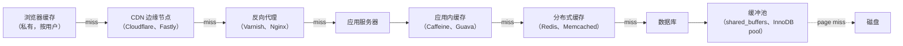
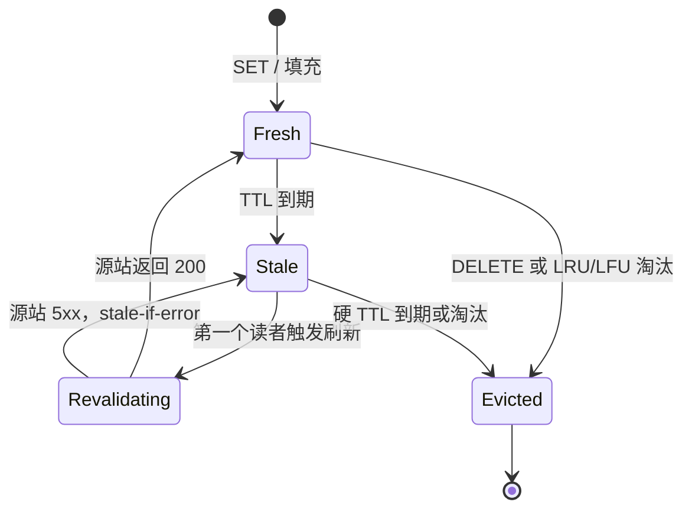
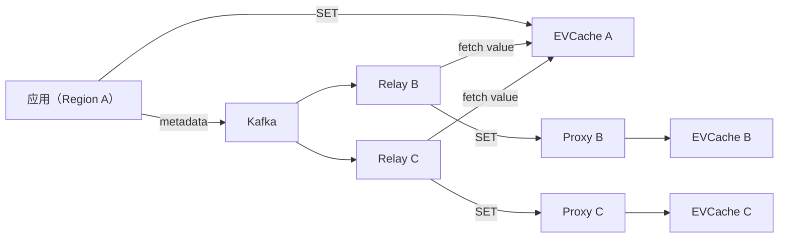
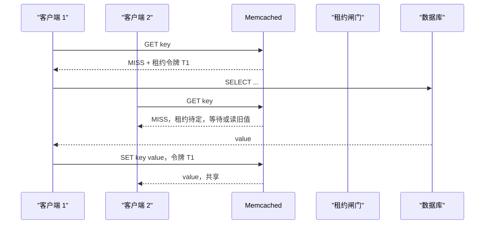

# 缓存：从浏览器到数据库

> **TL;DR**: 缓存用内存和一份有界的陈旧风险，换来 10 倍到 1,000 倍的延迟收益。现代技术栈的每一层都有缓存，从浏览器的 HTTP 缓存到数据库缓冲池。Facebook 的 Memcache 集群横跨数万亿个条目，每秒处理数十亿次请求[^1]。Netflix EVCache 在峰值时跑在 22,000 个服务器实例上，每秒约 4 亿次操作[^2]。默认组合是 cache-aside（旁路缓存），配上带抖动的 TTL 和 single-flight（单飞）合并。缓存失效确实难，因为它本质上是个分布式一致性问题。请用对待复制同等的严谨态度对待它。

## 学习目标

学完本模块，你将能够：

- [ ] 针对给定负载，在 cache-aside、read-through、write-through、write-behind、refresh-ahead 之间做选择
- [ ] 推理缓存失效、TTL 和一致性窗口
- [ ] 防止惊群（thundering herd）、缓存雪崩和热 key 问题
- [ ] 按访问模式挑选淘汰策略（LRU、LFU、TinyLFU）
- [ ] 用命中率、工作集和延迟目标来确定缓存容量
- [ ] 解释分布式缓存（Redis Cluster、mcrouter）如何路由和复制

## 直觉理解

想象一家餐厅的后厨正在忙晚餐档。主厨不会为每盘菜都跑一趟储藏室。她先摆好 **mise en place**（备料台）：几小盒处理好的食材，抬手就能够到。蒜已切末，酱汁已收浓，肉已分份。备料台就是缓存。它用台面空间（内存）换速度（延迟）。哪个盒子空了，副厨就从冷库（源站）补货。菜谱改了，旧的备料就倒掉（失效）。

现在把规模放大。连锁餐厅有中央加工厂（数据库）、区域配送中心（分布式缓存），还有每家门店自己的备料台（应用层缓存）。顾客永远见不到加工厂，他们只看到从最近那个备料台端出来的盘子。连锁店能运转，是因为大多数订单都打在备料台上。一旦打不中，出餐就变慢，小票堆起来，传菜员开始吼人。这就是高负载下的缓存未命中。

你的系统也是这个道理。一次 50 ms 的数据库调用，变成 0.3 ms 的缓存命中。问题从来不是“我该不该缓存”，而是“缓存在层级的哪一层、存多久、怎么安全地失效”。

## 原理

### 缓存层级

一个请求在碰到磁盘之前，最多会穿过六层缓存。每一层都为下面那层挡流量。

*从浏览器到缓冲池，每一层都是缓存；请求在任何一层命中，就短路掉后面所有层。*

浏览器遵守 RFC 9111 里的 `Cache-Control` 指令[^3]。带哈希名的静态资源用 `max-age=31536000, immutable`，拿到一年的新鲜期[^4]。CDN 在边缘缓存，省掉 WAN 往返时间。反向代理（Varnish）把渲染好的页面放在内存里，并支持 grace mode，在重新校验的同时继续供旧内容[^5]。应用内缓存（JVM 上的 Caffeine、Rails 的 fragment cache）存的是反序列化后的对象，零网络跳数。分布式缓存（Redis、Memcached）在无状态的应用服务器之间共享状态。数据库缓冲池（Postgres 建议 `shared_buffers` 设为内存的 25%[^6]）把热页留在内存里，让大多数读都不必碰磁盘。

关键洞察在这里：每一层有自己的 TTL 和一致性模型。浏览器上对不可变资源用长 TTL，应用层对用户特定状态用短 TTL。N 层就意味着 N 个可能残留旧数据的地方，所以每一层都要单独考虑失效。

### 缓存模式

应用、缓存、数据库三者的交互有五种标准模式。

**Cache-aside（旁路缓存，懒加载）。** 应用先读缓存。未命中时从数据库加载、回填缓存、返回结果。写入时更新数据库，再让缓存 key 失效。这是 AWS 的默认做法，因为它能容忍缓存不可用[^7]。Redis 挂了，读请求就落到数据库。

**Read-through（读穿透）。** 缓存库自己在未命中时从数据库加载。应用只调 `get`。Caffeine 的 `LoadingCache` 和 DynamoDB Accelerator（DAX）就是这么工作的[^7]。调用方代码更简单，但缓存从此落在可用性路径上。

**Write-through（写穿透）。** 每次写都同步写到缓存和数据库。保证读己之写一致性，代价是写入延迟翻倍。适合写很少、新鲜度比速度更重要的场景。

**Write-behind（写回）。** 先写缓存，再异步刷进数据库。写入快，数据库压力被批量化。Discord 的 Read States 服务用一个 30 秒的合并窗口批量写 Cassandra[^8]。风险是：缓存写完、数据库还没落盘的时候崩溃，数据就丢了。

**Refresh-ahead（提前刷新，stale-while-revalidate）。** 缓存发现某个 key 快到 TTL，就在过期前于后台刷新它。HTTP 的 `stale-while-revalidate` 指令（RFC 5861）是边缘缓存的标准版本[^9]。读方从不等候，但可能拿到有界的旧数据。

把 cache-aside 当默认。只有需要强读己之写时才伸手去拿 write-through。写量高、能容忍有界数据丢失的场景（计数、指标）用 write-behind。

### 淘汰策略

缓存满了，总得有人被赶出去。淘汰策略决定赶谁。

**LRU（最近最少使用）** 是缓存负载里最常见的淘汰策略。Redis 建议把 `allkeys-lru` 作为大多数缓存的默认选择[^10]。它 O(1)、直观，对访问偏向近期的工作负载足够好。弱点：一次顺序扫描（读 N 个 key，N 超过缓存容量）能把整个热工作集冲干净。

**LFU（最不经常使用）** 偏爱热门 key。Redis 用概率计数器支持 `allkeys-lfu`[^10]。热门条目会一直留着，但没有老化机制的话，过气的热门 key 永远淘汰不掉。

**TinyLFU** 用一个 4 位的 count-min sketch 估算访问频率。只有新条目的估算频率超过被淘汰者的频率，它才被接纳。Caffeine 的实现让 sketch 按每个缓存条目 8 字节增长[^11]。

**W-TinyLFU（Window TinyLFU）** 是 Caffeine 的默认策略。它多加了一个很小的准入 LRU 窗口，让突发的新近访问不会被频率过滤器直接拒掉。Caffeine 报告称，在 Wikipedia 和 ARC 的 trace 上，W-TinyLFU 与 Belady 最优解相差只有几个百分点，且明显优于纯 LRU[^12]。你在 JVM 上就用 Caffeine。你在 Redis 上，频率偏斜的负载用 `allkeys-lfu`，近期偏斜的用 `allkeys-lru`。

### TTL 与陈旧度

TTL（time-to-live，存活时间）限定一个缓存条目被当作新鲜多久。

**绝对 TTL** 在固定时间戳过期。简单、可预测，但同一时间填充的条目会一起过期，造成同步未命中。

**滑动 TTL** 每次访问都重置。热 key 一直活着，冷 key 自然老去。适合会话缓存，但陈旧度的边界更难推理。

**抖动 TTL** 掺入随机噪声：`TTL = base +/- 10%`。一起填充的条目不再一起过期。这是最便宜的雪崩预防手段，任何有多个写入方的缓存都该默认这么做。

**Stale-while-revalidate** 让缓存在异步刷新的同时继续返回旧响应[^9]。Varnish 把它实现成“grace mode”[^5]。读方从不等候，但看到的数据最多老 `grace_window` 秒。

**XFetch**（Vattani、Chierichetti、Lowenstein，2015）按计算耗时和一个 beta 参数，在 TTL 到期前以概率提前重算，可证明地把雪崩压到极罕见[^13]。当你能跟踪每个 key 的计算耗时，就用它。

AWS 建议软 TTL 加硬 TTL 的组合：客户端在软 TTL 时尝试刷新，但如果源站不可用，就继续返回缓存数据直到硬 TTL[^7]。这样后端故障就不会级联成缓存雪崩。

*缓存条目在新鲜、陈旧、重新校验、已淘汰四种状态间流转；TTL 到期和显式失效驱动这些转换。*

### 缓存失效

Phil Karlton 那句俏皮话——“计算机科学里只有两件难事：缓存失效和命名”——就是这类痛苦的通用说法。它难，是因为一致性是个分布式问题：多个缓存副本、多个写入方、时钟偏移、复制延迟。

**写失效（写时删除）。** cache-aside 的默认做法。先更新数据库，再删除缓存 key。下一次读会填入新值。简单，但在写入和删除之间，读方看到的还是旧数据。

**双重删除。** 写之前删一次，写之后再删一次。解决的是这个竞态：并发读方在写入和第一次删除之间把旧数据重新填回了缓存。每次写多一个操作，但把窗口关上了。

**版本化 key。** 在 key 里嵌版本或哈希：`product:v42:123`。失效变成空操作，因为旧 key 会自然老去。所有新读都走新 key。适合很少变更、schema 也不怎么动的不可变数据。

**发布/订阅失效。** 通过 Redis Pub/Sub 或 Kafka 广播失效消息。Netflix EVCache 用一条基于 Kafka 的中继，在 p99 一秒内把缓存变更复制到各个区域[^2]。投递不保证（队列满时 Kafka 会丢弃旧消息），所以要配 TTL 兜底。

**租约（Facebook NSDI 2013）。** 缓存未命中会返回一个 64 位租约令牌。只有租约持有者可以 SET 这个 key。任何并发写入方的失效都会吊销尚未使用的租约。这既挡住了并发下的旧值写入，又把重算限流到每个 key 每 10 ms 一次[^1]。租约是那篇论文里最聪明的想法，也是最容易被误解的。它用一个机制同时解决了惊群和旧值写入的竞态。

### 分布式缓存架构

到了规模，单个缓存节点就不够了。你需要一个集群，还需要决定客户端怎么找到正确的分片。

**客户端分片** 在客户端库里做一致性哈希（Memcached 用 Ketama，Redis Cluster 的哈希槽用 CRC16 mod 16,384）。没有额外跳数，但每个客户端都得知道池成员，不停机加节点还得小心地重新平衡环。

**代理路由**（Facebook 的 mcrouter[^14]、Twemproxy、Envoy）在应用和缓存池之间插一层路由。池管理、一致性哈希、故障切换都集中起来。代价是多一跳网络，而且代理本身成了可用性依赖。

**Redis Cluster** 把成员信息嵌在缓存服务器自己身上。客户端在重新分片期间会收到 `MOVED` 和 `ASK` 重定向。每个分片自带副本，故障切换内建。限制是：多 key 命令必须落在同一个哈希槽里。

**跨区域复制。** Netflix EVCache 在每个区域跑多个 memcached 服务器组，做区域内容错。跨区域复制走 Kafka 管道：客户端把元数据（key，不是 value）写进 Kafka，Replication Relay 从本地缓存取出 value，再送给目标区域的 Replication Proxy[^2]。跨区域复制的峰值超过 100 万 RPS[^2]。

*区域 A 的一次写入把元数据投到 Kafka；各区域的 relay/proxy 组合在几秒内把 value 复制到对等区域。*

## 真实案例

### Facebook 的大规模 Memcache（NSDI 2013）

Facebook 跑着世界上最大的缓存部署之一：每秒数十亿次请求，横跨数万亿个条目，区域内查询的目标 p99 在 1 ms 以下[^1]。系统把原版 memcached 当积木，外面包了一层自研的客户端库和服务端扩展。

**架构。** 每个面向用户的请求都通过 mcrouter 扇出到许多 memcached 分片。客户端对 GET 用 UDP（省 socket），对 SET/DELETE 用 TCP（保可靠）。池跨区域复制，一个主区域加若干从区域。写入会异步失效其他区域的缓存。

**租约机制。** 论文的核心贡献就是租约。缓存未命中时，客户端拿到一个 64 位租约令牌。只有令牌持有者可以 SET 这个 key。如果并发写入方在途中让这个 key 失效，租约被吊销，那次旧值 SET 会被拒绝。此外，每个 key 每 10 ms 只发一个租约，这硬性限制了重算的 QPS，挡住了惊群[^1]。

**旧值扩展。** DELETE 会把 key 标记为陈旧，而不是直接删掉。重算期间读方可以选择读旧数据，效果相当于缓存协议层面的 `stale-while-revalidate`。

**故障处理。** 跨区域流量切换曾引发冷缓存风暴，因为从区域的 memcached 没有那份工作集。修复办法：对一部分热 key 异步复制 SET（不只是 DELETE）来预热从区域。当某个主分片不可达时，一个小型的“gutter”池吸收溢出。

*Facebook 的租约机制：只有租约持有者可以 SET，既挡住旧值写入，又把重算限流到每个 key 每 10 ms 一个调用方。*

教训是：在 Facebook 的规模上，朴素的 cache-aside 会崩。租约、旧值服务和区域预热不是优化项，是必需品。

## 权衡

| 方案 | 优点 | 缺点 | 适用场景 | 我们的选择 |
|---|---|---|---|---|
| Cache-aside | 简单、容忍故障、能配任何 KV 存储 | 竞态下读到旧值，需要显式失效 | 大多数应用的默认 | 默认选择 |
| Read-through | 对应用透明，加载逻辑集中 | 缓存故障等于源站故障，与数据库 schema 耦合 | 库托管的缓存（Caffeine、DAX） | 用 Caffeine 或 DAX 时 |
| Write-through | 强读己之写一致性 | 写入延迟翻倍，缓存必须在线 | 写少且需要新鲜度 | 少用；只用于配置/元数据 |
| Write-behind | 写入快、数据库负载被批量化、吸收尖峰 | 崩溃有丢数据风险，恢复复杂 | 计数器、指标、Discord 式已读状态 | 高写入、可容忍丢失的负载 |
| Refresh-ahead | 对热 key 隐藏数据库延迟，读方不等 | key 变冷就白做，有界陈旧 | 可预测的热集、CDN 边缘 | CDN 上的 HTTP stale-while-revalidate |

## 常见陷阱

> [!WARNING]
> **缓存雪崩（惊群）。** 一个热门 key 过期，N 台服务器同时未命中，一起砸向源站。对策：抖动 TTL 避免同步过期。single-flight 合并（Go 的 `singleflight` 包[^15]）把源站调用压到每进程每 key 一次。在 Facebook 的规模上，租约把重算压到每 key 每 10 ms 一次[^1]。

> [!WARNING]
> **负面缓存投毒。** 对根本不存在的 key 的查询完全绕过缓存，持续产生源站未命中。攻击者可以利用这点压垮你的数据库。对策：用短 TTL（30 到 60 秒）缓存“未找到”结果。在打源站之前加一层 Bloom filter，挡掉明显不存在的 key[^7]。

> [!WARNING]
> **故障切换后的旧数据。** 数据库故障切换会提升一个落后的副本。缓存认为新鲜的数据，现在比新主节点还旧。用户看到写入被回退。对策：给缓存 key 加版本，让旧条目自然老去。接受这段陈旧窗口，或者清掉受影响的 key（小心操作，别引发雪崩）[^7]。

> [!WARNING]
> **双写不一致。** 并行写缓存和数据库（或者先写缓存再写数据库），在任何部分失败下都会出问题。缓存和数据库各说各话，而没有能跨两者的事务。对策：永远先写数据库，再失效缓存。要更强的保证就用 outbox 模式：在同一个事务里写一行 DB 和一行 outbox，然后从 outbox 触发失效。

> [!WARNING]
> **热 key 饱和。** 某一个 key（明星推文、爆款商品）的 QPS 比中位数高出几个数量级，打满单个 Redis 分片。对策：用 key 后缀把热 key 复制到多个分片（`tweet:celebrity:1:shard0`、`...:shard1`）。在分布式缓存前面加一层短 TTL 的本地进程内缓存（Caffeine L1）[^12]。

## 练习

> **Design Challenge:** 你要为一个类 Twitter 平台设计时间线缓存。一位有 1 亿粉丝的明星发了一条推文。几秒内，所有粉丝的时间线都必须体现这条新推文。设计缓存策略：用什么模式、什么 TTL、怎么防止雪崩、怎么处理热 key 问题？

提示

想想扇出问题。你没法同步推送到 1 亿条缓存时间线。考虑混合方案：明星时间线走拉模式（读时合并），再加一层本地缓存吸收热 key 的 QPS。用 single-flight 防止明星自己那条缓存推文上的雪崩。

解答

**模式：cache-aside，对明星走拉式扇出。**

普通用户（粉丝少于 1 万）用推模式扇出：发推时，追加到每个粉丝的缓存时间线。明星（粉丝超过 10 万）推送太贵。改为把明星最近的推文放进一个专用热缓存，读时合并进每个粉丝的时间线。

**热 key 缓解：** 明星的推文 key 会承受数百万 QPS。用 key 后缀把它复制到 8 到 16 个 Redis 分片（`tweet:celeb123:shard0` 到 `...:shard15`）。客户端对读者的用户 ID 做哈希来选分片，把负载摊匀。每台应用服务器上加一个 Caffeine L1 缓存（TTL 1 到 2 秒），吸收同进程内的重复读。

**雪崩预防：** 明星发推时，新推文写进数据库，并 SET 缓存 key（不是失效，因为这是个新条目）。时间线合并用 single-flight：每台应用服务器上第一个读者算出合并结果，该服务器上所有并发读者共享结果。

**TTL 策略：** 明星推文缓存：TTL 5 分钟，带抖动（±30 秒）。时间线合并结果：TTL 10 秒（短，因为变得频繁）。L1 Caffeine 缓存：TTL 1 秒（吸收突发，新鲜度也够）。

**接受的权衡：** 粉丝在 1 到 10 秒内看到明星的推文（最终一致性）。读时合并给每次时间线加载多加 2 到 5 ms 延迟。这可以接受，因为另一条路（推送到 1 亿条时间线）要花几分钟，还会压垮缓存集群。

## 要点回顾

- 缓存是大多数系统里性价比最高的优化。一次 50 ms 的数据库调用变成 0.3 ms 的缓存命中。先量命中率，再谈别的。
- cache-aside 是安全的默认。它能容忍缓存不可用，也能配任何键值存储。只有需要强读己之写时才伸手去拿 write-through。
- 规模上来后雪崩不可避免。抖动 TTL 加 single-flight 合并不是可选项。在 Facebook 的规模上，租约把重算压到每 key 每 10 ms 一次[^1]。
- 失效确实难，因为它是个分布式一致性问题。优先用短 TTL 和版本化 key，而不是精巧的失效方案。
- W-TinyLFU（Caffeine 的默认）在真实 trace 上显著优于 LRU[^12]。在 JVM 上就用 Caffeine。在 Redis 上，频率偏斜的负载选 `allkeys-lfu`。
- 一个离了缓存就跑不起来的服务，已经对缓存上瘾了[^7]。为优雅降级而设计：源站必须扛得住缓存整体重启。
- 层级中每一层都有自己的 TTL 和一致性模型。每一层的陈旧度要独立推理。

## 延伸阅读

- [Scaling Memcache at Facebook (Nishtala et al., NSDI 2013)](https://www.usenix.org/conference/nsdi13/technical-sessions/presentation/nishtala) - 生产级缓存的正典论文；租约、租约限流、旧值写入处理、区域池。设计任何 10 万 QPS 以上的缓存层之前先读它。
- [Caffeine Wiki: Efficiency](https://github.com/ben-manes/caffeine/wiki/Efficiency) - Ben Manes 讲 W-TinyLFU 对 ARC/LIRS/LRU 的 trace 对比；这是“准入策略比淘汰策略更重要”的证据。
- [AWS Builders' Library: Caching challenges and strategies](https://aws.amazon.com/builders-library/caching-challenges-and-strategies/) - 软 TTL/硬 TTL、负面缓存、冷启动上瘾，以及“对缓存上瘾”这个反模式。
- [Caching for a Global Netflix (EVCache team)](https://netflixtechblog.com/caching-for-a-global-netflix-7bcc457012f1) - 峰值 3000 万 req/s、每天 2T、跨区域 Kafka 复制架构。关于全球缓存集群最好的公开描述。
- [TinyLFU: A Highly Efficient Cache Admission Policy (Einziger et al., 2015)](https://arxiv.org/pdf/1512.00727.pdf) - Caffeine 准入策略背后的论文；讲清 count-min sketch，以及为什么频率胜过新近度。
- [Optimal Probabilistic Cache Stampede Prevention (Vattani et al., PVLDB Vol 8, 2015)](https://www.vldb.org/pvldb/vol8/p886-vattani.pdf) - XFetch 算法；可证明最优的提前刷新概率。
- [Why Discord is switching from Go to Rust](https://discord.com/blog/why-discord-is-switching-from-go-to-rust) - 大 LRU 缓存上 GC 引发的延迟尖峰，以及 Rust 重写如何修好它；一个关于缓存大小与垃圾回收的警示故事。
- [Go singleflight package](https://pkg.go.dev/golang.org/x/sync/singleflight) - 重复调用抑制的参考实现；50 行代码挡住雪崩。

## 记忆卡片

**Q:** 什么是 cache-aside，为什么它是默认模式？
**A:** 应用先读缓存；未命中就从数据库加载、回填缓存、返回。写入时更新数据库并让缓存失效。它之所以是默认，是因为能容忍缓存不可用（缓存挂了，读请求就落到数据库）。

**Q:** 说出三种缓存雪崩（惊群）的缓解手段。
**A:** （1）抖动 TTL 避免同步过期。（2）single-flight 合并把源站调用压到每进程每 key 一次。（3）租约（Facebook）把重算压到每 key 每 10 ms 一次，并拒绝旧值 SET。

**Q:** LRU 和 W-TinyLFU 有什么区别？
**A:** LRU 淘汰最近最少使用的条目。W-TinyLFU 用频率 sketch（count-min sketch）当准入过滤器：只有新条目的估算频率超过被淘汰者，它才被接纳。这让它在真实 trace 上接近最优，并且抗扫描污染。

**Q:** 为什么缓存失效被认为是难题？
**A:** 因为它是个分布式一致性问题。多个缓存副本、多个写入方、时钟偏移、复制延迟，意味着不存在“缓存与数据库一致”的某一个瞬间。每种策略都在延迟、正确性和复杂度上做不同的交换。

**Q:** Facebook Memcache 系统里的租约是什么？
**A:** 缓存未命中时返回的一个 64 位令牌。只有令牌持有者可以 SET 这个 key。如果并发写入方让 key 失效，租约被吊销，旧值 SET 被拒绝。租约还起限流作用：每个 key 每 10 ms 只发一个租约。

**Q:** “对缓存上瘾”是什么意思？
**A:** 指一个离了缓存就跑不起来的服务。缓存重启后所有请求同时打到源站，源站就塌了。对策：用软 TTL/硬 TTL、缓存预热和扛得住冷启动的源站容量来做优雅降级。

**Q:** 什么时候该用 write-behind 而不是 cache-aside？
**A:** 写量大、能容忍丢失、并且能从批处理中获益的时候。例子：计数器、指标、Discord 的 Read States（30 秒合并窗口）。风险是缓存写完、数据库还没落盘时崩溃会丢数据。

**Q:** Netflix EVCache 怎么做跨区域复制？
**A:** 客户端把元数据（key，不是 value）写进 Kafka。目标区域的 Replication Relay 消费消息，从源区域缓存取 value，再送给 Replication Proxy 写入目标区域的 EVCache。这样 Kafka 里存的东西很小，复制也不占用写入延迟。

**Q:** 频率偏斜的负载在 Redis 上该用哪种淘汰策略？
**A:** `allkeys-lfu`。它用概率频率计数器偏爱热门 key。近期偏斜的负载（最近访问能预测下次访问）用 `allkeys-lru`。

**Q:** 什么是 stale-while-revalidate 模式？
**A:** 缓存返回旧响应的同时，异步去源站取新值。读方从不等候，但看到的数据最多老 `grace_window` 秒。HTTP 里由 RFC 5861 定义；Varnish 把它实现成“grace mode”。

**Q:** 一个热 key 打满单个 Redis 分片，怎么处理？
**A:** 用 key 后缀把 key 复制到多个分片（例如 `key:shard0` 到 `key:shardN`）。客户端对读者 ID 做哈希来选分片。再加一层 1 到 2 秒 TTL 的本地进程内缓存（Caffeine）作为 Redis 前面的 L1。

**Q:** 什么是负面缓存，什么时候需要它？
**A:** 用短 TTL 缓存“未找到”结果。当对不存在 key 的查询会绕过缓存反复打数据库时，你就需要它。没有它，攻击者可以靠查询永远不会存在的 key 压垮你的源站。

**Q:** 说出缓存层级从用户到磁盘的六层。
**A:** 浏览器缓存、CDN 边缘节点、反向代理（Varnish/Nginx）、应用内缓存（Caffeine/Guava）、分布式缓存（Redis/Memcached）、数据库缓冲池（shared_buffers/InnoDB pool）。

**Q:** XFetch 算法是什么？
**A:** 一种概率式提前刷新策略。TTL 到期之前，每次访问都有一定概率触发后台重算，条目越接近过期概率越高。它让雪崩可证明地变得罕见，而且不需要客户端之间协调。

**Q:** 为什么要给 TTL 加抖动？
**A:** 同一时间填充的条目（比如发版后或缓存预热后）没有抖动就会一起过期，造成同步未命中，砸向源站。给 TTL 加 ±10% 的随机噪声，把过期时间摊开。这是最便宜的雪崩预防手段。

## 参考文献

[^1]: Rajesh Nishtala, Hans Fugal, Steven Grimm, Marc Kwiatkowski et al., "Scaling Memcache at Facebook", USENIX NSDI 2013. https://www.usenix.org/conference/nsdi13/technical-sessions/presentation/nishtala
[^2]: Shashi Madappa, Vu Nguyen, Scott Mansfield et al., "Caching for a Global Netflix", Netflix Technology Blog, 2016 年 3 月 1 日. https://netflixtechblog.com/caching-for-a-global-netflix-7bcc457012f1
[^3]: Fielding, Nottingham, Reschke (eds.), "RFC 9111: HTTP Caching", IETF, 2022 年 6 月. 废弃 RFC 7234. https://datatracker.ietf.org/doc/html/rfc9111
[^4]: MDN Web Docs, "HTTP caching". https://developer.mozilla.org/en-US/docs/Web/HTTP/Caching
[^5]: Varnish Cache Project, "Grace mode and keep", Varnish 用户指南（7.6）. https://varnish-cache.org/docs/7.6/users-guide/vcl-grace.html
[^6]: PostgreSQL Global Development Group, "19.4. Resource Consumption (shared_buffers)", PostgreSQL 文档. https://www.postgresql.org/docs/current/runtime-config-resource.html
[^7]: Matt Brinkley and Jas Chhabra, "Caching challenges and strategies", AWS Builders' Library. https://aws.amazon.com/builders-library/caching-challenges-and-strategies/
[^8]: Jesse Howarth, "Why Discord is switching from Go to Rust", Discord Engineering Blog, 2020 年 2 月 4 日. https://discord.com/blog/why-discord-is-switching-from-go-to-rust
[^9]: Mark Nottingham, "RFC 5861: HTTP Cache-Control Extensions for Stale Content", 2010 年 5 月. https://datatracker.ietf.org/doc/html/rfc5861
[^10]: Redis Ltd., "Key eviction", Redis 文档. https://redis.io/docs/latest/develop/reference/eviction/
[^11]: Gil Einziger, Roy Friedman, Ben Manes, "TinyLFU: A Highly Efficient Cache Admission Policy", 2015. https://arxiv.org/pdf/1512.00727.pdf
[^12]: Ben Manes, "Efficiency", Caffeine Wiki. https://github.com/ben-manes/caffeine/wiki/Efficiency
[^13]: Andrea Vattani, Flavio Chierichetti, Keegan Lowenstein, "Optimal Probabilistic Cache Stampede Prevention", Proceedings of the VLDB Endowment (PVLDB), Vol. 8, No. 8, 2015. https://www.vldb.org/pvldb/vol8/p886-vattani.pdf
[^14]: Facebook/Meta, "mcrouter: a memcached protocol router for scaling memcached deployments". https://github.com/facebook/mcrouter
[^15]: Go Authors, "singleflight: duplicate function call suppression", golang.org/x/sync. https://pkg.go.dev/golang.org/x/sync/singleflight
