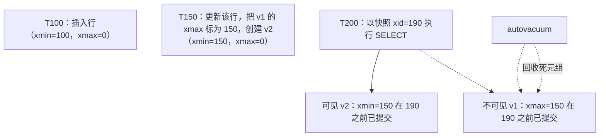
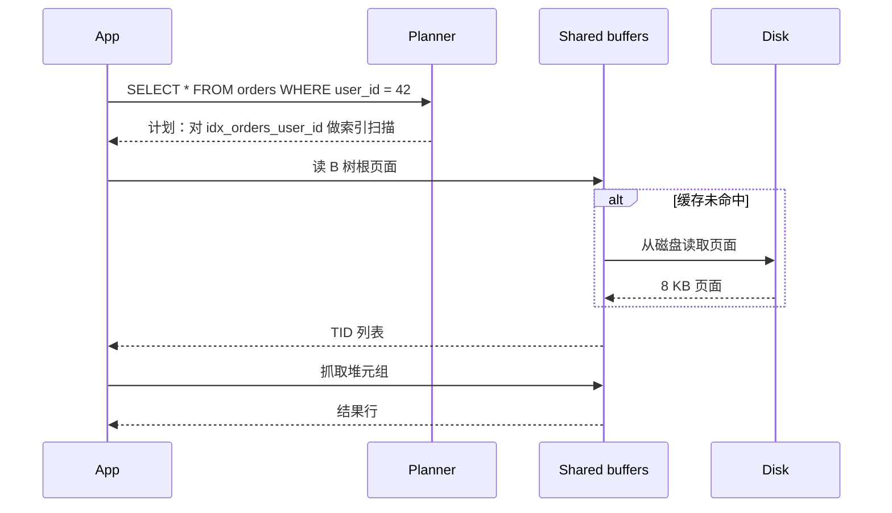
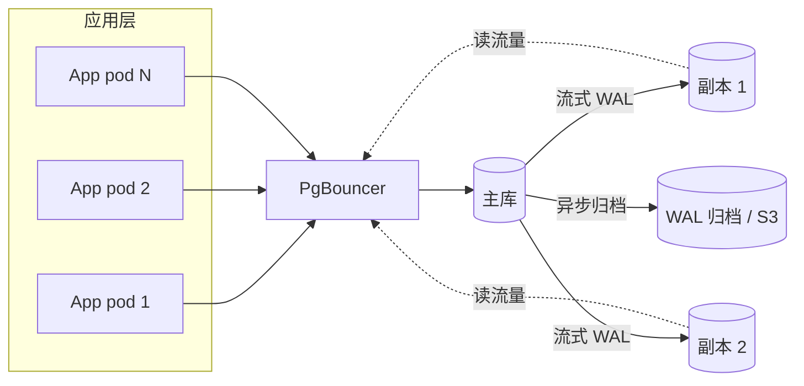
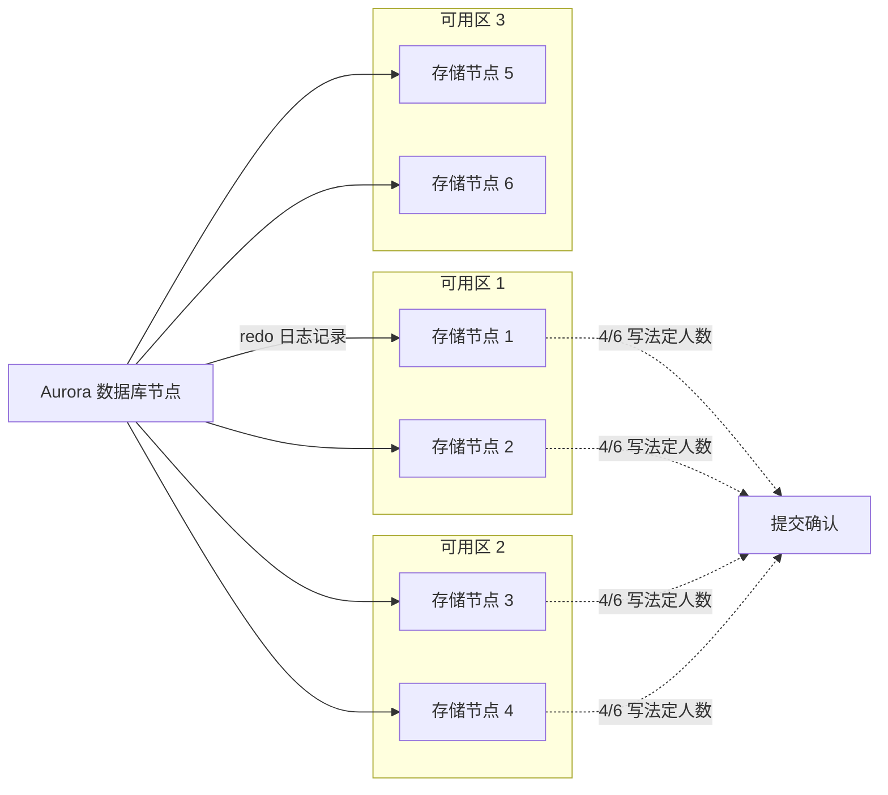

# SQL 数据库：无聊但胜出的技术

> **TL;DR**: Dan McKinley 在 2015 年写下“选择无聊的技术”，而 SQL 数据库正是仍然胜出的、最无聊的那一个。PostgreSQL 是专业开发者中使用最多的数据库（2025 年 Stack Overflow 调查中占 55.6%[^1]），Aurora MySQL 在单台实例上跑到每秒 20 万次写入[^2]，一台 GCP `c3-highmem-176` 给你 176 个 vCPU 和 1,408 GB 内存，月费不到 $9K[^3]。纵向扩展比你想的走得更远。非到万不得已不要分片。先把无聊的部分练熟：索引、连接池、VACUUM 和查询计划器。

## 学习目标

学完本章，你将能够：

- [ ] 解释 B 树和 WAL 如何同时给你持久、快速的读写
- [ ] 读懂 `EXPLAIN ANALYZE` 的执行计划，找出缺失的索引和糟糕的连接
- [ ] 根据你的负载无法容忍哪些异常现象来选择隔离级别
- [ ] 针对给定负载在 PostgreSQL、MySQL 和分布式 SQL 引擎之间做选择
- [ ] 为一个数据库做容量规划，并预判纵向扩展何时会撞墙
- [ ] 设计一套连接池策略，避免后端进程被耗尽

## 直觉理解

把 SQL 数据库想成一个带交叉索引和索引标签的档案柜。每个抽屉都有标签（表），每个文件夹都有标签条（主键），你还为最常跑的查询额外做了索引标签（二级索引）。桌上有一本台账，任何变更都先在台账上记一笔再归档（预写日志），所以就算大楼烧了，你重放台账也不会丢东西。

这个档案柜还实行复式记账：每个事务要么完整完成，要么不留痕迹。两个职员可以同时读同一个文件夹，因为各自拿到的是自己开始干活那一刻的版本的复印件（MVCC）。但复印件会越堆越多，必须定期有人把旧的碎掉（VACUUM）。

这套系统支撑了银行业、电商和 SaaS 四十年。它无聊、它正确，而且它几乎肯定是你下一个项目的正确默认选择。

## 原理

### 为什么 SQL 在 2026 年仍然胜出

在 Stack Overflow 2025 开发者调查中，PostgreSQL 连续第三年成为使用最多、最受推崇、最被想要的数据库，55.6% 的专业开发者在使用它。[^1] DB-Engines 把 2024 年度 DBMS 的第二名给了它，仅次于 Snowflake。[^4] Werner Vogels 称 Aurora 是“AWS 历史上增长最快的服务”。[^5]

为什么？因为 SQL 数据库把四十年的工程积累复利成了一个二进制文件。你一次拿到 ACID 事务、基于成本的查询优化器、流式复制、全文检索、地理空间查询、JSON 存储，以及一个扩展生态。没有别的数据存储品类能在不额外拼三个系统的情况下提供这种广度。

“Just use Postgres”这个梗是市场事实。Kelsey Hightower 说得很直白：“Use Postgres for everything.” Gergely Orosz 观察到，大多数融到 B 轮的创业公司仍然跑在一个 Postgres 实例上。无聊的选择会复利。

### ACID 内部机制

每个 SQL 数据库都靠两套机制实现 ACID：预写日志（WAL）和多版本并发控制（MVCC）。

**WAL 与持久性。** 每次变更都往 WAL 追加一条 redo 记录，并在返回 `COMMIT OK` 之前调用 `fsync`。[^6] 数据页在检查点时才懒懒地更新。共享同一个 fsync 窗口的多个事务会走组提交，把约 1 ms 的刷盘成本摊到几十次提交上。[^7] Postgres 的 WAL 段默认 16 MB；InnoDB 跑两份日志（redo log 用于崩溃恢复，binlog 用于复制）。[^8]

**MVCC 的实现各不相同。** Postgres 把旧行版本原地留在堆里。每个元组带着 `xmin`（创建它的事务 ID）和 `xmax`（删除/更新它的事务 ID）。每次查询做一次可见性检查，决定这个快照能看到哪些版本。[^9][^10] 死元组不断累积，直到 `VACUUM` 把它们回收。[^11]

InnoDB 则把当前版本原地保留，把旧版本推到 undo log。一致性读沿着 undo 链往回走，重建出快照。[^12] 这意味着更新更便宜（未改动的列不用更新二级索引），但长事务会让 undo 表空间膨胀。

**隔离级别。** Postgres 实现了三个真正的级别：[^13]

| 级别 | 防止的异常现象 | 机制 |
|-------|--------------------:|-----------|
| 读已提交（默认） | 脏读 | 每条语句一个新快照 |
| 可重复读（= 快照隔离） | 加上不可重复读、幻读 | 整个事务共用一个快照 |
| 可串行化（= SSI） | 加上写偏斜 | 运行时环检测，冲突时以 SQLSTATE 40001 中止 |

2020 年 Jepsen 发现 Postgres 12.3 的可串行化级别仍允许 G2-item 异常——这个 bug 从 9.1 引入 SSI 时就存在，已经潜伏了九年。[^14] 教训是：选一个级别、相信引擎，但要测你自己的不变式。



*每个堆元组都带着 xmin/xmax；快照决定可见性，VACUUM 稍后回收那些不可见的版本。*

### 索引

索引是一种辅助数据结构，把 O(n) 的扫描变成 O(log n) 的查找。Postgres 内置六种类型，外加 `bloom` 扩展：[^15]

- **B 树**（默认）：标量上的等值与范围查询，支持 `ORDER BY`。主力选手。
- **Hash**：只支持等值。自从 Postgres 10 让 hash 索引写 WAL 之后，它已经很少比 B 树更好用。
- **GIN**（通用倒排索引）：每个元素一条记录。用于数组、`tsvector` 全文检索和 `jsonb`。读快写慢。
- **GiST**（通用搜索树）：空间数据（PostGIS）、三元组相似度、范围类型。最近邻查询表现好。
- **SP-GiST**（空间分区 GiST）：四叉树、k-d 树、基数树这类非平衡结构；适合点数据和前缀搜索。
- **BRIN**（块范围索引）：按一段堆页记录最小/最大值。磁盘占用极小，但只有当物理顺序与被索引顺序相关时才有效（比如只追加的时序数据）。
- **Bloom**（扩展）：多列布隆过滤器，对低基数列的任意子集做等值判断。

**复合索引**遵循最左前缀规则：`(a, b, c)` 上的索引能服务 `WHERE a = ?` 和 `WHERE a = ? AND b = ?`，但单独 `WHERE b = ?` 用不上。[^16]

**覆盖索引**（`CREATE INDEX ... INCLUDE (col)`) 加上载荷列，让查询只靠索引就能出结果（index-only scan），不必回表抓取堆元组。[^17] Instagram 用部分索引和函数索引只给高价值行和键前缀建索引，索引体积最多缩小到原来的 1/10。[^18]

**代价。** 每个索引都是一笔写税。热 OLTP 表上 3 到 6 个索引是常态；再往上，写入会明显变慢。[^19] 一张有 12 个索引的表，每次 INSERT 要写 13 条物理记录（一个堆元组加 12 条索引项），每条都要写 WAL。

### 查询优化器

计划器给每个候选计划打一个抽象单位的成本（`seq_page_cost = 1.0`、`random_page_cost = 4.0`、`cpu_tuple_cost = 0.01`），然后挑最便宜的那个。[^20] 它在三种连接算法里做选择：

- **嵌套循环**：扫外表，探测内表。外表小且内表有索引时很便宜。
- **哈希连接**：在较小的一侧建哈希表，用较大的一侧去探测。大表等值连接的最佳选择。
- **归并连接**：两侧预先排好序，齐步走。通常由索引扫描喂数据。



*一次典型的索引扫描：沿 B 树穿过缓冲区缓存下降，然后回表抓堆元组（除非是覆盖索引）。*

**常见陷阱：**

- 统计信息过期会让计划器算错选择率。批量导入后记得跑 `ANALYZE`。[^20]
- `random_page_cost = 4.0` 是机械硬盘时代的老假设。在 SSD 上应调低。
- 参数嗅探：第一次绑定的参数值会被固化进预备好的计划。数据分布倾斜时，后续调用会拿到病态的计划。[^20]
- `pg_stat_statements` 是生产环境第一个该打开的扩展。它把归一化后的 SQL 按总耗时、调用次数和平均执行时间聚合起来。[^21]

### 复制

**Postgres 流式复制**通过一条长连接把 WAL 送给备库。默认异步（延迟几十到几百毫秒）；设置 `synchronous_standby_names` 后转为同步（提交会阻塞，直到至少一个备库把 WAL 持久落盘）。[^22] 逻辑复制把 WAL 解码成行级变更事件，这正是 Debezium CDC 的基础。[^23]

**MySQL** 默认异步（副本主动拉取 binlog 事件）。半同步保证至少一个副本收到事件之后主库才确认。Group Replication 跑一个 Paxos 变体，在最多九个成员间做近乎同步的、基于认证的复制。[^24]

**Aurora** 把复制层整个重写了。写入是 redo 日志记录，被发给一个多租户的存储集群：跨三个可用区六份副本，写操作在 4/6 法定人数上成功，读在 3/6 上成功。[^26] SIGMOD 2017 论文报告吞吐量最高是原生 MySQL 的 5 倍。[^25] 故障切换在一分钟内完成，因为副本共享存储。



*经典的 Postgres 部署形态：PgBouncer 吸收连接风暴，副本扛读扩展，WAL 归档提供按时间点恢复。*

### Postgres 的超能力

这些特性让团队用 Postgres 一个系统替掉另外三个：

- **JSONB** 加 GIN 索引：在 ACID 数据库里做模式灵活的文档存储。
- **全文检索**：`tsvector` + GIN 索引 + `ts_rank_cd`。对大多数本来要去上 Elasticsearch 的应用来说够用。
- **PostGIS**：地理空间类型、基于 GiST 的 R 树，开源 GIS 数据库的标杆。
- **逻辑解码**：WAL 到事件的流，CDC 管道的基础。
- **扩展**：TimescaleDB（时序）、`pgvector`（HNSW 向量检索）、外部数据包装器。

### 扩展上限

纵向扩展比工程师预期的走得更远。一台 GCP `c3-highmem-176` 是 176 个 vCPU 和 1,408 GB 内存。[^3] Aurora MySQL 在单台 r4 实例上跑到每秒 20 万次写入。[^2] 很多人分片的 OLTP 负载，其实从来没被逼到那一步。

**连接池是必须的。** 每个 Postgres 连接都会 fork 一个后端进程，在活跃负载下通常吃 5 到 10 MB 内存。`max_connections` 默认是 100。[^27] 到 500 个连接时光连接开销就烧掉好几个 GB。PgBouncer（每个客户端 2 kB）把成千上万个应用连接以事务模式池化到几十个服务器连接上。[^28]

**什么时候该离开 SQL：**

- 每秒数百万次操作的纯键值负载（用 Redis 或 DynamoDB）
- 大体量、写密集、能容忍最终一致性的时序数据（用 ClickHouse 或 TimescaleDB）
- Instagram 规模的 Feed 扇出（扇出层用 Cassandra，权威数据放 Postgres）
- 需要全局强一致又不想自己做分片运维（CockroachDB 或 Spanner，但每次写都要付共识往返的代价[^29]）



*Aurora 把 redo 日志记录（而不是数据页）发给跨三个可用区的六个存储节点；4/6 的写法定人数意味着任意单个可用区故障都不会阻塞提交。*

## 真实案例

**Figma：三年内从一个 Postgres 实例走到水平分片。**

2020 年，Figma 跑在单个 RDS Postgres 实例上，峰值 CPU 到 65%。从 2020 到 2024 年，他们的数据库集群规模大约涨了 100 倍。[^31]

**第一阶段：纵向拆分（2020 到 2022）。** 把相关联的表组（“Figma 文件”“组织”）迁到独立的物理数据库上，每个前面挂 PgBouncer。到 2022 年底，Figma 有了十几个按业务纵向拆分的 Postgres 数据库。有些表到了几十亿行、好几 TB，接近 Aurora/RDS 的 IOPS 上限。[^30]

**第二阶段：水平分片（2023 到 2024）。** Figma 写了 DBProxy，一个跑在应用和 PgBouncer 之间的 Go 服务。DBProxy 把 SQL 解析成 AST，抽出分片键（UserID、FileID、OrgID），单分片查询直接路由，跨分片查询则做散射-聚合。[^31] 他们用哈希路由，避免自增 ID 带来的热点。

关键的创新是用 Postgres 视图做“逻辑分片”：

```sql
CREATE VIEW table_shard1 AS
SELECT * FROM table
WHERE hash(shard_key) >= min_range
  AND hash(shard_key) <  max_range;
```

这样他们能在真正做风险更高的物理拆分之前，用一个配置开关（回滚只需几秒）先验证分片路由。第一张水平分片的表在 2023 年 9 月上线，造成约 10 秒的主库可用性部分受损，副本零影响。[^31]

**为什么留在 Postgres：** Figma 评估过 CockroachDB、TiDB、Spanner 和 Vitess。他们选择自研 DBProxy，因为纵向扩展还有几个月的余量，而在一个全新的引擎上重建领域专长，比在他们已经吃透的系统之上加一层路由更冒险。[^31]

## 权衡

| 方案 | 优点 | 缺点 | 适用场景 | 我们的选择 |
|----------|------|------|-----------|----------|
| PostgreSQL | 功能丰富（GIN、JSONB、PostGIS、扩展），严格的 MVCC，优化器强 | VACUUM 复杂，一连接一进程 | 新系统的默认选择 | **是，除非你有明确理由不用** |
| MySQL / InnoDB | 无处不在，Aurora + Vitess + ProxySQL，单连接开销更低 | 默认配置更弱（RR 间隙锁），数据类型更少 | 既有资产、高写 OLTP、规模化 Rails | 当团队已经熟悉它时 |
| Amazon Aurora | 存储解耦，故障切换快，吞吐最高达 MySQL 的 5 倍[^25] | 绑定 AWS，单 GB 成本更高，共识带来提交延迟地板 | 你在 AWS 上且需要托管的扩展能力 | 当运维简单性比成本更重要时 |
| CockroachDB / Spanner | 水平扩展的 SQL，跨地域强一致 | 每次写都要付共识往返，单地域 Postgres 不用付[^32] | 全局事务，且分片运维成本高于延迟成本 | 只有确实需要跨地域写时 |

## 常见陷阱

> [!WARNING]
> **外键缺索引。** Postgres 不会自动在外键列上建索引。删除父行时会触发对子表的全表扫描来检查引用完整性。每个外键都要跑 `CREATE INDEX CONCURRENTLY ON child (fk_col)`。[^16]

> [!WARNING]
> **N+1 查询。** 你的 ORM 先取 100 个用户，然后为每个用户各跑一次查询取他们的帖子。这就是 101 次往返。用 `JOIN`、`IN (...)` 或 DataLoader 式的批处理。用 `pg_stat_statements` 检测——它会显示成批出现的、几乎一模一样的查询。

> [!WARNING]
> **统计信息过期。** 计划器的水平取决于它的统计信息。批量导入或大批删除之后，对受影响的表跑 `ANALYZE`。基数估计错 10 倍就足以让计划从索引扫描翻成顺序扫描，把 1 ms 的查询变成 500 ms。[^20]

> [!WARNING]
> **参数嗅探。** 第一次见到的绑定值会被固化进预备计划。如果你的数据是倾斜的（一个用户有 1000 万行，大多数只有 100 行），缓存下来的计划对某一群数据就是病态的。对热查询用 `plan_cache_mode = 'force_custom_plan'` 解决。[^20]

> [!WARNING]
> **连接数不设限。** 500 个直连 Postgres 的连接，光后端进程就能烧掉好几个 GB 内存。永远用事务池化模式的 PgBouncer。设置 `idle_in_transaction_session_timeout` 杀掉游离会话。[^27][^28]

> [!WARNING]
> **忘了 VACUUM。** 每次 UPDATE 和 DELETE 都会累积死元组。如果 autovacuum 跟不上（长事务会把 xmin 水位钉住），表就会膨胀，并且在 20 亿个事务 ID 处有事务 ID 回卷的风险——那时 Postgres 会拒绝所有写入以保护数据完整性。Notion 2021 年的分片正是被这件事逼出来的。[^33][^11]

## 练习

你在一台 `db.r6i.4xlarge` 上跑一个 SaaS CRM，单实例 Postgres。`orders` 表有 1 亿行。夜间分析报表会锁住关键表，p99 写延迟从 5 ms 爬到了 80 ms。设计一份诊断与整改方案，覆盖索引、分区、只读副本、连接池，以及何时该考虑分片。

<details>
<summary>提示</summary>

先用 `pg_stat_statements` 找按总耗时排前几名的查询。查 `pg_stat_user_tables` 找出 `n_dead_tup` 高的表（VACUUM 跟不上了）。看 `pg_stat_activity` 里来自分析负载的长事务，它们可能在钉住 xmin 水位。

</details>

<details>
<summary>参考答案</summary>

**第 1 步：诊断。**

```sql
-- 按总耗时排名的查询
SELECT query, calls, mean_exec_time, total_exec_time
FROM pg_stat_statements ORDER BY total_exec_time DESC LIMIT 10;

-- 有 VACUUM 欠账的表
SELECT relname, n_dead_tup, last_autovacuum
FROM pg_stat_user_tables WHERE n_dead_tup > 100000;

-- 长事务（分析负载的元凶）
SELECT pid, state, age(clock_timestamp(), xact_start) AS duration, query
FROM pg_stat_activity WHERE state != 'idle' ORDER BY duration DESC;
```

**第 2 步：速赢项。**

- 按最热的“按客户查订单”模式加复合索引：`CREATE INDEX CONCURRENTLY idx_orders_customer_date ON orders (customer_id, created_at DESC);`
- 如果热查询只需要少数几列，加覆盖索引：`CREATE INDEX ... INCLUDE (status, total_cents);`
- 如果还没有，部署事务池化模式的 PgBouncer，服务器连接数限制在 50 到 80。
- 设置 `idle_in_transaction_session_timeout = '30s'`，杀掉游离的分析会话。

**第 3 步：隔离分析负载。**

- 把夜间报表路由到专用的只读副本。这样长快照查询就从主库移走了，VACUUM 得以回收死元组。
- 如果报表需要比异步复制更新的数据，用逻辑复制送到一个专门的分析实例。

**第 4 步：必要时分区。**

- 如果 `orders` 以追加为主且查询按日期过滤，用声明式范围分区（`PARTITION BY RANGE (created_at)`），按月切分。这样 VACUUM 可以按分区跑，也能享受分区裁剪。

**第 5 步：什么时候分片。**

- 如果做完以上所有事，写吞吐仍然打满主库（在能买到的最大实例上持续 >50K TPS），考虑按 `customer_id` 做应用层分片。照 Figma 的打法：先做视图逻辑分片，再做物理拆分。
- 如果你需要全局强一致又不想自己做分片运维，评估 CockroachDB，但要接受共识往返带来的写惩罚。

**接受的权衡：** 这套方案优先考虑运维简单性。每一步都可回滚。分片是最后手段，因为它是一个 9 到 18 个月的项目，会砸掉跨分片的连接和事务。

</details>

## 要点回顾

- PostgreSQL 或 MySQL 能解决生产 OLTP 99% 的问题。挑一个，钻深。
- 每个索引都加速一种查询形态、拖慢所有写入。热表上 3 到 6 个是甜点区。
- 单主库的纵向扩展比工程师预期的走得更远：176 个 vCPU、1.4 TB 内存、Aurora 上每秒 20 万次写入。
- 连接池（事务模式的 PgBouncer）是必须的。默认的 100 个连接远远不够。
- VACUUM 不是可选项。长事务是健康 Postgres 的敌人。
- 隔离级别是你和代码之间的契约。大多数负载用读已提交，涉及钱的用可串行化。
- 非到万不得已不要分片。Notion 在一个实例上先扛了四个数量级的增长。

## 延伸阅读

- [PostgreSQL Documentation (current)](https://www.postgresql.org/docs/current/) - 本章每个论断的出处；先读第 11 章（索引）、第 13 章（并发）和第 30 章（WAL）。
- [Use The Index, Luke!](https://use-the-index-luke.com/) by Markus Winand - 与具体数据库无关的 SQL 索引经典入门；“Concatenated Indexes”一章讲复合索引的列顺序，比任何其他资料都清楚。
- [Amazon Aurora SIGMOD 2017 paper](https://www.amazon.science/publications/amazon-aurora-design-considerations-for-high-throughput-cloud-native-relational-databases) - 由设计者本人讲解“只把 redo 发往存储”的模型；理解存储解耦的必读材料。
- [Jepsen: PostgreSQL 12.3 (Kingsbury, 2020)](https://jepsen.io/analyses/postgresql-12.3) - 那个潜伏九年的 SSI bug 的故事；提醒你“可串行化”是一个需要验证的声明，不是可以盲信的保证。
- [Notion: Sharding Postgres at Notion (2021)](https://www.notion.com/blog/sharding-postgres-at-notion) - 应用层分片的标杆案例：480 个逻辑分片、把 VACUUM 当作推动力，以及为什么 480 这个数有很多因数。
- [Figma: How Figma's databases team lived to tell the scale (2024)](https://www.figma.com/blog/how-figmas-databases-team-lived-to-tell-the-scale/) - DBProxy、逻辑分片与物理分片之别，以及为什么决定留在 Postgres 而不迁到分布式 SQL。
- [GitHub: Partitioning GitHub's relational databases (2021)](https://github.blog/engineering/infrastructure/partitioning-githubs-relational-databases-scale/) - 模式域、ProxySQL、Vitess，以及如何把 950K QPS 拆到 50 多个集群上。
- [Designing Data-Intensive Applications, Ch. 3, 7, 8](https://dataintensive.net/) - Kleppmann 对存储引擎、事务和分布式故障的处理；本章的教科书搭档。

## 记忆卡片

**Q:** Postgres 的默认隔离级别是什么，它允许哪些异常现象？
**A:** 读已提交。它允许不可重复读、幻读和写偏斜。每条语句看到一个新快照，但同一事务里的两条语句可能看到不同的数据。

**Q:** Postgres 的 MVCC 与 InnoDB 的 MVCC 有什么不同？
**A:** Postgres 把旧版本原地留在堆里（需要 VACUUM 回收）。InnoDB 把最新版本原地保留，把旧版本推到 undo log（需要 undo purge）。Postgres 付的是膨胀风险，InnoDB 付的是一致性读时遍历 undo 链的代价。

**Q:** 复合索引的最左前缀规则是什么？
**A:** (a, b, c) 上的索引能服务按 a、a+b、a+b+c 过滤的查询，但单独的 b 或单独的 c 不行。索引首先按第一列排序。

**Q:** 为什么生产环境的 Postgres 必须有连接池？
**A:** Postgres 每个连接 fork 一个后端进程，每个吃 5 到 10 MB。默认 max_connections 是 100。事务模式的 PgBouncer 让成千上万个应用连接共享几十个真实后端，每个客户端只占 2 KB。

**Q:** 是什么触发了 Notion 2021 年的 Postgres 分片？
**A:** 长事务导致 VACUUM 停滞，事务 ID 消耗逼近 20 亿的回卷边界。届时 Postgres 会拒绝所有写入以保护数据完整性。

**Q:** Aurora 与原生 MySQL/Postgres 的复制有什么不同？
**A:** Aurora 把 redo 日志记录（而不是数据页）发给跨三个可用区、六个节点的共享存储集群。写操作在 4/6 法定人数上成功。副本共享存储，所以故障切换不需要拷数据，一分钟内完成。

**Q:** 什么时候该选 CockroachDB 或 Spanner 而不是 Postgres？
**A:** 当你需要跨多个地理区域的强一致、又不想自己做分片运维时。代价是每次写都有共识往返，这给提交延迟设了个地板。

**Q:** 什么是写偏斜，哪个隔离级别能防止它？
**A:** 两个事务各自读一个条件，各自基于它写入，都提交成功，而组合结果违反了一条它们单独都没有破坏的不变式。只有可串行化（Postgres 里是 SSI）能防止它。

**Q:** `pg_stat_statements` 能给你看什么？
**A:** 按总执行时间、调用次数、平均耗时和返回行数聚合的归一化 SQL 语句。它是生产环境第一个该打开的扩展，用来定位慢查询。

**Q:** 为什么 Figma 选择自研 DBProxy 而不是迁到 CockroachDB？
**A:** 他们纵向扩展还有几个月的余量，而在新引擎上重建领域专长，比在已经吃透的 Postgres 之上加一层路由更冒险。他们看重回滚安全（配置开关几秒内回退），胜过分布式 SQL 的特性。

**Q:** 什么是覆盖索引，什么时候该用？
**A:** 覆盖索引通过 `INCLUDE (col)` 包含查询需要的所有列，从而走 index-only scan、完全跳过堆。当 EXPLAIN 显示某个热的读密集查询在回表时用它。

**Q:** Aurora 如何做到最高 5 倍于 MySQL 的吞吐？
**A:** 只把 redo 日志记录发往存储（而不是完整数据页），消除了检查点和双写缓冲的开销。存储集群独立地应用日志并物化页面。

**Q:** 2026 年单台 Postgres 实例的实际纵向上限是多少？
**A:** GCP c3-highmem-176 提供 176 个 vCPU 和 1,408 GB 内存。Aurora MySQL 在单台 r4 实例上演示过每秒 20 万次写入。大多数 OLTP 负载根本不需要超过这个量级。

**Q:** SQL 计划器可以在哪三种连接算法中选？
**A:** 嵌套循环（每个外表行探测一次内表，外表小 + 内表有索引时最好）、哈希连接（在较小的一侧建哈希表，大表等值连接最好）、归并连接（两侧预排序，齐步走）。

**Q:** 如果 VACUUM 跟不上死元组的产生会怎样？
**A:** 表和索引膨胀（浪费磁盘、拖慢扫描），事务 ID 消耗逼近 20 亿的回卷边界。到那时 Postgres 进入“紧急 autovacuum”模式，最终会拒绝所有写入以防止数据损坏。

## 参考文献

[^1]: Stack Overflow 2025 Developer Survey, "Databases"（PostgreSQL 在专业开发者中占 55.6%，连续第三年第一）. https://survey.stackoverflow.co/2025/technology/#most-popular-technologies-database
[^2]: AWS News, "Amazon Aurora (MySQL) Doubles Maximum Write Throughput with Support for R4 Instances"（每秒 20 万次写入）. https://aws.amazon.com/about-aws/whats-new/2017/10/amazon-aurora-mysql-doubles-maxiumum-write-throughput-with-support-for-r4-instances/
[^3]: Cloudprice/Vantage 上 GCP c3-highmem-176 的实例规格（176 vCPU、1,408 GB 内存）. https://instances.vantage.sh/gcp/c3-highmem-176
[^4]: DB-Engines, "Snowflake is the Database Management System of the Year 2024". https://db-engines.com/en/blog_post/109
[^5]: Werner Vogels, "Weekend Reading: Amazon Aurora", All Things Distributed, 2017. https://www.allthingsdistributed.com/2017/05/amazon-aurora-design-considerations.html
[^6]: PostgreSQL Documentation, "Write-Ahead Logging (WAL)". https://www.postgresql.org/docs/current/wal-intro.html
[^7]: PostgreSQL Documentation, "WAL Internals". https://www.postgresql.org/docs/current/wal-internals.html
[^8]: MySQL 8.0 Reference Manual, "The InnoDB Storage Engine". https://dev.mysql.com/doc/refman/8.0/en/innodb-storage-engine.html
[^9]: "PostgreSQL MVCC, byte by byte"（boringsql）. https://boringsql.com/posts/postgresql-mvcc-byte-by-byte/
[^10]: PostgreSQL Wiki, "Hint Bits". https://wiki.postgresql.org/wiki/Hint_Bits
[^11]: Google Cloud, "Deep dive into PostgreSQL VACUUM garbage collector", 2023. https://cloud.google.com/blog/products/databases/deep-dive-into-postgresql-vacuum-garbage-collector
[^12]: MySQL 8.0 Reference Manual, "InnoDB Multi-Versioning". https://dev.mysql.com/doc/refman/8.0/en/innodb-multi-versioning.html
[^13]: PostgreSQL Documentation, "13.2. Transaction Isolation". https://www.postgresql.org/docs/current/transaction-iso.html
[^14]: Kyle Kingsbury (Jepsen), "PostgreSQL 12.3", 2020. https://jepsen.io/analyses/postgresql-12.3
[^15]: PostgreSQL Documentation, "Index Types". https://www.postgresql.org/docs/current/indexes-types.html
[^16]: PostgreSQL Documentation, "Multicolumn Indexes". https://www.postgresql.org/docs/current/indexes-multicolumn.html
[^17]: PostgreSQL Documentation, "Index-Only Scans and Covering Indexes". https://www.postgresql.org/docs/current/indexes-index-only-scans.html
[^18]: Instagram Engineering, "Handling Growth with Postgres: 5 Tips From Instagram", 2013. https://web.archive.org/web/20240126214634/https://instagram-engineering.com/handling-growth-with-postgres-5-tips-from-instagram-d5d7e7ffdfcb
[^19]: Postgres.ai, "Over-indexing"（讲 HOT 更新与写放大）. https://postgres.ai/docs/postgres-howtos/performance-optimization/indexing/over-indexing
[^20]: PostgreSQL Documentation, "Using EXPLAIN" and "Query Planning". https://www.postgresql.org/docs/current/using-explain.html
[^21]: PostgreSQL Documentation, "pg_stat_statements". https://www.postgresql.org/docs/current/pgstatstatements.html
[^22]: PostgreSQL Documentation, "High Availability, Load Balancing, and Replication". https://www.postgresql.org/docs/current/high-availability.html
[^23]: Debezium Documentation, "Debezium connector for PostgreSQL". https://debezium.io/documentation/reference/stable/connectors/postgresql.html
[^24]: MySQL 8.0 Reference Manual, "Semisynchronous Replication" and "Group Replication". https://dev.mysql.com/doc/refman/8.0/en/replication-semisync.html
[^25]: AWS, "Amazon Aurora Features - Performance"（5 倍 MySQL、3 倍 Postgres 的 SysBench 说法）. https://aws.amazon.com/rds/aurora/features/
[^26]: Verbitski et al., "Amazon Aurora: Design Considerations for High Throughput Cloud-Native Relational Databases", SIGMOD 2017. https://www.amazon.science/publications/amazon-aurora-design-considerations-for-high-throughput-cloud-native-relational-databases
[^27]: PlanetScale, "Scaling Postgres connections with PgBouncer". https://planetscale.com/blog/scaling-postgres-connections-with-pgbouncer
[^28]: PgBouncer Documentation, "Features"（默认每连接 2 kB）. https://www.pgbouncer.org/features.html
[^29]: CockroachDB Docs, "Multi-Region Overview and Topology Patterns". https://www.cockroachlabs.com/docs/stable/topology-development
[^30]: Figma Blog, "The growing pains of database architecture", 2023. https://www.figma.com/blog/how-figma-scaled-to-multiple-databases/
[^31]: Figma Blog, "How Figma's databases team lived to tell the scale", 2024. https://www.figma.com/blog/how-figmas-databases-team-lived-to-tell-the-scale/
[^32]: CockroachDB blog, "CockroachDB Resilience Enhanced in 25.2"（单地域 9 节点基准约 63K tpmC）. https://cockroachlabs.com/blog/cockroachdbs-resilience-25-2
[^33]: Notion, "Herding elephants: Lessons learned from sharding Postgres at Notion", 2021. https://www.notion.com/blog/sharding-postgres-at-notion
