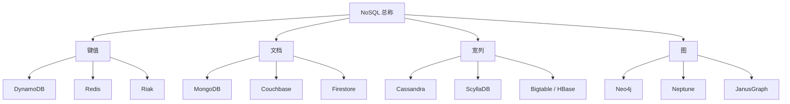
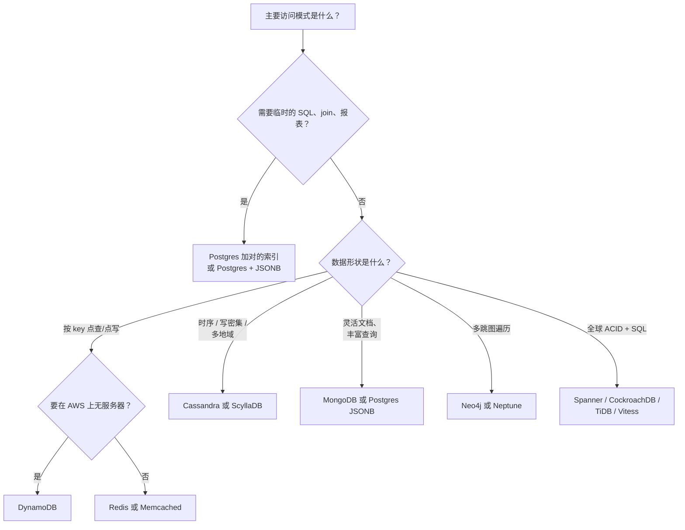
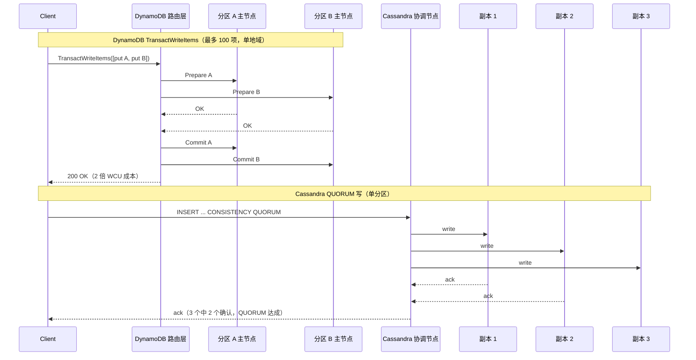

# NoSQL 数据库：选对非关系型工具

> **TL;DR**: 默认用 Postgres。只有当你能说清是哪一种访问模式、哪一道扩展墙在逼你时，才去动 NoSQL。DynamoDB 在 2025 年 Prime Day 期间峰值达到每秒 1.51 亿次请求[^1]，Discord 从 Cassandra 迁到 ScyllaDB 后把读 p99 从 125 ms 降到 15 ms[^2]。这些都是真实的收益，但背后是多年在“查询优先”数据建模、可调一致性和反范式化上的运维投入。如果你没法用一个数字说清自己撞上了 Postgres 的哪道上限，那么迁到 NoSQL 只是把问题挪了个位置，并没有解决它。

## 学习目标

学完本章，你将能够：

- [ ] 把一个 NoSQL 产品归类为键值、文档、宽列或图
- [ ] 根据访问模式、规模与一致性需求挑对类别
- [ ] 为 DynamoDB 的单表设计和 Cassandra 的查询优先 schema 建模数据
- [ ] 识别出“我们需要 NoSQL”其实是“我们需要一个索引”
- [ ] 针对每个产品讲清它的一致性保证（最终一致、可调、强一致）

## 直觉理解

想象你管着一座巨型仓库。SQL 数据库像一座带交叉索引的图书馆：每本书都有目录卡，你可以按作者、书名、主题或出版年份找到任何一本书，因为目录把一切都串了起来。它很强，但当几百万人同时检索时，目录本身就成了瓶颈。

NoSQL 数据库则是一间间专用储藏室。一间房里是一排编号储物柜（键值）：报上编号，立刻拿到里面的东西，不许翻找。另一间房里是文件柜，每个抽屉装着一整套相关文档（文档存储）：你可以在文件夹内部搜索，但柜与柜之间的交叉引用得你自己解决。第三间房是巨大的货架，按日期排好（宽列）：取“上周二以来的全部记录”非常顺手，回答临时想到的问题则很糟。最后一间房是一块软木板，上面钉着图钉、用线串起来（图）：顺着任意一根线都能找到关联，但要数清所有图钉就很慢。

每间房都是拿图书馆的通用灵活性，去换某一项特定任务上的速度。工程上的问题从来不是“哪间房最好？”，而是“哪间房匹配我的应用实际取数据的方式？”。大多数应用的取数方式，图书馆完全应付得来。只有当图书馆的目录被证明是瓶颈时，你才该搬进专用房间。

## 原理

### NoSQL 到底指什么（四大类）

“NoSQL”是顶营销大伞，不是一个技术分类。它罩着四个产品家族，每一家拒绝的是关系模型契约里不同的那部分。[^3][^4][^5] 三篇奠基性论文——Bigtable（OSDI 2006）、Dynamo（SOSP 2007）、Cassandra（LADIS 2009）——都在三年内冒出来，回应的都是同一处痛：在 Google、Amazon、Facebook，关系型的复制、schema 变更和 join 在廉价商用硬件上没法横向扩展。[^6][^4][^5]



*四大 NoSQL 家族都否定了关系模型，但在数据结构、访问路径和权衡取向上根本不同。*

### 键值存储

键值存储就是一张哈希表：不透明的键对不透明的值，O(1) 点查。DynamoDB 在其上加了排序键和可选的二级索引。Redis 在其上加了带类型的值结构（列表、有序集合、流），以及单线程执行命令顺手带来的原子操作。[^4][^1][^7]

Redis 的基准测试显示：不用流水线化时 SET 约 18 万 ops/s，用上流水线化（每次往返批 16 条命令）后约 153.6 万 ops/s。[^7] 这约 8.5 倍的差距是 Redis 性能上最要紧的一件事：不批处理，吞吐量就被往返时间（RTT）卡死。

DynamoDB 是无服务器（serverless）的极端形态。你可以预置读写容量单位，也可以按需付费；没有集群要运维。2025 年 Prime Day 期间，DynamoDB 扛住了每秒 1.51 亿次请求，p99 仍是单位数毫秒。[^1][^8]

**何时使用：** 会话存储、购物车、功能开关、缓存、排行榜。任何你在查询时总是已经知道键的工作负载。

### 文档存储

文档存储保存的是自描述的 JSON（或 BSON）文档，用 `_id` 标识，可以在任意字段上建索引。MongoDB 底层是 WiredTiger（默认用 B 树存储）；Firestore 则架在 Spanner 之上。[^9][^10]

它承诺的是“快速迭代期间不用做 schema 迁移”。现实是 schema 依然存在，只是搬进了应用代码里。发布几个版本之后，一个集合里躺着四个隐式 schema 版本，新代码在字段缺失时崩掉。MongoDB 自己的文档就建议显式写 `schema_version` 字段，并配上 `$jsonSchema` 校验。[^9][^11]

MongoDB 在 4.0（2018 年）加入了多文档 ACID 事务。但 Jepsen 在 2020 年对 MongoDB 4.2.6 的分析发现，即使在最强设置下（`readConcern: snapshot` 加 `writeConcern: majority`），数据库仍会出现读偏斜（read skew）和循环信息流。[^12] 更让人担心的是：99.6% 的 MongoDB Atlas 用户用的是默认的 `readConcern`，它会返回未提交的数据，而这些数据在故障切换时可能被静默回滚。[^12]

**何时使用：** 内容目录、商品列表、schema 多变的用户画像、迭代速度比报表更重要的早期产品。

### 列族存储

一行由分区键加若干聚类列（clustering columns）共同标识。同一分区内的行存在一起，按聚类键排序。引擎是 LSM 树：写入追加到提交日志加 memtable，再刷成不可变的 SSTable，之后再合并（compaction）。[^3][^5][^13]

关键的建模纪律是**查询优先的 schema**：一个读模式对应一张表。以聊天应用按频道取最近消息为例：

```cql
CREATE TABLE messages (
    channel_id  bigint,
    bucket      int,
    message_id  bigint,
    author_id   bigint,
    content     text,
    PRIMARY KEY ((channel_id, bucket), message_id)
) WITH CLUSTERING ORDER BY (message_id DESC);
```

复合分区键 `(channel_id, bucket)` 把一个频道-桶组合的所有行钉在同一组副本上。聚类列 `message_id DESC` 让它们在磁盘上按从新到旧排好。一条 `SELECT ... LIMIT 50` 就是单个分区上的前缀扫描，而不是跨集群的归并。[^2][^14]

Cassandra 的可调一致性让每条查询自己声明级别：`ONE`、`QUORUM`、`ALL`。写入用 `QUORUM`、读取也用 `QUORUM`，并且满足 R + W > N，就能在单个分区内得到读己之写一致性。[^15][^13]

**何时使用：** 时序数据、写密集负载、多地域部署、Discord/Netflix 量级的消息系统。

### 图数据库

节点和带类型的边，边上挂属性映射，存储时每个节点直接持有指向自己那些边的指针（免索引邻接，index-free adjacency）。k 跳遍历的代价是 O(d^k) 乘一个小常数，而不是每跳一次 join 的代价。Neo4j 在多跳查询上胜过关系型引擎，在大批量聚合扫描上则输给它们。[^16][^17]

Meta 的 TAO 面对数 PB 的社交图数据，每秒服务超过十亿次读和数百万次写，在从节点层有很高的缓存命中率。[^18][^19] TAO 把 MySQL 留作真相来源，在上面盖一层懂图的缓存，因为 Facebook 发现旁路式（lookaside）memcache 给不了图负载所需要的语义。

**何时使用：** 社交图、欺诈检测、知识图谱、推荐路径查询。不适合通用 OLTP。

### NewSQL 混合体

NewSQL 系统对外提供 SQL 和 ACID，但像 NoSQL 那样分片和复制。它们不是第五类 NoSQL；它们存在，是给那些既想要 NoSQL 的扩展性、又想要 SQL 的正确性的团队用的。

- **Google Spanner**：全球分布，通过 Paxos 同步复制，借助 TrueTime 实现外部一致性。获 2025 年 ACM SIGMOD 系统奖。[^20][^21]
- **CockroachDB**：用 Raft 复制的 range（每个 zone 配置默认上限 512 MiB、下限 128 MiB），上面是 SQL，通过 HLC 实现可串行化隔离。每晚跑 Jepsen；两年夜间测试下来，这套测试只挖出一个真正的不一致 bug。[^22][^23][^24][^25]
- **TiDB**：无状态 SQL 服务层（说 MySQL 协议）架在 TiKV（Raft 复制的 RocksDB）之上。通过 TiFlash 列式副本提供 HTAP。[^26][^27]
- **Vitess**：MySQL 分片中间件（不是分布式 SQL）。支撑着 YouTube、Slack、Shopify、GitHub。[^28][^29]

诚实的权衡：Dan McKinley 的“创新令牌”论点在这里最扎人。分布式 SQL 是个十几年的品类，但社区踩坑攒下的伤疤比 Postgres 或 MySQL 少。[^30]

### 何时选 NoSQL（以及何时不要选）

Dan McKinley 的《Choose Boring Technology》（2015）认为，每个团队大约只有三枚创新令牌可以花在不熟悉的技术上。[^30] 一枚花在新语言、一枚花在新队列、一枚花在新数据库，就一刻不剩了，而真正要做的产品还没开始。

判断法则：**迁移之前，先用数字说清扩展墙在哪。** 如果你指不出 Postgres 上具体是哪个数字撑不住了，迁到 NoSQL 也帮不了你。[^31][^30]

那些其实是“我们需要一个索引”的“我们需要 NoSQL”：

- 一次 500 ms 的全表扫描，一个 B 树索引或部分索引就解决了
- “schema 要灵活”的需求，Postgres JSONB 加 GIN 索引就能覆盖[^32]
- “要扩展”的需求，在连接池和只读副本之后就消失了

Instagram 靠分片的 Postgres 加激进的部分索引撑起了规模。从 MongoDB 迁回 Postgres 的案例很常见，而且很少再反向迁回去；团队给出的触发点是报表难做、跨实体查询和 schema 漂移。[^33][^34][^35]



*大多数问“该用哪个 NoSQL？”的团队，最后都落在 Postgres 那条分支上。走其他分支，你得说得出具体的扩展理由或访问模式理由。*

## 真实案例

**Discord：从 MongoDB 到 Cassandra 再到 ScyllaDB（2015 到 2023）。**

Discord 2015 年从 MongoDB 起步，2017 年带着 12 个节点和数十亿条消息迁到 Cassandra，到 2022 年初已经跑着 177 个 Cassandra 节点、存着数万亿条消息。[^2]

Cassandra 的痛点具体且可度量：

- **热分区。** 一个明星频道会冲破单副本的并发上限，把整个集群的长尾延迟一起拖下去。
- **合并债。** 团队要花值班时间把节点“请”出轮转（他们管这叫 gossip dancing），好让它们追上 LSM 合并。
- **JVM 垃圾回收。** GC 停顿造成延迟尖刺，得手动重启节点。

读 p99 在 40 到 125 ms 之间，写 p99 在 5 到 70 ms 之间。[^2]

2022 年 5 月，Discord 迁到 72 个 ScyllaDB 节点（同样的 CQL 线协议，C++ 实现，基于 Seastar 的每核一分片）。数据模型原封不动：按 `(channel_id, bucket)` 分区，按 `message_id DESC` 聚类。一个自研的 Rust 迁移器用 9 天搬完数据，峰值每秒 320 万条消息。[^2]

结果：读 p99 降到 15 ms，写 p99 降到 5 ms。节点数从 177 降到 72，同时单节点磁盘从约 4 TB 涨到 9 TB。[^2][^36]

架构上的关键不只是换了数据库。Discord 建了 Rust 写的“数据服务”，按 `channel_id` 做一致性哈希路由。每个服务实例里有一层进程内的请求合并（request coalescing），把对同一行的并发读去重成一次数据库查询。[^2]


*Discord 的数据模型在三个数据库引擎之间始终没变；每次撞到的扩展墙都不同，而解法始终在运维层面，不在 schema 层面。*

## 权衡

| 方案 | 优点 | 缺点 | 适用场景 | 我们的选择 |
|----------|------|------|-----------|----------|
| DynamoDB | 无服务器、延迟可预期在单位数毫秒、实战验证 8920 万请求/秒 | 绑死 AWS、需要建模纪律、GSI 最终一致 | AWS 原生、访问模式已知、要求零运维 | 当你已在 AWS 上，且能事先把访问模式建模清楚 |
| Cassandra / ScyllaDB | 写入线性扩展、可调一致性、原生多数据中心 | 运维复杂度高、没有 join、查询优先建模、合并债 | 时序、写密集、Discord/Netflix 量级的多地域 | 当你需要多地域写入，且愿意在运维上投入 |
| MongoDB | 迭代期 schema 灵活、查询丰富、驱动生态广 | 默认配置不安全（99.6% 用户用了不安全的 readConcern）、分片麻烦、Jepsen 查出异常 | 内容目录、schema 多变、早期产品 | 只有在你能盖掉默认配置、并接受 schema 住在代码里时 |
| Neo4j / 图数据库 | 多跳遍历只需 O(指针跳转)、Cypher 表达力强 | 写入难以扩到单主之外、运维偏小众 | 社交图、欺诈团伙、知识图谱 | 当遍历深度超过 3 跳，且 SQL join 被证明很慢 |
| Postgres JSONB | 一个系统搞定、完整 ACID、SQL join、GIN 索引 | 没有分片中间件就没法横向扩展 | “文档”需求不重、你想用无聊技术时 | **默认选项。从这里开始。** |
| 分布式 SQL | SQL + 横向扩展 + ACID；Spanner 提供严格可串行化 | 运维伤疤较新、延迟税、消耗创新令牌 | 需要 SQL 的全球 OLTP、又不愿拆 OLAP/OLTP | 只有当你真的需要多地域强一致时 |

## 常见陷阱

> [!WARNING]
> **因为错误的理由选 NoSQL。** “SQL 扩展不了”是 2010 年的梗，贴的是 2026 年的价签。一台 176 vCPU 的 Postgres 实例，处理能力超过大多数团队一辈子用得到的量。迁移之前，先用一个数字说清那道扩展墙。[^31][^30]

> [!WARNING]
> **盲信 MongoDB 的默认值。** 默认 `writeConcern: w:1` 在单节点确认就返回，大多数副本还没复制到。默认 `readConcern: local` 会返回未提交的数据。Jepsen 在 4.2.6 上发现，即使不注入任何故障，也有 10% 的事务出现循环异常。务必把 `readConcern: majority` 和 `writeConcern: majority` 设上。[^12]

> [!WARNING]
> **低估运维负担。** 跑一个 100 节点的 Cassandra 集群，要做合并调优、gossip 监控、修复调度和 JVM GC 调优。Discord 整场迁到 ScyllaDB 的动机是值班苦役，不是功能缺口。[^2]

> [!WARNING]
> **“无 schema”意味着 schema 在应用代码里。** 发布几个版本之后，你的 MongoDB 集合里躺着四个隐式 schema 版本。新代码读旧文档，在字段缺失时崩掉。用显式的 `schema_version` 字段，在读取时惰性迁移。[^9][^11]

> [!WARNING]
> **指望在 Cassandra 或 DynamoDB 里做 join。** 宽列存储是刻意禁止跨分区操作的。DynamoDB 事务上限 100 项，且按 2 倍 WCU 计费。要么提前反范式化，要么接受临时分析放在独立的 OLAP 系统里做。[^5][^1][^37]

> [!WARNING]
> **无视 Jepsen 的结论。** 宣传中的一致性保证和实际交付的保证经常对不上。MongoDB、Cassandra，甚至 CockroachDB 都被 Jepsen 挑出过问题。在预发环境里用故障注入验证你的不变量，不要只在生产环境里靠祈祷。[^12][^24]

## 练习

为一个社交消息应用设计主数据存储：10 亿用户、每天 100 亿条消息、消息按会话以倒序时间取、需要跨会话搜索，并且要在三个地域上达到 99.99% 的可用性 SLA。比较 Cassandra、DynamoDB 和分片 Postgres，选一个并给出理由。

<details>
<summary>提示</summary>

先想访问模式：“取会话 X 里最近的 50 条消息”。哪种数据模型能把它变成单分区前缀扫描？再想多地域：哪个系统能在不做应用层冲突解决的前提下给你双活写入？

</details>

<details>
<summary>解答</summary>

**答案是：消息存储用 Cassandra（或 ScyllaDB）。**

**访问模式匹配。** 主要读操作是“按会话取最近的消息，倒序”。用 `PRIMARY KEY ((conversation_id, bucket), message_id)` 加 `CLUSTERING ORDER BY (message_id DESC)` 的 schema，这就是一次返回 50 行的单分区前缀扫描。没有 join，没有跨分区查询。这恰好是 Cassandra 被设计出来解决的场景，也恰好是 Discord 在用的。[^2][^14]

**多地域。** Cassandra 的 `NetworkTopologyStrategy` 配 `LOCAL_QUORUM`，能在三个地域上给你双活写入。每个数据中心各自保留 3 个副本；一次写入等本地 3 个副本中的 2 个确认。99.99% 的可用性 SLA 可以达到，因为任何单个地域挂掉都不会阻塞写入。[^15][^13]

**为什么不用 DynamoDB？** DynamoDB Global Tables 用 last-writer-wins 做双活复制，能跑得通，但在每天 100 亿条消息（持续约 11.5 万写/秒，峰值 35 万+）的量级下，成本模型就变得可观了。DynamoDB 的事务还卡在 100 项、4 MB。如果你只在 AWS 上、又能接受这个成本，DynamoDB 是紧随其后的第二选择。

**为什么不用分片 Postgres？** 每天 100 亿条消息、跨 3 个地域，峰值需要约 35 万写/秒。分片 Postgres 撑得住，但你会失去原生多地域复制（得自己造）、失去按查询可调的一致性；而且如果分片键不是 conversation_id，“会话 X 里的所有消息”这类跨分片查询就要靠 scatter-gather。如果分片键就是 conversation_id，热门会话上又会出现热分片。Cassandra 的一致性哈希处理这类问题更优雅。

**跨会话搜索**放在独立系统里（Elasticsearch 或 OpenSearch），由消息存储的 CDC 喂数据。别指望让 Cassandra 干全文检索。

**接受的权衡：** 你放弃了临时 SQL 查询和 join。报表与分析走独立的 OLAP 管道（Kafka 到 ClickHouse 或 BigQuery），不碰消息存储。

</details>

## 要点回顾

- 默认用 Postgres。只有当你能用一个具体数字说清访问模式或扩展墙时，才去碰 NoSQL。
- 四大 NoSQL 家族（键值、文档、宽列、图）解决的是不同问题。选错家族，比留在 SQL 上更糟。
- 像 Cassandra 这样的宽列存储在写密集、时序、多地域负载上很亮眼，但在临时查询和 join 上一塌糊涂。
- DynamoDB 奖励有纪律的单表建模，惩罚偷懒的访问模式设计。它在 Prime Day 验证了 8920 万请求/秒。
- MongoDB 的默认设置不安全。把 `readConcern` 和 `writeConcern` 都改成 `majority`，否则就接受故障切换时的静默数据丢失。
- NewSQL（Spanner、CockroachDB）给你 SQL 加横向扩展，但代价是一枚创新令牌和一笔延迟税。
- 按读来建模，不要按写来建模。每个 NoSQL 家族都强推这条纪律；做得成的团队都是早早接受它。

## 延伸阅读

- [How Discord Stores Trillions of Messages](https://discord.com/blog/how-discord-stores-trillions-of-messages) - 关于大规模宽列存储运维最好的单篇公开案例研究；覆盖 MongoDB 到 Cassandra 再到 ScyllaDB，附具体延迟数字。
- [Amazon DynamoDB: A Scalable, Predictably Performant, and Fully Managed NoSQL Database Service (USENIX ATC 2022)](https://www.usenix.org/conference/atc22/presentation/elhemali) - DynamoDB 架构的权威论文；讲清分区、自适应容量，以及 Prime Day 那次 8920 万请求/秒的结果。
- [Jepsen: MongoDB 4.2.6](https://jepsen.io/analyses/mongodb-4.2.6) - Kyle Kingsbury 对 MongoDB 事务保证的定论性分析；在相信任何 NoSQL 一致性宣传之前，这篇是必读。
- [Choose Boring Technology](https://boringtechnology.club/) - Dan McKinley 关于创新令牌的文章；“默认用 Postgres”的思想源头。
- [Dynamo: Amazon's Highly Available Key-value Store (SOSP 2007)](https://www.amazon.science/publications/dynamo-amazons-highly-available-key-value-store) - 给键值这一族命名的论文，提出了一致性哈希、向量时钟和宽松法定人数。
- [Cassandra: A Decentralized Structured Storage System (LADIS 2009)](https://www.cs.cornell.edu/projects/ladis2009/papers/lakshman-ladis2009.pdf) - Lakshman 和 Malik 那篇短小好读的论文；Cassandra 把 Dynamo 的分区和 Bigtable 的数据模型合在一起的设计就出自这里。
- [TAO: Facebook's Distributed Data Store for the Social Graph (USENIX ATC 2013)](https://engineering.fb.com/core-data/tao-the-power-of-the-graph/) - Meta 用 MySQL 撑起来的图缓存，每秒服务数十亿次读；说明“图数据库”也可以指“架在无聊存储上的图 API”。
- [CockroachDB's Consistency Model](https://www.cockroachlabs.com/blog/consistency-model/) - 解释在分布式 SQL 里为什么可串行化不等于线性一致，以及把它做对要付的工程代价。

## 记忆卡片

**Q:** NoSQL 的四大类是什么，各自的典型访问模式是什么？
**A:** 键值（按 key 点查）、文档（在 JSON 字段上做丰富查询）、宽列（按聚类键排序的分区扫描）、图（通过免索引邻接做多跳遍历）。

**Q:** DynamoDB 经过验证的峰值吞吐是多少？
**A:** 2025 年 Amazon Prime Day 期间每秒 1.51 亿次请求，p99 延迟在单位数毫秒。

**Q:** Cassandra 里的“查询优先”数据建模是什么意思？
**A:** 一个读模式对应一张表。分区键决定数据落在哪，聚类键决定分区内的排序。凡是 schema 没为它设计过的查询方式，你都查不快。

**Q:** Discord 为什么从 Cassandra 迁到 ScyllaDB？
**A:** 热分区、合并债和 JVM GC 停顿，导致读 p99 在 40 到 125 ms。ScyllaDB（同样的 CQL 协议，C++ 每核一分片）把读 p99 降到 15 ms，节点从 177 个减到 72 个。

**Q:** MongoDB Atlas 用户里有多大比例用了默认（不安全）的 readConcern？
**A:** 据 Jepsen 2020 年的分析是 99.6%。默认的 `readConcern: local` 会返回未提交的数据，这些数据在故障切换时可能被回滚。

**Q:** DynamoDB 的单表设计是什么？
**A:** 把不同种类的条目（用户、订单、订单行）放进同一张表，用重载的分区键和排序键（例如 `PK=USER#123`、`SK=ORDER#456`），让每种访问模式都由一次 Query 或 GetItem 满足，不需要 join。

**Q:** Cassandra 的“可调一致性”是什么意思？
**A:** 每条查询自己声明一致性级别（ONE、QUORUM、ALL）。写入用 QUORUM、读取用 QUORUM，且 R + W > N，就能在单个分区内得到读己之写一致性。更弱的组合则是最终一致。

**Q:** 什么时候不该选 NoSQL？
**A:** 当你需要临时 SQL 查询、join、报表时，或者你的“扩展问题”其实是 Postgres 上少了索引、少了连接池时。迁移之前，先用一个数字说清扩展墙。

**Q:** 图数据库里的免索引邻接是什么？
**A:** 每个节点直接存着指向自己那些边的指针，所以 k 跳遍历的代价是 O(d^k) 乘一个小常数，而不是每跳一次 join。这让 Neo4j 在多跳查询上快过 SQL，但在大批量聚合扫描上更慢。

**Q:** 反对 NoSQL 的创新令牌论点是什么？
**A:** Dan McKinley 认为团队大约只有三枚创新令牌可以花在不熟悉的技术上。一个新数据库要吃掉一枚，还带来未知的运维故障模式、更小的人才池、更少的社区文档。无聊的选择（Postgres）该是默认。

**Q:** ScyllaDB 在同样负载上为什么比 Cassandra 快？
**A:** ScyllaDB 用 C++ 在 Seastar 的每核一分片框架上重写了 Cassandra 的 LSM 引擎。每个 CPU 核独占自己的数据切片，处理 IO 时不需要跨核同步，从而消除了 JVM GC 停顿和锁争用。

**Q:** DynamoDB 的最终一致读和强一致读有什么区别？
**A:** 最终一致读（默认、更便宜）可能从任意副本返回陈旧数据。强一致读总是走分区主节点，按 2 倍 RCU 计费，保证拿到最新的已提交值。全局二级索引永远是最终一致的。



*DynamoDB 用两阶段提交给出跨条目的 ACID，代价是 2 倍 WCU；Cassandra 的 QUORUM 写给出单个分区内的多数派持久性，但没有跨分区的原子性。*

## 参考文献

[^1]: Mostafa Elhemali et al., "Amazon DynamoDB: A Scalable, Predictably Performant, and Fully Managed NoSQL Database Service," USENIX ATC 2022. https://www.usenix.org/conference/atc22/presentation/elhemali
[^2]: Bo Ingram, "How Discord Stores Trillions of Messages," Discord Engineering blog, March 6, 2023. https://discord.com/blog/how-discord-stores-trillions-of-messages
[^3]: Apache Cassandra documentation, "Overview" (architecture/overview.adoc). https://github.com/apache/cassandra/blob/trunk/doc/modules/cassandra/pages/architecture/overview.adoc
[^4]: Giuseppe DeCandia et al., "Dynamo: Amazon's Highly Available Key-value Store," SOSP 2007. https://www.amazon.science/publications/dynamo-amazons-highly-available-key-value-store
[^5]: Avinash Lakshman and Prashant Malik, "Cassandra: A Decentralized Structured Storage System," LADIS 2009. https://www.cs.cornell.edu/projects/ladis2009/papers/lakshman-ladis2009.pdf
[^6]: Fay Chang et al., "Bigtable: A Distributed Storage System for Structured Data," OSDI 2006. https://research.google/pubs/bigtable-a-distributed-storage-system-for-structured-data/
[^7]: Redis documentation, "Redis benchmark." https://redis.io/docs/latest/operate/oss_and_stack/management/optimization/benchmarks/
[^8]: Sebastien Stormacq, "Happy 10th Birthday, DynamoDB!" AWS News Blog, February 18, 2022. https://aws.amazon.com/blogs/aws/happy-birthday-dynamodb/
[^9]: MongoDB documentation, "Data Modeling." https://www.mongodb.com/docs/manual/data-modeling/
[^10]: MongoDB documentation, "WiredTiger Storage Engine." https://www.mongodb.com/docs/manual/core/wiredtiger/
[^11]: MongoDB documentation, "Data Model Design: embedded vs references." https://www.mongodb.com/docs/manual/core/data-model-design/
[^12]: Kyle Kingsbury, "Jepsen: MongoDB 4.2.6," May 15, 2020. https://jepsen.io/analyses/mongodb-4.2.6
[^13]: Apache Cassandra Documentation, "Architecture Overview & Storage Engine." https://cassandra.apache.org/doc/latest/cassandra/architecture/overview.html
[^14]: Apache Cassandra documentation, "Data Definition Language." https://github.com/apache/cassandra/blob/trunk/doc/modules/cassandra/pages/developing/cql/ddl.adoc
[^15]: Apache Cassandra documentation, "Consistency levels." https://cassandra.apache.org/doc/latest/cassandra/architecture/dynamo.html
[^16]: Neo4j, "Graph Database vs. Relational Database." https://neo4j.com/blog/graph-database/graph-database-vs-relational-database/
[^17]: Neo4j, "Graph Database Concepts" (index-free adjacency). https://neo4j.com/docs/getting-started/graph-database/
[^18]: Mark Marchukov, "TAO: The power of the graph," Facebook Engineering, June 25, 2013. https://engineering.fb.com/core-data/tao-the-power-of-the-graph/
[^19]: Meta Engineering, "RAMP-TAO: Layering atomic transactions on Facebook's online graph store," August 18, 2021. https://engineering.fb.com/2021/08/18/core-data/ramp-tao/
[^20]: Google Cloud Spanner documentation, "TrueTime and external consistency." https://cloud.google.com/spanner/docs/true-time-external-consistency
[^21]: Google Cloud blog, "Spanner wins the 2025 ACM SIGMOD Systems Award." https://cloud.google.com/blog/products/databases/spanner-wins-the-2025-acm-sigmod-systems-award/
[^22]: CockroachDB documentation, "Frequently Asked Questions." https://www.cockroachlabs.com/docs/stable/frequently-asked-questions
[^23]: Cockroach Labs, "CockroachDB's consistency model." https://www.cockroachlabs.com/blog/consistency-model/
[^24]: Cockroach Labs, "Lessons learned from 2+ years of nightly Jepsen tests." https://www.cockroachlabs.com/blog/jepsen-tests-lessons/
[^25]: Cockroach Labs, "Replication Controls" (zone configuration defaults: `range_max_bytes = 536870912` / 512 MiB, `range_min_bytes = 134217728` / 128 MiB). https://www.cockroachlabs.com/docs/stable/configure-replication-zones
[^26]: PingCAP, "TiDB Architecture." https://docs.pingcap.com/tidb/stable/tidb-architecture/
[^27]: PingCAP, "TiKV Overview." https://docs.pingcap.com/tidb/stable/tikv-overview
[^28]: PlanetScale, "What is Vitess?" https://planetscale.com/blog/what-is-vitess
[^29]: Vitess project, "ADOPTERS.md" (lists Shopify, GitHub, Slack, YouTube, and others). https://github.com/vitessio/vitess/blob/main/ADOPTERS.md
[^30]: Dan McKinley, "Choose Boring Technology." https://boringtechnology.club/
[^31]: Thakur Coder, "Netflix Uses Cassandra. Instagram Uses PostgreSQL. Twitter Uses Redis. They're All Right." https://www.thakurcoder.com/blog/netflix-instagram-twitter-database-architecture
[^32]: PostgreSQL documentation, "JSON Types." https://www.postgresql.org/docs/current/datatype-json.html
[^33]: Instagram Engineering, "Sharding & IDs at Instagram," December 2012. https://web.archive.org/web/20210112134155/https://instagram-engineering.com/sharding-ids-at-instagram-1cf5a71e5a5c
[^34]: Selleo, "Rewriting a Ruby on Rails App from MongoDB to PostgreSQL." https://www.selleo.com/blog/rewriting-a-ruby-on-rails-app-from-mongodb-to-postgresql
[^35]: Nearform, "Database Migration: A TypeScript-guided journey from MongoDB to PostgreSQL." https://www.nearform.com/digital-community/database-migration-a-typescript-guided-journey-from-mongodb-to-postgresql/
[^36]: Discord Engineering blog, "How Discord Supercharges Network Disks for Extreme Low Latency." https://discord.com/blog/how-discord-supercharges-network-disks-for-extreme-low-latency
[^37]: AWS documentation, "Amazon DynamoDB Transactions: How it works" (TransactWriteItems groups up to 100 actions; 2x WCU cost). https://docs.aws.amazon.com/amazondynamodb/latest/developerguide/transaction-apis.html
