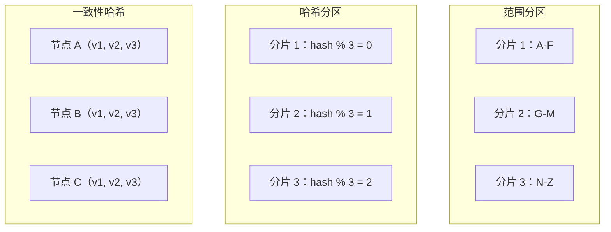
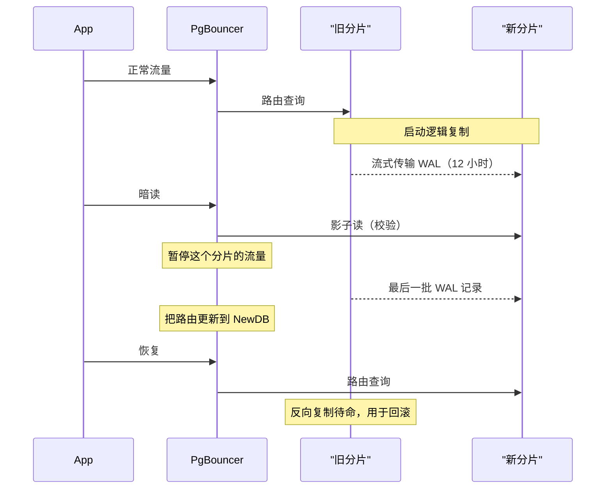
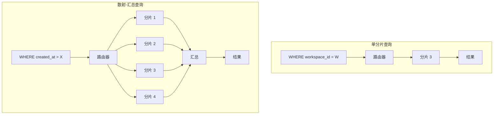
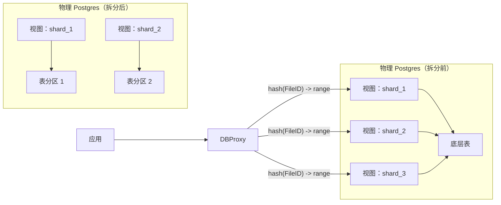

# 数据库分区与分片：当一个节点不够用时

> **TL;DR**: 分片（sharding）把一个逻辑数据库拆到多台物理节点上，从而突破单机的 CPU、IOPS 和连接数上限。分区键要选高基数、分布均匀的。除非需要范围扫描，否则用哈希路由。提前切成大量逻辑分区（Notion 选了 480，因为它约数多[^1]），这样扩物理容量时不必重新分配数据。只有纵向扩展真正走到尽头才分片：Figma 称横向分片“比我们此前所有的扩容工作都要复杂一个数量级”[^2]，第一张表上线花了九个月。

## 学习目标

学完这一章，你将能够：

- [ ] 针对具体负载在范围分区、哈希分区和一致性哈希分区之间做选择
- [ ] 挑出一个不会产生热点的分区键
- [ ] 设计分片路由层（客户端侧、代理侧，或 vtgate 那种风格）
- [ ] 规划一次停机时间极短的重新分片操作
- [ ] 判断什么时候分片为时过早、纵向扩展仍然更划算

## 直觉理解

想象一座城市只有一家巨型中心图书馆。每个居民都得开车进城借书、还书、咨询。居民到 5 万人时，停车场满了，馆员忙不过来，而这栋楼在物理上已经放不下更多书架。

市议会开了分馆。每个分馆只藏某几个邮编对应的书。居民走进离家最近的分馆就能找到需要的一切，不用穿城而过。中心目录仍然知道哪本书在哪个分馆，但日常人流是本地化的。

这就是分片。“邮编”是你的分区键，“中心目录”是你的路由层。难的地方在于：怎么划分邮编边界才能把居民摊匀，怎么应付那个要跑好几个分馆的人（跨分片查询），以及怎么在不关掉其他分馆搞装修的前提下开一家新分馆（在线重新分片）。

再想象某个邮编里有一座体育场。比赛日那天，那个分馆被挤爆，其他分馆空空荡荡。这就是热分片，也是分片系统里最常见的一种失效模式。

## 原理

### 为什么要分片

单个数据库节点有几道硬天花板：CPU 核数、磁盘 IOPS、给 buffer pool 的内存、连接槽位。Postgres 为每个连接创建一个独立的 OS 进程；共享内存映射、work_mem 分配，再加上每进程的开销，原生 Postgres 实际上在几百个连接就基本到顶，再多就是争用和内存压力说了算。[^3] Notion 用到了当时能拿到的最大 RDS 实例，VACUUM 卡顿让事务 ID 回卷（wraparound）的风险浮出水面，而且在有负载的情况下已经无法安全地执行迁移。[^1] Figma 的表到了几 TB、几十亿行，vacuum 已经开始影响可靠性，写入速率预计还要超过 IOPS 上限。[^2]

分片把这些天花板搬走：把键空间摊到彼此独立的节点上。每个分片只承担一部分流量，有自己的 buffer pool、自己的 VACUUM 节奏、自己的连接预算。但这是一扇单向门：跨分片 JOIN、跨分片事务、全局唯一索引全都没了。务必先确认纵向扩展和只读副本真的用尽了。

> [!IMPORTANT]
> **只在不得不分的时候才分。** Notion 自己的复盘警告说，在产品还没转向以团队为中心之前就按用户分片，“会带来相当大的技术痛苦”。[^1] Figma 在决定做横向分片之前，已经扩到 AWS 最大的物理实例，并且拆出了 12 个纵向分区的库。[^2]

### 分区与分片

这两个词在实际使用中含义有重叠，但侧重不同。**分区（partitioning）** 通常指在同一个数据库实例内部把行拆到多张表或子表（Postgres 的 `PARTITION BY RANGE`、MySQL 的 `PARTITION BY HASH`）。**分片（sharding）** 指把行拆到彼此独立、存储层完全不共享的数据库实例上。[^4] 两者常常共存：Notion 的 480 个逻辑分片，是 32 个（后来 96 个）物理 RDS 实例内部的 Postgres schema，也就是分片之中还有分区。[^1][^5]

### 分片策略



*三类分片方式：范围分区保留局部性，哈希分区保证分布均匀，一致性哈希把成员变动时的数据搬动降到最低。*

**范围分区。** 按 key 排好序的行在边界值处切开。适合范围扫描；对以追加为主的负载是灾难，因为最新的那个分片会变成热分片。Citus 明确建议：“不要把时间戳选为分布列。”[^6]

**哈希分区。** `shard = hash(key) % N`。天然均匀分布；代价是哈希列上的范围扫描局部性彻底丢失。Figma 用的就是这种方式：“只要选一个足够随机的哈希函数，我们就能保证数据均匀分布。”[^2] 缺点：N 一变，`hash % N` 几乎会把所有 key 重新映射。

**一致性哈希。** Karger 等人（1997）把 key 和节点都映射到一个单位圆上，每个 key 归给顺时针方向的第一个节点。加一个节点只抢走约 1/N 的 key，而不是几乎全部。[^7] 虚拟节点（一个物理节点占多个点）能抹平方差。bounded loads 扩展（Mirrokni 等人，2016）把每个节点的负载压到平均值的 (1+ε) 倍以内，每次变动最多搬 O(1/ε²) 个 key。[^8] Vimeo 把它部署到 HAProxy 之后，共享缓存带宽降低了约 8 倍。[^9][^17]

**目录式。** 用一张外部查找表把 key 映射到分片。可以按租户灵活摆放；但目录本身就是单点故障，还多一次网络跳转。Notion 用的是应用层目录路由，从 `workspace_id` 查到（数据库, schema）二元组。[^1]

**地理分区。** 按用户所在区域切分数据，满足 GDPR 的数据驻留要求或者降低延迟。Instagram 在 2015-2016 年就是用这种方式扩到多个数据中心的。[^10]

### 选择分区键

分区键是分片系统里最重要的一个设计决策。所有生产案例最后都收敛到同一套标准：

- **高基数。** 取值足够多，才能均匀铺到各分片。
- **分布均匀。** 没有哪个单值主导流量。
- **稳定。** 创建之后不再改变（用 UUID，不要用用户名）。
- **出现在热路径查询里。** 如果 WHERE 子句里没有它，每次查询都变成散射-汇总。

Notion 选了 `workspace_id`：UUID 类型、高基数，而且天然圈住了绝大多数读请求，因为用户几乎总是在单个 workspace 里活动。[^1] Discord 选了 `(channel_id, bucket)`，其中 `bucket` 是一个静态时间窗，这样分区不会无限增长。[^11] Figma 选了多个键（UserID、FileID、OrgID），因为他们的模型里不存在能独自承担这个角色的列，然后把相关的表按各自的键聚到一个 “colo” 里。[^2]

多租户系统的行业做法是复合键：`(tenant_id, local_id)`，`tenant_id` 负责分区，`local_id` 在租户内唯一。这样每个分片上只需要一个唯一索引，就能做到全局唯一，而不需要跨分片协调。[^6]

### 重新分片

主流做法是基于复制的在线重新分片：起新分片，用逻辑复制把数据从旧分片流过去，用暗读（dark reads）校验，最后切路由。

Notion 2023 年的重新分片是最干净的参考样本。[^5] 他们从 32 个物理库搬到 96 个：

1. 开 96 个新 RDS 实例
2. 启动 Postgres 逻辑复制（每个源库 3 个 publication，每个 publication 5 个 schema）
3. 先不建索引地复制（同步时间从 3 天降到 12 小时）
4. 在新分片上重建索引
5. 用暗读校验（1 秒的 setTimeout 等复制追上）
6. 在 PgBouncer 上暂停流量，确认复制已追平，更新路由，恢复流量

用户可见的影响：每个分片“大约一秒的‘保存中’转圈”。[^5] 全程反向复制都处于待命状态，作为回滚的逃生通道。



*在线重新分片：复制、用暗读校验、在代理上短暂暂停、切换路由，保留反向复制作为逃生通道。*

> [!TIP]
> **提前切成大量虚拟分区。** Instagram 2012 年的设计说得最清楚：“几千个‘逻辑’分片，在代码里映射到远少于这个数的物理分片。这样我们可以只从几台数据库服务器起步，最终扩到很多台，只需把一组逻辑分片从一台库搬到另一台，完全不必重新分配数据。”[^12] Notion 选 480 个逻辑分片，是因为 480 能被 2、3、4、5、6、8、10、12、15、16、20、24、30、32、40、48、60、80、96、120、160、240 整除，可以一步步扩物理容量。[^1]

### 跨分片查询

查询的 WHERE 里带了分片键，路由器就把它发到一个分片。没带，路由器就必须把查询散到所有分片再汇总结果。Figma 的比喻：“像一场全库范围的捉迷藏：你把查询发到每个分片（scatter），再把各处的答案拼起来（gather）。”[^2]

散射-汇总的延迟由最慢的那个分片决定（长尾放大）。规模上来之后，“散射-汇总太多会拖累横向分片的可扩展性。因为这些查询要碰每一个库，每一次散射-汇总带来的负载和数据库没分片时一样。”[^2]



*带分片键的查询直接命中一个分片；不带的时候，路由器散到所有分片再汇总，延迟由最慢的那个决定。*

**跨分片 JOIN** 需要三者之一：共置（colocation，两张表用同一个分片键，行落在同一分片）、参考表（小表复制到每个分片）、分布式 JOIN 计划（代理从多个分片拉行，在内存里 JOIN）。[^6]

**跨分片事务** 是最难的问题。Figma 和 Shopify 都明确去掉了它，而不是依赖两阶段提交。Figma：“我们选择不支持原子性的跨分片事务，因为跨分片事务失败我们有办法绕开。”[^2] Shopify：“我们选择移除所有跨分片事务，以避免任何问题。”[^13]

### 热点键与多租户

真实流量服从幂律。Discord 观察到过热分片：一个有几十万成员的大服务器和小服务器共用一个分区，于是“读比写更贵……用户与服务器交互时产生的大量并发读会把一个分区打成热点”。[^11]

缓解手段：

- **请求合并（request coalescing）。** Discord 的 Rust data services 层：“如果多个用户同时请求同一行，我们只查一次数据库。”[^11]
- **复合分区键。** Discord 的 `(channel_id, bucket)` 让单个频道的消息随时间分散到多个分区。[^11]
- **写分片（write sharding）。** DynamoDB 的套路：给热点键加随机后缀（`user#42#001` 到 `user#42#099`），写入就摊到 100 个分区上；读的时候把 100 个后缀都查一遍。[^14]
- **按键限流。** 限制单个 key 能从数据库索取的速率。

多租户 SaaS 有三种经典形态：**silo**（每个租户一个库，隔离最强、成本最高）、**pool**（所有租户共享表，靠 `tenant_id` 列区分，成本最低、有吵闹邻居风险）、**bridge**（共享库，每租户一个 schema，折中）。[^15] Shopify 的 pod 架构是务实的混合体：pod 是数据存储的 silo（MySQL + Redis + Memcached + cron），计算层则是共享的无状态池。一个 pod 挂掉只影响这个 pod 里的店铺，不影响平台。[^16]

## 真实案例

**Figma：九个月，从单个 Postgres 实例走到横向分片。**

Figma 的数据库栈在 2020 到 2024 年间增长了约 100 倍。[^2] 到 2022 年底，他们已经有 12 个纵向分区的 Postgres 库，但有些表到了几十亿行、好几 TB，正在逼近 RDS 的 IOPS 上限。

2022 年底，Figma 决定做横向分片。他们写了 **DBProxy**，一个 Go 服务，夹在应用和 PgBouncer 之间。DBProxy 把 SQL 解析成 AST，从 WHERE 子句里抽出分片键，到存在 S3 和 etcd 里的拓扑中查出对应的物理库，重写查询让它在正确分片的视图上执行，然后流式返回结果。[^2]

关键创新是**用 Postgres 视图做逻辑分片**：

```sql
CREATE VIEW table_shard1 AS
  SELECT * FROM table
  WHERE hash(shard_key) >= min_range
    AND hash(shard_key) <  max_range;
```

这让 Figma 能在真正做风险更高的物理拆分之前，用一个配置开关（回滚只要几秒）先验证分片路由。相关的表被编成共享同一个分片键的 “colo”，于是一个 colo 内部的跨表 JOIN 仍然落在单个分片。



*Figma 的逻辑分片到物理分片映射：视图在单个库上扮演逻辑分片，随后的物理拆分把视图搬到专属实例上，应用代码不用改。*

第一张横向分片的表在 2023 年 9 月上线，造成 10 秒的主库可用性部分受损，副本零影响。[^2] Figma 明确否掉了 CockroachDB、TiDB、Spanner 和 Vitess，理由是在硬性截止日期下，迁移一套现成的 Postgres 栈比自研 DBProxy 风险更大。

Figma 记录的未解问题：全局唯一 ID 生成、原子性跨分片事务、全局唯一索引，以及全自动的重新分片操作。[^2]

## 权衡

| 方案 | 优点 | 缺点 | 适用场景 | 我们的选择 |
|----------|------|------|-----------|----------|
| 范围分区 | 范围扫描高效；有序读有局部性 | 追加型负载上热点区间明显；边界附近容易倾斜 | 时序数据，且必须用非时间维度做二次分桶 | 仅当范围扫描在关键路径上 |
| 哈希分区 | 天然均匀分布；最容易推理 | 哈希列上无法范围查询；重新分片时 `hash % N` 会搬走大部分 key | 点查、写入均匀分布、分片数固定 | **多数 OLTP 的默认选择** |
| 一致性哈希 | 再均衡时数据搬动最少（约 1/N）；容忍成员动态变化 | 不用虚拟节点就有方差；调参复杂 | 成员动态变化（缓存、Dynamo 风格集群） | 分片集合频繁变动时 |
| 目录式 | 可按租户灵活摆放；能把大租户单独搬到一台 | 多一次目录查找跳转；目录是单点故障 | 有多租户规模长尾的多租户 SaaS | 需要按租户精细控制时 |

> [!TIP]
> **不管上面选了哪种策略，都要预分片。** 从第一天起就建出比物理库多得多的逻辑分片（虚拟分区）。Figma 每个 colo 起步就是 4,096 个逻辑分片；Vitess、Notion、DynamoDB 用的都是同一套模式。[^2][^5] 这样再均衡就变成一次物理搬迁（逻辑分片 173 从 DB-A 搬到 DB-B），而不是重新分桶（表里每个 key 都要重算）。初始逻辑分片数要挑约数多的（4,096 = 2^12、360、720），这样你能一路拆到 32、48、64、96 个物理节点而不留余数。这是全新分片系统里投入产出比最高的一个决定；事后补虚拟分区非常痛苦。

## 常见陷阱

> [!WARNING]
> **拿时间戳当分区键。** 所有写入都堆在一个分片（“当前”那个）上，旧分片闲着。Citus 明确反对这么做。[^6] 用高基数的实体 ID，只把时间当成第二维度加进去（Discord 的 bucket 模式）。

> [!WARNING]
> **名人热点键。** 某个用户或频道拿到了 1% 以上的流量，持有它那个 key 的分片就成了瓶颈。Discord 在 Cassandra 上的热分区之痛，来自有几十万成员的服务器和小服务器共用分区。[^11] 用请求合并、写分片或按键限流来缓解。

> [!WARNING]
> **每个查询都在散射-汇总。** 有个开发者提交了一条 WHERE 里没有分片键的查询；到了生产规模，每次查询都变成 N 路散射，N 个分片一起融化。在提交阶段就强制要求所有针对分片表的查询都带分片键。Figma 建了 shadow planning 框架；Shopify 建了查询校验器，直接拒绝不合规的 SQL。[^2][^13]

> [!WARNING]
> **跨分片的外键约束。** 跨越分片的外键，数据库没法保证。要么把相关的表共置在同一个分片键下，要么在应用层检查，要么接受最终一致性。别假装这个约束还成立。

> [!WARNING]
> **忘了重建二级索引。** 把数据物理搬到新分片时，索引不会自己跟过去。Notion 在复制阶段跳过索引创建（同步时间从 3 天降到 12 小时），之后再重建。[^5] 重新分片的时间线里要把这块算进去。

> [!WARNING]
> **在负载下回填分区键。** 如果分区键列还不存在，在已经饱和的主库上回填几十亿行，结果要么是回填卡死，要么是把产品直接拖进故障。Notion 的教训：在数据库饱和之前就把分区键回填好，或者在迁移复制的阶段顺带回填。[^1]

## 练习

你的单个 Postgres 主库在 3 万 WPS 的写入下 CPU 已经到 85%，数据集 2 TB。你预计 18 个月后增长 5 倍。请设计一套分片方案：分区键、分片数量、路由层、重新分片策略，以及迁移期间如何保证跨租户报表仍然可用。

<details>
<summary>提示</summary>

想想哪个实体圈住了你 90% 以上的查询。考虑预先切成一个约数很多的逻辑分片数。至于跨租户报表，先想清楚能不能让只读副本或者分析管道（CDC 到数仓）承担报表负载，而不是去散射 OLTP 分片。

</details>

<details>
<summary>参考答案</summary>

**分区键：** `tenant_id`。多租户 SaaS 里绝大多数查询都按租户过滤。基数高（几千个租户）、分布均匀（除非有“名人”租户，那种单独给一个分片就行）、稳定（租户 ID 永不改变），并且出现在每一条热路径查询里。

**分片数量：** 480 个逻辑分片（沿用 Notion 的可除性思路）。先上 16 个物理库（每库 30 个 schema）。增长到 5 倍时换成 48 个物理库（每库 10 个 schema），不需要重新分配数据。

**路由层：** 应用层。一个很薄的路由函数把 `hash(tenant_id) % 480` 映射到逻辑分片号，再由一个配置文件把逻辑分片映射到物理库。在应用和每个物理库之间部署 PgBouncer 做连接池。

**重新分片策略：** 从旧物理库到新物理库做 Postgres 逻辑复制。先不带索引复制，之后重建，用暗读校验，然后在 PgBouncer 上暂停并切换。全程保持反向复制可用于回滚。目标：每个分片的用户可见影响低于 2 秒。

**跨租户报表：** 不要去散射 OLTP 分片。搭 CDC（在每个分片的 WAL 上挂 Debezium）流进列式数仓（ClickHouse 或 BigQuery）。报表查数仓，数仓本来就是为全表扫描和聚合优化的。这样分析负载的延迟和 OLTP 的延迟彻底解耦。

**接受的权衡：** 跨租户报表看到的数据有复制延迟（秒到分钟级）。如果必须要有实时的跨租户查询，可以考虑 Citus 的共置分布式表，但要接受分布式协调者带来的运维复杂度。

</details>

## 要点回顾

- 分片是单向门。先把纵向扩展、只读副本和纵向分区用尽。
- 分区键要按最差的访问模式选，而不是平均情况。高基数、分布均匀、稳定、出现在热路径查询里。
- 哈希路由是 OLTP 的默认选择。只有分片集合动态变化时才用一致性哈希。
- 提前切成大量逻辑分区（挑 480、360 这种约数多的数）。这样增长物理容量时不用重新分配数据。
- 跨分片 JOIN 和事务要么很贵，要么根本做不到。把相关数据共置在同一个分片键下。
- 热分片一定会找上门。设计上要保证你能随时加上请求合并、写分片，或者临时拆分。
- 用逻辑复制 + 暗读 + 代理层暂停切换做在线重新分片，是行业标准做法。

## 延伸阅读

- [Herding elephants: Lessons learned from sharding Postgres at Notion](https://www.notion.com/blog/sharding-postgres-at-notion) - 第一次分片的经典复盘：480 个分片、workspace_id、审计日志迁移，以及 480 为什么约数多。
- [The Great Re-shard: adding Postgres capacity (again) with zero downtime](https://www.notion.com/blog/the-great-re-shard) - 如何在线上用逻辑复制和分片化的 PgBouncer 从 32 个 Postgres 实例扩到 96 个。
- [How Figma's databases team lived to tell the scale](https://www.figma.com/blog/how-figmas-databases-team-lived-to-tell-the-scale/) - DBProxy、逻辑分片与物理分片、colo、把视图当逻辑分片、shadow planning；业内最详细的分片记录之一。
- [Sharding & IDs at Instagram](https://web.archive.org/web/20210112134155/https://instagram-engineering.com/sharding-ids-at-instagram-1cf5a71e5a5c) - 关于逻辑分片与物理分片、Snowflake 风格分片 ID（41 位时间 + 13 位分片 + 10 位序列）仍然最清楚的解释。
- [How Discord Stores Trillions of Messages](https://discord.com/blog/how-discord-stores-trillions-of-messages) - 热分区、带请求合并的 data services、Cassandra 迁移到 ScyllaDB，以及 (channel_id, bucket) 分区模式。
- [Partitioning GitHub's relational databases to handle scale](https://github.blog/engineering/infrastructure/partitioning-githubs-relational-databases-scale/) - schema 域、SQL linter、引入 Vitess，以及 130 张表、95 万 QPS 下的写入切换流程。
- [Consistent Hashing and Random Trees (Karger et al., STOC 1997)](https://dl.acm.org/doi/10.1145/258533.258660) - 原始论文；至少读一下关于平衡性和分散性的定理陈述。
- [Designing Data-Intensive Applications, Ch. 6](https://dataintensive.net/) - Kleppmann 教科书中对分区策略、再均衡和请求路由的经典论述。

## 记忆卡片

**Q：** 分区（partitioning）和分片（sharding）有什么区别？
**A：** 分区是在同一个数据库实例内把行拆到多张表（Postgres 的 PARTITION BY）。分片是把行拆到彼此独立、存储层不共享的数据库实例上。两者常常共存：Notion 在独立的 RDS 实例（分片）里用 Postgres schema（分区）。

**Q：** 好的分区键有哪四条标准？
**A：** 高基数、分布均匀、稳定（创建后不变）、出现在热路径查询里，这样路由器能定位到单个分片而不是散射。

**Q：** 为什么时间戳当分区键不好？
**A：** 所有写入都堆在“当前”那个分片上，旧分片闲着。最新的时间范围上就形成了一个永久热分片。

**Q：** 一致性哈希在加节点时保证什么？
**A：** 只有约 1/N 的 key 会搬到新节点，而 hash-mod-N 几乎重映射所有 key。虚拟节点能抹平各物理节点之间的方差。

**Q：** Notion 为什么选 480 个逻辑分片？
**A：** 480 的约数多（2、3、4、5、6、8、10、12、15、16、20、24、30、32、40、48、60、80、96、120、160、240）。这让物理机可以从 32 台逐步加到 40、48、96 台，而不用重新分配数据。

**Q：** 什么是散射-汇总，为什么贵？
**A：** 查询缺分片键时，路由器把它扇出到每个分片再聚合结果。延迟由最慢的分片决定（长尾放大），而且每次散射-汇总产生的负载和不分片时一样。

**Q：** Figma 怎么把逻辑分片和物理分片解耦？
**A：** 用 Postgres 视图（`CREATE VIEW ... WHERE hash(shard_key) >= min AND < max`）当逻辑分片。这样他们能先用配置开关（几秒回滚）验证路由，再去动风险更高的物理数据拆分。

**Q：** 预分片的虚拟分区模式是什么？
**A：** 先建很多逻辑分片（几百到几千个），映射到较少的物理库。要扩容就在物理库之间搬逻辑分片，不用重新哈希任何 key。Instagram、Notion、Figma 都用了这个模式。

**Q：** Figma 和 Shopify 怎么处理跨分片事务？
**A：** 直接去掉。两家都明确选择不支持原子性跨分片事务，改在应用层绕开失败，而不是依赖两阶段提交。

**Q：** Discord 应对热分区的方案是什么？
**A：** 一层 Rust 的“data services”，做请求合并：多个用户同时请求同一行时，只有一条查询打到数据库。再配合 `(channel_id, bucket)` 分区键，把老频道拆到多个分区。

**Q：** DynamoDB 针对热点键的写分片模式是什么？
**A：** 给热点键加随机后缀（`user#42#001` 到 `user#42#099`），写入就摊到多个分区。读的时候要查所有后缀再聚合。

**Q：** Notion 的在线重新分片步骤是什么？
**A：** 开新库、启动逻辑复制、不带索引复制（12 小时 vs 3 天）、重建索引、用暗读校验、在 PgBouncer 暂停流量、确认复制追平、更新路由、恢复。用户可见影响：每个分片约 1 秒。

**Q：** 多租户有哪三种模式？
**A：** silo（每租户一个库，隔离最强、成本最高）、pool（所有租户共享表，用 tenant_id 列区分，成本最低、有吵闹邻居风险）、bridge（共享库、每租户一个 schema，折中）。

## 参考文献

[^1]: Garrett Fidalgo, "Herding elephants: Lessons learned from sharding Postgres at Notion", Notion Blog, 2021-10-06. https://www.notion.com/blog/sharding-postgres-at-notion
[^2]: Sammy Steele, "How Figma's databases team lived to tell the scale", Figma Blog, 2024-03-14. https://www.figma.com/blog/how-figmas-databases-team-lived-to-tell-the-scale/
[^3]: PostgreSQL Documentation, "Resource Consumption" (work_mem, shared_buffers, and per-backend resource costs). https://www.postgresql.org/docs/current/runtime-config-resource.html
[^4]: PostgreSQL Documentation, "Table Partitioning". https://www.postgresql.org/docs/current/ddl-partitioning.html
[^5]: Arka Ganguli, Tanner Johnson, Ben Kraft, Nathan Northcutt, "The Great Re-shard: adding Postgres capacity (again) with zero downtime", Notion Blog, 2023-07-17. https://www.notion.com/blog/the-great-re-shard
[^6]: Citus Documentation, "Choosing Distribution Column" and "Table Co-Location", 13.0. https://docs.citusdata.com/en/stable/sharding/data_modeling.html
[^7]: D. Karger, E. Lehman, T. Leighton, M. Levine, D. Lewin, R. Panigrahy, "Consistent Hashing and Random Trees", STOC 1997. https://dl.acm.org/doi/10.1145/258533.258660
[^8]: V. Mirrokni, M. Thorup, M. Zadimoghaddam, "Consistent Hashing with Bounded Loads", arXiv 1608.01350, 2016. https://arxiv.org/abs/1608.01350
[^9]: Andrew Rodland, "Improving load balancing with a new consistent-hashing algorithm", Vimeo Engineering Blog, 2018. https://web.archive.org/web/20250101010558/https://medium.com/vimeo-engineering-blog/improving-load-balancing-with-a-new-consistent-hashing-algorithm-9f1bd75709ed
[^10]: Instagram Engineering, "Instagration Pt. 2: Scaling our infrastructure to multiple data centers", 2016-04-28. https://web.archive.org/web/20210112134648/https://instagram-engineering.com/instagration-pt-2-scaling-our-infrastructure-to-multiple-data-centers-5745cbad7834
[^11]: Bo Ingram, "How Discord Stores Trillions of Messages", Discord Blog, 2023-03-06. https://discord.com/blog/how-discord-stores-trillions-of-messages
[^12]: Instagram Engineering, "Sharding & IDs at Instagram", 2012-12-30. https://web.archive.org/web/20210112134155/https://instagram-engineering.com/sharding-ids-at-instagram-1cf5a71e5a5c
[^13]: Hammad Khalid et al., "Horizontally scaling the Rails backend of Shop app with Vitess", Shopify Engineering, 2024-01-17. https://shopify.engineering/horizontally-scaling-the-rails-backend-of-shop-app-with-vitess
[^14]: AWS Documentation, "Using write sharding to distribute workloads evenly". https://docs.aws.amazon.com/amazondynamodb/latest/developerguide/bp-partition-key-sharding.html
[^15]: AWS Prescriptive Guidance, "Multi-tenant SaaS partitioning models for PostgreSQL". https://docs.aws.amazon.com/prescriptive-guidance/latest/saas-multitenant-managed-postgresql/partitioning-models.html
[^16]: Xavier Denis, "A Pods Architecture To Allow Shopify To Scale", Shopify Engineering, 2018-03-02. https://shopify.engineering/a-pods-architecture-to-allow-shopify-to-scale
[^17]: Vahab Mirrokni, Morteza Zadimoghaddam, "Consistent Hashing with Bounded Loads", Google AI Blog, 2017-04-03. https://ai.googleblog.com/2017/04/consistent-hashing-with-bounded-loads.html
