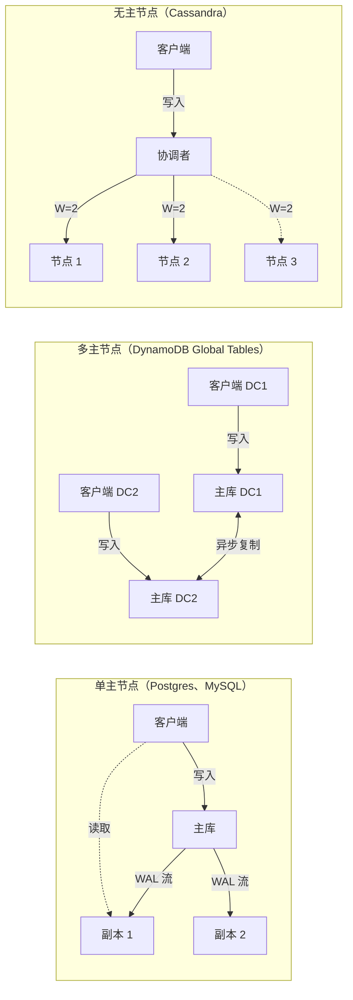
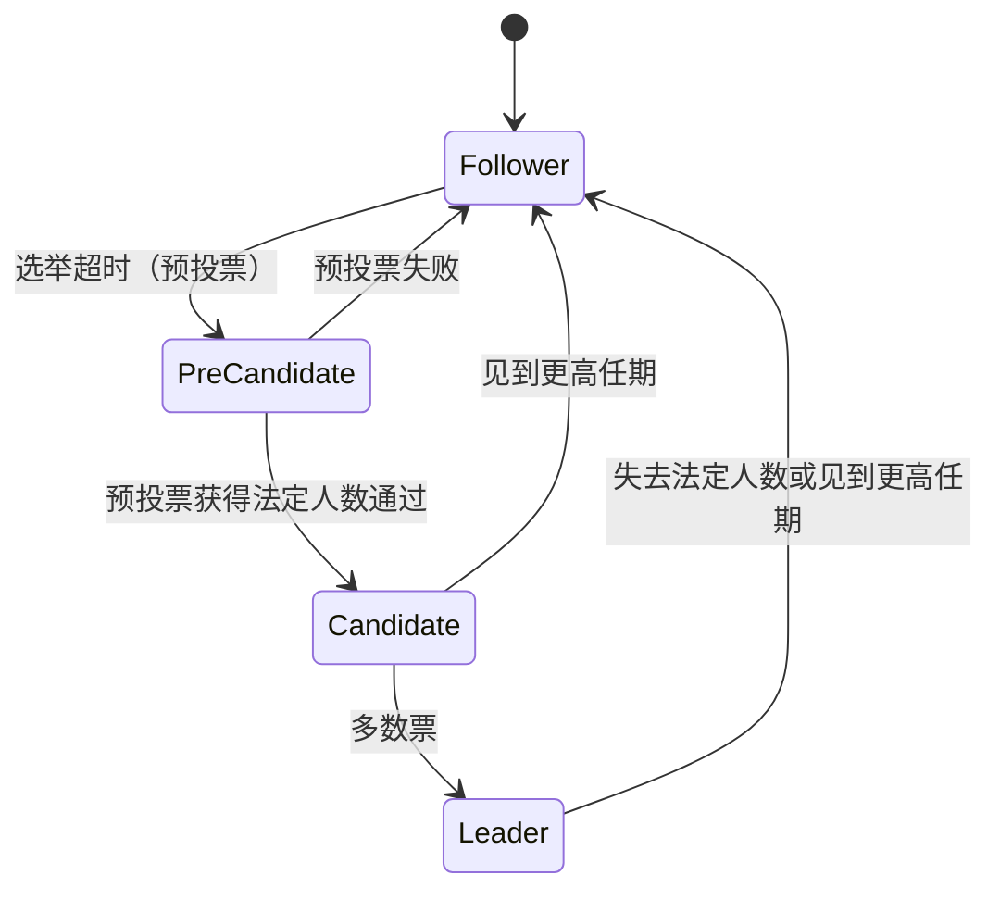
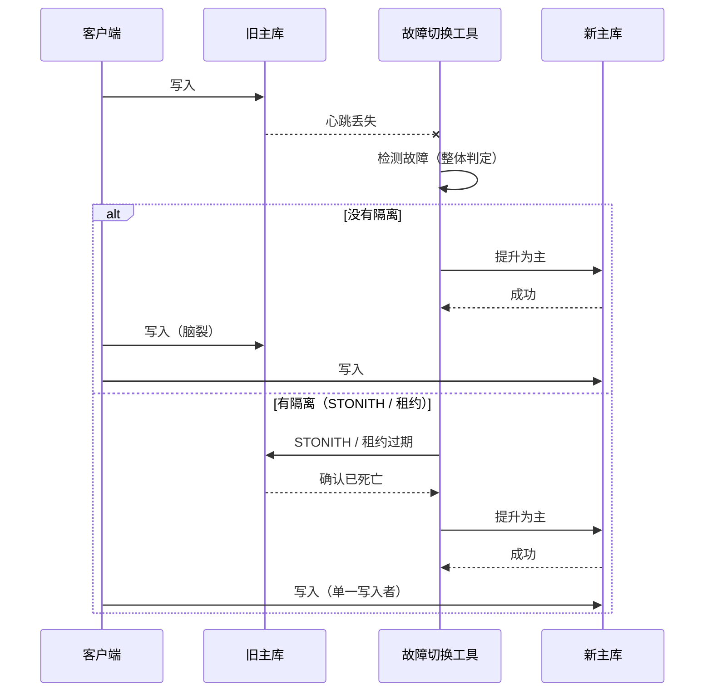
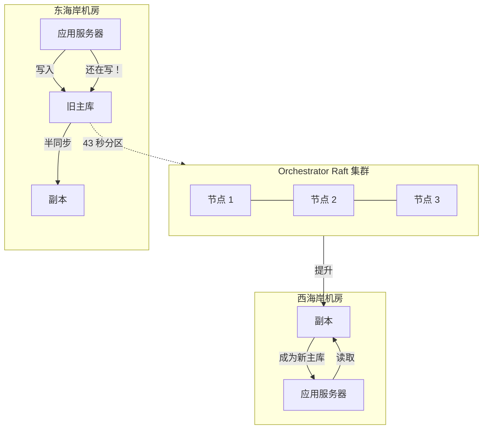

# 数据库复制：让副本保持同步

> **TL;DR**: 复制把同一份数据在 N 个节点上存 N 份，读请求因此可以扩量，单点故障也不会丢数据。对大多数 OLTP 负载来说，半同步的单主复制就是默认答案。只有当你已经用数据证明了跨地域延迟确实需要解决时，才去碰多主或无主。难的部分从来不是拷贝字节，而是在不发生脑裂的前提下完成故障切换。GitHub 就是被这件事教训的：一次 43 秒的网络分区，换来 24 小时的恢复，单个集群上最多 954 条未对账的写入[^1]。复制的每一个决策都是可分离的选择（拓扑、同步模式、故障切换策略、多地域），并且都有可度量的代价。

## 学习目标

学完本章，你将能够：

- [ ] 区分主从复制、多主复制和无主复制
- [ ] 依据持久性与延迟要求，在同步复制和异步复制之间做选择
- [ ] 推理复制延迟及其对读己之写的影响
- [ ] 设计一套不会引发脑裂的故障切换流程
- [ ] 理解无主系统中的可调一致性（R + W > N）
- [ ] 说清 Aurora 的六分之四法定人数与 Spanner 的 Paxos 组在实践中差在哪

## 直觉理解

想象你经营一家连锁银行，每个网点都留着一本账。每天日终，各网点把新增的流水送到总行，总行对账后再把合并后的账本连夜发回去。

这套做法一直很顺，直到同一天有两个网点给同一个客户批了互相冲突的贷款。总行手里就出现了一个自己不打电话给两位网点经理就解决不了的冲突。这就是多主复制加最后写入者胜（last-write-wins），它会悄无声息地丢数据。

更安全的模型是：指定一个网点当“总行”，所有贷款审批都走它。其余网点拿到的账本是只读副本，每隔几分钟刷新一次。万一总行烧了，你就把手里副本最新的那个网点提上来。但在提升的过程中，谁也批不了贷款——这段空档就是你的故障切换窗口。

“每个网点都能批贷款”（可用性、低延迟）与“只有一个网点能批贷款”（一致性、无冲突）之间的张力，就是数据库复制里那个根本的权衡。本章你要学的每一种拓扑，都是对这股张力的不同回答。

## 原理

### 为什么要复制

复制的理由有四个，而且彼此独立：

1. **持久性。** 主库的磁盘坏了，副本上还有数据。没有复制，你只能指望备份，而恢复点是以小时计的。
2. **可用性。** 主库进程崩了，副本几秒内就能接管，而不是像冷恢复那样要等上几分钟。
3. **读扩展。** 把读查询打到副本上。读吞吐量随副本数量线性增长[^2]。
4. **跨地域延迟。** 在新加坡放一个副本，当地用户读本地数据，不用跨太平洋跑到 us-east-1。

这四个目标互相拉扯。持久性要求至少一个副本做同步写；读扩展希望有一大堆异步副本；跨地域延迟要求副本放在很远的地方，于是同步写就变得很贵。每一种复制设计，都是这四个目标的加权组合。

### 拓扑结构

*单主把所有写都送进一个节点；多主到处都能接写，事后对账；无主把每次写扇出到 N 个副本，等 W 个确认。*

**单主（single-leader）** 是主力方案。所有写都进一个节点（主库），它再把变更日志推给从节点。PostgreSQL 流式传输预写日志（WAL），MySQL 传二进制日志（binlog），MongoDB 传 oplog[^2]。主库是唯一的事实来源，从节点是只读副本。

**多主（multi-leader）** 让两个或更多节点接受写入，再彼此复制。DynamoDB Global Tables 在 MREC 模式（默认）下允许每个地域都接受写入，复制延迟通常在 1 秒以内[^3]。代价是冲突解决。几乎总是最后写入者胜（LWW），当两个地域并发写同一个键时，它会悄无声息地丢掉“输”的那一条。

**无主（leaderless）**，也就是 Dynamo 风格，没有指定的主库。客户端或协调者把写扇出到 N 个副本，等 W 个确认；读则扇出到 R 个副本，取最新的那份。Netflix 在 288 个 EC2 节点、RF=3 的配置上压出过每秒 110 万次客户端写入[^4]。

**基于共识（Raft、Paxos）** 有时被归为单主，但它的安全保证不一样。每次写只有在多数副本持久化之后才算提交，单节点故障不丢数据，主节点自动选举。etcd、CockroachDB、Spanner 和 TiKV 都用这个模型[^5]。

**链式复制（chain replication）** 把副本排成一条线。写入从头部进、往尾部流，读取从尾部取。它比 Paxos 简单，但需要一个外部的配置管理节点。由 van Renesse 和 Schneider 提出[^6]，Windows Azure Storage 采用[^7]。

### 同步、异步与半同步

同步还是异步，只回答一个问题：单机故障时，你承受得起丢失多少秒的写入？

| 模式 | 机制 | RPO | 写入延迟 | 示例 |
|------|------|-----|---------|------|
| 异步 | 主库立即返回，日志稍后推送 | 数秒到数分钟 | 最低 | Postgres 默认、MySQL 默认 |
| 半同步 | 主库最多等超时时间 T，之后退回异步 | 副本确认则为 0，否则为秒级 | +1 RTT（本地） | GitHub MySQL（500 毫秒超时）[^8] |
| 同步 | 主库等副本 fsync 完才回复 | 0 | +1 RTT（可能跨地域） | Postgres `synchronous_commit = on`[^2] |
| 法定人数 | 主库等 N 个副本中的 W 个 | 满足 W 则为 0 | +1 RTT（到第 W 快的那个） | Aurora 六分之四[^9]、Raft 多数派 |

PostgreSQL 用 `synchronous_commit` 暴露这个选择，可取 `on`、`remote_write`、`remote_apply`。同步模式最少也要等一个到备库的网络往返[^2]。MySQL 的半同步用的是超时（GitHub 设为 500 毫秒），副本慢就退回异步[^8]。这在机房内部换来了尽力而为的无损故障切换。

> [!IMPORTANT]
> 对大多数生产环境的 MySQL 部署，带短超时的半同步是务实的默认值。常见情况下 RPO 接近零（本地副本 1 毫秒内就能确认），同时副本挂掉时写入也不会被卡死。

### 基于日志的复制

每个单主系统都靠日志推送变更，差别在格式：

- **物理日志（WAL）。** PostgreSQL 传原始 WAL 记录（页级变更）。紧凑、快，但跟具体的存储格式绑死。不做逻辑解码，就没法在不同 Postgres 大版本之间复制[^2]。
- **二进制日志（binlog）。** MySQL 传行级变更（前后镜像）或语句。生产默认用行格式，因为语句格式有非确定性 bug（`NOW()`、`RAND()`）[^10]。
- **Oplog。** MongoDB 在一个固定大小的集合里记录幂等操作。副本尾随 oplog 并重放[^11]。
- **逻辑复制。** 更高层的格式（行变更表达成结构化数据），把复制和存储格式解耦。PostgreSQL 的逻辑复制槽、MySQL 行格式的 binlog、Debezium 的 CDC 连接器都在这一层工作。

关键区别在于：物理复制更快，但把你锁在某一个引擎版本上；逻辑复制更慢，却支持跨版本升级、异构复制和 CDC 管道。

### 共识复制（Raft 与 Paxos）

Raft 把共识拆成三个子问题：主节点选举、日志复制、安全性[^5]。主节点接收提案，追加到自己的日志，向从节点发 `AppendEntries` RPC，当多数节点持久化后判定该条目已提交。etcd 的 `raft` 库把 ElectionTick 与 HeartbeatTick 设成 10:1，并给选举超时加随机化，避免选票被撕开[^12]。

*每个 Raft 节点都在 Follower、Candidate、Leader 之间迁移；预投票（Pre-Vote）机制防止一个重新加入的孤立节点靠抬任期把集群搅乱。*

Paxos 在容错能力上等价，但正确实现起来更难。Spanner 按 tablet 划分 Paxos 组，配上 TrueTime（时钟不确定度通常在 1 到 7 毫秒之间），在整个数据库上实现外部一致性[^13]。实践中的差别是：凌晨三点你要调试的是 Raft，因为它干净地拆成了选举 + 复制 + 安全三块；Google 跑的是 Paxos，因为他们先做出来，而且攒了 20 年的运维工具。

> [!TIP]
> `R + W > N` 只保证在协调者所见的法定人数范围内实现读己之写。它不意味着读是线性一致的，也不能阻止 LWW 在时钟偏移下悄悄丢数据。要线性一致性，你得用共识（Raft/Paxos），或者从主节点读并做 read-index 校验。

### 故障切换

故障切换分三部分：检测、选举、隔离（fencing）。

**检测。** 朴素的 ping 监控在网络抖动时会误判。GitHub 的 Orchestrator 用整体判定：只有当它连不上主库、并且所有副本都从自己那侧报告复制中断时，才宣布主库死亡[^14][^15]。

**选举。** Orchestrator 按一张规则矩阵（版本、格式、半同步状态、机房）挑最新的副本[^16]。Patroni 把这件事交给分布式配置存储（etcd、Consul 或 ZooKeeper），于是选举本身就是一个 Raft 决策[^17]。

**隔离。** 旧主库必须停止接受写入。没有隔离，网络一分区，脑裂就是必然。通过 IPMI 断电实现 STONITH（“shoot the other node in the head”，直译是“一枪打掉另一个节点的脑袋”）是核选项。Patroni 用 DCS 租约，主库续不上就失效[^17]。GitHub 用 HAProxy 的 `hard-stop-after`，在 reload 之后掐掉旧连接[^8]。

*没有隔离，旧主库在提升窗口里照样接写；有了隔离，旧主库在新主库接管之前就已经确定死亡。*

### 多地域复制

生产环境主流的是三种做法：

- **DynamoDB Global Tables（MREC）。** 跨地域异步复制，用 LWW 解决冲突，延迟通常低于 1 秒，SLA 99.999% 可用[^3]。适合写入幂等、能接受静默冲突处理的场景。
- **Aurora Global Database。** 存储层跨地域复制，延迟低于 1 秒，最多 10 个从属地域。写转发（write forwarding）让从属地域的读请求把写转回主地域[^18]。适合读多写少、只有单一写入地域的多地域部署。
- **Spanner。** 跨地域同步 Paxos。每次写都要等多数投票副本。靠 TrueTime 实现外部一致性。当你需要全局强一致、又能忍受跨地域写延迟时，它是答案[^13]。

## 真实案例

### GitHub 2018 年 MySQL 事故：43 秒的分区，24 小时的修复

2018 年 10 月 21 日，GitHub 东海岸网络枢纽与其东海岸主机房之间一次 43 秒的网络分区，触发了一连串反应，完全恢复花了 24 小时 11 分钟[^1]。

**背景。** GitHub 跑着多个 MySQL 集群（到 2023 年，这个舰队已增长到 50 多个集群、1,200 多台主机）[^19]。每个集群都用 500 毫秒超时的半同步复制。Orchestrator 跨机房跑在 Raft 上，负责协同的故障切换。应用通过 Consul 支撑的 HAProxy 访问主库[^8]。

**分区。** UTC 22:52，网络枢纽与东海岸机房之间的连通性中断了 43 秒。跑在 Raft 上的 Orchestrator 在剩余机房中仍持有法定人数，它正确地判定各主库不可达，并把西海岸副本提升为主库[^1]。

**脑裂。** 在这 43 秒里，东海岸的应用仍在往旧主库写。网络恢复后，两边都接受了对方没见过的写入。最繁忙的一个集群在受影响窗口内有 954 条写入没被复制出去[^1]。

**决策。** GitHub 选择了数据完整性而不是速度。他们保留西海岸为主库（它持有 Orchestrator 认可的身份），让东海岸应用硬扛跨全美的延迟，然后花了 24 小时清空 webhook 和 GitHub Pages 构建的积压。那些分叉的写入是人工对账的[^1]。

**教训。** 自动化故障切换，如果应用层没准备好承受跨地域延迟，就会造出一种新的故障模式。GitHub 的事后复盘建议给 Orchestrator 加约束，除非应用能承受延迟变化，否则不允许跨地域提升[^1]。故障切换工具优化的是“只要有一个健康的主库就行”；而应用的延迟预算里，默认主库就在本地机房。

*43 秒的分区期间，Orchestrator 提升了西海岸副本，而东海岸应用还在往旧主库写，单个集群上最多产生 954 条未对账的写入。*

## 权衡

| 方案 | 优点 | 缺点 | 适用场景 | 我们的选择 |
|------|------|------|---------|-----------|
| 单主 + 异步 | 写入延迟最低，拓扑简单 | 主库故障会丢数据，读有延迟 | 能容忍丢几秒数据的大多数 OLTP 负载 | **大多数系统的默认值** |
| 单主 + 半同步 | 常见情况下 RPO 接近零 | 写入延迟 +1 个本地 RTT，副本故障时退回异步 | 金融、受监管、审计关键的写入 | RPO 重要时用它 |
| 多主（LWW） | 每个地域都能本地写，整个地域挂掉也不影响 | 时钟偏移下静默丢写，冲突难调 | 多地域且写入幂等或可交换 | 只有已证实需要跨地域低延迟时 |
| 无主（Dynamo） | 高可用，一致性可按请求调节 | 最终一致，运维复杂（修复、压缩、gossip） | 写密集且能容忍最终一致 | Cassandra/DynamoDB 类负载 |
| 共识（Raft/Paxos） | 强一致，自动故障切换，不丢数据 | 每次写都有共识延迟，跨地域很贵 | 元数据存储、需要线性一致的系统 | etcd、Spanner、CockroachDB |

## 常见陷阱

> [!WARNING]
> **没有隔离的脑裂。** 两个节点都自称主库，都接受写入，而这些写入永远没法干净地合并。故障切换工具在没确认旧主库已死的情况下提升新主库，就会这样。永远要做隔离：STONITH、DCS 租约过期，或者代理层掐断连接[^8][^17]。

> [!WARNING]
> **在需要读己之写的流程里从异步副本读。** 用户保存表单、刷新，看到的还是旧数据，因为这次刷新落到了一个尚未收到写入的副本。解决办法：写入后的 N 秒内把读钉在主库，或者传一个提交 LSN 令牌，把请求路由到足够新的副本[^2]。

> [!WARNING]
> **把复制当备份。** 一条写错的 `DROP TABLE` 会在几秒内复制到每个副本，你一次性在所有地方丢了数据。复制会忠实地复制 bug、人为失误和恶意操作。你依然需要基于 WAL 归档的 PITR 和延迟副本[^2]。

> [!CAUTION]
> **忽视 Jepsen 已经证明的故障切换丢写。** MongoDB 默认 `w:1`，只要一个节点持久化就确认；一旦发生故障切换，这条写可能被回滚。托管 MongoDB 服务的用户里大约 80% 从没改过这个默认值[^20]。凡是丢不起的数据，都要设 `writeConcern: majority`[^21]。

> [!WARNING]
> **忽视复制延迟告警。** 正常负载下延迟是毫秒级，但写入压力大或网络抖动时会涨到秒甚至分钟。盯住 `pg_stat_replication.replay_lag`（Postgres）、`Seconds_Behind_Source`（MySQL）或 `ReplicationLatency`（DynamoDB Global Tables）[^22]。5 秒告警，30 秒打电话叫人。

> [!WARNING]
> **应用没准备好就跨地域提升。** 高可用工具正确地提升了另一个地域的主库；但应用不是为多出来的延迟写的，页面加载直接超时。给高可用工具加约束，只允许在应用已就绪的地域做提升[^1]。

## 练习

你在 us-east-1 用 Postgres 跑一个全球 SaaS，在 eu-west-1 和 ap-southeast-1 各有一个只读异步副本。一位新加坡客户反馈：保存之后立刻刷新，看到的是旧数据。请诊断，并设计三种替代方案：（1）写入后把读钉在主库；（2）在亚太区放同步副本；（3）改用多地域 SQL 引擎。为每种方案量化延迟代价。

提示

客户的写去了 us-east-1（主库），读落到了 ap-southeast-1 的副本，而这个副本落后于主库的量，等于复制延迟加上从写入到读取之间的时间。想一想每种方案在延迟上付出多少、在一致性上换来什么。

解答

**诊断。** 客户写 us-east-1（跨太平洋，约 180 毫秒 RTT）。随后的读落到 ap-southeast-1 的异步副本，它可能落后主库 200 毫秒到 2 秒。如果读在副本追上之前到达，客户就看到过期数据。

**方案 1：写入后把读钉在主库。**
任何写入之后，设置一个带 TTL 的会话标记（比如 5 秒）。在这段窗口内，该用户的所有读都路由到 us-east-1 主库。延迟代价：新加坡用户在每次写入后的 5 秒内，读要跨太平洋（约 180 毫秒 RTT）。其余时间读是本地（约 20 毫秒）。实现方式：下发一个 `last_write_ts` cookie，路由层拿它和副本已知的 LSN 比较。

**方案 2：亚太区同步副本。**
在主库上设 `synchronous_standby_names = 'ANY 1 (ap-southeast-1-replica)'`。这样每次写都要等亚太副本 fsync 才确认。延迟代价：每个用户的每次写（不只是新加坡用户）都多付 180 毫秒。对全球 SaaS 来说这通常不可接受，除非亚太副本是唯一的同步备库，并且你用 `ANY 1 (local, apac)` 优先本地备库。

**方案 3：多地域 SQL 引擎（Spanner 或 Aurora Global）。**
Aurora Global Database 加写转发：读在本地，写转发到主地域，跨地域约 1 个 RTT 返回。Spanner：写发到最近的 Paxos 主节点，多数确认后提交（每次写都吃跨地域延迟，但读是本地且强一致的）。延迟代价：Spanner 每次写因跨地域共识多约 100 到 200 毫秒。Aurora Global 的写转发多约 1 秒，但读在本地，过期不超过 1 秒。

**给大多数 SaaS 的建议：** 方案 1（写入后把读钉在主库）。它最便宜，不用改基础设施，延迟惩罚被限制在写入后的一小段窗口内。只有当你确实有多个写密集地域、并且有做数据库迁移的工程预算时，方案 3 才成立。

## 要点回顾

- 单主 + 异步是默认答案，能解决大部分问题。把复制延迟搞明白，你就走完了 90% 的路。
- 同步复制用延迟换持久性。机房内部想要尽力而为的无损故障切换，就用带短超时（500 毫秒）的半同步。
- 多主看起来诱人，其实是个陷阱。冲突永远比看上去更难，而 LWW 会静默丢数据。
- 无主（Dynamo 风格）配可调的 R/W，给了你按查询在一致性与可用性之间权衡的旋钮，但 `R + W > N` 不是线性一致性。
- 没有隔离的自动故障切换，就是一场迟早发生的脑裂。提升新主库之前，永远先隔离旧主库。
- 复制不是备份。一条写错的 `DROP TABLE` 几秒内复制到所有地方，你依然需要按时间点恢复。
- Aurora 的六分之四法定人数能容忍一个可用区整体失效再加一个分段丢失而不丢数据[^9]。这就是云原生持久性的及格线。

## 延伸阅读

- [Amazon Aurora: Design Considerations for High Throughput Cloud-Native Relational Databases（Verbitski 等，SIGMOD 2017）](https://www.amazon.science/publications/amazon-aurora-design-considerations-for-high-throughput-cloud-native-relational-databases) - Aurora 的经典论文；“日志就是数据库”和六分之四法定人数设计，从第一性原理讲起。
- [MySQL High Availability at GitHub（Shlomi Noach，2018）](https://github.blog/2018-06-20-mysql-high-availability-at-github/) - Orchestrator + Consul + GLB 的生产细节；10 到 13 秒故障切换目标背后的架构。
- [October 21 post-incident analysis（GitHub，2018）](https://github.blog/news-insights/company-news/oct21-post-incident-analysis/) - 43 秒分区引发的 24 小时故障；任何复制讨论都绕不开的脑裂战例。
- [In Search of an Understandable Consensus Algorithm（Ongaro 与 Ousterhout，USENIX ATC 2014）](https://raft.github.io/raft.pdf) - Raft 论文；动手用 etcd、CockroachDB 或 TiKV 之前的必读。
- [Dynamo: Amazon's Highly Available Key-value Store（DeCandia 等，SOSP 2007）](https://www.amazon.science/publications/dynamo-amazons-highly-available-key-value-store) - 开创无主这一类别的论文，定义了 (N, W, R) 可调法定人数。
- [Spanner: Google's Globally-Distributed Database（OSDI 2012）](https://research.google/pubs/spanner-googles-globally-distributed-database-2/) - Paxos + TrueTime；用延迟换全局强一致的同步多地域蓝本。
- [Jepsen: MongoDB 4.2.6（Kyle Kingsbury，2020）](https://jepsen.io/analyses/mongodb-4.2.6) - “完整 ACID”的宣称如何撞上网络分区；对复制保证保持健康怀疑的必读材料。
- [PostgreSQL: High Availability, Load Balancing, and Replication](https://www.postgresql.org/docs/current/high-availability.html) - 流复制、同步提交模式和 PITR 配置的权威参考。

## 记忆卡片

**Q:** 复制的三大拓扑是什么？
**A:** 单主（所有写进一个节点，再复制给从节点）、多主（多个节点接受写入，冲突事后对账）、无主（写扇出到 N 个副本，等 W 个确认）。

**Q:** `R + W > N` 保证了什么，又不保证什么？
**A:** 它保证在协调者所见的法定人数范围内实现读己之写。它不保证线性一致性，也不能阻止 LWW 在时钟偏移下静默丢数据。

**Q:** 异步复制和半同步复制的 RPO 差别在哪？
**A:** 异步：RPO 是秒到分钟级（已接受但尚未复制的写在主库故障时丢失）。半同步：常见情况下 RPO 为零（副本先确认，主库再回复客户端），但副本慢或挂掉时会退回异步的 RPO。

**Q:** 故障切换的三个部分是什么？
**A:** 检测（确认主库真的死了）、选举（挑出最新的副本）、隔离（确保旧主库不能再接受写入）。

**Q:** 为什么说“复制不是备份”？
**A:** 一条写错的 DROP TABLE 或逻辑损坏会在几秒内复制到每个副本，你一次性在所有地方丢数据。备份（PITR、延迟副本、离线导出）防的是逻辑错误，复制防的是硬件故障。

**Q:** GitHub 2018 年 10 月那次事故发生了什么？
**A:** 43 秒的网络分区让 Orchestrator 提升了西海岸副本。东海岸应用在这 43 秒里继续往旧主库写，单个繁忙集群上最多产生 954 条未对账的写入。恢复花了 24 小时。

**Q:** Aurora 的六路复制是怎么工作的？
**A:** Aurora 把 6 份副本存在 3 个可用区（每区 2 份）。写法定人数为 4/6，读法定人数为 3/6。这样能容忍一个可用区整体失效再加一个分段故障而不丢数据。

**Q:** 什么是 STONITH，为什么重要？
**A:** “Shoot The Other Node In The Head”，一枪打掉另一个节点的脑袋。它在提升新主库之前强制干掉旧主库（通过 IPMI 断电、网络 ACL 或租约过期），防止两个节点都接受写入的脑裂。

**Q:** 什么时候该用多主复制？
**A:** 只有当你用数据证明了跨地域延迟需求（多个地域的用户需要本地写延迟），并且写入足够幂等或可交换、能容忍 LWW 冲突处理时才用。对多数负载，单主加只读副本更简单也更安全。

**Q:** GitHub 的半同步超时是多少，为什么取这个值？
**A:** 500 毫秒。高到本地机房的副本几乎总能确认（典型是亚毫秒级），低到副本全挂时不会把用户的写卡住。

**Q:** Spanner 如何做到全局强一致？
**A:** 每个 tablet 一个 Paxos 组，配 TrueTime（P99 时钟不确定度低于 7 毫秒）。每次写都要等跨地域的 Paxos 多数派，而 TrueTime 的有界不确定度让只读事务不必用分布式锁。

**Q:** DynamoDB Global Tables 的典型复制延迟是多少？
**A:** 地域之间通常低于 1 秒（默认的 MREC 模式）。更新的 MRSC 模式用跨地域共识换取强一致，代价是更高的延迟。

## 参考文献

[^1]: Jason Warner, "October 21 post-incident analysis", GitHub Blog, October 30, 2018. https://github.blog/news-insights/company-news/oct21-post-incident-analysis/
[^2]: "Chapter 26. High Availability, Load Balancing, and Replication", PostgreSQL 18 documentation. https://www.postgresql.org/docs/current/warm-standby.html
[^3]: "How DynamoDB global tables work", AWS DynamoDB Developer Guide. https://docs.aws.amazon.com/amazondynamodb/latest/developerguide/V2globaltables_HowItWorks.html
[^4]: Adrian Cockcroft and Denis Sheahan, "Benchmarking Cassandra Scalability on AWS - Over a million writes per second", Netflix Tech Blog, November 2011. https://web.archive.org/web/20240118151011/https://netflixtechblog.com/benchmarking-cassandra-scalability-on-aws-over-a-million-writes-per-second-39f45f066c9e
[^5]: Ongaro and Ousterhout, "In Search of an Understandable Consensus Algorithm", USENIX ATC 2014. https://raft.github.io/
[^6]: van Renesse and Schneider, "Chain Replication for Supporting High Throughput and Availability", OSDI 2004. https://www.usenix.org/legacy/publications/library/proceedings/osdi04/tech/full_papers/renesse/renesse_html/index.html
[^7]: Calder et al., "Windows Azure Storage: A Highly Available Cloud Storage Service with Strong Consistency", SOSP 2011. https://sigops.org/s/conferences/sosp/2011/current/2011-Cascais/11-calder-online.pdf
[^8]: Shlomi Noach, "MySQL High Availability at GitHub", GitHub Engineering, June 20, 2018. https://github.blog/2018-06-20-mysql-high-availability-at-github/
[^9]: Anurag Gupta, "Amazon Aurora under the hood: quorums and correlated failure", AWS Database Blog, August 14, 2017. https://aws.amazon.com/blogs/database/amazon-aurora-under-the-hood-quorum-and-correlated-failure/
[^10]: "MySQL 8.0 Reference Manual: Replication", Oracle. https://dev.mysql.com/doc/refman/8.0/en/replication.html
[^11]: "MongoDB Replication", MongoDB Manual. https://www.mongodb.com/docs/manual/replication/
[^12]: etcd-io/raft source code, raft.go. https://github.com/etcd-io/raft/blob/main/raft.go
[^13]: Corbett et al., "Spanner: Google's Globally-Distributed Database", OSDI 2012. https://research.google/pubs/spanner-googles-globally-distributed-database-2/
[^14]: Shlomi Noach, "Orchestrator at GitHub", GitHub Engineering, December 8, 2016. https://github.blog/engineering/infrastructure/orchestrator-github/
[^15]: openark/orchestrator, docs/failure-detection.md. https://github.com/openark/orchestrator/blob/master/docs/failure-detection.md
[^16]: openark/orchestrator repository and documentation. https://github.com/openark/orchestrator
[^17]: "Patroni documentation", Patroni 3.x. https://patroni.readthedocs.io/en/latest/
[^18]: "Using Amazon Aurora Global Database", AWS RDS User Guide. https://docs.aws.amazon.com/AmazonRDS/latest/AuroraUserGuide/aurora-global-database.html
[^19]: Jiaqi Liu, Daniel Rogart & Xin Wu, "Upgrading GitHub.com to MySQL 8.0", GitHub Engineering, December 7, 2023. https://github.blog/engineering/infrastructure/upgrading-github-com-to-mysql-8-0/
[^20]: Schultz et al., "Tunable Consistency in MongoDB", PVLDB 12(12), 2019. http://www.vldb.org/pvldb/vol12/p2071-schultz.pdf
[^21]: Kyle Kingsbury, "Jepsen: MongoDB 4.2.6", Jepsen, May 15, 2020. https://jepsen.io/analyses/mongodb-4.2.6
[^22]: "Monitoring DynamoDB global tables", AWS DynamoDB Developer Guide. https://docs.aws.amazon.com/amazondynamodb/latest/developerguide/V2globaltables_monitoring.html
