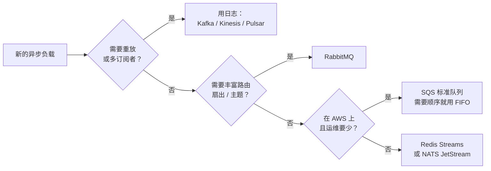
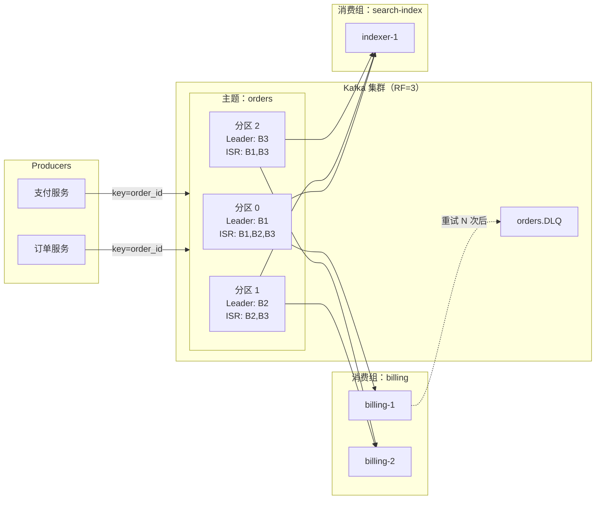
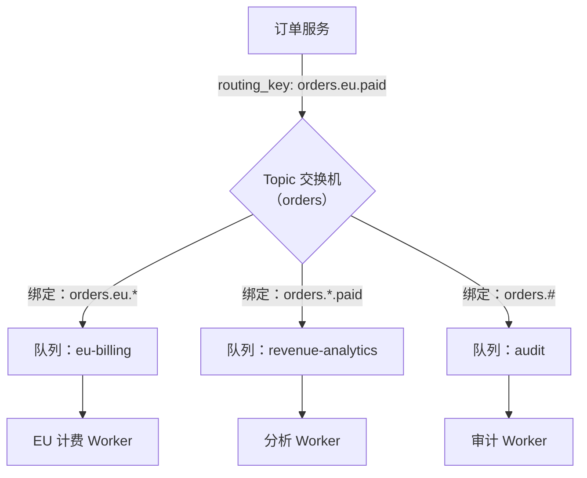
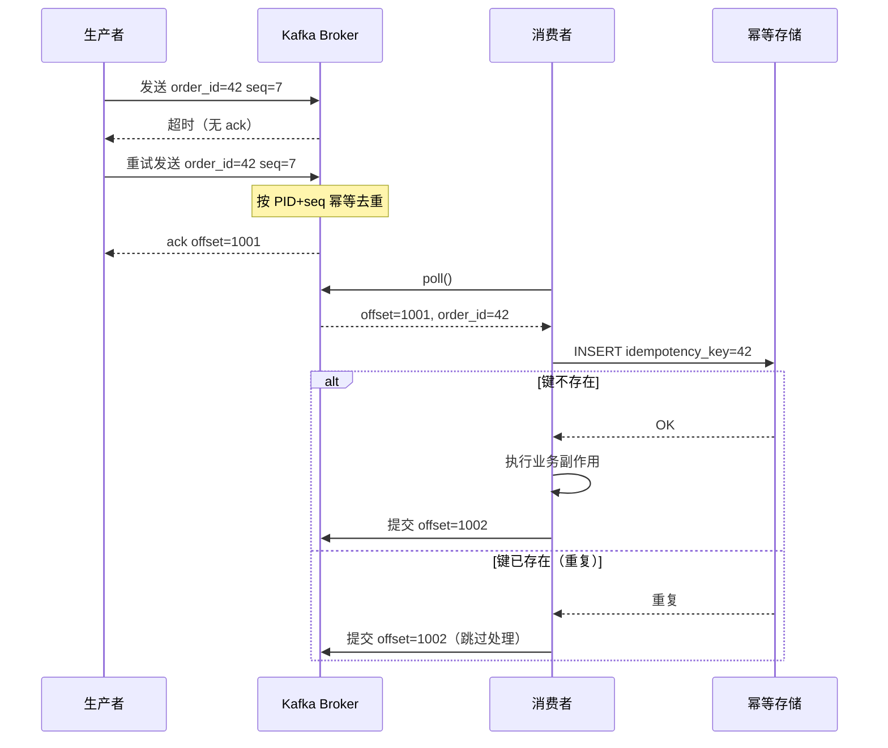

# 消息队列与流式处理：大规模解耦

> **TL;DR**: 消息系统分成两大族。**队列**（RabbitMQ、SQS）把每条消息投递给一个消费者，收到确认后就删除。**日志**（Kafka、Kinesis、Pulsar）是一份只追加、有序、持久的记录，多个消费组按各自的节奏独立读取。Jay Kreps 在 2013 年的文章里把日志重新定位为事实来源，所有下游系统的状态都从它派生[^1]。工程上真正能拿到的投递保证是至少一次加上幂等消费者；“恰好一次”只有在 Kafka 的事务边界内才能端到端成立[^2]。在超大规模下，LinkedIn 每天通过 4,000+ 个 broker 处理超过 7 万亿条消息[^3]，Netflix 则通过 Keystone 管道每天处理数千亿个事件。分区既是并行度的单位，也是消费者扩展的上限，还是顺序的边界。

## 学习目标

学完本章，你将能够：

- [ ] 区分队列与日志，并为具体负载选对其中一个
- [ ] 用幂等消费者设计至少一次投递
- [ ] 理解 Kafka 的分区、消费组与顺序保证
- [ ] 处理背压、死信队列与毒消息
- [ ] 按真实维度比较 Kafka、RabbitMQ、SQS、Kinesis 与 Pulsar
- [ ] 解释为什么分区数是不可逆的架构决策

## 直觉理解

设想邮局里的两种服务窗口。

第一种是**包裹柜台**。你把包裹交给柜员，柜员把它交给唯一一名配送司机。送达之后，回执就被碎掉了。如果你想寄同一个包裹给两个人，就得准备两个包裹。这就是队列：一条消息、一个消费者，处理完就消失。

第二种是**报纸档案馆**。每一期都印好、编号、按顺序上架。任何订阅者都能走进来，找到第 4,217 期，从那里往后读。新订阅者不必等明天的报纸，他可以从任何一期旧报开始。多一个订阅者也不会拖慢已有的读者。这就是日志：只追加、有序、可重放、支持多订阅者。

队列更简单，日志更强大。系统设计里大多数混乱，都来自你明明需要日志却伸手去拿队列，或者队列就够用却背上了日志的运维成本。

本章余下的部分，就是教你分辨这两者，并做出正确选择。

## 原理

### 队列与流：本质区别

**队列**（SQS、RabbitMQ 工作队列）跟踪每条消息的状态：可见、处理中、已确认。多个竞争消费者一起把活干得比单打独斗更快。一旦确认，消息就没了。如果你下个月新增一个消费者服务，它只能从“现在”开始，看不到任何历史[^4]。

**日志**（Kafka、Kinesis、Pulsar）保存持久的、可按偏移量寻址的段。每个消费组跟踪自己的偏移量。新增一个消费组可以从偏移量 0 重放历史，完全不影响已有消费者。日志不只是传输机制，它是事实来源——下游系统（搜索索引、缓存、数仓、微服务）都从它派生自己的状态[^1]。

*一棵务实的决策树：先看是否需要重放与扇出，再按路由复杂度和运维胃口收窄。*

需要重放、多订阅者扇出或 CDC 时，用日志。需要简单的工作分发、逐条确认、不留历史时，用队列。

### 投递保证：至多一次、至少一次、恰好一次

存在三个级别，而在大规模下只有一个说实话：

- **至多一次**（Kafka `acks=0`，发完即忘）：生产者发出就继续往下走。broker 崩溃时消息可能丢失。
- **至少一次**（实践中的默认选择）：生产者一直重试到拿到 ack。broker 崩溃时，一条消息可能被写入两次，消费者必须处理重复。Netflix 的 Keystone 管道用 `acks=1`（只等 leader 确认），这是一个务实的折中：用 leader 故障时少量丢数据的风险，换取更低的延迟和更高的可用性[^5]。
- **恰好一次**（Kafka EOS）：需要 `enable.idempotence=true`（broker 侧按生产者序列号去重）、`transactional.id`（跨分区的原子写入，并把消费者偏移量提交放进同一个事务），以及消费者使用 `isolation.level=read_committed`[^2]。相比 `acks=all` 的至少一次，吞吐开销约为 3%[^2]。

> [!IMPORTANT]
> Kafka 的恰好一次只覆盖 Kafka 到 Kafka 的管道。一旦你发起外部 RPC、写数据库或触发副作用，这条链就断了。真实系统的诚实答案：至少一次投递，加上带应用层去重键的幂等消费者。

### Kafka 架构：主题、分区、ISR、KRaft

一个 Kafka **主题（topic）** 被切成 N 个**分区（partition）**。每个分区都是一份复制日志，有一个 leader 和若干 follower。**ISR**（in-sync replicas，同步副本）是已经追上 leader 的那部分副本。

关键不变量：

- 复制因子为 3 时，`acks=all` 加 `min.insync.replicas=2` 可以保证单个 broker 故障下不丢数据[^6]。
- 生产者幂等（Kafka 3.0 起默认开启）给每个生产者分配 PID、给每个批次分配序列号；broker 借助 `max.in.flight.requests.per.connection <= 5` 对重试去重[^6]。
- 分区吞吐：生产环境每个分区 10-50 MB/s[^7]。

*生产者把带键的事件写进分区主题；两个消费组按各自的偏移量独立读取，毒消息在重试 N 次后被路由到 DLQ。*

**KRaft**（KIP-500）用基于 Raft 的内部元数据法定人数取代了 ZooKeeper。ZooKeeper 在 Kafka 3.5 中被标记为弃用，在 Kafka 4.0 中彻底移除[^8]。这让运维面上少了一整个系统，控制器的故障切换也更快。

**分层存储**（KIP-405，Kafka 3.9 起 GA）把较旧的日志段下沉到对象存储（S3、GCS），长保留期主题的存储成本大幅下降，同时近期数据仍留在本地磁盘上供热读[^9][^10]。

### RabbitMQ 与 AMQP：交换机、灵活性、路由

RabbitMQ 实现的是 AMQP 0-9-1。生产者把消息发布到**交换机（exchange）**；**绑定（binding）** 用**路由键（routing key）** 模式把队列挂到交换机上[^11]:

- **直连交换机（direct）**：路由到绑定键与路由键完全相同的队列。
- **扇出交换机（fanout）**：忽略路由键，投递给所有绑定的队列。
- **主题交换机（topic）**：使用点分路由键（`orders.eu.paid`），支持 `*`（一个词）和 `#`（零个或多个词）通配符。

*主题交换机按通配模式路由；一条消息扇出到多个队列，生产者不需要写任何复制逻辑。*

现代 RabbitMQ（3.8+）提供基于 Raft 的**仲裁队列（quorum queue）**，取代已弃用的镜像队列，故障语义清晰[^12]。但 RabbitMQ 的吞吐（每队列数万条/秒）比 Kafka（每分区数十万条/秒）低一个数量级[^13]。它是 broker，不是日志：消息一旦确认就消失，没有重放。

需要丰富路由（topic/fanout/headers）、低延迟任务分发或 RPC 式请求/响应时，用 RabbitMQ。需要持久、可重放的事件日志时，用 Kafka。

### SQS、SNS、Kinesis、Pulsar 与 Redpanda

| 系统 | 模型 | 吞吐量 | 顺序 | 运维负担 | 最适合 |
|---|---|---|---|---|---|
| SQS Standard | 队列 | 无上限 | 无 | 零（托管） | AWS 内的异步任务 |
| SQS FIFO | 队列 | 300 TPS（批量 3K，高吞吐模式 70K）[^14] | 按 MessageGroupId | 零 | AWS 内的有序任务 |
| Kinesis | 日志 | 每分片 1 MB/s 或 1K 条/秒[^15] | 按分片 | 低（托管） | AWS 原生流处理 |
| Pulsar | 日志 | 高（BookKeeper） | 按分区 | 中（broker + bookie） | 多租户、跨地域复制 |
| Redpanda | 日志 | Kafka 兼容，C++，无 JVM | 按分区 | 低（单个二进制） | 低延迟、边缘场景 |

SQS 使用**可见性超时（visibility timeout）**（默认 30s）：`ReceiveMessage` 之后，消息对其他消费者不可见。如果消费者在 `DeleteMessage` 之前崩溃，消息会重新出现。**重驱动策略（redrive policy）** 在 `maxReceiveCount` 次接收失败后把消息移入 DLQ[^16]。

在 AWS 里做扇出，把 **SNS**（发布/订阅）和 **SQS**（每个订阅者一个队列）组合起来：SNS 投递到 N 个 SQS 队列，各自独立消费。这样不跑 Kafka 也能拿到类似日志的多订阅者语义。

### 消费者模式：消费组、竞争消费者、DLQ、背压

**消费组**把分区分配给组内成员。每个组的活跃消费者不能多于分区数，这就是并行度的硬上限[^7]。

**协作式再均衡（cooperative rebalance）**（KIP-429，Kafka 2.4+）：只回收需要迁移的分区，而不是旧协议那种“stop-the-world”——任何成员变化都让所有消费者交出全部分区[^17][^18]。

**背压**通过有界的在途窗口来管理：

- Kafka：`max.poll.records` 与 `fetch.max.bytes`
- SQS：每队列 120,000 条在途消息[^19]
- RabbitMQ：prefetch（QoS）数量

**死信队列（DLQ）**：指数退避重试 N 次后，把失败记录生产到 `<topic>.DLQ`，提交偏移量，继续往下走。这就是 Hohpe 与 Woolf 在《Enterprise Integration Patterns》里写的死信通道（Dead Letter Channel）模式[^20]。对 DLQ 深度告警。再写一个重驱动工具，把修复后的消息重新注入。

**滞后监控（lag monitoring）**：日志末端偏移量与已提交偏移量之差。LinkedIn 的 [Burrow](https://github.com/linkedin/Burrow) 是这一领域的标杆消费者滞后监控器[^21]。

*生产者的重试在 broker 侧制造了一条重复消息；幂等生产者按 PID + 序列号去重，消费者则在提交偏移量之前用持久化的幂等键去重。*

## 真实案例

**LinkedIn 的 Kafka：每天 7 万亿条消息。**

LinkedIn 是 Kafka 的诞生地，至今仍是最大的公开部署。截至 2019 年，LinkedIn 运行 100 多个 Kafka 集群、4,000+ 个 broker、10 万+ 个主题、700 万个分区，每天处理超过 7 万亿条消息[^3]。最大的单集群有 140+ 个 broker、100 万个副本。

LinkedIn 的每个服务都带一个 Kafka 客户端（非 JVM 语言走 REST 代理）。事件流入区域 Kafka 集群，由 Brooklin 跨地域镜像（它取代了 MirrorMaker，在集群之间每天镜像超过 7 万亿条消息）[^22]，再被 Samza 流处理器、Hadoop、Pinot 和数百个微服务消费。

让这套系统持续运转的关键工程决策：

- **维护模式 broker**：被标记为退役的 broker 停止接收新的分区分配，SRE 可以安全地把硬件抽干，而不会引发再均衡风暴[^3]。
- **控制器内存优化**：复用 `UpdateMetadataRequest` 对象，避免在拥有数百万副本的集群里出现控制器级联故障[^3]。
- **Cruise Control**：自动化的分区再均衡与集群自愈。

失败案例同样有教益。LinkedIn 的 KIP 文档记录了若干生产问题：KIP-291（把控制器连接与数据面连接分开，避免队头阻塞）、KIP-354（日志压实滞后的上限，起因是一次压实停滞写满了磁盘）、KIP-380（在 broker 重启后识别过期的控制请求）[^3]。

教训是：在每天 7 万亿条消息的规模上，每一个配置选择（分区数、acks 设置、保留策略、再均衡策略）都是健康管道与凌晨三点告警电话之间的差别。

## 权衡

| 系统 | 吞吐量 | 顺序 | 重放 | 运维负担 | 成本模型 | 我们的选择 |
|---|---|---|---|---|---|---|
| Kafka | 每分区 10-50 MB/s | 按分区 | 完整日志重放 | 高（JVM、KRaft、磁盘） | 基础设施 + 团队 | 有序事件流、CDC、分析 |
| SQS Standard | 无上限 | 无 | 不支持 | 零 | 按请求计费 | AWS 内无需顺序的异步任务 |
| SQS FIFO | 最高 70K TPS | 按 MessageGroupId | 不支持 | 零 | 按请求计费 | AWS 内的有序工作队列 |
| RabbitMQ | 每队列数万条/秒 | 按队列 | 不支持 | 中（Erlang、仲裁队列） | 基础设施 | 丰富路由、RPC、任务分发 |
| Pulsar | 高（BookKeeper） | 按分区 | 完整重放 | 中高（broker + bookie） | 基础设施 | 多租户 SaaS、跨地域复制 |
| Kinesis | 每分片 1 MB/s | 按分片 | 最长 365 天重放 | 低（托管） | 按分片小时计费 | AWS 原生流处理、小团队 |

**决策规则**：需要分区级有序流并支持重放，用 Kafka。不需要顺序也不需要重放、想要零运维，用 SQS。需要灵活的路由模式，用 RabbitMQ。约束条件（AWS 原生或多租户）要求时，用 Kinesis 或 Pulsar。

## 常见陷阱

> [!WARNING]
> **热点分区。** 如果分区键的基数倾斜（一个客户产生 80% 的流量），一个分区扛下全部负载，其它分区闲着。监控每分区滞后。用复合键（`customer_id + order_date`）或子分区策略把热键摊开。

> [!WARNING]
> **Stop-the-world 式再均衡。** 在旧的“eager”协议下，任何一个消费者错过心跳（GC 停顿、处理太慢超过 `max.poll.interval.ms`），都会让所有消费者交出所有分区。换成 `CooperativeStickyAssignor`，并使用静态成员（`group.instance.id`），这样发布期间的 Pod 重启就不会触发再均衡[^17]。

> [!WARNING]
> **没有 DLQ 的毒消息。** 一条格式错误的消息就能卡死整个分区。消费者反序列化时崩溃、重试、再崩溃，无限循环。实现死信通道模式：指数退避重试 N 次后生产到 DLQ，提交偏移量，并告警[^20][^23]。

> [!WARNING]
> **没有背压的无界保留。** 生产者突发，消费者跟不上，滞后涨到几小时，保留期到期，数据在消费之前就被删了。用 Burrow 监控滞后[^21]。把消费者扩到分区数上限。滞后超过 `consumption_rate * X minutes` 时告警。

> [!WARNING]
> **用 Kafka 做 RPC 式请求/响应。** Kafka 是为高吞吐、高延迟的流式场景优化的。请求/响应模式需要低延迟、逐条路由和关联 ID。同步通信用 RabbitMQ 或 gRPC。在这个场景下用 Kafka，只会平白增加延迟（批处理、轮询间隔）和复杂度（回复主题、关联头）。

> [!WARNING]
> **无视消费者滞后，直到保留期到期。** 消费者滞后不是警告，是倒计时。滞后一旦超过 `retention.ms`，消息会在被消费之前删除，没有恢复的办法。告警设在保留期的 50%，不是 90%。

## 练习

> **Design Challenge**: 你要为一个金融科技平台搭建事件骨干。需求：每天 1 亿个事件，3 类消费者（欺诈检测要求亚秒级延迟，计费要求恰好一次语义，分析数仓按小时批量加载），以及金融事件严格的按用户顺序。

提示

分区键决定顺序的作用域。按用户有序意味着用 `user_id` 做分区键。但每天 1 亿的吞吐需要多少分区？又怎么让三类延迟和语义要求不同的消费者共用同一个主题？

参考答案

**吞吐估算**：每天 1 亿事件约合平均 1,157 事件/秒，峰值突发 3-5 倍（3,500-5,800/秒）。按每事件约 1 KB 算，峰值 3-6 MB/s。单个 Kafka 分区能扛 10-50 MB/s，所以单看吞吐只需要 1 个分区。但并行度更重要。

**分区数**：你需要足够的分区来并行消费者。欺诈检测要求低延迟，给它专门的消费者实例。3 类消费者加上未来扩展，起步 32 个分区，这样每组最多可以有 32 个并行消费者。

**分区键**：`user_id`。这保证一个用户的所有事件落到同一个分区，从而保住按用户顺序。用户数以百万计时，在 32 个分区上的分布大致均匀。

**一个主题上挂三个消费组**：

1. **欺诈检测**（消费组 `fraud`）：`max.poll.records=1` 读取，延迟最低。内联处理，不批处理。
2. **计费**（消费组 `billing`）：使用 Kafka 事务。读事件、把计费记录写入计费主题、原子地提交消费者偏移量。对写外部数据库那一步，在计费库里用幂等键（`event_id`）。
3. **分析**（消费组 `analytics`）：大批量读取，在内存里缓冲，每小时刷入 S3/数仓。能容忍滞后。

**DLQ 策略**：每个消费组有自己的 DLQ 主题（`events.fraud.DLQ`、`events.billing.DLQ`）。指数退避重试 3 次后生产到 DLQ 并提交偏移量。DLQ 深度 > 0 就告警。

**计费的恰好一次**：Kafka 事务生产者把读-处理-写包成一个循环。写外部数据库时，计费服务用 `INSERT ... ON CONFLICT DO NOTHING`，把 `event_id` 当幂等键。这样无论 Kafka 层面是否重复，消费者都是幂等的。

## 要点回顾

- 队列把每条消息投递给一个消费者，然后删除。日志是一份只追加、可重放的记录，多个消费组各自独立读取。
- 至少一次投递加幂等消费者，才是诚实且实用的投递保证。“恰好一次”只在 Kafka 的事务边界内端到端成立。
- 分区是并行度的单位，也是消费者扩展的上限。每个组的活跃消费者不能多于分区数。
- 顺序只在分区内部有意义。按你需要的顺序来设计分区键（通常是实体 ID）。
- 分区数几乎是永久的。事后增加会重排 `hash(key) % N`，破坏顺序保证。创建时就多留一些。
- DLQ 不是可选项。毒消息一定会出现，没有 DLQ 它们会无限期堵死整个分区。
- 有序且可重放的事件流用 Kafka。零运维的异步任务用 SQS。丰富路由与任务分发用 RabbitMQ。

## 延伸阅读

- [The Log: What every software engineer should know (Jay Kreps, 2013)](https://web.archive.org/web/20260612105408/https://engineering.linkedin.com/distributed-systems/log-what-every-software-engineer-should-know-about-real-time-datas-unifying) - 那篇奠基性文章，把消息传递重新解释为对一份持久日志的派生视图；进入这个领域之前先读它。
- [How LinkedIn customizes Apache Kafka for 7 trillion messages/day](https://engineering.linkedin.com/blog/2019/apache-kafka-trillion-messages) - 最经典的大规模运维故事；涵盖控制器调优、维护模式和 Cruise Control。
- [Exactly-Once Semantics Are Possible (Confluent, 2017)](https://www.confluent.io/blog/exactly-once-semantics-are-possible-heres-how-apache-kafka-does-it/) - 幂等生产者加事务的权威讲解；解释了 3% 开销和 Kafka 到 Kafka 的边界。
- [Scaling Slack's Job Queue](https://slack.engineering/scaling-slacks-job-queue/) - 最好的“不重写一切、增量引入 Kafka”故事；展示了把 Kafka 当作 Redis worker 前面的持久缓冲。
- [Kafka Inside Keystone Pipeline (Netflix, 2016)](https://netflixtechblog.com/kafka-inside-keystone-pipeline-dd5aeabaf6bb) - 在一个把 broker 当牲口看待的云里跑 Kafka；涵盖 `acks=1` 的权衡和冷备切换。
- [Designing Data-Intensive Applications, Ch. 11 (Kleppmann)](https://dataintensive.net/) - 消息传递与流处理的概念框架；恰好一次语义的教科书式论述。
- [Enterprise Integration Patterns (Hohpe and Woolf)](https://www.enterpriseintegrationpatterns.com/) - DLQ、路由和通道模式，人人都要糟糕地重新发明一遍；重点读死信通道和竞争消费者两个模式。
- [KIP-500: Replace ZooKeeper with Self-Managed Metadata Quorum](https://cwiki.apache.org/confluence/display/KAFKA/KIP-500%3A+Replace+ZooKeeper+with+a+Self-Managed+Metadata+Quorum) - KRaft 的设计文档；解释了为什么 ZooKeeper 是运维瓶颈。

## 记忆卡片

**Q:** 队列与日志的根本区别是什么？
**A:** 队列把每条消息投递给一个消费者，确认后删除。日志是只追加、可按偏移量寻址的序列，多个消费组可以独立读取，并可从任意位置重放。

**Q:** 对需要写外部数据库的系统，诚实的投递保证是什么？
**A:** 至少一次投递加幂等消费者。Kafka 的恰好一次只覆盖 Kafka 到 Kafka 的管道；任何外部副作用都会打破事务边界。

**Q:** 为什么 Kafka 的分区数几乎是永久的？
**A:** 因为默认分区器用 `murmur2(key) % N`。增加分区会改变 N，重排每个键的分区归属，破坏顺序保证，并产生重复处理的窗口。

**Q:** ISR 是什么，`min.insync.replicas=2` 为什么重要？
**A:** ISR（in-sync replicas，同步副本）是已追上 leader 的副本集合。复制因子为 3 时，`acks=all` 加 `min.insync.replicas=2` 要求至少两个副本确认，写入才算提交，从而保证单 broker 故障下不丢数据。

**Q:** 协作式再均衡与 eager 再均衡有什么区别？
**A:** eager 再均衡（旧版）在任何成员变化时从所有消费者回收所有分区，造成 stop-the-world 停顿。协作式再均衡（KIP-429，Kafka 2.4+）只回收需要迁移的分区，迁移期间大多数消费者仍在处理。

**Q:** 死信队列模式是什么？
**A:** 指数退避重试 N 次后，把失败记录生产到专门的 DLQ 主题，提交偏移量，继续往下走。这样一条毒消息不会堵死整个分区。要对 DLQ 深度告警，并做一个重驱动工具。

**Q:** 什么时候该用 RabbitMQ 而不是 Kafka？
**A:** 需要丰富路由（topic/fanout/headers 交换机）、低延迟任务分发或 RPC 式请求/响应时。RabbitMQ 是路由灵活的 broker，不是可重放的持久日志。

**Q:** 32 个分区的 Kafka 主题，最大消费者并行度是多少？
**A:** 每个消费组 32 个消费者。活跃消费者不能多于分区数，多出来的就闲着。

**Q:** SQS FIFO 的顺序是怎么工作的？
**A:** SQS FIFO 在同一个 `MessageGroupId` 内保序，相同组 ID 的消息按顺序投递。不同组 ID 并行处理，从而把有序工作横向扩展。

**Q:** Kafka 的恰好一次（事务生产者）会带来多少吞吐开销？
**A:** 相比至少一次大约降低 3%。代价来自事务协调，以及 `read_committed` 消费者要等提交标记。

**Q:** Netflix Keystone 用 `acks=1` 而不是 `acks=all`，权衡是什么？
**A:** `acks=1` 意味着只有 leader 确认写入。如果 leader 在 follower 复制之前崩溃，数据就丢了。Netflix 接受这点丢数据风险，换取更低的延迟和更高的可用性。

**Q:** 消费者滞后是什么，为什么危险？
**A:** 滞后是日志末端偏移量与消费者已提交偏移量之差。滞后一旦超过 `retention.ms`，消息会在被消费之前删除，无法恢复。

**Q:** LinkedIn 是怎么扛住每天 7 万亿条消息的？
**A:** 100+ 个 Kafka 集群、4,000+ 个 broker、700 万个分区。关键做法：维护模式 broker 实现安全退役，Cruise Control 做自动再均衡，Brooklin 做跨集群镜像，控制器内存优化防止级联故障。

**Q:** 分层存储（KIP-405）解决什么问题？
**A:** 它把较旧的日志段下沉到对象存储（S3/GCS），长保留期主题的存储成本大幅下降，近期数据仍留在本地磁盘上做低延迟读取。

**Q:** 什么时候该用 SQS 而不是 Kafka？
**A:** 需要零运维负担、按请求计费，且不需要顺序、重放或多订阅者扇出时。AWS 里简单的异步任务处理，SQS 是正确选择。

## 参考文献

[^1]: Jay Kreps, "The Log: What every software engineer should know about real-time data's unifying abstraction", LinkedIn Engineering, 2013. https://web.archive.org/web/20260612105408/https://engineering.linkedin.com/distributed-systems/log-what-every-software-engineer-should-know-about-real-time-datas-unifying
[^2]: Neha Narkhede, Guozhang Wang, "Exactly-Once Semantics Are Possible: Here's How Kafka Does It", Confluent Blog, 2017. https://www.confluent.io/blog/exactly-once-semantics-are-possible-heres-how-apache-kafka-does-it/
[^3]: Jon Lee, Wesley Wu, "How LinkedIn customizes Apache Kafka for 7 trillion messages per day", LinkedIn Engineering, October 2019. https://engineering.linkedin.com/blog/2019/apache-kafka-trillion-messages
[^4]: AWS, "Amazon SQS queue types". https://docs.aws.amazon.com/AWSSimpleQueueService/latest/SQSDeveloperGuide/sqs-queue-types.html
[^5]: Real-Time Data Infrastructure Team, "Kafka Inside Keystone Pipeline", Netflix Tech Blog, April 2016. https://netflixtechblog.com/kafka-inside-keystone-pipeline-dd5aeabaf6bb
[^6]: Apache Kafka project, ProducerConfig.java source, clients module. https://github.com/apache/kafka/blob/trunk/clients/src/main/java/org/apache/kafka/clients/producer/ProducerConfig.java
[^7]: Jun Rao, "How to Choose the Number of Topics/Partitions in a Kafka Cluster?", Confluent Blog, March 2015. https://www.confluent.io/blog/how-choose-number-topics-partitions-kafka-cluster/
[^8]: KIP-500: Replace ZooKeeper with a Self-Managed Metadata Quorum. https://cwiki.apache.org/confluence/display/KAFKA/KIP-500%3A+Replace+ZooKeeper+with+a+Self-Managed+Metadata+Quorum
[^9]: KIP-405: Kafka Tiered Storage. https://cwiki.apache.org/confluence/display/KAFKA/KIP-405%3A+Kafka+Tiered+Storage
[^10]: Apache Kafka, "Tiered Storage Operations". https://kafka.apache.org/39/operations/tiered-storage/
[^11]: RabbitMQ, "Exchanges". https://www.rabbitmq.com/docs/exchanges
[^12]: RabbitMQ, "Quorum Queues". https://www.rabbitmq.com/docs/quorum-queues
[^13]: Quix, "Redpanda vs Kafka". https://quix.io/blog/redpanda-vs-kafka-comparison
[^14]: AWS, "Amazon SQS high throughput FIFO queues". https://docs.aws.amazon.com/AWSSimpleQueueService/latest/SQSDeveloperGuide/high-throughput-fifo.html
[^15]: AWS, "Amazon Kinesis Data Streams: working with streams and shards". https://docs.aws.amazon.com/streams/latest/dev/working-with-streams.html
[^16]: AWS, "Amazon SQS visibility timeout". https://docs.aws.amazon.com/AWSSimpleQueueService/latest/SQSDeveloperGuide/sqs-visibility-timeout.html
[^17]: Apache Kafka, CooperativeStickyAssignor.java source. https://github.com/apache/kafka/blob/trunk/clients/src/main/java/org/apache/kafka/clients/consumer/CooperativeStickyAssignor.java
[^18]: KIP-429: Kafka Consumer Incremental Rebalance Protocol. https://cwiki.apache.org/confluence/display/KAFKA/KIP-429%3A+Kafka+Consumer+Incremental+Rebalance+Protocol
[^19]: AWS, "SQS message quotas". https://docs.aws.amazon.com/AWSSimpleQueueService/latest/SQSDeveloperGuide/quotas-messages.html
[^20]: Gregor Hohpe, Bobby Woolf, "Dead Letter Channel" pattern, Enterprise Integration Patterns. https://www.enterpriseintegrationpatterns.com/patterns/messaging/DeadLetterChannel.html
[^21]: LinkedIn, Burrow: Kafka Consumer Lag Checking. https://github.com/linkedin/Burrow
[^22]: LinkedIn Engineering, "Replicating large-scale Kafka clusters at LinkedIn with Brooklin". https://engineering.linkedin.com/blog/2022/load-balanced-brooklin-mirror-maker--replicating-large-scale-kaf
[^23]: Codelit, "Handling Failed Messages at Scale: Dead Letter Queue patterns". https://codelit.io/blog/dead-letter-queue-patterns
