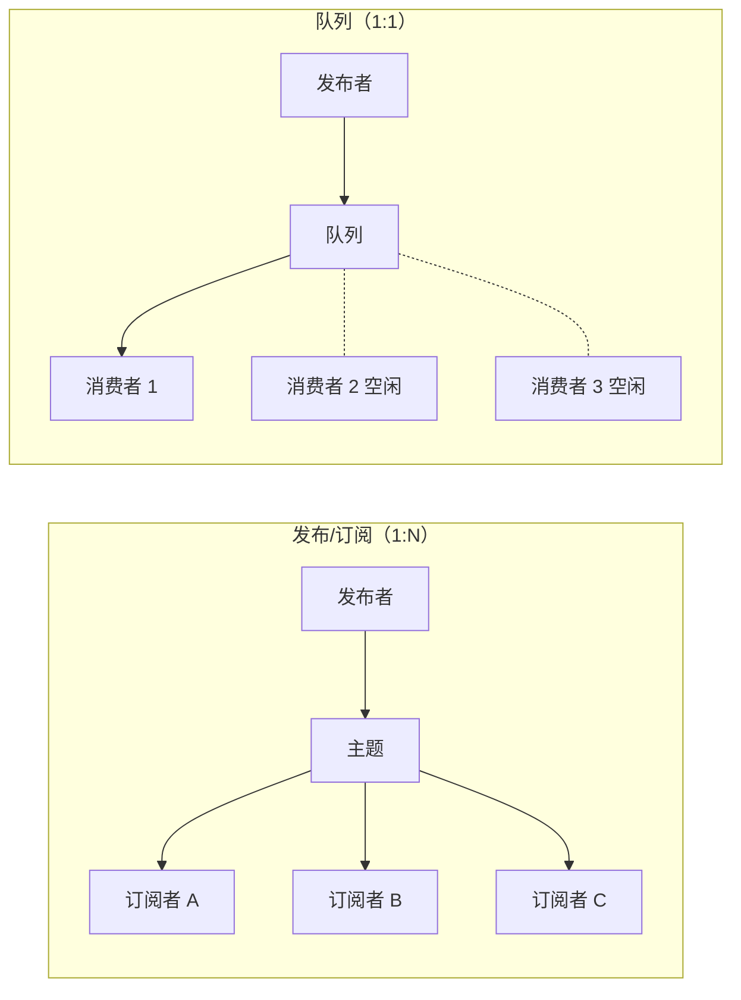
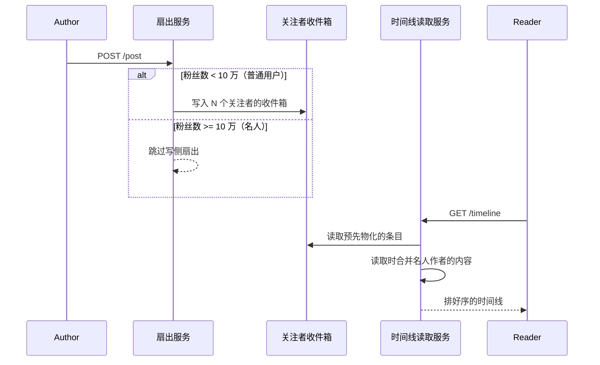
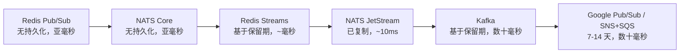
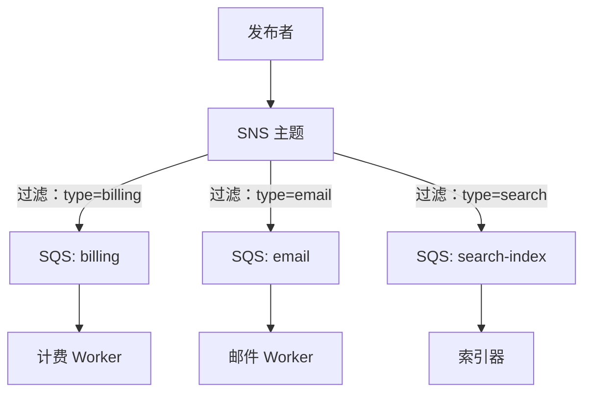
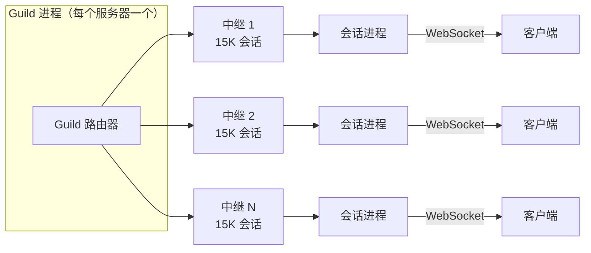

# 发布/订阅：扇出与事件驱动系统

> **TL;DR**：发布/订阅是 1:N 的消息模式：发布者把消息发到某个主题，Broker 再把消息复制给每一个订阅[^1]。它是队列（1:1）的“广播”表亲。最关键的设计维度是持久性、延迟与成本三者的权衡。Redis Pub/Sub 在亚毫秒内送达，但订阅者一断开就会静默丢消息[^2]。Google Cloud Pub/Sub 在确认之前先把消息复制到法定人数（多数派）的集群，内部支撑每秒 5 亿条以上的消息[^3]。Kafka 给你重放和消费者组，但要求你提前规划分区[^4]。要尽力而为的实时投递就用 Redis Pub/Sub；要可重放的持久扇出就用 Kafka；在 AWS 上又不想自己运维，就用 SNS+SQS。

## 学习目标

学完本章，你将能够：

- [ ] 区分发布/订阅、队列和点对点消息
- [ ] 根据消费者行为和规模，选择推模式还是拉模式投递
- [ ] 在内存型（Redis、NATS）与持久型（Kafka、Google Pub/Sub、SNS+SQS）底座之间做选择
- [ ] 设计能扛住“名人问题”、又不会让写放大爆炸的扇出策略
- [ ] 在不要求全局顺序（它本来就不可扩展）的前提下实现按键保序
- [ ] 识别 Redis Pub/Sub 会在什么情况下静默丢消息，以及该换用什么

## 直觉理解

想想广播电台。主持人对着麦克风说话，信号同时送到每一台调好频的收音机。主持人不知道有多少听众，不会等每个人确认收到，也不会为晚开收音机的人重播。你错过了早上 8 点的新闻，那就是错过了。

再想想订报纸。报社印一版，给名单上每个订户寄一份。新订户从明天的报纸开始收，而不是昨天的。如果信箱塞满了，报纸就堆着（或者被投递员扔掉）。

发布/订阅同时是这两种模型，取决于你选哪套系统。Redis Pub/Sub 是电台：发完就不管，瞬时，没有记忆。Kafka 是带档案室的报纸：每一版都有编号并上架，新订户可以从第 1 版开始读。

本章剩下的部分，就是教你在什么时候选电台、什么时候选报纸，以及把两者搞混时会炸在哪里。

## 原理

### 发布/订阅模式

一个发布/订阅系统有四个角色：**发布者**（publisher）负责发出消息，**主题**（topic，一个有名字的通道），**订阅**（subscription，一种兴趣表达式），以及**订阅者**（subscriber），接收匹配到的消息副本。每个订阅都会拿到每条匹配消息的一份属于自己的副本。这就是它与队列的根本区别：队列把每条消息投给恰好一个相互竞争的消费者；发布/订阅把每条消息投给每一个订阅者[^1]。

*发布/订阅主题把每条消息复制给每一个订阅，而队列把每条消息只投给一个相互竞争的消费者。*

订阅可以是**持久的**（durable，订阅者断开后仍然存在：Google Pub/Sub、Kafka 消费者组、`CleanStart=0` 的 MQTT），也可以是**短暂的**（ephemeral，断开即消失：Redis Pub/Sub、NATS Core）[^3][^5]。过滤通常基于主题（订阅 `orders.us`），可以带通配符（MQTT 的 `+` 匹配一层，`#` 匹配多层），也可以基于内容，用消息属性上的过滤谓词实现（SNS 过滤策略、Google Pub/Sub 过滤表达式）[^6][^7]。

### 主流系统对比

并非所有发布/订阅系统都能互换。它们分布在一条从“快而有损”到“持久而笨重”的光谱上：

| 系统 | 持久性 | 顺序 | 投递 | 吞吐量 | 最适合 |
|---|---|---|---|---|---|
| Redis Pub/Sub | 无 | 按连接 | 至多一次 | 高（受单线程限制）[^8] | 缓存失效、在线状态 |
| NATS Core | 无 | 按发布者 | 至多一次 | 亚毫秒 | 微服务事件、IoT |
| Redis Streams | 基于保留期 | 按流 | 至少一次 | 高 | 轻量级持久化发布/订阅 |
| NATS JetStream | 已复制 | 按流 | 至少一次 / 精确一次 | ~10ms | 云原生消息 |
| Kafka | 基于保留期 | 按分区 | 至少一次（可选 EOS） | 通常每分区数十 MB/s[^4] | 分析 + 应用事件 |
| Google Cloud Pub/Sub | 7 天（未确认） | 按排序键 | 至少一次（拉模式下可精确一次） | 内部 5 亿+ 条/秒[^3] | 跨服务云端事件 |
| SNS + SQS | SQS：最长 14 天 | SNS Standard：无；FIFO：按组 | 至少一次 | SNS FIFO：每组 300 条/秒；每主题 3K 条/秒（默认）[^9] | AWS 原生扇出 |
| MQTT | 取决于 Broker | 按发布者（QoS 1/2） | QoS 0/1/2[^10] | 不定 | IoT、受限设备 |

丢一条消息可以接受时（缓存失效、正在输入提示），用 Redis Pub/Sub。需要重放、顺序，以及多个消费者组各自独立推进时，用 Kafka。想拿到 AWS 上的持久扇出又不想自己跑基础设施，就用 SNS+SQS。

### 投递语义

存在三种语义，而只有一种在大规模下是诚实的：

- **至多一次**（Redis Pub/Sub、NATS Core）：Broker 把消息写进订阅者的 socket 就不管了。订阅者断线或处理得慢，消息就没了。没有重试、没有确认、没有持久化[^2]。
- **至少一次**（Google Pub/Sub、SNS+SQS、Kafka 默认）：Broker 反复重试，直到订阅者确认。发布端重试、Broker 在确认过程中崩溃、消费者产生副作用后未提交就崩溃，这些情况下都可能出现重复[^3][^4]。
- **精确一次**（Kafka EOS、Google Pub/Sub 仅拉模式、MQTT QoS 2）：只在单个系统边界内成立。一旦你发起外部 RPC 或写数据库，这条链就断了[^4][^11]。MQTT QoS 2 用四包握手（PUBLISH/PUBREC/PUBREL/PUBCOMP），每条消息要 4 次网络往返，吞吐量相比 QoS 0 明显下降[^10]。

> [!IMPORTANT]
> 对真实系统来说，诚实的答案是：至少一次投递 + 幂等的消费者。把消息的唯一 ID（SNS 的 `MessageId`、Kafka 的 offset+partition、Pub/Sub 的 `messageId`）存进去重表，或者用幂等的 upsert。这个责任在消费者，不在 Broker。

### 扇出策略

当一个生产者有 N 个关注者，怎么保证这 N 个人都看到事件？这就是扇出问题，有三种解法：

**写时扇出（推）：** 发布时就把消息插进每个关注者的收件箱。Twitter 2013 年的设计用一个 Redis 集群，每条时间线是一条 800 条目的链表；发一条有 20,000 粉丝的推文意味着 20,000 次 LPUSH。这让时间线读取达到 300K QPS[^12]。失败模式是：Lady Gaga 在 2013 年有 3,100 万粉丝，一条推文的端到端长尾延迟最高到 5 分钟[^12]。

**读时扇出（拉）：** 发布时什么都不做。读取时去查每个被关注作者的时间线再合并。LinkedIn 的 FollowFeed 用的就是这种办法，实测数据集规模相比预先物化降低了 62 倍[^13]。

**混合：** 普通用户走推，名人走拉。Twitter 明确停止对“高价值用户”做扇出，改为在读取时合并，省下“几十个百分点的计算资源”[^12]。

*普通作者在写时把内容推进收件箱；名人作者的内容在读取时合并进来，从而给写放大设了上限。*

### 推模式与拉模式

**推**（push，由 Broker 发起）：投递延迟最低，没有轮询开销。Google Pub/Sub 的推订阅把每条消息 POST 到 HTTPS 端点。AWS SNS 对订阅者只支持推（HTTP、SQS、Lambda）。MQTT 是 Broker 向订阅者推[^14][^9][^10]。

**拉**（pull，由订阅者轮询）：订阅者自己控制速率，大批量能带来高吞吐。Kafka 消费者组在设计上只支持拉。Google Pub/Sub 建议“每秒 GB 级”的负载用拉模式[^14]。

权衡在于：推对消费者更简单（“有事发生我的代码就跑”），但需要流控协议来应付慢订阅者。拉增加了客户端侧的复杂度（游标管理、确认截止时间续期、再均衡处理），但把消费者的慢和 Broker 的健康解耦了。

延迟重要、订阅者处理得快，就用推。吞吐量重要、订阅者处理速度参差不齐，就用拉。第 [2.10 实时通信](./10-real-time-communication.md) 章讲消费侧的投递机制（WebSocket、SSE、长轮询）。

### 持久性光谱

发布/订阅系统沿着一条清晰的光谱，用持久性换延迟：

*发布/订阅系统用持久性换延迟；挑你的用例能忍受的那个点。*

**Redis Pub/Sub** 毫无持久性：“发布出去的消息会蒸发，不管当时有没有订阅者”[^2]。断开的订阅者永远失去那些消息。Redis Streams（`XADD`/`XREADGROUP`）补上了一个带消费者组的持久化追加日志[^15]。

**SNS+SQS** 是 AWS 的持久性套路：SNS 是纯推、不存消息，但订阅的 SQS 队列能把消息留最多 14 天。订阅者宕机不会丢数据[^16]。

**Google Cloud Pub/Sub** 在确认之前把每次发布复制到法定人数的集群。在数据平面上，消息写进 N 个集群，每个集群内再写进 M 块磁盘；只要写进至少一半集群就确认发布[^3]。未确认的消息保留 7 天，支持基于 seek 的重放。

*一次 SNS 发布扇出到 N 个 SQS 队列；每个队列由独立的消费者按自己的节奏消费。在 SNS 侧评估过滤策略，就不会把消息送出去只为了让订阅者丢掉它们[^7]。*

## 真实案例

**Discord：在单个服务器里向 100 万+ 同时在线用户扇出。**

Discord 的 Midjourney 服务器有超过 1,000 万成员，同时在线 100 万+[^17]。每条消息、每次在线状态更新、每个语音事件都必须扇出到该服务器内所有已连接的会话。这是平方级的：一个 10 万人的服务器，每人发 1 条消息就是 100 亿次通知。

Discord 的架构用 Elixir（Erlang/BEAM），每个服务器一个进程作为中心路由器。每个在线用户有一个会话进程。服务器进程持有会话列表，把每个事件扇出到每个会话，会话再通过 WebSocket 转发给客户端。

三个优化让这件事变得可行：

1. **被动会话。** 大服务器里约 90% 的用户-服务器连接被标记为“被动”。这些连接跳过逐消息的权限检查和载荷序列化，只有当用户把该服务器切到前台时才接收事件。这 90% 的被动比例带来了约 3 倍的社区规模上限余量[^17]。

2. **中继进程。** 不让服务器进程直接发给所有会话，而是在服务器和会话之间插入中继进程。每个中继最多处理 15,000 个在线会话，把扇出拆分到多个 Erlang 进程上。

3. **Manifold Offload。** 把网络发送移到独立的发送进程，当某个中继的网络缓冲区堆起来时，服务器进程不会被 BEAM 的背压拖住[^17]。

*Discord 的 Guild 进程经由中继层扇出，每层处理 15,000 个会话，避免中心路由器的平方级成本。*

扇出是本地的（Erlang 消息传递，进程内），逐会话那一步不走网络。成本是调度加上权限检查，不是 TCP 往返。在 Elixir 不可变数据结构成为瓶颈的地方，Discord 换成了 Rust NIF：在 25 万元素时，原生 Elixir `ordsets` 最坏情况插入要 27,000 微秒。Discord 自己实现的 Elixir `OrderedSet`（类似跳表的结构）把它降到 4-640 微秒。最终的 Rust `SortedSet` NIF 在 5,000 到 1,000,000 元素的各个规模下，插入只要 0.61-3.68 微秒[^18]。

教训是：在极端扇出下，发布/订阅的原语不是 Broker，而是进程内消息传递，配上精心分层，把平方级成本压到可控。

## 权衡

| 方案 | 持久性 | 顺序 | 延迟 | 运维成本 | 我们的选择 |
|---|---|---|---|---|---|
| Redis Pub/Sub | 无 | 按连接 | 亚毫秒 | 低 | 缓存失效、正在输入提示 |
| Kafka（消费者组） | 基于保留期 | 按分区 | 数十毫秒 | 高（JVM、磁盘） | 可重放的有序事件流 |
| SNS + SQS | SQS：14 天 | Standard：无；FIFO：按组 | 数十毫秒 | 零（托管） | AWS 原生持久扇出 |
| Google Cloud Pub/Sub | 7 天 | 按排序键 | 数十毫秒 | 零（托管） | GCP 原生跨服务事件 |
| NATS JetStream | 已复制 | 按流 | ~10ms | 低（单个二进制） | 轻量级持久消息 |

**决策规则：** 丢消息可以接受的临时通知，用 Redis Pub/Sub。需要重放、按键保序和多个独立消费者组，用 Kafka。在 AWS 上想要持久扇出又不想跑基础设施，用 SNS+SQS。在 GCP 上就用 Google Pub/Sub。想要 Kafka 的语义但不想背 Kafka 的运维，用 NATS JetStream。

## 常见陷阱

> [!WARNING]
> **Redis Pub/Sub 的静默丢消息。** Redis Pub/Sub 是发完就不管：没有持久化，没有逐订阅者的队列。订阅者的 socket 缓冲区满了，或者 TCP 连接断了，消息就静默丢了。默认没有报错、没有日志、没有指标。把 `PUBLISH` 的返回值和预期的订阅者数量对一下，并对客户端输出缓冲区驱逐告警[^2][^15]。

> [!WARNING]
> **无界扇出（名人问题）。** 纯写时扇出是 O(每次发布的粉丝数)。Twitter 上 3,100 万粉丝的 Lady Gaga，会产生 3,100 万次 LPUSH，端到端最长 5 分钟[^12]。设一个粉丝数阈值，超过就走拉。读取时合并和排序，相比 N 次写入便宜得多。

> [!WARNING]
> **缺顺序保证。** 多数发布/订阅系统只保证按分区（Kafka）、按排序键（Google Pub/Sub）有序，或者根本不保证（SNS Standard、Redis Pub/Sub 跨发布者）[^4][^19]。永远按实体 ID（user_id、order_id）分区。全局顺序不可扩展，而且几乎从来不需要。

> [!WARNING]
> **僵尸订阅者造成背压。** 推订阅上一个慢的或已死的订阅者会把 Broker 堵住。Google Pub/Sub 限制每个推订阅的未完成消息数，并在 N 次失败后用重试退避转投到死信主题[^14]。自建 Broker 的话，要么给每个订阅者单独缓冲，要么改用拉模式。

> [!WARNING]
> **至少一次加上不幂等的消费者。** 同一条消息处理两次意味着重复扣款、重复邮件、计数器多加一次。至少一次是实际上的默认，重复会在发布端重试、Broker 确认过程中崩溃、消费者产生副作用后未提交就崩溃时出现[^3][^4]。把消息的唯一 ID 存进去重表。

> [!WARNING]
> **一个主题只干一件事。** 把不相关的事件类型堆在一个主题里，会逼每个订阅者过滤并丢弃无关消息。这浪费带宽，让 schema 演进变复杂，也没法为不同事件类型设置各自的排序键。不同领域用不同主题。

## 练习

> **设计挑战：** 你要为一个 1 亿用户的社交应用做通知扇出。每个用户平均每天产生 10 个事件（发帖、点赞、评论）。每个事件都必须送到所有关注者。平均每个用户有 200 个关注者；0.1% 的用户有 100 万+ 关注者。你必须保证按用户保序（同一个用户的事件按创建顺序到达）。设计这套发布/订阅架构：选底座、估算吞吐量、处理名人问题，并说明你的保序策略。

提示

按用户保序意味着分区键必须是作者的用户 ID。名人问题意味着你不能对所有用户都做写时扇出。想想什么阈值触发切换到拉模式，以及读路径如何合并两个来源。

解答

**吞吐量估算：** 1 亿用户 × 每天 10 个事件 = 每天 10 亿个事件。平均 200 个关注者的扇出，如果纯写时扇出，就是每天 2,000 亿次收件箱写入。也就是平均每秒 230 万次写，3 倍峰值时每秒 700 万次。纯推太贵了。

**混合策略：** 把名人阈值设在 10,000 关注者。阈值以下的用户走写时扇出（发布时把事件推进每个关注者的收件箱）。阈值以上的用户跳过写侧扇出，他们的事件在读取时合并进来。

**底座选择：** 事件总线用 Kafka（持久、按分区有序、新消费者可重放）。按 `author_user_id` 分区以保证按用户保序。每天 10 亿事件、每个约 500 字节，平均约 6 MB/s。64 个分区有舒服的余量。

**扇出服务：** 从 Kafka 消费。对每个事件查作者的关注者数。低于阈值就执行 N 次写入到关注者的收件箱存储（Redis Sorted Set 或 Cassandra）。高于阈值就只写作者自己的时间线存储。

**读路径：** 时间线读取服务先取用户预先物化的收件箱，再合并被关注名人的近期事件（对他们的时间线存储做分散-汇聚）。按事件时间戳排序，按 event_id 去重。

**顺序保证：** Kafka 的按分区顺序保证同一作者的事件按序到达扇出服务。收件箱存储保留插入顺序。读取时按时间戳合并排序，维持因果顺序。

**名人阈值调优：** 每天重新评估。账号越过阈值后停止对新事件做扇出（旧的收件箱条目保留）。读时合并延迟的 P99 超过 200ms 就告警，说明拉模式这一层名人太多了。

## 要点回顾

- 发布/订阅就是扇出：每个订阅者拿到每条匹配的消息。它不是负载均衡器。
- Redis Pub/Sub 是短暂的，会静默丢消息。投递有要求时用 Streams、Kafka 或 SNS+SQS。
- 写时扇出读得快，但遇到名人就崩。社交网络规模下必须用混合方案（普通人走推，名人走拉）。
- 全局顺序不可扩展。按设计按键保序（user_id、order_id），接受跨键事件无序。
- 推对消费者更简单，拉对 Broker 更简单。看你希望把慢消费者吸收在哪一侧。
- SNS+SQS 是 AWS 上最简单的持久扇出，不跑基础设施就能解决大部分问题。
- 至少一次加幂等消费者才是诚实的投递保证。“精确一次”只在单个系统边界内成立。

## 延伸阅读

- [Google Cloud Pub/Sub Architectural Overview](https://cloud.google.com/pubsub/architecture)——云上发布/订阅服务最好的一篇一手架构文档；讲清了数据面/控制面拆分、法定人数写入和一致性哈希。
- [Fanout Amazon SNS notifications to Amazon SQS queues](https://docs.aws.amazon.com/sns/latest/dg/sns-sqs-as-subscriber.html)——AWS 官方扇出模式，带 JSON 信封示例；在 AWS 上做持久扇出的“正确默认”。
- [The Architecture Twitter Uses to Deal with 150M Active Users](https://highscalability.com/the-architecture-twitter-uses-to-deal-with-150m-active-users/)——Raffi Krikorian 2013 年演讲的整理稿；名人问题的起源故事，扇出延迟有具体数字。
- [Discord: Maxjourney - Pushing Discord's Limits](https://discord.com/blog/maxjourney-pushing-discords-limits-with-a-million-plus-online-users-in-a-single-server)——Elixir 的 Guild 扇出、被动会话、中继分层；100 万+ 同时在线时平方级扇出成本讲得最清楚的一篇。
- [LinkedIn FollowFeed](https://engineering.linkedin.com/blog/2016/03/followfeed--linkedin-s-feed-made-faster-and-smarter)——大规模读时扇出配分散-汇聚 Broker；展示了相比预先物化 62 倍的数据缩减。
- [Slack Engineering: Real-time Messaging](https://slack.engineering/real-time-messaging/)——Channel Server / Gateway Server / 一致性哈希；单机 1,600 万通道的聊天生产级发布/订阅。
- [Enterprise Integration Patterns: Publish-Subscribe Channel](https://www.enterpriseintegrationpatterns.com/patterns/messaging/PublishSubscribeChannel.html)——Hohpe 和 Woolf 2003 年的原始模式定义；讲形式语义最好的一页纸参考资料，至今没被超越。
- [OASIS MQTT 5 Specification](https://docs.oasis-open.org/mqtt/mqtt/v5.0/mqtt-v5.0.html)——IoT 领域的标准发布/订阅协议；读它是为了 QoS 0/1/2 的语义和精确一次投递的代价。

## 记忆卡片

**Q:** 发布/订阅和消息队列的根本区别是什么？
**A:** 队列把每条消息投给恰好一个相互竞争的消费者。发布/订阅把每条消息的一份副本投给注册在该主题上的每一个订阅者。

**Q:** 为什么 Redis Pub/Sub 用在任何在意丢消息的场景里都很危险？
**A:** Redis Pub/Sub 是发完就不管，毫无持久性。订阅者断线或 socket 缓冲区写满，消息就静默丢了，没有重试、没有报错，默认也没有指标。

**Q:** 发布/订阅系统有哪三种投递语义？
**A:** 至多一次（消息可能丢，但绝不重复）、至少一次（消息投递一次或多次，可能重复）、精确一次（消息只投递一次，且只在单个系统边界内能做到）。

**Q:** 写时扇出里的名人问题是什么？
**A:** 当一个有几百万粉丝的用户发布内容时，系统必须执行几百万次写入到关注者收件箱。Twitter 上 3,100 万粉丝的 Lady Gaga，每条推文造成最高 5 分钟的端到端长尾延迟。

**Q:** 混合扇出策略怎么解决名人问题？
**A:** 普通用户（低于关注者阈值）走写时扇出，读得快。名人用户跳过写侧扇出，他们的内容在读时通过分散-汇聚合并进来，从而给写放大设了上限。

**Q:** 多数发布/订阅系统提供什么顺序保证？
**A:** 只有按键或按分区的顺序。Kafka 保证按分区有序。Google Pub/Sub 提供按排序键有序。全局顺序不可扩展，因为它需要单个分区或定序器。

**Q:** SNS+SQS 的扇出模式是什么？
**A:** 发布者发到 SNS 主题。SNS 评估过滤策略，投递到 N 个订阅的 SQS 队列。每个队列由独立的消费者按自己的节奏消费。SNS 负责推式扇出，SQS 负责持久缓冲。

**Q:** Discord 为什么把 90% 的 Guild 连接标记为“被动”？
**A:** 被动会话跳过逐消息的权限检查和载荷序列化，只有用户把该服务器切到前台时才接收事件。这大约把逐事件扇出成本降到十分之一，换来约 3 倍的社区规模上限余量。

**Q:** 什么时候该用拉模式而不是推模式？
**A:** 吞吐量比延迟更重要时，订阅者处理速度参差不齐时，或者需要由订阅者自己限速时。Kafka 正是因为这一点在设计上只支持拉。

**Q:** 对于会写外部数据库的系统，诚实的投递保证是什么？
**A:** 至少一次投递配幂等消费者。精确一次只在单个系统边界内成立（Kafka 到 Kafka，或 Google Pub/Sub 仅拉模式）。任何外部副作用都会打断这条事务链。

**Q:** Google Cloud Pub/Sub 怎么实现它的持久性保证？
**A:** 确认之前把每次发布复制到法定人数的集群。消息写入 N 个集群，每个集群内再写入 M 块磁盘；只要写进至少一半集群就确认发布。

**Q:** Google Cloud Pub/Sub 和 SQS 对未确认消息的最长保留时间分别是多少？
**A:** Google Cloud Pub/Sub 保留未确认消息 7 天。SQS 保留消息最长 14 天。

**Q:** 为什么“一个主题只干一件事”很重要？
**A:** 把不相关的事件类型堆进一个主题，会逼每个订阅者过滤并丢弃无关消息，浪费带宽，让 schema 演进变复杂，并且使按事件类型设排序键变得不可能。

**Q:** SNS FIFO 支持多少吞吐量？
**A:** 默认每个消息组每秒 300 条，每个主题每秒 3,000 条（或 10 MB/s，取先到者）。高吞吐模式（把 `FifoThroughputScope` 设为 `MessageGroup`）在美国东部（弗吉尼亚北部）区域可达到每账号每秒 30,000 条。不需要严格顺序时，用 SNS Standard 配 SQS 拿更高吞吐。

**Q:** Slack 的 Channel Server 架构怎么为聊天实现发布/订阅？
**A:** 消息经一致性哈希路由到某个 Channel Server（CS），它在内存里持有通道状态。CS 广播给跨区域订阅该通道的每个 Gateway Server（GS）。每个 GS 推给已连接的 WebSocket 客户端。峰值：单台 CS 主机 1,600 万通道，全球投递 500ms 以内。

## 参考文献

[^1]: Hohpe and Woolf, Enterprise Integration Patterns, Publish-Subscribe Channel. https://www.enterpriseintegrationpatterns.com/patterns/messaging/PublishSubscribeChannel.html
[^2]: Redis, Pub/Sub. https://redis.io/docs/latest/develop/pubsub/
[^3]: Google Cloud, Architectural overview of Pub/Sub. https://cloud.google.com/pubsub/architecture
[^4]: Apache Kafka Documentation. https://kafka.apache.org/documentation/
[^5]: NATS Docs, Core NATS. https://docs.nats.io/nats-concepts/core-nats
[^6]: Google Cloud Pub/Sub product page, Key features. https://cloud.google.com/pubsub
[^7]: AWS, Amazon SNS message filtering. https://docs.aws.amazon.com/sns/latest/dg/sns-message-filtering.html
[^8]: Redis Labs Knowledge Base, Reducing CPU and Server Load Caused by Redis Pub/Sub Traffic. https://support.redislabs.com/hc/en-us/articles/34110927418002-Reducing-CPU-and-Server-Load-Caused-by-Redis-Pub-Sub-Traffic
[^9]: AWS, Amazon SNS Features. https://aws.amazon.com/sns/features/
[^10]: OASIS, MQTT Version 5.0 Specification. https://docs.oasis-open.org/mqtt/mqtt/v5.0/mqtt-v5.0.html
[^11]: Google Cloud, Exactly-once delivery. https://cloud.google.com/pubsub/docs/exactly-once-delivery
[^12]: Todd Hoff (High Scalability), The Architecture Twitter Uses to Deal with 150M Active Users, 300K QPS, a 22 MB/S Firehose. https://highscalability.com/the-architecture-twitter-uses-to-deal-with-150m-active-users/
[^13]: Ankit Gupta et al. (LinkedIn Engineering), FollowFeed: LinkedIn's Feed Made Faster and Smarter. https://engineering.linkedin.com/blog/2016/03/followfeed--linkedin-s-feed-made-faster-and-smarter
[^14]: Google Cloud, Choose a subscription type (pull vs push vs export). https://cloud.google.com/pubsub/docs/subscriber
[^15]: Redis, Introduction to Redis Streams. https://redis.io/docs/latest/develop/data-types/streams/
[^16]: AWS, Fanout Amazon SNS notifications to Amazon SQS queues. https://docs.aws.amazon.com/sns/latest/dg/sns-sqs-as-subscriber.html
[^17]: Yuliy Pisetsky (Discord), Maxjourney: Pushing Discord's Limits with a Million+ Online Users in a Single Server. https://discord.com/blog/maxjourney-pushing-discords-limits-with-a-million-plus-online-users-in-a-single-server
[^18]: Matt Nowack (Discord), Using Rust to Scale Elixir for 11 Million Concurrent Users. https://discord.com/blog/using-rust-to-scale-elixir-for-11-million-concurrent-users
[^19]: Google Cloud, Ordering messages. https://cloud.google.com/pubsub/docs/ordering
