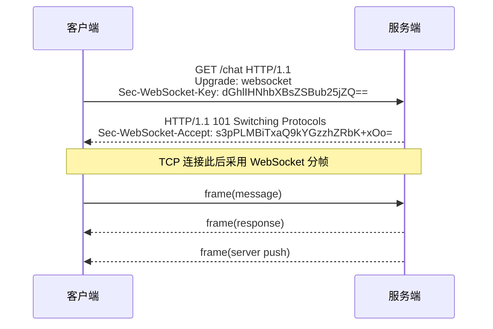
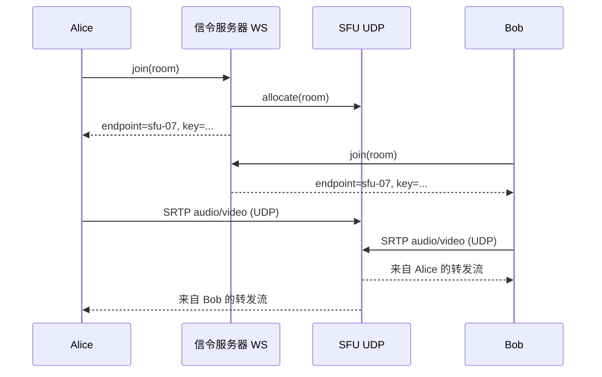
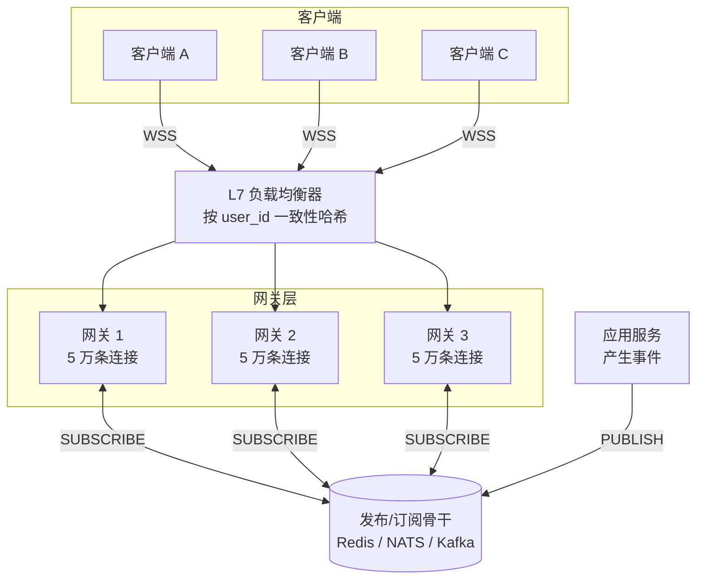
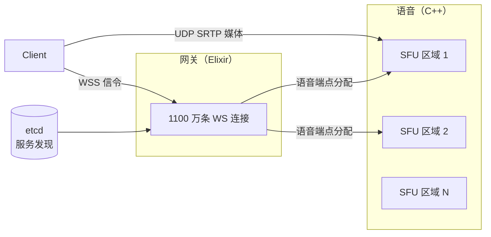

# 实时通信：WebSocket、SSE 与长轮询

> **TL;DR**: Web 上的"实时"不是一种协议，而是五种，每一种都在简洁性与延迟、基础设施成本之间做不同的权衡。长轮询能穿过任何代理，但每条消息都要重付一遍头部开销。SSE 提供单向的服务端推送，还自带免费的重连。WebSocket（RFC 6455）做到全双工，每帧封装开销只有 2 到 14 字节[^1]。WebRTC 提供几十毫秒级的点对点媒体传输，但需要 STUN/TURN 基础设施[^2]。MQTT 让 IoT 设备以 2 字节开销拿到投递保证[^3]。双向聊天和协同编辑用 WebSocket；服务端到客户端的看板用 SSE；语音视频用 WebRTC；受限设备用 MQTT。对所有这些持久连接系统来说，扩展维度都是单个网关的内存，而不是请求吞吐量。

## 学习目标

学完本模块，你将能够：

- [ ] 针对具体场景，在轮询、长轮询、SSE、WebSocket、WebRTC 与 MQTT 之间做出选择
- [ ] 讲清 WebSocket 的升级握手与帧格式（RFC 6455）
- [ ] 用会话保持路由加发布/订阅骨干，横向扩展一个 WebSocket 服务
- [ ] 设计带序号恢复机制的重连、续传与消息重放协议
- [ ] 识别并缓解慢消费者带来的背压
- [ ] 分析每条连接的资源成本（文件描述符、TCP 缓冲区、堆内存）

## 直觉理解

想象两种确认朋友在不在家的办法。第一种：每五分钟走到他家门口敲一次门。大部分往返都是白跑。这就是轮询。

第二种：打电话过去，一直不挂。对方一有话要说，你立刻就能听到。不用反复跑，也不浪费力气。但整段时间你都占着一条电话线，而电话公司按线路收费。

这就是实时通信的核心张力。HTTP 的请求-响应模型就是反复敲门：无状态、可扩展，但两次请求之间它是瞎的。持久连接（WebSocket、SSE）则是那条不挂的电话线：投递即时，但每一条打开的线路都占着一个文件描述符、一块 TCP 缓冲区，以及服务器内存里的一个位置。在 10 万条连接、Linux TCP 缓冲区取默认值的情况下，应用还没分配一个字节，socket 就已经吃掉 19 GB 以上的内核内存[^4]。

本章余下的部分讲的就是：该挑哪条"电话线"，怎么把上百万条线路一直挂着而不把服务器烧穿，以及当有人意外挂断时你该怎么办。

## 原理

### HTTP 请求-响应模型的问题

HTTP 在设计上就是半双工。客户端说话，服务端回答，连接结束。如果服务端五秒后有了新数据，它没有任何办法主动触达客户端。客户端只能再问一次。

对一个每秒更新一次的股票行情来看，轮询意味着每个客户端每秒一次 HTTP 往返。每次往返携带着几百字节的头部，只为了几个字节的负载。到 10 万个客户端，那就是每秒 10 万个纯属开销的请求[^5]。

Web 需要服务端推送。于是出现了五种机制，每一种都落在"简洁性 ↔ 能力"这条光谱上的不同位置。

### 长轮询

长轮询是最简单的服务端推送土办法。客户端发一个 GET 请求，服务端把它挂住（把协程或线程停在那里），直到有数据到达或超时（通常是 30 到 60 秒）。服务端返回响应，客户端立刻再连一次[^5]。

它能穿过任何代理、防火墙和企业的中间设备，因为每条消息都是一个普通的 HTTP 响应。不需要协议升级，不需要特殊的负载均衡器配置。代价是：每条消息都要付一次带完整头部的 HTTP 往返，而且上一个响应和下一个请求之间有一小段空档，消息可能就丢在这段空档里[^5]。

把长轮询当作兜底方案，用在 WebSocket 被封的环境里（企业代理、老旧基础设施）。

### Server-Sent Events（SSE）

SSE 是由 WHATWG HTML Living Standard 定义的单向、服务端到客户端流式协议。客户端发起一个标准的 HTTP GET；服务端用 `Content-Type: text/event-stream` 响应并保持连接不关，事件一到就写 `data:` 行[^6]。

杀手级特性：自动重连并能续传。浏览器的 `EventSource` API 在断线后会自动重连，并把 `Last-Event-ID` 带回服务端，服务端据此重放漏掉的事件。`retry:` 字段让服务端可以控制退避节奏。每 15 秒发一行 keep-alive 注释（`:`），就能躲过代理的空闲超时[^6]。

局限：SSE 只能服务端到客户端。客户端到服务端仍然要另外发 fetch 或 XHR。在 HTTP/1.1 上，浏览器对同一源的连接数上限是 6，所以同开多个标签页连同一个 SSE 端点会把这份额度耗光。HTTP/2 的多路复用解决了这个问题，但又在单条 TCP 连接上引入队头阻塞[^6]。

实时看板、行情推送、通知流、日志 tail 这类客户端只读的场景，用 SSE。

### WebSocket（RFC 6455）

WebSocket 是全双工的答案。客户端发一个 HTTP/1.1 的 `Upgrade: websocket` 请求，带一个随机的 `Sec-WebSocket-Key`。服务端回 101 Switching Protocols 和一个 `Sec-WebSocket-Accept` 值（把 key 与一个固定 GUID 拼接后取 SHA-1，再 base64 编码）。握手完成后，这条 TCP 连接就切换到二进制分帧协议[^7][^1]。

*WebSocket 握手把一条 HTTP 连接升级成全双工分帧连接；101 之后，两端各自独立发送。*

每条消息都包在一个 2 到 14 字节的帧头里。客户端到服务端的帧会用随机的 32 位密钥做掩码（防止缓存投毒）。ping/pong 帧用来保活。RFC 7692 通过协商扩展加入了按消息的 deflate 压缩[^7][^1]。

子协议字段（`Sec-WebSocket-Protocol`）让你可以独立地对应用层协议做版本管理：Socket.IO、STOMP、GraphQL-WS、MQTT-over-WS 全都跑在 WebSocket 分帧之上[^7]。

RFC 8441（2018）借助 Extended CONNECT，让 WebSocket 能跑在 HTTP/2 上。RFC 9220（2022）用同样的思路支持 HTTP/3 over QUIC，让一条 WebSocket 独占一个 QUIC 流，与普通请求并行[^8][^9]。QUIC 的连接迁移能让 WebSocket 在 Wi-Fi 切到蜂窝网络时不断线，因为 QUIC 用连接 ID 而不是五元组来标识连接[^9]。

### HTTP/2 Push（已废弃）与 HTTP/3

HTTP/2 Server Push 已经死了。2022 年 10 月，Chrome 106 默认关闭了它，此前测得的采用率是 1.25%，随后跌到 0.7%，而且性能影响常常是负的[^10]。它本来是个缓存预热机制（推送关联资源），不是发布/订阅通道。指望"HTTP/2 Push"能像 WebSocket 那样投递的工程师会发现，浏览器根本不理这些流量。

它原本那个用例的替代品是 HTTP 103 Early Hints 配上 `Link: rel=preload` 头部。要做服务端到客户端的流式推送，用 SSE 或 WebSocket[^10]。

HTTP/3 over QUIC 对实时场景很重要，因为它消除了跨流的队头阻塞。某条 WebSocket 流上丢了一个包，不会拖住共用同一条 UDP 连接的其他流[^11]。不过 UDP 在一些企业网络里被封，所以 HTTP/3 需要一条可靠的 HTTP/1.1 回退路径。

### 用于点对点媒体的 WebRTC

WebRTC 是一套浏览器原生的规范，覆盖媒体采集、编解码、NAT 穿透和点对点传输。它不定义信令。对端之间通过你自备的通道交换 SDP offer 和 ICE candidate（通常是你服务器上的一条 WebSocket）[^12]。

ICE 会按顺序尝试三条路径：直连 UDP（host candidate）、STUN（服务器告诉客户端它的公网 IP）、以及 NAT 打洞失败时的 TURN（经服务器中继）。媒体走 SRTP；DataChannel 走 DTLS over UDP 之上的 SCTP[^12]。

*WebRTC 的信令走你的 WebSocket；媒体直接走 UDP 到 SFU，在直连路径上通常能做到几十毫秒的传输延迟。*

规模一大，点对点网状结构就不现实了：超过大约 4 到 6 个参与者，每个对端都要发 N-1 路流（总带宽按 N*(N-1) 增长）。生产系统改用选择性转发单元（SFU），每个发送者的流只收一次，然后按订阅者转发，不做转码[^2]。

语音视频通话、游戏、低延迟数据同步用 WebRTC。要给 TURN 带宽留预算：在 NAT 限制严格的网络里，估计有 10% 到 20% 的通话需要中继[^12]。

### 面向 IoT 的 MQTT

MQTT 是一个发布/订阅的线路协议（OASIS 标准），专为受限设备设计，每消息开销最低只有 2 字节。客户端通过 TCP（或 WebSocket）连到一个中心 broker。三个 QoS 等级控制投递语义[^3]：

- **QoS 0**：发完不管（一个 PUBLISH，零确认）
- **QoS 1**：至少一次（PUBLISH 后 PUBACK；没确认就重传）
- **QoS 2**：恰好一次，靠四次报文握手（PUBLISH、PUBREC、PUBREL、PUBCOMP）

QoS 2 在学术上很有意思，实践中很少用。大多数 IoT 部署用 QoS 1 加应用层去重，因为 QoS 2 那四次往返的成本对高频遥测来说无法承受[^3]。AWS IoT Core 宣称支持数十亿设备、路由数万亿条消息[^16]。

IoT 遥测、车队追踪、工业传感器这类电池寿命和带宽比延迟更重要的场景，用 MQTT。

### 扩展实时连接

根本挑战在于：一条持久连接把用户钉死在某个特定进程上。你不能把下一条消息轮询给任意一台服务器。扩展需要三样东西：

1. **会话保持路由。** 负载均衡器对 user_id（或一个签名的续传 token）做哈希，让重连落回同一个网关。L7 负载均衡器（Envoy、Nginx）必须能识别 WebSocket，否则会把空闲连接关掉[^13]。

2. **发布/订阅骨干。** 当用户 A 给用户 B 发消息，而两人在不同网关上，骨干（Redis Pub/Sub、NATS、Kafka）负责把事件路由到 B 所在的网关。每个网关订阅与其在线用户相关的频道[^14][^15]。

3. **内核调优。** 每条 WebSocket 是一个文件描述符加上 TCP 发送/接收缓冲区。在 Linux TCP 缓冲区默认上限下（接收约 128 KB，发送约 64 KB），10 万条连接可以吃掉几十 GB 的内核内存。生产系统会把基本空闲的 socket 的 `tcp_rmem` 和 `tcp_wmem` 调到 4-16 KB，把 `fs.file-max` 提到 1200 万以上，并把 `ulimit -n` 设为 2000 万[^4]。

*会话保持路由把每个客户端钉在一个网关上；发布/订阅骨干让任意网关都能投递任意频道的消息。*

优雅发布时：正在下线的网关会发一个 WebSocket 关闭帧，code 1001，并附带提示（例如新的端点 URL）。客户端以指数退避加抖动的节奏重连，避免惊群[^13][^17]。

## 真实案例

**Discord：Elixir 上 1100 万并发用户，WebRTC 上超过 260 万并发语音用户。**

每一个在线的 Discord 客户端都持有到 Gateway 服务的一条 WebSocket，该服务用 Elixir 写在 BEAM 虚拟机上。峰值时它扛着 1100 万并发用户[^18]。BEAM 的轻量进程模型（每条连接一个 Erlang 进程，由调度器在多个核之间协作式调度）让这件事在没有线程池耗尽的情况下成为可能。

当 Elixir 的不可变数据结构在规模上成为瓶颈时，Discord 用 Rustler 把关键路径换成了 Rust NIF。用于公会成员列表的有序集合，把最坏情况下的插入从 640 微秒（自研 Elixir `OrderedSet`，25 万元素）降到 Rust 实现的 3.68 微秒（在 5000 到 100 万个元素区间测过）[^18]。

语音方面，Discord 跑着独立的一批服务器：13 个区域、850 多台，承载 260 万以上并发语音用户、220 Gbps 以上的出流量、每秒 1.2 亿个数据包[^19]。他们完全跳过了标准的 WebRTC ICE 协商。每个客户端直连一个 C++ 写的 SFU（选择性转发单元），端点由 etcd 里的服务发现分配。这消除了 NAT 穿透的复杂度，也让客户端 IP 对其他参与者不可见（用于 DDoS 防御）[^19]。

这套架构把信令（Elixir，走已有的网关 WebSocket）和媒体（C++，走 UDP）分开。如果 SFU 崩了，信令进程会重建状态并把新端点推给客户端，不需要整体重连[^19]。

语音服务器的 DDoS 缓解：Discord 检测到流量尖峰后，把该节点从 etcd 服务发现里摘掉，把语音状态迁到新服务器，再通过网关 WebSocket 通知客户端新端点。这套流程是自动化的，日常在跑[^19]。

*Discord 把信令（Elixir 的 WebSocket 网关）和媒体（C++ 的 SFU，走 UDP）分开，各自独立扩展。*

教训是：在 Discord 的体量上，WebSocket 网关是一层路由和在线状态。重活（媒体转发、有序集合操作）都甩给用更合适语言写的专用进程。

## 权衡

| 方案 | 方向 | 开销 | 重连 | 最佳场景 | 我们的选择 |
|---|---|---|---|---|---|
| 长轮询 | 双向（但很别扭） | 每条消息都要完整 HTTP 头部 | 客户端立即重新 GET | WebSocket 被封时的兜底；老旧代理 | 仅作兜底 |
| SSE | 服务端到客户端 | HTTP 流，自动重连 | 内置 Last-Event-ID | 看板、行情、通知 | 只需服务端推送的场景 |
| WebSocket | 全双工 | 每帧 2-14 字节 | 手写（续传 token + 重放） | 聊天、多人游戏、协同编辑 | 双向实时的默认选择 |
| WebRTC | 点对点 | UDP、SRTP | ICE 重启 | 语音视频、游戏、P2P 数据 | 媒体与超低延迟数据 |
| MQTT | 发布/订阅（broker） | 最低 2 字节 | 持久会话（QoS 1/2） | IoT、受限设备、车队遥测 | 需要投递保证的 IoT |

**决策规则：** 只需要服务端到客户端，就从 SSE 开始。一旦需要双向通信或二进制分帧，就换 WebSocket。只有在做媒体、或者需要 50 毫秒以内的 P2P 延迟时才用 WebRTC。电池和带宽是首要约束的 IoT 设备用 MQTT。

## 常见陷阱

> [!WARNING]
> **负载均衡器的空闲超时会杀掉 WebSocket。** 大多数 L4/L7 负载均衡器默认空闲超时是 60 秒。一条 61 秒没有流量的 WebSocket 会被静默关闭。把空闲超时配成能识别 WebSocket 的值（5 分钟以上），并且每 30 秒发一次 ping/pong 帧保活。

> [!WARNING]
> **重连时的惊群。** 网关重启时，所有断开的客户端会同时重连。固定 1 秒延迟的朴素客户端会在 100 毫秒的窗口里制造出 10 万条连接的尖峰。用带全抖动的指数退避：`sleep = random(0, min(cap, base * 2^attempt))`[^13][^17]。Slack 的 Flannel 在边缘层直接返回缓存的团队数据，不向源站扇出，从而吸收了重连风暴[^14]。

> [!WARNING]
> **单连接内存耗尽。** 每条 WebSocket 是一个文件描述符加上 TCP 缓冲区，按默认上限可以到约 192 KB。10 万条连接就是几十 GB 内核内存，而你的应用还没分配一个字节。把空闲 socket 的 `tcp_rmem` 和 `tcp_wmem` 调到 4-16 KB。Phoenix 团队在冲向 200 万连接的路上反复撞上这堵墙[^4]。

> [!WARNING]
> **会话保持会在移动端换 IP 时失效。** 按源 IP 哈希，在移动客户端从 Wi-Fi 切到蜂窝网络时就崩了。改用签名的续传 token（user_id + 最后序号）作为会话保持的键。把近期消息的滑动窗口持久化到 Redis，这样任意网关都能在续传时重放[^15]。

> [!WARNING]
> **慢消费者上的背压。** 网络差的移动客户端停止 ACK，服务端的内核发送缓冲区被填满，朴素的服务器无上限地排队，RSS 一路涨到 OOM。要按客户端检查 `getBufferedAmount()`（或等价物）。超过阈值（例如 1 MB）时，要么丢掉非关键事件（正在输入之类的指示），要么断开并在续传提示里让客户端拉快照[^20]。

> [!WARNING]
> **HTTP/1.1 上 SSE 的浏览器 6 连接上限。** 同开多个标签页连同一个 SSE 端点会耗光单源连接额度，用户看到的是"卡住"的标签页。多标签页应用要么用 HTTP/2（多路复用流），要么改用 WebSocket[^6]。

## 练习

> **设计挑战：** 你要为 1000 万并发用户做实时聊天。消息必须在 P99 100 毫秒以内送达。用户在断网后要能优雅重连，且不丢消息。系统必须在网关发布时做到用户无感。请设计协议选型、网关架构、发布/订阅骨干和重连策略。

提示

想想网关进程重启时会发生什么。"旧网关死掉"到"客户端连上新网关"之间的那些消息在哪里？你需要在网关进程之外有一个持久缓冲。

解答

**协议选型：** 双向消息用 WebSocket。SSE 不够，因为客户端也要发消息。

**网关架构：** 一批近似无状态的网关服务器，每台扛 20 万到 50 万条连接（内核调优过，TCP 缓冲区 8-16 KB）。L7 负载均衡器（Envoy）对签名过的会话 token 做一致性哈希。每个网关在发布/订阅骨干上订阅相关频道。

**发布/订阅骨干：** Redis Streams（不要用 Redis Pub/Sub，它在断连时会丢消息）。每个频道是一个 Redis Stream，键为 `channel:{id}`。网关通过 `XREADGROUP` 订阅。消息保留一个可配置的窗口（例如 24 小时）。

**重连策略：** 每条消息在每个频道内携带单调递增的序号。重连时客户端发 `last_ack=N`。新网关向 Redis Streams 查询序号大于 N 的消息，先重放，再切回实时流。这样网络断连和网关发布两种情况都能覆盖。

**优雅发布：** 正在下线的网关发 WebSocket 关闭码 1001，body 里带一个 JSON，包含新的网关端点（来自负载均衡器的健康检查）。客户端带抖动退避重连（基数 100 毫秒，上限 5 秒）。发布/订阅骨干保证切换期间不丢消息，因为它们持久化在 Redis Streams 里，与网关生命周期无关。

**容量估算：** 1000 万连接 / 每网关 50 万 = 至少 20 个网关实例。按发布和尖峰留 3 倍余量：60 个网关。每个网关需要约 8 GB 内存（50 万连接 * 16 KB 缓冲）。Redis Streams 集群按峰值写 QPS 定容（假设每秒 100 万条消息、每条 500 字节 = 500 MB/s，分片到 10 个 Redis 节点上）。

## 要点回顾

- 双向实时默认用 WebSocket。只做服务端到客户端的场景，SSE 被低估了，而且不需要任何客户端库。
- WebSocket 握手就是一次标准的 HTTP Upgrade；101 之后，每消息的分帧开销降到 2-14 字节。
- 持久连接服务的扩展瓶颈在单网关资源（文件描述符、TCP 缓冲区、堆），不在请求吞吐量。要调内核。
- 会话保持路由加发布/订阅骨干，是 WebSocket 集群横向扩展的标准范式。
- 从第一天起就把重连设计进协议：序号、服务端消息缓冲、带抖动的指数退避。
- HTTP/2 Server Push 已经死了（Chrome 106，2022）。别把它和服务端到客户端流式推送混为一谈。
- WebRTC 不是 WebSocket 的替代品。它是点对点的媒体层，底层还有一条 WebSocket 信令通道。

## 延伸阅读

- [RFC 6455：WebSocket 协议](https://datatracker.ietf.org/doc/html/rfc6455) - 权威规范；读第 4 节（握手）、第 5 节（分帧）和第 7 节（关闭），就能明白你的库替你抽象掉了什么。
- [Server-Sent Events，WHATWG HTML Living Standard](https://html.spec.whatwg.org/multipage/server-sent-events.html) - 包含解析算法和 Last-Event-ID 语义；短得出乎意料，也读得下去。
- [Discord：用 Rust 扩展 Elixir 支撑 1100 万并发用户](https://discord.com/blog/using-rust-to-scale-elixir-for-11-million-concurrent-users) - 具体的 Rust NIF 数据和让 Discord 网关成为可能的 BEAM 调优。
- [Discord：如何用 WebRTC 支撑 250 万并发语音用户](https://discord.com/blog/how-discord-handles-two-and-half-million-concurrent-voice-users-using-webrtc) - 关于生产级 SFU 架构与 DDoS 自动化最公开的一手描述。
- [Slack Engineering：Flannel 边缘缓存](https://slack.engineering/flannel-an-application-level-edge-cache/) - 400 万同时连接下的重连风暴缓解；面向 WebSocket 元数据的边缘缓存范式。
- [Phoenix 冲上 200 万 WebSocket 连接之路](https://phoenixframework.org/blog/the-road-to-2-million-websocket-connections) - 深入的内核调优、BEAM 虚拟机的故事，以及你在奔向上百万连接途中会撞到的每一处资源天花板。
- [WebRTC for the Curious（Sean DuBois）](https://webrtcforthecurious.com/) - 免费书；对从没碰过 WebRTC 的工程师来说，是 ICE/STUN/TURN/SDP 最好的入门读物。
- [uWebSockets.js 背压示例](https://github.com/uNetworking/uWebSockets.js/blob/master/examples/Backpressure.mjs) - 所有 WebSocket 库里最诚实的一句注释："Any slow receiver can DOS your whole server if you are not taking backpressure into account."

## 记忆卡片

**Q:** WebSocket（RFC 6455）的单消息分帧开销是多少？
**A:** 每帧 2 到 14 字节，取决于负载长度以及是否做掩码（客户端到服务端的帧总是用 4 字节密钥掩码）。

**Q:** WebSocket 握手是怎么工作的？
**A:** 客户端发一个 HTTP/1.1 GET，带 `Upgrade: websocket` 和一个随机的 `Sec-WebSocket-Key`。服务端回 101 Switching Protocols 和 `Sec-WebSocket-Accept`（key + 固定 GUID 的 SHA-1，base64 编码）。101 之后，这条 TCP 连接就用 WebSocket 分帧。

**Q:** 做服务端到客户端推送时，SSE 相比 WebSocket 的关键优势是什么？
**A:** SSE 在浏览器的 `EventSource` API 里内置了自动重连与 `Last-Event-ID` 续传。不需要客户端库，能穿过任何 HTTP 代理，而且服务端可以通过 `retry:` 字段控制重试节奏。

**Q:** 为什么 HTTP/2 Server Push 不适合做实时流式推送？
**A:** 它是给关联资源做缓存预热的机制，不是发布/订阅通道。由于采用率太低（1.25%，跌到 0.7%）且性能影响常常是负的，Chrome 106 在 2022 年 10 月默认关闭了它。

**Q:** 横向扩展 WebSocket 需要哪三样东西？
**A:** （1）会话保持路由，让重连落回同一个网关；（2）发布/订阅骨干，让任意网关都能投递任意频道的消息；（3）内核调优，以支撑每进程几十万个文件描述符和被缩小的 TCP 缓冲区。

**Q:** Discord 在规模上怎么做到不做 ICE 协商就用 WebRTC？
**A:** 每个客户端直连一个 C++ 的 SFU，端点通过 etcd 服务发现分配。因为所有对端连的都是 SFU（而不是彼此），NAT 穿透是确定性的，ICE 就不必要了。这顺便隐藏了客户端 IP，用于 DDoS 防御。

**Q:** WebSocket 服务器里的背压是什么，怎么处理？
**A:** 慢客户端停止 ACK 时，服务端的内核发送缓冲区被填满，应用层队列无上限增长。处理办法是按客户端检查 `getBufferedAmount()`；超过阈值就丢掉非关键事件，或断开并给出续传提示。

**Q:** 支撑上百万 WebSocket 连接必须调哪些内核参数？
**A:** 提高 `fs.file-max`（1200 万以上）、`ulimit -n`（2000 万），并缩小每个 socket 的 TCP 缓冲区（`tcp_rmem`、`tcp_wmem` 调到 4-16 KB），好让空闲 socket 塞进内存。Phoenix 团队记录了他们冲向 200 万连接途中撞到的每一处天花板。

**Q:** 什么时候该用 MQTT 而不是 WebSocket？
**A:** IoT 和受限设备场景，电池寿命和带宽比延迟更重要。MQTT 最低 2 字节开销，有 QoS 等级提供投递保证，有持久会话让离线订阅者补收，还有 broker 管理的主题路由。

**Q:** WebSocket 系统里的惊群问题是什么？
**A:** 网关重启时，所有断开的客户端同时重连，把存活的网关和鉴权服务打爆。缓解手段是客户端侧指数退避加全抖动，以及边缘缓存（如 Slack 的 Flannel）吸收重连期的元数据请求、不打到源站。

**Q:** SSE 如何应对断连期间漏掉的消息？
**A:** 每个事件带一个 `id:` 字段。重连时浏览器在请求头里发 `Last-Event-ID`，服务端重放所有 ID 大于该值的事件。

**Q:** 在 HTTP/1.1 上影响 SSE 的浏览器连接上限是多少？
**A:** 浏览器对同一源的 HTTP/1.1 连接数上限是 6。多个标签页连同一个 SSE 端点会把这份额度耗光，导致标签页"卡住"。HTTP/2 多路复用通过让多条流共用一条 TCP 连接来解决。

**Q:** MQTT 的三个 QoS 等级分别是什么？
**A:** QoS 0 是发完不管（无确认）。QoS 1 是至少一次（PUBLISH + PUBACK，没确认就重传）。QoS 2 是恰好一次，靠四次报文握手（PUBLISH、PUBREC、PUBREL、PUBCOMP）。实践中大多数部署用 QoS 1 加应用层去重。

**Q:** Phoenix 在一台 40 核服务器上做到了多少并发 WebSocket 连接？
**A:** 一台 40 核、128 GB 的机器上 200 万条连接，当时受限于 `ulimit`。关键调优：`fs.file-max=12000500`、`ulimit -n 20000000`，以及把每个 socket 的 TCP 缓冲区缩到 4-16 KB。

**Q:** 在原本的资源提示用例上，什么取代了 HTTP/2 Server Push？
**A:** HTTP 103 Early Hints 配 `Link: rel=preload` 头部。服务端在还在计算真正响应的同时，先发一个带预加载提示的预备响应。

## 参考文献

[^1]: I. Fette and A. Melnikov, "The WebSocket Protocol", RFC 6455, IETF, 2011 年 12 月. https://datatracker.ietf.org/doc/html/rfc6455
[^2]: Mazed, "Scaling WebRTC for Thousands of Concurrent Voice Agents". https://www.mazed.ai/blog/scaling-webrtc-concurrent-voice-agents
[^3]: HiveMQ, "What is MQTT Quality of Service (QoS) 0,1, & 2? MQTT Essentials Part 6". https://www.hivemq.com/blog/mqtt-essentials-part-6-mqtt-quality-of-service-levels/
[^4]: Gary Rennie, "The Road to 2 Million Websocket Connections in Phoenix", Phoenix Framework blog, 2015 年 11 月. https://phoenixframework.org/blog/the-road-to-2-million-websocket-connections
[^5]: WebSocket.org comparison guides, "WebSockets vs Long Polling" and "WebSockets vs SSE". https://websocket.org/guides/websocket-protocol/
[^6]: WHATWG, "HTML Living Standard, section 9.2 Server-sent events". https://html.spec.whatwg.org/multipage/server-sent-events.html
[^7]: Matthew O'Riordan, "WebSocket Protocol: RFC 6455 Handshake, Frames & More", WebSocket.org. https://websocket.org/guides/websocket-protocol/
[^8]: P. McManus, "Bootstrapping WebSockets with HTTP/2", RFC 8441, IETF, 2018 年 9 月. https://datatracker.ietf.org/doc/html/rfc8441
[^9]: R. Hamilton, "Bootstrapping WebSockets with HTTP/3", RFC 9220, IETF, 2022 年 6 月. https://www.rfc-editor.org/rfc/rfc9220
[^10]: Barry Pollard, "Remove HTTP/2 Server Push from Chrome", Chrome for Developers blog, 2022 年 8 月. https://developer.chrome.com/blog/removing-push
[^11]: HTTP.dev, "HTTP/3 explained"（RFC 9114 摘要）. https://http.dev/3
[^12]: MDN Web Docs, "Introduction to WebRTC protocols". https://developer.mozilla.org/en-US/docs/Web/API/WebRTC_API/Protocols
[^13]: Matthew O'Riordan, "WebSocket Reconnection: State Sync and Recovery Guide", WebSocket.org, 2026 年 3 月. https://websocket.org/guides/reconnection/
[^14]: Bing Wei, "Flannel: An Application-Level Edge Cache to Make Slack Scale", Slack Engineering, 2017. https://slack.engineering/flannel-an-application-level-edge-cache/
[^15]: Sameera Thangudu, "Real-time Messaging", Slack Engineering, 2023 年 4 月. https://slack.engineering/real-time-messaging/
[^16]: AWS, "AWS IoT Core documentation and pricing". https://aws.amazon.com/iot-core/pricing/
[^17]: Evil Martians, "Connection avalanche safety tips and prepping for real-time applications". https://evilmartians.com/chronicles/connection-avalanche-safety-tips-and-prepping-for-realtime-applications
[^18]: Matt Nowack, "Using Rust to Scale Elixir for 11 Million Concurrent Users", Discord Engineering, 2019 年 5 月. https://discord.com/blog/using-rust-to-scale-elixir-for-11-million-concurrent-users
[^19]: Jozsef Vass, "How Discord Handles Two and Half Million Concurrent Voice Users using WebRTC", Discord Engineering, 2018 年 9 月. https://discord.com/blog/how-discord-handles-two-and-half-million-concurrent-voice-users-using-webrtc
[^20]: uNetworking, "uWebSockets.js Backpressure example", GitHub. https://github.com/uNetworking/uWebSockets.js/blob/master/examples/Backpressure.mjs
