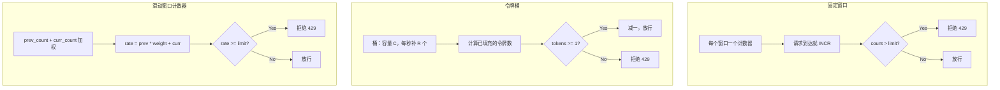
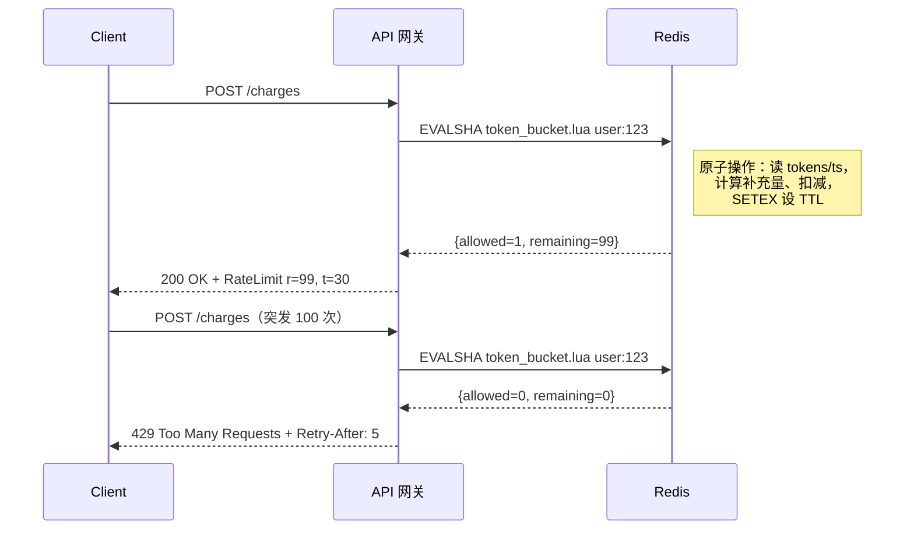
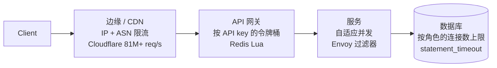
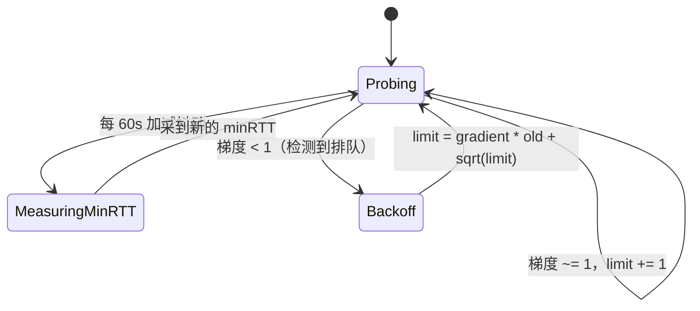

# 限流：保护系统不被自己拖垮

> **TL;DR**: 限流规定一个主体（用户、API key、IP、租户）在一段时间窗口内最多能调用多少次 API，超出的部分用 HTTP 429 拒掉。令牌桶是默认算法：允许突发到配置的桶容量，再按恒定速率补充令牌。中等规模下用中心化 Redis 加 Lua 脚本保证原子性[^1]；到了全球规模，在边缘用滑动窗口计数器[^2]；如果提前算不出安全速率，就用自适应并发限流（Netflix 的 Vegas 式做法）[^3]。返回 429 时永远带上 `Retry-After`。把限流（防滥用，按秒重置）和配额（计费，按月重置）分开：两者共用基础设施，但重置语义完全不同。

## 学习目标

学完本章，你将能够：

- [ ] 实现令牌桶、漏桶、固定窗口和滑动窗口四种限流器
- [ ] 选择合适的限流 key 方案（按用户、按 API key、按 IP、按租户）
- [ ] 把限流器做成分布式的，同时不把 Redis 变成瓶颈
- [ ] 用标准 HTTP 响应头和状态码把限制告知客户端
- [ ] 把限流与熔断、主动丢弃、配额组合起来用

## 直觉理解

你是一家夜店的门口保安，消防规定店内最多 200 人。你一个一个放人进去，同时数人头。数到 200，绳子一拉，直到有人出来才继续放行。这就是固定窗口限流器。

再想想高速公路收费站。车流有时爆发（早晚高峰），有时稀疏（凌晨 3 点）。收费亭并不在意这种波动，只要平均吞吐量不超道路的通行能力就行。它会先快速放走一批车，再压住下一批。这就是令牌桶：空闲时攒令牌，突发时花掉，花光了就等补充。

两种模型解决的是同一个问题：用一个有限资源去承接无上限的需求。在软件里，这个资源是你的 API 服务器、数据库连接池，或者某个下游依赖；而需求来自互联网上每一个客户端、脚本和爬虫。没有限流器，一个跑飞了的脚本就能打满整个集群，而且你直到很晚才能分清它和 DDoS 攻击。

本章剩下的部分会给你算法、分布式基础设施，以及把这些“门口保安”装进系统的生产实践。

## 原理

### 为什么要限流

限流防的是后端本来分辨不出的三类故障[^4]:

1. **恶意滥用** —— 撞库、爬取、L7 DDoS。
2. **无意滥用** —— 开发者写出死循环，或者客户端坏掉引发重试风暴。
3. **成本失控** —— 某个租户的批处理任务把共享容量吃干，其他客户全部饿死。

除了防御，限流还支撑**商业化**（免费版 100 req/min，专业版 1,000 req/min）和 **SLO 保护**（数据库只能扛 50K QPS，你就不能让客户端往网关里灌 80K）。

Stripe 把界限划得很清楚：限流器（rate limiter）约束单个主体的行为良好的流量速率，而主动丢弃（load shedder）看的是整个系统，在资源饱和时丢掉低优先级工作[^4]。两者都在同一条请求路径上，但回答的是不同的问题。

### 算法

生产环境里主流就六种算法。它们的差别在于每个 key 的状态量、突发容忍度和原子性要求。

**固定窗口。** 每个 (key, 窗口起点) 存一个计数器。请求到达就 INCR，超过上限就拒绝。每个 key 一个整数。致命缺陷在窗口边界：客户端可以在 11:00:59 打 N 个请求，11:01:00 再打 N 个，一秒内放进 2N 个[^5]。Figma 正是因为这一点否掉了它[^6]。

**滑动窗口日志。** 用一个有序集合存每个请求的时间戳，每次请求统计窗口内的成员数。结果精确，但内存是 O(limit * keys)。Figma 算过：10,000 个用户、每人每天 500 次请求，光时间戳就要在 Redis 里占约 20 MB[^6]。适合安全攸关、量又小的端点（登录）。

**滑动窗口计数器。** 保留当前桶和上一个桶的计数，再加权：`rate = prev_count * ((window - elapsed) / window) + curr_count`[^2]。每个 key 两个整数。Cloudflare 在 4 亿次请求、27 万个不同来源上测过这个方案：错误率 0.003%，真实速率与观测速率平均相差 6%，零误杀[^2]。这是边缘规模下经过生产验证的选择。

**令牌桶。** 容量为 C 的桶按每秒 R 个令牌补充。每个请求取走一个令牌，桶空就拒绝。允许突发到 C，长期速率是 R。Stripe 取 C = 5 * R，所以限额 100 req/sec 的用户可以突发到 500[^1]。这是业界默认答案，除非你有明确理由换别的。

**漏桶。** 容量为 C 的队列以恒定速率 R 漏出。请求到达时入队，队列满就拒绝。输出速率恒定。NGINX 的 `limit_req` 默认就是这个，并且不带突发[^7]。它比令牌桶更“硬”，因为它把突发磨平而不是吸收。

**GCRA（Generic Cell Rate Algorithm，通用信元速率算法）。** 把漏桶形式化成虚拟调度。状态只有一个标量：理论到达时间（Theoretical Arrival Time，TAT）。在 t_now 时刻收到请求：若 `t_now >= TAT - tau` 则放行，然后令 `TAT = max(t_now, TAT) + T`，其中 T = 周期/限额[^8]。`redis-cell` 用 `CL.THROTTLE` 命令实现了它，基准测试约 0.1 ms 一条命令[^9]。只有在你需要精确平滑且状态极小的时候才用它。



*三类算法：固定窗口最简单，但边界上会突发；令牌桶天然吸收突发；滑动窗口计数器用两个整数逼近精确值。*

### 分布式限流

单进程计数器是小菜。真正难的是让计数器在一整队服务器之间保持一致——每台机器只看到同一个用户流量的一部分。

**中心化 Redis 加 Lua。** 最简单且正确的设计。Lua 脚本在 Redis 里原子执行（单线程），把读—改—写压成一次往返。Stripe 生产用的令牌桶 Lua 大约 26 行：读 tokens 和 last_refreshed，算出应补的令牌，检查请求是否够用，写回，返回是否放行和剩余量[^10]。同集群内的典型往返是 0.1 到 0.5 ms。Stripe 生产环境里 Redis 的故障率是 0.01%，遇到故障就 fail open[^1]。

**独立限流服务。** Envoy 的全局限流过滤器通过长连接流调用 gRPC 的 Rate Limit Service（RLS）；Lyft 的参考实现 RLS 后端就是 Redis[^11]。Gubernator（Mailgun 开源）跑一组无状态对等节点，把每个 key 一致性哈希到某个归属节点，计数放在内存里，并按 500 微秒的窗口批量处理（峰值时一批可达 1,000 个请求）[^12]。对全局热点 key，Gubernator 的 `GLOBAL` 行为从本地副本直接回答，再异步把命中情况 gossip 给归属节点，用精确计数换规模。

**按 cell 的本地计数。** Cloudflare 在 330 多个 PoP 上评估限流。每个 PoP 内部是一个 Twemproxy/memcached 集群，把计数器一致性哈希到各台机器。一旦某个限流器触发，每台服务器就把“缓解生效中”这个标志缓存进进程内存，后续被拒的请求直接在本地短路，不再走一次 memcached 往返。40 万 req/sec 的攻击之所以压不垮它们自己的计数层，靠的就是这个[^2]。



*Lua 的 EVALSHA 在 Redis 内原子执行，把四个操作（取 tokens、取时间戳、计算、setex 两个值）合并成一次网络往返。*

### 在哪一层执行

多数生产栈会在多个点分层设限，用上下文换覆盖范围：



*粗粒度的限制放在边缘，上下文最少；精确的限制放在网关，能拿到认证上下文；自适应并发放在服务里，靠延迟信号判断。*

边缘的爆炸半径（故障影响面）最小——流量还没碰到你的基础设施就被拒了——但它对用户的套餐等级、会话几乎一无所知。网关有认证上下文，代价是多一跳。服务上下文最全，但只能保护自己。数据库层的限速（Postgres 的 `statement_timeout`、按角色的连接数上限）是最后一道也是最正确的一道，但触发得最晚[^13]。

### 客户端行为

RFC 6585 定义了 HTTP 429 Too Many Requests，并允许（原文是“MAY include”）附带 `Retry-After` 响应头；RFC 里的 SHOULD 说的是解释性细节，不是 `Retry-After` 本身[^14]。IETF 的 `draft-ietf-httpapi-ratelimit-headers-10`（2025）标准化了两个结构化字段：`RateLimit-Policy`（配额与窗口）和 `RateLimit`（剩余量与重置时间）[^15]。

老式响应头仍然到处都是：GitHub 返回 `x-ratelimit-limit`、`x-ratelimit-remaining`、`x-ratelimit-used`、`x-ratelimit-reset`（UTC epoch 秒）[^16]。Slack 返回 429 并带上 `Retry-After`（例如 30 秒）[^17]。

行为良好的客户端会实现带完整抖动的截断指数退避：`sleep = random(0, min(cap, base * 2^attempt))`。Marc Brooker 在 2015 年用 AWS 做的模拟显示，在 100 个相互竞争的客户端下，完整抖动比不加抖动把总调用次数减少了一半以上[^18]。现在多数 AWS SDK 都内置了这一套。

持续的 429 就该触发客户端熔断器，不能只盯着持续的 5xx。在 429 上死循环重试，和在 503 上死循环重试一样会给系统加压。

### 自适应与并发限制

拓扑一变（自动扩缩容、局部故障、一次改变延迟的代码发布），静态限速就过期了。Netflix 的 Concurrency Limits（2018）用 TCP-Vegas 式的梯度，从实测延迟反推安全运行点[^3]:

`gradient = minRTT / sampleRTT`

梯度等于 1 表示没有排队；小于 1 表示队列已经形成。限额按 `newLimit = currentLimit * gradient + sqrt(limit)` 更新。收敛之后，算法会把限额稳定在 P99 延迟刚开始抬头的那个点上。Netflix 说它能阻止重试风暴扩散，并在亚毫秒内拒掉多余负载[^3]。

Envoy 把这套思路做成了 `adaptive_concurrency` HTTP 过滤器，配一个 Gradient Controller：每 60 秒测一次 minRTT（带 0 到 10% 的抖动，避免全集群同步），然后在每个采样窗口调整并发上限[^13]。



*自适应并发过滤器在延迟平稳时向上试探，一旦梯度掉到 1 以下就压低限额；这条锯齿会随着自动扩缩容一起移动，始终贴着真实天花板。*

## 真实案例

**Stripe 的四层限流架构**是这个领域记录最详尽的生产系统[^1][^10]。

**第 1 层：请求速率限流器。** 令牌桶，容量 = 补充速率的 5 倍，按用户做 key。实现是约 26 行的 Lua 脚本跑在 Redis（ElastiCache）上。脚本读取 tokens 和 last_refreshed，按经过时间算出应补的令牌，判断请求是否放得下，扣减，然后写回并设置 2 倍 fill_time 的 TTL。整个读—改—写是原子的，因为 Redis 单线程执行 Lua。

**第 2 层：并发请求限流器。** 每个用户在 Redis 里有一个存放飞行中请求 ID 的有序集合。用 ZCARD 查数量，ZADD 进入，完成时 ZREM，用 ZREMRANGEBYSCORE 清理时间戳超时（进程已崩溃）的请求。这一层抓的是那些开几千条慢连接、而不是快速突发的用户。

**第 3 层：集群用量主动丢弃器。** 与并发限流器结构相同，但用的是全局 key。集群承压时为关键请求（创建支付）预留一部分 worker。

**第 4 层：worker 利用率主动丢弃器。** 每个进程本地执行。worker 利用率超过 0.8 时线性丢弃流量（先丢测试模式流量，再丢 GET，再丢 POST，关键请求最后），并在 120 秒内逐步升到位，避免抖动[^19]。

**关键工程决策：**

- **Redis 出错就 fail open。** 限流器不能把 API 拖死。Redis 故障率 0.01%[^1]。
- **每个新限流器都先暗发布（dark launch）。** 先只统计“本来会拦掉多少”，调好阈值，再真正执行。
- **每个限流器都配 kill switch**（功能开关），让运维在事故期间能关掉任意一层。
- **用 Lua 而不是 MULTI/WATCH。** 乐观并发在争用下会崩，Lua 永远原子。

按他们的博客所述，仅第 1 层每月就拒掉“数百万次”测试模式请求，并发限流器每月拒掉 12,000 次[^1]。

## 权衡

### 算法

| 算法 | 精度 | 每个 key 的内存 | 突发容忍度 | 最适用的场景 | 我们的选择 |
|---|---|---|---|---|---|
| 令牌桶 | 高 | 2 个值 | 极好（容量 C） | 通用 API 限流 | **默认选择** |
| 滑动窗口计数器 | ~94%（6% 偏差） | 2 个整数 | 好（加权） | 大规模边缘（Cloudflare） | 中心化 Redis 不可行时 |
| GCRA | 精确（滚动） | 1 个标量 | 可配置（tau） | 精确平滑、状态极小 | 需要滚动窗口精确性时 |
| 固定窗口 | 窗口内精确 | 1 个整数 | 差（边界处 2 倍） | 粗粒度、非关键计数 | 可接受边界 2 倍突发的日配额计数器 |
| 滑动窗口日志 | 精确 | O(limit) | 精确 | 安全攸关的小流量端点 | 仅用于登录、支付鉴权 |

### 执行位置

| 执行位置 | 可用上下文 | 增加延迟 | 爆炸半径 | 我们的选择 |
|---|---|---|---|---|
| 边缘（CDN/WAF） | IP、ASN、请求头 | ~0 ms（内联） | 最好（进不了基础设施） | 粗粒度防滥用限制 |
| API 网关 | 认证 token、套餐、端点 | 0.1 到 0.5 ms（Redis） | 好 | 精确的按用户限流 |
| 服务（sidecar） | 完整请求上下文、延迟 | 亚毫秒（本地） | 仅单实例 | 自适应并发 |
| 数据库 | 连接、查询成本 | 不适用（最后一道） | 最窄 | 连接池兜底 |

## 常见陷阱

> [!WARNING]
> **固定窗口的边界突发。** 客户端在 11:00:59 打 N 个请求，11:01:00 再打 N 个，一秒内放进 2N 个。所有重置时刻落在同一瞬间的受限客户端会同步撞出一个尖峰。改用滑动窗口，或者给重置值加抖动[^5]。

> [!WARNING]
> **按 IP 限流会误伤共享 NAT。** 宿舍、办公室或移动网络的 CGNAT 会把几千个用户放在同一个 IP 后面。严格的按 IP 限制要么把所有人挡在门外，要么松到形同虚设。用复合 key（IP + 会话 cookie、IP + JA3 TLS 指纹）。Cloudflare 特别点名运营商级 NAT，就是用来说明只按 IP 限流不够[^20]。

> [!WARNING]
> **不带 Retry-After 的重试会放大故障。** 客户端收到 429，立刻重试，又是 429，再重试。重试流量在每次失败后翻倍，而不是减半。429 上永远带 `Retry-After`。客户端侧则实现带完整抖动的截断指数退避[^18]。

> [!WARNING]
> **失败请求造成的计数泄漏。** 一个请求消耗了令牌，下游超时，客户端重试，服务端数了两次。时间一长，实际限额比对外宣称的更紧。失败时退还（5xx 就回补令牌），或者用 Stripe 那种 ZADD/ZREM 的租借—释放模式[^10]。

> [!WARNING]
> **限制过紧会打断突发型流量。** 合法用户跑一个夜间批处理任务，在反应灵敏的移动平均限流器眼里就是滥用。请同时公布突发上限和持续速率。容量远大于补充速率的令牌桶（Stripe 的 5 倍）恰好能吸收这种形态[^1]。

> [!WARNING]
> **多租户系统里忽视共享租户。** 一个吵闹租户的批处理任务会把其他客户全部饿死。用按租户的 key，并给每个端点设子限额。GitHub 在同一个用户身上叠了 5,000/hr 主限额、100 并发、900 点/分钟次限额，以及 80 次/分钟的内容创建限额[^16]。

## 练习

**设计一个限流器**，用于一个公共 API，要求：每个 API key 1,000 请求/分钟，突发额度 200 个请求，1 亿个活跃 key，两个区域，限额变更 30 秒内生效的 SLO。请给出：算法、key 方案、存储、运行位置，以及触发限流时返回哪些响应头。

<details>
<summary>提示</summary>

令牌桶天然对应“1,000/min 持续 + 200 突发”。想一想 1 亿活跃用户会产生多少个 Redis key，单个 Redis 集群扛不扛得住这些 QPS，以及一个用户同时打到两个区域时会发生什么。

</details>

<details>
<summary>参考答案</summary>

**算法：** 令牌桶。容量 C = 200（突发额度），补充速率 R = 1000/60 = 16.67 令牌/秒。空闲一段时间的用户可以攒到 200 个令牌打出突发；稳态吞吐被限制在约 16.67 req/sec。

**key 方案：** `(api_key, endpoint_class)`。主限额按 key 全局计。再加一个按端点的次限额（例如写端点 100/min），防止某个端点吃光整个预算。

**存储：** Redis 集群，按 hash slot 分片。每个 key 通过一个 Lua EVALSHA 脚本存两个值（tokens + last_refreshed）。100M 个 key × 2 个值 × 8 字节 ≈ 1.6 GB，单个 Redis 集群的内存完全够。每 key 1,000 req/min、1 亿 key 的最坏情况 QPS 是天文数字，但任意时刻的活跃 key 远少于此。按峰值并发活跃 key 来定容（大概 100 万到 500 万），对应 1600 万到 8300 万 Redis ops/sec，需要 3 到 8 个带副本的 Redis 主节点。

**运行位置：** API 网关层。网关能从认证头里拿到 API key，并从本地缓存解析套餐（免费/专业/企业）。边缘再用 Cloudflare 做一层粗粒度 IP 限制，把流量型攻击挡在网关之前。

**双区域一致性：** 每个区域跑自己的 Redis 集群。用户同时打到两个区域时，最坏情况会拿到两倍于设计值的限额。接受它（按 cell 的近似），或者在负载均衡器上按一致性哈希把每个 API key 路由到归属区域。对多数 API 来说 2 倍最坏情况可接受，因为正常用户很少把流量拆到两个区域。

**限额变更 30 秒 SLO：** 把套餐到限额的映射放在配置服务里，每个网关本地缓存 30 秒 TTL。管理员改限额后，新值会在一个缓存 TTL 内传遍。

**429 时返回的响应头：**

```http
HTTP/1.1 429 Too Many Requests
Retry-After: 4
RateLimit: "default";r=0;t=4
RateLimit-Policy: "default";q=1000;w=60
```

</details>

## 要点回顾

- 令牌桶是默认的限流算法。从它起步基本不会后悔。容量设成补充速率的 3 到 5 倍，用来容忍突发。
- 按 key 的 Redis 计数器加 Lua 脚本能一直用到 Redis 成为瓶颈（单主约 100K req/s）；再往上就得上 cell 化或分片方案。
- 429 上永远返回 `Retry-After`。没有它，客户端会在紧循环里重试，把过载放大。
- 把限流（防滥用，按秒重置）和配额（计费，按月重置）分开，即使它们共用基础设施。两者的重置语义和审计需求不同。
- 防御要分层：边缘粗、网关精、服务自适应。任何单独一层都不够。
- 自适应并发限制（Netflix Vegas 式）能自我调节，省掉猜服务 RPS 上限的功夫。自动扩缩容环境下的服务间调用就该用它。
- 算法是个两周的项目。策略（按用户、按端点、按租户、分层）是长期的事。把投入放在策略框架上。

## 延伸阅读

- [Stripe: Scaling your API with rate limiters](https://stripe.com/blog/rate-limiters) —— 最经典的生产实践文章，覆盖令牌桶、并发请求限流器、主动丢弃器和 worker 利用率；包含 fail open 的权衡与暗发布方法论。
- [Cloudflare: How we built rate limiting capable of scaling to millions of domains](https://blog.cloudflare.com/counting-things-a-lot-of-different-things/) —— 滑动窗口的精度计算（4 亿请求上 0.003% 误差）、PoP 本地架构，以及为什么在攻击负载下放弃了 CAS。
- [Figma: An alternative approach to rate limiting](https://www.figma.com/blog/an-alternative-approach-to-rate-limiting/) —— 滑动窗口计数器的推导、内存计算，以及针对顽固攻击者的影子封禁手法。
- [AWS Architecture Blog: Exponential Backoff and Jitter](https://aws.amazon.com/blogs/architecture/exponential-backoff-and-jitter/) —— Marc Brooker 2015 年的文章，把完整抖动确立为业界标准；含模拟结果，证明重试负载下降超过 50%。
- [Netflix: Performance Under Load](https://netflixtechblog.medium.com/performance-under-load-3e6fa9a60581) —— 自适应并发限制、梯度算法，以及静态 RPS 限制为何在自动扩缩容下会过期。
- [Brandur Leach: Rate Limiting, Cells, and GCRA](https://brandur.org/rate-limiting) —— GCRA 的权威解释；每 key 一个标量、没有滴漏进程、滚动窗口天然内建。
- [IETF draft-ietf-httpapi-ratelimit-headers-10](https://www.ietf.org/archive/id/draft-ietf-httpapi-ratelimit-headers-10.html) —— `RateLimit` 和 `RateLimit-Policy` 响应头字段的现代标准，取代混乱的 `X-RateLimit-*`。
- [GitHub REST rate limits docs](https://docs.github.com/en/rest/using-the-rest-api/rate-limits-for-the-rest-api) —— 分层的主限额与次限额、完整的响应头契约，以及 GitHub 如何在一个 API 上叠出 5 种以上限额维度。

## 记忆卡片

**Q:** 通用 API 的默认限流算法是什么？
**A:** 令牌桶。它允许突发到配置容量 C，并按每秒 R 个令牌的恒定速率补充。Stripe、GitHub 和多数 API 网关都用它。

**Q:** 固定窗口的边界突发问题是什么？
**A:** 客户端可以在一个窗口末尾打 N 个请求，在下一个窗口开头再打 N 个，不到一秒放进 2N 个请求。滑动窗口计数器或令牌桶能避免这一点。

**Q:** Stripe 如何让它在 Redis 里的令牌桶检查保持原子？
**A:** 一个 Lua 脚本（EVALSHA）把整个读—改—写放在 Redis 单线程里跑完。不需要 MULTI/WATCH；无论争用多严重，Lua 都是原子的。

**Q:** 服务端在 429 响应里必须始终带上什么？
**A:** `Retry-After` 头（客户端应等待多少秒再重试）。没有它，客户端会立刻重试，放大过载。

**Q:** 滑动窗口计数器的公式是什么？
**A:** `rate = prev_count * ((window - elapsed) / window) + curr_count`。每 key 两个整数。Cloudflare 在 4 亿请求上测得 0.003% 的误差率。

**Q:** 为什么只按 IP 限流不够？
**A:** 运营商级 NAT（CGNAT）会把几千个移动用户放在一个 IP 后面。严格的按 IP 限制要么误杀正常用户，要么松到攻击者直接走过去。用复合 key。

**Q:** 什么是自适应并发限制？
**A:** 不用静态速率，而是用 TCP-Vegas 式梯度从实测延迟反推安全并发：`gradient = minRTT / sampleRTT`。梯度掉到 1 以下说明队列形成了，限额随之下降。Netflix 和 Envoy 都实现了它。

**Q:** 限流和配额有什么区别？
**A:** 限流防滥用（按秒计，持续重置）。配额管计费（按月计，按计费周期重置）。两者共用基础设施，但重置语义和审计需求不同。

**Q:** Stripe 的限流器怎么处理 Redis 故障？
**A:** Fail open。如果 Redis 不可达（生产上占 0.01%），请求直接放行。限流器不能变成 API 的单点故障。

**Q:** 完整抖动给指数退避加了什么？
**A:** `sleep = random(0, min(cap, base * 2^attempt))` 让相互竞争的客户端之间的重试错开。AWS 的模拟显示，相比不加抖动，它把总调用次数减少了一半以上。

**Q:** 说出三个限流执行点，从最外层到最内层。
**A:** 边缘（CDN/WAF，粗粒度 IP 限流）、API 网关（带 Redis 的按用户令牌桶）、服务（Envoy sidecar 的自适应并发）。每一层都用上下文换覆盖范围。

**Q:** GCRA 是什么，什么时候该用它？
**A:** Generic Cell Rate Algorithm（通用信元速率算法）。状态就是一个标量（理论到达时间）。等价于漏桶，但没有滴漏进程，且在一个 Redis 操作里原子完成。需要精确平滑、又要每个 key 状态极小时用它。

**Q:** Cloudflare 如何在 40 万 req/sec 的攻击下不压垮自己的计数层？
**A:** 速率一旦越过阈值，PoP 就写一个“缓解生效中”标志。每台服务器把这个标志缓存在进程内存里。后续被拒的请求靠本地缓存标志直接短路，不再走 memcached 往返。

**Q:** GitHub 的 REST API 主限额是多少？
**A:** 认证请求 5,000 req/hr，未认证按 IP 60 req/hr；另有次限额：100 并发请求、900 点/分钟、80 次/分钟内容创建。

**Q:** Netflix 为什么选自适应并发而不是静态 RPS 限制？
**A:** 静态限制会随拓扑变化而过期（自动扩缩容、局部故障、代码发布）。自适应并发通过实测延迟自我调节，能跨扩缩容事件适应，并在亚毫秒内拒掉多余负载。

## 参考文献

[^1]: Stripe Engineering，"Scaling your API with rate limiters"（令牌桶部分、并发请求、0.01% 故障率下的 fail open）。https://stripe.com/blog/rate-limiters
[^2]: Julien Desgats，"How we built rate limiting capable of scaling to millions of domains"，Cloudflare Blog，2017 年 6 月 7 日。https://blog.cloudflare.com/counting-things-a-lot-of-different-things/
[^3]: Eran Landau, William Thurston, Tim Bozarth，"Performance Under Load"，Netflix Tech Blog，2018 年 3 月 23 日。https://netflixtechblog.medium.com/performance-under-load-3e6fa9a60581
[^4]: Paul Tarjan，"Scaling your API with rate limiters"，Stripe Blog，2017 年 3 月 30 日。https://stripe.com/blog/rate-limiters
[^5]: Nikrad Mahdi，"An alternative approach to rate limiting"（固定窗口边界突发部分），Figma Engineering，2017 年 4 月 12 日。https://www.figma.com/blog/an-alternative-approach-to-rate-limiting/
[^6]: Figma Engineering，"An alternative approach to rate limiting"（滑动窗口计数器推导、内存计算、影子封禁）。https://www.figma.com/blog/an-alternative-approach-to-rate-limiting/
[^7]: NGINX，"Module ngx_http_limit_req_module"。https://nginx.org/en/docs/http/ngx_http_limit_req_module.html
[^8]: Brandur Leach，"Rate Limiting, Cells, and GCRA"，2015 年 9 月 18 日。https://brandur.org/rate-limiting
[^9]: brandur/redis-cell README。https://github.com/brandur/redis-cell
[^10]: Paul Tarjan（Stripe），rate-limiter gist，含 Lua 脚本与 Ruby 驱动代码。https://gist.github.com/ptarjan/e38f45f2dfe601419ca3af937fff574d
[^11]: Envoy Project，"Global rate limiting" 架构概览。https://www.envoyproxy.io/docs/envoy/latest/intro/arch_overview/other_features/global_rate_limiting
[^12]: Derrick Wippler，"Gubernator: Cloud-native distributed rate limiting for microservices"，Mailgun Blog，2019 年 9 月 9 日。https://www.mailgun.com/blog/gubernator-cloud-native-distributed-rate-limiting-microservices
[^13]: Envoy Project，"Adaptive Concurrency" HTTP 过滤器参考。https://www.envoyproxy.io/docs/envoy/latest/configuration/http/http_filters/adaptive_concurrency_filter
[^14]: M. Nottingham 与 R. Fielding，"RFC 6585: Additional HTTP Status Codes (including 429 Too Many Requests)"，IETF，2012 年 4 月。https://www.rfc-editor.org/rfc/rfc6585.html
[^15]: R. Polli, A. Martinez, D. Miller，"RateLimit header fields for HTTP"，draft-ietf-httpapi-ratelimit-headers-10，IETF，2025 年 9 月 27 日。https://www.ietf.org/archive/id/draft-ietf-httpapi-ratelimit-headers-10.html
[^16]: GitHub Docs，"Rate limits for the REST API"。https://docs.github.com/en/rest/using-the-rest-api/rate-limits-for-the-rest-api
[^17]: Slack API docs，"Rate limits"。https://api.slack.com/apis/rate-limits
[^18]: Marc Brooker，"Exponential Backoff And Jitter"，AWS Architecture Blog，2015 年 3 月 4 日（2023 年更新）。https://aws.amazon.com/blogs/architecture/exponential-backoff-and-jitter/
[^19]: Paul Tarjan（Stripe），rate-limiter gist 中的 worker 利用率主动丢弃器实现。https://gist.github.com/ptarjan/e38f45f2dfe601419ca3af937fff574d
[^20]: Daniele Molteni，"Introducing Advanced Rate Limiting"，Cloudflare Blog，2022 年 3 月 16 日。https://blog.cloudflare.com/advanced-rate-limiting/
