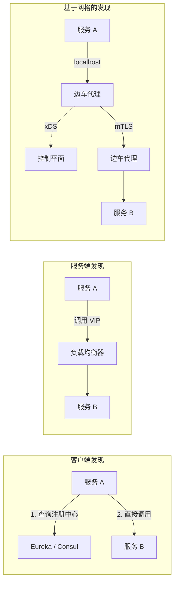
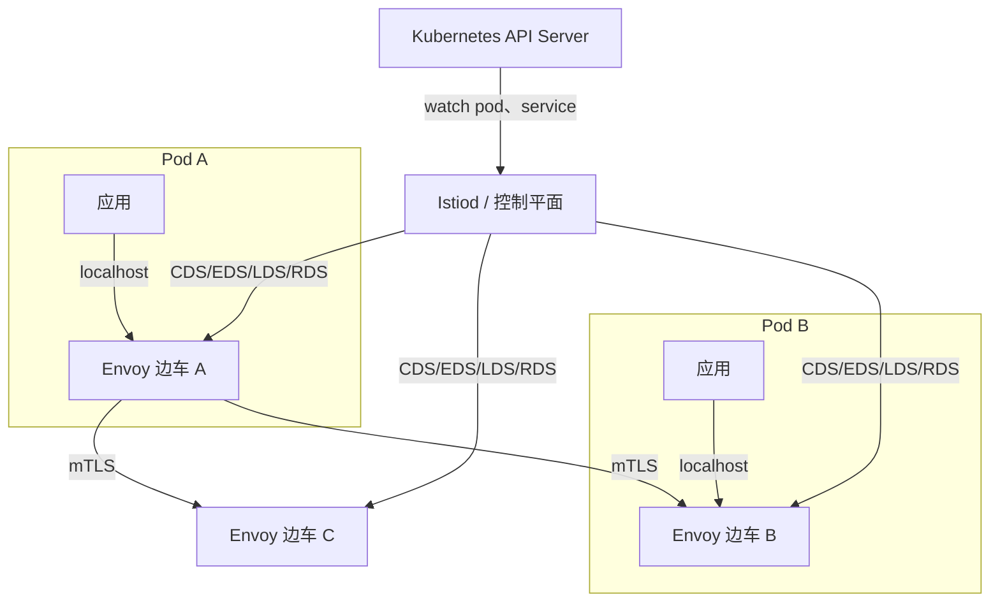
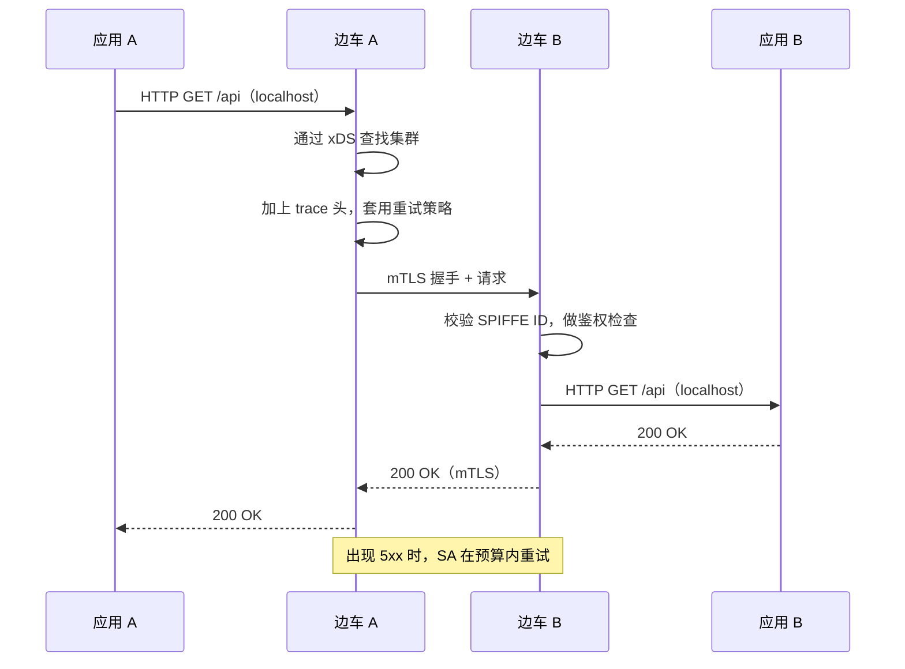
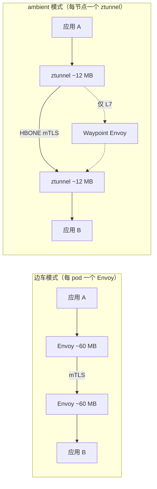

# 服务发现与服务网格：找到服务并与之通信

> **TL;DR**: 服务发现要为每一次跨服务调用回答“服务 B 现在在哪”。方案从带短 TTL 的 DNS，到 Consul 与 Kubernetes Service 这类注册中心，再到在本地解析端点的网格边车。服务网格通过在每个 pod 旁边插入一个代理（Envoy、Linkerd2-proxy）来扩展发现能力，让你不改应用代码就拿到 mTLS、重试、熔断和分布式追踪。代价是实打实的：在 1,000 RPS 下，Istio 边车每 pod 消耗约 0.20 vCPU 和 60 MB 内存[^1]。服务不到 20 个、也没有对整套能力的明确需求之前别上网格；如果只需要 mTLS，cert-manager 加 NetworkPolicies 更便宜。

## 学习目标

学完本模块，你将能够：

- [ ] 区分客户端发现、服务端发现和基于网格的服务发现
- [ ] 解释 Kubernetes Service 与 EndpointSlice 如何在大规模下路由流量
- [ ] 描述数据平面与控制平面的拆分，以及 xDS API
- [ ] 判断服务网格对你的系统来说是否值那份运维成本
- [ ] 在网格层配置 mTLS、重试、超时和熔断
- [ ] 从性能、功能和开销三方面比较 Istio、Linkerd 和 Cilium

## 直觉理解

你入职了一家 500 人的公司，需要找财务部的某个人。在小创业公司里，你隔着工位喊一嗓子就行。在大公司里，你得去企业通讯录（注册中心）查他，拿到他的工位号（端点），再走过去。如果他上周换了工位，通讯录里是新位置；如果他休假了，通讯录会把他标成不可用，你就不用白跑一趟。

现在想象公司在每间办公室门口都装了一位前台。前台检查你的工牌（mTLS），记录你的来访（追踪），对方暂时不在时帮你重试（带预算的重试），对方排队太长时把你挡回去（熔断）。你根本不需要知道路由规则，只要说“我找财务”，剩下的事前台处理。

企业通讯录就是服务发现，前台就是边车代理（sidecar proxy），负责培训所有前台、让他们的策略保持同步的 HR 部门就是控制平面。一个类比就把整个服务网格讲完了。

## 原理

### 服务发现模型

把逻辑服务名解析到一个存活实例，有三种模型：

**客户端发现（client-side discovery）。** 调用方自己查注册中心（Eureka、Consul、ZooKeeper），然后自己挑一个实例。Netflix 为此写了 Ribbon：Java 客户端从 Eureka 拉端点，在客户端做负载均衡[^2]。优点是不多一次网络跳转；缺点是每种语言都得有一套成熟的客户端库，Netflix 最终转向 Envoy，正是因为跨多语言维护 Ribbon 已经难以为继[^2]。

**服务端发现。** 调用方打到一个稳定的 VIP 或负载均衡器上，由它知道后端是谁。带 target group 的 AWS ALB、Kubernetes 的 ClusterIP Service 都是典型例子。客户端保持“傻”，代价是多一次代理跳转，而且 LB 上多了一个共享故障域。

**基于网格的发现。** 调用方发给 `localhost`，边车代理用控制平面推下来的配置解析目标。这本质上是“客户端发现 + 本地代理”：应用侧依然简单，但你得付边车的 CPU 和内存开销。

*客户端发现省掉 LB 那一跳，但要求每种语言都有自己的客户端；服务端发现把复杂度藏在 VIP 后面；基于网格的发现靠本地代理让客户端保持简单。*

如果你掌控所有调用方、又想要考虑延迟的实例选择，用客户端发现（gRPC + xDS、Finagle）。Kubernetes 上的负载默认用服务端发现。需要在多种语言之间统一策略时，用基于网格的发现。

### Kubernetes Service 模型

Kubernetes Service 是多数云上负载的原生发现机制。一个 ClusterIP Service 拿到一个虚拟 IP；每个节点上的 `kube-proxy` 写入 iptables（或 nftables——Kubernetes 1.33 起推荐的后继方案）规则，把流量 DNAT 到某个后端 pod[^3]。

**EndpointSlice** 从 Kubernetes 1.19 起成为 kube-proxy 的默认选择，取代了单体式的 Endpoints 对象。在 EndpointSlice 之前，一个 5,000 pod、3,000 节点的 Service，每次变更都要分发一份 1.5 MB 的 Endpoints 对象，一次滚动更新期间整个集群“传输了超过 22 TB 的数据”[^4]。EndpointSlice 把端点切成每片最多 100 个，单个 Service 可扩展到 100,000+ 个网络端点。

规模极大时，kube-proxy 写规则是公认的热点。Cilium 直接用 eBPF map 把它整个换掉，每个包 O(1) 查表[^5]。

### 服务网格：数据平面与控制平面

Matt Klein 在 2017 年给出了这个经典划分：“数据平面负责对每一个网络包做条件化的翻译、转发和观测……控制平面把一组彼此孤立的无状态边车代理，变成一个分布式系统”[^6]。

**数据平面**是请求路径上的那一组代理：Envoy（C++，Istio 和 Consul Connect 在用）、Linkerd2-proxy（Rust，Linkerd 在用）、ztunnel（Rust，Istio ambient 模式在用）。

**控制平面**（Istiod、Linkerd 控制平面、Consul server、Google Traffic Director）生成配置，并通过 xDS 系列 API 推给代理：CDS（cluster）、EDS（endpoint）、LDS（listener）、RDS（route）[^6]。每个边车向控制平面开一条 gRPC 流，接收最终一致的配置更新。某个 Deployment 扩容时，控制平面 watch 到 Kubernetes 的变化，向所有受影响的代理发出 EDS 更新。

*Istiod watch Kubernetes 的变化，把 xDS 配置推给每个 Envoy 边车；控制平面从不在请求路径上。*

### 网格提供什么

边车让任何语言写的服务，不接 SDK 就能获得下面这些东西：

- **双向 TLS（mTLS）**，证书自动轮换（Istio 默认 TTL 是 24 小时）
- **带预算的重试**，避免重试风暴级联
- **熔断与异常点检测**，把不健康的上游摘掉
- **分布式追踪**，追踪头自动透传（B3、W3C Trace Context）
- **流量切分**，用于金丝雀、蓝绿和 A/B 发布
- **按服务的鉴权策略**，基于密码学身份（SPIFFE）

*每一次穿过网格的跳转都要加上 mTLS 终止、策略检查、重试逻辑和追踪透传；而应用看到的只是一次普通的本地调用。*

### 主流网格对比

**Istio** 是功能最全的那个。2023 年 7 月从 CNCF 毕业[^7]。Istio 1.24 做过 1,000 个服务、2,000 个 pod、网格内 70,000 RPS 的压测[^1]。数据平面用 Envoy，控制平面统一为 Istiod。缺点是重：每个边车在 1,000 RPS 下约需 0.20 vCPU 和 60 MB 内存[^1]。

**Linkerd** 是轻量路线。2021 年 Kinvolk 的基准测试（Linkerd 2.11.1 对 Istio 1.12.0）在 2,000 RPS 下：Linkerd 增加 6 ms 中位延迟，Istio 是 17 ms；Linkerd 每个代理 26 MB，Istio 是 156 MB[^8]。两个项目此后都有大幅演进，Istio ambient 模式直接改变了这个对比。它的数据平面 Linkerd2-proxy 是为这件事专门写的 Rust 微代理，基于 Tokio 和 Rustls。设计权衡很明确：避开带垃圾回收的语言，让长尾延迟可预测[^9]。

**Cilium** 走的是完全不同的路。它把 eBPF 程序挂在 socket 钩子上，执行 L4 策略和加密（WireGuard 或 IPsec），请求路径上根本没有代理[^5]。L7 能力弱一些，还受内核版本限制，但对只用 L4 的负载来说开销接近零。

**Consul Connect** 打通 VM 与容器两个世界。如果你的环境是混合的（一部分 Kubernetes、一部分裸金属、一部分 VM），Consul 那种“先注册中心、再网格”的路径最自然。

### 开销与替代方案

CNCF 年度调查数据显示，基于边车的网格采用率在 2023 到 2024 年间从 50% 降到 42%[^10]。原因是成本：边车开销大体上按 pod 固定，与流量无关。一个 10 RPS 的旁路服务，JVM 堆 100 MB，加上 Envoy 的 60 MB 就成了 160 MB。几百个小服务乘起来，集群容量就这么没了。

**Istio ambient 模式**把网格拆开：ztunnel DaemonSet 在节点层面处理 mTLS 和 L4 策略，约 0.06 vCPU、12 MB/节点；需要 L7 的地方再挂可选的 waypoint 代理[^1][^11]。在同一份 Istio 1.24 基准里对比边车的每 pod 0.20 vCPU、60 MB，对只用 L4 的负载大约是 3 倍 CPU、5 倍内存的节省。

**无代理 gRPC（proxyless gRPC）**把 xDS 支持直接做进 gRPC 库。Google Traffic Director 用 xDS 与 gRPC 客户端通信，对已经在用 gRPC 的服务彻底省掉边车这一跳[^12]。

*边车模式在每个 pod 里放一个 Envoy（各 60 MB）；ambient 模式每节点跑一个共享的 ztunnel（12 MB），只有需要 L7 功能时才加可选的 waypoint 代理。*

### 用 SPIFFE 引导 mTLS

网格为每个工作负载签发短时效 X.509 证书，并要求连接双方在每次连接上都出示并校验证书。SPIFFE 标准化了身份文档（SVID）和代理取证书所用的 Workload API；SPIRE 是参考实现[^13]。

一个典型的 Kubernetes SPIFFE ID 长这样：`spiffe://cluster.local/ns/default/sa/bookinfo-reviews`，把命名空间和 ServiceAccount 编进 URI。因为身份是一个 URI，鉴权策略可以用符号引用工作负载，而不是写 IP。在 Linkerd 里，每个代理启动时自己生成密钥，从不落盘，再由控制平面的 Identity 服务签发证书[^9]。

关键一点：mTLS 认证的是“谁在调用”，它不授权“能做什么”。你仍然需要显式的 AuthorizationPolicy，并且默认拒绝。

## 真实案例

### Lyft Envoy：现代服务网格的起点

2016 年，Lyft 的 SOA 撞上了每家多语言公司都会遇到的问题：每个服务都带一套半成品的 RPC 库，重试、熔断、可观测性各写各的。Java 服务用一种重试策略，Python 服务用另一种，分布式追踪谁都不一致。Matt Klein 写了 Envoy 来解决这件事。

Envoy 于 2016 年 9 月 14 日公开发布[^14]。到 2017 年 4 月，贡献者已超过 40 人，Google 和 IBM 都开始采用[^14]。几个关键设计决策：

1. **用 C++ 换性能。** 相比基于 JVM 的代理，长尾延迟更可预测，没有 GC 停顿。
2. **最终一致的服务发现。** Lyft 有意把 Envoy 里的服务发现做成“最终一致、允许丢信息”，与 ZooKeeper 那套强一致方案相反，他们的反馈是“可靠性极高，而且没有维护上的头痛”[^14]。
3. **HTTP/2 透明升级。** 这对全公司推 gRPC 至关重要。
4. **通用的 xDS API。** Klein 把 CDS/EDS/LDS/RDS 作为开放 API 发布，从而把数据平面和任何具体控制平面解耦。这就是今天 Istio、Consul Connect 和 Google Traffic Director 都用 Envoy 的原因。

Lyft 把 Envoy 同时用作边缘代理和每个服务 pod 上的主机级边车，彻底替换了各语言的 RPC 库。这个架构就是所有现代服务网格的直系祖先：边车代理、本地优先路由、控制平面推配置。

教训是：如果你有 3 种以上语言、韧性逻辑各写各的，一个共享代理比维护 N 套客户端库便宜。但如果你是单语言、又有成熟的 RPC 框架，你可能根本不需要那个代理。

## 权衡

| 方案 | 优点 | 缺点 | 适用场景 | 我们的选择 |
|---|---|---|---|---|
| 仅用 DNS 发现 | 零基础设施；通用 | 没有健康检查；TTL 缓存让故障切换失灵 | 小型/静态拓扑 | 小型静态集群（< 10 节点），能容忍分钟级故障切换 |
| Consul / etcd 注册中心 | 强一致；主动健康检查；元数据 | 得自己运维；Raft 法定人数的运维 | 中等规模、非 k8s、VM 与容器混合 | **混合环境** |
| Kubernetes Service + EndpointSlice | 内置；可扩展到 100K+ 端点 | 高级 L7 路由能力有限 | 大多数 k8s 负载 | **k8s 默认选择** |
| 客户端发现（gRPC xDS、Finagle） | 不多一跳；延迟感知的负载均衡 | 每种语言都要有客户端 | 内部 RPC，调用方全在自己手里 | 单语言时 |
| 服务网格（Istio 边车） | mTLS + 重试 + 追踪 + 策略；语言无关 | 每 pod 60 MB + 0.20 vCPU；升级复杂 | 服务多、有合规要求、多语言 | **20+ 服务、多语言** |
| Ambient / eBPF 网格（Istio ambient、Cilium） | 对 L4 相比边车省 3 倍 CPU、5 倍内存；运维更简单 | 较新；L7 功能少；依赖内核 | 规模大且有成本压力的 k8s 集群 | **演进方向** |

## 常见陷阱

> [!WARNING]
> **还没到需要的时候就上网格。** 团队只有 8 个服务、一种语言，却为了“零信任”部署 Istio。网格给每个 pod 加 60 MB，还带来升级复杂度和调试开销，而那些功能他们从来不用。如果只需要 mTLS，cert-manager 加 NetworkPolicies 便宜得多。

> [!WARNING]
> **跨边车调试。** 一个失败请求要穿过客户端边车、网络、服务端边车，一个 503 可能来自五个组件。如果不对照 Envoy 的 response flag（`UH`、`URX`）和分布式 trace ID，本该 5 分钟定位的问题能耗掉几小时。从第一天起就把 response flag 打进访问日志。

> [!WARNING]
> **证书轮换失败。** 网格默认每 24 小时轮换一次工作负载证书。如果轮换期间控制平面挂了，代理拿不到新证书，连接就会失败。控制平面至少 3 个副本、跨可用区部署，并监控证书过期指标。

> [!WARNING]
> **版本偏差带来的升级地狱。** Istio 支持的偏差很窄：控制平面可以比数据平面高一个小版本，但数据平面不能高于控制平面[^15]。边车还跑着老 Envoy 时升级 Istiod，偏差再大一点就会让 xDS 配置推送失败。用金丝雀升级：装第二个 Istiod revision，给 pod 打标签逐步切过去。

> [!WARNING]
> **没有预算的重试风暴。** 代理层对一个抖动的后端做重试，会把负载放大。调用路径上两个边车各重试 3 次，1 个失败请求就变成 9 个。一定要配重试预算（把重试流量限制为成功流量的一定比例），并且绝不对非幂等操作重试。

> [!WARNING]
> **只开 mTLS 不做鉴权。** 团队为了“零信任”打开 mTLS，AuthorizationPolicy 却还是 allow-all。任何被攻陷的工作负载照样能调其他任何服务。mTLS 认证“谁在调用”，不授权“能做什么”。先做命名空间级的 deny-all，再按 SPIFFE 身份逐个服务放行。

## 练习

你有 80 个跑在 Kubernetes 上的微服务、5 个团队、一条“全面上 mTLS”的硬性要求，以及一套自研 Go 库里现成的重试/超时逻辑。请比较三条路：(a) 保留该库，加 cert-manager + NetworkPolicies；(b) 上 Linkerd；(c) 上 Istio。估算 CPU 开销、迁移成本，以及哪些运维负担从谁身上转移到了谁身上。

提示

算一算三种方案在 80 个服务上的每 pod 内存成本（假设每个服务 3 个副本，共 240 个 pod）。想一想今天谁负责重试逻辑，迁移后又归谁。再想想：Go 库团队发一个破坏性变更会发生什么，对比网格团队升级控制平面会发生什么。

参考答案

**方案 (a)：cert-manager + NetworkPolicies。**

- 内存开销：约 0（证书以 secret 形式挂载，没有边车）。合计：只有基线。
- 迁移成本：低。加一个 cert-manager Issuer，给 pod 打注解，按服务写 NetworkPolicy。自研 Go 库继续负责重试和超时。
- 运维负担：cert-manager 很轻（一个 controller）。NetworkPolicy 需要一个真正执行它的 CNI（Calico、Cilium）。韧性逻辑仍归 Go 库团队，他们一发版，所有团队都得跟着升。
- 局限：没有流量切分，没有基础设施层的分布式追踪，没有 L7 鉴权。你只拿到 mTLS 和粗粒度的网络隔离。

**方案 (b)：Linkerd。**

- 内存开销：每个代理约 26 MB（Kinvolk 基准）。240 pod x 26 MB = 全集群约 6.2 GB。控制平面再加约 365 MB。
- 迁移成本：中。Linkerd 注入只是一个命名空间标签，不用改应用代码。自研 Go 库的重试逻辑现在和 Linkerd 代理的重试打架，必须关掉其中一个，否则重试会被放大。
- 运维负担：Linkerd 控制平面比 Istio 轻，升级也更简单（CRD 更少、暴露面更小）。但你现在有两套系统在做韧性：Go 库和网格。选一个。

**方案 (c)：Istio。**

- 内存开销：每个边车约 60 MB。240 pod x 60 MB = 全集群约 14.4 GB。控制平面再加约 600 MB。
- 迁移成本：高。Istio 的 CRD 更多、配置面更大、失败模式也更多。你能得到流量切分、更丰富的鉴权和更大的生态。但 Go 库必须废弃或收缩范围，避免和 Envoy 的重试/超时逻辑冲突。
- 运维负担：Istio 升级出了名地复杂（金丝雀 revision、版本偏差）。你需要一个专职的平台团队。

**建议：** 80 个服务、5 个团队、纯 Go 技术栈，从方案 (a) 开始。你在 Go 里已经有韧性逻辑，上网格等于把它做两遍。cert-manager 用近乎零的成本给你 mTLS。将来真需要流量切分或多语言支持，再迁到 Linkerd（方案 b），它开销更低、运维更简单。Istio 留给 200+ 服务、10+ 团队、3+ 种语言、功能广度足以证明成本合理的场景。

## 要点回顾

- 服务发现是必选项，服务网格是主动选择。很多团队买回来的网格功能，自己从来没用过。
- 如果只需要 mTLS，cert-manager 和 NetworkPolicies 比上一整套网格便宜得多。
- Envoy 是事实标准的数据平面；Linkerd 更轻更快（26 MB、中位开销 6 ms），Istio 功能全但更重（60 MB、中位开销 17 ms）[^8]。
- 控制平面永远不在请求路径上。它挂了，已有代理还能用旧配置继续路由，但新部署会停摆。
- 边车用每 pod 1-5% 的 CPU 和 30-200 MB 内存，换来语言无关的策略。ambient 模式和 eBPF 对只用 L4 的负载把这块砍掉约 3 倍 CPU、5 倍内存。
- 服务不到 20 个、也没有对整套能力（mTLS + 重试 + 追踪 + 策略 + 流量切分）的明确需求，就别上网格。
- 演进方向是无边车：Istio ambient、Cilium eBPF、无代理 gRPC。锁定“每 pod 一个边车”之前先评估一遍。

## 延伸阅读

- [Matt Klein, "Service mesh data plane vs. control plane" (2017)](https://web.archive.org/web/20190603132747/https://blog.envoyproxy.io/service-mesh-data-plane-vs-control-plane-2774e720f7fc) - 提出数据平面/控制平面划分的那篇分类文章；评估任何网格之前都该先读。
- [Linkerd blog, "Under the hood of Linkerd2-proxy" (2020)](https://linkerd.io/2020/07/23/under-the-hood-of-linkerds-state-of-the-art-rust-proxy-linkerd2-proxy/) - 讲清楚为什么专门打造的 Rust 微代理在长尾延迟上能赢通用 C++ 代理的最佳单篇。
- [Netflix Tech Blog, "Zero Configuration Service Mesh with On-Demand Cluster Discovery" (2023)](https://netflixtechblog.com/zero-configuration-service-mesh-with-on-demand-cluster-discovery-ac6483b52a51) - 从 Eureka + Ribbon 迁到 Envoy 的真实故事；展示了维护各语言发现客户端的痛苦。
- [Kubernetes Blog, "Scaling Kubernetes Networking with EndpointSlices" (2020)](https://kubernetes.io/blog/2020/09/02/scaling-kubernetes-networking-with-endpointslices/) - 旧的 Endpoints API 为什么在大规模下崩掉，EndpointSlice 如何用 100 端点一片来解决。
- [Istio blog, "Istio: The Highest-Performance Solution for Network Security" (2025)](https://istio.io/latest/blog/2025/ambient-performance/) - ambient 模式的基准数据，四个版本内吞吐提升 75%；无边车路线的论据。
- [William Morgan, "Benchmarking Linkerd and Istio: 2021 Redux"](https://linkerd.io/2021/11/29/linkerd-vs-istio-benchmarks-2021/) - 被引用最多的独立网格基准；Linkerd 相比 Istio 内存少 6 倍、延迟少 3 倍。
- [SPIFFE project documentation](https://spiffe.io/docs/latest/spiffe-about/overview/) - Istio、Consul、cert-manager 和 Dapr 都在用的工作负载身份标准；设计零信任策略之前先弄懂它。
- [Envoy Proxy documentation](https://www.envoyproxy.io/docs/envoy/latest/) - 数据平面的权威参考；从架构概览和 xDS 协议说明读起。

## 记忆卡片

**Q:** 服务发现有哪三种模型？
**A:** 客户端发现（调用方查注册中心、自己挑实例）、服务端发现（调用方打到一个稳定的 LB VIP）、基于网格的发现（调用方发给 localhost，边车代理经控制平面解析）。

**Q:** 服务网格里数据平面与控制平面是怎么划分的？
**A:** 数据平面（Envoy、Linkerd2-proxy）处理请求路径上的每一个网络包。控制平面（Istiod、Linkerd 控制平面）生成配置并通过 xDS 推给代理。控制平面从不在请求路径上。

**Q:** xDS 代表什么，主要有哪些 API？
**A:** xDS 是“x Discovery Service”协议族。主要 API：CDS（Cluster Discovery）、EDS（Endpoint Discovery）、LDS（Listener Discovery）、RDS（Route Discovery）。每一个都通过 gRPC 把配置从控制平面流式推给数据平面。

**Q:** 一个 Istio 边车给每个 pod 增加多少开销？
**A:** 在 1,000 RPS、1 KB 负载下：约 0.20 vCPU 和 60 MB 内存。Istio ambient 模式的 ztunnel 约 0.06 vCPU、12 MB，便宜大约 5 倍。

**Q:** Kubernetes 为什么用 EndpointSlice 取代 Endpoints？
**A:** 一个 5,000 pod 的 Service 会产生 1.5 MB 的 Endpoints 对象。跨 3,000 节点的一次滚动更新传输了超过 22 TB 数据。EndpointSlice 把端点按 100 个一组分片，可扩展到 100K+ 端点。

**Q:** SPIFFE 是什么，为什么对服务网格重要？
**A:** SPIFFE（Secure Production Identity Framework For Everyone）把工作负载身份标准化为 X.509 证书里的一个 URI（例如 spiffe://cluster.local/ns/default/sa/my-service）。它让鉴权策略按身份而不是 IP 地址来引用工作负载。

**Q:** 什么情况下不该上服务网格？
**A:** 服务少于 20 个、单语言且已有成熟的 RPC 库，或者只需要 mTLS（用 cert-manager 就行）的时候。没有整套功能，网格的 CPU/内存开销和运维复杂度不划算。

**Q:** 资源消耗上 Linkerd 和 Istio 差多少？
**A:** 2021 年 Kinvolk 基准在 2,000 RPS 下：Linkerd 每个代理 26 MB，Istio 是 156 MB（少 6 倍）；Linkerd 增加 6 ms 中位延迟，Istio 是 17 ms（少 3 倍）；Linkerd 控制平面内存 365 MB，Istio 是 597 MB。

**Q:** Istio ambient 模式是什么，为什么会有它？
**A:** ambient 模式用每节点一个 ztunnel DaemonSet 承接 L4（mTLS、基础策略），替代每 pod 一个边车；L7 功能则用可选的 waypoint 代理。它出现的原因是边车开销按 pod 固定、与流量无关，正在拖低采用率。

**Q:** 网格里 mTLS 的认证和鉴权有什么区别？
**A:** mTLS 认证“谁在调用”（校验证书里的 SPIFFE 身份）。鉴权策略单独控制这个身份被允许做什么。只开 mTLS 不做默认拒绝的鉴权，你得到的是加密，不是零信任。

**Q:** Lyft 为什么把 Envoy 的服务发现做成最终一致，而不用 ZooKeeper？
**A:** Lyft 反馈说，强一致的注册中心（ZooKeeper、etcd）在大规模下带来运维痛点。最终一致、允许丢信息的发现在他们那里“可靠性极高，而且没有维护上的头痛”，因为过期端点会被健康检查和重试优雅地兜住。

**Q:** 什么是“重试风暴”，网格怎么防？
**A:** 调用路径上两个边车各重试 3 次，1 个失败请求就变成 9 个。网格用重试预算（把重试流量限制为成功流量的一个百分比）来防止，并且绝不对非幂等操作重试。

## 参考文献

[^1]: Istio documentation, "Performance and Scalability" (Istio 1.24). https://istio.io/latest/docs/ops/deployment/performance-and-scalability/
[^2]: David Vroom, James Mulcahy, Ling Yuan, Rob Gulewich, "Zero Configuration Service Mesh with On-Demand Cluster Discovery", Netflix TechBlog, Aug 29, 2023. https://netflixtechblog.com/zero-configuration-service-mesh-with-on-demand-cluster-discovery-ac6483b52a51
[^3]: Kubernetes documentation, "Virtual IPs and Service Proxies". https://kubernetes.io/docs/reference/networking/virtual-ips/
[^4]: Rob Scott, "Scaling Kubernetes Networking With EndpointSlices", Kubernetes blog, Sep 2, 2020. https://kubernetes.io/blog/2020/09/02/scaling-kubernetes-networking-with-endpointslices/
[^5]: Cilium documentation, "Kubernetes Without kube-proxy". https://docs.cilium.io/en/stable/network/kubernetes/kubeproxy-free/
[^6]: Matt Klein, "Service mesh data plane vs. control plane", Envoy Proxy blog, Oct 10, 2017. https://web.archive.org/web/20190603132747/https://blog.envoyproxy.io/service-mesh-data-plane-vs-control-plane-2774e720f7fc
[^7]: CNCF, "Cloud Native Computing Foundation Reaffirms Istio Maturity with Project Graduation", Jul 12, 2023. https://www.cncf.io/announcements/2023/07/12/cloud-native-computing-foundation-reaffirms-istio-maturity-with-project-graduation/
[^8]: William Morgan, "Benchmarking Linkerd and Istio: 2021 Redux", Linkerd blog, Nov 29, 2021. https://linkerd.io/2021/11/29/linkerd-vs-istio-benchmarks-2021/
[^9]: Eliza Weisman, "Under the hood of Linkerd's state-of-the-art Rust proxy, Linkerd2-proxy", Linkerd blog, Jul 23, 2020. https://linkerd.io/2020/07/23/under-the-hood-of-linkerds-state-of-the-art-rust-proxy-linkerd2-proxy/
[^10]: Ratan Tipirneni, "Why Service Mesh is Poised for a Dramatic Comeback in 2026", CloudNativeNow, Mar 5, 2026 (citing CNCF Annual Survey 2024 data). https://cloudnativenow.com/contributed-content/why-service-mesh-is-poised-for-a-dramatic-comeback-in-2026/
[^11]: Istio documentation, "Ambient Mode". https://istio.io/latest/docs/ambient/
[^12]: Google Cloud, "Cloud Service Mesh - xDS control plane APIs" (formerly Traffic Director). https://cloud.google.com/traffic-director/docs/xds-control-plane-apis
[^13]: SPIFFE project, "SPIFFE Overview" documentation. https://spiffe.io/docs/latest/spiffe-about/overview/
[^14]: Matt Klein, "Envoy: 7 months later", Lyft Engineering, Apr 25, 2017. https://eng.lyft.com/envoy-7-months-later-41986c2fd443
[^15]: Istio documentation, "Supported Releases" - Control Plane/Data Plane Skew. https://istio.io/latest/docs/releases/supported-releases/
