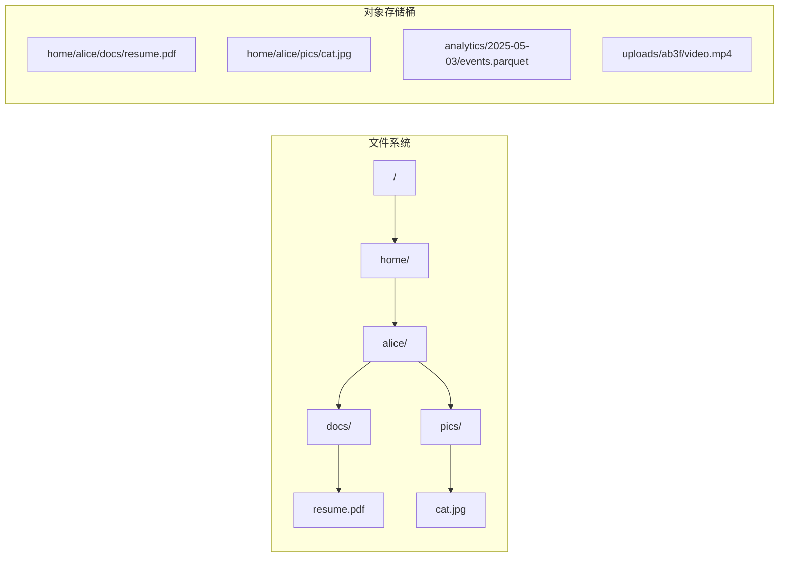
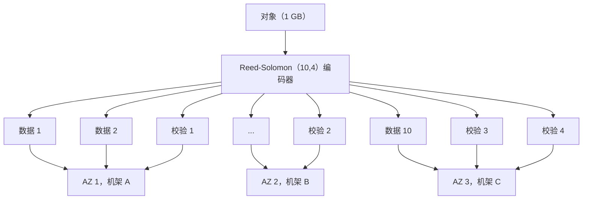
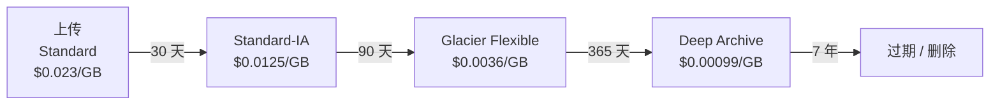
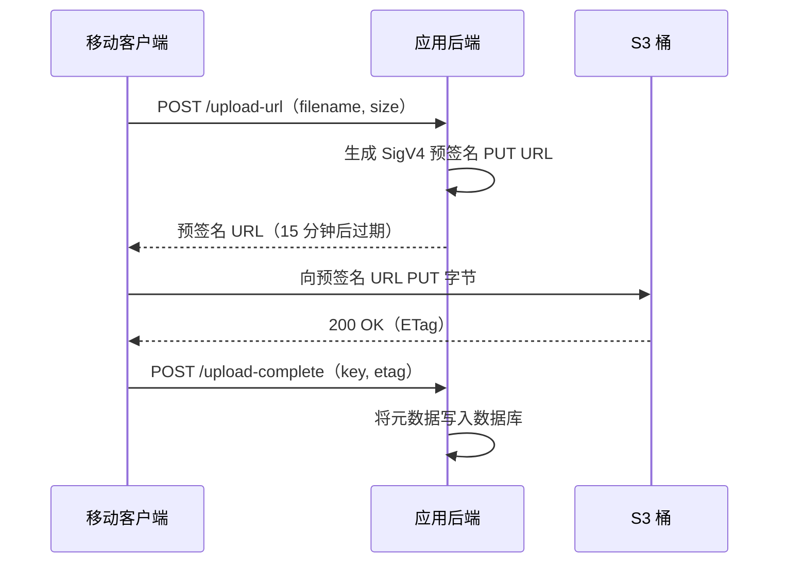

# Blob 与对象存储：存放大块数据

> **TL;DR**: 对象存储是扁平的、可用 HTTP 寻址的键值存储，用来放不透明的二进制大对象（blob）。Amazon S3 存着超过 500 万亿个对象，每秒处理 2 亿次以上请求[^1]。它把 Reed-Solomon 纠删码铺到多个可用区，做到 99.999999999%（十一个 9）的持久性[^1]。热数据默认用 S3 Standard，只有量过访问模式之后才下沉到 Glacier Deep Archive（便宜 23 倍）；公网桶前面永远挂一层 CDN，否则出流量账单会把你吃干。

## 学习目标

学完本模块，你将能够：

- [ ] 解释对象存储的数据模型（桶、键、对象、元数据、版本）
- [ ] 用预签名 URL 和分片上传设计上传与下载流程
- [ ] 用存储类和生命周期策略在规模化场景下控制成本
- [ ] 分析 S3 的一致性保证（2020 年起为强读写一致）
- [ ] 判断一块数据该放对象存储、数据库还是文件系统

## 直觉理解

想象一座自助仓储仓库，里面有数百万个编号的储物柜。你走进去，把贴好标签的箱子（多大都行，从明信片到冰箱）交给柜台，拿回一张写着柜号的回执。取东西时出示回执就行。这里没有走廊，没有楼层，也没有嵌套的房间，只有一份扁平的柜号清单。你没法打开箱子改动里面某一样东西；要么整箱换掉，要么原封不动。

现在再想象一家唱片公司的母带档案库。每一首歌、每一次录音、每一个混音版本都进了一座能扛住地震、洪水和人为失误的库房。库房把每份母带存在多栋建筑的多盘磁带上。一栋楼烧了，其余的会自动重建丢失的副本。你从不用操心容量；仓库会随着你填满而扩张。

对象存储同时具备这两面：扁平的命名空间、不可变的二进制大对象，加上行星级的持久性。它用 POSIX 语义（没有部分写、没有目录、没有重命名）换来无需容量规划即可扩展到 EB 级的能力。正是这个权衡，让你上传的每一张照片、播放的每一段视频、训练的每一份 ML 数据集，都躺在对象存储里。

## 原理

### 对象、文件与块存储

文件系统把数据组织成目录和 inode 构成的树。你可以 `open()`、`seek()`、`write()`，在任意偏移写入任意字节。块设备给你的是编号的裸扇区。对象存储两者都不是。

对象存储只有三个概念：**桶**（bucket，命名空间边界）、**键**（key，最长 1,024 字节的 UTF-8 字符串）和**对象**（object，二进制主体加元数据）。`photos/2025/cat.jpg` 里的斜杠只是装饰，并不存在 `photos/` 这个目录[^2]。API 刻意做得极小：`PUT`、`GET`、`DELETE`、`HEAD`、`LIST`，再加上分片上传的几种变体。

*文件系统有目录和 inode 构成的树；对象存储只有扁平的键空间，斜杠只是装饰。*

从客户端视角看，对象是**不可变**的。想改动一段 1 GB 视频里的一个字节，你得把整个 1 GB 重新 PUT 一遍（单个 S3 对象通过分片上传最大可达 48.8 TiB）[^2][^3]。正是这个约束让系统能够扩展：不需要部分写的协调，不需要锁管理器，不需要目录重命名的串行化。

### 内部实现：纠删码与数据放置

S3 如何在不给每个对象存三份完整副本的前提下承诺十一个 9 的持久性？答案是 **Reed-Solomon 纠删码**。

每个对象被切成 *k* 个数据分片。编码器在有限域上做线性代数，生成 *m* 个校验分片。*k+m* 个分片中任意 *k* 个都能重建原始对象。分片被分散到不同的磁盘、机架和可用区，这样相关性故障永远不会同时毁掉超过 *m* 个分片[^4]。

一个 (10, 4) 编码为每 10 个真实数据分片存 14 个分片：原始开销 1.4 倍，而三副本是 3 倍，同时还能扛住 4 块盘同时故障。Meta 的 f4 系统用了类似的纠删码方案，把有效副本因子从 3.6 倍降到最低 2.1 倍，省下 PB 级磁盘[^5]。

*一个 (10, 4) Reed-Solomon 编码把单个对象切成 14 个分片，铺到不同机架和可用区；任意 10 个都能重建对象，可承受 4 个分片同时故障。*

读的时候，前端从最近的可用 *k* 个分片取数据。写的时候，要等全部 *k+m* 个分片确认落盘才返回 HTTP 200。这种分散放置意味着单个客户的突发流量能同时打到数百万块盘上，因为数百万租户的访问热度加总会相互抵消[^4]。

### 持久性与可用性

这是两个不同的数字。**持久性**（durability）是对象一年后仍然存在的概率。**可用性**（availability）是你此刻能读到它的概率。

S3 Standard：99.999999999% 持久性（十一个 9），99.99% 可用性[^1]。把十一个 9 翻成具体场景：存 1000 万个对象，平均每 10,000 年丢一个。持久性来自跨多个可用区的纠删码。可用性上的缺口（99.99% 相当于每年 52 分钟不可用）来自前端集群、元数据索引或网络路径的瞬时故障。

S3 Express One Zone 用单可用区的持久性换取个位数毫秒延迟，价格 $0.16/GB-月[^6]。那个可用区一旦烧掉，数据就没了。它适合临时缓存和草稿空间，绝不能放事实来源（source of truth）。

### 存储类与分层

S3 提供了一条从热到冻的谱系：

| 存储类 | $/GB-月 | 取回 | 最短存储时长 | 使用场景 |
|-------|---:|---|---:|---|
| Express One Zone | $0.160 | 约 1 ms | 无 | ML 草稿数据、临时缓存 |
| Standard | $0.023 | 即时 | 无 | 活跃数据的默认选择 |
| Standard-IA | $0.0125 | 即时 + 取回费 | 30 天 | 每月访问一次的备份 |
| Glacier Instant | $0.004 | 即时 + 取回费 | 90 天 | 合规归档、极低频读取 |
| Glacier Flexible | $0.0036 | 分钟到小时 | 90 天 | 灾难恢复 |
| Deep Archive | $0.00099 | 12-48 小时 | 180 天 | 法律留存、7 年保留期 |

从 Standard 到 Deep Archive，同一个 API 的价格差 23 倍[^7]。

**生命周期策略**（lifecycle policy）把这种迁移自动化。一条典型规则是："30 天后转到 Standard-IA。120 天后转到 Glacier Flexible。7 年后过期删除。" 这些规则配置免费，却能在陈旧数据上省下 5 到 20 倍[^8]。

*典型的热到冷生命周期：前 30 天用 Standard，之后 90 天用 IA，一年内用 Glacier Flexible，法律留存期用 Deep Archive，最终过期。*

> [!TIP]
> 访问模式难以预测时用 **Intelligent-Tiering**。它会监控每个对象的访问情况并自动在层级之间搬动对象，只收一点点监控费（每 1,000 个对象每月 $0.0025）。没有取回费，也没有最短存储时长的罚金。

### 一致性模型

2020 年 12 月 1 日之前，S3 在覆盖写和删除上是最终一致的。一次 PUT 紧接着 GET，可能读到旧数据。Spark 这类分析工具得靠变通手段（S3Guard、EMRFS consistent view）来避免读到"幽灵文件"。

2020 年 12 月 1 日，AWS 上线了**所有操作的强读写一致**，不加价、不增加延迟[^9]。现在每次 PUT 都提交到强一致的元数据索引，每次 GET 都先经过同一个索引定位再读分片。写后列（list-after-write）同样是强一致的。

代价是：强一致是**按 key** 的，不是多对象事务性的。对同一个 key 的两个并发 PUT 会竞争，后写者赢。用条件写（`If-None-Match: *` 在 key 已存在时失败，`If-Match: <etag>` 在别人改过时失败）来避免更新丢失[^10]。

### 访问模式：上传与下载

**分片上传**（multipart upload）把大对象切成 5 MB 到 5 GB 的分片。客户端调用 `CreateMultipartUpload`，并行 PUT 每个分片，然后带着分片 ETag 列表调用 `CompleteMultipartUpload`。AWS 建议超过 100 MB 就上分片[^3]。好处是并行、按分片重试、网络中断后可续传。

**预签名 URL**（presigned URL）让客户端直接向 S3 上传或下载，不必让字节流经你的后端。服务端用有时效的 HMAC-SHA256 凭证签出一个 URL（SigV4，最长 7 天），客户端拿它把字节直接 PUT 进桶[^11]。

*后端只签一次 URL；移动客户端把字节直接传给 S3，完全不占后端带宽。*

> [!IMPORTANT]
> 预签名 URL 就是持有者令牌（bearer token）。签名 URL 在过期前泄露，谁都能用。把有效期压短（上传几分钟，下载几小时）。除非有明确理由，绝不要设 7 天有效期。

### 性能与成本

S3 会自动扩展到**每个分区前缀 3,500 次 PUT/秒、5,500 次 GET/秒**[^12]。前缀数量没有硬上限，所以只要键分布得当，总吞吐实际上无界。如果你的键都以 `logs/2025-05-03/` 开头，你就把所有写灌进了一个分区，几分钟内就会触发限速。

**成本模型：**

| 项目 | 价格 | 说明 |
|-----------|------:|-------|
| 存储（Standard） | $0.023/GB-月 | 前 50 TB |
| PUT/COPY/POST/LIST | $0.005/1,000 次 | 比 GET 贵 12.5 倍 |
| GET/HEAD | $0.0004/1,000 次 | 读取便宜 |
| 公网出流量 | $0.09/GB | 每月前 10 TB |
| S3 到 CloudFront | $0.00 | 回源传输免费 |

规模上去之后，**出流量才是大头**。每月直接从 S3 送出 10 TB 视频，出流量要 $900，存储只要 $230[^7]。这就是 CDN 回源架构成为标准做法的原因：S3 到 CloudFront 免费，而 CloudFront 到公网的单价更低。对于出流量真正吃重的工作负载，Cloudflare R2（$0.015/GB-月，零出流量费）和 Backblaze B2（$6.95/TB-月，约合 $0.00695/GB-月，含 3 倍免费出流量）都是值得认真考虑的替代品[^13][^17][^14]。

## 真实案例

**Dropbox Magic Pocket：自建 EB 级对象存储。**

2012 年，Dropbox 把所有用户文件放在 Amazon S3 上。到 2014 年，他们已是 S3 最大的客户之一，每年在存储和出流量上花掉数千万美元。这笔账算不下去了：Dropbox 的负载（大而不可变的文件、重度读取、增长可预测）恰好是专用基础设施的完美场景。

2015 年 2 月到 10 月，Dropbox 把超过 500 PB 的用户数据从 S3 迁到自己造的对象存储 **Magic Pocket**[^15]。2015 年 10 月 7 日完成 90% 的切换。今天它横跨美国三个区域，规模达到数 EB。

**架构：** 文件被切成 4 MB 的不可变块，用 SHA-256 哈希寻址。块放在 1 GB 的 bucket 里，bucket 组成 volume，volume 组成 cell（每个约 50 PB 裸容量）。每个 cell 有一个中心化的 Master 协调修复和垃圾回收，但不碰数据通路。跨可用区复制在上传后 1 秒内异步完成[^16]。

**关键决策：**

- 不可变块彻底消除了并发写的协调。
- Block Index 用分片的 MySQL（复用已有的运维经验，而不是另造一个 KV 存储）。
- 纠删码针对单 OSD 重建做优化（那篇博客描述的方案是：多数故障场景下可以"从更小的 OSD 子集重建"）[^16]。
- 每个 cell 一个 Master，把 cell 规模限制在约 100 PB，而不去跑 Paxos——为了运维简单，接受这个扩展上限。

**设计持久性目标：** 99.9999999999%（十二个 9），比 S3 还多一个[^15]。教训是：规模足够大时，自建对象存储比租用便宜。而在约 100 PB 以下，自建存储集群的运维成本几乎一定超过 S3 的账单。

## 权衡

| 方案 | 优点 | 缺点 | 适用场景 | 我们的选择 |
|----------|------|------|-----------|----------|
| S3 / GCS / Azure Blob | 十一个 9 的持久性（S3；GCS 和 Azure 各自公布对等指标）、无限扩展、零运维 | 出流量成本、约 100 ms 延迟、厂商锁定 | 非结构化数据的默认选择 | **是，从这里起步** |
| Cloudflare R2 / Backblaze B2 | 零或低出流量费、S3 兼容 API | 区域少、存储类少 | 出流量很重的公开内容 | 出流量成本超过存储成本时 |
| 自建 MinIO / Ceph | 无厂商锁定、S3 兼容 API | 你自己运维、要算容量、持久性得自己保 | 受监管 / 隔离环境、规模超过约 10 PB 后的成本 | 只有合规强制时才用 |
| 块存储（EBS、本地 SSD） | 亚毫秒延迟、可挂载 POSIX | 不能共享、容量固定、每 GB 贵 | 数据库或有状态服务的热路径 | 只给数据库用 |

## 常见陷阱

> [!WARNING]
> **把大对象塞进关系库的 BLOB 列。** 每次读一行都会把整个 blob 拉进缓冲池，挤掉有用的页；每次写，每个副本都要拷一遍这些字节；备份体积膨胀到无法承受。单行超过约 1 MB 后，Postgres 的 TOAST 和 MySQL 的 `LONGBLOB` 都会明显劣化。修法：blob 放 S3，行里只留 URL 加元数据。唯一说得过去的窄场景是小于 100 KB、极少访问的附件，且它跟父行的强事务耦合确实重要、总体积仍落在缓冲池的舒适区内——即便如此，S3 加一个引用通常也更简单。

> [!WARNING]
> **拿 NFS 或 EFS 当对象存储用。** POSIX 文件系统为对象存储根本不需要的语义（目录、硬链接、加锁）付出了亚毫秒延迟的代价，还带上了对象存储没有的天花板特性（inode 数量、每文件 IOPS 成本）。EFS 按 GB-月计价，是 S3 Standard 的好几倍，而且在大量小对象并发时 IOPS 开销涨得极快。修法：NFS/EFS 只用于那些必须有 POSIX 语义的老应用的平迁；其余所有场景都把字节放进 S3（或 S3 兼容存储），走 HTTPS 取。

> [!WARNING]
> **大文件上传不用分片。** 拿单个 PUT 传 2 GB 文件，一次网络抖动就得从头再来。超过 100 MB 一律用分片。每个分片独立重试，还能借多条 TCP 连接拿到并行吞吐。

> [!WARNING]
> **出流量成本突袭。** S3 Standard 存储 $0.023/GB，出流量 $0.09/GB。每月出 100 TB，流量账单是存储账单的 40 倍。公网桶前面挂 CloudFront（S3 到 CloudFront 免费）。出流量极端的话，评估 R2 或 B2。

> [!WARNING]
> **孤儿分片上传。** 没完成的分片上传（发起了但从未 complete 也没 abort）会把分片数据永久留在 S3 里。你在为这些字节悄悄付钱。给每个桶都配一条生命周期规则："7 天后中止未完成的分片上传。" 这条规则免费[^8]。

> [!WARNING]
> **热前缀限速。** 像 `logs/2025-05-03/...` 这样的键会把所有写灌进一个分区。持续负载下 S3 会自动分裂分区，但分裂是渐进的，不是瞬时完成的。给键加上哈希或随机值做前缀（`logs/3f/2025-05-03/...`），立刻把写摊开[^12]。

> [!WARNING]
> **在规模上做桶根列举。** 不带前缀的 `ListObjectsV2` 会扫全桶。键上亿时，这又慢又贵（每列举 1,000 个键 $0.005）。永远用前缀限定范围，并用分页游标。

> [!WARNING]
> **合规场景漏配 Object Lock。** 如果法规要求不可变留存（SEC 17a-4、HIPAA），在创建桶时就开启 Governance 或 Compliance 模式的 Object Lock。对已存在的对象无法回溯开启。忘了这一步，就得把数据全部重传一遍。

## 练习

> **Design Challenge:** 你要为一个有 1 亿用户的社交应用搭图片存储。平均每个用户 10 张照片（共 10 亿个对象），平均每张 500 KB。访问模式是：10% 的照片是"热"的（每天都有人访问），90% 是"冷"的（每月访问不到一次）。设计存储架构，包括分层策略和分发路径。

提示

想想把热路径和冷路径分开。热的那 10% 要用最小延迟服务（CDN + Standard）。冷的那 90% 要在被访问时不牺牲可用性的前提下尽量便宜。算一下各层的总存储和月度成本。

解答

**先算数：**

- 总存储：10 亿对象 x 500 KB = 500 TB
- 热层（10%）：50 TB 放 S3 Standard = 每月 $1,150
- 冷层（90%）：450 TB 放 S3 Standard-IA = 每月 $5,625（放 Standard 则要 $10,350）
- 分层带来的月度节省：约 $4,725

**架构：**

1. **上传路径：** 移动客户端从后端拿到预签名 URL，直接 PUT 到 S3 Standard（500 KB 低于分片上传阈值）。后端把 key 和元数据记进数据库。

2. **分发路径：** S3 桶前面挂 CloudFront CDN。热照片命中 CDN 缓存（热门内容的命中率超过 90%），未命中的回源到 S3 Standard。S3 到 CloudFront 的传输免费。

3. **分层：** 生命周期规则在 30 天后把对象转到 Standard-IA。30 天的最短存储时长正好对上"新上传的热窗口"。不要用 Glacier，因为用户仍会按需访问老照片（Standard-IA 是即时取回）。

4. **键设计：** 用 `{user_id_hash_prefix}/{user_id}/{photo_id}` 把写摊到多个前缀，避免热分区限速。

5. **成本优化：** 如果访问模式不可预测，给冷层开 Intelligent-Tiering。监控费（每 1,000 个对象每月 $0.0025，10 亿对象就是每月 $2,500）只有在省下的取回费超过这个数时才划算。对这份访问可预测的冷负载来说，静态生命周期规则更便宜。

**接受的权衡：** Standard-IA 按 GB 收取取回费（$0.01/GB）。冷层每月访问一次的话，就是 450 TB x $0.01 = 每月 $4,500 的取回费。冷层总成本 $5,625 + $4,500 = $10,125，跟全部放 Standard（$10,350）大致持平。真正的省钱来自那 90% 每月访问不到一次（而不是恰好一次）的冷对象。如果真实的冷访问是每月 1%，取回费降到 $45，IA 就比 Standard 省 45%（$5,670 对 $10,350）。

## 要点回顾

- 对象存储是给大对象用的扁平键值存储，通过 HTTP 暴露。没有目录，没有部分写，没有 POSIX。正是这份简单让它能扩展到 EB 级。
- 十一个 9 的持久性来自铺在多个可用区的 Reed-Solomon 纠删码，不是三副本。
- 从 2020 年 12 月起，S3 是强一致的（所有操作读写一致）。但一致性是按 key 的，不是多对象事务性的。
- 客户端上传用预签名 URL。绝不要让大文件流经你的后端。
- 超过 100 MB 的文件必须用分片上传。第一天就给每个桶配上"中止未完成分片"的生命周期规则。
- 生命周期策略配置免费，在冷数据上省 5 到 20 倍。默认用 Standard，量过访问模式后再往下沉。
- 出流量是隐藏成本。公网桶前面挂 CDN。出流量超过存储成本时，评估 R2 或 B2。

## 延伸阅读

- [Building and Operating a Pretty Big Storage System（Warfield, 2023）](https://www.allthingsdistributed.com/2023/07/building-and-operating-a-pretty-big-storage-system.html) - 一位 AWS 杰出工程师对 S3 规模、热度管理和组织架构的权威内部讲述。
- [Inside the Magic Pocket（Dropbox Engineering, 2016）](https://dropbox.tech/infrastructure/inside-the-magic-pocket) - EB 级自建对象存储的详细架构，从 4 MB 块到 50 PB 的 cell。
- [f4: Facebook's Warm BLOB Storage System（OSDI 2014）](https://research.facebook.com/publications/f4-facebooks-warm-blob-storage-system/) - 温层 blob 存储的纠删码实践；它定义的有效副本因子指标，每个存储工程师都该知道。
- [Amazon S3 Strong Consistency（AWS Blog, 2020）](https://aws.amazon.com/blogs/aws/amazon-s3-update-strong-read-after-write-consistency/) - 把最终一致性从 S3 里彻底抹掉的公告；配合 [Vogels 的深入解读](https://www.allthingsdistributed.com/2021/04/s3-strong-consistency.html) 看实现细节。
- [S3 Performance Best Practices（AWS Docs）](https://docs.aws.amazon.com/AmazonS3/latest/userguide/optimizing-performance.html) - AWS 自己讲前缀分片、分片上传和按字节范围取数的指南；3,500/5,500 每前缀上限的出处。
- [Announcing Cloudflare R2（Cloudflare, 2021）](https://blog.cloudflare.com/introducing-r2-object-storage/) - 重塑云存储定价的零出流量宣言；读完能判断什么时候 R2 打得过 S3。
- [Colossus Under the Hood（Google Cloud, 2021）](https://cloud.google.com/blog/products/storage-data-transfer/a-peek-behind-colossus-googles-file-system) - GCS、YouTube 和 Drive 底下的文件系统，单集群可扩展到 EB 级。
- [MinIO Erasure Code Quickstart](https://github.com/minio/minio/blob/master/docs/erasure/README.md) - 在真实 S3 兼容实现里讲 Reed-Solomon，紧贴代码、讲得清楚；做本地部署容量决策时很有用。

## 记忆卡片

**Q:** 为了达到 EB 级，对象存储放弃了哪三样东西？
**A:** POSIX 语义（没有部分写）、强树形结构（用扁平命名空间取代目录）、低延迟（无状态 HTTP API，每个请求几十毫秒）。

**Q:** S3 的持久性目标是多少，具体意味着什么？
**A:** 99.999999999%（十一个 9）。存 1000 万个对象，平均每 10,000 年丢一个。

**Q:** 从持久性角度看，纠删码和副本有什么区别？
**A:** 副本存 3 份完整拷贝（3 倍开销）。(10, 4) Reed-Solomon 编码为 10 个数据分片存 14 个分片（1.4 倍开销），却能扛住 4 个分片同时故障，而不是 2 个。

**Q:** S3 什么时候变成强一致的，范围有多大？
**A:** 2020 年 12 月 1 日。所有操作强读写一致，按 key 生效。不是多对象事务性的；对同一个 key 的并发 PUT 仍会竞争（后写者赢）。

**Q:** 为什么该用预签名 URL 而不是让上传流经后端？
**A:** 预签名 URL 让客户端把字节直接传给 S3，省下后端的带宽和 CPU。服务端只做签名（几 KB 的工作量），而不是转发几个 GB。

**Q:** S3 的每个前缀吞吐上限是多少？
**A:** 每个分区前缀每秒 3,500 次 PUT/COPY/POST/DELETE 和 5,500 次 GET/HEAD。把键摊到多个前缀来避免限速。

**Q:** 什么时候该用分片上传？
**A:** 任何超过 100 MB 的对象（超过 5 GB 是强制）。好处是分片并行上传、失败按分片重试、不用从头重传就能续传。

**Q:** 每个 S3 桶从第一天就该有的生命周期规则是哪条？
**A:** "7 天后中止未完成的分片上传。" 没有这条，未完成的上传会悄悄堆积，你会为孤儿分片永久付钱。

**Q:** S3 Standard 和 Glacier Deep Archive 的价格差多少倍？
**A:** 约 23 倍。Standard 是 $0.023/GB-月，Deep Archive 是 $0.00099/GB-月。代价在取回时间：即时 vs 12-48 小时。

**Q:** Dropbox 为什么自建对象存储而不用 S3？
**A:** 到 500 PB 以上（如今是数 EB），经济账就偏向专用基础设施了。Dropbox 的负载（大而不可变的文件、增长可预测）让 Magic Pocket 的运维成本低于 S3 的账单。而在约 100 PB 以下，S3 几乎总是更便宜。

**Q:** 怎么避免 S3 的热前缀限速？
**A:** 给键加上哈希或随机值做前缀（例如 `uploads/3f/2025-05-03/file.mp4`），让写立刻摊到许多分区，而不是全灌进一个时间前缀。

**Q:** 为什么出流量会成为面向公网的对象存储的主要成本？
**A:** S3 公网出流量收 $0.09/GB，而存储只要 $0.023/GB-月。每月送 10 TB，出流量 $900，存储 $230。在前端挂 CloudFront（S3 到 CloudFront 免费）把账单转到更便宜的 CDN 单价上。

## 参考文献

[^1]: Amazon Web Services, "Cloud Object Storage - Amazon S3," 产品页（持久性与可用性数据）。https://aws.amazon.com/s3/
[^2]: Amazon Web Services, "Amazon S3 User Guide"（对象模型、键、元数据）。https://docs.aws.amazon.com/AmazonS3/latest/userguide/Welcome.html
[^3]: Amazon Web Services, "Amazon S3 multipart upload limits"（最大对象 48.8 TiB、分片大小 5 MiB 到 5 GiB、最多 10,000 个分片、建议阈值 100 MB）。https://docs.aws.amazon.com/AmazonS3/latest/userguide/qfacts.html
[^4]: Andy Warfield, "Building and Operating a Pretty Big Storage System," FAST 2023 主题演讲，AWS 杰出工程师。https://www.usenix.org/conference/fast23/presentation/warfield
[^5]: Muralidhar et al., "f4: Facebook's Warm BLOB Storage System," OSDI 2014。https://research.facebook.com/publications/f4-facebooks-warm-blob-storage-system/
[^6]: Jeff Barr, "Announcing the new Amazon S3 Express One Zone high performance storage class," AWS News Blog, 2023 年 11 月 28 日。https://aws.amazon.com/blogs/aws/new-amazon-s3-express-one-zone-high-performance-storage-class/
[^7]: Amazon Web Services, "Amazon S3 Pricing," 2025（S3 Standard $0.023/GB，Deep Archive $0.00099/GB，PUT $0.005/1K，GET $0.0004/1K，出流量 $0.09/GB）。https://aws.amazon.com/s3/pricing/
[^8]: Amazon Web Services, "Managing your storage lifecycle"。https://docs.aws.amazon.com/AmazonS3/latest/userguide/object-lifecycle-mgmt.html
[^9]: Jeff Barr, "Amazon S3 Update - Strong Read-After-Write Consistency," AWS News Blog, 2020 年 12 月 1 日。https://aws.amazon.com/blogs/aws/amazon-s3-update-strong-read-after-write-consistency/
[^10]: Werner Vogels, "Diving Deep on S3 Consistency," All Things Distributed, 2021 年 4 月。https://www.allthingsdistributed.com/2021/04/s3-strong-consistency.html
[^11]: Amazon Web Services, "Sharing an object with a presigned URL"。https://docs.aws.amazon.com/AmazonS3/latest/userguide/ShareObjectPreSignedURL.html
[^12]: Amazon Web Services, "Best practices design patterns: optimizing Amazon S3 performance"（每前缀 3,500 PUT/s、5,500 GET/s）。https://docs.aws.amazon.com/AmazonS3/latest/userguide/optimizing-performance.html
[^13]: Greg McKeon, "Announcing Cloudflare R2 Storage: Rapid and Reliable Object Storage, minus the egress fees," Cloudflare Blog, 2021 年 9 月 28 日。https://blog.cloudflare.com/introducing-r2-object-storage/
[^14]: Backblaze, "B2 Cloud Storage Pricing," 2026（$6.95/TB/月，含 3 倍免费出流量）。https://www.backblaze.com/cloud-storage/pricing
[^15]: Akhil Gupta, "Scaling to exabytes and beyond," Dropbox Engineering, 2016 年 3 月 14 日。https://dropbox.tech/infrastructure/magic-pocket-infrastructure
[^16]: James Cowling, "Inside the Magic Pocket," Dropbox Engineering, 2016 年 5 月 6 日。https://dropbox.tech/infrastructure/inside-the-magic-pocket
[^17]: Cloudflare, "R2 Pricing"（Standard 存储 $0.015/GB-月，零出流量费）。https://developers.cloudflare.com/r2/pricing/
