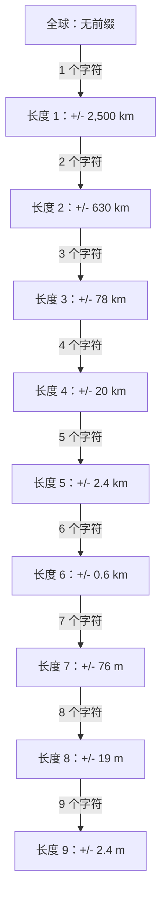
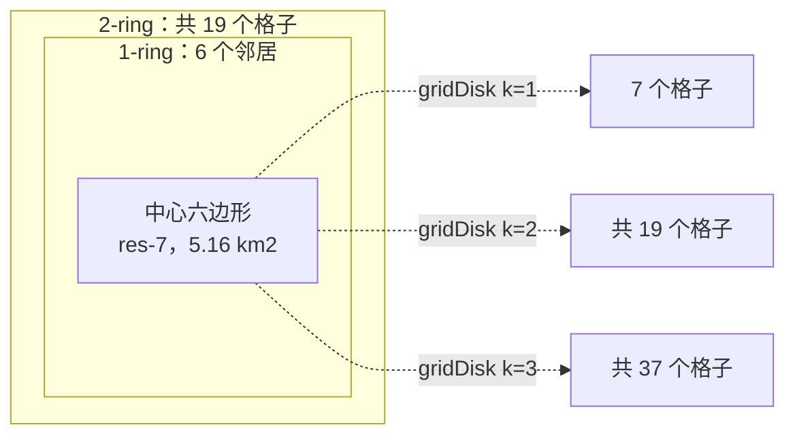
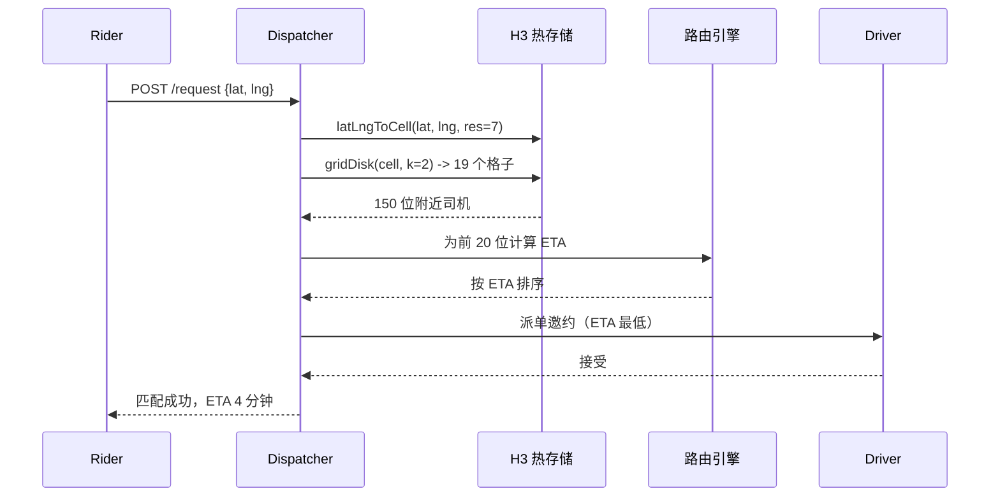
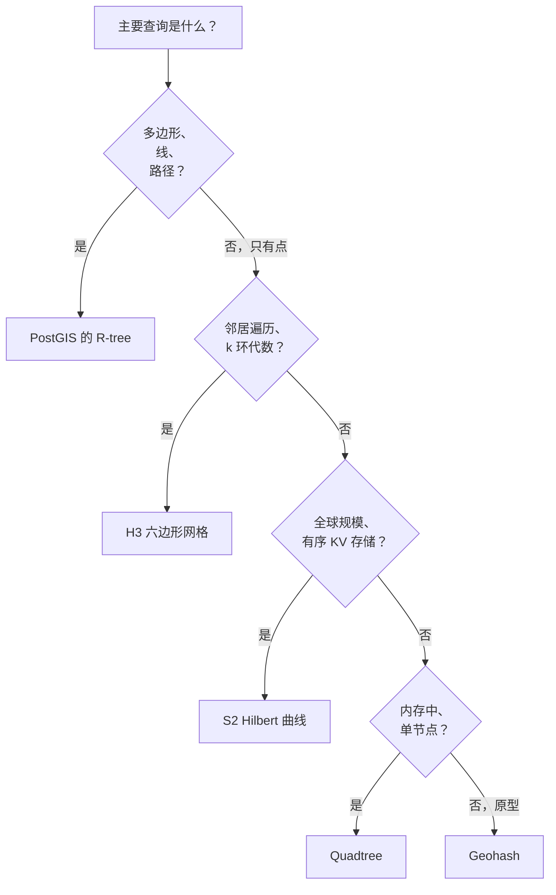

# 地理空间索引：Geohash、Quadtree、R-tree、S2 与 H3

> **TL;DR**: 哈希索引回答等值查询，B 树回答一维范围查询，但两者都回答不了“给我这个点 2 公里内的所有东西”。你需要地理空间索引。派单和邻近查询用 H3（六边形邻居均匀，k 环干净）。要在有序 KV 存储上做全球距离查询，用 S2（球面上的 Hilbert 曲线，64 位整数键）。多边形和路径查询用 PostGIS 及其 R-tree GiST 索引。Uber 每天处理超过 4000 万次行程[^1]，司机匹配用的就是 H3 的 res-7 网格。PostGIS 借助 GiST R-tree 索引高效完成最近 K 个查询[^2]。Redis GEO 用 52 位 geohash 编码，单节点每秒能处理数十万次操作[^3]。

## 学习目标

学完本模块，你将能够：

- [ ] 解释哈希索引和 B 树索引为什么在地理空间范围查询上失效
- [ ] 针对给定负载在 geohash、quadtree、R-tree、S2、H3 之间做出选择
- [ ] 用环形扩展（ring expansion）或有界矩形过滤实现 k 近邻搜索
- [ ] 分析城市级密度下的热点与重建索引故障模式
- [ ] 把索引选型对应到真实系统：PostGIS、Redis GEO、S2、H3、Elasticsearch geo_point

## 直觉理解

你站在一座方格路网城市的街角，想找最近的咖啡店。手机里存着全城每家店按字母排序的列表。没用。它还有一份按门牌号排序的列表。同样没用，因为“附近”意味着在两个维度上都靠近，而不是一个维度。

现在想象给整座城市罩上一张渔网。网格里每个方块都有编号：第 3 行第 7 列就是“3-7”。手机可以瞬间拉出“3-7”这个方块以及周围八个方块里的所有店铺。这就是地理空间索引：它把一个二维的邻近性问题，转换成一组一维查找。

本章这五个索引，就是画这张渔网的五种不同方式。Geohash 用 Z 形曲线。S2 在球面上用 Hilbert 曲线。H3 用六边形而不是正方形。Quadtree 让网格大小随密度自适应。R-tree 用外接矩形把形状包起来。每一种都在均匀性、精度和查询灵活性之间做了不同的权衡。读完本章，你会知道该为自己的负载画哪张网。

## 原理

### 为什么地理空间问题难

B 树沿一个维度给键排序。你可以用 O(log n) 问出“给我 100 到 200 之间的所有键”。但纬度和经度是两个维度。(37.77, -122.41) 这个点离 (37.78, -122.40) 很近，可只按纬度建的 B 树约束不了经度，这两个点会被打散到不同的经度区间里。

根本问题在于：你想在一维索引里获得二维局部性。空间填充曲线（space-filling curve）的解法，是把坐标的位交错成一个可排序的键。二维上靠近的点，在一维曲线上往往也靠近，但并不总是如此——边界情况正是从这里咬人的。

第二个问题：地球是个球。一度经度在赤道是 111.3 km，到两极缩到零。超过几公里的距离，欧氏距离（`sqrt(dx^2 + dy^2)`）就是错的。生产系统用 Haversine（球面地球，误差 0.5% 以内[^4]）或 Vincenty（椭球地球，亚毫米精度[^5]）。

### 常见查询

所有地理空间负载都能归到四类查询之一：

- **最近 K 个**：“找到离这位乘客最近的 10 位司机。”需要按距离顺序遍历。
- **范围（半径）**：“找到 2 公里内的所有餐厅。”地图上的一个圆，变成一组网格查找加一次距离过滤。
- **外接矩形**：“找到这个视口内的所有 POI。”最简单的查询：一个矩形直接映射成索引范围扫描。
- **包含**：“这个点在配送区域的多边形内吗？”需要 R-tree 这类几何感知索引。

你的索引选择取决于哪种查询在你的负载里占主导。

### Geohash 与 Z 序曲线

Geohash 沿 Z 序（Morton）曲线交错纬度和经度的位，再对结果做 base-32 编码[^6]。每个字符增加 5 位精度：

*每个 geohash 字符把误差减半；长度 6 是街区级精度，长度 9 是房间级精度。*

杀手级优势：任何以字符串为索引的存储（Postgres、MySQL、DynamoDB、Redis）都能对 geohash 前缀做范围扫描。截掉字符就是缩小地图。Redis GEO 用的正是这条路：52 位交错 geohash，存成有序集合的分数[^3]。

杀手级缺陷：“边缘跨越”（edge straddle）问题。相距一米却分处格子边界两侧的两个点，一个前缀都不共享。更糟的是国际日期变更线（180 度）：(0, 179.999) 的经度位是 `111111...`，而 (0, -179.999) 是 `000000...`。明明只隔几米，却没有任何共享前缀[^6]。所以永远要查中心格加周围 8 个邻居。

### Quadtree 与 KD-tree

四叉树把空间递归切成四个象限（NW/NE/SW/SE）。每个叶子节点装点，直到达到容量阈值（通常 4 到 16 个）。叶子一旦溢出，就分裂成四个子节点。

四叉树对数据密度自适应得极好。曼哈顿会长成一棵很深的子树；南极洲始终是一片叶子。这让它在单机内存场景里非常出色：游戏服务器、碰撞检测、CAD 工具。

对分布式系统来说，缺点很严重。分裂取决于数据落到哪儿，于是两个副本的树形会逐渐漂移。你没法按哈希路由到一个确定的分片。Uber 最终选了 H3 这种确定性六边形网格，而没有选 quadtree 这一类方案，理由正是均匀网格单元能在不同城市之间提供可比的形状和大小[^7]。KD-tree（按维度交替做二叉切分）有同样的分布问题。

### R-tree 与 PostGIS

R-tree（Guttman，SIGMOD 1984）是一棵高度平衡树，每个节点为其子节点保存最小外接矩形（MBR）[^8]。叶子节点保存真正的几何对象：点、线、多边形。搜索时靠 MBR 相交来剪枝。PostGIS 里的 `<->` 运算符按距离序遍历 R-tree，完成 k-NN 查询[^2]。

R-tree 是本章唯一原生处理多边形和路径的索引。`ST_Contains`、`ST_Intersects`、`ST_DWithin` 全都靠它。PostGIS 通过 GiST（Generalized Search Tree）实现它，允许针对不同几何类型定义自己的运算符类（operator class）。

天花板在于单写者摩擦。GiST 的分裂要持有页级写锁，所以 PostGIS 实例的写吞吐上限远低于它的读能力，高并发插入时争用会变得明显。对读多的分析和静态 POI 数据集来说这没问题；对 Uber 规模的实时司机追踪来说就不行。

### H3：Uber 的六边形网格

H3 用外接于球体的二十面体上的六边形来铺满地球。它有 16 个分辨率：res-0 的格子是 430 万 km^2，res-15 的格子是 0.9 m^2[^9]。Uber 的默认派单分辨率是 res-7（平均面积 5.16 km^2，平均边长 1.40 km）[^9]。

为什么用六边形？六边形到全部 6 个邻居的中心距完全相等。正方形有两种距离（边相邻与对角相邻）。这对动态加价（surge pricing）这类梯度计算很关键，因为你需要邻居权重均匀[^7]。

*H3 的 k 环扩展：gridDisk(k) 返回 1 + 3k(k+1) 个格子，为派单提供了一个干净的“附近”原语。*

`gridDisk` 返回 k 环邻域，每个格子 O(1)。做“找附近司机”时，你算出 `gridDisk(riderCell, k=2)`，拿这 19 个格子去查已建索引的司机，再按 ETA 排序。

要小心的地方：每个分辨率有 12 个五边形格子（位于二十面体顶点，设计上被放在大洋里[^9]）。路径穿过五边形时 `gridDistance` 可能失败。把它当尽力而为，失败就回落到 Haversine。

### S2：Google 在球面上的 Hilbert 曲线

S2 把单位球投影到六个立方体面上，对每个面施加 Hilbert 曲线，再把它们连成一个连续的环。每个格子得到一个 64 位 S2CellId，30 层细分，最细一层约 1 cm^2[^10]。

关键性质：数值相近的 cell ID 在空间上也相近。于是对 64 位整数列做普通的 B 树范围扫描，就变成了空间范围扫描。任何有序 KV 存储（Bigtable、Spanner、Cassandra、Postgres）不需要任何专用基础设施，就能当地理索引使。

查询用 `S2RegionCoverer` 把搜索区域近似成一组 cell-ID 区间（默认 8 段）。每段变成一次 B 树扫描；各段的并集再用精确几何过滤。S2 在业界常用于场所和位置搜索，正是因为它按整数键建索引效率很高[^10]。

S2 用 Hilbert 曲线而不用 Z 序，是因为 Hilbert 更好地保持局部性：曲线上的相邻格子，在二维上必定相邻；而 Z 序有那些让 geohash 在边界处声名狼藉的“跳跃”。

### 距离计算：Haversine vs Vincenty

- **Haversine**：假定完美球体。快。误差最大 0.5%（100 km 行程上约 500 m）[^4]。用于“N 公里以内”这类误差可以当噪声的过滤。
- **Vincenty**：按 WGS84 椭球建模。亚毫米精度[^5]。用于计费、合规和安全阈值。
- **欧氏距离**：超过几百米就是错的。一度经度在赤道是 111 km，到两极是 0 km。

PostGIS 的 `geography` 类型默认走 Vincenty。`geometry` 类型按你声明的 SRID 做平面计算。在 `ST_Distance` 里混用 SRID，会静默返回毫无意义的数字。

## 真实案例

Uber 每天处理超过 4000 万次行程（2025 年 Q4 为 38 亿次）[^1]。每次行程都始于“找到这位乘客附近的可用司机”，而且必须在 100 ms 内完成。

**索引**：H3 的 7 号分辨率。司机 App 每 4 秒上报一次位置更新，以 H3 格子为键。匹配服务算出 `gridDisk(riderCell, k=2)` 拿到 19 个候选格子，再去热存储（Redis 或内存）里查这些格子中的司机。

**为什么选 H3 而不是其他方案**：Uber 工程团队选六边形，是因为动态加价需要在邻居之间做梯度计算。用正方形，对角邻居比边邻居远 sqrt(2) 倍，梯度就失真了。用六边形，6 个邻居等距[^7]。

**派单流程**：

*Uber 的派单流水线：H3 k 环找出候选司机，路由引擎按 ETA 排序，二分图匹配指派最优的一对。*

**分辨率选择**：res-7（5.16 km^2）用于粗粒度匹配，res-8 到 res-9（0.74 到 0.11 km^2）用于加价热力图[^9]。更细的分辨率能把体育场热点切成可管理的块。

**规模数字**：按每天 3300 万次行程算，平均每秒约 380 次叫车请求，高峰是平均值的 3-5 倍。每次请求触发一次跨 19 个格子的 k 环查找，过滤出最近的 10-20 位司机，再算 ETA。整条流水线在 100 ms 内完成。

## 权衡

| 索引 | 优点 | 缺点 | 适用场景 | 我们的选择 |
|---|---|---|---|---|
| Geohash | 任何数据库都能存字符串；前缀即缩放级别 | 边缘跨越；两极格子不均 | 原型、单区域应用 | 用于 Redis GEO 或快速 MVP |
| Quadtree | 随密度自适应；外接矩形简单 | 难以分布式；没有邻居原语 | 单机内存（游戏、CAD） | 仅在单进程时使用 |
| R-tree（PostGIS） | 支持多边形、精确距离、完整 SQL | 单写者锁争用天花板 | 静态 POI、地理围栏、分析 | 用于多边形/路径查询 |
| S2 | 64 位键能存进任何 KV 存储；能处理极点 | API 复杂；k 环比 H3 麻烦 | 全球制图、区域覆盖 | 用于行星级有序 KV |
| H3 | 邻居均匀；k 环干净；64 位 | 12 个五边形；覆盖近似误差 | 派单、动态加价、邻近查询 | 用于实时空间匹配 |

## 常见陷阱

> [!WARNING]
> **国际日期变更线会击穿 geohash 查询。** 经度 179.999 和 -179.999 上相距几米的两个点，前缀位一个都不共享。你的“附近”查询什么都返回不了。修法：用 S2 或 H3（两者都能正确处理日期变更线），或者显式地把 +180/-180 两侧的查询并起来。

> [!WARNING]
> **Geohash 边界必须多取。** 靠近格子边缘的点，需要查 9 个格子（中心 + 8 个邻居）才不会漏掉附近结果。粗糙的实现只查中心格，会漏掉 20-40% 的真正邻居。

> [!WARNING]
> **体育场热点会把一个分片钉死。** 一座 5 万座的体育场在散场时，会在单个 H3 res-7 格子里产生 4 万+ 请求。如果你按 cell ID 分片，一个分片要扛每秒 4 万次热读，其他分片却闲着。修法：对热点区域降到 res-8 或 res-9，或者按 driver_id 分片再挂一个二级 cell 索引。

> [!WARNING]
> **球面上用欧氏距离是错的。** 用 `sqrt(dlat^2 + dlng^2)` 在高纬度误差可达 30%，因为一度经度越靠近两极越短。生产环境算距离永远用 Haversine（误差 0.5%）或 Vincenty（亚毫米）。

> [!WARNING]
> **写入路径和读取路径投影不一致。** 写入用 SRID 4326（WGS84 度），读取用 SRID 3857（Web Mercator 米）。PostGIS 接受跨 SRID 的 `ST_Distance`，但返回的是毫无意义的数字。修法：距离计算一律用 `geography` 类型，它会强制走球面数学。

> [!WARNING]
> **密集城区会压垮均匀网格。** 曼哈顿单个 H3 res-8 格子（0.74 km^2）里可能有 1 万名司机。你的“附近”查询返回太多候选，ETA 计算纯属浪费算力。修法：用自适应分辨率（城区更细、郊区更粗），或者用按距离排序来限制候选集大小。

## 练习

为一个网约车服务设计地理空间子系统：100 万活跃司机，每秒 1 万次并发叫车请求，响应时间目标 100 ms 以内。选定一种索引并说明理由，估算存储层容量，并处理演唱会散场热点——4 万名乘客在同一个格子里同时发起请求。

Hint

想一想哪种索引能给你一个干净的“附近”原语，而不必对每位司机都算距离。考虑 k=2 的 k 环覆盖多少格子，以及平均每个格子里有多少司机。热点部分，想想切换分辨率。

Solution

**索引选择**：H3 的 7 号分辨率（每格 5.16 km^2）。理由：邻居均匀，k 环扩展干净；64 位整数键能直接进 Redis 有序集合；Uber 在相近规模上已经验证过。

**存储估算**：100 万司机，每人作为 Redis 有序集合的一个成员，键为 H3 res-7 格子。按每条约 100 字节（成员名 + 分数 + 开销）算，约 100 MB。单节点 Redis 轻松扛住这个量。每秒 1 万请求，每次触发跨 19 个格子的 `gridDisk(k=2)` 查找，你需要每秒约 19 万次 ZRANGEBYSCORE 操作。单节点 Redis 能跑每秒 50 万+ 次操作，所以索引层一个节点就够。

**查询流程**：乘客请求到达。算出 `latLngToCell(lat, lng, res=7)`。调 `gridDisk(cell, 2)` 拿到 19 个格子。对每个格子，在 Redis 有序集合上做 `ZRANGEBYSCORE` 取司机。用 Haversine 距离过滤（k 环可能包含超出目标半径的司机）。按直线距离排出前 20 位，通过路由引擎算这 20 位的 ETA，派给最合适的那位。

**热点处理**：当 4 万名乘客同时从一个 res-7 格子发起请求时，该格子的候选司机很快就被抽空。方案：（1）把 k 扩到 3 或 4，从更远的格子拉司机；（2）对热点区域切到 res-9（0.11 km^2），让请求分散到约 50 个子格子而不是 1 个；（3）对每位司机的派单邀约限流，避免同一批 100 位司机同时收到 400 个邀约。

**与 Uber 的对比**：Uber 用 H3 res-7 作默认派单网格，res-9 用于加价热力图。我们的设计与之一致。在 Uber 的规模上（每天 3300 万次行程，我们是约 86 万次），关键差异是他们跑二分图匹配优化器（匈牙利算法），而不是简单的最近司机派单。

## 要点回顾

- 不存在通用的最佳地理空间索引。正确的选择取决于你的查询是最近 K、范围、多边形，还是邻居遍历。
- 空间填充曲线（geohash、S2）让任何有序 KV 存储都能当地理空间索引，这也是它们在大规模场景占主导的原因。
- 六边形（H3）给出均匀的邻居距离，因此特别适合动态加价、派单这类梯度计算。
- 永远要查中心格加邻居。只查单个格子，在格子边界处会漏掉 20-40% 的真正邻近结果。
- 上线前就要为热点做规划。密集城区和活动场馆会把流量压在一两个格子里。
- “N 公里以内”的过滤用 Haversine；计费和合规阈值用 Vincenty。地理坐标上永远不要用欧氏距离。
- 需要多边形或路径，就需要 PostGIS 的 R-tree。基于曲线的索引不原生处理形状。

## 延伸阅读

- [H3: Uber's Hexagonal Hierarchical Spatial Index](https://www.uber.com/en-CA/blog/h3/) - 原始发布文章，解释了为什么在市场平台的梯度计算上六边形胜过正方形；任何派单系统设计都必读。
- [S2 Geometry Cell Hierarchy](https://s2geometry.io/devguide/s2cell_hierarchy) - 深入讲解 Hilbert 曲线投影、cell-ID 位布局和区域覆盖算法；在生产环境实现 S2 之前先读这篇。
- [H3 Resolution Table](https://h3geo.org/docs/core-library/restable/) - 全部 16 个分辨率的权威格子面积数字；做容量估算时值得收藏。
- [PostGIS ST_DWithin Documentation](https://postgis.net/docs/ST_DWithin.html) - 配合 GiST R-tree 索引做邻近过滤的参考文档，含控制 Haversine 与 Vincenty 之选的 `use_spheroid` 开关。
- [Redis Geospatial Commands](https://redis.io/docs/latest/develop/data-types/geospatial/) - GEOADD/GEOSEARCH 的命令面、52 位 geohash 编码，以及 O(N + log M) 复杂度分析。
- [BKD-backed geo_shapes in Elasticsearch](https://www.elastic.co/blog/bkd-backed-geo-shapes-in-elasticsearch-precision-efficiency-speed) - Elasticsearch 如何用三角剖分在 quadtree 前缀编码之上做到 138,236:1 的压缩比。
- [Guttman, R-trees: A Dynamic Index Structure for Spatial Searching, SIGMOD 1984](https://dl.acm.org/doi/10.1145/602259.602266) - R-tree 原始论文；理解基于 MBR 的空间搜索仍然要看它。
- [Should You Use H3 for Geospatial Analytics?, Apache Sedona 2025](https://sedona.apache.org/latest/blog/2025/09/05/should-you-use-h3-for-geospatial-analytics-a-deep-dive-with-apache-spark-and-sedona/) - 实测 H3 覆盖误差基准，显示 res-8 下会多算 3.8 倍；在把 H3 用于分析之前先读这篇。

## 记忆卡片

**Q:** 为什么 B 树索引回答不了“找到 P 点 2 公里内的所有点”？
**A:** B 树只沿一个维度排序，而邻近是二维属性。纬度上很近的两个点，经度可能很远，所以单维范围扫描表达不了半径查询。

**Q:** Geohash 里的“边缘跨越”问题是什么？
**A:** 相距几米却分处格子边界两侧的两个点，没有任何共同前缀。只查中心格的查询会漏掉它们。修法：永远查中心格加 8 个邻居格。

**Q:** Uber 为什么在 H3 里选六边形而不是正方形？
**A:** 六边形到全部 6 个邻居的中心距只有一个值。正方形有两种距离（边相邻与对角相邻），会扭曲动态加价这类梯度计算。

**Q:** H3 的 gridDisk(k=2) 返回多少个格子？
**A:** 1 + 3k(k+1) = 1 + 3(2)(3) = 19 个格子。这个公式给出中心格加上 k 环以内的所有格子。

**Q:** H3 里的 12 个五边形格子是什么？
**A:** 六边形无法完美铺满球面。H3 把 12 个五边形放在二十面体顶点（设计上位于大洋中）。跨五边形边界时 gridDistance 可能失败。

**Q:** 算距离时什么时候用 Haversine，什么时候用 Vincenty？
**A:** “N 公里以内”这类误差可当噪声的过滤用 Haversine（球面，误差 0.5%）。计费、合规和安全阈值用 Vincenty（椭球，亚毫米）。

**Q:** 带 GiST R-tree 索引的 PostGIS 写吞吐天花板是多少？
**A:** GiST 的分裂持有页级写锁，并发插入下争用明显。具体上限取决于硬件和负载，但写吞吐显著低于读吞吐。

**Q:** Redis GEO 怎么编码坐标？
**A:** 它把纬度和经度交错成一个 52 位 geohash，存成有序集合的分数。52 位这个限制来自双精度尾数，给出约 60 cm 的精度。

**Q:** Uber 的默认派单分辨率是多少？
**A:** H3 的 7 号分辨率，平均格子面积 5.16 km^2，平均边长 1.40 km。加价热力图用 res-8 到 res-9 以获得更细的粒度。

**Q:** S2 和 geohash 在曲线选择上有什么不同？
**A:** S2 用 Hilbert 曲线（曲线上的相邻格子在二维上必定相邻）。Geohash 用 Z 序曲线，那些“跳跃”会破坏格子边界处的局部性。

**Q:** 多边形包含查询该选哪个地理空间索引？
**A:** PostGIS 的 R-tree。它是唯一原生处理多边形、线和路径，并支持 ST_Contains、ST_Intersects 这类精确几何运算的生产级索引。

*决策流程图：从你的负载出发，落到合适的地理空间索引。*

## 参考文献

[^1]: "Uber Announces Results for Fourth Quarter and Full Year 2024", Uber Investor Relations (3.1B trips in Q4 2024, approximately 33M trips/day). https://investor.uber.com/news-events/news/press-release-details/2025/Uber-Announces-Results-for-Fourth-Quarter-and-Full-Year-2024
[^2]: "ST_DWithin", PostGIS Documentation. https://postgis.net/docs/ST_DWithin.html
[^3]: "Redis geospatial", Redis Documentation (GEOADD, GEOSEARCH with complexity notes). https://redis.io/docs/latest/develop/data-types/geospatial/
[^4]: "Great-circle distance", Wikipedia. https://en.wikipedia.org/wiki/Great-circle_distance
[^5]: "Distance on an ellipsoid: Vincenty's Formulae", Esri Community. https://community.esri.com/t5/coordinate-reference-systems-blog/distance-on-an-ellipsoid-vincenty-s-formulae/ba-p/902053
[^6]: "Geohash", Wikipedia (includes precision table and limitations section). https://en.wikipedia.org/wiki/Geohash
[^7]: "H3: Uber's Hexagonal Hierarchical Spatial Index", Uber Engineering Blog. https://www.uber.com/en-CA/blog/h3/
[^8]: Guttman, A. (1984). "R-trees: A dynamic index structure for spatial searching", ACM SIGMOD 1984. https://dl.acm.org/doi/10.1145/602259.602266
[^9]: "Tables of Cell Statistics Across Resolutions", h3geo.org. https://h3geo.org/docs/core-library/restable/
[^10]: "S2 Cells and the S2CellId Numbering", s2geometry.io Developer Guide. https://s2geometry.io/devguide/s2cell_hierarchy
