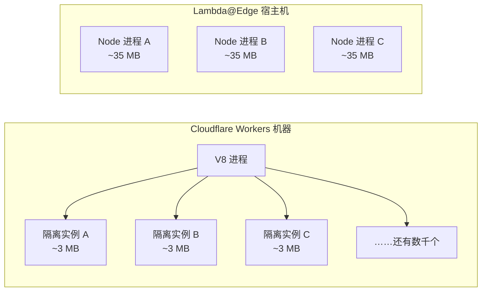
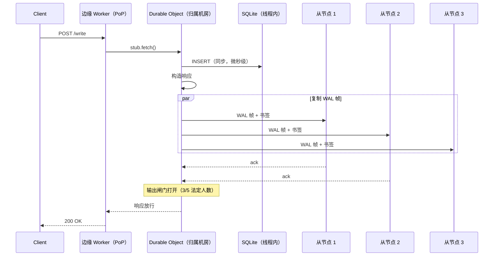
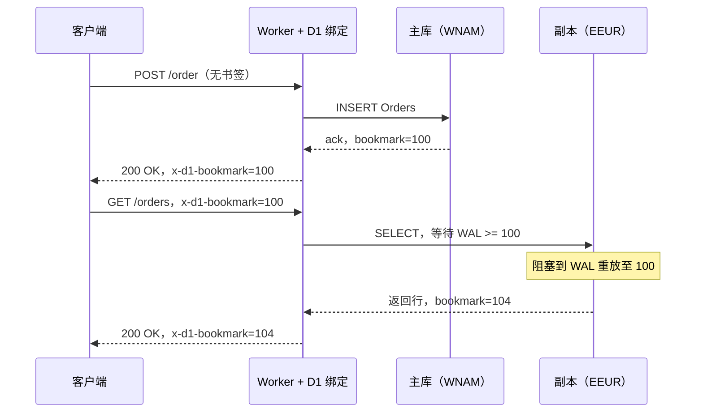
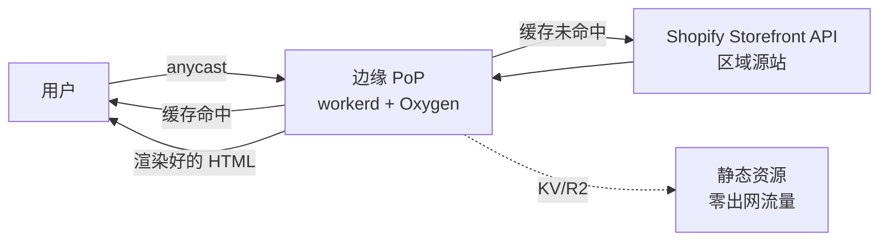

# 边缘计算（Cloudflare Workers、Lambda@Edge、Deno Deploy）

> **TL;DR**: 边缘计算把应用代码跑在几百个 PoP 里，而不是少数几个地域。Cloudflare Workers 在 330+ 座城市运行，靠一台 V8 进程服务上千个租户，冷启动低于 5 ms [^1]。它的吸引力在延迟：计算离大多数联网用户只有几毫秒 [^2]。陷阱在于以为把代码挪到用户附近，数据也会跟着挪过去。并不会。成功的边缘应用是混合式的：边缘做无状态转换，源站是记录系统（system of record），中间用精心挑选的有状态原语（Durable Objects、D1、Turso）把两头接起来。

## 学习目标

学完本章，你将能够：

- [ ] 说清三种主流边缘运行时模型及其执行约束
- [ ] 解释 Durable Objects 如何支撑有状态的边缘计算
- [ ] 针对给定负载，在全局、区域、边缘三种层级之间做选择
- [ ] 用 D1 Sessions、KV 和 Hyperdrive 设计边缘数据访问模式
- [ ] 避开反模式：在边缘跑重计算、频繁回源调用、把 KV 当事务型存储

## 直觉理解

你在 330 座城市开了一串咖啡店。每家店有一位咖啡师（计算）、一个小展示柜（缓存）、一块菜单板（配置）。顾客几秒就能拿到咖啡，因为店就在他们街区。

但店不自己烘豆子。每晚有一辆卡车从中央烘焙厂（源站）送来新鲜豆子。如果顾客点了一杯店里没备货的稀有单一产区手冲，咖啡师得打电话给烘焙厂，顾客再等快递送来。常见订单很快，罕见订单很慢。

现在想象每个区域有一家特殊的店，专门保管一本积分账。全世界每个顾客都恰好有一本账，钉在某一间店里。你离那家店近，查余额就是瞬时的；你在大洋彼岸，就得等这通电话跨过去。那本账就是 Durable Object：单实例、单位置、强一致，但并不会神奇地变成全局。

边缘计算是同一个道理。PoP 就是咖啡店。咖啡师是一个 V8 隔离实例，CPU 预算很紧（免费套餐 10 ms，付费套餐默认 30 s）。展示柜是边缘缓存。烘焙厂是你的源站数据库。而那本积分账，就是让边缘不只是“高级 CDN”的有状态原语。后面几节把这些想法讲精确。

## 原理

### 边缘运行时与冷启动

[CDN 与边缘分发](../part-2-building-blocks/02-cdns.md)把 CDN 介绍为缓存层。边缘计算在这层之上加了可编程的请求处理。三种运行时家族占主导：

**V8 隔离实例（V8 isolates）**（Cloudflare Workers、Deno Deploy、Vercel Edge Functions）在同一台机器上让上千个租户共用一个 V8 进程。隔离实例之间切换不需要操作系统级的进程切换。冷启动约 5 ms，每个租户内存开销约 3 MB；作为对比，一个 Node.js Lambda 容器是 35 MB [^1]。代价是：代码只能用 JavaScript、TypeScript 或 WebAssembly。不能用原生二进制，不能做任意系统调用。

**WebAssembly 沙箱**（Fastly Compute）把租户代码编译成 Wasm，每个请求起一个全新的 Wasmtime 沙箱 [^3]。这带来最强的单请求隔离和真正的多语言支持（Rust，TinyGo 跑 Go，Javy 跑 JavaScript）。轻量函数的冷启动在微秒量级。

**MicroVM 平台**（AWS Lambda@Edge，Fly.io 基于 Firecracker）为每个租户启动一台硬件虚拟化的 VM。完整的操作系统语义，任何语言都能跑，但冷启动要 50 到 100 ms，内存开销也更高 [^4]。

*V8 隔离实例用一个进程服务上千个租户，每个租户的内存占用大约只有容器化 Lambda 函数的十分之一 [^1]。*

CPU 预算才是决定一切的那个约束。在现行的 Workers Standard 套餐上，每个 HTTP 请求默认 30 秒 CPU 时间，最高可以提到 5 分钟；Workers Free 套餐把每请求 CPU 限制在 10 ms（`await` 期间的挂钟时间不计入 CPU 时间）[^5]。旧的 Bundled 套餐那个 50 ms CPU 上限，只留在被保留的存量 Workers 上，新部署已经不再默认如此。CloudFront Functions 紧得多：亚毫秒执行、2 MB 内存、10 KB 代码、只支持 ECMAScript 5.1 [^6]。Lambda@Edge 允许跑 30 秒，但只部署到 CloudFront 的 15 个区域边缘缓存，而不是每个 PoP [^6]。

| 平台 | 冷启动 | CPU 预算 | 内存 | 节点位置 | 语言 |
|---|---|---|---|---|---|
| Cloudflare Workers | ~5 ms | 默认 30 s，最高 5 分钟（付费）；10 ms（免费） | 128 MB | 330+ 座城市 | JS/TS/Wasm |
| CloudFront Functions | 亚毫秒 | 亚毫秒 | 2 MB | 750+ 个 PoP | 仅 ES 5.1 |
| Lambda@Edge | 50 到 100 ms | 30 s | 128 MB（viewer）/ 10 GB（origin） | 15 个区域边缘缓存 | Node/Python |
| Deno Deploy | 低于 50 ms | 可配置 | 512 MB | 全球（多区域） | TS/JS/Wasm |
| Fastly Compute | 微秒级 | 可配置 | 128 MB | 约 90 座城市 | Rust/Go/JS（Wasm） |
| Vercel Edge Functions | ~5 ms | 30 s（Fluid） | 128 MB | 多区域 | JS/TS |

### 用 Durable Objects 实现有状态边缘

大多数边缘运行时在设计上就是无状态的。Durable Objects（DO）打破这条规则。一个 DO 是一个单实例、有名字、绑定位置的 actor，自带私有 SQLite 存储 [^7]。对某个名字的任何请求，无论来自世界哪个角落，都路由到同一台机器上的同一个实例。

SQLite 和应用代码跑在同一个线程里。查询以微秒级同步执行，因为数据库是一次库调用，不是一次网络往返 [^7]。SELECT 和 UPDATE 之间没有 `await`，这本身就是正确性保证：没有并发请求能插进来，因为 JavaScript 是单线程的，而且“输入闸门”在 await 期间会挡住其它事件。

写入通过 Cloudflare 的 Storage Relay Service 异步复制到不同数据中心的五台“持久化从节点”上。“输出闸门”会拦住 Worker 的响应，直到五台里至少三台确认了这次写入 [^7]。这样就在不阻塞应用代码的前提下保证了持久性。

*输出闸门会一直拦住响应，直到五分之三的持久化法定人数确认了这次写入。应用看到的只是同步 SQL，但系统保证了跨数据中心持久性 [^7]。*

**WebSocket 休眠（hibernation）** 把 DO 扩展到实时场景。用 `ctx.acceptWebSocket()` 而不是 `ws.accept()`，运行时可以把 DO 从内存里驱逐出去，同时在边缘保持 TCP 连接不断。只有消息到达时 DO 才被唤醒 [^8]。一个有一万个空闲连接的聊天室，在没人说话之前不产生任何时长费用。

单写者特性是功能，不是缺陷。它对按键的状态消除了分布式协调：限流器、会话存储、协作文档锁、游戏大厅。但一个钉在北美的 DO 服务欧洲用户时，每个请求都要吃 100+ ms 的跨大西洋延迟。用 `locationHint` 或带区域前缀的命名来控制落位。

### 边缘数据库与存储

边缘数据库解决读路径。写入依然在主库上成为瓶颈，但读可以由附近的副本承担。

**D1** 是 Cloudflare 基于 SQLite 的边缘数据库。底层上，每个 D1 数据库都是一个 Durable Object，并在每个支持的区域自动配有只读副本 [^9]。Sessions API 提供读己之写一致性：每次写入返回一个单调递增的“书签”（bookmark，一个 Lamport 时间戳）。客户端在后续读取时带上这个书签，副本会等到自己重放到那个位置之后才应答 [^9]。从 ENAM 主库到 WEUR 副本的确认延迟约为 55 ms [^9]。

*客户端把书签带过整个往返；副本会阻塞读取，直到自己的 WAL 追到那个书签，从而避免刚写完就从陈旧副本读到旧数据 [^9]。*

**Workers KV** 是一个最终一致的全局键值存储。从有缓存的 PoP 读取延迟很低，写入异步传播。它为“读多写少”的模式设计，比如特性开关和配置。它不是事务型的，也没有 compare-and-swap。

**R2** 是兼容 S3 的对象存储，出网流量零费用 [^10]。存储 $0.015/GB-月、出网 $0，对读多的负载来说，价格远低于 AWS S3。

**Hyperdrive** 是面向外部 PostgreSQL/MySQL 的连接池加查询缓存。它让查询走 Cloudflare 的骨干网，减少连接开销，并在边缘缓存读结果。它不会让一个区域性的 Postgres 变成全球的；它只是让从边缘访问它更快。

**Turso** 使用 libSQL（SQLite 的一个分支），配“内嵌副本”（embedded replicas）：本地维护一个从云端主库同步来的 SQLite 文件 [^11]。读是零延迟（本地文件），写回到主库。这是目前最接近真正“边缘优先”数据库的东西。

### 适合边缘的模式

**带 stale-while-revalidate 的边缘缓存。** 先瞬时返回陈旧内容，同时在后台刷新。再叠上分层缓存（Tiered Cache，把 PoP 的未命中先导入上层缓存，再去源站），就能消除 TTL 过期时的惊群风暴。

**边缘 API 网关。** 校验鉴权 token、限流、请求路由、改写请求头，这些全都能舒服地塞进几毫秒 CPU 时间里，远低于 Standard 套餐 30 秒的默认额度。边缘于是成了安全与路由的前门，又不增加源站延迟。

**边缘 SSR 与 React Server Components。** Shopify Hydrogen 在 Oxygen（Cloudflare 的 `workerd` 运行时）上渲染店面。Vercel 的 Fluid Compute 预热实例，并用函数内并发让多个请求分摊同一个 JavaScript 引擎的开销 [^12]。首字节在用户几十毫秒内到达。

**智能路由。** Cloudflare 的 Smart Placement 会在 Worker 发出的子请求多于它直接服务的请求时，自动把 Worker 挪到离源站更近的地方。这是给那些不小心变得“话痨”的 Worker 留的逃生门。

**边缘 ML 推理。** Workers AI 绑定让你直接调推理模型，不必把权重推到边缘。模型跑在 Cloudflare 的 GPU 集群上，Worker 负责编排这个请求。

### 什么情况下不该用边缘

边缘是 CDN 和源站之间的一个混合层。它替代不了任何一头。

**重计算。** 图像处理、PDF 生成、视频转码、ML 训练，全都超出 CPU 预算。放到容器或源站去做。

**频繁回源调用。** 一个边缘处理函数对 `us-east-1` 连做 8 次串行 `fetch()`，新加坡的用户就要等 8 x 200 ms = 1.6 秒。把处理函数挪到边缘，反而让延迟更糟。让数据和计算待在一起，把调用批量化，或者用 Smart Placement。

**同步扇出。** 在边缘聚合 5 个微服务的响应，等于把跨洋往返串起来。在服务同处一地的源站做聚合。

**跨区域强一致。** 如果每个请求都必须读到全局最新的写入，边缘只是多了一跳，并不会降低延迟。把请求留在主库所在的源站。

## 真实案例

### Shopify Hydrogen 跑在 Oxygen 上：边缘渲染的店面

Shopify 的 Hydrogen 是一个基于 React 的店面框架。Oxygen 是承载它的托管平台，运行在 Cloudflare 的 `workerd` 运行时上，部署在 Cloudflare 全网 [^13]。每个付费 Shopify 套餐都包含 Oxygen，不额外收基础设施费用。

架构很直白：一个 Hydrogen 店面就是一个 Worker。它在最近的 PoP 收到请求，渲染 React Server Components，从 Shopify 的 Storefront API 取商品数据（在边缘做激进缓存），返回个性化 HTML。本地开发服务器精确复刻生产环境的 Workers 运行时，所以本地能跑的东西，生产就能跑。

*Shopify Oxygen 在边缘 PoP 渲染 Hydrogen 店面。缓存命中在 30 ms 内返回。未命中时从 Storefront API 取数据，并把结果缓存给后续请求。*

为什么可行：商品目录页是读多的，数据形状可预测。渲染一棵 React 组件树的 CPU 开销，在 Worker 预算之内。写入（购物车更新、结账）路由到 Shopify 的区域源站，事务保证在那里。边缘承接 95% 的浏览流量，源站承接 5% 的下单流量。

## 权衡

| 方案 | 优点 | 缺点 | 适用场景 | 我们的选择 |
|---|---|---|---|---|
| 纯源站（单区域） | 简单，只有一套数据模型 | 远端用户 100 到 200 ms | 内部工具、区域型应用 | 仅用于内部或区域型业务 |
| 边缘 CDN 缓存 | 缓存路径上延迟收益巨大 | 数据可能陈旧，无动态逻辑 | 静态 + 偶尔动态 | 静态资源的默认选择 |
| 边缘计算（无状态） | 个性化渲染、A/B、鉴权，冷启动 5 ms | 受 CPU 预算限制（付费默认 30 s，免费 10 ms），无状态 | 重定向、鉴权、转换 | 请求整形（request shaping）的默认选择 |
| 边缘计算 + Durable Objects | 状态就近用户，3/5 持久化 | 单实例瓶颈，钉在单一区域 | 会话状态、限流、协调 | 需要按键状态时 |
| 边缘数据库（D1/Turso 副本） | 低延迟读，按会话钉住一致性 | 写入仍集中，要传书签 | 读多，多数读可接受最终一致 | 读占 10:1 时 |
| 边缘优先的本地数据库（CRDT） | 真离线，零延迟读 | 数据模型受限，同步复杂 | 协作类应用、外勤人员 | 小众但很强 |

## 常见陷阱

> [!WARNING]
> **把 KV 当事务型存储。** `get -> modify -> put` 模式在争用下会丢写，因为 KV 是最终一致的，没有 compare-and-swap。计数器、会话，或任何读-改-写模式，都用 Durable Object。

> [!WARNING]
> **缓存未命中时在源站引发惊群。** 一个热门页面在缓存里过期，330 个 PoP 同时各自去回源。用 Tiered Cache 把未命中导入上层缓存，用 `stale-while-revalidate` 先返回陈旧内容再异步刷新。

> [!WARNING]
> **给全球用户把 Durable Objects 钉在一个区域。** 在北美创建的 DO 服务欧洲用户时，每个请求都要吃 100+ ms 的跨大西洋 RTT。用 `locationHint`、带区域前缀的命名，或者在 DO 前面加一层读缓存。

> [!WARNING]
> **跑的重计算超出配置的 CPU 上限。** Workers Free 的 CPU 上限是 10 ms；Workers Paid 默认 30 s，最高可提到 5 min。超出配置上限，请求会以 1102 错误终止。图像处理、PDF 生成、ML 推理都放到容器或 Workers AI 绑定上。视频转码永远不要在边缘跑。

> [!WARNING]
> **频繁回源调用放大边缘延迟。** 对远距离源站连做 8 次串行 `fetch()`，200 ms 的 RTT 就变成 1.6 秒。把调用合并到一个 BFF 端点，用 D1/Hyperdrive 让数据和计算同处一地，或者交给 Smart Placement 把 Worker 挪近源站。

## 练习

为一个公共 API 设计限流逻辑，要全局强制执行“每个 API key 每分钟 100 个请求”。朴素实现打一个中心 Redis；在边缘你希望延迟低于 10 ms。用 Durable Objects 设计一个方案（每个 API key 一个对象，钉在第一个看到该 key 的区域），并推理客户端在分钟内切换区域时会发生什么。

提示

每个 API key 恰好映射到一个 Durable Object 实例。DO 在自己的 SQLite 存储里维护一个滑动窗口计数器。想一想“钉在第一个区域”对一个从欧洲开始、分钟中间跑到亚洲的用户意味着什么。计数器依然准确（单写者），但这个迁移过去的用户延迟会升高。

解答

**架构：** 建一个 Durable Object 类 `RateLimiter`。每个 API key 按名字映射到一个 DO（`env.RATE_LIMITER.idFromName(apiKey)`）。DO 在 SQLite 里存一个排好序的时间戳列表。

**请求流程：**

1. 边缘 Worker 从请求头里取出 API key。
2. Worker 带着当前时间戳调用 `rateLimiter.fetch()`。
3. DO 清掉 60 秒之前的时间戳，数剩下多少条，然后要么放行（插入时间戳，返回 200），要么拒绝（返回 429）。

**为什么可行：** DO 是单线程的。没有竞态，没有分布式锁。计数器永远准确，因为写者恰好只有一个。SQLite 查询是微秒级同步的。

**区域迁移：** 如果客户端从法兰克福（DO 钉在这里）跑到东京，之后每次限流检查都要跨洋（约 150 ms RTT）。计数器仍然正确，但延迟升高了。这对限流是可以接受的，因为：

- 这个检查不在响应体的关键路径上（可以和回源请求并行做）。
- 对防滥用来说，准确性比延迟更重要。
- 如果延迟不可接受，就按区域分片：`eu-{apiKey}`、`ap-{apiKey}`，并把全局上限略微调高，以补偿各区域少算的部分。

**接受的代价：** 按区域分片是用准确性换延迟。一个用户可能在同一分钟内于 EU 拿到 100 个请求、在 AP 又拿到 100 个。如果严格的全局执行很重要，就接受跨洋延迟。如果近似执行就够（大多数限流器都是），那就按区域分片。

## 要点回顾

- 延迟重要、计算量又小的时候，边缘很出彩；一旦你把它当成便宜的源站，它就会失灵。
- V8 隔离实例让冷启动不再成为障碍（约 5 ms，对比 Lambda@Edge 的 50 到 100 ms），但每请求的 CPU 预算（免费 10 ms，付费默认 30 s、最高 5 min）依然限定了单个请求能干什么 [^1][^5]。
- Durable Objects 是内嵌 SQLite 的单实例 actor。单写者特性为按键状态消除了分布式协调 [^7]。
- D1 的 Sessions API 用单调书签提供读己之写一致性。不用它，读就退化成没有保证的最终一致 [^9]。
- R2 的零出网定价，让规模上边缘分发的静态资源比 S3 便宜得多 [^10]。
- 边缘是对区域源站的加法，不是替代。大多数成功的边缘应用是混合式的：边缘做无状态转换，源站是记录系统。
- 明确挑一个一致性说法：读己之写（D1 Sessions）、最终一致（KV），还是强一致单写者（Durable Objects）。这里含糊其辞就会养出 bug。

## 延伸阅读

- [Cloud Computing without Containers](https://blog.cloudflare.com/cloud-computing-without-containers/) - Cloudflare 2018 年为 V8 隔离实例胜过容器的论证；至今仍是最清楚的解释：这个模型为什么重要，以及它如何让每个 Worker 都部署到每个 PoP。
- [Zero-latency SQLite storage in every Durable Object](https://blog.cloudflare.com/sqlite-in-durable-objects/) - Kenton Varda 深入讲 Storage Relay Service、输出闸门，以及为什么 SQLite 要和应用代码跑在同一线程。
- [Sequential consistency without borders: how D1 implements global read replication](https://blog.cloudflare.com/d1-read-replication-beta) - 书签/Sessions API 的设计，附跨区域实测的确认延迟数字。
- [AWS CloudFront Functions vs Lambda@Edge](https://docs.aws.amazon.com/AmazonCloudFront/latest/DeveloperGuide/edge-functions-choosing.html) - 权威对比表；注意 Lambda@Edge 的 10 KB 代码上限和 10,000 RPS 天花板。
- [The Anatomy of an Isolate Cloud](https://deno.com/blog/anatomy-isolate-cloud) - Deno 对 V8 隔离实例架构的看法，多加了安全层（seccomp、每次部署一个进程）。
- [How We Built Oxygen](https://shopify.engineering/how-we-built-oxygen) - Shopify 的工程文章：如何在全球规模上让 Hydrogen 跑在 Cloudflare 的 `workerd` 运行时上。
- [Turso Embedded Replicas](https://turso.tech/blog/do-it-yourself-database-cdn-with-embedded-replicas) - 把 SQLite 副本放进应用进程本身；本地优先加云端同步，正是边缘优先数据库模式。
- [workerd GitHub repo](https://github.com/cloudflare/workerd) - Cloudflare 开源的 Workers 运行时（Apache 2.0）；读 README，看设计原则，以及那句“不是加固过的沙箱”的警告。

## 记忆卡片

**Q:** V8 隔离实例和 Lambda@Edge 容器的根本区别是什么？
**A:** V8 隔离实例让上千个租户共用一个操作系统进程，开销约 3 MB，冷启动约 5 ms。Lambda@Edge 每个租户跑一个完整的 Node.js 进程，开销约 35 MB，冷启动 50 到 100 ms。隔离实例用语言灵活性（只支持 JS/Wasm）换密度和速度。

**Q:** Cloudflare Worker 默认的 CPU 预算是多少，超了会怎样？
**A:** 在 Workers Paid Standard 套餐上，每个 HTTP 请求的 CPU 时间默认 30 秒，最高可提到 5 分钟。Workers Free 套餐封顶 10 ms。await 期间的挂钟时间不计入 CPU 时间。超出配置上限，请求会以 1102 错误终止。（50 ms 那个数字来自已废弃的 Bundled 计费模型。）

**Q:** Durable Object 如何保证写入的持久性？
**A:** 输出闸门会拦住 Worker 的响应，直到位于不同数据中心的五台持久化从节点中至少三台确认了 WAL 帧。应用看到的只是同步 SQL，但系统保证了跨数据中心持久化。

**Q:** 什么是 WebSocket 休眠，为什么它影响成本？
**A:** 用 `ctx.acceptWebSocket()`，运行时会把 DO 从内存里驱逐，同时在边缘保持 TCP 连接不断。只有消息到达时 DO 才被唤醒。一个有一万个空闲连接的房间，不产生任何时长费用。

**Q:** D1 的 Sessions API 如何提供读己之写一致性？
**A:** 每次写入返回一个单调书签（Lamport 时间戳）。客户端在后续读取时带上它。副本会等到自己重放到该书签之后才应答。没有书签，读就退化成最终一致。

**Q:** D1 读复制从 ENAM 到 WEUR 的确认延迟是多少？
**A:** 约 55 ms。区域内确认延迟是 30 到 45 ms。

**Q:** 为什么 Workers KV 不适合做计数器或会话状态？
**A:** KV 是最终一致的，没有 compare-and-swap。get-modify-put 模式在争用下会丢写。任何读-改-写模式都用 Durable Object。

**Q:** Cloudflare R2 的出网流量怎么收费？
**A:** $0。R2 存储收 $0.015/GB-月，出网到互联网为零。这让它在读多的规模场景下比 S3 便宜得多。

**Q:** 什么时候不该用边缘计算？
**A:** 当负载超出 CPU 预算（图像处理、视频转码）、需要多次串行回源（话痨 BFF）、每个请求都要求全局强一致，或者源站本来就离所有用户很近的时候。

**Q:** 什么是 Cloudflare Smart Placement？
**A:** 一种自动优化：当 Worker 发出的子请求多于它直接服务的请求时，把它挪到离源站更近的位置。它是那些不小心对远距离后端变“话痨”的 Worker 的逃生门。

**Q:** Shopify Oxygen 如何用边缘计算做店面？
**A:** Oxygen 让 Hydrogen（基于 React 的店面）跑在 Cloudflare 的 `workerd` 运行时上，部署在 Cloudflare 全网。商品页在边缘 PoP 用缓存好的 Storefront API 数据渲染。写入（购物车、结账）路由到 Shopify 的区域源站。

**Q:** 边缘计算的核心张力是什么？
**A:** 计算的就近性 vs 状态的就近性。把一个函数推到 330 个 PoP 很容易。把一个可写、一致性的数据库推到 330 个 PoP 不容易，因为每次写入都要跨光速。边缘平台用无状态计算、只读副本或单实例 actor 来化解这一点。

## 参考文献

[^1]: Zack Bloom, "Cloud Computing without Containers," Cloudflare Blog, November 2018. https://blog.cloudflare.com/cloud-computing-without-containers/
[^2]: Cloudflare, "Global Network." https://www.cloudflare.com/network/
[^3]: Fastly, "Getting started with Compute," 2024. https://www.fastly.com/documentation/guides/compute/getting-started-with-compute/
[^4]: Ann Pastushko, "Lambda@Edge vs. CloudFront Functions," 2024. https://annpastushko.substack.com/p/lambdaedge-vs-cloudfront-functions
[^5]: Cloudflare, "Workers Pricing" and "Workers Platform Limits." https://developers.cloudflare.com/workers/platform/pricing/ and https://developers.cloudflare.com/workers/platform/limits/
[^6]: AWS, "Differences between CloudFront Functions and Lambda@Edge." https://docs.aws.amazon.com/AmazonCloudFront/latest/DeveloperGuide/edge-functions-choosing.html
[^7]: Kenton Varda, "Zero-latency SQLite storage in every Durable Object," Cloudflare Blog, September 2024. https://blog.cloudflare.com/sqlite-in-durable-objects/
[^8]: Cloudflare, "Use WebSockets (Durable Objects)." https://developers.cloudflare.com/durable-objects/best-practices/websockets/
[^9]: Justin Mazzola Paluska and Lambros Petrou, "Sequential consistency without borders: how D1 implements global read replication," Cloudflare Blog, April 2025. https://blog.cloudflare.com/d1-read-replication-beta
[^10]: Cloudflare, "R2 Pricing." https://developers.cloudflare.com/r2/pricing/
[^11]: Turso, "Do It Yourself Database CDN with Embedded Replicas." https://turso.tech/blog/do-it-yourself-database-cdn-with-embedded-replicas
[^12]: Vercel, "A new compute model for modern workloads (Fluid compute)." https://vercel.com/resources/fluid-a-new-compute-model-for-modern-workloads
[^13]: Shopify Engineering, "How We Built Oxygen: Hydrogen's Counterpart for Hosting Custom Storefronts," August 2022. https://shopify.engineering/how-we-built-oxygen
