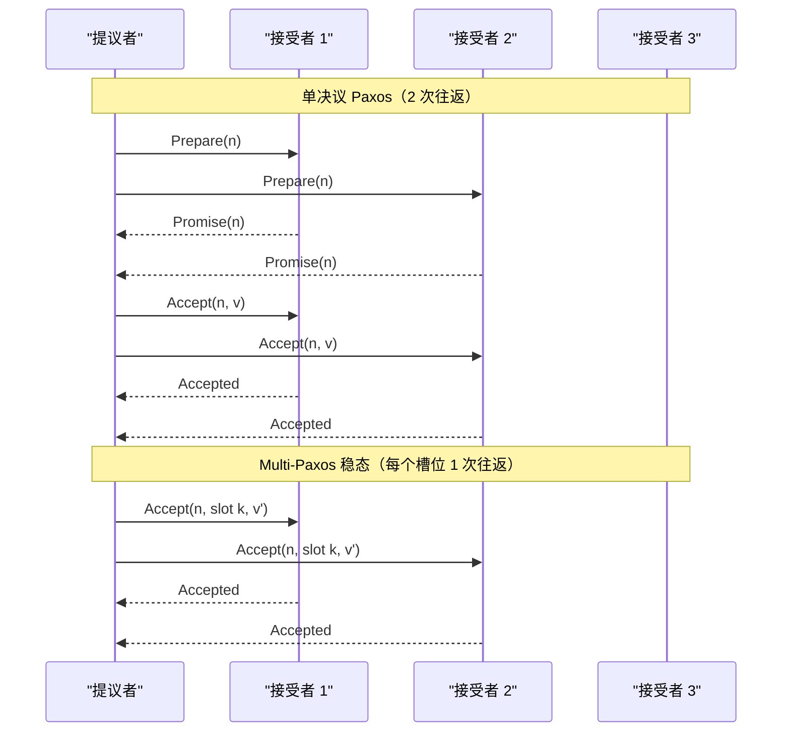
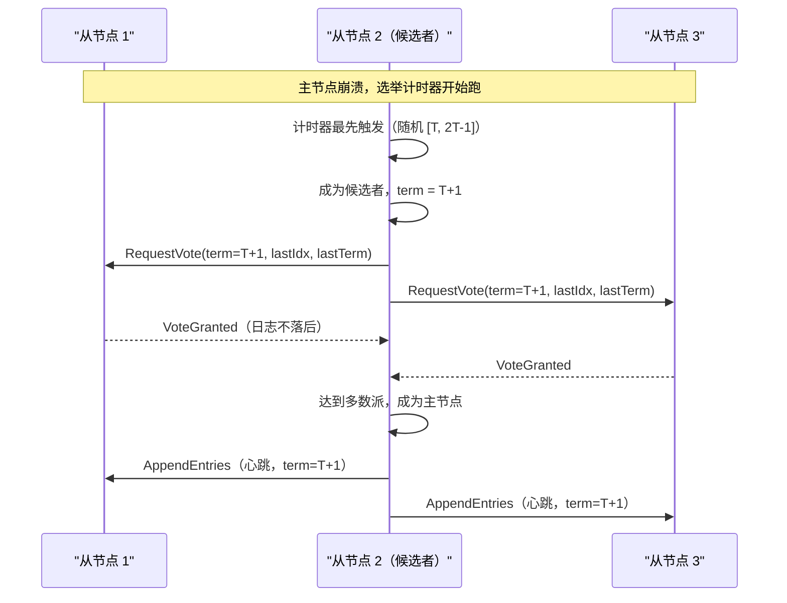
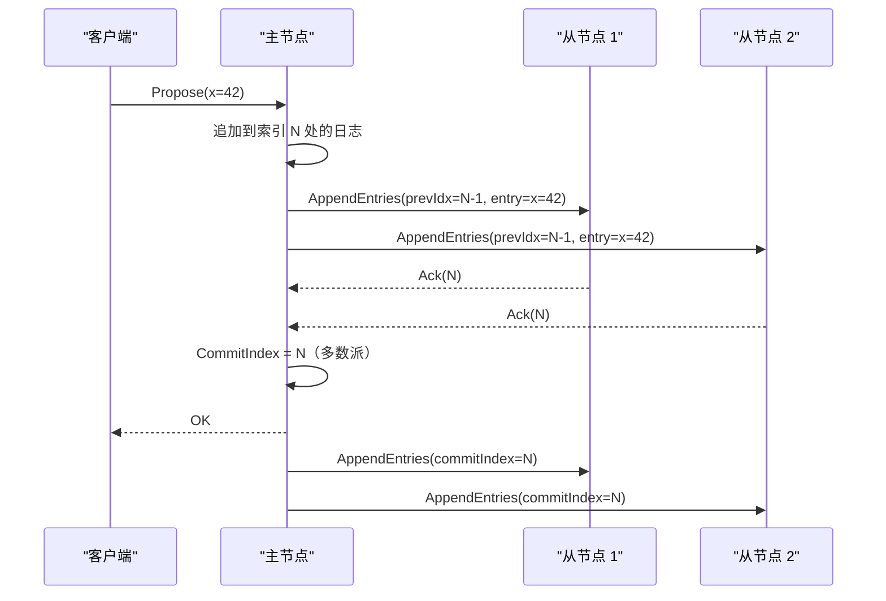
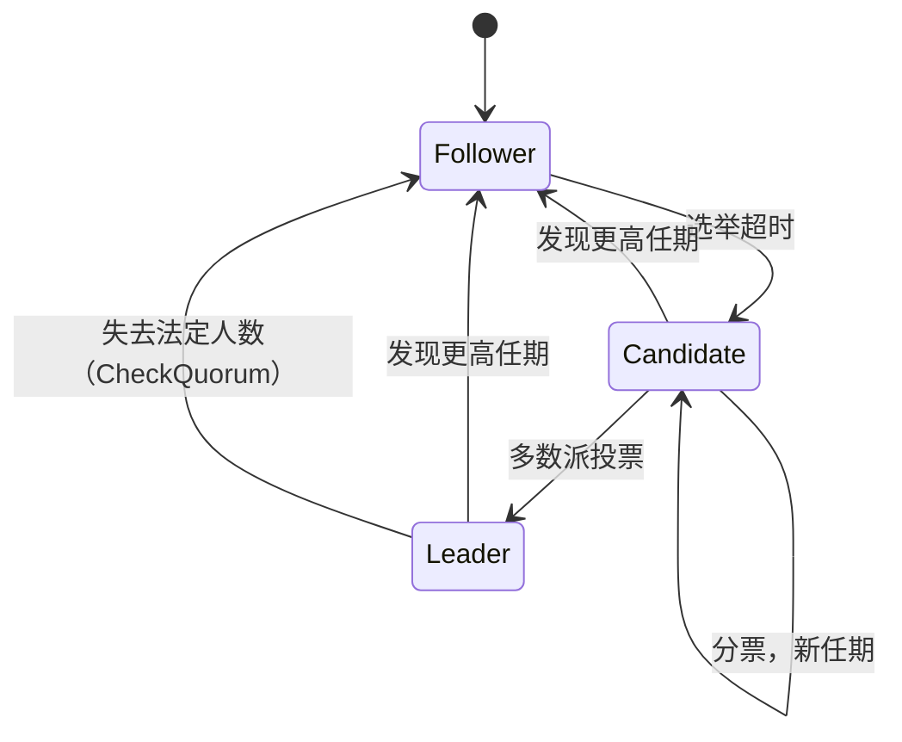
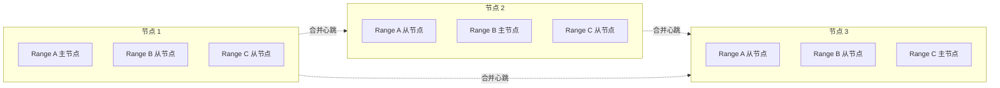

# 共识协议：分布式系统如何达成一致

> **TL;DR**: 共识就是一组节点在有崩溃、有网络延迟的情况下，对同一个值达成一致。实用协议（Raft、Multi-Paxos）永远安全，但只有当网络足够听话、能让主节点稳住房位时，才保证活性。每一次已提交的决定，至少要向多数派走一次往返，所以共识要省着用：只用在必须正确的状态上（主节点身份、集群成员、事务元数据），而不是每个请求都走一遍。2N+1 个节点的集群能容忍 N 个故障。etcd 通常跑 3 到 5 个节点，心跳 100 ms，WAL fsync 的 P99 小于 10 ms[^1][^2]。如果你发现自己在为每个请求都上共识，那这一层大概率根本不需要强一致性。

## 学习目标

学完本节，你将能够：

- [ ] 解释 Paxos 的两个阶段（prepare/promise、accept/accepted），以及各自在什么情况下可以跳过
- [ ] 完整走一遍 Raft 的主节点选举、日志复制，以及靠任期编号实现的安全性
- [ ] 按所需的故障容忍度选择集群规模（3、5、7）
- [ ] 推理少数派分区能做哪些事、不能做哪些事
- [ ] 判断什么时候需要共识、什么时候不需要
- [ ] 说明 multi-raft 分片如何把写吞吐量扩展到单个主节点之上

## 直觉理解

想象一个五人陪审团在合议裁决。法官说：“你们必须形成多数意见，而且只能靠传纸条，因为你们不能同时说话。”其中一人是陪审长。她提出裁决，写在纸条上，抄给另外四人。五人中有三人（含她自己）在同一张纸条上签字后，裁决就定了。

现在想象一名陪审员在合议途中睡着了。剩下四人仍能凑出三人多数。但如果两人睡着，醒着的三人恰好就是多数派，再睡一个，陪审团就卡住了。这就是为什么五节点集群只能容忍两个故障，多一个都不行。

如果陪审长睡着了呢？其余陪审员发现她不再传纸条。经过一段随机等待（免得大家同时喊话），其中一人宣布自己当新陪审长，征集投票，然后继续。老陪审长醒来，看到更新的提案编号，就安静地变回普通陪审员。

这就是共识。一个主节点提议，多数派同意，即使有成员崩溃，决定依然持久。本章余下部分把这件事说精确。

## 原理

### 共识解决什么问题

共识只回答一个问题：当部分进程可能崩溃、消息可能丢失或延迟时，N 个进程如何对同一个值达成一致？

形式上，共识协议必须满足三条性质[^3]：

1. **一致性（Agreement）。** 所有正确的进程决定同一个值。
2. **有效性（Validity）。** 被决定的值必须是某个进程提出过的。
3. **终止性（Termination）。** 每个正确的进程最终都会做出决定。

1985 年的 Fischer-Lynch-Paterson（FLP）不可能性结论证明：在纯异步系统中，只要有一个进程可能崩溃，就不存在任何确定性算法能同时保证这三条[^3]。直觉是这样的：你分不清一个节点是崩了还是只是慢，所以任何算法要么永远等下去（丢掉终止性），要么带着不完整的信息往前推（冒不一致的风险）。

实用协议靠假设部分同步来绕开 FLP：它们永远安全（无论发生什么，一致性和有效性都成立），但只在网络足够正常、主节点能维持其角色时，才保证活性（终止性）[^3]。这不是理论上的奇趣细节。它意味着你的 Raft 集群在分区期间绝不会写坏数据，但可能会停止接受写入，直到分区恢复。

共识最主要的用途是**复制状态机（replicated state machine，RSM）**：一组节点对一条有序的命令日志达成一致，每个节点确定性地执行这些命令，整个组表现得就像一台容错机器[^4]。主节点选举、分布式锁、配置中心（etcd、ZooKeeper）、强一致数据库（CockroachDB、Spanner），底层都是 RSM。

### 15 分钟讲清 Paxos

Paxos 是最早的多数派法定人数共识协议。它有三个角色：提议者（proposer）、接受者（acceptor）、学习者（learner）。单决议 Paxos 的一次执行分两个阶段选出一个值[^5]：

**阶段 1（Prepare/Promise）。** 提议者挑一个提案编号 n，向多数派接受者请求：“承诺不再接受编号小于 n 的任何提案，并告诉我你已经接受过的编号最大的值。”多数派承诺之后，提议者继续往下走。

**阶段 2（Accept/Accepted）。** 提议者发送 accept(n, v)，其中 v 要么是自己的值，要么是阶段 1 中报告上来的、已被接受过的最大编号的值。多数派接受者接受后，这个值就算被选中。

*Multi-Paxos 在选出稳定的主节点后省掉阶段 1，把常见情况下的提交延迟从两次往返压到一次。*

单次执行要两次往返。**Multi-Paxos** 通过选出一个稳定的主节点来摊薄这个成本：后续日志槽位跳过阶段 1，稳态下每条命令只需一次往返[^5]。

Paxos 的问题不在正确性，而在可实现性。Google 的 “Paxos Made Live” 论文记录单决议规格与生产系统之间的工程鸿沟：主节点租约、日志损坏处理、成员变更、快照、master 恢复、磁盘配额，全都需要论文里没写的定制方案[^6]。Multi-Paxos 在文献中描述得不够完整，因此每个实现都在这些细节上各走各路[^4]。

**EPaxos**（Moraru 等，SOSP 2013）去掉了单主节点瓶颈：任何副本都能提议，互不冲突的命令一次往返即可提交[^7]。冲突命令退回两轮路径，并显式维护依赖图。这个想法很优雅，但原始协议存在已知漏洞，后续工作不得不“修复并简化”它，才能恢复线性一致性[^8]。

### Raft：为可理解性而设计

Raft（Ongaro 与 Ousterhout，2014）在安全性和性能上等价于 Multi-Paxos[^9]。它被广泛采用，靠的是好理解，而不是本质不同。

**任期（term）**是核心抽象。时间被划分为单调递增的任期，每个任期以一次选举开始，最多产生一个主节点。每个 RPC 都携带任期编号。节点收到更高任期的消息时，立刻退回从节点。任期就是给领导权排序的分布式时钟。

**主节点选举。** 每个节点处于三种状态之一：从节点、候选者、主节点。从节点在随机化的选举超时内（从 [T, 2T-1] 中取值，T 是基础超时）没收到心跳，就变成候选者，递增任期，开始拉票[^9]。随机化避免了同时选举。候选者拿到多数派投票即当选。

*一次有竞争的选举：随机超时让某个候选者在别人开始之前就跑完 RequestVote 轮次，避免分票。*

**选举限制**保证了安全性：投票方要求候选者的日志至少与自己的一样新（先比最后一条日志的任期，再比最后一条日志的索引）。这确保新主节点带着所有已提交的条目[^9]。

**日志复制。** 主节点把客户端命令追加到自己的日志，向从节点发送 AppendEntries RPC，多数派持久化后即提交该条目。Raft 的日志匹配不变式（相同索引和任期意味着相同内容、且前缀完全一致）由主节点的单写者纪律、以及从节点覆盖冲突后缀来维持[^10]。

*只有多数派从节点确认追加之后，写入才算持久；主节点推进提交索引，并在下一次心跳中通知从节点。*

*每个 Raft 节点在从节点、候选者、主节点三种状态间切换，驱动力来自计时器和更高任期的消息。*

### 成员变更与快照

在运行中的集群里加节点或减节点是危险动作：如果新旧配置重叠方式不对，可能同时形成两个互不相干的多数派。Raft 原始论文描述了**联合共识（joint consensus）**：集群短暂地同时在新旧两套配置下运作。实践中，多数实现（包括 etcd/raft）把它简化成一次只改一个节点，从而避开联合状态，代价是重配置更慢[^11]。

**日志压缩**防止日志无限增长。节点定期对状态机做快照，丢弃快照索引之前的全部日志条目。如果某个从节点落后太多，主节点直接发送快照，而不必重放成千上万条日志。

### 主节点租约与 ReadIndex

朴素的线性一致读要求主节点在回答之前确认自己仍掌握领导权，这要花一次到多数派的往返。有两种优化[^11]：

1. **ReadIndex。** 主节点记录当前提交索引，确认法定人数（一轮心跳），然后等自己的状态机应用到该索引后再返回读结果。安全，但多一次往返。
2. **基于租约的读。** 主节点假定自己在选举超时时间内仍是主节点（因为心跳正常流动时，任何选举都不可能成功），于是本地直接返回读结果，不做法定人数检查。更快，但依赖时钟漂移有界。etcd 默认用 ReadIndex，因为时钟偏斜下租约读不安全[^11]。

### 拜占庭共识

以上讨论全都假设崩溃故障容忍：节点要么遵守协议，要么停止。**拜占庭（Byzantine）**共识能容忍任意行为的节点，包括恶意行为。代价是：要容忍 f 个拜占庭故障，至少需要 3f+1 个副本[^12]。

**PBFT**（Castro 与 Liskov，1999）使用三个阶段（pre-prepare、prepare、commit），每次决定产生 O(n^2) 条消息[^12]。**HotStuff**（Yin 等，2019）用流水线化的三阶段投票取代全互联阶段，由主节点聚合，把每次决定的通信降到 O(n)，视图切换也是 O(n)[^13]。HotStuff 是 Diem/Libra 以及大多数生产级区块链共识的基础。**Tendermint**（CometBFT）是部分同步的 BFT 协议，主节点轮换，被 Cosmos 采用，一次一个区块地达成共识，具备即时最终性[^14]。

什么时候需要 BFT？当参与者互不信任时：许可链、跨机构账本、多云协调中某个节点被攻陷后可能撒谎的场景。对于内部基础设施——所有节点都跑你的代码、在你的硬件上——崩溃故障容忍（Raft/Paxos）就够了，而且便宜得多。

## 真实案例

### etcd 支撑 Kubernetes 控制面

每个 Kubernetes 集群都把全部状态（pod、service、secret、config map）存在 etcd 里——一个单 Raft 组的键值存储。官方 Go 库（`etcd-io/raft`）把 Raft 建模为确定性状态机：存储、传输、计时都由调用方负责[^11]。

**集群规模。** etcd 建议 3 或 5 个成员，绝不超过 7 个[^2]。默认心跳间隔 100 ms，选举超时 1000 ms，以此满足“选举超时约为 RTT 的 10 倍”这条规则，保证选举稳定[^1]。跨地域部署的集群，选举超时可以放宽到 50 秒[^1]。

**磁盘是瓶颈。** WAL fsync 的 P99 目标小于 10 ms[^2]。一旦 fsync 延迟超过心跳间隔，从节点就会超时并强行发起新选举。这是生产环境 etcd 集群里主节点无故丢失的头号原因[^2]。独立 SSD 和 ionice 优先级没有商量余地。

**存储上限。** 默认配额 2 GB（建议最大 8 GB）[^2]。etcd 是为能装进内存的小体量协调状态设计的，不是给大流量数据用的。

**线性一致读。** etcd 默认用 ReadIndex：主节点先确认法定人数再回答。从节点可以承接可串行化（可能过期）的读来扩展读吞吐量，但线性一致读必须走主节点[^2]。

**Jepsen 结论。** Kyle Kingsbury 在 2020 年对 etcd 3.4.3 的分析发现，在进程暂停、崩溃、时钟偏斜、网络分区的组合下，键值操作满足严格可串行化[^15]。但 etcd 的分布式锁存在根本性不安全：在 2 秒租约 TTL 下，进程暂停导致约 18% 的更新丢失；另有一个 bug——服务端在阻塞式加锁被唤醒后没有重新校验租约有效性[^15]。

*CockroachDB 和 TiKV 每个 range 跑一个 Raft 组（分别是 512 MiB 和 96 MiB），并把心跳合并成每对节点每 tick 只交换一次，而不是每个 range 一次。*

**突破单组上限。** CockroachDB 把键空间切成约 512 MiB 的 range，每个 range 用自己的 Raft 组复制，底层复用 etcd/raft 库[^16]。单个节点可能同时参与几十万个共识组。MultiRaft 优化把心跳合并为每对节点每 tick 一次交换，这是唯一能让它扩展的做法[^16]。TiKV 用同样的模式，只是 region 更小，为 96 MiB[^17]。

## 权衡

| 方案 | 优点 | 缺点 | 适用场景 | 我们的选择 |
|---|---|---|---|---|
| Raft | 好理解；库成熟（etcd/raft、hashicorp/raft）；选举、复制、安全性拆分清晰 | 每组单主节点是吞吐量瓶颈；要扩展就得叠 multi-raft | 大多数需要强一致复制的新系统 | **默认选择** |
| Multi-Paxos | 组合灵活（Flexible Paxos、EPaxos）；几十年的研究变体 | 难以正确实现；文献描述不完整 | 已有 Paxos 专长的团队、Google 级生态 | 已有 20 年 Paxos 工具链时才用 |
| ZAB（ZooKeeper） | 久经战场；全序广播；客户端生态丰富 | 绑定 ZooKeeper；Kafka 4.0 已移除它（改用 KRaft），其他项目在迁移 | 迁移期间的存量 ZooKeeper 部署 | 现存 ZooKeeper 集群保留；新项目选 Raft |
| PBFT / HotStuff | 容忍恶意节点；HotStuff 每次决定 O(n) | 需要 3f+1 副本；密码学开销；协议复杂 | 跨信任边界的系统：区块链、许可账本 | 只在无法信任参与者时用 |
| 不上共识（最终一致） | 可用性更高、延迟更低、无需法定人数 | 没有线性一致性；应用层要处理冲突 | 最终一致可接受时（缓存、计数器、信息流） | 不需要一致性时 |

## 常见陷阱

> [!WARNING]
> **分脑领导却没有隔离令牌。** 一个被分区隔开的老主节点仍在返回过期读，而多数派一侧已选出新主节点。要用经法定人数校验的读（ReadIndex），或者绑定选举超时的主节点租约。Jepsen 2014 年对 etcd/Consul 的分析记录的正是这种模式导致的线性一致性违规[^18]。

> [!WARNING]
> **慢 fsync 拖死提交延迟。** 如果 WAL fsync 延迟超过心跳间隔，从节点会超时并选出新主节点，哪怕老主节点是健康的。etcd 官方文档把它列为主节点无故丢失的首要原因。独立 SSD、ionice 优先级、监控 `wal_fsync_duration_seconds` 指标，这三样没有商量余地[^2]。

> [!WARNING]
> **没有隔离的分布式锁。** 在异步模型下，任何锁服务都必须在活性（锁会超时）和互斥（锁不超时）之间二选一。一个僵尸客户端握着已过期的锁，就会和新持有者交错执行。每把锁都要配一个单调递增的 fencing token（隔离令牌），由被保护的资源来校验。etcd 的 Jepsen 报告显示，2 秒租约 TTL 下有 18% 的更新丢失[^15]。

> [!WARNING]
> **被分区的从节点反复捣乱。** 一个被隔离在外的从节点，每次重连都会递增任期，逼着在任主节点回退。启用 pre-vote（预投票）扩展：候选者先向集群试探性拉票，但不递增任期。如果赢不了，它就永远不会干扰当前主节点[^11]。

> [!WARNING]
> **少数派分区靠过期主节点接受写入。** 少数派一侧的客户端会看到写入一直卡住。如果协议有 bug，它们还可能从一个滞留的主节点读到过期数据。接受这份不可用就好：少数派一侧的读必须走 ReadIndex，或者被明确标记为可能过期[^2]。

> [!WARNING]
> **在拜占庭环境里用 Raft/Paxos。** 崩溃容忍型共识假定节点是 fail-stop 的。一个被攻陷的节点向不同对端发送互相矛盾的消息，就会破坏多数派必然相交的论证。如果你的威胁模型包含恶意节点，用 PBFT 或 HotStuff。否则就把网络层加固好（mTLS、认证 RPC），把 BFT 明确排除在范围之外[^12]。

## 练习

你要为一个任务调度器搭建控制面，它绝不能把同一个任务调度两次。请设计共识层：选 Raft 还是 Paxos，定集群规模（3、5、7），决定读写如何经过主节点，并描述 30 秒网络分区期间会发生什么。

提示

先想清楚“绝不重复调度”在一致性上意味着什么。你需要线性一致的读和写。再想生产环境需要容忍几个故障（一个？两个？），这直接决定集群规模。至于分区场景，记住一点：只有多数派一侧能提交。

参考答案

**协议选择：Raft。** 你是在建新系统，不是延续 Google 级 Paxos 生态。Raft 有成熟的库（Go 的 etcd/raft、hashicorp/raft）、无歧义的规格、干净利落的运维工具。性能与 Multi-Paxos 相当。

**集群规模：5 个节点。** 5 个能容忍两个故障。3 个只能容忍一个，意味着单单升级一个节点就把容错能力降到零。7 个增加延迟（主节点要等第 4 快的 ack），收益却很有限。5 是生产控制面的甜点。

**写路径。** 所有任务调度变更都走 Raft 主节点。主节点把“在 worker Y 上调度任务 X”这条命令追加到日志，复制到多数派，提交，然后回复客户端。因为日志是全序的、已提交的条目永不被撤销，针对同一任务的两条冲突调度命令不可能同时提交。

**读路径。** 用 ReadIndex 做线性一致读。主节点先确认自己仍掌握法定人数（一轮心跳），再返回读结果。这能防止少数派一侧的过期主节点返回陈旧的任务状态。除非你已验证所有节点的时钟漂移有界，否则不要用基于租约的读。

**30 秒分区行为。** 假设节点 {A, B, C} 构成多数派分区，{D, E} 构成少数派。

- 多数派一侧：如果老主节点是 D 或 E，会在一个选举超时内（默认 1000 ms 超时下约 1 秒）选出新主节点。写入照常继续，任务调度不中断。
- 少数派一侧：D 和 E 凑不出多数派。所有写入卡住。如果 D 是老主节点，它会在一个选举超时后自行退位（CheckQuorum 检测到失去多数派）。连到 D 或 E 的客户端会收到超时或重定向。
- 30 秒之后：分区恢复。D 和 E 收到主节点携带更高任期的心跳，退回从节点，并补齐错过的日志条目。没有数据丢失，没有任务被重复调度。

关键洞察：少数派一侧不可用，但永远不安全。这正是 CP 权衡的实际样子。

## 要点回顾

- 共识只给你一样东西：在少数节点崩溃的情况下仍达成一致。这很贵（每次提交都要一次到多数派的往返），所以要省着用。
- FLP 不可能性意味着：在纯异步系统里，没有任何协议能同时保证安全性和活性。实用协议（Raft、Paxos）永远安全，但可能在分区期间卡住。
- Raft 胜出，是因为它好理解、库好用，而不是因为和 Multi-Paxos 有本质区别。
- 2N+1 个节点的集群能扛住 N 个故障。五节点容忍两个故障，是生产环境的常见甜点。
- 主节点是吞吐量和延迟的瓶颈。切成多个 Raft 组（multi-raft）就是 CockroachDB 和 TiKV 横向扩展写入的办法。
- 没有隔离令牌的分布式锁不安全。把锁当作性能提示，写入时用资源侧会校验的单调递增令牌来兜底。
- 如果你发现自己在为每个请求都上共识，那这一层大概率不需要强一致性。把共识下沉到元数据和协调层面，数据路径在可接受的范围内用更弱的保证。

## 延伸阅读

- [In Search of an Understandable Consensus Algorithm (Raft paper)](https://raft.github.io/raft.pdf)：Raft 的第一手资料；读 18 页的扩展版，里面有成员变更和日志压缩，别只看会议短文版。
- [The Raft Visualization](https://raft.github.io/)：交互式动画，是不读代码就能把主节点选举和日志复制装进脑子里的最快方式。
- [Paxos Made Simple (Lamport, 2001)](https://lamport.azurewebsites.net/pubs/paxos-simple.pdf)：好读的 13 页单决议 Paxos 推导；先读它，再去啃原始那篇 “Part-Time Parliament”。
- [Paxos Made Live (Chandra, Griesemer, Redstone, 2007)](https://research.google/pubs/paxos-made-live-an-engineering-perspective-2006-invited-talk/)：Google 把单决议 Paxos 做成 Chubby 的工程日记；这个方向上“从理论到生产”的最佳读物。
- [Jepsen: etcd 3.4.3 (Kingsbury, 2020)](https://jepsen.io/analyses/etcd-3.4.3)：etcd 的经典现代分析，也是“用隔离令牌而不是分布式锁”的决定性论据。
- [CockroachDB “Scaling Raft” (Darnell, 2015)](https://www.cockroachlabs.com/blog/scaling-raft/)：让按 range 共识得以规模化的 MultiRaft 思路；做分布式数据库的人都该读。
- [HotStuff (Yin et al., PODC 2019)](https://arxiv.org/abs/1803.05069)：大多数生产级区块链共识背后的 BFT 协议；威胁模型含恶意参与者时读它。
- [DDIA Chapter 9 (Kleppmann)](https://dataintensive.net/)：关于一致性、共识、全序广播最好读的教科书论述；和本章搭配着看。

## 记忆卡片

**Q:** 共识协议必须满足哪三条性质？
**A:** 一致性（所有正确进程决定同一个值）、有效性（被决定的值必须是某个进程提出过的）、终止性（每个正确进程最终都会做出决定）。

**Q:** FLP 不可能性结论究竟证明了什么？
**A:** 在纯异步系统中，只要有一个进程可能崩溃，就没有任何确定性共识协议能同时保证安全性和活性。它并没说共识不可能实现；实用协议靠部分同步假设绕开了它。

**Q:** 2N+1 个节点的集群能容忍几个故障？
**A:** N 个。五节点集群容忍 2 个故障；三节点容忍 1 个。

**Q:** 就往返次数而言，单决议 Paxos 和 Multi-Paxos 有什么区别？
**A:** 单决议 Paxos 需要两次往返（prepare/promise + accept/accepted）。Multi-Paxos 选出一个稳定的主节点并跳过阶段 1，把稳态下每个槽位的提交压缩到一次往返。

**Q:** Raft 的选举限制是什么，为什么重要？
**A:** 投票方要求候选者的日志至少与自己的一样新（先比最后一条日志的任期，再比索引）。这保证新主节点带着所有已提交条目，从而在领导权变更中维持安全性。

**Q:** etcd 为什么默认用 ReadIndex 而不是基于租约的读？
**A:** ReadIndex 在返回读之前确认法定人数，无论时钟行为如何都安全。基于租约的读假定时钟漂移有界；一旦时钟偏斜，过期主节点就可能返回违反线性一致性的读。

**Q:** Raft 里的 pre-vote 优化是什么？
**A:** 候选者在递增任期之前，先向集群做一次假设性的拉票试探。如果赢不了（例如它曾被分区、日志落后），它就不会递增任期，也就不会干扰当前主节点。

**Q:** multi-raft（CockroachDB、TiKV）如何扩展写吞吐量？
**A:** 键空间被切成 range（CockroachDB 是 512 MiB，TiKV 是 96 MiB），每个 range 有自己的 Raft 组和主节点。不同 range 的主节点可以落在不同节点上，从而分散写负载。心跳被合并为每对节点每 tick 一次交换。

**Q:** 容忍 f 个拜占庭故障最少需要多少副本？
**A:** 3f+1 个副本。崩溃故障容忍只需 2f+1 个。

**Q:** 没有隔离令牌的分布式锁为什么不安全？
**A:** 锁持有者可能在租约过期后被暂停（GC、swap、网络延迟）。新持有者拿到锁，但僵尸进程恢复后又去写被保护资源。没有资源侧校验的隔离令牌，两个持有者都会破坏共享状态。Jepsen 在 2 秒租约 TTL 的 etcd 上测到 18% 的更新丢失。

**Q:** Raft 集群中网络分区的少数派一侧会发生什么？
**A:** 所有写入卡住，因为少数派凑不出多数派法定人数。如果老主节点在少数派一侧，它会在一个选举超时后退位（CheckQuorum）。少数派不可用，但永远不安全。分区恢复后，少数派节点从主节点的日志补齐。

**Q:** etcd 的 WAL fsync P99 目标是多少，为什么重要？
**A:** 小于 10 ms。如果 fsync 延迟超过心跳间隔（默认 100 ms），从节点会超时并触发不必要的选举，造成主节点频繁更替和写入不可用。

## 参考文献

[^1]: etcd Authors, "Tuning." https://etcd.io/docs/current/tuning/
[^2]: etcd Authors, "Frequently Asked Questions." https://etcd.io/docs/current/faq/
[^3]: Fischer, Lynch, Paterson, "Impossibility of Distributed Consensus with One Faulty Process," JACM 1985. https://groups.csail.mit.edu/tds/papers/Lynch/jacm85.pdf
[^4]: Michael Whittaker, "In Search of an Understandable Consensus Algorithm" (paper notes). https://mwhittaker.github.io/papers/html/ongaro2014search.html
[^5]: Lamport, "Paxos Made Simple," 2001. https://lamport.azurewebsites.net/pubs/paxos-simple.pdf
[^6]: Chandra, Griesemer, Redstone, "Paxos Made Live: An Engineering Perspective," 2007. https://research.google/pubs/paxos-made-live-an-engineering-perspective-2006-invited-talk/
[^7]: Moraru, Andersen, Kaminsky, "There Is More Consensus in Egalitarian Parliaments," SOSP 2013. https://www.cs.cmu.edu/~dga/papers/epaxos-sosp2013.pdf
[^8]: Ryabinin, Gotsman, Sutra, "Making Democracy Work: Fixing and Simplifying Egalitarian Paxos," 2025 (OPODIS). https://arxiv.org/abs/2511.02743v1
[^9]: Ongaro and Ousterhout, "In Search of an Understandable Consensus Algorithm (Extended Version)," USENIX ATC 2014. https://www.usenix.org/conference/atc14/technical-sessions/presentation/ongaro
[^10]: "Raft Consensus Algorithm." https://raft.github.io/
[^11]: etcd-io/raft README. https://github.com/etcd-io/raft/blob/main/README.md
[^12]: Castro and Liskov, "Practical Byzantine Fault Tolerance," OSDI 1999. https://web.archive.org/web/2024/https://pmg.csail.mit.edu/~castro/osdi99_html/osdi99.html
[^13]: Yin, Malkhi, Reiter, Gueta, Abraham, "HotStuff: BFT Consensus in the Lens of Blockchain," PODC 2019. https://arxiv.org/abs/1803.05069
[^14]: Cosmos Network, CometBFT/Tendermint consensus docs. https://docs.cosmos.network/cometbft/latest/spec/consensus/Overview
[^15]: Kingsbury, "Jepsen: etcd 3.4.3," 2020. https://jepsen.io/analyses/etcd-3.4.3
[^16]: Darnell, "Scaling Raft," CockroachDB blog, 2015. https://www.cockroachlabs.com/blog/scaling-raft/
[^17]: PingCAP, "Tune TiKV Memory Parameter Performance" (coprocessor config: region-split-size = 96MiB). https://docs.pingcap.com/tidb/stable/tune-tikv-memory-performance
[^18]: Kingsbury, "Jepsen: etcd and Consul," 2014. https://aphyr.com/posts/316-jepsen-etcd-and-consul
