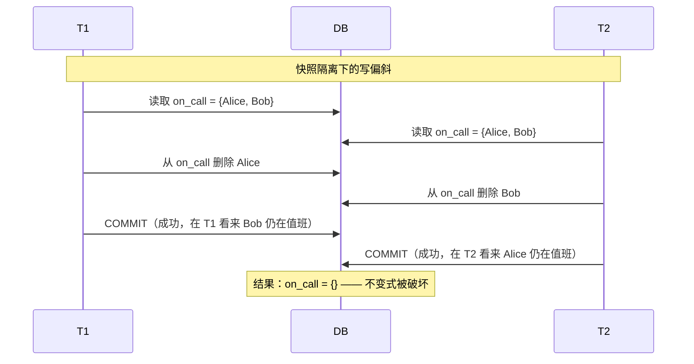
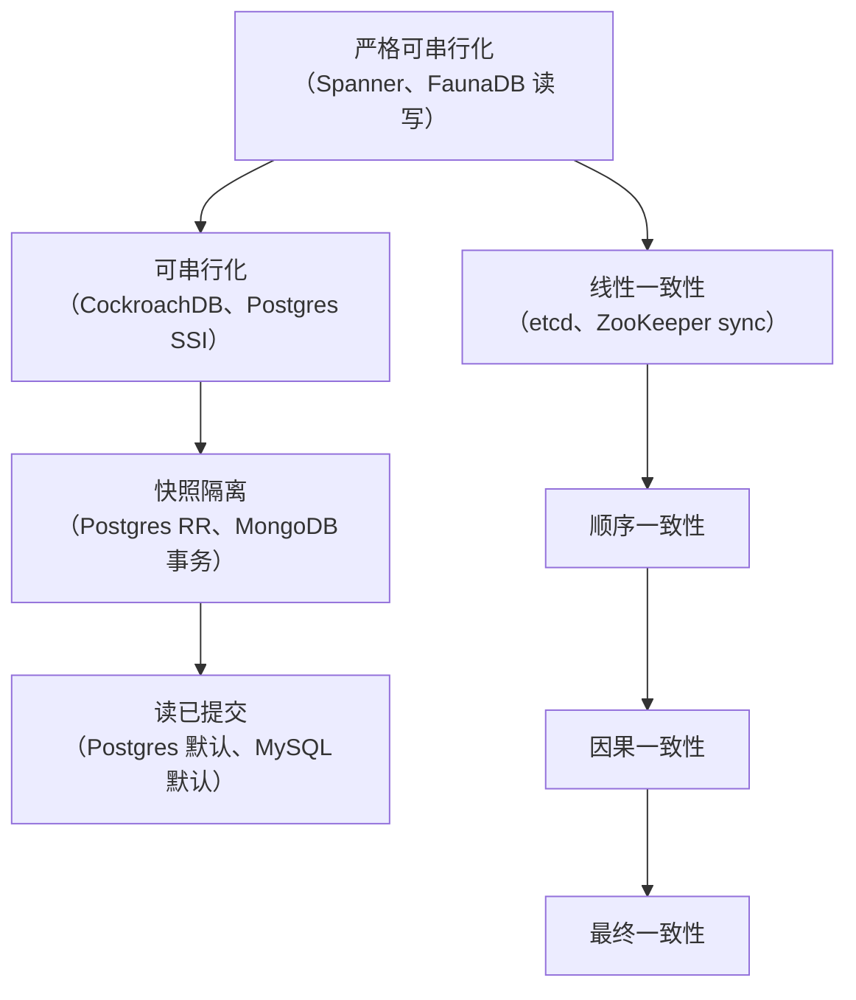
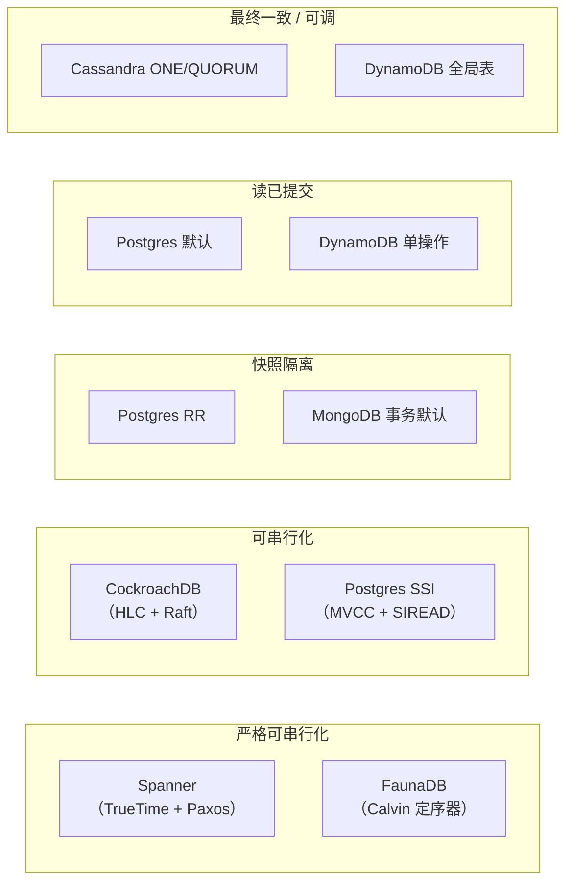
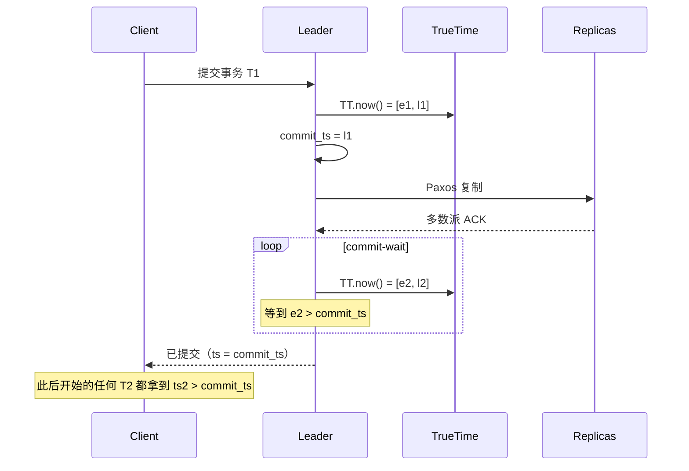

# 一致性深入探讨：线性一致性、可串行化，以及两者之间的光谱

> **TL;DR**: “强一致性”是个营销词。把它换成精确的保证：线性一致性（单对象、按真实时间排序）、可串行化（多对象事务等价于某个串行顺序），或者严格可串行化（两者同时成立，Spanner 称之为“外部一致性”）[^1][^2]。大多数 OLTP 负载跑在快照隔离上都没问题，但它会放过写偏斜[^3]。按操作调一致性，而不是按数据库调。现代系统（Spanner 的陈旧读、CockroachDB 的 `AS OF SYSTEM TIME`、DynamoDB 的按请求读模式）让你只为每条查询真正需要的那个保证付费。

## 学习目标

学完本模块，你将能够：

- [ ] 区分可串行化与线性一致性，并解释为什么这个组合需要一个专门的名字
- [ ] 在各事务隔离级别下识别写偏斜、丢失更新与幻读
- [ ] 按操作而不是按数据库选择隔离级别
- [ ] 说清 Spanner、CockroachDB、Postgres SSI、DynamoDB 和 Cassandra 究竟是怎么实现它们宣称的保证的
- [ ] 把“我们需要强一致性”翻译成负载真正需要的那个精确保证

## 直觉理解

想象两个会计在对一家公司的账。一个看的是昨天打印出来的总账（有界陈旧）。回答“上个季度我们的营收是多少”，用这份陈旧数据完全够。另一个坐在收银机前，实时处理付款。每一笔事务提交的瞬间她就必须看到，因为她正在决定要不要批准下一笔电汇。

两个会计供职于同一家公司。两个人都“是一致的”。但他们需要的保证根本不同。看总账的会计能忍受陈旧，因为她的决策不依赖最新的写入。收银机前的会计不能，因为一次陈旧的读可能让她批准一笔会把账户透支的转账。

核心洞见就在这里：一致性不是一个可以往上或往下拧的旋钮，而是一张二维网格。一个维度是隔离级别（并发事务之间能看见彼此的什么），另一个维度是一致性模型（一次已提交的写在副本之间多快对读者可见）。“严格可串行化”同时站在两个维度的顶端。其余的一切，都是它下面某个有名字的权衡。

[一致性模型](../part-1-core-fundamentals/03-consistency-models.md)给了你单对象层级（线性一致性、顺序一致性、因果一致性、最终一致性）和四条会话保证。本章加上事务这一层：当关注的单位变成一个多对象事务时会发生什么，真实数据库如何实现它们声称的保证，以及这些声称为什么经常与现实不符。

## 原理

### 回顾与范围

[一致性模型](../part-1-core-fundamentals/03-consistency-models.md)讲的是单对象一致性模型和会话保证。本章讲的是当关注的单位是一个**事务**（多对象）而不是单个寄存器时会发生什么，以及真实数据库如何实现它们声称的保证。我们不会重新推导线性一致性，而是在它之上继续搭建。

### 隔离级别与异常现象

SQL-92 标准用三种异常现象（脏读、不可重复读、幻读）定义了四个隔离级别（读未提交、读已提交、可重复读、可串行化）。但英文表述本身有歧义，而且漏掉了好几个重要的异常现象[^3]。

Berenson 等人（1995）指出 ANSI 的现象定义允许严格和宽泛两种解读，两者都没能刻画真实的实现行为，并把快照隔离作为一个正式的级别引入[^3]。Adya 1999 年的博士论文用依赖图把这些推广开来，给出了现象 G0（脏写）、G1a-c（中止读／中间读／循环读）、G-single（读偏斜）和 G2（反依赖环）[^4][^5]。

实践中最重要的几个异常现象：

- **写偏斜（write skew）**：两个事务各自读到有重叠的状态，写入互不相交的键，都提交成功，而合并后的结果违反了一条它们各自都没有单独破坏的不变式。两个值班医生各自读到“还有别人在值班”，各自把自己撤下，结果没有人在值班。
- **读偏斜（read skew，G-single）**：一个事务在不同时间点读到两个相关的值，看到了一个不一致的快照。
- **幻读（phantom）**：一个事务重复执行同一条谓词查询，却拿到不同的行，因为另一个事务插入或删除了符合条件的行。

最关键的厂商映射问题：Postgres 的 “REPEATABLE READ” 实际是快照隔离，不是 ANSI 的可重复读[^6]。MySQL InnoDB 的 RR 用间隙锁（next-key locking）让索引扫描不出现幻读，但仍然允许写偏斜。Jepsen 在一个有争用的 Postgres RR 负载上测得每分钟约 140 次 G2-item 反依赖环[^7]。

*当两个事务读取有重叠的状态、写入互不相交的键时就会发生写偏斜；快照隔离检测不到这个冲突，因为写集不相交。*

**可串行化快照隔离（SSI）**修好了这个问题。Cahill、Rohm 和 Fekete（2008）证明：危险结构（三个事务构成的两条相邻读写反依赖）是非可串行化结果的必要条件[^8]。Postgres 从 9.1 起把 SSI 作为 SERIALIZABLE 级别实现，跟踪 SIREAD 锁，并中止那些会闭合危险结构的事务[^9]。SSI 保留了快照隔离的非阻塞读，同时提供真正的可串行化。

> [!WARNING]
> **Postgres 的 SERIALIZABLE 有一个潜伏 9 年的 bug。** Jepsen（2020）发现，从 9.1 到 13 的每一个版本，Postgres SERIALIZABLE 在并发的 INSERT+UPDATE 负载下都会放过 G2-item。这个 bug 从 SSI 被引入时就存在，2020 年 8 月才修掉[^7]。教训：去测你的隔离保证，别只信文档。

### 线性一致性、可串行化与严格可串行化

这三个词是分布式系统里最常被混淆的。它们讲的是不同的事：

**线性一致性（linearizability）**（Herlihy 和 Wing，1990）：一个单对象的正确性条件。每个操作看起来都是在调用与响应之间的某个点上原子地生效，由此形成的全序与真实时间一致[^10]。代价：对该对象的每次写入都要一轮共识。

**可串行化（serializability）**：一个多对象事务的正确性条件。已提交事务的某个串行顺序能产生观察到的读和最终状态。它完全不涉及真实时间[^1]。一个数据库可以是可串行化的，同时仍然自由地重排互不重叠的事务。

**严格可串行化（strict serializability）** = 可串行化 + 线性一致性。每个已提交事务在调用与响应之间都有一个明确的提交点，而串行顺序与该真实时间顺序一致[^1][^2]。Spanner 称之为“外部一致性”[^11]。Jepsen 的一致性地图把严格可串行化放在事务族和单对象族两边的顶端[^1]。

*严格可串行化是最强的模型，它把事务族（左支）和单对象族（右支）统一起来；每个箭头都表示“蕴含”。*

关键洞见：线性一致性与可串行化互相正交，可以有其一而无其二。CockroachDB 有意实现可串行化，但不实现跨键的线性一致性（单键操作是线性一致的，但涉及不相交键的事务可能出现“因果反转”异常：T1 提交之后才开始的 T2，看起来却先提交了）[^12][^13]。这就是在通用硬件上避开 Spanner 级时钟代价的代价。

### 有界陈旧性与读时 API

有界陈旧性（bounded staleness）的意思是“最多落后最新已提交写入 X 秒或 N 个版本”。它严格强于最终一致性（给差距设了上界），严格弱于线性一致性（允许存在差距）[^14]。

三种生产实现：

- **Spanner 陈旧读**：接受最大陈旧度或精确时间戳；由任何已经追到该时间戳的副本直接服务，省掉到主节点的一次往返[^11]。
- **CockroachDB 的 `AS OF SYSTEM TIME`**：`follower_read_timestamp()` 目标是至少 4.2 秒之前的历史读（按当前 v26.2 文档），这样读可以由本地从副本服务，不必阻塞在冲突写入上[^15]。
- **Cosmos DB 的有界陈旧**：按 K 次写入或 T 秒配置（多区域时最小 100,000 次写入 / 300 秒）；如果某个区域落后超过这个界限，写入会被限速[^14]。

有界陈旧性安全的场景：分析、看板、排行榜、审计类的“截至上次结账”查询、个性化推荐。

有界陈旧性危险的场景：库存检查（“最后一件还有货吗？”）、账户余额、唯一性约束、限流，以及任何读-改-写模式。写入方无法从读 API 判断这个值是不是最新的。

### 真实系统各自怎么实现

*各个具名数据库在“隔离级别 × 一致性”这张网格上的位置；子图名称标的是默认或最强模式提供的保证。*

**Spanner**：每个 tablet 一个约 5 副本的 Paxos 组。每个事务在 TrueTime 区间内拿到一个提交时间戳；协调者在释放锁之前等到 `TT.now().earliest > commit_ts`[^11][^16]。2012 年的 Spanner 论文报告 TrueTime 的 epsilon “通常小于 7 ms”；到 2023 年，Google 称 TrueTime 让 Spanner 服务器的时钟不确定度在 p99 上小于 1 ms[^16][^2]。只读事务挑一个安全时间戳，可以由任何已追平的副本服务，不需要主节点协调。

**CockroachDB**：基于 Range 的分片，配 Raft 组。事务使用混合逻辑时钟（HLC）。每个读者的不确定区间宽度为 `max-offset`（默认 500 ms）[^17]。如果观察到某次写入的时间戳落在这个窗口内，事务必须重启。并行提交（Parallel Commits，19.2，2019）把提交延迟从两轮共识压到一轮[^18]。当观测到的时钟偏移超过 max-offset 的 80% 时，节点会自行关闭[^17]。

**PostgreSQL**：单主上的 MVCC。SERIALIZABLE 增加 SIREAD 锁，并中止卷入危险结构的事务[^8][^9]。复制是异步的；只读副本不是可串行化的。默认隔离级别是 READ COMMITTED[^6]。

**DynamoDB**：每次请求可选两种读模式：最终一致（每 4 KB 0.5 RCU）或强一致（1 RCU，仅单区域）。`TransactWriteItems` 和 `TransactGetItems` 是可串行化的，但上限 100 个条目、4 MB[^19]。全局表异步复制、后写者胜，不保证跨区域的事务原子性[^20]。

**Cassandra**：按查询调一致性（ONE、QUORUM、LOCAL_QUORUM、ALL）。轻量事务（LWT）通过四轮往返的 Paxos 协议实现线性一致的比较并交换[^21]。CEP-14（Cassandra 4.1）把无争用的 LWT 写降到两轮往返。

## 真实案例

**Google Spanner：靠 TrueTime 实现外部一致性。**

Spanner 是最干净地展示了全球规模严格可串行化的生产系统。它的工程洞见简单得有点骗人：把时钟不确定度暴露成一个区间而不是一个点，然后等它过去。

Spanner 的每个数据中心都有 GPS 接收机和原子钟。TrueTime API 返回 `[earliest, latest]`，真实时间保证落在这个区间内。2012 年的 Spanner 论文报告 epsilon（区间宽度）“通常小于 7 ms”；到 2023 年，Google 称 TrueTime 在 p99 上做到亚毫秒级时钟不确定度[^16][^2]。

一个读写事务提交时：

1. 协调者从当前 TrueTime 区间取 `commit_ts = latest` 作为提交时间戳。
2. 它通过 Paxos 把写入复制到多数副本。
3. 它进入**提交等待（commit-wait）**：轮询 TrueTime，直到 `TT.now().earliest > commit_ts`。
4. 这时才向客户端确认提交。

*Spanner 在 TrueTime 的不确定区间内分配提交时间戳，并在向客户端确认之前等过这个区间，从而保证后续任何事务都能观察到这次提交。*

这段提交等待与 epsilon 成正比：今天 p99 不确定度已是亚毫秒级，等待时间通常被 Paxos 多数派那一轮往返本身遮掉了[^2][^16]。结果是：如果 T1 在 T2 开始之前（真实时间里）提交，那么 T1 的时间戳严格小于 T2 的。这就是外部一致性：事务的串行顺序与任何外部观察者能看到的真实时间顺序一致。

只读事务更便宜。它们挑一个安全时间戳，可以由任何已经应用了截至该时间戳全部写入的副本服务，不用加锁，也不用联系主节点[^11]。

权衡是明摆着的：Spanner 要求每个数据中心都有 GPS 和原子钟。CockroachDB 的替代方案（HLC，500 ms 的 max-offset 预算，可串行化但不做跨键线性一致性）跑在普通 NTP 同步的硬件上，代价是接受因果反转异常[^13][^12]。Jepsen 2017 年对 CockroachDB beta 的分析确认了两处可串行化违规（都已修复），并把因果反转记录为设计如此[^12]。

## 权衡

| 方案 | 优点 | 缺点 | 适用场景 | 我们的选择 |
|---|---|---|---|---|
| 严格可串行化（Spanner） | 心智模型最简单；和单机数据库一致 | 延迟高（提交等待）；需要 GPS/原子钟 | 金融核心、唯一性、主节点选举 | 正确性不可让步、且付得起 Spanner 级基础设施 |
| 分布式可串行化（CockroachDB） | 可横向扩展的可串行化；单键线性一致 | 不相交键上的因果反转；500 ms 时钟偏移下限 | 单键线性一致就够的多区域 OLTP | 通用硬件上分布式 OLTP 的默认选择 |
| 单节点可串行化（Postgres SSI） | 事务正确；读永不阻塞写 | 只能纵向扩展；副本不可串行化 | 单台 Postgres 主库上的核心 OLTP | 数据装得下一个节点时 |
| 快照隔离 | 快，无读锁，认知成熟 | 允许写偏斜；应用必须自己守住不变式 | 读多写少、表结构设计有纪律的 OLTP | 大多数不触碰跨行不变式的 OLTP 负载 |
| 有界陈旧性 | 读可大规模扩展，滞后可预期 | 读-改-写不安全；只适合报表 | 分析、看板、审计类“截至”查询 | 需要新鲜度 SLA 但不想为线性一致性付费 |
| 最终一致 / 可调 | 可用性最高，延迟最低 | LWW 会丢写；大量应用层补救 | 缓存、计数器、分析汇聚、Dynamo 风格 KV | 陈旧真的可接受、冲突真的罕见时 |

## 常见陷阱

> [!WARNING]
> **以为 “REPEATABLE READ” 就是 ANSI 的可重复读。** Postgres 的 RR 是快照隔离，允许写偏斜。MySQL InnoDB 的 RR 用间隙锁挡住幻读，但在某些交错执行下仍然允许写偏斜。Jepsen 在 Postgres RR 下测得每分钟约 140 次 G2-item 环[^7]。对不变式关键的事务，用 SERIALIZABLE 或显式 `SELECT FOR UPDATE`。

> [!WARNING]
> **跨区域依赖 LWW。** DynamoDB 全局表按条目异步复制、后写者胜[^20]。有时钟偏移时，因果上更晚的写入可能带着更小的时间戳，被悄悄丢掉。对每一次写入都重要的数据（金融、医疗），LWW 不够用。

> [!WARNING]
> **对金融不变式使用快照隔离却不加写偏斜防护。** 同一账户的两笔并发转账可以各自读到“余额 = $100”，各自扣 $80，双双提交，账户变成 -$60。快照隔离检测不到，因为两个写集不相交（不同的事务行）。用 SERIALIZABLE，或者在余额那一行上加显式的行级锁。

> [!WARNING]
> **以为读已提交对并发计数器自增是安全的。** 在读已提交下，两个事务可以各自读到 counter=5，各自写入 counter=6，其中一次自增就丢了。这是经典的丢失更新异常。用 `UPDATE counters SET value = value + 1`（原子自增），或者 SERIALIZABLE 隔离级别。

> [!WARNING]
> **指望 DynamoDB 全局表是线性一致的。** `TransactWriteItems` 在单个区域内是可串行化的，但全局表是异步复制[^19][^20]。在 us-east-1 提交的事务，复制期间在 eu-west-1 可能被部分观察到。把全局表当成跨区域的最终一致来用。

> [!WARNING]
> **把“强一致”当需求写，却不说清到底是哪一种。** “我们需要强一致性”可能指线性一致的读、可串行化的事务、严格可串行化，或者只是读己之写。每一种的代价和实现都不同。把保证命名出来：线性一致性、可串行化、严格可串行化、快照、因果、最终一致。然后挑能满足真实不变式的最便宜那个。

## 练习

你在设计一个银行账户服务。转账绝不能重复花掉同一笔钱，而且必须立刻对付款方可见。月度对账单晚几秒没关系。请为每个操作设计一致性级别：哪些必须线性一致，哪些可以用快照隔离，哪些可以从陈旧副本读。然后选一个数据库（Postgres、CockroachDB 还是 Spanner）并给出理由。

提示

想一想三个不同的操作：(1) 转账本身（触碰两个账户的多行事务），(2) 付款方在转账后查余额，(3) 生成月度对账单。三者的不变式要求各不相同。对每个操作来说，哪些异常现象会是灾难性的？

解答

**操作 1：转账（从账户 A 扣款，向账户 B 入账）。**

这是一个带跨行不变式的多对象事务（所有账户之和必须保持不变）。威胁是写偏斜：同一账户的两笔并发转账可能各自读到余额、各自批准，结果透支。需要 SERIALIZABLE 隔离（不是快照隔离，快照隔离在写集不相交时允许写偏斜）。如果是分布式的，需要跨节点的可串行化。

**操作 2：付款方在转账后查余额。**

付款方刚发起转账，期望看到新余额。这至少需要读己之写。如果付款方的读打到陈旧副本，他看到旧余额就会慌。实现方式：把这次读路由到主节点/主库，或者带上一个会话令牌，确保副本在服务这次读之前已经应用了那笔转账。

**操作 3：生成月度对账单。**

对账单反映的是“当月最后一天午夜”那一刻的状态。晚几秒可以接受。用有界陈旧性：CockroachDB 里写 `AS OF SYSTEM TIME '2026-04-30 23:59:59'`，或者在 Spanner 里按固定时间戳做陈旧读。这样省掉主节点协调，任何副本都能服务。

**数据库选择：**

- **单区域、中等规模**：PostgreSQL。转账用 SERIALIZABLE，读己之写靠把读固定到主库，对账单从热备副本做陈旧读。运维模型最简单。
- **多区域、大规模**：CockroachDB。默认可串行化。单键线性一致足够覆盖付款方的余额查询。对账单用 `AS OF SYSTEM TIME`。接受因果反转异常（对银行无影响，因为转账触碰的是有重叠的键）。
- **全球金融系统、正确性高于一切**：Spanner。外部一致性意味着转账在跨大洲的真实时间里严格有序。对账单用陈旧读。付 TrueTime 的基础设施成本。

关键的一课是：你没有为整个数据库挑一个一致性级别，而是为三个操作挑了三个级别，各自匹配它们真正的不变式要求。

## 要点回顾

- “强一致性”是营销词。把保证命名出来：线性一致性、可串行化、严格可串行化、快照、因果、最终一致。
- 线性一致性是单对象属性（真实时间顺序）。可串行化是多对象事务属性（等价于某个串行顺序）。两者兼备就是严格可串行化 / 外部一致性。
- 大多数 OLTP 负载跑在快照隔离上都没问题。要清楚它会放过哪些异常现象：写偏斜是大头。
- Postgres 的 “REPEATABLE READ” 是快照隔离，不是 ANSI 的 RR。Jepsen 在争用下测得每分钟约 140 次 G2-item 环[^7]。
- 按操作调一致性，不是按数据库调。转账要可串行化；对账单可以有界陈旧；余额查询要读己之写。
- CockroachDB 是可串行化的，但跨键不满足严格可串行化。Spanner 严格可串行化，但需要 GPS 和原子钟。按真实的不变式需求来选。
- 就算“过了 Jepsen”，也不等于“永远正确”。Postgres SSI 有一个潜伏 9 年的 bug（2011 到 2020）[^7]。在争用下测你的隔离保证。

## 延伸阅读

- [A Critique of ANSI SQL Isolation Levels（Berenson 等，1995）](https://www.microsoft.com/en-us/research/publication/a-critique-of-ansi-sql-isolation-levels/)——定义了快照隔离，揭出 ANSI 现象定义的含糊；想弄懂厂商标签为什么不可信，这篇是基础。
- [Serializable Isolation for Snapshot Databases（Cahill 等，2008）](https://dl.acm.org/doi/abs/10.1145/1620585.1620587)——Postgres 9.1 上线的 SSI 算法；读它才能明白乐观的可串行化如何在不阻塞读的前提下工作。
- [Spanner: Google's Globally-Distributed Database（Corbett 等，OSDI 2012）](https://research.google/pubs/spanner-googles-globally-distributed-database-2/)——外部一致性与 TrueTime；全球规模严格可串行化的经典参考。
- [CockroachDB Jepsen 2017 分析](https://jepsen.io/analyses/cockroachdb-beta-20161013)——记录了因果反转异常和早期两处可串行化 bug；理解“可串行化但非线性一致”在实践中意味着什么，必读。
- [PostgreSQL 12.3 Jepsen 分析](https://jepsen.io/analyses/postgresql-12.3)——证明 Postgres RR 就是 SI，找出那个潜伏 9 年的 SSI bug，并测出 G2-item 发生率；对 Postgres 用户来说是最重要的一份 Jepsen 报告。
- [Jepsen Consistency Models 参考](https://jepsen.io/consistency/models)——Kyle Kingsbury 做的交互式一致性模型地图，带蕴含箭头；网上最清楚的一页纸参考。
- [Parallel Commits（Cockroach Labs，2019）](https://www.cockroachlabs.com/blog/parallel-commits/)——CockroachDB 如何把分布式提交从两轮共识压到一轮；读它是为了看隐式提交的 TLA+ 规约。
- DDIA 第 7 章（事务）与第 9 章（一致性与共识），Martin Kleppmann 著——本主题的经典教学参考；配合本章一起读，形式化更深入。

## 记忆卡片

**Q:** 线性一致性和可串行化有什么区别？
**A:** 线性一致性是单对象属性，要求操作按真实时间顺序呈现。可串行化是多对象事务属性，要求结果等价于某个串行执行顺序。两者正交：可以有其一而无其二。

**Q:** 什么是严格可串行化，Spanner 怎么称呼它？
**A:** 严格可串行化 = 可串行化 + 线性一致性。每个事务看起来都在调用与响应之间的某个真实时间点上原子地提交。Spanner 称之为“外部一致性”。

**Q:** 为什么 Postgres 的 “REPEATABLE READ” 与 ANSI 的可重复读不一致？
**A:** Postgres 的 RR 实际是快照隔离。它挡住了幻读（这一点比 ANSI RR 更强），但允许写偏斜（ANSI RR 的形式化定义并没有清楚处理这一点）。Jepsen 在争用下测得每分钟约 140 次 G2-item 环。

**Q:** 什么是写偏斜，哪个隔离级别能挡住它？
**A:** 两个事务各自读到有重叠的状态，写入互不相交的键，双双提交，合并结果违反不变式。只有可串行化（SSI 或两阶段锁）能挡住。快照隔离不行，因为写集不相交。

**Q:** Spanner 如何实现外部一致性？
**A:** TrueTime（GPS + 原子钟）给时钟不确定度定出上界（2012 年论文报告小于 7 ms；Google 称 2023 年 p99 已低于 1 ms）。协调者分配提交时间戳，并等到 TrueTime 确认该时间戳已成为过去，才向客户端确认。这段“提交等待”保证了全局有序的时间戳。

**Q:** CockroachDB 为什么接受“因果反转”异常？
**A:** CockroachDB 在普通 NTP 硬件上用 HLC，max-offset 预算 500 ms。要避免因果反转，就得像 Spanner 那样在亚毫秒时钟上做提交等待。权衡的结果是：可串行化但没有跨键线性一致性，跑在标准硬件上。

**Q:** DynamoDB 强一致读相比最终一致读的代价是什么？
**A:** 强一致读每 4 KB 消耗 1 RCU，且必须打到分区主节点（仅单区域）。最终一致读每 4 KB 消耗 0.5 RCU，任何副本都能服务。

**Q:** 有界陈旧性什么时候安全，什么时候危险？
**A:** 对分析、看板、审计查询和报表安全。对读-改-写模式（库存、余额、唯一性）危险，因为读者无法判断这个值是不是最新的。

**Q:** Jepsen 在 2020 年发现了 Postgres SERIALIZABLE 的什么问题？
**A:** 一个从 9.1（2011）引入 SSI 时就存在的 bug，让并发的 INSERT+UPDATE 负载下出现 G2-item 异常。2020 年 8 月修复，距引入已九年。

**Q:** 一次 Cassandra 轻量事务需要几轮往返？
**A:** CEP-14 之前是四轮往返（基于 Paxos 的比较并交换）。CEP-14（Cassandra 4.1）之后，无争用的 LWT 写只需两轮往返，读只需一轮。

**Q:** CockroachDB 某节点时钟偏移过大时会怎样？
**A:** 如果相对多数派节点观测到的时钟偏移超过 max-offset 的 80%（默认即 400 ms），该节点会自行关闭，以防提供陈旧的读。

**Q:** 举出三种实现多对象可串行化的方法。
**A:** (1) 两阶段锁（悲观，读会被写阻塞）。(2) 可串行化快照隔离 / SSI（乐观，遇到危险结构就中止）。(3) 确定性定序（Calvin/FaunaDB：先给事务定序，再确定性地执行）。

**Q:** 为什么“我们需要强一致性”是个坏需求？
**A:** 它含糊。它可能指线性一致的读、可串行化的事务、严格可串行化，或者只是读己之写。每一种代价不同（从会话令牌到 GPS 时钟）。把负载真正需要的精确保证说出来。

**Q:** DynamoDB 的 BatchWriteItem 是什么隔离级别？
**A:** 作为一个整体是读已提交。单个子操作相对于事务操作是可串行化的，但这一批本身并不原子。“我把写入包在了一个批里，所以它们是原子的”是错的；批不是事务。

**Q:** Spanner 生产数据中心里 TrueTime 的 epsilon 典型值是多少？
**A:** 2012 年的 Spanner 论文报告“通常小于 7 ms”。到 2023 年，Google 称 TrueTime 在 99 分位上提供低于 1 ms 的时钟不确定度。这决定了提交等待的时长，也就决定了外部一致性的最小写入延迟。

## 参考文献

[^1]: Jepsen. "Consistency Models." https://jepsen.io/consistency/models
[^2]: Google Cloud. "Strict Serializability and External Consistency in Spanner." https://cloud.google.com/blog/products/databases/strict-serializability-and-external-consistency-in-spanner
[^3]: Berenson, Bernstein, Gray, Melton, O'Neil, O'Neil. "A Critique of ANSI SQL Isolation Levels." SIGMOD 1995. https://www.microsoft.com/en-us/research/publication/a-critique-of-ansi-sql-isolation-levels/
[^4]: Adya, Liskov, O'Neil. "Generalized Isolation Level Definitions." ICDE 2000. http://pmg.csail.mit.edu/pubs/adya00generalized-abstract.html
[^5]: Adya. "Weak Consistency: A Generalized Theory and Optimistic Implementations for Distributed Transactions." PhD thesis, MIT, 1999. https://web.archive.org/web/2024/https://pmg.csail.mit.edu/papers/adya-phd.pdf
[^6]: PostgreSQL. "Transaction Isolation." https://www.postgresql.org/docs/current/transaction-iso.html
[^7]: Kingsbury. "PostgreSQL 12.3." Jepsen, 2020-06-12. https://jepsen.io/analyses/postgresql-12.3
[^8]: Cahill, Rohm, Fekete. "Serializable Isolation for Snapshot Databases." SIGMOD 2008 / TODS 2009. https://dl.acm.org/doi/abs/10.1145/1620585.1620587
[^9]: Ports and Grittner. "Serializable Snapshot Isolation in PostgreSQL." VLDB 2012 / arXiv:1208.4179. https://arxiv.org/abs/1208.4179
[^10]: Herlihy and Wing. "Linearizability: A Correctness Condition for Concurrent Objects." ACM TOPLAS 1990. https://cs.brown.edu/~mph/HerlihyW90/p463-herlihy.pdf
[^11]: Google Cloud Spanner. "TrueTime and external consistency." https://cloud.google.com/spanner/docs/true-time-external-consistency
[^12]: Kingsbury. "CockroachDB beta-20160829." Jepsen, 2017-02-16. https://jepsen.io/analyses/cockroachdb-beta-20161013
[^13]: Cockroach Labs. "Living Without Atomic Clocks." https://www.cockroachlabs.com/blog/living-without-atomic-clocks/
[^14]: Microsoft Azure. "Consistency levels in Azure Cosmos DB." https://learn.microsoft.com/en-us/azure/cosmos-db/consistency-levels
[^15]: Cockroach Labs. "Follower Reads (v26.2)." https://www.cockroachlabs.com/docs/stable/follower-reads
[^16]: Corbett et al. "Spanner: Google's Globally-Distributed Database." OSDI 2012. https://www.usenix.org/conference/osdi12/technical-sessions/presentation/corbett
[^17]: Entin. "Clock Management in CockroachDB." Cockroach Labs, 2025-04-22. https://www.cockroachlabs.com/blog/clock-management-cockroachdb
[^18]: VanBenschoten. "Parallel Commits: An atomic commit protocol for globally distributed transactions." Cockroach Labs, 2019-11-07. https://www.cockroachlabs.com/blog/parallel-commits/
[^19]: AWS. "Amazon DynamoDB Transactions: How it works." https://docs.aws.amazon.com/amazondynamodb/latest/developerguide/transaction-apis.html
[^20]: AWS. "How DynamoDB global tables work." https://docs.aws.amazon.com/amazondynamodb/latest/developerguide/V2globaltables_HowItWorks.html
[^21]: Apache Cassandra. "CEP-14: Paxos Improvements." https://cwiki.apache.org/confluence/x/54cjCw
