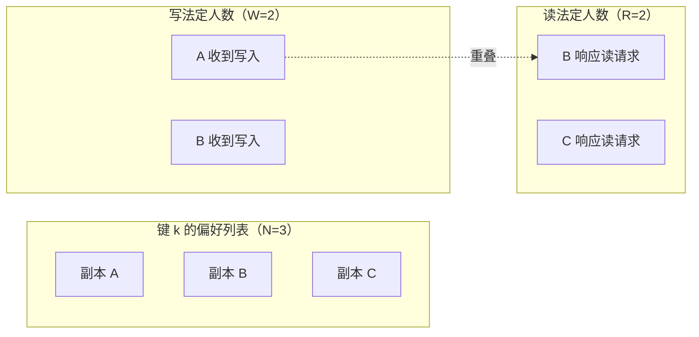
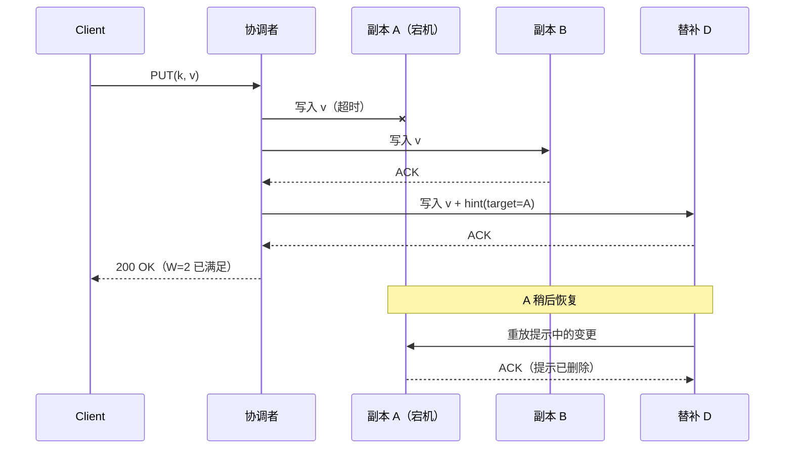
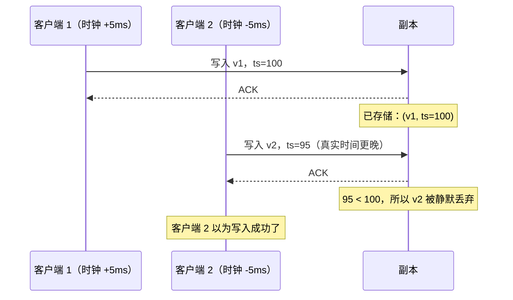
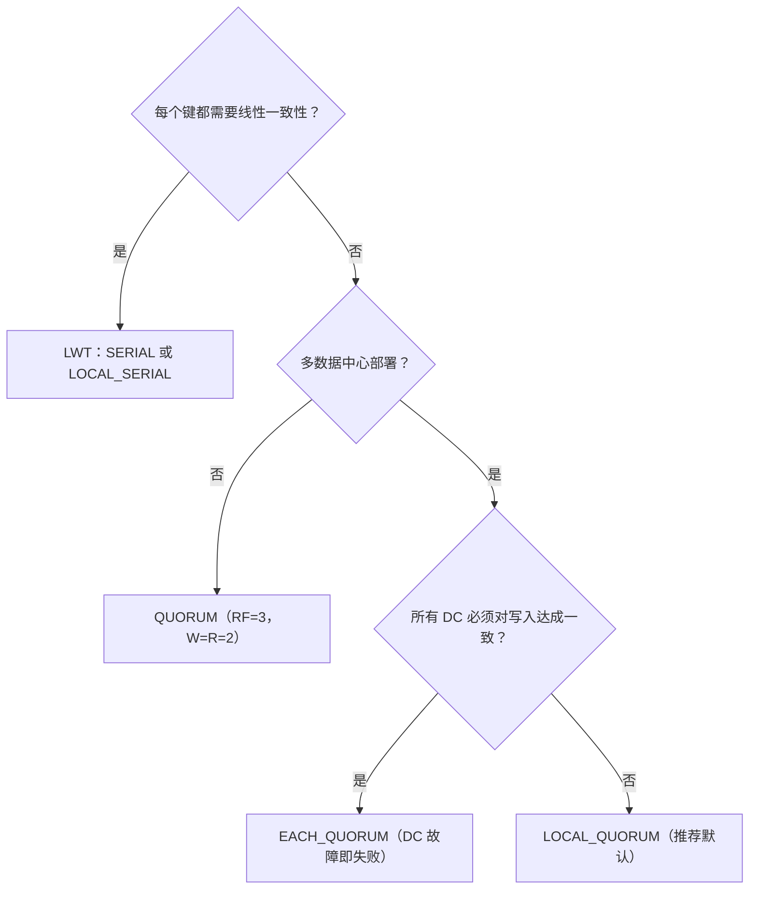

# 法定人数与复制：R + W > N 背后的数学

> **TL;DR**: 在一个有 N 个副本的无主节点系统里，要求写入拿到 W 个写确认、读取拿到 R 个读响应，只要 R + W > N，每一次读就一定会与最近一次写至少在一个节点上重叠。这是一条**新鲜度**规则，不是线性一致性规则。Dynamo 风格的系统（Cassandra、Riak、DynamoDB 的初版设计）靠这种重叠返回最新值，但并发写配合最后写入者胜（last-write-wins）仍可能悄悄丢数据。Jepsen 在分区场景下测到 Cassandra QUORUM 有 28% 的已确认写入丢失[^1]。要拿到每个键真正的线性一致性，你需要共识算法（Paxos、Raft）或 ABD 回写协议，光有 R + W > N 不够。

## 学习目标

学完本章，你将能够：

- [ ] 解释 R + W > N 这条法定人数规则，以及它到底保证了什么（新鲜度，而非线性一致性）
- [ ] 依据可用性、延迟与一致性需求挑选 (N, R, W) 配置
- [ ] 描述松散的法定人数、提示移交，以及它们对法定人数保证的破坏
- [ ] 解释为什么 R + W > N 不具备线性一致性，以及 ABD 寄存器补上了什么
- [ ] 把 Cassandra 的一致性级别（ONE、QUORUM、LOCAL_QUORUM、EACH_QUORUM）映射到 (R, W) 取值
- [ ] 在多数据中心部署中，在 LOCAL_QUORUM 与 EACH_QUORUM 之间做出选择

## 直觉理解

想象你在签一份需要见证人的法律文件。规则是：三名指定见证人中至少两人必须在文件上签字（这就是"写"），之后至少两人必须确认自己见过这份文件（这就是"读"）。因为你总共只有三名见证人，任何两人组成的确认小组里，必然至少有一个人当时在场签了字。这份重叠就是你新鲜度的证据。

但问题在这儿：如果两个人同时在不同版本的文件上签了字，而你的冲突解决方式是"谁签的时间戳晚就留谁"——时间戳取的是房间墙上那只钟——那么只要有个房间的钟慢了，你就会丢掉一份合法签名。重叠只能保证你看到**某个**较新的东西，当并发事件撞在一起时，它不保证你看到的是**正确**的那个。

这就是法定人数复制的核心张力。鸽巢数学（R + W > N）给你的是新鲜度保证，不是线性一致性。本章剩下的部分就来讲这个区别在实践中意味着什么，以及该怎么应对。

## 原理

### 基本法定人数规则

把每个键的 N 份副本放在 N 个不同节点上。写入在 W 个节点确认后算成功，读取在 R 个节点响应后算成功。若 R + W > N，那么根据鸽巢原理，任意读法定人数与任意写法定人数至少共享一个节点[^2][^3]。

这个重叠节点持有最近一次已确认的写。只要客户端能判断哪个响应最新（靠版本向量或时间戳），它就能返回一个最新的值。

Werner Vogels 在 2007 年把这话说得很直白："若 W + R > N，写集合与读集合必然重叠，于是可以保证强一致性"[^3]。Dynamo 论文用的是同一套表述："把 R 和 W 设成 R + W > N，就得到一个类法定人数的系统"[^2]。

*在 N=3、R=W=2 时，任意读法定人数与写法定人数至少共享一个副本（此图中是 B），从而保证读能看到最近一次已确认的写。*

这种重叠的代价有两方面。延迟取决于 W（或 R）个副本中最慢的那一个，所以法定人数越大，长尾延迟被放大得越厉害。Dynamo 自己在 (3,2,2) 上的 99.9 分位延迟约为 200 ms，而平均值不到 10 ms（第 6 节）[^2]。可用性上，写入需要 W 个可达节点、读取需要 R 个，法定人数越大，容错能力越弱。

### 常见的 (N, R, W) 配置

标准的多数派选择是 N=3、W=2、R=2。Dynamo 论文把这一组称为"多个 Dynamo 实例常用的 (N,R,W) 配置"[^2]。在 Cassandra 里，它对应副本因子 3 下的 QUORUM 一致性级别，其中 `quorum = floor(RF/2) + 1 = 2`[^4]。

其他有用的配置：

| 配置 | 可容忍 | 延迟特征 | 适用场景 |
|--------|-----------|-----------------|----------|
| N=3, W=2, R=2 | 读写各可容忍 1 个副本故障 | 均衡 | 通用默认 |
| N=3, W=3, R=1 | 写入 0 个、读取 2 个 | 读快写慢 | 读多写少的商品目录数据 |
| N=3, W=1, R=3 | 写入 2 个、读取 0 个 | 写快读慢 | 写多的遥测数据 |
| N=5, W=3, R=3 | 2 个副本故障 | 长尾延迟更高 | 集群规模更大的关键业务 |

Cassandra 通过一致性级别把这件事暴露到每次查询上：ONE、TWO、THREE、QUORUM、ALL、LOCAL_QUORUM、EACH_QUORUM、LOCAL_ONE、ANY、SERIAL 和 LOCAL_SERIAL[^4]。同一个集群上按请求灵活选择一致性级别，正是 Dynamo 风格系统在运维上的关键优势。

### 松散的法定人数与提示移交

"松散的法定人数（sloppy quorum）"接受沿环游走时遇到的前 W 个**健康**节点，而不一定接收键的偏好列表里那 W 个节点[^2]。这让写入在分区期间仍然可用，但全局意义上打破了 R + W > N 的保证。

当首选副本 A 不可达时，协调者把写入转发给替补节点 D，并附一个"提示（hint）"，指明原本该接收的是 A。A 恢复后，D 重放这条被提示的变更，然后删掉本地副本[^2][^5]。

*当首选副本 A 不可达时，协调者带着提示把写入路由到替补 D，用牺牲严格 R + W > N 保证的代价换取可用性。*

Cassandra 的 `max_hint_window` 默认是 3 小时[^5]。节点宕机时间超过这个窗口，协调者就不再生成提示，节点回来后必须靠全量修复来对齐。一次 10 分钟的滚重启、写入流量 100 Mbps，大约会产生 7 GB 提示，按默认 1024 KiB/s 的限速回放约需 2 小时[^5]。

> [!IMPORTANT]
> 松散的法定人数意味着 R + W > N 在全局不再成立。此时向首选副本发起读（它们已经恢复但还没收到提示），即便写入已被确认，读到的也可能是旧数据。这是有意为之：Dynamo 选择了"永远可写"而非严格一致性[^2]。

### 读修复与反熵

读修复在读取路径上把分叉的副本对齐。一次读请求中，Cassandra 协调者向最快的副本发一次全量读，再向其余 `CL-1` 个副本发摘要读。若摘要不一致，就升级为全量读，按时间戳合并，把合并后的值写回过期副本，然后才返回结果[^6]。

Cassandra 4.0 把阻塞式读修复变成唯一选项（CASSANDRA-13910 移除了旧的概率型 `read_repair_chance`）[^7]。这带来了"单调的法定人数读"：连续的法定人数读永远不会在时间上倒退[^6]。

反熵作为后台进程运行，靠 Merkle 树实现。每个节点为每段键区间维护一棵树；节点之间交换根哈希，不一致就逐层下探，只传输有差异的叶子[^2]。这覆盖了读修复永远碰不到的冷键。想深入看这块，请读 [Merkle 树与反熵](./10-merkle-trees-anti-entropy.md)。

### 为什么法定人数不保证线性一致性

这是本章最重要的一节。R + W > N 保证新鲜度，不保证线性一致性。即便用严格的法定人数，也有三种机制会破坏线性一致性：

**1. 松散的法定人数 + 异步移交。** 如前所述，写到非首选节点会制造一个窗口：读首选副本时返回的是旧值[^2][^8]。

**2. 最后写入者胜 + 时钟偏移。** Cassandra 用物理时间戳做冲突解决。Jepsen 在 2013 年的分析显示，在时钟已同步、发生分区的情况下，QUORUM 上"总共 2000 次写、1009 次被确认、724 次存活、285 次已确认写入丢失"[^1]。这是分区恢复期间 LWW 冲突解决带来的 28% 丢失率——分区一侧已确认的写，被另一侧时间戳不同的写覆盖掉了。

*客户端 2 在真实时间上写得更晚，但因为时钟偏移它的时间戳更早；这条后到的写被 LWW 静默丢弃。*

**3. 没有同步回写。** ABD 寄存器（Attiya、Bar-Noy、Dolev，1995）在读路径上加了一轮：读者在返回前把最新值写回多数派[^9]。这保证了一旦某次读返回了值 v，之后任何读看到的都是 v 或更新的值。Dynamo 的读修复是异步的，发生在响应**已经返回**客户端之后，所以并发的读者仍然可能看到旧数据[^2]。

要做到每个键的线性一致性，你要么用 ABD 的两轮协议（每次读 2 次往返）[^9]，要么用共识（Cassandra 的轻量级事务在 3.x 里用 Paxos，每次操作 4 次往返；4.1+ 通过 CEP-14 把无冲突情况降到 2 次）[^10][^11]。

### 多数据中心部署的考量

在多数据中心部署中，Cassandra 的 QUORUM 是按所有 DC 的副本数总和来算的：两个 DC 各 RF=3（总和 6），QUORUM 需要 4 个确认，且横跨两个 DC。这会让每次写都产生跨 DC 往返（WAN 延迟通常在 30 到 200 ms）[^4]。

LOCAL_QUORUM 只在本地 DC 内计算多数派。每个 DC RF=3 时，LOCAL_QUORUM 需要 2 个本地确认。写入不必等待跨 DC 复制就能完成。这是多 DC Cassandra 部署的标准配置[^4]。

EACH_QUORUM 要求每次写都在**每个** DC 拿到多数派。任一 DC 宕机，写入就整体失败。只有当一致性必须扛住丢掉一个 DC、且绝不能出现本地读到旧数据时，才用它[^4]。

*实用的一致性级别选择路径：先从线性一致性需求出发，再考虑多 DC 拓扑。*

## 真实案例

### Amazon DynamoDB：从松散的法定人数到 Multi-Paxos

Amazon 最初的 Dynamo（SOSP 2007）就是定义了可调法定人数的那个系统。它用 (N=3, W=2, R=2) 跑购物车服务，在所有 Dynamo 实例上做到个位数毫秒的平均延迟和 99.9995% 的请求成功率[^2]。24 小时内只有 0.06% 的读看到分叉版本，且主要来自自动化"忙碌机器人"发起的并发写[^2]。

但 Dynamo 的松散法定人数加向量时钟协调在运维上太复杂。Amazon 后来做 DynamoDB（2012 年上线，2022 年在 USENIX ATC 上发表论文）时做了一个激进的选择：彻底用每个分片的 Multi-Paxos 取代松散的法定人数[^12]。每个分片就是一个 Paxos 复制组，副本分散在多个可用区。写入走 Paxos 主节点；强一致读打到主节点，或通过法定人数校验[^12]。

结果是：DynamoDB 在 2025 年 Prime Day 峰值扛住每秒 1.51 亿次请求，同时保持个位数毫秒响应[^13]。系统提供两种读模式："最终一致"（读任意副本，更便宜）与"强一致"（读主节点或经法定人数校验，每个键线性一致）[^12]。

从 Dynamo 到 DynamoDB 的演进印证了本章的核心论点：R + W > N 是个好用的新鲜度原语，但需要强一致性的生产系统最终都会升级到共识算法。DynamoDB 保留了键值 API 和自动扩缩的目标，却放弃了松散的法定人数转向 Paxos，因为在 Amazon 的规模下，向量时钟协调和静默过期数据的运维代价实在太高[^12][^14]。

## 权衡

| 方案 | 优点 | 缺点 | 适用时机 | 我们的选择 |
|----------|------|------|-----------|----------|
| R=W=N/2+1（多数派） | 均衡；可容忍少数派故障；配合阻塞式读修复可得单调读 | 延迟受限于最慢的法定人数成员；仍受 LWW 影响 | 通用可调一致性 | **多数 Cassandra 负载的默认** |
| W=N, R=1 | 读快（单副本） | 任一副本宕机就阻塞写入；在 LWW 下仍非线性一致 | 读多写少的目录数据 | 每个节点都已持有数据的读多静态目录 |
| W=1, R=N | 写快（单个确认） | 任一副本宕机就阻塞读取；W=1 留下持久性窗口 | 可以接受丢写的写多遥测数据 | 偶尔丢写无所谓的遥测管道 |
| 松散法定人数 + 提示移交 | 短暂分区期间保持可用 | R + W > N 不再成立；提示会过期（默认 3 小时）；静默过期 | 可用性优先于一致性的 Dynamo 风格 AP 系统 | 当你接受最终一致性时 |
| ABD 寄存器 / 每键共识 | 每个键真正线性一致 | 多一轮往返（ABD）或 4 轮（Paxos）；吞吐更低 | 锁、唯一约束、比较并交换 | 正确性不可妥协时 |

## 常见陷阱

> [!WARNING]
> **指望 R + W > N 给你线性一致性。** 鸽巢重叠保证的是新鲜度，不是实时序。配合 LWW 和时钟偏移，一条物理时间更晚但时间戳更早的写会静默覆盖因果上更晚的写。要严格正确，请用向量时钟、CRDT 或 Cassandra 的 LWT[^1]。

> [!WARNING]
> **时钟偏移下的 LWW 静默丢数据。** Cassandra 的毫秒级时间戳让并发负载下的碰撞变得常见。Jepsen 在分区场景下测到 QUORUM 有 28% 的已确认写入丢失[^1]。在没有外部协调者提供单调时间戳的情况下，绝不要用 LWW 反复修改同一个单元格。

> [!WARNING]
> **EACH_QUORUM 在 DC 故障时掐死写入。** EACH_QUORUM 要求每个 DC 都有多数派。哪怕别处还有大量活着的副本，只要有一个 DC 不可达，全集群的写入都会失败。热路径用 LOCAL_QUORUM；EACH_QUORUM 只留给那些绝对不能读到跨 DC 旧数据的工作负载[^4]。

> [!WARNING]
> **R=1 加异步读修复导致读到旧值。** 一致性级别 ONE 直接返回第一个副本的响应，不等摘要比对。那个副本如果是旧的，你拿到的就是旧数据。读修复在后台发生，对当前这次请求毫无帮助。要读己之写，请用 QUORUM 或 LOCAL_QUORUM。

> [!WARNING]
> **提示撑爆磁盘配额。** 节点宕机时间超过 `max_hint_window`（默认 3 小时）后就不再累积提示。它回来时会一直处于分叉状态，直到跑完一次完整的 `nodetool repair`。请把节点停机时长纳入监控对照提示窗口；任何长时间中断之后都要安排修复[^5]。

> [!WARNING]
> **忽略最慢的那次写确认带来的长尾延迟。** 你的写延迟是 W 个副本里第 W 快那一个的耗时，不是平均值。W=2、N=3 时，一个慢副本无所谓；W=3（ALL）时，一个慢副本就主宰了你的 p99。Dynamo 的 99.9 分位是 200 ms，而平均值不到 10 ms[^2]。永远测长尾延迟，别只看平均。

## 练习

你用 Cassandra 跑一个用户设置服务，RF=3，跨三个 AWS 可用区。负载是 90% 读、10% 写。用户必须在一次页面刷新内看到自己刚改的设置。请为读和写选择一致性级别，论证 R + W > N，并描述一个可用区宕机时会发生什么。

提示

想想"读己之写"在法定人数重叠上要求什么。RF=3、三个可用区，每个可用区持有一个副本。哪个一致性级别能在容忍一个可用区故障的同时给出 W + R > 3？

解答

**选择：** 读写都用 LOCAL_QUORUM。

RF=3、跨 3 个可用区（单地域内每区一个副本），LOCAL_QUORUM 需要 `floor(3/2) + 1 = 2` 个确认。于是 W=2、R=2，R + W = 4 > 3。重叠保证了每次读都能看到最近一次已确认的写。

**读己之写：** 用户的客户端打到同一个地域，而 LOCAL_QUORUM 需要 3 个副本中的 2 个，读法定人数必然与写法定人数重叠。用户在下一次读时就能看到自己的写。

**可用区故障：** 一个可用区宕掉后，3 个副本里还有 2 个可用。LOCAL_QUORUM 只需 2 个，所以读写都不中断。如果你选了 ALL（W=3），单个可用区故障就会阻塞所有写入。

**为什么不用 QUORUM？** 单地域三可用区的部署里，QUORUM 和 LOCAL_QUORUM 算出来是同一个值（都要 3 个里的 2 个）。区别在多地域场景：QUORUM 会跨地域，带来跨地域延迟；LOCAL_QUORUM 只留在本地地域。

**为什么不用 ONE？** ONE 给出 W=1、R=1，R + W = 2，不大于 3。没有新鲜度保证。用户可能正好从那台还没收到写入的副本上读。

**接受的权衡：** LOCAL_QUORUM 配 LWW 意味着，不同会话对同一项设置的并发写，在时钟偏移下仍可能丢掉其中一次。对用户设置（低争用、单用户写）来说，这个风险可以忽略。但如果换成计数器或余额，你就得用 LWT。

## 要点回顾

- R + W > N 是新鲜度规则，不是线性一致性规则。并发写仍可能分叉，LWW 下仍可能静默丢数据。
- 标准的 (N=3, W=2, R=2) 配置对读写各容忍一个副本故障，是正确的默认选择。
- 松散的法定人数用 R + W > N 的保证换取分区期间的可用性。启用之前先搞清楚你放弃了什么。
- Cassandra 的 LOCAL_QUORUM 是多 DC 部署的正确默认。跨 DC 的 QUORUM 会让每次操作都背上 30 到 200 ms 的跨 DC 延迟。
- 对并发访问下的可变数据，LWW 几乎总是错的。请改用向量时钟、CRDT 或应用层协调。
- 要每个键真正线性一致，你需要共识（Paxos、Raft）或 ABD 回写协议。光靠 R + W > N 不够。
- DynamoDB 从松散法定人数演进到每分片 Multi-Paxos，说明需要强一致性的生产系统终究会超越法定人数。

## 延伸阅读

- [Dynamo: Amazon's Highly Available Key-value Store (DeCandia et al., SOSP 2007)](https://www.allthingsdistributed.com/files/amazon-dynamo-sosp2007.pdf) - 定义 (N, R, W) 可调法定人数、松散法定人数与提示移交的奠基论文；4.5 节是法定人数的数学，4.6 节是提示移交。
- [Eventually Consistent (Werner Vogels, 2007)](https://www.allthingsdistributed.com/2007/12/eventually_consistent.html) - 造出"R + W > N 保证强一致性"这句话、并定义了客户端一致性分类（读己之写、单调读、会话一致性）的文章。
- [Jepsen: Cassandra (Kyle Kingsbury, 2013)](https://aphyr.com/posts/294-call-me-maybe-cassandra) - 证明分区下 QUORUM 写配 LWW 会丢 28% 已确认写入的经典案例；信任任何法定人数系统之前必读。
- [Sharing Memory Robustly in Message-Passing Systems (Attiya, Bar-Noy, Dolev, 1995)](https://dl.acm.org/doi/10.1145/200836.200869) - 证明法定人数加上回写阶段就能做到线性一致的 ABD 寄存器；2011 年 Dijkstra 奖。
- [Amazon DynamoDB: A Scalable, Predictably Performant, and Fully Managed NoSQL Database Service (USENIX ATC 2022)](https://www.usenix.org/conference/atc22/presentation/elhemali) - DynamoDB 如何用每分片 Multi-Paxos 取代松散的法定人数；所谓"没有 Dynamo 的 Dynamo"论文。
- [Cassandra Consistency Levels (DataStax docs)](https://docs.datastax.com/en/cassandra-oss/3.0/cassandra/dml/dmlConfigConsistency.html) - ONE/QUORUM/LOCAL_QUORUM/EACH_QUORUM/ALL/SERIAL 的完整参考，含法定人数公式。
- [Apache Cassandra Hints Documentation](https://cassandra.apache.org/doc/4.1/cassandra/operating/hints.html) - 提示移交的机制、`max_hint_window`、限速设置与运维建议。
- [CEP-14: Paxos Improvements (Apache Cassandra, 2022)](https://cwiki.apache.org/confluence/x/54cjCw) - 承认 LWT 在区间迁移期间存在线性一致性缺口；Cassandra 4.1 中 Paxos v2 重写的范围。

## 记忆卡片

**Q:** R + W > N 保证了什么？
**A:** 保证每个读法定人数与每个写法定人数至少在一个节点上重叠，因此读能返回最新的已确认值。它保证的是新鲜度，不是线性一致性。

**Q:** Dynamo 风格系统的标准 (N, R, W) 配置是什么？
**A:** (3, 2, 2)。对读写各容忍一个副本故障。Dynamo 的购物车和 Cassandra 副本因子为 3 时的 QUORUM 都用它。

**Q:** 为什么 R + W > N 给不了线性一致性？
**A:** 三个原因：松散的法定人数把写路由到非首选节点（破坏重叠）；LWW 配时钟偏移会静默丢弃并发写；缺少同步回写阶段（ABD）时，并发读者可能以非实时序看到值。

**Q:** 什么是松散的法定人数？
**A:** 从任意 W 个健康节点收确认的法定人数，不一定是键的偏好副本。它在分区期间保住可用性，但破坏了 R + W > N 的新鲜度保证，因为向首选副本的读可能看不到那次松散的写。

**Q:** 什么是提示移交，它在 Cassandra 里的默认窗口是多久？
**A:** 首选副本宕机时，协调者在本地存下这次写，并附一个指明目标的"提示"。目标恢复后重放该提示。Cassandra 默认的 `max_hint_window` 是 3 小时；超过之后提示不再累积，必须做全量修复。

**Q:** Jepsen 在分区下的 Cassandra QUORUM 写上发现了什么？
**A:** 28% 的已确认写入丢失（1009 次已确认写里丢了 285 次），原因是 LWW 配时钟偏移，即便时钟已同步且有外部锁也一样。

**Q:** 什么是 ABD 寄存器，它为什么重要？
**A:** Attiya-Bar-Noy-Dolev（1995）协议给法定人数读加了一个回写阶段：读者找到最新值后，先把它的多数派写回，然后才返回。这让法定人数读具备线性一致性。Dynamo 风格的系统跳过了这一步同步回写。

**Q:** 什么时候该用 LOCAL_QUORUM，什么时候该用 EACH_QUORUM？
**A:** LOCAL_QUORUM（本地 DC 内多数派）是多 DC 的默认，因为它避开跨 DC 延迟。EACH_QUORUM（每个 DC 都要多数派）用于绝对不能从滞后 DC 读到旧数据的工作负载，但任一 DC 不可达时写入会整体失败。

**Q:** DynamoDB 和最初的 Dynamo 有什么不同？
**A:** DynamoDB 用每分片 Multi-Paxos 取代了松散的法定人数和向量时钟。写入走 Paxos 主节点；强一致读打到主节点。这以共识开销为代价消除了最终一致性的分叉。

**Q:** Cassandra 的 QUORUM 公式是什么？
**A:** `quorum = floor(sum_of_replication_factors / 2) + 1`。单 DC RF=3 时 quorum=2；两个 DC 各 RF=3（总和 6）时 QUORUM=4，横跨两个 DC。

**Q:** Cassandra 节点宕机时间超过 `max_hint_window` 会怎样？
**A:** 协调者停止生成提示。节点回来后，在它缺席期间被写过的键上永久处于分叉状态。只有完整的 `nodetool repair`（Merkle 树反熵）才能对齐。

**Q:** Cassandra 4.0+ 里的阻塞式读修复是什么？
**A:** 一次读请求中，若摘要响应不一致，协调者从所有副本拉全量数据，按时间戳合并，把合并值写回过期副本，然后才返回客户端。这提供了单调的法定人数读。

**Q:** DynamoDB 在 2025 年 Prime Day 峰值每秒处理多少请求？
**A:** 每秒 1.51 亿次请求，同时保持个位数毫秒响应。

**Q:** 法定人数写的长尾延迟含义是什么？
**A:** 写延迟受限于第 W 快的副本，不是平均值。Dynamo 在 (3,2,2) 上报告 p99.9 为 200 ms，而平均不到 10 ms。W 越大，长尾延迟越被放大。

## 参考文献

[^1]: Kyle Kingsbury, "Jepsen: Cassandra", aphyr.com, 2013-09-24. https://aphyr.com/posts/294-call-me-maybe-cassandra
[^2]: DeCandia, Hastorun, Jampani, Kakulapati, Lakshman, Pilchin, Sivasubramanian, Vosshall, Vogels, "Dynamo: Amazon's Highly Available Key-value Store", SOSP 2007. https://www.allthingsdistributed.com/2007/10/amazons_dynamo.html
[^3]: Werner Vogels, "Eventually Consistent", All Things Distributed, December 2007. https://www.allthingsdistributed.com/2007/12/eventually_consistent.html
[^4]: DataStax, "How is the consistency level configured?", Cassandra 3.0 docs. https://docs.datastax.com/en/cassandra-oss/3.0/cassandra/dml/dmlConfigConsistency.html
[^5]: Apache Cassandra, "Hints" documentation, Cassandra 4.1. https://cassandra.apache.org/doc/4.1/cassandra/operating/hints.html
[^6]: Apache Cassandra, "Read repair" documentation, Cassandra 5.x. https://cassandra.apache.org/doc/latest/cassandra/managing/operating/read_repair.html
[^7]: CASSANDRA-13910, removal of `read_repair_chance` in Cassandra 4.0. https://issues.apache.org/jira/browse/CASSANDRA-13910
[^8]: Werner Vogels, "Eventually Consistent", Communications of the ACM, 2008/2009. https://cacm.acm.org/practice/eventually-consistent/
[^9]: Hagit Attiya, Amotz Bar-Noy, Danny Dolev, "Sharing Memory Robustly in Message-Passing Systems", JACM 42(1):124-142, 1995. https://dl.acm.org/doi/10.1145/200836.200869
[^10]: DataStax, "How do I accomplish lightweight transactions with linearizable consistency?", Cassandra 3.0 docs. https://docs.datastax.com/en/cassandra-oss/3.0/cassandra/dml/dmlLtwtTransactions.html
[^11]: Apache Cassandra, "CEP-14: Paxos Improvements", Confluence wiki, 2022. https://cwiki.apache.org/confluence/x/54cjCw
[^12]: Elhemali et al., "Amazon DynamoDB: A Scalable, Predictably Performant, and Fully Managed NoSQL Database Service", USENIX ATC 2022. https://www.usenix.org/conference/atc22/presentation/elhemali
[^13]: Channy Yun, "AWS services scale to new heights for Prime Day 2025: key metrics and milestones", AWS News Blog, August 26, 2025. https://aws.amazon.com/blogs/aws/aws-services-scale-to-new-heights-for-prime-day-2025-key-metrics-and-milestones/
[^14]: Lu Pan, "Notes on Amazon's DynamoDB USENIX ATC'22 Paper", 2022-08-14. https://blog.the-pans.com/dynamodb/
