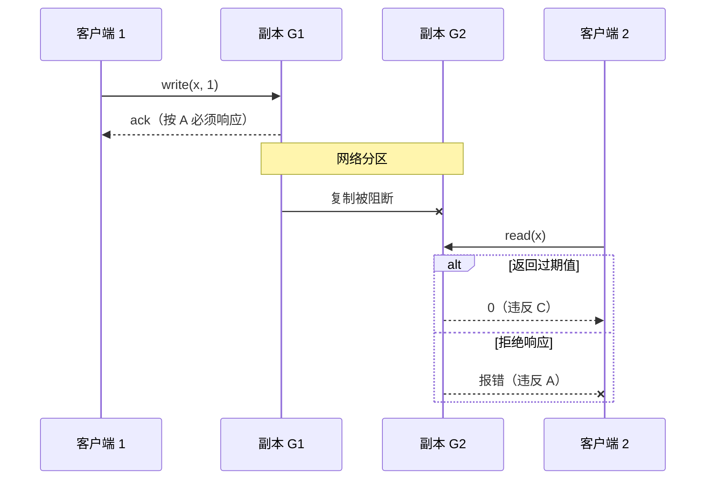
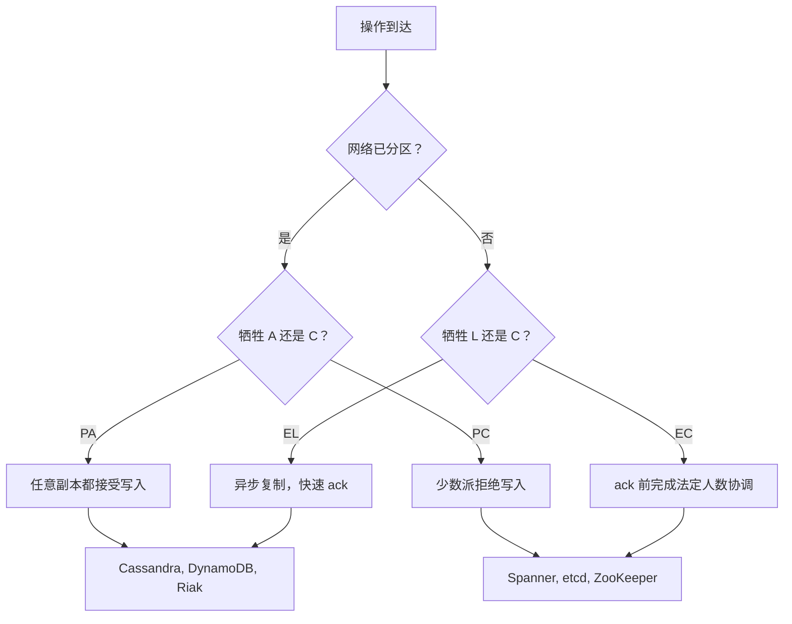
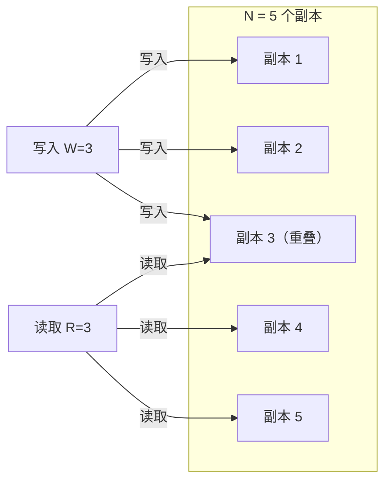
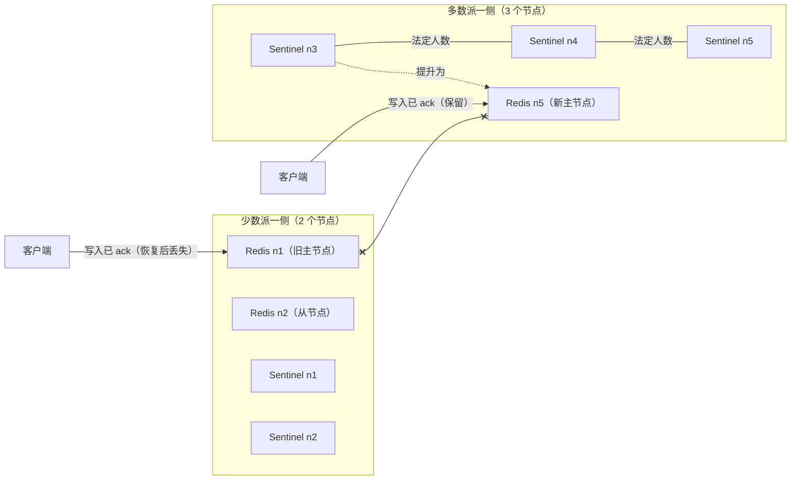

# CAP 与 PACELC：那个始终让人困惑的权衡

> **TL;DR**: CAP 是一个不可能性结论：网络分区期间，分布式数据存储必须在可线性化的一致性与可用性之间做选择[^1]。它从没说“三选二”。PACELC 把这个思路往前推了一步：即便没有分区，你依然要拿一致性去换延迟[^2]。每个数据库都落在这个光谱的某个位置上。用 PACELC 逼出精确的设计讨论，别拿它贴一句保险杠贴纸式的口号。

## 学习目标

学完本章，你将能够：

- [ ] 精确陈述 CAP，并拆掉“三选二”这个误解
- [ ] 用一段话讲清 Gilbert-Lynch 证明
- [ ] 用 PACELC 给真实系统归类（PC/EC、PA/EL、PC/EL、PA/EC）
- [ ] 算出法定人数重叠条件（R + W > N），并识别它在什么情况下失效
- [ ] 用收成与产出（harvest and yield）来推理优雅降级
- [ ] 当同事说“我们选了 CA”时，能建设性地反驳

## 直觉理解

想象一家银行有两个网点，靠一根电话线连着。两个网点看到的是同一个账户余额。一位客户走进 A 网点取走 500 美元。柜员更新了账本，想打电话给 B 网点同步，但电话线断了。

这时第二位客户走进 B 网点，问余额是多少。B 网点的柜员有两个选择：

1. **拒绝回答**，等电话线恢复。客户只能干等（或者气冲冲地走人）。银行保持了正确，但变得不可用。
2. **用旧余额回答**。客户被服务到了，但答案是错的。银行保持了可用，但变得不一致。

电话线断着的时候，没有第三个选项。这就是 CAP。

所有人都忘掉的那部分：即便电话线是通的，每笔交易前都要打给 A 网点也会带来延迟。每笔操作都同步的银行很慢，不同步的银行很快但偶尔给出过期数据。这就是 PACELC 补上的那条“延迟 vs 一致性”的维度。

## 原理

### CAP：它到底说了什么

Eric Brewer 在 PODC 2000 上提出猜想：一个分布式共享数据系统无法同时保证一致性、可用性和分区容忍[^3]。Gilbert 和 Lynch 在 2002 年把它形式化并给出了证明[^1]。精确表述是：

- **C（一致性，Consistency）：** 每次读都返回最近一次写入的值，或者返回错误。形式上指线性一致性。
- **A（可用性，Availability）：** 每个发往未故障节点的请求都能得到非错误的响应。
- **P（分区容忍，Partition tolerance）：** 即使节点之间任意丢消息，系统仍能继续运行。

最关键的纠正：分区不是设计选项。网络会分区，光纤会被挖断，交换机会挂，BGP 会配错[^4]。真正的问题是：分区发生时，你牺牲 C 还是牺牲 A？

Brewer 自己在 2012 年的 IEEE 回顾文章里纠正了“三选二”的说法[^5]：

1. 分区很罕见，但不可避免。分布式系统里你没法“放弃 P”。
2. 这个选择不是二元的，也不是永久的。不同的操作、不同的数据、不同的分区，可以有不同的答案。
3. 要为分区恢复做设计，而不只是为分区期间的响应做设计。

> [!WARNING]
> **“三选二”是错的。** 这种说法暗示 CA 是一个可行的分布式选项。它不是。单节点系统天然就是“CA”，因为它根本没有分区需要容忍。你一旦加了副本，就回到了 CAP 的地盘[^5]。

### 一段话讲完 Gilbert-Lynch 证明

把 N 个节点分成两组，G1 和 G2，两组之间不通消息。客户端把值 v1 写到 G1。G1 必须确认（可用性要求如此）。客户端再去 G2 读。在异步网络里，G2 分不清“G1 慢”和“G1 被分区隔离”。G2 必须响应（可用性要求如此），但它没见过 v1，所以只能返回过期数据（违反线性一致性）。唯一的出路是 G2 拒绝响应，那又违反了可用性。证毕[^1][^6]。

*分区期间，G2 分不清“G1 慢”和“G1 不可达”。任何响应都会违反一致性或可用性其中之一。*

### PACELC：故事的另一半

Daniel Abadi 在 2010 年指出，CAP 只描述了分区时的行为，可分区是罕见的[^7]。大多数时候，主导的权衡是一致性 vs 延迟：一致性越强，每次操作需要协调的副本越多，往返次数就越多。

PACELC 把这个原则重新表述为[^2]：

- **若发生分区（P，Partition）：** 在可用性（A）与一致性（C）之间选
- **否则（E，Else）：** 在延迟（L）与一致性（C）之间选

于是每个系统都能得到一个四字母分类：

*PACELC 逼你回答两个决策：分区时怎么办（A 还是 C），正常运行时怎么办（L 还是 C）。多数互联网规模的系统是 PA/EL，多数金融系统是 PC/EC。*

| PACELC | 分区时的行为 | 正常运行时的行为 | 示例系统 |
|---|---|---|---|
| PC/EC | 少数派不可用 | 每次操作都协调 | Spanner、CockroachDB、etcd、ZooKeeper |
| PA/EL | 所有副本都服务 | 异步复制，快 | Cassandra、DynamoDB（默认）、Riak |
| PC/EL | 少数派不可用 | 允许放宽的读 | PNUTS（Yahoo）、ZooKeeper follower 读 |
| PA/EC | 所有副本都服务 | 正常操作下强一致 | 罕见；实践中可以说并不存在[^8] |

> [!NOTE]
> 对日常设计来说，PACELC 严格比 CAP 更有用，因为大多数时候你处在 E 模式，而不是 P 模式。EL/EC 这个决策才是你天天要面对的。

### 实践中的“CP”与“AP”

**CP 系统**用基于共识的复制（Paxos、Raft、Zab）。N 个节点的集群需要多数派法定人数才能推进。分区期间，少数派一侧停止接受写入。那一侧的用户看到报错，但他们永远不会看到过期或分叉的数据。

- **Spanner：** 每个 split 一个 Paxos + TrueTime。五个九的可用性[^9]，但少数派分区不可用。
- **etcd/ZooKeeper/Consul：** Raft 或 Zab 法定人数。Jepsen 对 etcd 3.4.3 的测试观察到键值操作表现出严格可串行化[^10]。
- **MongoDB（majority 写关注）：** 主节点够不到多数派就自行降级。

**AP 系统**用无主或多主复制。每个可达的副本都接受写入；分叉的数据之后通过 LWW、向量时钟或 CRDT 来收敛。

- **Cassandra（默认）：** N/R/W 可调。一致性级别为 ONE 时，分区两侧都继续服务。
- **DynamoDB（默认读）：** 最终一致。强读要付 2 倍代价[^11]。
- **Riak：** 纯 Dynamo 风格。就是为“永远可写”的语义设计的。

> [!IMPORTANT]
> Kleppmann 认为，不给操作级别加限定就宣称某个数据库是“CP”或“AP”，在分析上是有信息损失的[^12]。ZooKeeper 默认的读并不是线性一致的（follower 可能读到旧值）。DynamoDB 的 Global Tables 是“AP”，但在单个区域内提供强读。永远要问一句：哪个操作一致，在哪种故障下一致？

### 法定人数算术

Dynamo 风格的系统暴露三个参数：每个键 N 个副本、写入需要 W 个副本确认、读取要联系 R 个副本[^13]。核心不变量是：

**R + W > N 保证读法定人数与写法定人数至少在一个副本上重叠。**

那个重叠的副本上有最新写入，所以读方能发现它。

*当 R + W > N 时，至少有一个副本同时参与写法定人数和读法定人数，从而保证读方能看到最新写入。*

常见配置：

- **N=3, R=2, W=2：** 重叠 1 个。单键强读。对应 Cassandra 的 LOCAL_QUORUM。
- **N=3, R=1, W=3：** 所有副本都得确认写入；读快，写慢。
- **N=5, R=3, W=3：** 重叠 1 个。读和写都能容忍 2 个节点故障。

> [!WARNING]
> **R + W > N 是线性一致的必要条件，不是充分条件。** 它只保证在同一组 N 个副本上重叠。多机房部署里按机房用 LOCAL_QUORUM 就会破坏它：在 DC1 完成的写法定人数和在 DC2 的读法定人数可能完全不重叠[^12]。

### 收成与产出

Fox 和 Brewer（1999）为优雅降级提出了两个连续指标[^14]：

- **产出（yield）：** 得到响应的请求占比（类似可用性）。
- **收成（harvest）：** 响应中体现的数据占比（完整性）。

传统 CAP 把可用性当成二元的。收成/产出则揭示出一个光谱：搜索引擎在部分故障时可以只返回 90% 分片的结果（产出高、收成降低），而不是拒绝所有查询（产出为零、收成完整）。转账系统不能牺牲收成（答案错了银行就完了），它只能牺牲产出[^14]。

这直接对应真实的设计决策：

- **搜索/社交信息流：** 返回部分结果。用户对结果不全的容忍度远高于超时。
- **金融交易：** 直接拒绝请求。用户对“稍后重试”的容忍度远高于余额出错。
- **分析看板：** 展示过期数据，同时标注“最后更新时间”。有界陈旧就是显式地降低收成。

## 真实案例

**Redis Sentinel：42 秒内丢掉 56% 的写入。**

Redis 为了低延迟，采用主到从的异步复制（PA/EL）。Redis Sentinel 是一组独立的监控进程，负责发现主节点故障并提升新的主节点。这两者组合起来，就是教科书级的脑裂场景。

在 Jepsen 2013 年对一个 5 节点 Redis Sentinel 集群的测试中[^15]：

1. 一次网络分区把主节点（node 1）和一个从节点（node 2）隔离在少数派一侧。
2. 少数派一侧的客户端继续往旧主节点写，旧主节点对每一笔写入都回 ack。
3. 多数派一侧的 Sentinel（5 个中有 3 个）判定主节点不可达，把某个从节点提升为新主节点。
4. 多数派一侧的客户端往新主节点写。
5. 分区恢复后，Sentinel 把旧主节点降级。旧主节点在分裂期间接受的所有写入全部被丢弃。

**结果：** 1,998 笔已确认写入中丢了 1,126 笔，42 秒的分区窗口内丢写率 56%[^15]。

*分区期间，旧主节点继续接受写入，同时 Sentinel 在多数派一侧提升新主节点。恢复时，旧主节点上的写入被静默丢弃。*

**根因：** 数据通路上是异步复制（为了延迟）加上自动故障切换（为了可用性），却没有共识机制。故障切换协议有法定人数，但复制没有[^16]。

**后来的变化：** Redis 文档现在明确警告“Sentinel + Redis 的分布式系统不保证故障期间已确认的写入会被保留”[^15]。Kingsbury 的建议是：把 Redis 当缓存用，不要当主数据存储或锁服务用。

**给设计者的教训：** 如果你的系统用了异步复制 + 自动故障切换，分区期间就会丢掉已确认的写入。这不是 bug，这是 PA/EL 权衡的具体形态。如果丢写不可接受，就用基于共识的复制（Raft、Paxos），或者要求多数派确认后才响应。

## 权衡

| PACELC | 一致性 | 分区期间的可用性 | 正常运行时的延迟 | 示例系统 | 适用场景 |
|---|---|---|---|---|---|
| PC/EC | 线性一致 | 少数派不可用 | 较高（法定人数协调） | Spanner、CockroachDB、etcd | 金融数据、库存、锁 |
| PA/EL | 最终一致 | 所有副本都服务 | 最低（本地 ack） | Cassandra、DynamoDB、Riak | 购物车、信息流、会话、分析 |
| PA/EC | 分区时最终一致，正常时强一致 | 所有副本都服务 | 中等 | 罕见（可以说并不存在）[^8] | 理论探讨 |
| PC/EL | 分区时强一致，正常时放宽 | 少数派不可用 | 较低（允许读旧值） | ZooKeeper follower 读、PNUTS | 读多写少的配置中心 |

这四行就是 Abadi 2x2 PACELC 分类法的四个象限。按构造方式，它们既穷尽又互斥，所以读者会把一个系统归到且只归到一行，而不是在若干备选之间挑一个。

**我们的选择：** 金融数据、唯一性约束，以及任何“答错比答慢代价更大”的场景，用 PC/EC（Spanner、CockroachDB）。购物车、社交信息流、会话存储，以及能容忍陈旧、可用性直接换收入的场景，用 PA/EL（DynamoDB、Cassandra）。

## 常见陷阱

> [!WARNING]
> **把“三选二”当设计框架。** 这种说法暗示 CA 是真实的分布式选项。它不是。Brewer 在 2012 年就纠正过[^5]。真正的选择是：分区期间牺牲 C 或 A；分区之外牺牲 L 或 C。

> [!WARNING]
> **“CP 就是不可用”。** CP 系统只在分区期间、只在少数派一侧不可用。Spanner 能达到五个九的可用性，是因为它的私有光纤网络让分区极其罕见（网络原因导致的故障占比不到 10%）[^9]。CP 不等于“永远又慢又坏”。

> [!WARNING]
> **LWW 冲突解决会静默丢数据。** DynamoDB Global Tables 和 Cassandra 默认用最后写入者胜出（LWW）[^17]。在时钟偏移下，因果上更晚的写入可能带着更小的时间戳，从而被丢弃。对于每笔写入都重要的数据，LWW 不够用。改用 CRDT、向量时钟，或者把某个键的所有写入都路由到同一个区域。

> [!WARNING]
> **可调一致性不是免费的。** Cassandra 允许你设 R=QUORUM、W=QUORUM 来获得强读。但你要付账：更高的延迟、故障期间更低的可用性、以及运维复杂度。“可调”意味着“你可能把它配错”，而很多团队确实配错了[^12]。

> [!CAUTION]
> **CAP 说的是线性一致性，不是“泛泛的一致性”。** CAP 里的“C”特指线性一致性。因果一致性、会话保证、有界陈旧，都是更弱的模型，它们完全可以在分区期间保持全可用[^18]。一个提供因果一致性的系统，并不会因为分区期间仍可用就“违反了 CAP”。

## 练习

> **问题：** 你有一个 Dynamo 风格集群，N=5、R=2、W=3。(a) R + W > N 成立吗？(b) 这个配置对单键读是强一致的吗？(c) 一次网络分区把集群切成 {1, 2} 和 {3, 4, 5}。多数派一侧还能接受写入吗？少数派一侧呢？两侧的读分别会怎样？

提示

(a) 先算算术。(b) 想一想“强一致”在法定人数重叠之外还要求什么。(c) 数一数每一侧能触达几个副本，再和 W、R 的阈值比。

解答

**(a) R + W > N 成立吗？**

R + W = 2 + 3 = 5，N = 5。所以 R + W = N，也就是说 R + W 并不大于 N。最坏情况下重叠恰好为零。这个配置不保证读法定人数和写法定人数共享一个副本。

**(b) 强一致吗？**

不。当 R + W = N（而不是 >）时，存在这样的执行：读法定人数只联系到不在写法定人数里的副本。读方可能漏掉最新写入。要强一致，你需要 R=3（这样 R + W = 6 > 5，至少重叠 1 个）。

**(c) 分区时的行为：**

- **多数派一侧 {3, 4, 5}：** 有 3 个副本。W=3 需要 3 个 ack，写入勉强成功。R=2 需要 2 个响应，读成功。
- **少数派一侧 {1, 2}：** 有 2 个副本。W=3 需要 3 个 ack 但只有 2 个可达，写入失败。R=2 需要 2 个响应，读能成功，但可能返回过期数据（因为新写入落不到这里）。

多数派一侧保持完全可运行。少数派一侧变成只读，而且数据可能过期。对写入而言这接近 CP 的行为，但少数派一侧的读陈旧意味着：没有额外机制（读修复、反熵）时，它并不是线性一致的。

**关键洞察：** R + W > N 是必要条件，不是充分条件。你还需要法定人数落在正确的那 N 个副本上重叠，并且需要一个机制来判断存在多个版本时哪个是“最新”的。

## 要点回顾

- CAP 说的是：分区期间，在 C 和 A 之间选。分区不可避免；“CA”不是真实的分布式选项。
- “三选二”的说法是错的。Brewer 在 2012 年纠正过。真正的选择是特定故障下、按操作粒度的行为。
- PACELC 补上了缺失的那条维度：正常运行时，你拿一致性换延迟。这才是你每天都要面对的权衡。
- R + W > N 保证同一个键在同一组 N 个副本上有法定人数重叠。多机房 LOCAL_QUORUM 会静默破坏这一点。
- 异步复制 + 自动故障切换 = 分区期间静默丢写。Redis Sentinel 在 42 秒的测试里丢了 56% 的已确认写入[^15]。
- 收成与产出把 CAP 的二元判断变成光谱：返回部分结果（搜索）、拒绝请求（银行）、或者带着时间戳展示过期数据（看板）。
- 涉及钱用 PC/EC。购物车和信息流用 PA/EL。用 PACELC 逼出讨论，而不是拿来分配标签。

## 延伸阅读

- [Brewer, "CAP Twelve Years Later," IEEE Computer, 2012](https://ieeexplore.ieee.org/document/6133253) - Brewer 亲自纠正“三选二”神话；把 CAP 定性为“分区时的选择”的权威表述。
- [Gilbert and Lynch, "Brewer's Conjecture and the Feasibility of Consistent, Available, Partition-Tolerant Web Services," 2002](https://dl.acm.org/doi/10.1145/564585.564601) - 原始证明；短小、构造性强，至今仍是最清晰的形式化陈述。
- [Abadi, "Consistency Tradeoffs in Modern Distributed Database System Design," IEEE Computer, 2012](https://www.cs.umd.edu/~abadi/papers/abadi-pacelc.pdf) - PACELC 论文；读它才能理解为什么日常运行中延迟比分区行为更重要。
- [Kleppmann, "Please stop calling databases CP or AP," 2015](https://kleppmann.com/2015/05/11/please-stop-calling-databases-cp-or-ap.html) - 这篇批评解释了为什么单个字母的标签掩盖了分层现实；做细致的设计评审必读。
- [Kleppmann, "A Critique of the CAP Theorem," arXiv, 2015](https://arxiv.org/abs/1509.05393) - 批评的形式化版本；提出用延迟敏感性（delay-sensitivity）替代原有框架。
- [Fox and Brewer, "Harvest, Yield, and Scalable Tolerant Systems," HotOS, 1999](https://dl.acm.org/doi/10.5555/822076.822436) - 可调一致性的思想前身；引入了被 CAP 的二元判断掩盖掉的连续权衡。
- [Bailis and Kingsbury, "The Network is Reliable," CACM, 2014](https://cacm.acm.org/magazines/2014/9/177925-the-network-is-reliable/fulltext) - 真实世界分区事件的实证清单，从交换机固件 bug 到整个机房失联。
- [Jepsen analyses](https://jepsen.io/analyses) - Kingsbury 对 MongoDB、Cassandra、etcd、Redis、CockroachDB 等的测试结果；数据库在分区下的真实表现 vs 市场宣传。
- [DeCandia et al., "Dynamo: Amazon's Highly Available Key-value Store," SOSP, 2007](https://www.allthingsdistributed.com/files/amazon-dynamo-sosp2007.pdf) - AP 设计的经典范本，含 N/R/W 法定人数与购物车并集合并语义。
- [Brewer, "Inside Cloud Spanner and the CAP Theorem," 2017](https://cloud.google.com/blog/products/databases/inside-cloud-spanner-and-the-cap-theorem) - “实际上等于 CA”的论证；既理解 Brewer 的道理何在，也理解 Kleppmann 为何不同意。

## 记忆卡片

**Q:** CAP 到底说了什么？
**A:** 网络分区期间，分布式数据存储必须在可线性化的一致性（每次读都能看到最新写入）与可用性（每个未故障节点都响应）之间做选择。你无法同时拥有两者。

**Q:** 为什么“三选二”是错的？
**A:** 分区容忍在分布式系统里不是可选项。网络就是会分区。真正的选择是：分区期间牺牲 C 还是 A？“CA”只对单节点成立，而单节点显然不算分布式。

**Q:** PACELC 给 CAP 补充了什么？
**A:** 延迟这条维度。即便没有分区，你也要拿一致性换延迟。PACELC：若分区，选 A 或 C；否则，选 L 或 C。它捕捉到了 CAP 忽略的日常权衡。

**Q:** 把 Cassandra（默认配置）按 PACELC 归类并解释。
**A:** PA/EL。分区期间两侧都继续服务（可用，但会分叉）。正常运行时，单副本读写带来低延迟，代价是一致性。

**Q:** 把 Spanner 按 PACELC 归类并解释。
**A:** PC/EC。分区期间少数派停止服务（保持一致）。正常运行时，Paxos 法定人数 + TrueTime 提交等待以延迟为代价强制外部一致性。

**Q:** Dynamo 风格系统中强读的法定人数重叠条件是什么？
**A:** R + W > N，其中 N 是每个键的副本数，W 是写入确认数，R 是读联系的副本数。这保证至少有一个副本同时参与两个法定人数。

**Q:** 为什么 R + W > N 是线性一致的必要而非充分条件？
**A:** 它保证在同一组 N 个副本上重叠，但多机房部署按机房划分法定人数时会破坏这一点。另外，仅有重叠也处理不了并发写入和读修复的时机问题。

**Q:** Jepsen 在分区下发现了 Redis Sentinel 的什么问题？
**A:** 42 秒的分区里丢了 56% 的已确认写入（1,998 笔中丢 1,126 笔）。旧主节点继续接受写入，同时 Sentinel 提升了新主节点；恢复时旧主节点上的写入被丢弃。

**Q:** 收成和产出是什么？
**A:** 产出（yield）是得到响应的请求占比（类似可用性）。收成（harvest）是响应中体现的数据占比（完整性）。它们把 CAP 的二元判断变成优雅降级的连续光谱。

**Q:** 有团队说“我们需要跨区域强一致”。这在 PACELC 里意味着什么类别，代价是什么？
**A:** PC/EC。代价是写延迟：跨区域协调会让每次写入多出几十到几百毫秒，而且某个区域被分区隔离时可用性会下降。

**Q:** Kleppmann 为什么说“请别再叫数据库 CP 或 AP”？
**A:** 因为 CAP 的二元分类太粗。真实系统对不同操作提供不同的一致性。ZooKeeper 默认的读不是线性一致的。DynamoDB 的 Global Tables 是“AP”，但在区域内提供强读。没有哪个真实系统纯粹属于一个标签。

**Q:** CAP 的 C 和 ACID 的 C 有什么区别？
**A:** CAP 的 C 指线性一致性：每次读都返回最近一次已完成的写入。ACID 的 C 指应用层不变量在每个事务后都成立（外键、唯一性）。这是两种完全不同的性质，只是不幸共用了一个字母。

**Q:** Spanner 技术上属于 CP，怎么做到“实际上等于 CA”？
**A:** Spanner 跑在 Google 的私有光纤上，分区极其罕见（网络原因导致的故障不到 10%）。凭借五个九的可用性，系统每年处于“选 C 还是选 A”状态的时间不到 5 分钟。技术上它是 CP，运维上它基本一直可用。

**Q:** 什么时候该选 PA/EL 而不是 PC/EC？
**A:** 当可用性和低延迟比完美一致性更重要时。购物车（丢一次加购就丢一单）、社交信息流（点赞数过期无所谓）、会话存储、分析。如果答错的代价小于答慢或没答，就选 PA/EL。

**Q:** 把异步复制和自动故障切换放在一起会发生什么？
**A:** 分区期间静默丢写。旧主节点接受的写入从未被复制出去。新主节点走出一条不同分支。恢复时，旧主节点上的写入被丢弃。这就是 PA/EL 权衡的具体形态。

## 参考文献

[^1]: Gilbert and Lynch, "Brewer's conjecture and the feasibility of consistent, available, partition-tolerant web services," ACM SIGACT News 33(2), 2002. https://users.ece.cmu.edu/~adrian/731-sp04/readings/GL-cap.pdf
[^2]: Abadi, "Consistency Tradeoffs in Modern Distributed Database System Design: CAP is Only Part of the Story," IEEE Computer 45(2), Feb 2012. https://www.odbms.org/2012/01/consistency-tradeoffs-in-modern-distributed-database-system-design/
[^3]: Brewer, "Towards Robust Distributed Systems," PODC 2000 keynote. https://dl.acm.org/doi/abs/10.1145/343477.343502
[^4]: Bailis and Kingsbury, "The Network is Reliable," ACM Queue / CACM, September 2014. https://cacm.acm.org/magazines/2014/9/177925-the-network-is-reliable/fulltext
[^5]: Brewer, "CAP Twelve Years Later: How the Rules Have Changed," IEEE Computer 45(2), Feb 2012. https://ieeexplore.ieee.org/document/6133253
[^6]: Whittaker (summary), "An Illustrated Proof of the CAP Theorem." https://mwhittaker.github.io/blog/an_illustrated_proof_of_the_cap_theorem/
[^7]: Abadi, "Problems with CAP, and Yahoo's little known NoSQL system," DBMS Musings blog, April 2010. http://dbmsmusings.blogspot.com/2010/04/problems-with-cap-and-yahoos-little.html
[^8]: Abadi, "Hazelcast and the Mythical PA/EC System," DBMS Musings, 2017. http://dbmsmusings.blogspot.com/2017/10/hazelcast-and-mythical-paec-system.html
[^9]: Brewer, "Inside Cloud Spanner and the CAP Theorem," Google Cloud Blog, Feb 2017. https://cloud.google.com/blog/products/databases/inside-cloud-spanner-and-the-cap-theorem
[^10]: Kingsbury, "etcd 3.4.3," Jepsen, Jan 2020. https://jepsen.io/analyses/etcd-3.4.3
[^11]: AWS, "DynamoDB Read Consistency." https://docs.aws.amazon.com/amazondynamodb/latest/developerguide/HowItWorks.ReadConsistency.html
[^12]: Kleppmann, "Please stop calling databases CP or AP," May 2015. https://kleppmann.com/2015/05/11/please-stop-calling-databases-cp-or-ap.html
[^13]: DeCandia et al., "Dynamo: Amazon's Highly Available Key-value Store," SOSP 2007. https://www.allthingsdistributed.com/files/amazon-dynamo-sosp2007.pdf
[^14]: Fox and Brewer, "Harvest, Yield, and Scalable Tolerant Systems," HotOS-VII, 1999. https://radlab.cs.berkeley.edu/people/fox/static/pubs/pdf/c18.pdf
[^15]: Kingsbury, "Jepsen: Redis," May 2013. https://aphyr.com/posts/283-jepsen-redis
[^16]: Kingsbury, "Jepsen: Redis redux," December 2013. https://aphyr.com/posts/307-jepsen-redis-redux
[^17]: AWS, "DynamoDB Global Tables: How it works," Version 2019.11.21 (Current). https://docs.aws.amazon.com/amazondynamodb/latest/developerguide/V2globaltables_HowItWorks.html
[^18]: Kleppmann, "A Critique of the CAP Theorem," arXiv:1509.05393, September 2015. https://arxiv.org/abs/1509.05393
