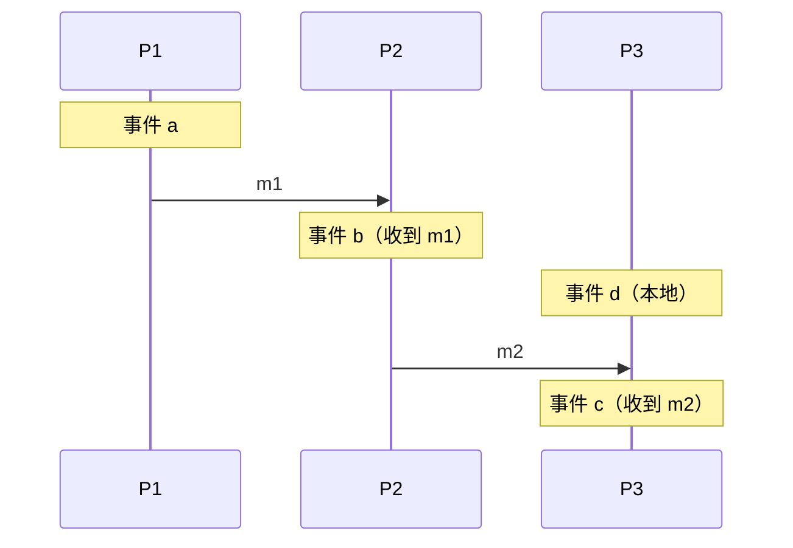
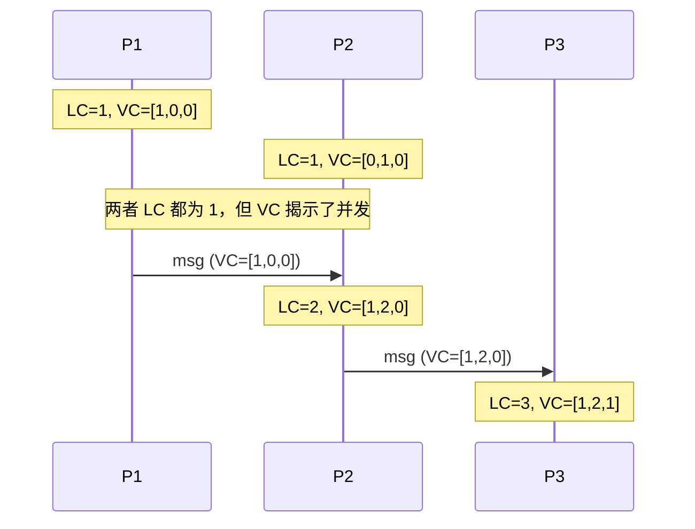
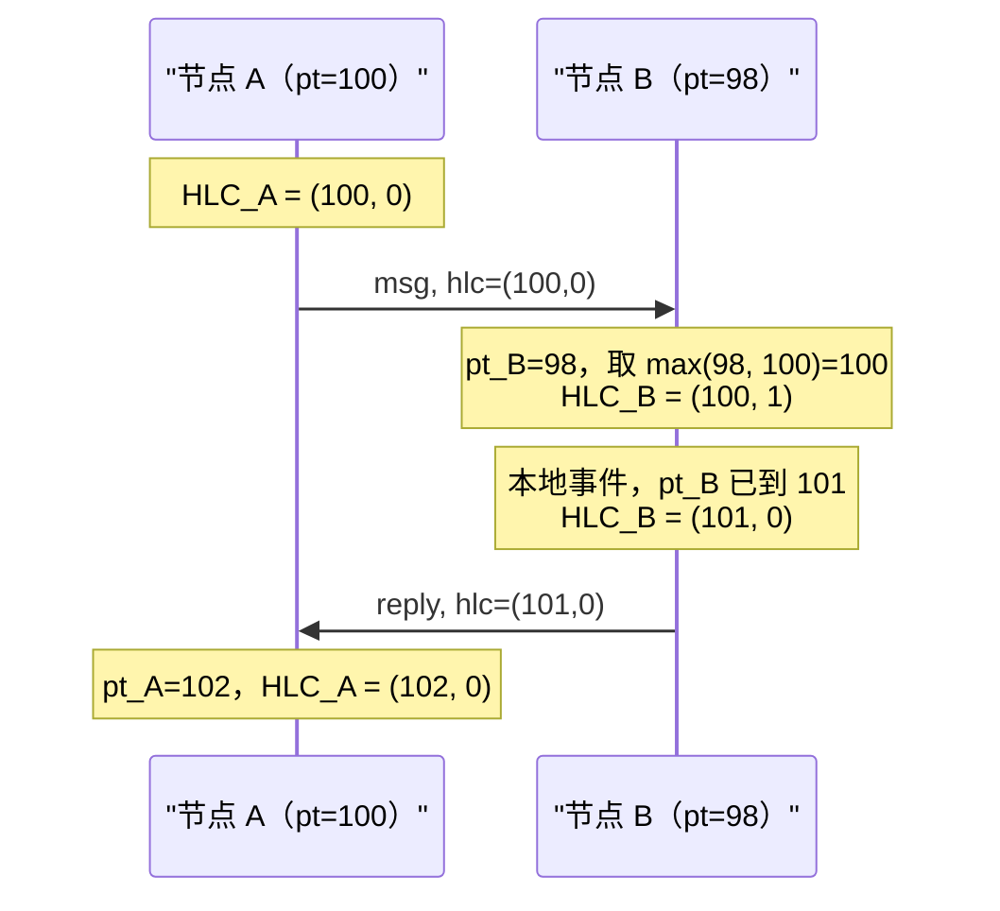
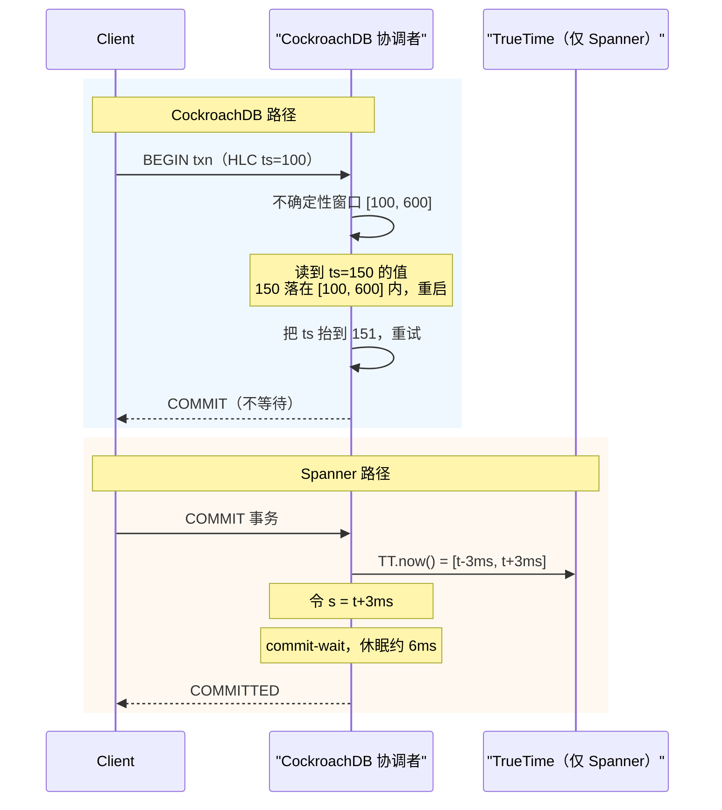

# 时钟与定序：Lamport 时钟、向量时钟与混合逻辑时钟

> **TL;DR**: 墙上时钟（wall-clock）不足以给跨机器的事件定序。云上 VM 之间的 NTP 偏差常见 10 到 250 ms[^1]，石英振荡器漂移可达 150 ppm[^2]，闰秒更是把从 Reddit 到 Cloudflare 的生产系统搞崩过[^3][^4]。需要便宜的全序时用 Lamport 时间戳，需要检测并发时用向量时钟，需要在 64 位时间戳里同时拿到因果序和可读的物理时间时用混合逻辑时钟（HLC）。TrueTime 是一种硬件优势，最初把 epsilon 控制在"通常小于 7 ms"（Corbett 等，OSDI 2012），按 Google 2023 年的更新已收紧到 **p99 小于 1 ms**[^5][^25]；这套东西没法用软件复刻，但 AWS ClockBound 如今已把类似的亚毫秒级界限带到 EC2 上。任何时候看到对多节点写入的数据做 `ORDER BY created_at`，都该起疑心。

## 学习目标

学完本模块，你将能够：

- [ ] 定义 happens-before，并区分因果相关事件与并发事件
- [ ] 用 Lamport 时间戳构造与因果关系一致的全序
- [ ] 用向量时钟检测并发更新
- [ ] 解释 HLC：把逻辑计数器钉在物理时间上，装进 64 位
- [ ] 描述 TrueTime，以及 Spanner 如何用有界不确定性实现外部一致性
- [ ] 为具体的系统设计挑对时钟

## 直觉理解

想象婚礼上有两个摄影师，各戴一块手表。摄影师 A 的表快了 30 秒，摄影师 B 的表慢了 20 秒。两人都用手表时间给每张照片打上时间戳。事后你想按时间戳把所有照片排成时间顺序，结果是错的：A 的某些"较晚"照片其实发生在 B 的某些"较早"照片之前，而光看时间戳你分辨不出来。

再想象一间公司收发室，给每封进来的信盖一个流水号：第 1 封、第 2 封、第 3 封。这个计数器不知道现在几点，但它保证：如果第 5 封是对第 3 封的回信，那就一定有 3 < 5。你从印章上看不出真实时间，但能看出因果关系。这就是物理时钟（人类可读，但跨机器不可靠）与逻辑时钟（定序可靠，但与墙上时间脱钩）之间的权衡。

分布式系统需要定序。一致性模型和共识协议都假定你已经有了它。本章讲的就是定序到底从哪来。

## 原理

### 墙上时钟为什么不可靠

每台计算机都有一块会漂移的石英振荡器。普通主板漂移可达 150 ppm[^2]，不校正的话一天能积累到几十秒。NTP 通过慢调（slew）或跳变（step）校正漂移，但在云上 VM 里，同步偏差常见 10 到 250 ms[^1]。NTP 故障期间，偏差能到好几秒。

三种失效模式让墙上时钟在定序上变得危险：

**闰秒。** 1972 到 2016 年间，IERS 以不规则的间隔插入了 27 个闰秒（平均约 21 个月一次，但最长有 6 年的空档）。最近一次闰秒是 2016 年 12 月 31 日；此后没有再插入，且 CGPM 于 2022 年 11 月投票决定最迟在 2035 年前废除该做法[^6]。即便不再新增，遗留的闰秒 bug 仍会缠上那些处理历史时间戳或跑在老代码路径上的系统。2012 年 6 月 30 日，Linux 内核的 hrtimer/futex 路径在插入那一秒时死锁，导致跑 Reddit、Mozilla、Cassandra 和 Hadoop 的服务器 CPU 打满[^4][^7]。2017 年 1 月 1 日，Cloudflare 的 RRDNS（Go 编写）在 `time.Now()` 跨闰秒倒退时算出了负的 RTT，让 `rand.Int63n` 收到负数参数而 panic，高峰期约 0.2% 的 DNS 查询报错，完全恢复花了约 6 小时 45 分钟[^3]。

**非单调跳变。** POSIX 的 `CLOCK_REALTIME` 可以往任一方向跳（NTP 跳变、管理员操作、闰秒）。任何不用单调时钟源就算 `elapsed = now - start` 的代码都是脆的。

**VM 暂停。** Hypervisor 的 steal time 和热迁移冻结能把一台 guest 暂停几百毫秒。恢复后 guest 的时钟看起来向前跳了，但暂停期间发生的事件根本没有时间戳。

> [!IMPORTANT]
> 测量时间间隔请用 `CLOCK_MONOTONIC`（Linux）或 `time.Time` 的单调分量（Go 1.9+）。`CLOCK_REALTIME` 只留给面向人的展示。

### Happens-before（Lamport 1978）

Leslie Lamport 干脆绕开了物理时间[^8]。他的"happens-before"关系（记作 `->`）捕捉的是程序正确性唯一在乎的那种顺序：

- **同进程规则：** 若 a 和 b 是同一进程中的事件且 a 先发生，则 a -> b。
- **消息规则：** 若 a 是某条消息的发送、b 是它的接收，则 a -> b。
- **传递性：** 若 a -> b 且 b -> c，则 a -> c。

不被 `->` 关联的事件是**并发**的（记作 `a || b`）。并发不表示"同一瞬间"，而是指两个事件都不可能影响对方。这是一切逻辑时钟的基础。

*事件 a -> b -> c 构成一条因果链；事件 d 与 a 是并发的（两者之间没有消息路径相连），尽管在墙上时钟上 d 可能"发生在同一时刻"。*

### Lamport 时间戳

Lamport 时间戳是每个进程一个标量计数器[^8]：

1. 本地事件：`C_P += 1`
2. 发送消息：用 `C_P` 给它打标签（在自增之后）
3. 收到标签为 `t` 的消息：`C_P = max(C_P, t) + 1`

为了打破平局，把时间戳扩展成 `(C_P, process_id)`，按字典序比较。得到的结果是**与因果关系一致的全序**：若 a -> b，则 LC(a) < LC(b)。

关键局限：逆命题不成立。LC(a) < LC(b) **并不**意味着 a -> b。两个并发事件会拿到不同的 Lamport 时间戳，但你无法把它们和因果有序的事件区分开。Lamport 时间戳抹掉了并发信息。

**什么时候用 Lamport 时间戳：** 你需要给日志一个便宜的全序（比如 Raft 的日志索引），并且不需要检测并发写。

### 向量时钟

向量时钟（Fidge 1988，Mattern 1989）把保证加强到双向成立[^9][^10]。每个进程 i 维护一个长度为 N 的向量 `VC_i`（每个进程一项）：

1. 本地事件：`VC_i[i] += 1`
2. 发送时：附上 `VC_i`
3. 收到 `VC_j` 时：对所有 k 做 `VC_i[k] = max(VC_i[k], VC_j[k])`，然后 `VC_i[i] += 1`

比较方式：`VC(a) < VC(b)` 当且仅当 a 的每一项都小于等于 b 的对应项，且至少有一项严格更小。若既非 `VC(a) <= VC(b)` 也非 `VC(b) <= VC(a)`，两个事件就是并发的。

这就给出了精确刻画：**a -> b 当且仅当 VC(a) < VC(b)**[^9]。

*同一串事件分别用 Lamport 标量和向量时钟打戳。Lamport 给最初两个事件都打了 1，把它们的并发性藏了起来。向量时钟 [1,0,0] 与 [0,1,0] 不可比，暴露出两者互不为因。*

代价是：每个时间戳 O(N) 字节，N 是写者数量。Amazon 最初的 Dynamo 论文（2007）对每个数据项使用向量时钟[^11]。当有成千上万个移动客户端在写时，向量会大到不实用，这正是 Dynamo 引入截断方案的原因。

### 点分版本向量

Riak 经典的向量时钟实现（2009 到 2014）在成千上万客户端各自用自己的 client ID 写入时，遭遇了"兄弟节点爆炸"（sibling explosion）。Preguica 等人（2010）提出的点分版本向量（dotted version vectors，DVV）把向量的键从客户端换成**服务器**，从而解决了这个问题[^12][^13]。

每个值都带一个"点"（server_id, counter），标明是哪个服务器事件产生了它。周围的上下文只是一个以服务器为维度的版本向量。在做带上下文的 put 时，DVV 会吸收客户端观察到的所有兄弟版本，只有与该上下文并发的兄弟版本才留下来。

Riak KV 在 2.0 版本把 DVV 设为默认，消除了困扰早期部署的兄弟爆炸[^14]。

**什么时候用向量时钟或 DVV：** 你有一个多主（multi-leader）最终一致存储，并且必须检测（而不只是消解）并发写。当客户端数量远多于服务器时，专门用 DVV。

### 混合逻辑时钟（HLC）

HLC（Kulkarni 等，2014）把两边的优点合起来：一个 64 位时间戳，既紧贴墙上时钟，又保留 Lamport 的因果保证[^15][^16]。

节点 j 的状态是一对 `(l_j, c_j)`，`l` 是物理时间分量，`c` 是逻辑计数器：

- **本地事件：** `l_new = max(l_j, physical_time)`；若 `l_new == l_j`，则 `c_j += 1`，否则 `c_j = 0`。
- **收到来自 (l_m, c_m) 的消息：** `l_new = max(l_j, l_m, physical_time)`；在相同的 `l` 值下，把 `c_j` 抬到严格大于本地计数器和来件计数器的水平。

一种常见编码把时间戳塞进 64 位：48 位物理时间（毫秒粒度），16 位逻辑计数器[^15]。结果是：

- **因果性：** 若 a -> b，则 HLC(a) < HLC(b)（Lamport 性质）。
- **贴近墙上时间：** 物理分量保持在 NTP 漂移范围内，因此 HLC 时间戳人类可读，也兼容 `AS OF SYSTEM TIME` 查询[^17]。
- **恒定大小：** 无论集群多大都是 64 位，不像向量时钟。

局限：和 Lamport 一样，HLC 是单向的。HLC(a) < HLC(b) 并不意味着 a -> b。单靠 HLC 检测不了并发。

CockroachDB、YugabyteDB 和 MongoDB 都使用 HLC 风格的时钟[^1][^17][^18]。MongoDB 的 SIGMOD 2019 论文描述了它们用于因果一致性的集群级逻辑时钟[^17]。

*节点 B 的 HLC 在自己物理时钟落后于来件时间戳时会推进逻辑计数器，从而在不等待 NTP 追上的情况下保持严格单调。*

### TrueTime 与有界物理时钟

Google 的 TrueTime 不是一个时钟。它是一个 API，返回一个**区间** `[earliest, latest]`，并保证真实时间落在其中[^5]。每个 Google 数据中心都部署"时间主节点"（一半 GPS，一半原子钟）。服务器向多个主节点轮询，用 Marzullo 算法剔除离群值，并把不确定性报告为 epsilon。

生产环境里 epsilon 通常是 1 到 7 ms[^5]。这比 NTP（10 到 250 ms）紧了好几个数量级。

Spanner 用 TrueTime 做 **commit-wait**：给事务分配提交时间戳 `s` 之后，先睡到 `TT.now().earliest > s` 再对外确认[^5]。这就保证了世界上任何更晚发生的事务都会选到严格更大的时间戳。结果是在读路径不需要跨数据中心协调的前提下拿到外部一致性（严格可串行化）。

commit-wait 的代价与 epsilon 成正比：每次写入大约 2 * epsilon，实践中约 7 到 14 ms[^5]。

AWS 现在提供了类似能力。Amazon Time Sync Service（2023 年 11 月）在 EC2 上通过 NTP 提供优于 100 微秒的精度，通过 PTP 硬件时钟提供优于 40 微秒的精度[^19]。ClockBound 是暴露该不确定性区间的开源守护进程[^20]。YugabyteDB 与 Amazon Time Sync 集成以收紧自己的时钟不确定性[^21]。

> [!TIP]
> 用 commit-wait 这个思路并不需要 Google 的基础设施。AWS ClockBound 在普通 EC2 实例上就能给你一个有界区间。界限越紧，等待越短。

## 真实案例

**CockroachDB：没有原子钟的 HLC。**

CockroachDB 是一个分布式 SQL 数据库，靠 HLC 在普通硬件上实现可串行化[^1]。它的设计说明了没有 TrueTime 该怎么活。

每个 CockroachDB 节点维护一个 HLC。事务从协调者节点的 HLC 拿到一个临时提交时间戳。关键点在于**不确定性区间**（uncertainty interval）：每次读都带一个窗口 `[ts, ts + max_offset]`，`max_offset` 默认 500 ms[^22]。如果某次读碰到的时间戳落在这个窗口内，系统就无法判断该值是先于还是后于本事务开始提交的。CockroachDB 用**不确定性重启**解决：把事务时间戳抬到碰到的那个值之上再重试[^1]。

节点之间通过 RPC 心跳两两交换时钟偏移。如果某节点观测到的偏移超过配置的容忍阈值，它会自我终止，而不是冒险提供陈旧读[^22][^23]。

与 Spanner 的对比很能说明问题：

| | Spanner | CockroachDB |
|---|---|---|
| 时钟源 | GPS + 原子钟（epsilon 1-7 ms） | NTP（偏差 10-250 ms） |
| 写入代价 | Commit-wait（约 7-14 ms 休眠） | 不等待；读可能重启 |
| 一致性 | 外部一致性（严格可串行化） | 可串行化（非跨键线性一致） |
| 硬件 | 每个 DC 自建时间主节点 | 普通服务器 |
| 默认偏移预算 | 约 7 ms | 500 ms |

Spanner 在写上付账（短暂休眠）。CockroachDB 在读上付账（偶发重启）。两者都实现了可串行化。只有 Spanner 实现外部一致性，因为只有 TrueTime 把不确定性压得足够紧，让 commit-wait 变得便宜。

*CockroachDB 让命中不确定性区间的读重启，从而避开 commit-wait；Spanner 在写上等过自己那段很紧的不确定性区间，从而避开读重启。*

## 权衡

| 方案 | 优点 | 缺点 | 适用场景 | 我们的选择 |
|---|---|---|---|---|
| Lamport 时间戳 | 全序；O(1) 大小；不需要成员信息 | 无法检测并发 | 全序日志（Raft 索引） | 只需要"前后"，不需要"并发"时 |
| 向量时钟 | 精确检测并发 | 每个时间戳 O(N)；N 为写者数 | 写者集合较小的多主 K/V | 冲突检测比体积更重要时 |
| 点分版本向量 | 客户端很多也保持紧凑；修复兄弟爆炸 | 更复杂；客户端必须携带上下文 | 面向客户端的 K/V 存储（Riak 风格） | 客户端数量远多于服务器时 |
| HLC | 64 位；兼具物理时间与因果性；可平替墙上时钟 | 只有单向因果；需要有时钟偏差上界 | 分布式 SQL、因果一致性 | 大多数分布式数据库的现代默认 |
| TrueTime + commit-wait | 外部一致性；读不需要跨 DC 协调 | 需要原子钟 + GPS 硬件；写在 epsilon 上付账 | 全球严格可串行化；Google 2023 年更新称 p99 epsilon 小于 1 ms[^25] | 正确性不可妥协且养得起基础设施时 |

## 常见陷阱

> [!WARNING]
> **最后写入者胜（LWW）会静默丢掉并发写。** Cassandra 的默认冲突消解比较墙上时钟时间戳，保留最大的那个[^24]。在云上 VM 之间 10 到 250 ms 的 NTP 偏差下[^1]，一个因果上更晚、但写在走慢的节点上的写入，会被一个更早、写在走快节点上的写入永久遮蔽，而用户看不到任何提示。Jepsen 对 Cassandra 在 QUORUM + LWW 下的分析观察到 1,009 次已确认写入中有 285 次丢失（约 28%）[^26]。对协作状态、共享计数器，或任何丢一次写都不能接受的场景，请用 OR-Set、保留所有并发值的 CRDT register，或者 HLC + 每个键单写者的共识。

> [!WARNING]
> **对多写者数据做 `ORDER BY created_at`。** 如果 `created_at` 来自不同节点的墙上时钟，那么在 NTP 偏差窗口内的排序毫无意义。用 HLC 派生的时间戳，或每个分片单写者的模式。

> [!WARNING]
> **计时代码里的闰秒 bug。** 任何用非单调时钟源算的 `elapsed = now - start` 都可能在闰秒时变成负数。2012 年那个 Linux 内核 bug 搞挂了 Reddit 和 Cassandra[^4]；2017 年 Cloudflare 的 bug 让 DNS 报错了约 6 小时 45 分钟[^3]。间隔测量用单调时钟；用闰秒抹平（leap smearing，Google、AWS）消除不连续。

> [!WARNING]
> **把 CockroachDB 的 `max_offset` 设得比 NTP 偏差还小。** 两两偏移超过容忍阈值的节点会自我终止[^22]。在一个 NTP 抖动有 80 ms 的集群上把它设成 100 ms，会导致节点连环死亡。除非你有 PTP 或 AWS Time Sync，否则保留 500 ms 默认值。

> [!WARNING]
> **把 NTP 当成事实而不是尽力而为。** NTP 给你的是概率分布，不是一个点。`System.currentTimeMillis()` 只是个猜测。设计时要为不确定性留位置：用区间（TrueTime、ClockBound），或干脆用不依赖精度的逻辑时钟。

> [!WARNING]
> **以为单调时钟能扛过 VM 迁移。** `CLOCK_MONOTONIC` 只保证在一次启动内非递减。VM 热迁移实际上等于时钟源重启。迁移之后，单调时钟可能归零或跳变。有条件时用 hypervisor 的半虚拟化时钟（`kvm-clock`、`tsc`）。

## 练习

你的多区域文档协作服务用 LWW 处理编辑，每周大约静默丢失一次用户改动。请诊断原因。提出三种修法并比较：（1）用向量时钟检测冲突；（2）用 CRDT 自动合并（前向引用 [CRDTs](./05-crdts.md)）；（3）改用 HLC + 每个文档一份共识。

提示

每周的丢失率与维护窗口期间的 NTP 偏差尖峰相关。想一想当两个用户在同一段文字上、在偏差窗口内先后编辑时会发生什么：两次写都拿到了时间戳，但"更晚"的那个时间戳并不对应实际更晚的事件。

解答

**诊断：** LWW 通过比较墙上时钟时间戳来消解冲突。区域间 NTP 偏差为 10 到 250 ms，落在该窗口内的编辑被任意定序。每周会有一次，两个用户在同一段落上、在偏差窗口内编辑，而"输"的那次编辑被静默丢弃。

**修法 1：用向量时钟检测冲突。**

把每个文档段落的 LWW 换成向量时钟（或 DVV）。当两次编辑并发（向量不可比）时，把两者都呈现出来让用户决断。这消除了静默丢失，但引入面向用户的合并交互。代价：每段 O(N) 的元数据，N 是编辑类服务器的数量。

**修法 2：用 CRDT 自动合并。**

用 CRDT 文本类型（RGA、Yjs、Automerge），它能在无冲突的前提下合并并发编辑，不需要用户介入。代价：存储更高（操作日志或基于状态的 CRDT 元数据），客户端库更复杂，而且某些合并结果会让用户意外（并发输入者的字符交错在一起）。

**修法 3：HLC + 每个文档一份共识。**

给每个文档选一个主节点（通过 Raft 或租约）。对该文档的所有编辑都经过主节点，由它按因果顺序分配 HLC 时间戳。同一个文档上不存在并发写，所以 LWW 是安全的（只有一个写者）。代价：写延迟增加一次共识往返；主节点故障切换增加了复杂度；跨区域写要付到主节点所在区域的往返延迟。

**对比：**

| 修法 | 静默丢失 | 用户体验 | 延迟 | 复杂度 |
|---|---|---|---|---|
| 向量时钟 | 不会（冲突被呈现） | 需要合并界面 | 低（无协调） | 中 |
| CRDT | 不会（自动合并） | 无缝，但合并结果可能意外 | 低（无协调） | 高（CRDT 库） |
| HLC + 共识 | 不会（单写者） | 无缝 | 较高（共识 RTT） | 中 |

**建议：** 对文档协作服务，CRDT 最合适。它消除了冲突又不引入协调延迟，这对实时打字很关键。Google Docs、Figma 和 Apple Notes 都采用类似 CRDT 的做法。只有在你需要严格顺序保证时才用 HLC + 共识（例如金融文档，合并语义不可接受）。

## 要点回顾

- 墙上时钟在分布式系统里不足以给事件定序。云上 VM 之间 10 到 250 ms 的 NTP 偏差是常态。
- Lamport 时间戳给出与因果一致的全序，但检测不了并发。用它做日志，不要用它做冲突检测。
- 向量时钟能精确检测并发（a -> b 当且仅当 VC(a) < VC(b)），但每个时间戳 O(N) 的开销。点分版本向量解决了客户端密集型负载下的爆炸问题。
- HLC 是分布式数据库的现代默认：64 位、有因果性、贴近物理时间，CockroachDB、YugabyteDB 和 MongoDB 都在用。
- TrueTime 用 GPS 加原子钟把不确定性压到 1 到 7 ms。commit-wait 把这个界限转成外部一致性。AWS ClockBound 把类似的 API 带到了普通 EC2 上。
- 任何时候看到对多节点写入的数据做 `ORDER BY created_at`，都要问一句："这个时间戳是哪个时钟产生的，它的偏差预算是多少？"
- 默认用最后写入者胜是错的。只有在明确接受"并发写会被丢掉"时才用它。

## 延伸阅读

- [Time, Clocks, and the Ordering of Events in a Distributed System (Lamport 1978)](https://lamport.azurewebsites.net/pubs/time-clocks.pdf) - 开山之作；6 页讲清 happens-before 与逻辑时钟。从这里开始。
- [Logical Physical Clocks and Consistent Snapshots (Kulkarni et al. 2014)](https://cse.buffalo.edu/tech-reports/2014-04.pdf) - HLC 论文，带伪代码；很密，但如果你要碰 CockroachDB 或 YugabyteDB 的内核就是必读。
- [Living Without Atomic Clocks (CockroachDB, 2022)](https://www.cockroachlabs.com/blog/living-without-atomic-clocks/) - 讲"HLC vs TrueTime"的标杆文章；理解不确定性重启权衡最好的一份单篇材料。
- [Spanner: Google's Globally Distributed Database (Corbett et al., OSDI 2012)](https://research.google/pubs/spanner-googles-globally-distributed-database-2/) - TrueTime + Paxos 的原始系统论文；读第 4 节看 commit-wait。
- [Spanner, TrueTime and the CAP Theorem (Brewer, 2017)](https://research.google/pubs/spanner-truetime-and-the-cap-theorem/) - Brewer 解释 Spanner 为什么"实际上是 CA"，以及 TrueTime 如何让它成立。
- [There Is No Now (Sheehy, ACM Queue 2015)](https://queue.acm.org/detail.cfm?id=2745385) - 一篇简短、观点鲜明的文章，讲"现在"为什么不是分布式系统的概念；用来建立直觉极好。
- [How and why the leap second affected Cloudflare DNS (2017)](https://ghost.blog.cloudflare.com/how-and-why-the-leap-second-affected-cloudflare-dns/) - 一份紧凑的复盘，附 Go 代码，精确展示了非单调时钟如何造成生产事故。
- [It's About Time: Microsecond-Accurate Clocks on Amazon EC2 (AWS, 2023)](https://aws.amazon.com/blogs/compute/its-about-time-microsecond-accurate-clocks-on-amazon-ec2-instances) - AWS 的 TrueTime 风格硬件加 ClockBound；不靠 Google 级基础设施也能收紧界限的路径。

## 记忆卡片

**Q:** happens-before（a -> b）是什么意思？
**A:** 事件 a 可能在因果上影响了事件 b：要么它们在同一进程中且 a 在前，要么 a 是 b 所接收的那条消息的发送，要么存在一条传递链把它们连起来。

**Q:** Lamport 时间戳提供什么保证，又不提供什么？
**A:** 它保证一个与因果一致的全序（a -> b 蕴含 LC(a) < LC(b)）。它不能检测并发：LC(a) < LC(b) 可能意味着 a -> b，也可能意味着 a || b。

**Q:** 向量时钟比 Lamport 时间戳强在哪里？
**A:** 向量时钟给出精确刻画：a -> b 当且仅当 VC(a) < VC(b)。若两个向量互不占优，事件就是并发的。代价是每个时间戳 O(N) 空间。

**Q:** 点分版本向量解决了什么问题？
**A:** 经典向量时钟每个写者（包括客户端）就多一项。DVV 让向量的键只落在服务器上，并且每个值只附一个"点"，因此即使有上百万客户端，体积也只随服务器数量增长。

**Q:** HLC 是什么，为什么是 64 位？
**A:** 混合逻辑时钟把 48 位物理时间（毫秒）和 16 位逻辑计数器组合起来。它保留 Lamport 的因果性质，同时保持在墙上时钟的 NTP 漂移范围内，使时间戳人类可读，也兼容时间旅行查询。

**Q:** CockroachDB 没有 TrueTime 怎么处理时钟不确定性？
**A:** 每个事务携带一个不确定性区间 [ts, ts + max_offset]。如果读碰到落在该窗口内的值，事务就以更高的时间戳重启。节点若时钟漂移超过配置的容忍偏移阈值，会自我终止。

**Q:** TrueTime 的 commit-wait 是什么，达成了什么？
**A:** 分配提交时间戳 s 之后，Spanner 睡到 TT.now().earliest > s 才确认。这保证任何更晚的事务都选到严格更大的时间戳，从而在读不需要跨 DC 协调的情况下实现外部一致性（严格可串行化）。

**Q:** Spanner 生产环境里 TrueTime 的典型 epsilon 是多少？
**A:** 1 到 7 ms，取决于与时间主节点的距离。它决定了 commit-wait 的时长。

**Q:** 为什么把最后写入者胜（LWW）当作默认冲突消解很危险？
**A:** LWW 比较墙上时钟时间戳。在 NTP 偏差下，因果上更晚的写可能拿到更低的时间戳而被静默丢弃。系统丢了数据，却没有任何错误信号。

**Q:** CockroachDB 默认的 max_offset 是多少，节点超过它会怎样？
**A:** 默认 500 ms。若节点观测到的时钟偏移相对同伴超过容忍阈值，它会自我终止以避免一致性违规。

**Q:** 什么时候用 HLC，什么时候用向量时钟？
**A:** 需要在紧凑的 64 位时间戳里拿到因果序（分布式 SQL、因果一致性）时用 HLC。必须检测并发写并把冲突呈现出来（写者集合较小的多主最终一致存储）时用向量时钟。

**Q:** 2012 年的闰秒 bug 弄坏了什么？
**A:** Linux 内核的 hrtimer/futex 路径在被插入的那一秒上死锁，导致 CPU 打满。Reddit、Mozilla、Cassandra 和 Hadoop 的运维都报告了崩溃和负载升高。

**Q:** AWS ClockBound 与 TrueTime 是什么关系？
**A:** ClockBound 借助 Amazon Time Sync Service（GPS 驯服，NTP 精度优于 100 微秒）在 EC2 实例上暴露一个 TrueTime 式的不确定性区间。它让数据库不必依赖 Google 的定制硬件，也能实现 commit-wait 类协议。

## 参考文献

[^1]: Spencer Kimball, "Living Without Atomic Clocks", Cockroach Labs 博客，2022-01 更新。https://www.cockroachlabs.com/blog/living-without-atomic-clocks/
[^2]: NTPclient HOWTO, "Typical commodity PC motherboards have initial set errors up to 150 ppm"。http://doolittle.icarus.com/ntpclient/HOWTO
[^3]: John Graham-Cumming, "How and why the leap second affected Cloudflare DNS", Cloudflare 博客，2017-01-01。https://ghost.blog.cloudflare.com/how-and-why-the-leap-second-affected-cloudflare-dns/
[^4]: Cade Metz, "The Inside Story of the Extra Second That Crashed the Web", WIRED, 2012-07-03。https://www.wired.com/2012/07/leap-second-glitch-explained/
[^5]: James C. Corbett 等, "Spanner: Google's Globally-Distributed Database", OSDI 2012。https://research.google/pubs/spanner-googles-globally-distributed-database-2/
[^6]: CGPM Resolution 4 (2022), "On the use and future development of UTC"，2022 年 11 月 18 日通过（2035 年前废除闰秒）；1972 年至 2016 年 12 月 31 日全部 27 次插入的完整清单另见 Wikipedia, "Leap second"。https://en.wikipedia.org/wiki/Leap_second
[^7]: Red Hat Knowledge Base, "Resolve Leap Second Issues in Red Hat Enterprise Linux"，2021 年更新。https://access.redhat.com/articles/15145
[^8]: Leslie Lamport, "Time, Clocks, and the Ordering of Events in a Distributed System", Communications of the ACM, 1978 年 7 月。https://lamport.azurewebsites.net/pubs/time-clocks.pdf
[^9]: Colin J. Fidge, "Logical Time in Distributed Computing Systems", IEEE Computer, Vol. 24, No. 8, 1991 年 8 月, pp. 28-33（"Timestamps in Message-Passing Systems That Preserve the Partial Ordering", ACSC-11, 1988 的期刊扩展版）。https://ieeexplore.ieee.org/document/84874
[^10]: Friedemann Mattern, "Virtual Time and Global States of Distributed Systems", 1989。https://www.researchgate.net/publication/2949837_Virtual_Time_and_Global_States_of_Distributed_Systems
[^11]: Giuseppe DeCandia 等, "Dynamo: Amazon's Highly Available Key-value Store", SOSP 2007。https://www.allthingsdistributed.com/files/amazon-dynamo-sosp2007.pdf
[^12]: Nuno Preguica, Carlos Baquero, Paulo Sergio Almeida, Victor Fonte, Ricardo Goncalves, "Dotted Version Vectors: Logical Clocks for Optimistic Replication", arXiv:1011.5808, 2010。https://arxiv.org/abs/1011.5808
[^13]: Riak KV 点分版本向量概览。https://riak.com/products/riak-kv/dotted-version-vectors/index.html
[^14]: Riak 文档, "Causal Context"。https://docs.riak.com/riak/kv/latest/learn/concepts/causal-context/
[^15]: Sandeep S. Kulkarni, Murat Demirbas, Deepak Madappa, Bharadwaj Avva, Marcelo Leone, "Logical Physical Clocks and Consistent Snapshots in Globally Distributed Databases", 2014。https://cse.buffalo.edu/tech-reports/2014-04.pdf
[^16]: Kulkarni 等, "Logical Physical Clocks", Springer LNCS。https://link.springer.com/chapter/10.1007/978-3-319-14472-6_2
[^17]: Misha Tyulenev 等, "Implementation of Cluster-wide Logical Clock and Causal Consistency in MongoDB", SIGMOD 2019。https://dl.acm.org/doi/10.1145/3299869.3314049
[^18]: Sergei Turukin, "Hybrid Logical Clock (HLC)", 2017。https://sergeiturukin.com/2017/06/26/hybrid-logical-clocks.html
[^19]: Josh Levinson, Julien Ridoux, "It's About Time: Microsecond-Accurate Clocks on Amazon EC2 Instances", AWS Compute Blog, 2023-11-16。https://aws.amazon.com/blogs/compute/its-about-time-microsecond-accurate-clocks-on-amazon-ec2-instances
[^20]: AWS ClockBound 开源守护进程。https://github.com/aws/clock-bound
[^21]: "Every Microsecond Counts: YugabyteDB Boosts Performance with Amazon Time Sync", AWS APN 博客，2025-02-17。https://aws.amazon.com/blogs/apn/when-every-microsecond-counts-yugabytedb-amazon-time-sync-service-database-performance/
[^22]: Cockroach Labs 论坛, "Clock drift inconsistencies", 2017。https://forum.cockroachlabs.com/t/clock-drift-inconsistencies/520
[^23]: CockroachDB HLC 源码，`pkg/util/hlc/hlc.go`。https://github.com/cockroachdb/cockroach/blob/master/pkg/util/hlc/hlc.go
[^24]: 关于 Cassandra LWW 语义的 Stack Overflow 讨论。https://stackoverflow.com/questions/44534564/cassandra-concurrent-writes
[^25]: Google Cloud, "Strict serializability and external consistency in Spanner", 2023: "As of this writing, TrueTime provides Spanner servers with less than 1 millisecond clock uncertainty in the 99th percentile."。https://cloud.google.com/blog/products/databases/strict-serializability-and-external-consistency-in-spanner
[^26]: Kyle Kingsbury (Aphyr), "Jepsen: Cassandra", 2013: "2000 total, 1009 acknowledged, 724 survivors, 285 acknowledged writes lost. 0.2824579 loss rate."。https://aphyr.com/posts/294-jepsen-cassandra
