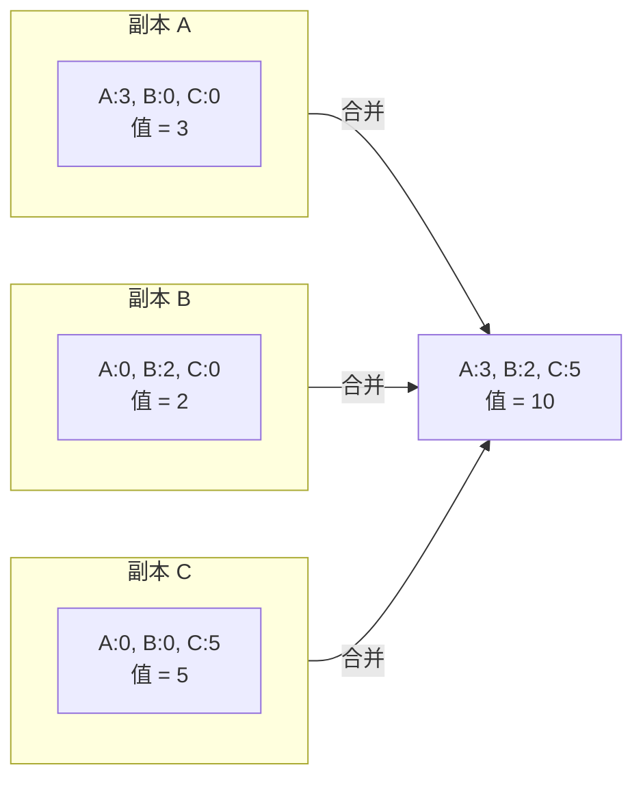
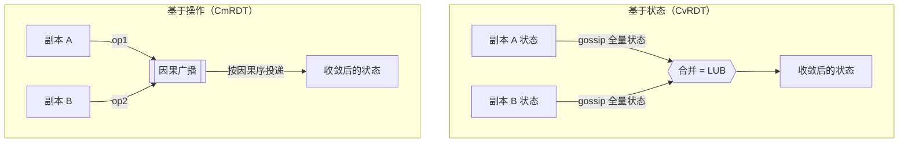
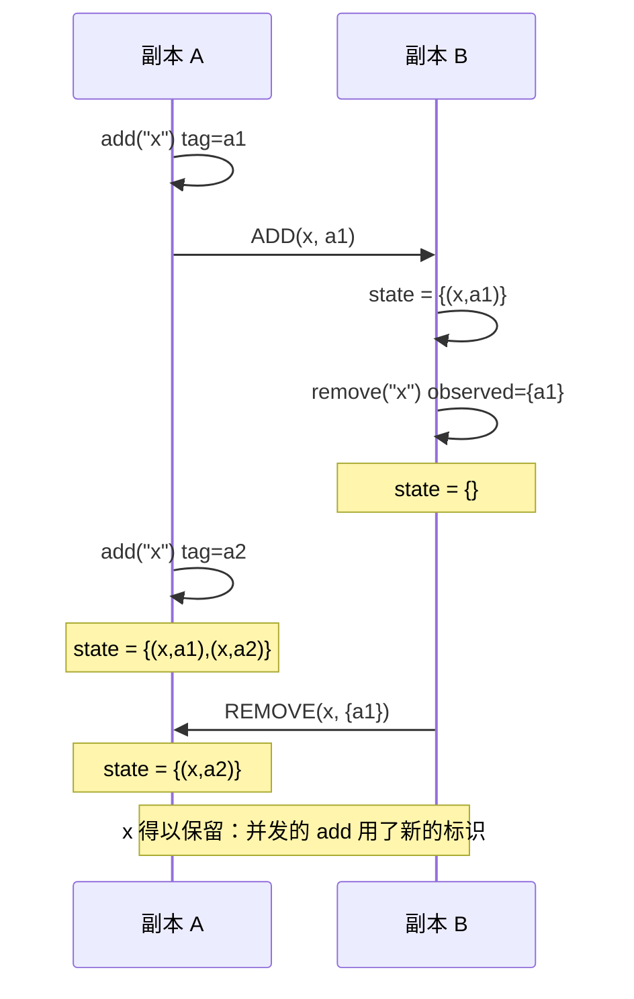
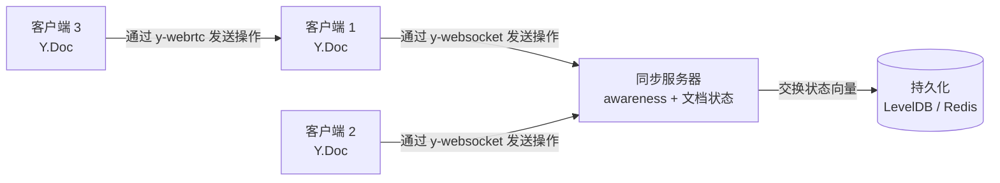

# CRDT：无冲突复制数据类型

> **TL;DR**：CRDT 是一种数据结构，它的多个副本可以在不同节点上并发更新、彼此不协调，而数学上保证所有更新送达后必然收敛。这个性质叫强最终一致性（Strong Eventual Consistency，SEC）[^1]。基于状态的 CRDT（CvRDT）通过并半格（join-semilattice）合并完整状态；基于操作的 CRDT（CmRDT）在因果投递之上广播可交换的操作。CRDT 支撑着 Redis Enterprise Active-Active、Yjs（npm 周下载量约 400 万[^2]）和 Automerge；Figma 的多人协作引擎受 CRDT 启发，但用的是中心服务器排序事件的方案，并非真正的 CRDT[^3]。代价是：你要付出元数据开销、放弃顺序一致性，换来零协调下的可用性。

## 学习目标

学完本章，你将能够：

- [ ] 区分 CvRDT（基于状态）与 CmRDT（基于操作），并说明各自适用场景
- [ ] 从第一性原理实现 G-Counter、PN-Counter 和 OR-Set
- [ ] 为给定场景（计数器、集合、文本、JSON 文档）选对 CRDT
- [ ] 解释 CRDT 为什么不需要共识就能达到强最终一致性
- [ ] 认清代价：元数据膨胀、墓碑、垃圾回收的复杂度
- [ ] 说清 LWW-Register 为什么静默丢数据，以及什么时候要避开它

## 直觉理解

想象两个会计在相距很远的城市，各自为同一家公司记账。一整天里，两人独立记录交易。到了结账时间，他们打电话互相核对、合并账本。如果两人都遵守一条简单规则——“每个账户取余额较大的那个”，那么不用争论谁的条目在先，他们总能对最终状态达成一致。不需要协调者，不需要锁，不需要等待。

再想象一块协同白板。两个设计师同时画线。每笔画都有一个唯一 ID。笔画同步时，谁也不会擦掉对方，因为两者的标记不同。白板收敛到“两笔画都在”，压根没有冲突解决逻辑。

这就是 CRDT 的思路：把冲突解决嵌进数据结构本身，让副本按构造方式收敛。Raft 和 Paxos 付出延迟换取线性一致性，CRDT 则付出元数据、接受更弱的顺序，换取零协调下的可用性。这是与共识完全不同的一个体系。

## 原理

### 强最终一致性（SEC）

普通的最终一致性只承诺副本会“最终”收敛，对“两个副本收到了同一批更新但顺序不同”会发生什么，只字不提。应用开发者只能自己写冲突解决逻辑，而这极易出错。

SEC 用一个安全性保证堵住了这个缺口：**任意两个已投递相同更新集合的副本，状态完全相同**[^1]。没有“最终”这种模糊限定，也不需要应用层写合并代码。数据类型自己搞定。

Shapiro、Preguica、Baquero 和 Zawirski 在 2011 年的 INRIA 研究报告里形式化了 SEC[^1]，并给出两个充分条件：

1. **基于状态（CvRDT）：** 副本交换完整状态，用一个可交换、可结合、幂等的 join 合并，这个 join 构成并半格。每次更新都让状态在半格中单调上移。
2. **基于操作（CmRDT）：** 副本通过可靠的因果投递广播操作，且并发操作之间可交换。

两种形式都能在没有共识的前提下达到 SEC。副本在任意网络分区下都保持可用，对应 CAP 里的 AP[^4]。

### 基于状态的 CRDT（CvRDT）

CvRDT 的副本持有一个格值 S。更新让 S 上移。合并取两个状态的最小上界（least upper bound，LUB）。由于合并可交换、可结合、幂等，无论消息顺序如何、重复多少次、合并了多少回，副本都会收敛。

**G-Counter（只增计数器）：** 一个由各副本单调整数组成的向量。每个副本只递增自己那一格，取值是所有格之和，合并取逐元素最大值（elementwise max）[^1]。

```python
# G-Counter：最经典的基于状态 CRDT
state = {}  # map<replica_id, int>，全部从 0 开始

def value(s):
    return sum(s.values())

def increment(s, me):
    s[me] = s.get(me, 0) + 1

def merge(a, b):
    return {r: max(a.get(r, 0), b.get(r, 0))
            for r in set(a) | set(b)}
```



*三个副本各自独立递增；合并取逐元素最大值，全局值是合并后向量的总和。*

**PN-Counter：** 一对 G-Counter (P, N)。递增记到 P，递减记到 N。值 = sum(P) - sum(N)。合并时对两半分别套用 G-Counter 的合并[^1]。

**G-Set：** 只增集合。合并 = 并集。只能加，永远不能删。

**2P-Set：** 在增集合之外再加一个墓碑集合表示删除。元素一旦删除就不能再加回来——这个限制正是 OR-Set 出现的动机。

**OR-Set（Observed-Remove Set，观察到才删除的集合）：** 每次 add 都给元素打一个唯一标识。remove 只删掉删除方自己观察到的那些标识。另一副本上并发的 add 用的是新标识，因此能存活下来[^1]。

> [!TIP]
> 如果你能想明白为什么 G-Counter 的合并（逐元素取最大）构成一个并半格，那这个家族里的其他成员都只是同一个想法的变体：找一个可交换、可结合、幂等的合并函数。

**基于状态的 CRDT 的权衡：**

- 优点：可以跑在任何传输之上（gossip、TCP、带重试的 UDP）。重复和乱序都无害。
- 缺点：副本变大之后，传完整状态很贵。增量状态 CRDT（Delta-state CRDT，Almeida、Shoker、Baquero，2018）只传仍然构成半格的增量 delta 来解决这个问题[^5]。

### 基于操作的 CRDT（CmRDT）

CmRDT 不传状态，而是广播操作。中间件按因果序投递操作，至少一次，且每个副本恰好一次。由于并发操作可交换，那些没有因果关系的操作对之间的投递顺序无关紧要[^1]。



*基于状态的方案在任何传输上传递完整状态；基于操作的方案在因果广播通道上传递单个操作。*

**基于操作的 OR-Set：** 每次 `add(e)` 生成一个唯一标识。`remove(e)` 只广播删除方观察到的标识。带新标识的并发 add 永远不会被抹掉。



*并发的 add 用的是新标识，因此之前的 remove 抹不掉它——这就是 OR-Set 能无损收敛的原因。*

**基于操作的 CRDT 的权衡：**

- 优点：每次更新的带宽低（几十字节，对比完整状态）。细粒度的编辑历史支持撤销和时间旅行[^6][^7]。
- 缺点：需要可靠的因果广播。实践中这意味着要有一个 backplane（Redis Streams、Kafka、自研的 WebSocket 扇出，或点对点协议）。

### 文本与富文本协作

协同文本编辑是 CRDT 里最难的问题。每个字符都需要一个稳定标识，这样同一位置上的并发插入才能收敛。这个领域经历了好几代演进：

- **WOOT**（Oster 等，2006）：第一个文本 CRDT。字符带前驱/后继指针[^8]。
- **Logoot**（Weiss、Urso、Molli，2009）：变长位置向量。在并发的前缀插入上会出现交错异常[^9]。
- **RGA**（Roh 等，2011）：一棵因果树，每次插入引用一个已存在的字符 ID。Automerge 用的就是 RGA[^10]。
- **YATA**（Jahns，2016）：Yjs 背后的算法。与 RGA 相似，但并发插入的打破平局规则不同。Jahns 发现平坦列表加插入排序的实现比树结构快得多[^10][^6]。
- **Peritext**（Litt、Lim、Kleppmann、van Hardenberg，2022）：一种富文本 CRDT，把格式区间（粗体、斜体、链接）锚定到字符操作 ID 而不是易变的索引上，因此并发的格式化和编辑能在保留意图的前提下合并[^11]。

不同实现之间的性能差距大得吓人。在 B4 基准上（259,778 次操作，最终 104,852 个字符）[^12]：

| 库 | 应用耗时 | 编码后大小 | 备注 |
|---------|-----------|-------------|-------|
| Yjs 13.6 | 5,714 ms | 159,929 bytes | 约每字符 1.5 字节 |
| Automerge 2.1 | 14,326 ms | 129,116 bytes | Rust + WASM |
| Automerge 0.14 | ~500,000 ms | ~146 MB | 纯 JS，重写前（磁盘格式）[^7] |
| Diamond（Rust） | 56 ms | - | 比 Automerge 1.0 快 5,196 倍[^10] |

> [!IMPORTANT]
> 不要自己发明文本 CRDT。Peritext 论文显示，即便是 Notion 在 Peritext 之前的实现，也会丢弃两个并发段落编辑中的一个[^11]。用 Yjs 或 Automerge。

### CRDT 的代价与陷阱

CRDT 不是免费的。元数据成本是最主要的工程挑战：

**墓碑与标识符。** OR-Set、RGA 和文本 CRDT 会永久保留标识符（往往还有完整操作），好让迟到的 remove 知道自己该删什么。在 B4 轨迹上，Automerge 0.14 每次按键的峰值内存约 4 KB[^7]。Automerge 2.0 通过列式压缩把磁盘编码体积缩小了 1,135 倍[^7]。Automerge 3.0 又把运行时内存普遍压低了 10 倍以上，某些场景降得更多（粘贴《白鲸》Moby Dick：1.3 MB vs 2.0 的 700 MB，约 538 倍）[^13]。

**垃圾回收。** 只有当操作“因果稳定”时，才能丢掉它的元数据，也就是所有副本都见过它。判断因果稳定需要知道有哪些副本存在、各自收到了什么。在成员开放的系统里，这并不简单。

**LWW-Register：吃掉你数据的 CRDT。** LWW 给每次写入附一个时间戳，合并时保留最大的那个。两个并发写？其中一个被静默丢弃。时钟偏移甚至可能把“真实”顺序颠倒过来。Kleppmann 的 local-first 文章警告说，LWW 在并发写之下会静默丢数据[^4]。

**增量状态 CRDT**（Almeida、Shoker、Baquero，2018）给出折中方案：只传仍在半格里的增量 delta，于是既有接近基于操作的带宽，又保留基于状态的传输容忍度[^5]。Akka Distributed Data 在生产中用的就是这个方案。

## 真实案例

**Yjs：AFFiNE、Evernote、GitBook 和 Tiptap 背后的 CRDT 引擎。**

Yjs 是一个 JavaScript CRDT 库，截至 2026 年 5 月，npm 周下载量超过 4,000,000 次[^2]。它为 AFFiNE、Evernote、GitBook、Tiptap、Huly、Cargo、JupyterLab、Proton Docs 以及几十个其他产品提供协同编辑能力[^2][^14]。（相比之下，Notion 用的是自研的块级冲突解决系统，不是 Yjs。）

这套架构看起来简单得有点骗人。Yjs 把文档存成一个平坦的 item 列表。每个 item 是 `(content, id=[clientID, clock], originLeft, originRight, deleted?)`。插入时，Yjs 找到 origin item，用 YATA 冲突规则向前扫描，然后把新 item 拼接进去[^10]。

让它快的技巧是**游程编码（run-length encoding）**。粘贴 1,000 个字符会变成一个长度为 1,000 的 item，而不是 1,000 个 item。再加上一个“最近编辑位置”的内存缓存，常见情况（“用户一直在打字”）就变成 O(1)。为了达到这些性能数字，Kevin Jahns“把 Yjs 的部分代码写了又重写了 12 遍”[^10]。

Yjs 提供共享类型（Y.Map、Y.Array、Y.Text、Y.XmlFragment），并且与网络无关：连接提供方（y-websocket、y-webrtc、y-redis）负责同步，不强制要求有服务器。删除操作存成压缩位图而不是逐条 item 的墓碑，使“插入之后又删掉同一段字符串”的文档大小保持在 38 字节[^12]。

结果是：在 B4 学术论文编辑轨迹上，Yjs 用 159,929 字节编码了 104,852 个最终字符，大约每字符 1.52 字节[^12]。整个库 gzip 后约 20 KB。对比 Automerge 0.14，同一文档的磁盘编码是 146,406,415 字节（约 146 MB），约 915 倍的大小差距，正是 Automerge 彻底重写的动因[^7]。



*Yjs 客户端通过可插拔的 provider 同步；服务器持有文档状态，用于持久化和后加入的客户端，但 CRDT 合并是在每个副本上独立发生的。*

## 权衡

### 实现风格

| 方案 | 优点 | 缺点 | 适用场景 | 我们的选择 |
|----------|------|------|-----------|----------|
| CvRDT（基于状态） | 能跑在任何传输上；重复无害 | 每次合并都传完整状态，对大结构很贵 | 状态小、用 gossip 协议 | 先从它开始，图个简单 |
| CmRDT（基于操作） | 每次更新带宽低；有细粒度历史 | 依赖可靠的因果广播基础设施 | 已有 backplane（Redis Streams、Kafka） | 带宽敏感时用 |
| 增量状态（Delta-state） | 消息小，还能容忍不可靠传输 | 缓冲和 ack 逻辑复杂 | 副本状态大、网络有丢包 | 基于状态撞到带宽上限后的进阶优化 |

### 为你的数据挑选 CRDT

| 数据类型 | CRDT | 优点 | 缺点 | 我们的选择 |
|-----------|------|------|------|----------|
| 计数器 | PN-Counter | 无需协调即可增减 | 每个计数器的元数据是 O(副本数) | 多写计数器的默认选择 |
| 集合（增/删/再增） | OR-Set | 直观；并发 add 能在并发 remove 下存活 | 墓碑需要在因果稳定前提下做 GC | 集合的默认选择 |
| 寄存器（单值） | MV-Register（多值） | 把并发写保留为兄弟值，交给应用解决 | 应用必须处理兄弟值 | 丢失并发写不可接受时 |
| 富文本 / 文档 | RGA（Automerge）或 YATA（Yjs） | 大规模富文本协作经过验证；字符级合并 | 内部复杂；自研实现容易踩已知异常（Logoot 交错、Peritext 之前的格式 bug） | 要性能用 Yjs，要历史用 Automerge；别自己造 |

## 常见陷阱

> [!WARNING]
> **最后写入者胜会静默丢弃并发写。** LWW-Register 给每次写入附一个时间戳，合并时保留最大的那个。两个副本在复制窗口内接受对同一个键的写入，只有一个时间戳胜出的写会留下，另一个被丢弃，用户端没有任何提示（[Shapiro 等，2011](https://inria.hal.science/inria-00555588/document)；[Kleppmann，“Local-first software,” 2019](https://www.inkandswitch.com/essay/local-first/)）。节点之间的墙上时钟偏移甚至能把“真实”顺序颠倒过来。对于协作文档、共享文件、购物车，以及任何丢失写入会造成后果的场景，请改用 OR-Set、能保留兄弟值的 MV-Register，或者 RGA/Yjs/Automerge 文档。只有像 `last_seen_at` 或临时在线状态这类真正无关紧要的字段，才可以接受 LWW。

> [!WARNING]
> **自己造文本 CRDT。** Logoot 在并发前缀插入上会交错。朴素的基于 Markdown 的富文本在粗体/斜体区间重叠时会崩。Peritext 论文证明了，连 Notion 在 Peritext 之前的实现都会丢弃并发段落编辑[^11]。用 Yjs 或 Automerge。

> [!WARNING]
> **留下墓碑却没有 GC 计划。** 长期被反复编辑的文档，即使当前可见状态很小，加载也会越来越慢。监控文档大小与最终内容大小的比值。健康的 Yjs 文档约为最终文本的 1.5 倍；Automerge 0.14 曾超过 1,000 倍[^12][^7]。

> [!WARNING]
> **上基于操作的 CRDT 却没有因果广播基础设施。** CmRDT 假设因果的、恰好一次投递。不带去重的裸 pub/sub 是不够的。用能提供因果序的 broker（Kafka，每个文档一个分区），或者给操作用版本向量打戳，以便去重和缓冲。

> [!WARNING]
> **朴素的元数据开销（数据大小的 10 到 100 倍）。** 在朴素实现里，每次按键都是一条永久记录。对连续插入做游程编码（Yjs），用列式二进制格式（Automerge 2.0+），并回收因果稳定的条目。

> [!WARNING]
> **给 LWW 混用跨副本的墙上时钟时间戳。** 跨地域几十毫秒的 NTP 偏移很容易出现。打破平局要用混合逻辑时钟（HLC），不要用墙上时钟时间戳。更好的做法是：多地域多写键干脆别用 LWW。

## 练习

**为一个可离线工作的协同待办应用设计状态层。** 用户可以新增、删除、重新添加任务，标记完成，编辑任务文本。所有变更在副本重新连上时必须干净合并。为每个字段（标题、完成标记、负责人、顺序）挑选 CRDT，并描述同步协议。

<details>
<summary>提示</summary>

先想清楚每个字段需要什么操作。任务标题是文本（一串字符）。完成标记是可以在两个方向翻转的布尔值。负责人是集合，元素可以加也可以删。任务顺序需要一个稳定、不会互相撞车的位置。任务列表本身需要支持增、删和再增。

</details>

<details>
<summary>解答</summary>

**顶层结构：** 一个以任务 ID 为键的 Y.Map（或 Automerge 文档）。

**任务列表成员关系：** OR-Set 语义。每个任务有一个客户端生成的唯一 ID。新增任务就是插入这个 ID；删除只删掉观察到的标识。重新添加会生成新标识，因此能扛住并发的删除。

**每个任务的字段：**

| 字段 | CRDT | 理由 |
|-------|------|-----------|
| `title` | RGA / Y.Text | 字符级合并；两个用户改不同词永远不会冲突 |
| `done` | LWW-Register（配 HLC） | 布尔开关；并发翻转很少见且无关紧要；最后一次翻转胜出 |
| `assignees` | OR-Set | 用户可以加也可以删；并发添加能在并发删除下存活 |
| `order` | 分数索引（Figma 式） | 每个任务存一个位于相邻任务之间的位置；无需重建索引 |

**同步协议：**

1. 每个客户端维护一个本地 Y.Doc（或 Automerge 文档）。
2. 编辑时，客户端先在本地应用操作（界面即时响应）。
3. 在线时，客户端通过 y-websocket 与服务器交换状态向量。
4. 服务器计算客户端状态向量与已存文档之间的 delta，把缺失的操作发过去。
5. 离线后重连时，同样是这套状态向量交换把客户端补齐。合并通过 CRDT 的 join 自动完成。

这个设计给出了离线优先的编辑能力，且收敛有保证。唯一可能“丢”数据的字段是 `done`（LWW），但勾选框这种操作无关紧要，接受最后写入者胜是可以的。

</details>

## 要点回顾

- CRDT 无需协调就能给出强最终一致性。这是与共识协议完全不同的一个体系。
- 基于状态的 CRDT（CvRDT）更容易落地，因为它不需要因果广播。基于操作的 CRDT（CmRDT）带宽效率高，但对基础设施要求更高。
- G-Counter（各副本计数器组成的向量，合并 = 逐元素取最大）是所有 CRDT 的心智模型：去找那个并半格。
- 不要自己造文本 CRDT。用 Yjs（性能优化，gzip 后 20 KB）或 Automerge（保留历史，类似 Git 的分支）。
- LWW-Register 是人们不小心就会用上的那个 CRDT，也正是并发写下静默丢数据的那个。
- 墓碑和元数据会无界增长，除非你按因果稳定规划好垃圾回收。
- 生产级 CRDT（Redis Enterprise Active-Active、Yjs、Automerge）把 CRDT 语义藏在熟悉的 API 背后。这套数学对应用开发者是不可见的。

## 延伸阅读

- [A comprehensive study of Convergent and Commutative Replicated Data Types](https://inria.hal.science/inria-00555588/document) - Shapiro 等（2011）。开山之作；读第 1 到 4 节，看 SEC 与 CvRDT/CmRDT 的对偶关系。
- [Local-first software: you own your data, in spite of the cloud](https://www.inkandswitch.com/essay/local-first/) - Kleppmann 等（2019）。把 CRDT 定位为后云时代协作基石的宣言。
- [5000x faster CRDTs: An Adventure in Optimization](https://josephg.com/blog/crdts-go-brrr/) - Seph Gentle（2021）。性能深潜，说明为什么实现比算法更重要；B4 基准就出自这里。
- [How Figma's multiplayer technology works](https://www.figma.com/blog/how-figmas-multiplayer-technology-works/) - Evan Wallace（2019）。最好的“我们看过 CRDT，然后造了个更简单的东西”式文章；讲清了什么时候需要完整 CRDT、什么时候不需要。
- [Peritext: A CRDT for Rich-Text Collaboration](https://www.inkandswitch.com/peritext/) - Litt 等（2022）。富文本 CRDT 的最前沿；解释了为什么格式合并比纯文本合并更难。
- [Introducing Automerge 2.0](https://automerge.org/blog/automerge-2/) - Ink & Switch（2023）。从纯 JS 走到 Rust + WASM 列式格式、性能提升 275 倍的历程。
- [Yjs documentation and CRDT benchmarks](https://github.com/dmonad/crdt-benchmarks) - Kevin Jahns。横向对比 CRDT 库的参考基准套件。
- [Data types for Active-Active databases](https://redis.io/docs/latest/operate/rs/databases/active-active/develop/data-types/) - Redis Enterprise 文档。把计数器、集合、有序集合和 JSON 的 CRDT 语义放在熟悉的 Redis 命令背后的生产实践。

## 记忆卡片

**Q：** 什么是强最终一致性（SEC）？
**A：** 任意两个已投递相同更新集合的副本，状态完全相同，且不需要协调。CRDT 通过可交换的合并操作实现 SEC。

**Q：** CRDT 有哪两大族？
**A：** 基于状态（CvRDT）：副本交换完整状态并通过并半格合并。基于操作（CmRDT）：副本在可靠因果投递之上广播可交换的操作。

**Q：** G-Counter 怎么工作？
**A：** 每个副本只递增向量中自己那一格。取值是所有格之和。合并取跨副本的逐元素最大值。这个操作可交换、可结合、幂等。

**Q：** OR-Set 为什么能在删除后重新添加元素？
**A：** 每次 add 给元素打一个唯一标识。remove 只删掉观察到的标识。另一副本上的并发 add 用的是这次 remove 从未见过的新标识，因此能存活。

**Q：** LWW-Register 为什么危险？
**A：** 它会静默丢弃两个并发写中的一个。时钟偏移能把“真实”顺序颠倒。它就是那个按设计丢数据的 CRDT。

**Q：** 增量状态 CRDT 解决了什么问题？
**A：** 它给出接近基于操作的带宽（消息小），同时保留接近基于状态的传输容忍度（不需要因果广播）。delta 仍在半格里，所以正确性不受损。

**Q：** 为什么不该自己写文本 CRDT？
**A：** 文本 CRDT 有微妙的交错异常（Logoot）、格式合并失败（Peritext 之前）、以及性能悬崖（Automerge 0.14 比优化过的实现慢 5,000 倍）。用 Yjs 或 Automerge。

**Q：** Yjs 怎么做到约每字符 1.5 字节的开销？
**A：** 对同一客户端的连续插入做游程编码，用压缩的删除集位图代替逐条 item 的墓碑，再加一个最近编辑位置缓存让常见插入变成 O(1)。

**Q：** 基于操作的 CRDT 需要什么基于状态的 CRDT 不需要的基础设施？
**A：** 可靠的因果广播：操作必须按因果序投递，至少一次，且每个副本恰好一次。这通常需要一个 backplane，比如 Kafka、Redis Streams 或自研的 WebSocket 扇出。

**Q：** 举三个使用 CRDT 语义的生产系统。
**A：** Redis Enterprise Active-Active（集合用 OR-Set，INCR 用 PN-Counter，字符串用 LWW）、Yjs（YATA 算法，支撑 AFFiNE、Evernote、GitBook、Tiptap），以及 Riak KV 2.0+（原生 counter、set、map、register、flag）。

**Q：** 什么是因果稳定，为什么它对 CRDT 垃圾回收重要？
**A：** 当所有副本都收到了某个操作，它就是因果稳定的。只有到那时，它的元数据（墓碑、标识符）才能安全丢弃。判断因果稳定需要知道有哪些副本存在、它们各自见过什么。

**Q：** Automerge 2.0 怎么做到相对 0.14 把磁盘体积缩小 1,135 倍？
**A：** 列式压缩：把同类型的字段（actor ID、计数器、键、值）跨所有操作分组到并行数组里，再用变长整数编码（LEB128）压缩每一列。

## 参考文献

[^1]: Shapiro、Preguica、Baquero、Zawirski.《A comprehensive study of Convergent and Commutative Replicated Data Types》. INRIA Research Report RR-7506，2011. https://inria.hal.science/inria-00555588/en（完整 PDF：https://hal.inria.fr/inria-00555588/document）
[^2]: “Yjs in the Wild”（用户列表）与 npm 周下载量（https://www.npmjs.com/package/yjs；API：https://api.npmjs.org/downloads/point/last-week/yjs 报告 2026-05-01 当周为 4,115,526）。https://docs.yjs.dev/yjs-in-the-wild
[^3]: Evan Wallace.《How Figma's multiplayer technology works》. Figma Blog，2019 年 10 月 16 日。Figma 只是“受 CRDT 启发”，明确不是真正的 CRDT：“Figma 并没有使用真正的 CRDT。CRDT 是为去中心化系统设计的……而 Figma 是集中式的，所以我们可以简化自己的系统。”https://www.figma.com/blog/how-figmas-multiplayer-technology-works/
[^4]: Kleppmann、Wiggins、van Hardenberg、McGranaghan.《Local-first software: you own your data, in spite of the cloud》. Onward! 2019. https://www.inkandswitch.com/essay/local-first/
[^5]: Almeida、Shoker、Baquero.《Delta State Replicated Data Types》. Journal of Parallel and Distributed Computing，第 111 卷，2018 年 1 月，第 162-173 页。arXiv:1603.01529. https://arxiv.org/abs/1603.01529
[^6]: Yjs 文档. https://docs.yjs.dev/
[^7]: Ink & Switch.《Introducing Automerge 2.0》. 2023 年 1 月. https://automerge.org/blog/automerge-2/
[^8]: Oster、Urso、Molli、Imine.“Data consistency for P2P collaborative editing”（WOOT）. CSCW 2006. https://dl.acm.org/doi/10.1145/1180875.1180916
[^9]: Weiss、Urso、Molli.“Logoot: A Scalable Optimistic Replication Algorithm for Collaborative Editing on P2P Networks”. ICDCS 2009. https://doi.org/10.1109/ICDCS.2009.75
[^10]: Seph Gentle.“5000x faster CRDTs: An Adventure in Optimization”. 2021 年 7 月 31 日. https://josephg.com/blog/crdts-go-brrr/
[^11]: Litt、Lim、Kleppmann、van Hardenberg.“Peritext: A CRDT for Rich-Text Collaboration”. Ink & Switch，2021 年 11 月；CSCW 2022. https://www.inkandswitch.com/peritext/
[^12]: Kevin Jahns (dmonad). CRDT 基准测试仓库（B1-B4、B4x100）. https://github.com/dmonad/crdt-benchmarks
[^13]: Ink & Switch.“Automerge 3.0”. 2025 年 7 月. https://automerge.org/blog/automerge-3/
[^14]: Yjs GitHub README（完整用户列表，含 AFFiNE、Evernote、GitBook、Tiptap、Huly、Cargo、JupyterLab、Proton Docs）. https://github.com/yjs/yjs
