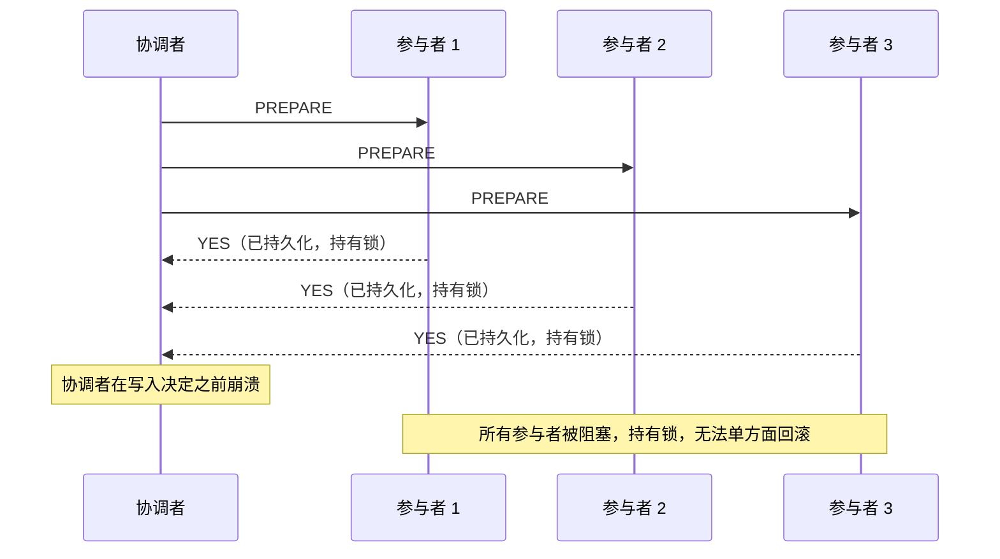
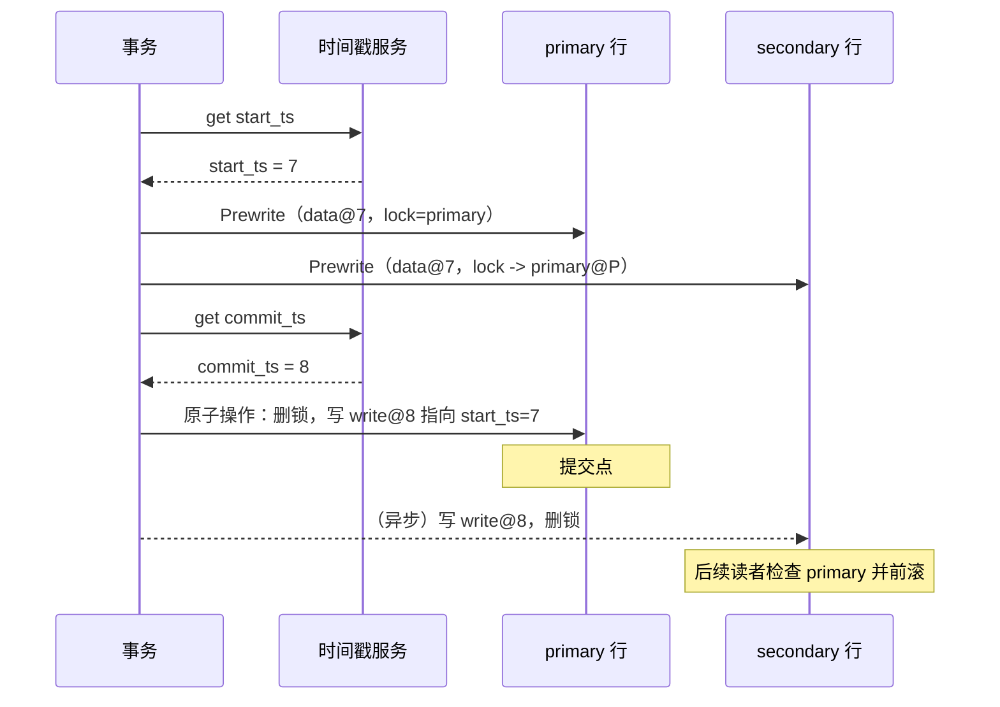
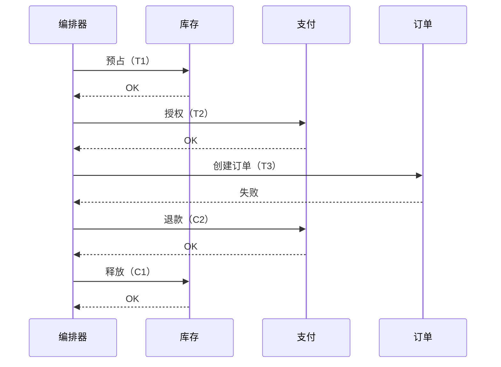
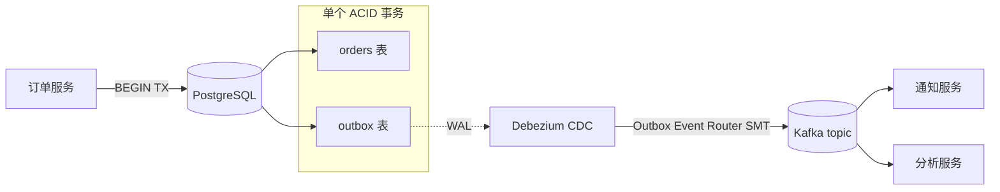

# 分布式事务：2PC、Saga，以及何时两者都别用

> **TL;DR**: 当一个业务动作要跨多个数据库或服务时，你需要在节点之间保证原子性。两阶段提交（2PC）能做到，但协调者故障时会阻塞。Percolator 和 Spanner 把 2PC 架在共识复制的状态之上，消除了阻塞问题，代价是跨地域延迟（Spanner 读写事务约 100 ms[^1]）。Saga 把大事务拆成一串本地 ACID 步骤，配以补偿动作，是分布式业务工作流的默认选择。outbox 模式不需要 XA 就解决了“原子地写库 + 发事件”的问题。大多数分布式事务难题在幂等性 + 最终一致性 + 用户可见的对账机制下自然消解。如果这一章你只带走一件事：先考虑 outbox 和 saga，2PC 放最后。

## 学习目标

学完本模块，你将能够：

- [ ] 走一遍 2PC，指出它阻塞式的失败模式
- [ ] 描述 Percolator 如何跨分片实现快照隔离
- [ ] 解释 Spanner 和 CockroachDB 如何借共识让 2PC 不再阻塞
- [ ] 为每个步骤设计带补偿动作的 saga
- [ ] 实现事务性 outbox 模式，让状态变更与事件发布原子化
- [ ] 判断自己究竟需要分布式事务，还是最终一致性就够

## 直觉理解

你正在办房屋过户。买家、卖家、银行和产权公司各自都有文件要签。谁都不愿意第一个签——万一其他方反悔，自己就卡在那儿了。于是每个人先签好自己的文件，交给一个第三方托管代理（escrow agent）。代理保管所有签名。只有当每一方都签完，代理才把所有文件同时释放出去。只要有任一方拒签，代理就把全部文件退回，交易作废。

这就是两阶段提交。托管代理是协调者。“签字并交付”是准备阶段。“同时释放”是提交。问题在于：如果代理收齐了所有签名、还没释放就心脏病发作，所有人都卡在半空，既拿不到东西，也没法退出。

再换个场景。你和三个朋友分摊一顿饭钱。每人各自刷自己的卡。有人卡被拒，那个人就付现金或者事后转账。这里没有一个中心协调者攥着全部东西。每笔支付都是一个本地事务。出了问题就补偿（退款、重试、事后结清）。这就是 saga：一串相互独立的本地事务，失败时执行补偿。

本章剩下的部分会把这两种模式讲清楚，给你看现代变体，并论证大多数时候你该用餐馆那一套，而不是托管代理那一套。

## 原理

### 问题所在

分布式事务要求：一个跨越 N 个独立资源管理器的单一逻辑操作，必须在所有地方提交，或者都不提交，而且要顶住并发访问、部分失败和异步网络[^2]。

经典例子：从分片 1 上的账户 A 转 100 美元到分片 2 上的账户 B。钱已经离开 A、但还没到 B 的中间状态，绝不能持久化，也绝不能被观察到。跨节点保持原子性之所以难，是因为参与者一旦把自己的变更持久化准备好，万一协调者消失了，它在本地就没有任何安全的动作可做[^2][^3]。

### 两阶段提交

这个协议有两个阶段[^2]：

1. **准备（Prepare）。** 协调者向所有参与者发送 PREPARE。每个参与者把变更持久化写入日志、获取锁，然后投 YES（可提交）或 NO。
2. **提交/回滚（Commit/Abort）。** 如果所有参与者都投 YES，协调者记录 COMMIT 并广播；否则广播 ABORT。参与者按决定执行，释放锁。

The Open Group 的 XA 规范定义了事务管理器与资源管理器之间的标准接口（xa_start、xa_prepare、xa_commit、xa_rollback）[^4]。所有主流关系型数据库和消息中间件都实现了它。

**阻塞问题。** 参与者一旦投出 YES，就交出了单方面回滚的权利。如果协调者在收齐所有 YES 之后、写入 COMMIT 之前崩溃，每个参与者都卡死：锁还握着，却没有权限前进或回滚[^2][^3]。三阶段提交（Skeen）多加一轮来规避，但它假设消息延迟有界，在网络分区下并不安全。生产环境里没人跑 3PC。

*协调者收齐 PREPARE 的 YES 票之后崩溃，参与者停在已准备状态，锁被无限期持有。*

现代解法是 Gray 和 Lamport 的 **Paxos Commit**（2004 年技术报告；ACM TODS 2006）：用共识复制协调者的状态，这样任意多数派都能恢复出结果[^3]。Spanner 和 CockroachDB 干的正是这件事。

### Percolator：跨 Bigtable 的快照隔离

Google 的 Percolator（OSDI 2010）在 Bigtable 之上，用每单元格一把锁加一个中心化的时间戳服务（timestamp oracle），叠出了 ACID 快照隔离事务[^5]。

每个逻辑列存成三个 Bigtable 列：`data`（带时间戳的值）、`lock`（未提交的锁）、`write`（已提交的写指针）。事务先从 oracle 拿一个 `start_ts`，预写所有单元格（写入数据并加锁），指定其中一把锁为 **primary**，然后拿 `commit_ts`，原子地把 primary 锁替换成写指针。primary 行上这一次原子写就是提交点[^5][^6]。

次级锁（secondary lock）是惰性解析的：之后任何读到陈旧锁的读者都会去查 primary。primary 已提交就前滚（roll forward），否则回滚。这意味着恢复过程不需要中心事务管理器。

*从“primary 锁”到“primary 写”的这一次原子切换就是唯一的提交点；次级记录留给后续读者惰性解析。*

时间戳 oracle 靠批处理在单机上每秒发出约 200 万个时间戳[^5]。相比它替换掉的 MapReduce 系统，Percolator 把 Google 搜索索引里的平均文档年龄降低了 50%，文档到索引的中位延迟改善约 100 倍[^5][^7]。

**权衡：** Percolator 有意接受锁清理带来的数十秒级长尾延迟。对网页索引可以接受，对 OLTP 不可接受。它提供的是快照隔离而不是可串行化，所以写偏斜（write skew）是可能的[^5][^6]。

### Spanner 与 CockroachDB：架在共识组之上的 2PC

Google Spanner（OSDI 2012）在 Paxos 复制的 tablet 组之间跑 2PC[^1]。每个 tablet 都是一个横跨多个数据中心的 Paxos 组。读写事务在每个涉及的 tablet leader 上取锁，挑一个组作为 2PC 协调者，然后跑协议，其中每一次 PREPARE 和 DECISION 都是 Paxos 复制的日志条目。协调者自己就是一个共识组，所以它不可能阻塞[^1][^3]。

Spanner 用 TrueTime API（每个数据中心配 GPS 接收机 + 原子钟）分配全局有意义的提交时间戳。横跨美国的读写事务约 100 ms。只读事务完全跳过锁和 2PC，从本地副本读，快约 10 倍[^1][^8]。

**CockroachDB 的 Parallel Commits**（19.2，2019 年 11 月）把两轮串行 Raft 压成一轮[^9]。关键洞察是：当事务记录处于 STAGING 状态、且它所有在途的 intent 写入都已通过 Raft 提交时，这个事务就算隐式提交了。协调者把 STAGING 记录的写入与 intent 写入并行流水线化，于是客户端只需一轮共识就能看到确认，而不是两轮。TPC-C 基准显示，启用 Parallel Commits 时事务延迟按 1 倍节点间 RTT 增长，不启用则是 2 倍 RTT[^9]。该协议已在 TLA+ 中形式化验证[^9]。

**TiDB** 直接继承 Percolator 协议，把它跑在 TiKV（Raft 复制的键值存储）之上。TiDB Cloud 在 Sysbench 负载上的目标是 P95 事务延迟小于 105 ms[^10][^6]。

### Saga：用补偿动作代替分布式锁

一条 saga（Garcia-Molina 与 Salem，SIGMOD 1987）把长事务建模成一串本地 ACID 事务 T1..Tn，每个都配一个在语义上撤销 Ti 的补偿事务 Ci[^11][^12]。如果第 k 步失败，编排器逆序执行 C(k-1)..C1。

协调风格有两种[^13]：

- **编排式 saga（orchestrated）。** 中心编排器（状态机）按顺序给每个服务发命令，等回复，失败时驱动补偿。实现有：Temporal（累计 9.1 万亿次 action，峰值 150,000+ action/秒[^14]）、AWS Step Functions（Express Workflows 宣称可达 100,000 次状态转换/秒[^15]；当前服务配额把 Express 的 StateTransition 桶列为 Unlimited[^16]）、Netflix Conductor（据称首年跑了 260 万+ 流程[^17]）。
- **协同式 saga（choreographed）。** 每个服务订阅其他服务的事件，收到触发就跑自己的本地事务，再发出自己的事件。没有中心流程负责人。适合 2-3 步的流程；再长就不可观测了。

**Saga 缺了 ACID 里的“I”。** 这是最需要理解的一点。在 T1 和 T2 之间，另一个并发 saga 能看到中间状态。你在生产环境碰到的每一个 saga bug 都是隔离性 bug[^13]。对策依业务而定：语义锁（预占行）、可交换更新（用增量代替读后写）、悲观视图（在用户查询里滤掉“pending”状态）。

*T3 失败；编排器逆序执行 C2 和 C1，把语义一致性恢复回来。*

### outbox 模式

问题：你的服务先写数据库，再往 Kafka 发事件。如果进程在 DB 提交和 Kafka 发布之间崩溃，事件就丢了。如果先发事件而 DB 写失败，你就凭空多出一个事件。

解法：把事件写进 `outbox` 表，与业务写放在同一个本地 ACID 事务里。再由一个独立的 relay 进程把 outbox 行投递给消息中间件[^18][^19]。

relay 有两种风格：

- **轮询发布（polling publisher）：** 周期性 SELECT 未发送的行并发布。简单，但会增加延迟。
- **CDC（变更数据捕获）：** 用 Debezium 或 Maxwell 追数据库的预写日志。往 outbox 表的 INSERT 自动变成消息中间件里的消息。延迟更低，并且保留按聚合的先后顺序[^19]。

*一个本地 ACID 事务同时写入业务行和 outbox 行；Debezium 追 WAL 并发布到 Kafka，在不用 XA 的前提下做到至少一次的事件投递。*

因为 CDC 投递是至少一次，消费者必须幂等。在本地表里记录已处理的事件 ID（INSERT ... ON CONFLICT DO NOTHING）。这部分在[幂等性与恰好一次](./07-idempotency-exactly-once.md)里有深入讨论。

outbox 模式并不光鲜。但它是“原子地写库 + 发事件”这个问题的诚实答案。如果这一章你只带走一件事，就该是这个模式。

### 什么时候你不需要分布式事务

Pat Helland 的《Life Beyond Distributed Transactions》（CIDR 2007）主张：为近乎无界的规模而设计的系统，应当彻底拒绝分布式事务[^20][^21]。ACID 活在一个实体内部（一个用户、一个订单、一个账户）。所有跨实体交互都基于消息、幂等、最终一致。

落到实处就是：

- **转账** 是账本追加模式。每个账户是自己的实体。一次转账是两条只追加的账本记录，用一个 transfer ID 关联，外加点一个校验金额守恒的对账任务[^20]。
- **库存预占** 是一条 saga：预占、扣款、履约。扣款失败就释放预占。
- **“机票 + 酒店 + 租车”** 是带显式取消流程的 saga。跨三家旅行供应商的 2PC 既不存在，也不可能存在。
- **分析管道** 用以事件 ID 为键的幂等写，加上最终一致性。

设计成本是真实的：幂等键、补偿、对账、用户可见的恢复流程，都是额外的工程量。但另一条路（跨服务的分布式锁）在规模上更糟，因为任何一个参与者失败都会拖住提交，而系统越大，任何时候被卡住的概率越高[^21]。

## 真实案例

### Temporal：万亿级动作规模下的持久化执行

Temporal 是一个持久化执行（durable execution）编排器，源自 Uber 的 Cadence（2016），2019 年由它的原作者们 fork 出来[^22]。截至 2026 年 2 月，Temporal Cloud 累计处理了 9.1 万亿次 action 执行，峰值吞吐超过 150,000 action/秒[^14]。生产用户包括 OpenAI、ADP、Yum! Brands 和 Block。

**怎么工作的。** Workflow 是持久化执行的代码（Go、Java、TypeScript、Python）。每一次非确定性操作（activity 调用、定时器、signal）的调用都记进持久化的事件历史。如果 worker 崩溃，替补者会重放事件历史重建本地状态，从最后记录的决策处继续[^22]。Activity 是调用外部系统的那些步骤（写库、RPC、支付）；它们必须幂等，因为 Temporal 在超时时按至少一次重试。

**在 Temporal 里做 saga 编排**很自然：workflow 代码就是对步骤的 for 循环，加一个 try/catch，失败时逆序跑补偿。跟 JSON DSL 那类编排器（Step Functions、Conductor）不一样，分支、循环、sleep 都用宿主语言表达。权衡是：Step Functions 给你可视化状态机和 1 年的执行持久性，还有面向高吞吐的 5 分钟 Express 模式；Temporal 给你代码级的表达力和无上限的执行时长，但需要你自己跑（或付费使用）Temporal 服务端基础设施。

**非确定性陷阱。** Temporal 要求 workflow 在 SDK 的 `workflow.Now()` 和 activity 调用之外保持确定性。如果 workflow 代码直接读 `time.Now()` 或者随机数，重放就会偏离，workflow 以 NonDeterministicError 失败[^22]。这是团队采用 Temporal 时最常见的生产陷阱。

## 权衡

下面这几行分成两组：**协调机制**（Percolator/Spanner 式的共识之上 2PC、编排式 saga、协同式 saga）是同一个业务动作的可替代选项。**outbox 模式** 和 **绕开问题** 是互补的：outbox 与任何“写库 + 发事件”的 saga 并存，而“绕开问题”是你在挑任何方案之前该先回答的元问题。

| 方案 | 优点 | 缺点 | 适用场景 | 我们的选择 |
|---|---|---|---|---|
| Percolator / Spanner 2PC | 协调者不阻塞；外部一致；无锁读 | 跨地域延迟（约 100 ms）；需要共识基础设施 | 全球数据库；多地域 OLTP | 用 Spanner/CockroachDB/TiDB |
| 编排式 saga | 流程清晰；可观测；自带重试；支持长事务 | 编排器成为基础设施依赖；没有隔离性 | 复杂业务工作流（结算、开户、理赔） | **多数团队的默认选择** |
| 协同式 saga | 没有中心协调者；松耦合 | 超过 3 步就不可观测；难调试 | 小型、松耦合的 2-3 服务流程 | 事件图已经稳定的小型 2-3 步流程 |
| outbox 模式（互补） | DB 与事件发布原子化；不用 XA；保留顺序 | 至少一次（消费者必须幂等）；relay 运维开销 | 每个写库又发事件的 event-driven 服务 | **凡发布事件的 saga 步骤都要配上** |
| 绕开问题 | 最简单；最快；可用性最高 | 需要建模投入；有隔离性异常 | 多数“分布式事务”场景；按实体 ACID 就够 | 从这里开始。先问“我是否真的需要跨这些服务的原子性？” |

## 常见陷阱

> [!WARNING]
> **经典 2PC（XA）在协调者故障时阻塞。** 已经投了 YES 的参与者把变更持久化准备好并持有锁，无法单方面回滚。如果协调者在收齐投票之后、广播 COMMIT 之前崩溃，每个参与者都会无限期被锁住（[Gray and Lamport, ACM TODS 2006](https://www.microsoft.com/en-us/research/publication/consensus-on-transaction-commit/)；[Dynamo, SOSP 2007](https://www.allthingsdistributed.com/files/amazon-dynamo-sosp2007.pdf)）。跨 WAN 时，经典 XA 的提交延迟很容易超过每事务 200 ms，而一个慢参与者会拖住所有其他人。如果你觉得自己需要 2PC，就从替代方案里挑一个：Spanner/CockroachDB/TiDB 把 2PC 架在共识上，协调者不会阻塞；编排式 saga 用补偿动作取代锁；outbox 模式在不用 XA 的前提下处理 DB + broker 的场景。只有在一个数据中心内、两个可靠的资源管理器、并且运维团队本来就在跑 XA 时，才去碰经典 XA。

> [!WARNING]
> **补偿动作并没有在语义上撤销。** saga 的一步提交后就对外可见了（钱扣了，邮件发了）。如果这一步的补偿从未实现、或者本身是坏的，系统就停在不一致状态：客户被扣款，订单从未创建。要求每个正向步骤的 PR 都附带它的补偿，并把它当一等公民来测[^23]。

> [!WARNING]
> **没有账本的协同式 saga 根本无法调试。** 没有中心编排器时，saga 进度的唯一记录散落在各服务的日志和事件流里。当 6 步中的第 4 步静默失败，没人知道这条 saga 卡住了。协同式只用于 2-3 步的流程，或者加一个 saga 状态投影，把事件聚合成可查询的视图。

> [!WARNING]
> **outbox relay 没有退避，把 Kafka 往死里打。** 如果 CDC connector 卡住后猛烈重启，它可能用重复发布淹没 broker，或者用连接抖动把它压垮。监控 Debezium 的 `MilliSecondsBehindSource` 指标；滞后超过 SLO 就告警；WAL 保留时间要长于最坏情况下的 relay 停机时长[^19]。

> [!WARNING]
> **saga 补偿里忘了幂等。** 编排器在超时后会重试补偿。一个不幂等的补偿（比如不检查是否已退过款就直接再退一次）会让退款翻倍。每个补偿都必须幂等：先查再做、用幂等键、按至少一次执行来设计。

## 练习

为一个电商网站设计结算流程：预占库存（库存服务）、授权支付（支付服务）、创建订单（订单服务）、发出物流事件。选择编排式还是协同式 saga，为每一步定义补偿，并描述当库存在预占之后支付授权超时会发生什么。

提示

想一想可观测性：4 个步骤、3 条补偿路径，没有中心协调者你能调试一条卡住的流程吗？再想想“支付超时”意味着什么：这笔钱到底扣了没有？你的补偿必须处理这个模糊状态。

参考答案

**选择：编排式 saga。** 四个步骤、三条可能的补偿路径，对协同式来说太复杂。你需要一个地方能查“这笔结算现在处于什么状态”，并能确定性地驱动重试和补偿。

**步骤与补偿：**

| 步骤 | 正向动作（Ti） | 补偿（Ci） |
|---|---|---|
| T1 | 预占库存（可用量减一，预占量加一） | C1：释放预占（预占量减一，可用量加一） |
| T2 | 授权支付（在卡上冻结资金） | C2：撤销授权（解冻资金） |
| T3 | 创建订单（写订单记录，status=CONFIRMED） | C3：取消订单（status=CANCELLED，发出取消事件） |
| T4 | 发出物流事件（发布到履约队列） | 不需要补偿（下游幂等，并会检查订单状态） |

**支付超时的场景：**

1. T1（预占库存）成功。
2. T2（授权支付）超时。编排器不知道这次授权是成功还是失败。
3. 编排器向支付服务查询授权状态（用原始幂等键做幂等的状态查询）。
4. 如果授权成功：继续 T3。
5. 如果授权失败，或者重试 N 次后仍未确定：执行 C1（释放库存预占）。把这条 saga 记为 FAILED，原因 PAYMENT_TIMEOUT。
6. 支付服务必须支持幂等授权：如果 *** 同一个幂等键被重试，它返回原始结果，而不是再冻结一笔。

**关键洞察：** 模糊的超时是最难的情况。你没法对一笔自己都不确定是否扣款成功的支付做补偿。解法永远是“先查询，再决定”，而不是“假设一下然后盲目补偿”。这就是为什么每个 saga 步骤既需要一个幂等的正向动作，也需要一个幂等的状态查询端点。

**实现：** 用 Temporal 写一个 workflow，循环遍历步骤，捕获 ActivityFailure，逆序执行补偿。workflow 的持久化事件历史给了你完整的可观测性，不用自己搭一张 saga 状态表。

## 要点回顾

- 2PC 是能用的、也是正确的，但它会阻塞、而且慢。只有当 saga 不可接受、且两个参与者都在同一个数据中心时，才去考虑它。
- Percolator 式的 2PC 架在共识复制的存储之上，全球数据库（Spanner、CockroachDB、TiDB）正是靠这一招做到不阻塞的跨分片原子性。
- CockroachDB 的 Parallel Commits 把事务记录的写入与 intent 写入流水线化，把提交延迟减半（1 倍 RTT，而非 2 倍）[^9]。
- saga 是分布式业务工作流的默认选择。Temporal 这类编排器负责重试、超时和可见性。
- saga 没有隔离性。你在生产环境碰到的每一个 saga bug 都是隔离性 bug。按业务设计对策。
- outbox 模式不光鲜，但它是“原子地写库 + 发事件”的诚实答案。用 CDC（Debezium）做低延迟的 relay。
- 大多数分布式事务难题在幂等性 + 最终一致性 + 用户可见的对账机制下自然消解。先问“我是否真的需要跨这些服务的原子性？”答案通常是不需要。

## 延伸阅读

- [Consensus on Transaction Commit（Gray 与 Lamport，2004）](https://www.microsoft.com/en-us/research/publication/consensus-on-transaction-commit/)：把 2PC 重新表述成共识问题，并提出 Paxos Commit 这种不阻塞的协调者设计；这是 Spanner 方案的理论基础。
- [Percolator paper（Peng 与 Dabek，OSDI 2010）](https://research.google/pubs/large-scale-incremental-processing-using-distributed-transactions-and-notifications/)：Bigtable 之上做快照隔离 2PC 的权威出处；配合 TiKV 深度解析一起读，看现代实现。
- [Spanner: Google's Globally-Distributed Database（OSDI 2012）](https://www.usenix.org/conference/osdi12/technical-sessions/presentation/corbett)：在 Paxos 组之上用 TrueTime 做 2PC；这篇论文证明了全球规模下外部一致的分布式事务是可行的。
- [Parallel Commits（CockroachDB，2019）](https://www.cockroachlabs.com/blog/parallel-commits/)：靠 STAGING 事务记录做到 1 倍 RTT 提交，并有 TLA+ 验证；理解现代分布式数据库提交协议的必读。
- [Life Beyond Distributed Transactions（Helland，CIDR 2007）](https://paperswelove.org/papers/life-beyond-distributed-transactions-an-apostates--a2e1af4d/)：从哲学层面反对大规模使用分布式事务；用实体边界、消息和幂等作为替代方案。
- [Pattern: Saga（Chris Richardson）](https://microservices.io/patterns/data/saga.html)：编排与协同的对比、隔离性对策，以及微服务里的落地指导。
- [Reliable Microservices Data Exchange With the Outbox Pattern（Debezium）](https://debezium.io/blog/2019/02/19/reliable-microservices-data-exchange-with-the-outbox-pattern/)：用 Debezium CDC 和 Kafka 实现 outbox 模式的参考实现；含 Outbox Event Router SMT 的配置。
- [DDIA 第 7 章和第 9 章（Kleppmann）](https://dataintensive.net/)：关于分布式事务、共识和恰好一次语义最好读的教科书论述；与本章直接配套。

## 记忆卡片

**Q:** 经典 2PC 的根本问题是什么？
**A:** 它会阻塞。参与者投出 YES 之后就无法单方面回滚。如果协调者在广播决定之前崩溃，所有参与者无限期持锁，阻塞其他事务。

**Q:** Paxos Commit（Gray 与 Lamport）怎么解决 2PC 的阻塞问题？
**A:** 它用共识组复制协调者的状态。协调者的任意多数派副本都能恢复并广播决定，所以协调者故障不再阻塞参与者。

**Q:** Percolator 里唯一的提交点是什么？
**A:** primary 行上从“锁”到“写指针”的那一次原子切换。primary 的锁一旦被替换成写条目，事务就提交了。次级记录留给后续读者惰性解析。

**Q:** CockroachDB 的 Parallel Commits 怎么降低延迟？
**A:** 它引入了一个 STAGING 的事务记录状态。协调者把 STAGING 写入与 intent 写入并行流水线化，于是客户端在一轮共识（1 倍 RTT）后就看到确认，而不是两轮串行（2 倍 RTT）。

**Q:** “saga 缺了 ACID 里的 I”在实际中意味着什么？
**A:** 在 saga 步骤 Ti 和 T(i+1) 之间，另一个并发 saga 能看到中间状态。这会产生重复预订、库存为负之类的隔离性异常。对策（语义锁、可交换更新、悲观视图）依业务而定。

**Q:** 编排式 saga 和协同式 saga 有什么区别？
**A:** 编排式：中心协调者驱动流程、发命令、处理补偿。协同式：每个服务响应其他服务的事件，没有中心负责人。编排式可观测、可调试；协同式松耦合，但超过 2-3 步就很难推理。

**Q:** 事务性 outbox 模式解决什么问题？
**A:** 它解决“原子地写数据库并向 broker 发布事件”。把事件写进 outbox 表，与业务写放在同一个本地 ACID 事务里，再通过 CDC 转发出去，就消除了 DB 提交与 broker 发布之间的失败窗口，而且不需要 XA。

**Q:** 为什么 outbox 的消费者必须幂等？
**A:** 因为 CDC 投递是至少一次的。broker 重启、消费者重试、relay 重放都可能让消息重复。消费者必须记录已处理的事件 ID 并跳过重复。

**Q:** Pat Helland 在《Life Beyond Distributed Transactions》里的核心论点是什么？
**A:** 在近乎无界的规模下，ACID 应该活在一个实体内部（一个用户、一个订单）。所有跨实体交互都应该基于消息、幂等、最终一致。分布式事务与规模不搭，因为任何一个参与者失败都会拖住提交。

**Q:** 什么情况下你才真的该用 2PC（XA）？
**A:** 很少。主要的有效场景是在单个数据中心内协调两个数据库（或一个数据库加一个消息中间件），两个参与者都可靠、延迟也低。跨服务或跨地域的场景，改用 saga 或共识支撑的协议。

**Q:** Spanner 跨美国的读写事务延迟是多少，为什么？
**A:** 约 100 ms。成本来自跨数据中心的 Paxos 往返，加上为外部一致性做的 2 倍 TrueTime epsilon 提交等待。只读事务快约 10 倍，因为它们跳过锁和 2PC。

**Q:** 如果 Temporal 的 workflow 直接调 time.Now()，而不是 workflow.Now()，会怎样？
**A:** 重放时 workflow 拿到的时间值与事件历史里记录的不同，触发 NonDeterministicError。所有非确定性操作都必须走 SDK 的确定性 API，或者包进 activity。

**Q:** 举三个你不需要分布式事务的场景。
**A:** （1）转账：用账本追加加对账任务。（2）库存预占：用预占/扣款/履约的 saga。（3）多供应商预订（机票 + 酒店 + 租车）：用带显式取消流程的 saga。

**Q:** Debezium 的 Outbox Event Router SMT 是什么？
**A:** 一个 Single Message Transform，从 outbox 表捕获 CDC 事件，把事件键改写成聚合 ID（从而保留按聚合的分区顺序），路由到名为 `outbox.event.<aggregatetype>` 的 topic，并把事件 ID 放进 Kafka header 供消费者去重。

**Q:** 为什么协同式 saga 难调试？
**A:** 没有中心编排器，saga 进度的唯一记录散落在各服务的日志和事件流里。某一步静默失败时，没有任何单一系统知道这条 saga 卡住了。你需要一个显式的 saga 状态投影，或者把协同式限制在 2-3 步的流程里。

## 参考文献

[^1]: Corbett et al., "Spanner: Google's Globally-Distributed Database", OSDI 2012. https://www.usenix.org/conference/osdi12/technical-sessions/presentation/corbett
[^2]: Wikipedia, "Two-phase commit protocol". https://en.wikipedia.org/wiki/Two-phase_commit_protocol
[^3]: Jim Gray and Leslie Lamport, "Consensus on Transaction Commit", ACM TODS 31(1), 2006. https://www.microsoft.com/en-us/research/publication/consensus-on-transaction-commit/
[^4]: Wikipedia, "X/Open XA". https://en.wikipedia.org/wiki/X/Open_XA
[^5]: Peng and Dabek, "Large-scale Incremental Processing Using Distributed Transactions and Notifications" (Percolator), OSDI 2010. https://research.google/pubs/large-scale-incremental-processing-using-distributed-transactions-and-notifications/
[^6]: TiKV Project, "Deep Dive TiKV: Percolator". https://tikv.github.io/deep-dive-tikv/distributed-transaction/percolator.html
[^7]: Darsh Shah, "Percolator: Large-Scale Incremental Processing at Google", 2024. https://darshshah.org/blog/2024/09/23/percolator-incremental-processing/
[^8]: MIT 6.5840 Lecture Notes on Spanner, 2024. http://nil.csail.mit.edu/6.5840/2024/notes/l-spanner.txt
[^9]: Nathan VanBenschoten, "Parallel Commits: An atomic commit protocol for globally distributed transactions", CockroachDB blog, Nov 2019. https://www.cockroachlabs.com/blog/parallel-commits/
[^10]: PingCAP, "TiDB Cloud Performance Reference". https://docs.pingcap.com/tidbcloud/tidb-cloud-performance-reference/
[^11]: Hector Garcia-Molina and Kenneth Salem, "Sagas", SIGMOD 1987. https://www.cs.cornell.edu/andru/cs711/2002fa/reading/sagas.pdf
[^12]: Hillel Wayne / Temporal, "Paper Summary: Sagas", 2023. https://dev.to/temporalio/paper-summary-sagas-4bb6
[^13]: Chris Richardson, "Pattern: Saga", microservices.io. https://microservices.io/patterns/data/saga.html
[^14]: Allanah Hughes, "Temporal raises $300M Series D at a $5B valuation", Temporal blog, Feb 2026. https://temporal.io/blog/temporal-raises-usd300m-series-d-at-a-usd5b-valuation
[^15]: Benjamin Smith, "Building cost-effective AWS Step Functions workflows", AWS Compute blog, 2022. https://aws.amazon.com/blogs/compute/building-cost-effective-aws-step-functions-workflows/
[^16]: AWS, "Step Functions service quotas". https://docs.aws.amazon.com/step-functions/latest/dg/limits-overview.html
[^17]: Viren Baraiya and Vikram Singh, "Netflix Conductor: A microservices orchestrator", Netflix TechBlog, Dec 2016. https://netflixtechblog.com/netflix-conductor-a-microservices-orchestrator-2e8d4771bf40 (see also https://github.com/Netflix/conductor)
[^18]: Chris Richardson, "Pattern: Transactional Outbox", microservices.io. https://microservices.io/patterns/data/transactional-outbox.html
[^19]: Debezium Project, "Outbox Event Router transformation (SMT)", Debezium documentation. https://debezium.io/documentation/reference/stable/transformations/outbox-event-router.html
[^20]: Pat Helland, "Life Beyond Distributed Transactions: an Apostate's Opinion", CIDR 2007. https://www.researchgate.net/publication/220988217_Life_beyond_Distributed_Transactions_an_Apostate's_Opinion
[^21]: Papers We Love, "Life Beyond Distributed Transactions". https://paperswelove.org/papers/life-beyond-distributed-transactions-an-apostates--a2e1af4d/
[^22]: Temporal, "How Temporal Transformed Workflow Orchestration from Azure and Uber Roots", 2024. https://temporal.io/blog/building-resilient-workflows-from-azure-to-cadence-to-temporal
[^23]: Airbnb Engineering, "Avoiding Double Payments in a Distributed Payments System". https://web.archive.org/web/20250105181155/https://medium.com/airbnb-engineering/avoiding-double-payments-in-a-distributed-payments-system-2981f6b070bb
