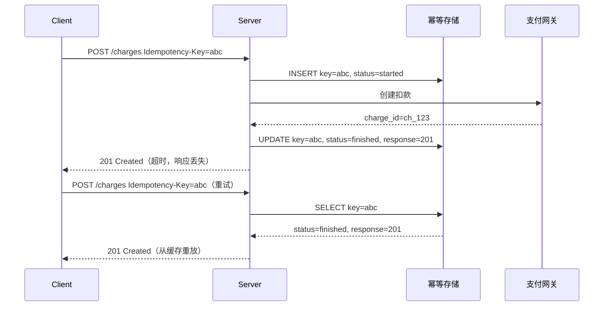
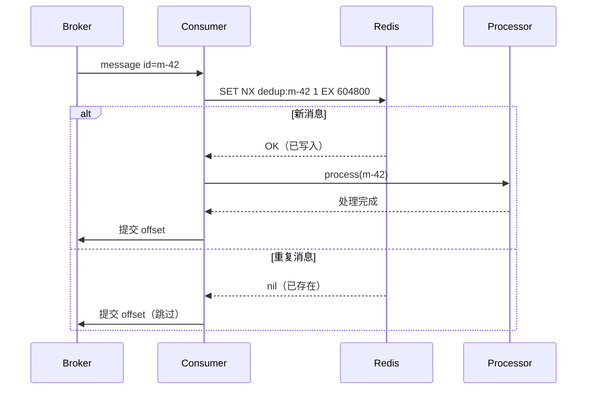
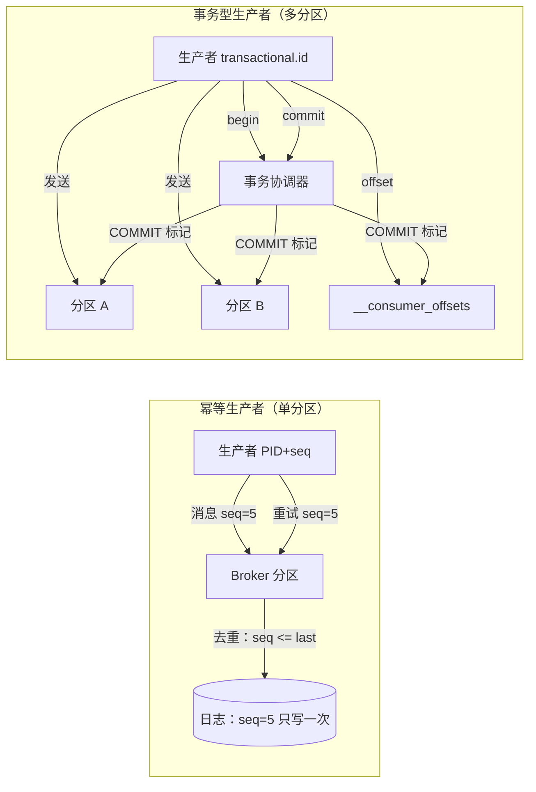
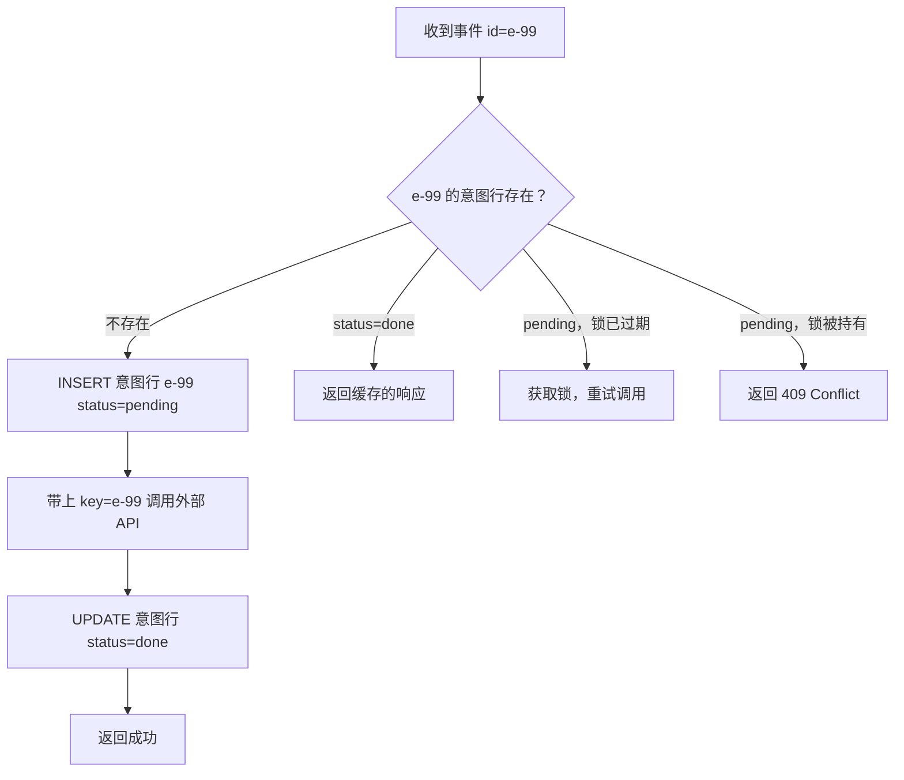

# 幂等性与精确一次：关于投递保证的老实话

> **TL;DR**: 在一个会崩溃的网络上，精确一次投递（exactly-once delivery）不可能做到。发送方分不清“消息丢了”和“确认丢了”，所以它只有两条路：重试（冒重复的风险）或者放弃（冒丢失的风险）[^1]。你实际能建起来的是至少一次投递（at-least-once）加上幂等处理，从而得到“效果上的精确一次”。幂等键（idempotency key）是构建安全 API 最有价值的一个模式：Stripe 保留它们 24 小时[^2]，Kafka 的事务型生产者只增加约 3% 的吞吐开销[^3]，SQS FIFO 在 5 分钟窗口内去重[^4]。每个关键端点都应该接受幂等键。Kafka 的“精确一次”只覆盖 Kafka 到 Kafka 的管道。

## 学习目标

学完这一章，你应当能够：

- [ ] 解释为什么至多一次和至少一次是网络上唯一诚实的两种投递保证
- [ ] 为 HTTP API 设计幂等键（Stripe 模式）
- [ ] 在消费者端实现去重（带 TTL 的消息 ID 存储）
- [ ] 正确使用 Kafka 的幂等生产者与事务型生产者
- [ ] 在非事务系统（短信、支付、webhook）上做出“精确一次的副作用”

## 直觉理解

两位将军分别驻守在相对的两座山头上。他们要协同发起一次进攻，但每个穿过山谷的信使都可能被抓。将军 A 送出“黎明进攻”。将军 B 收到了吗？A 不知道。B 送回一个确认。A 收到这个确认了吗？B 不知道。他们可以无限地确认“确认的确认”，永远到不了确定。

现在把将军换成你的结算服务和支付网关。你提交一笔扣款。网络超时了。这笔扣款到底成没成？你不知道。重试，可能给客户重复扣款；不重试，这笔支付可能就丢了。

这就是那个根本问题。在不可靠的网络上，没有任何协议能解决它。你能做的是让重试变得安全。如果支付网关能认出“这个一模一样的请求我已经处理过了”，并把当初的响应重放回来，你的重试就是无害的。这就是幂等性（idempotency）：同一个操作执行两遍，结果和执行一遍一样。

本章剩下的部分，讲的就是如何在分布式系统的每一层都铺上这张安全网。

## 原理

### 双将军问题

双将军问题（Two Generals problem）证明：两方在一条会丢包的信道上通信，无法在有限轮次内就某个决定达成共同认知（common knowledge）[^1]。当服务 A 向服务 B 发请求并等确认时，一次超时可能意味着：

- 请求在传输途中丢了
- B 收到并处理了请求，但确认丢了
- B 处理完之后崩溃了
- B 单纯就是慢

A 无法区分这几种情况。为了安全，A 重试，这就有重复投递的风险。为了不重复，A 可以不重试，这就有丢失的风险。Tyler Treat 在 2015 年的文章里把这个核心的不可能性讲得很干脆：“你不可能有精确一次投递”[^1]。

由此得到投递的分类：

- **至多一次（At-most-once）**：发出去就不管。消息可能丢，但绝不重复。（Kafka `acks=0`、UDP 的发完就忘。）
- **至少一次（At-least-once）**：一直重试到被确认。消息绝不丢，但可能重复。（每个生产系统的实际默认值。）
- **精确一次处理（Exactly-once processing）**：至少一次投递加上幂等的消费者，重复消息不产生任何可见的副作用。Kafka、Pulsar 和 Stripe 实际提供的正是这个[^3][^5]。

“精确一次投递”这个说法是营销。真实存在的是精确一次*处理*。

### 投递保证的分类

投递和处理的区别不是咬文嚼字。它决定了你把去重逻辑放在哪儿：

- **至多一次** 适合指标、遥测和尽力而为的通知——丢几个事件无所谓。
- **至少一次** 是任何不能丢数据的系统的默认。每个主流消息中间件（Kafka、SQS、RabbitMQ、Pulsar）都默认这个模式。
- **效果上的精确一次** 要求消费者是幂等的。broker 按至少一次投递；消费者保证一条消息处理两遍和处理一遍效果相同。

Apache Pulsar 通过生产者序列号提供“消息去重”，而不宣称“精确一次投递”[^5]。Kafka 说的是“精确一次语义”，但 Confluent 的文档写得很小心：这只覆盖 Kafka 到 Kafka 的管道[^3]。

### 幂等性基础

一个操作 f 是幂等的，当且仅当 f(f(x)) = f(x)。执行两遍所产生的可观测效果，和执行一遍相同。

**天然幂等**不需要任何记录：

- `PUT /users/42 {name: "Alice"}` 替换这个资源，调用多少次都一样
- `DELETE /orders/99` 删掉订单；再调一次返回 404，但什么也没变
- `SET balance = 100` 赋一个固定值；重复执行无害

**非幂等操作**就得借助外力：

- `POST /charges` 每次调用都创建一笔新扣款
- `INCREMENT counter BY 1` 每次重试都改变总数
- “给 +1-555-0100 发短信”每次都产生一条新消息

HTTP 语义把幂等性赋予了 GET、HEAD、OPTIONS、PUT 和 DELETE，但没给 POST 和 PATCH[^6]。当你的操作本身不幂等时，你需要诱导幂等（induced idempotency）：由客户端提供一个键，服务端拿它去重。

### 幂等键模式

最经典的实现来自 Stripe[^7]。客户端为每个逻辑请求生成一个唯一值（通常是 UUIDv4），放在 `Idempotency-Key` 这个 HTTP 头里发出去。服务端存下 (key, 请求指纹, 响应, 状态) 这个元组，重试时重放已存的响应，而不是重新执行业务逻辑。

IETF 草案 `draft-ietf-httpapi-idempotency-key-header-07`（2025 年 10 月，工作组草案；还不是正式 RFC）把这个模式落实到具体状态码上[^6]：

- `409 Conflict`：同一个键上出现并发重试（另一个请求还在处理中）
- `422 Unprocessable Entity`：键被复用，但请求体不同
- `400 Bad Request`：缺少必需的键

Stripe 把幂等键保留 24 小时[^2]。一个返回 `400` 的请求，用同一个键重试会原样重放这个 `400`；要让请求走通，客户端必须生成新键[^2]。



*客户端用同一个 Idempotency-Key 重试同一个请求；服务端重放缓存的响应，不再执行一次副作用。*

服务端存的是请求的*指纹*（method + path + body 的哈希），不是整个请求体——这样既能识别出“同一个键换了载荷”，又能把存储压小[^8]。Brandur Leach 的参考实现额外加了 `recovery_point` 字段，用来支持可恢复的多步工作流：崩掉的请求从最后一个已完成的步骤接着走，而不是把前面的步骤全重放一遍[^8]。

### 消费者端去重

在消费者这一侧，你记录每条消息的 ID，见过就跳过。常见的存储选择：

- **带 TTL 的 Redis SET**：`SET NX dedup:{msg_id} 1 EX {ttl}`。快、内存有界、与语言无关。
- **PostgreSQL 唯一约束**：`INSERT INTO processed_messages (msg_id) VALUES ($1) ON CONFLICT DO NOTHING`。ACID 保证，不用额外运维一套存储。
- **布隆过滤器（Bloom filter）**：低内存的近似去重。永不产生假阴性（安全），但假阳性会悄悄丢掉合法消息。命中后必须再查一份权威存储。



*消费者在处理前先查 Redis 里的消息 ID 集合；TTL 必须长于生产者的最大重试窗口。*

关键的设计决策是 TTL 该设多大。PayPal IPN 会重试长达 4 天[^9]。如果你的 Redis TTL 只有 1 小时，晚到的重试就会造成重复。把 TTL 设成至少覆盖生产者的最大重试窗口。遇到长尾场景就用分层方案：热 Redis 保留 24 小时，再加一个 PostgreSQL 唯一索引做持久的长尾去重。

### Kafka 的精确一次语义

从 Kafka 0.11（KIP-98，2017）起，Kafka 提供两级去重[^10]：

**幂等生产者**（Kafka 3.0 起默认开启[^11]）：每个生产者拿到一个 Producer ID（PID）。每条消息在每个分区上携带 (PID, epoch, 序列号)。如果某个 (PID, 分区) 上的序列号不是正好 `last_committed + 1`，broker 就拒绝这次写入，从而消除生产者重试造成的重复。吞吐代价：相对于至少一次可以忽略不计[^3]。

**事务型生产者**：增加一个由用户提供的 `transactional.id`，它在进程重启后依然存在。broker 记录 begin 标记、produce RPC、通过 `sendOffsetsToTransaction` 提交的消费者 offset，最后是 COMMIT 或 ABORT 标记。使用 `isolation.level=read_committed` 的消费者会把消息缓冲住，直到看见 commit 标记才放出去[^10]。



*幂等生产者用序列号在单个分区上去掉重试造成的重复；事务型生产者在它之上增加了跨分区的原子写入和 offset 提交。*

关键配置：`transaction.timeout.ms` 默认 60 秒，`max.transaction.timeout.ms` 默认 15 分钟，`transactional.id.timeout.ms` 默认 7 天[^10]。Kafka Streams 在 `processing.guarantee=exactly_once`、提交间隔 100 ms 时有 15-30% 的吞吐开销；提交间隔放到 30 秒，开销就降到接近零[^3]。

> [!IMPORTANT]
> Kafka 的精确一次只覆盖 Kafka 到 Kafka 的管道。一旦你的消费者向支付网关发 HTTP 调用、发短信，或者写 Kafka 事务之外的数据库，这个保证就断了[^3][^12]。外部副作用需要自己的幂等机制。

### 外部副作用：最难的部分

任何发生在你的 ACID 边界之外的变更（发短信、刷信用卡、调 webhook）都无法回滚。Kafka EOS 管不到它。这就是**意图行模式**（intent-row pattern）登场的地方[^8]：

1. **原子第一步**：本地插入一行“意图”（status=pending，idempotency_key=event_id）
2. **外部调用**：带上对方系统认可的幂等键调用外部 API
3. **原子第二步**：把意图行标记为完成，存下响应

重试时，消费者检查意图行：已完成就跳过并重放缓存的响应；处于 pending 且锁已过期，就重新拿锁再调一次外部接口；处于 pending 且锁还在别人手里，返回 409。



*意图行在外部调用之前写入；重试时消费者检查意图行，决定是继续、跳过，还是重新执行。*

这个模式能一层层拼起来，因为 Stripe、Twilio、Adyen、PayPal 和 Square 的 API 都提供幂等键机制[^6]。你从本地事件 ID 推导出一个确定性的键（比如 `payment-intent-{event_id}`）传给外部服务。两边各自独立去重。

## 真实案例

**Stripe 在大规模下的幂等键。**

Stripe 的公开 API 要求每个有副作用的 POST 请求都带 `Idempotency-Key` 头。这套系统至少从 2015 年起就在实战里被打磨，每天支撑数百万次 API 调用，是最底层的安全网[^7]。

服务端对每个请求的查找走这条路径：加载 `(user_id, idempotency_key)` 对应的幂等键行。不存在，就以 `recovery_point = started` 插入并继续。存在且 `recovery_point = finished`，重放缓存的 `(response_code, response_body)`。存在但被另一个在途请求锁住，返回 `409 Conflict`[^8]。

Brandur Leach 的参考实现（`rocket-rides-atomic`）用 PostgreSQL 演示了完整模式[^8]：

```sql
CREATE TABLE idempotency_keys (
    id              BIGSERIAL   PRIMARY KEY,
    idempotency_key TEXT        NOT NULL,
    user_id         BIGINT      NOT NULL,
    recovery_point  TEXT        NOT NULL,
    locked_at       TIMESTAMPTZ DEFAULT now(),
    request_params  JSONB       NOT NULL,
    response_code   INT         NULL,
    response_body   JSONB       NULL
);
CREATE UNIQUE INDEX ON idempotency_keys (user_id, idempotency_key);
```

`recovery_point` 这一列充当状态机（`started`、`ride_created`、`charge_created`、`finished`）。每一步都包在 `SERIALIZABLE` 事务里。如果进程在两步之间崩溃，下一次重试从最后一个已提交的恢复点接着走，而不是把整个工作流重放一遍[^8]。

后台任务走的是事务性暂存：`staged_jobs` 行和业务写入放在同一个事务里插入。一个独立的派发进程只在事务提交之后，才把暂存任务搬进工作队列。这就避免了“邮件发出去了、事务却回滚了”这种倒挂[^8]。

让这套东西在 Stripe 的规模上成立的关键设计决策：

- **按用户唯一**：唯一约束是 `(user_id, idempotency_key)`，两个不同用户可以复用同一个键值而不冲突
- **保留 24 小时**：键在 24 小时后过期，把存储增长限住[^2]
- **下游键的确定性**：调用外部 API（卡组织、银行）时，Stripe 从父键派生出子幂等键（比如 `stripe-charge-{key_id}`），让外部系统也去重

## 权衡

| 方案 | 优点 | 缺点 | 适用场景 | 我们的选择 |
|---|---|---|---|---|
| 天然幂等（PUT、DELETE） | 服务端无需额外状态；HTTP 生态默认如此 | 不是所有操作都能塞进“资源替换” | 客户端自选 ID 的 REST 资源 | 只要操作天然合适就用 |
| 幂等键（客户端 UUID） | 适用于任何 HTTP 动词；有 IETF 标准；在 Stripe、Adyen、PayPal 久经考验 | 每个键都要持久化状态；要管 TTL；并发重试要加锁 | 金融操作、外部 API 调用、支付 | 任何有副作用的 POST 的默认选择 |
| 消费者端去重（Redis SET） | 简单、与语言无关、对任何生产者都有效 | TTL 必须覆盖最大重试窗口；每条消息多一次网络往返 | 生产者重试边界已知的异步处理器 | 适合重试窗口有界的事件消费者 |
| 数据库唯一约束 | ACID 保证；不需要单独的去重存储 | 高 QPS 下数据库自己成了去重瓶颈 | 重复的代价高于数据库负载的关键业务事件 | 路径里本来就有事务型数据库时 |
| Kafka EOS（幂等 + 事务） | 跨分区原子写入 + offset 提交；开销低（约 3%） | 只在 Kafka 到 Kafka 内有效；外部副作用仍要自己的幂等 | Kafka 内部的流处理管道 | 用于 Kafka Streams 应用；外部调用配意图行 |

## 常见陷阱

> [!WARNING]
> **把 Kafka EOS 当成端到端保证。** 打开 `processing.guarantee=exactly_once` 并不会让你对支付网关的 HTTP 调用变成精确一次。Kafka EOS 的原子性只覆盖从 Kafka 读、状态存储更新、写回 Kafka。任何外部 RPC 都会打破这个保证[^3][^12]。用外部系统自己的幂等键。

> [!WARNING]
> **去重存储的 TTL 短于生产者重试窗口。** PayPal IPN 最长重试 4 天[^9]。Redis TTL 设 1 小时，甚至 Stripe 那样的 24 小时窗口，都会在这些晚到的重试上失效。TTL 至少设成生产者的最大重试窗口，或者用分层存储（热 Redis + 持久化数据库索引）。

> [!WARNING]
> **用同一个键重试，却换了请求体。** 如果客户端先用 `Idempotency-Key: abc` 发 amount=100，然后用同一个键重试 amount=200，服务端应当返回 `422 Unprocessable Entity`[^6]。存一个请求指纹（method + path + body 的哈希），每次重试都校验。

> [!WARNING]
> **用非加密强度的随机数生成 UUID 导致碰撞。** 用 `Math.random()` 或弱种子，可能在并发客户端之间撞键。IETF 草案警告：低熵的键会让一个租户猜到另一个租户的键，从而构成“数据泄漏”攻击[^6]。用 RFC 4122 UUIDv4（122 位熵，见 RFC 4122 第 4.4 节），并且按租户给键加命名空间：`UNIQUE (user_id, idempotency_key)`。

> [!WARNING]
> **对并不唯一的载荷做基于内容的去重。** SQS 的基于内容去重是对整个消息体做哈希。两条载荷完全相同、都合法的“心跳”事件在 5 分钟内会悄悄撞在一起，被丢掉[^4]。改成显式的 `MessageDeduplicationId`，用单调递增的序列号或每个事件一个 UUID。

> [!WARNING]
> **布隆过滤器的假阳性吃掉合法请求。** 布隆过滤器不会产生假阴性（用于去重是安全的），但假阳性会悄悄丢掉真实消息。只有在配一份权威存储的前提下才可接受：命中布隆过滤器时，先查权威存储再决定跳过。

## 练习

你要做一个 webhook 接收器，处理某支付服务商发来的支付通知。服务商对任何非 2xx 响应都会重试，最长 3 天。你的服务可能在处理过程中崩溃。请设计这条处理管道，使每笔逻辑上的支付都恰好记入用户余额一次——即便出现重复 webhook、乱序投递和崩溃。

<details>
<summary>提示</summary>

你需要三样东西：识别重复 webhook 的办法（服务商会在事件里带 event ID）、处理中崩溃也能保住结果的办法（原子写入）、以及应对乱序投递的办法（在余额更新上做版本或序列号检查）。想一想：如果你先给余额加了钱，但在确认 webhook 之前崩溃了，会发生什么。

</details>

<details>
<summary>参考答案</summary>

**第一步：用意图行实现幂等。**

建一张 `webhook_intents` 表，在 `(provider, event_id)` 上加唯一约束：

```sql
CREATE TABLE webhook_intents (
    provider    TEXT NOT NULL,
    event_id    TEXT NOT NULL,
    status      TEXT NOT NULL DEFAULT 'pending',
    locked_at   TIMESTAMPTZ,
    result      JSONB,
    PRIMARY KEY (provider, event_id)
);
```

**第二步：原子处理。**

webhook 到达时：

1. `INSERT INTO webhook_intents (provider, event_id, status, locked_at) VALUES ('stripe', 'evt_123', 'pending', now()) ON CONFLICT DO NOTHING`
2. 插入成功（新事件）就继续；冲突了就查状态：`done` 则立刻返回 200；`pending` 且锁已过期（超过 5 分钟）则重新拿锁重试。
3. 在同一个事务里：更新用户余额，并把意图行标记为 `done`。
4. 向服务商返回 200。

**第三步：乱序保护。**

在用户的余额行上加一列 `last_event_sequence`。只有进来的事件序列号大于已存值时，才应用这笔入账：

```sql
UPDATE balances
SET amount = amount + $credit,
    last_event_sequence = $seq
WHERE user_id = $uid AND last_event_sequence < $seq;
```

如果更新影响了 0 行，说明这个事件已经过期。把意图行标记为 `done`（附一条“过期”说明），返回 200。

**第四步：崩溃恢复。**

如果服务在插入意图行之后、事务提交之前崩溃，意图行会停在 `pending` 状态。等服务商下一次重试（3 天之内），处理逻辑看到 `pending` 且锁已过期，就重新拿锁、重试余额更新。`(provider, event_id)` 上的唯一约束能防止重复入账，即使两个实例同时抢也一样。

**接受的权衡：** `webhook_intents` 表随事件数线性增长（用 7 天后归档的 TTL 策略缓解）。余额行上的可串行化事务限制了单个用户的吞吐（对支付事件可以接受，它们的单用户 QPS 很低）。

</details>

## 要点回顾

- 网络上的精确一次投递是不可能的。你要建的是至少一次投递 + 幂等处理 = 效果上的精确一次。
- 幂等键是构建安全 API 最有价值的一个模式。每个有副作用的关键端点都应该接受一个。
- 消费者端用“存储 + TTL”做去重，不用改动生产者就能消化生产者的重复。TTL 要设成生产者的最大重试窗口。
- Kafka 的精确一次只覆盖 Kafka 到 Kafka。外部副作用（HTTP 调用、短信、支付）永远需要自己的幂等机制。
- 意图行模式让外部副作用变安全：本地写意图，带派生键调外部，原子地标记完成。
- 设计 API 时就假定客户端会重试。它们一定会。让重试默认是安全的。
- 天然幂等（PUT、DELETE）是白拿的。能套上就用。幂等键留给本身不幂等的操作（POST /charges）。

## 延伸阅读

- [Designing robust and predictable APIs with idempotency](https://stripe.com/blog/idempotency) (Stripe, 2017) - 确立幂等键模式的那篇经典工程博客；如果只读一篇，就读这篇。
- [Implementing Stripe-like Idempotency Keys in Postgres](https://brandur.org/idempotency-keys) (Brandur Leach, 2017) - 完整可运行的参考实现，含表结构、状态机、恢复点和 Ruby 代码；讲“到底怎么写出来”最好的资料。
- [Exactly-Once Semantics Are Possible: Here's How Kafka Does It](https://www.confluent.io/blog/exactly-once-semantics-are-possible-heres-how-apache-kafka-does-it/) (Confluent, 2017, updated 2025) - 对 Kafka 幂等生产者与事务型生产者的权威拆解，附吞吐基准。
- [KIP-98: Exactly Once Delivery and Transactional Messaging](https://cwiki.apache.org/confluence/display/KAFKA/KIP-98+-+Exactly+Once+Delivery+and+Transactional+Messaging) (Apache, 2017) - 第一手设计文档，完整的 API、配置与消息格式细节。
- [You Cannot Have Exactly-Once Delivery](https://bravenewgeek.com/you-cannot-have-exactly-once-delivery/) (Tyler Treat, 2015) - 重置了整个行业表述的那篇博文；读它，把“为什么这个不可能性重要”内化掉。
- [The Idempotency-Key HTTP Header Field](https://www.ietf.org/archive/id/draft-ietf-httpapi-idempotency-key-header-07.html) (IETF draft-07, October 2025) - 正在成形的标准，含状态码、安全考量，以及 Stripe、Adyen、PayPal、Twilio 的实现状态。
- [Life Beyond Distributed Transactions](https://queue.acm.org/detail.cfm?id=3025012) (Pat Helland, 2007/2016) - 用幂等消息而不是分布式事务来构建系统的奠基论证；设计事件驱动系统的人必读。
- [Exactly-once processing in Amazon SQS](https://docs.aws.amazon.com/AWSSimpleQueueService/latest/SQSDeveloperGuide/FIFO-queues-exactly-once-processing.html) (AWS) - FIFO 去重的机制、5 分钟窗口，以及基于内容与显式去重 ID 的区别。

## 记忆卡片

**Q:** 为什么在有崩溃的网络上，精确一次投递不可能实现？
**A:** 发送方分不清“消息丢了”和“确认丢了”。超时之后，它只能选择重试（冒重复的风险）或放弃（冒丢失的风险）。这就是双将军问题。

**Q:** “效果上的精确一次”处理的公式是什么？
**A:** 至少一次投递 + 幂等消费者 = 效果上的精确一次。broker 保证消息不丢，消费者保证消息不会被处理两遍。

**Q:** 幂等键被复用但请求体不同时，服务端应该返回哪个 HTTP 状态码？
**A:** 422 Unprocessable Entity，依据 IETF 的 Idempotency-Key 草案。服务端存一个请求指纹，每次重试都校验。

**Q:** Stripe 保留幂等键多久？
**A:** 24 小时。超过之后键被回收，用同一个键重试会被当成新请求。

**Q:** Kafka 的幂等生产者靠什么去除重试造成的重复？
**A:** Producer ID（PID）加上按分区的序列号。对于某个 (PID, 分区)，只要序列号不是正好 last_committed + 1，broker 就拒绝这次写入。

**Q:** Kafka 精确一次相关特性的吞吐开销有多大？
**A:** 幂等生产者的开销可以忽略。事务型生产者在 1 KB 消息下比至少一次（acks=all）多约 3%。Kafka Streams 在 100 ms 提交间隔下多 15-30%，但提交间隔放到 30 秒就降到接近零。

**Q:** 为什么 Kafka 的精确一次不覆盖外部 HTTP 调用？
**A:** Kafka EOS 的原子性只覆盖从 Kafka 读、状态存储更新、写回 Kafka。任何发往集群之外的调用（HTTP、短信、数据库）都是 Kafka 事务之外的外部状态变更。

**Q:** 针对外部副作用的意图行模式是什么？
**A:** 本地插入一行意图（status=pending），带上幂等键做外部调用，然后把意图标记为完成。重试时看意图：完成就跳过；pending 且锁过期就重试；还被锁着就返回 409。

**Q:** SQS FIFO 的去重窗口有多长？
**A:** 5 分钟。窗口内的重试会被静默去重。超过 5 分钟的重试会被当成新消息，所以在最坏情况下仍然需要消费者端幂等。

**Q:** 为什么幂等键要按用户/租户加命名空间？
**A:** 防止跨租户碰撞。有了 UNIQUE(user_id, idempotency_key)，两个用户可以复用同一个键值而不冲突，恶意方也无法猜别人的键来触发数据泄漏。

**Q:** 天然幂等和诱导幂等有什么区别？
**A:** 天然幂等不需要任何记录（PUT、DELETE、SET）。诱导幂等是给本身不幂等的操作（POST、INCREMENT）套一个客户端提供的键，由服务端拿它去重。

**Q:** PayPal IPN 重试 webhook 通知持续多久？
**A:** 最长 4 天。这意味着任何消费者端去重存储都必须把消息 ID 保留至少 4 天，而不是几分钟或几小时。

**Q:** 在开启消费者端去重的情况下，从 offset 0 重放一个 Kafka topic 会发生什么？
**A:** 如果去重存储里还留着旧的消息 ID，所有重放消息都被跳过（什么也不做）；如果存储已被回收，所有消息都会被重新处理。在幂等键的命名空间里带上 replay_generation，就能控制这个行为。

**Q:** Stripe 幂等模式里的 recovery point 是什么？
**A:** 多步工作流里的具名检查点（started、ride_created、charge_created、finished）。崩溃后重试时，服务端从最后一个已提交的恢复点继续，而不是重放所有步骤。

**Q:** 什么时候该用布隆过滤器做去重？
**A:** 只在配了权威存储的时候。布隆过滤器不产生假阴性（安全），但假阳性会悄悄丢掉合法消息。命中时先查权威存储，再决定跳过。

## 参考文献

[^1]: Tyler Treat, "You Cannot Have Exactly-Once Delivery", Brave New Geek, 2015. https://bravenewgeek.com/you-cannot-have-exactly-once-delivery/
[^2]: Stripe, "Advanced error handling"（Idempotency-Key 的行为与保留策略）. https://docs.stripe.com/error-low-level
[^3]: Neha Narkhede, Guozhang Wang, "Exactly-Once Semantics Are Possible: Here's How Kafka Does It", Confluent, 2017 (updated 2025). https://www.confluent.io/blog/exactly-once-semantics-are-possible-heres-how-apache-kafka-does-it/
[^4]: AWS, "Exactly-once processing in Amazon SQS"（5 分钟去重窗口、MessageDeduplicationId）. https://docs.aws.amazon.com/AWSSimpleQueueService/latest/SQSDeveloperGuide/FIFO-queues-exactly-once-processing.html
[^5]: Apache Pulsar, "Messaging" 概念（消息去重、序列号）. https://pulsar.apache.org/docs/next/concepts-messaging/
[^6]: J. Jena and S. Dalal, "The Idempotency-Key HTTP Header Field", draft-ietf-httpapi-idempotency-key-header-07, IETF, October 2025（工作组草案，尚未成为正式 RFC）. https://www.ietf.org/archive/id/draft-ietf-httpapi-idempotency-key-header-07.html
[^7]: Stripe Engineering, "Designing robust and predictable APIs with idempotency", Stripe Blog, 2017. https://stripe.com/blog/idempotency
[^8]: Brandur Leach, "Implementing Stripe-like Idempotency Keys in Postgres", brandur.org, 2017. https://brandur.org/idempotency-keys
[^9]: PayPal, "Instant Payment Notification" 开发者指南（4 天重试窗口）. https://web.archive.org/web/20220123023133/https://developer.paypal.com/docs/api-basics/notifications/ipn/
[^10]: Apache Software Foundation, "KIP-98 - Exactly Once Delivery and Transactional Messaging", Apache Kafka Wiki, 2017. https://cwiki.apache.org/confluence/display/KAFKA/KIP-98+-+Exactly+Once+Delivery+and+Transactional+Messaging
[^11]: Apache Kafka, "KIP-679: Producer will enable the strongest delivery guarantee by default"（默认开启幂等）. https://cwiki.apache.org/confluence/display/KAFKA/KIP-679:+Producer+will+enable+the+strongest+delivery+guarantee+by+default
[^12]: Conduktor, "Kafka Exactly-Once: When It Works and When It Doesn't", 2025. https://www.conduktor.io/blog/exactly-once-semantics-when-it-works
