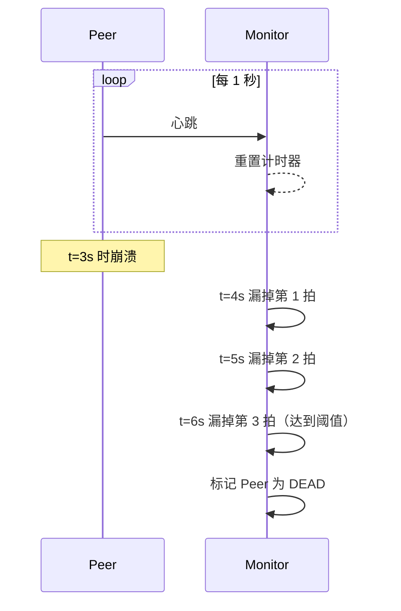
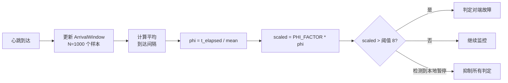
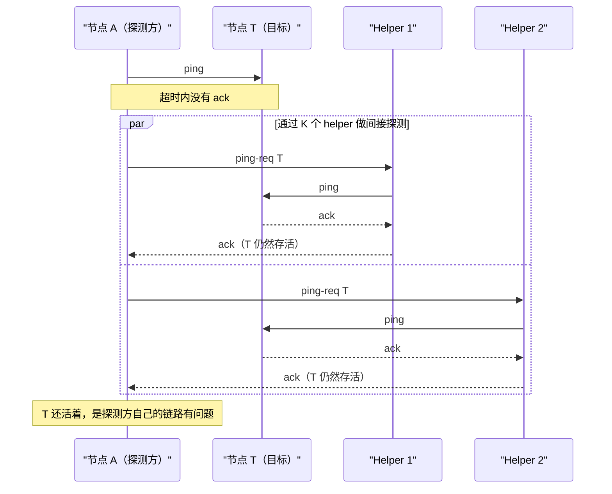
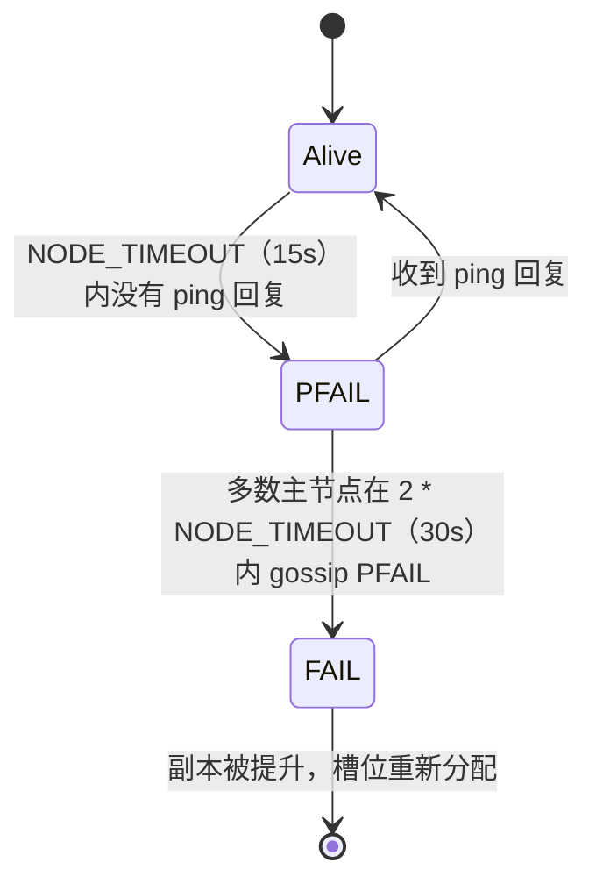

# 故障检测：判定一个节点已经死亡

> **TL;DR**：在异步网络里，完美的故障检测不可能做到。每个检测器都在误报（把活着的节点判死，触发不必要的故障切换）和漏报（漏掉已死的节点，让客户端一直挂在僵尸节点上）之间做权衡。固定超时的心跳适合稳定链路。Phi-accrual 检测器会跟着观测到的抖动自适应（Cassandra 在 phi 阈值 8.0 时判定故障，相当于约 18 秒静默）[^1]。SWIM gossip 能把检测扩展到数千个节点，每个成员的带宽开销是 O(1)[^2]。生产环境要把这些分层叠加：用 LB 健康检查把坏节点快速踢出转发路径，用集群内部检测维护成员关系共识，用多数派门控的决策挡住单观察者误报。

## 学习目标

学完本章，你将能够：

- [ ] 解释为什么在异步系统里完美的故障检测不可能
- [ ] 针对你所在网络的 P99 延迟设计心跳间隔与超时
- [ ] 描述 phi-accrual：随观测抖动自适应的概率化怀疑
- [ ] 描述 SWIM/Lifeguard 基于 gossip 的故障检测及其反熵特性
- [ ] 区分 LB 健康检查与集群成员协议
- [ ] 用滞后、宽限期和多数派门控的决策避免状态抖动

## 直觉理解

你给一个朋友打电话。响了六声，转到语音信箱。他死了吗？多半没有。他可能在洗澡、在开车，或者就是不想接。五分钟后你再打，还是没人接。这时你更怀疑了，但仍然不确定。你发消息问一个共同的朋友：“今天有 Alex 的消息吗？”如果三个朋友都说“从昨天起就没联系上”，你才开始担心。

这就是故障检测。单次丢失心跳什么都说明不了。反复静默会抬高怀疑。来自独立观察者的印证会进一步抬高怀疑。但你永远到不了确定，因为那位朋友可能正在一架没有信号的飞机上，活得好好的，只是联系不上。每个分布式系统都面对这个一模一样的困境：静默是含糊的，而你必须照常行动。

本章剩下的部分给你明智行动的工具：超时怎么设，怎么让超时跟随实际观测条件，怎么在同伴之间互相印证怀疑，以及怎么避开每隔几秒就在“活着”和“死亡”之间来回跳的那种运维噩梦。

## 原理

### 为什么它本质上很难

在异步网络里，消息投递延迟没有上界。一个 5 秒没响应的节点，可能是崩溃了，可能是 GC 停顿，可能是被分区隔离了，也可能活得好好的只是回复还在路上。对任何一个本地观察者来说，从单条丢失的消息里区分不出这几种情况[^3]。

FLP（Fischer、Lynch、Paterson，1985）把这个困境收窄成一个不可能性结论：在异步系统里，只要有一个进程发生崩溃故障，就没有任何确定性协议能保证达成共识，因为系统无法可靠地区分崩溃的进程和慢的进程[^4]。

Chandra 和 Toueg 在 1996 年给出的回应是把故障检测器定义为一种预言机（oracle），它输出一组被怀疑的对端。他们用两个性质刻画检测器：

- **完备性（completeness）：** 每个崩溃的进程最终都会被怀疑。
- **准确性（accuracy）：** 正确的进程不会被错误怀疑（程度有强有弱）。

他们证明，足以解决共识问题的最弱检测器是“最终弱”（eventually weak，记作 ⋄W，等价于 Omega），它保证最终存在某个正确进程，永远不被任何正确进程怀疑[^5]。落到实践上的结论是：所有生产级故障检测器都只是一次概率判断，它周围的系统必须同时容忍误报和漏报。

### 心跳与超时

最简单的检测器：节点 A 每 I 毫秒向监控者 M 发一次心跳。若 K * I 毫秒内没有心跳到达，M 就宣布 A 死亡。

**怎么选超时：**

- 从你网络的 P99 RTT 加上预期处理抖动起步。
- 再加一段安全余量（通常是心跳间隔的 2-4 倍）。
- etcd 用 100 ms 心跳间隔和 1,000 ms 选举超时（心跳的 10 倍），并建议至少 10 倍以吸收抖动[^6]。
- Kubernetes 的 kubelet 每 10 秒更新一次 Lease 对象；节点控制器在静默 40 秒后把节点标记为 Unknown（更新频率的 4 倍）[^7]。

**问题在于：** 静态超时不会自适应。按正常情况调好的超时，在短暂的延迟尖峰里太激进（误报），在其余时间里又太保守（检测太慢）。Linux TCP keepalive 默认要 7,200 秒（2 小时）才发出第一次探测[^8]，拿来检测集群完全没用。

*最简单的心跳检测：连续漏掉 K 拍心跳后，监控者把对端标记为死亡，但它区分不出崩溃、GC 停顿和网络延迟。*

### Phi-accrual 检测器

Phi-accrual 检测器由 Hayashibara、Defago、Yared 和 Katayama 在 SRDS 2004 上提出，它输出一个连续的怀疑度，而不是二元的活/死[^9]。应用按自己的容忍度挑一个 phi 阈值。

**工作方式：**

1. 记录最近 N 次心跳的到达间隔（Cassandra 取 N = 1,000）[^10]。
2. 用这个采样窗口算出平均到达间隔。
3. 查询时计算 phi =（距上次心跳的时间）/ 平均间隔。
4. 乘以 PHI_FACTOR（1 / ln(10) = 0.434）后与阈值比较。

Cassandra 默认的 `phi_convict_threshold` 是 8.0[^1]。心跳间隔为 1 秒时，一个节点要静默大约 8 / 0.434 = 18.4 秒才会被判定[^1]。在云上或跨机房环境里，运维会把阈值提高到 10-12，以吸收更大的抖动。

**关键优势：** 同样是 phi = 8，在稳定链路上（平均到达间隔很集中）意味着更严格的检测，在抖动链路上（平均到达间隔很分散）意味着更宽容的检测。检测器会对每个对端自我调参。

**GC 暂停护栏：** Cassandra 的 `MAX_LOCAL_PAUSE_IN_MS`（默认 5,000 ms）能防止本节点的一次 stop-the-world 停顿在调度恢复时把所有对端都误判为故障[^10]。没有它，一次 10 秒的 GC 停顿会让每个对端的 phi 同时冲高。

*Cassandra 的 phi-accrual 检测器用观测到的平均间隔来归一化静默时长；MAX_LOCAL_PAUSE 护栏防止 GC 停顿后自我造成的大面积误判。*

### Gossip：SWIM 与 Lifeguard

SWIM（Scalable Weakly-consistent Infection-style Process Group Membership）由 Das、Gupta 和 Motivala 在 DSN 2002 上提出[^2]。每个节点在每个协议周期 T 里做三件事：

1. 随机挑一个对端，发 `ping`。
2. 若在子超时内没有 ack，就随机挑 K 个 helper，让它们向目标发 `ping-req`（间接探测）。
3. 直接探测和间接探测都失败，就把目标标记为可疑，并把该状态 gossip 出去。

成员变更搭在 ping 和 ack 上顺带传递（piggyback），所以稳态下每个节点的带宽开销在集群规模上是 O(1)，检测时间与集群规模无关[^2]。

**Lifeguard 扩展**（Dadgar、Phillips、Currey，HashiCorp 2017）[^11] 加了三个机制：

- **自我感知（self-awareness）：** 每个节点维护一个 "nack" 计数器。helper 的 nack 缺失说明本节点自己状态不佳，于是它会压低自己的指控力度。累坏了的观察者不该去指责别人。
- **抗群起而攻（dogpile resistance）：** 怀疑超时一开始设得很长，随着独立确认陆续到达而收缩。真正的快速故障很快定论；只有单个观察者的指控会等到超时作废。
- **伙伴机制（buddy system）：** 被怀疑的节点只要听到这条 gossip，就能立刻用更高的 incarnation 号广播反驳。

Consul 和 Serf 部署了 SWIM + Lifeguard，默认 LAN 探测间隔 1 秒，从怀疑到判死大约 10 秒[^12]。Lifeguard 不需要运维做任何配置，它按观测到的 nack 率自我调参。

*SWIM 的间接探测过滤掉单观察者误报：如果 K 个 helper 都能连通目标，问题出在探测方的链路上，而不是目标的健康状态。*

### LB 健康检查与集群成员关系

这两类机制解决的是不同问题，时间尺度也不同：

**LB 健康检查**优化的目标是尽快把坏目标从转发路径上摘掉。AWS ALB 的默认值：间隔 30 秒，超时 5 秒，连续失败 2 次标记为不健康，连续成功 5 次才恢复[^13]。它是二元的（健康/不健康），也是单边的（LB 自己说了算）。

**集群成员协议**（Cassandra gossip、Consul SWIM、Redis Cluster bus）优化的目标是集群范围内正确一致的视图。它们按自己的节奏运行，要求多方印证，也接受更慢的检测，因为误报代价很高（触发再平衡、副本选举、hinted-handoff 风暴）。

**被动异常点检测**（Envoy）能抓到主动探测漏掉的东西：一个节点通过了 /health，但在真实流量上返回 500。Envoy 按上游统计成功率，把偏离集群均值超过配置标准差倍数的 host 摘除[^14]。

> [!IMPORTANT]
> 一个节点对 LB 来说可以是“健康”的，同时对集群来说是“死亡”的，反过来也一样。这是两个独立信号，不要混为一谈。

### 抖动抑制

抖动（flapping）是“活着”和“死亡”之间的快速来回切换。每次切换都要付一次故障切换、一次客户端重连或者一次再平衡。抑制手段有：

**滞后（hysteresis）：** 判死和恢复用不同的阈值。ALB 连续失败 2 次就标记不健康，但要连续成功 5 次才恢复[^13]。这种不对称是故意的。

**宽限期：** Kubernetes 探针上的 `initialDelaySeconds`；Cassandra 在 stop-the-world 停顿之后的 `MAX_LOCAL_PAUSE` 护栏[^10]。Kubernetes 节点控制器在把节点转为 Unknown 之前有 40 秒宽限期[^7]。

**状态转换限速：** Kubernetes 以 0.1 节点/秒（每 10 秒一个节点）的速度驱逐 Pod，一旦怀疑是整区故障（一个区里超过 55% 的节点不健康），还会进一步放慢[^15]。

**多数派门控的决策：** Redis Cluster 要把本地的 PFAIL 升级成集群范围的 FAIL，必须拿到多数主节点的同意。节点在 `cluster-node-timeout`（默认 15 秒）内没收到回复就把对端标记为 PFAIL。升级为 FAIL 需要多数主节点在 2 * NODE_TIMEOUT（30 秒）内各自独立报告 PFAIL[^16]。只有 FAIL 才会触发副本选举。

*Redis Cluster 的两阶段检测：PFAIL 是本地怀疑；FAIL 需要多数主节点印证，从而消除单观察者误报，代价是最多 30 秒的检测延迟。*

## 真实案例

### 200+ 节点集群上的 Cassandra phi-accrual

设想一个 200 节点的 Cassandra 集群，跑着 JVM 负载，会周期性出现 2 秒的 stop-the-world GC 停顿。没有护栏的话，事情是这样的：

1. 节点 A 在一次 G1 mixed collection 中停顿了 2 秒。
2. 恢复后，A 的故障检测器逐个检查对端。此时距所有对端上次心跳都已过了 2 秒以上。平均到达间隔为 1 秒时，phi = 2.0 / 1.0 = 2.0，乘以 0.434 得 0.87，远低于阈值 8。所以单是 2 秒停顿并不构成判定。
3. 但如果 A 停了 10 秒（一次病态的 full GC），每个对端的 phi 就是 10.0 * 0.434 = 4.34，依然低于 8。然而，若这次停顿恰好撞上一个本来就迟了 8 秒的对端，累计静默就会把 phi 推过阈值，A 就错误地判定了那个对端。
4. 更糟的是：如果 A 在停顿期间自己也不发心跳，其他节点会看到 A 静默了 10 秒。平均值 = 1 秒时，每个观察者算出的 phi = 10 * 0.434 = 4.34，还不到阈值 8，但再漏一拍就过线了。

**Cassandra 的分层防御：**

- **MAX_LOCAL_PAUSE 护栏：** 如果检测器自己的 interpret() 循环发现距上次运行已有超过 5,000 ms 的间隔，就记一条警告，并且拒绝判定任何人[^10]。这是抵御自我造成的大面积误判的首要防线。
- **初始间隔设得偏高：** 到达窗口以 2 * gossip 间隔（2,000 ms）作为初值，偏向保守，因为误报引发的 hinted-handoff 风暴比检测慢更糟[^10]。
- **阈值可调：** 云环境里的运维会把 `phi_convict_threshold` 从 8 提到 10-12，用更慢的检测换更大的抖动容忍度[^1]。
- **GC 调优：** 真正的解法是把停顿时间压住。用 `-XX:MaxGCPauseMillis=200` 的 G1，或者换 Shenandoah/ZGC 拿到亚毫秒级停顿，根因就消失了。

运维上的教训：phi-accrual 对网络抖动的自适应非常漂亮，但它没法适应会影响检测器自身的本地调度停顿。这需要单独一道护栏。

## 权衡

### 集群内部检测

| 方案 | 优点 | 缺点 | 适用场景 | 我们的选择 |
|---|---|---|---|---|
| 固定超时心跳 | 简单、可预测、实现起来毫不费力 | 不适应抖动；不是太激进就是太保守 | 稳定的低抖动同机房链路 | etcd 式紧密集群（RTT 已知）的基线方案 |
| Phi-accrual | 按对端自适应观测到的抖动；同一阈值可跨机房使用 | 需要调阈值；依赖分布假设；易受本地停顿影响 | 延迟波动大的集群 | **数据库的默认选择**（Cassandra、Akka） |
| SWIM + Lifeguard | 可扩展到数千节点；O(1) 带宽；自调节；去中心化 | 成员视图最终一致；协议复杂度更高 | 大规模成员服务、服务发现 | **成员管理的默认选择**（Consul、Serf、HashiCorp memberlist） |

### 分层控制（与集群检测并行运行）

| 控制手段 | 目的 | 典型默认值 | 我们的选择 |
|---|---|---|---|
| LB 主动健康检查（HTTP/TCP） | 在数秒内把不健康的后端从转发路径摘掉 | AWS ALB：间隔 30 s、超时 5 s、连续 2 次失败标记不健康、连续 5 次成功恢复[^13] | 永远在 LB 层开启；阈值比集群内部超时更紧 |
| 多数派门控的决策（PFAIL → FAIL） | 要求 M 个独立观察者印证故障，再执行昂贵动作 | Redis Cluster：多数主节点必须在 2 * NODE_TIMEOUT 内同意[^16] | 故障切换代价高时开启（主节点选举、重分片） |
| 被动异常点摘除 | 靠观察真实流量发现僵尸后端（有响应但慢或报错） | Envoy：连续网关失败或错误率偏离达到配置值后摘除[^14] | 与主动健康检查搭配，抓住灰色故障 |

## 常见陷阱

> [!WARNING]
> **只靠 TCP keepalive 不算故障检测器。** Linux 默认要 7,200 秒（2 小时）才发第一次探测（[tcp(7) man page](https://man7.org/linux/man-pages/man7/tcp.7.html)）。即便把参数调到秒级，keepalive 也是点对点的，给不出集群范围的视图：它只告诉你某个 socket 死了，不代表某个节点死了，也无法与其他观察者互相印证。TCP keepalive 只用来回收内核 socket，永远再配一个应用层检测器（phi-accrual、SWIM 或固定超时心跳），由多个对端共同认可。

> [!WARNING]
> **超时比 P99 抖动还短。** 如果跨可用区 P99 RTT 是 15 ms，但在每天负载高峰会飙到 200 ms，那 100 ms 的超时每天下午都会误报。超时要按负载下观测到的 P99 的 3-4 倍来设，而不是按理想状况。

> [!WARNING]
> **忽视非对称分区。** 节点 A 能发给 B，但收不到 B 的回复。标准的 ping/pong 只看到单向静默；不同观察者会得出不同结论。SWIM 的间接探测正是为此存在——让 K 个第三方交叉验证[^2]。

> [!WARNING]
> **没有滞后，引发抖动风暴。** 一个每 30 秒就在活/死之间切换一次的节点，会带来故障切换、恢复、再故障切换、再恢复。每一轮都要付客户端重连和数据再平衡的成本。用不对称阈值（2 次失败判死、5 次成功恢复），并给状态转换限速。

> [!WARNING]
> **把 LB 健康检查当成集群成员关系。** LB 健康检查回答的是“我要不要把流量路由到这里”，集群成员协议回答的是“这个节点还在环里吗”。两者的时间间隔、判断标准、服务对象都不同。从 LB 摘掉的节点，对集群来说未必是死的。

> [!WARNING]
> **把僵尸节点当成死亡节点。** 僵尸节点会响应健康检查，但返回垃圾数据或者延迟极高。二元检测器完全看不到它。用被动异常点检测（Envoy 的成功率偏离[^14]），或者用对比全集群单机指标的异常检测[^17]。

## 练习

你的 200 节点 Cassandra 集群经常出现单节点 2 秒的 GC 停顿，目前会导致 phi 检测器把它们判定为死亡，并引发 hinted-handoff 风暴。设计一个修复方案：调 phi、加宽限期、改 GC 策略，或者换检测方式。先决定你实际上会先改哪一个。

提示

2 秒停顿配 1 秒平均到达间隔，phi = 2 * 0.434 = 0.87，远低于阈值 8。所以停顿本身不是问题所在。想一想：当停顿撞上本来就因为正常抖动而偏高的 phi 时会怎样，或者当停顿的节点自己的检测器恢复运行、看到陈旧时间戳时又会怎样。`MAX_LOCAL_PAUSE` 护栏解决的是其中一种，另一种靠什么？

解答

**优先级 1：修掉 GC 停顿（根因）。**

从长停顿的 CMS 或 G1 换成带 `-XX:MaxGCPauseMillis=200` 的 G1，更好的做法是换 ZGC/Shenandoah 拿到亚毫秒级停顿。2 秒的停顿说明你的 GC 调优已经坏了。再怎么调检测器也修不好一个坏掉的 JVM。

**优先级 2：确认 MAX_LOCAL_PAUSE 生效。**

Cassandra 的 `MAX_LOCAL_PAUSE_IN_MS` 默认 5,000 ms。如果你的停顿是 2 秒，护栏不会触发（2,000 < 5,000）。这是对的：护栏是给灾难性停顿（10 秒以上）用的，不是给日常停顿用的。对 2 秒停顿，phi 的算法（缩放后 0.87）本来就不该判定。如果节点还是被判死，真正的问题多半是叠加效应：停顿的节点漏发了自己的心跳，其他节点于是累积静默。

**优先级 3：把 phi_convict_threshold 提到 10-12。**

这买的是叠加场景下的容忍度。阈值 12 时，节点要静默 12 / 0.434 = 27.6 秒才会被判定。这是止血贴，不是修复，但能在你修 GC 期间止住出血。

**优先级 4：给 hinted-handoff 风暴限速。**

即使检测正确，一波集中判定也可能压垮 hinted-handoff 子系统。配置 `max_hints_delivery_threads` 和 `hinted_handoff_throttle_in_kb` 来限定爆炸半径。

**不要做的事：** 换成固定超时。那样会丢掉 phi-accrual 的对端自适应能力，而这个能力在 200 节点、跨机架与跨机房链路混杂的集群里很有价值。

## 要点回顾

- 在异步网络里完美的故障检测不可能做到。每个检测器都在误报和漏报之间做选择。
- 从心跳加超时起步，超时按负载下观测到的 P99 延迟的 3-4 倍来设。规模或波动性提出要求时，再上 phi-accrual 或 SWIM。
- Phi-accrual 能自动适应每个对端的抖动，但防不住本地调度停顿。要单独配一道暂停护栏。
- SWIM 把检测扩展到数千节点，每个成员带宽 O(1)。Lifeguard 的自我感知机制防止状态不佳的观察者误指同伴。
- LB 健康检查与集群故障检测目的不同、时间尺度不同，不要混用。
- 多数派门控的决策（Redis 的 PFAIL 到 FAIL、Sentinel 的 SDOWN 到 ODOWN）以检测延迟为代价，消除单观察者误报。
- 僵尸节点（活着但很慢）往往比死节点更糟。要在被动异常点检测上投入，而不只是二元的死活检查。

## 延伸阅读

- [Unreliable Failure Detectors for Reliable Distributed Systems](https://dl.acm.org/doi/10.1145/226643.226647) - Chandra 和 Toueg 1996 年的论文，定义了故障检测器的层级；获 2010 年 Dijkstra 奖，至今仍是所有生产级检测器的形式基础。
- [The Phi Accrual Failure Detector](https://www.computer.org/csdl/proceedings-article/srds/2004/22390066/12OmNvT2phv) - Hayashibara 等，SRDS 2004；Cassandra 和 Akka 自适应检测背后的原始论文。
- [SWIM: Scalable Weakly-consistent Infection-style Process Group Membership Protocol](https://www.cs.cornell.edu/projects/Quicksilver/public_pdfs/SWIM.pdf) - Das、Gupta、Motivala，DSN 2002；Consul、Serf、Nomad 实现的那个 gossip 协议。
- [Lifeguard: Local Health Awareness for More Accurate Failure Detection](https://arxiv.org/abs/1707.00788) - Dadgar、Phillips、Currey（HashiCorp）2017；让 SWIM 在 CPU 耗尽时也能安全生产的三个扩展。
- [AWS Builders Library: Implementing health checks](https://aws.amazon.com/builders-library/implementing-health-checks) - Yanacek 的运维手册，讲浅检查与深检查、fail-open 行为，以及存活性与依赖性的拆分。
- [Redis Cluster specification](https://redis.io/docs/latest/operate/oss_and_stack/reference/cluster-spec/) - PFAIL/FAIL 状态机、gossip 协议和副本选举时序的权威参考。
- [Impossibility of Distributed Consensus with One Faulty Process](https://dl.acm.org/doi/10.1145/3149.214121) - Fischer、Lynch、Paterson，JACM 1985；FLP 结论，证明了故障检测为什么不可能完美。
- [etcd Tuning Guide](https://etcd.io/docs/v3.5/tuning/) - 关于 Raft 共识在各种网络条件下心跳与选举超时比例设置的实操建议。

## 记忆卡片

**Q:** 为什么在异步网络里完美的故障检测不可能？
**A:** 消息延迟没有上界，监控者区分不出崩溃的节点和慢的节点。FLP 证明在这种条件下，只要有一个崩溃故障，就没有确定性协议能解决共识。

**Q:** Chandra 和 Toueg 的框架用哪两个性质刻画故障检测器？
**A:** 完备性（每个崩溃的进程最终都会被怀疑）和准确性（正确的进程不会被错误怀疑，程度有强有弱）。

**Q:** Cassandra 默认的 phi_convict_threshold 是多少，实践中意味着什么？
**A:** 默认 8.0。心跳间隔 1 秒时，节点要静默约 18.4 秒（8 / 0.434）才会被判定。

**Q:** SWIM 的间接探测如何避免单条坏链路造成的误报？
**A:** 直接 ping 失败时，探测方请 K 个随机 helper 去 ping-req 目标。如果 helper 能连通目标，问题就在探测方自己的链路上，而不是目标的健康状态。

**Q:** Lifeguard 给 SWIM 加了哪三个扩展？
**A:** 自我感知（状态不佳的节点压低自己的指控）、抗群起而攻（怀疑超时只在独立确认到达时才收缩）、伙伴机制（被怀疑者能用更高的 incarnation 号立刻反驳）。

**Q:** Redis Cluster 的 PFAIL 和 FAIL 状态有什么区别？
**A:** PFAIL 是本地怀疑（一个节点在 NODE_TIMEOUT 静默后的看法）。FAIL 需要多数主节点在 2 * NODE_TIMEOUT 内达成一致，并触发副本选举。

**Q:** 为什么 Cassandra 的故障检测器里要有 MAX_LOCAL_PAUSE 护栏？
**A:** 检测节点上的一次 stop-the-world GC 停顿，会让调度恢复时所有对端看起来都迟到了。护栏检测到本地停顿并抑制所有判定，避免大面积误报。

**Q:** LB 健康检查与集群成员检测的关键区别是什么？
**A:** LB 健康检查优化的是快速从转发路径摘除（秒级、单边决定）。集群成员优化的是正确一致的共识视图（更慢、需印证、保守）。它们服务不同对象，不该混用。

**Q:** 什么是抖动，怎么防？
**A:** 抖动是活/死状态之间的快速来回切换。用滞后（不对称阈值）、宽限期、状态转换限速和多数派门控的决策来防。

**Q:** Kubernetes 的 node-monitor-grace-period 是什么，为什么是 40 秒？
**A:** 它是节点控制器在最后一次 kubelet 心跳之后等待多久才把节点标记为 Unknown。40 秒（10 秒更新频率的 4 倍）的设定允许漏掉最多 3 次心跳再反应。

**Q:** 为什么僵尸节点往往比死节点更糟？
**A:** 死节点能被快速检测并切换掉。僵尸节点通过健康检查，却返回垃圾数据或极高延迟，把路由到它的每个请求都毒化，而二元检测器毫无察觉。

**Q:** 当一个区里超过 55% 的节点看起来不健康时，Kubernetes 会怎么做？
**A:** 它认为这是分区或控制面问题，而不是大批节点同时死亡，于是放慢甚至停止 Pod 驱逐，避免误报风暴引发级联故障。

**Q:** Envoy 的被动异常点检测和主动健康检查有什么不同？
**A:** 主动检查按固定间隔探测 /health 端点。被动异常点检测统计每个上游的真实请求成功率，把错误率偏离集群均值的主机摘除，从而抓到主动探测漏掉的故障。

**Q:** etcd 的心跳间隔与选举超时推荐比例是多少？
**A:** 至少 10 倍。默认是 100 ms 心跳、1,000 ms 选举超时。这样能在不触发无谓选举的前提下吸收网络抖动和磁盘 fsync 延迟。

**Q:** AWS ALB 把所有目标都标记为不健康时会怎样？
**A:** 它会 fail open：照样把流量路由到所有目标。这防止一个有 bug 的健康检查把整个集群的健康目标清零，但代价是所有请求都打到了不健康的后端。

## 参考文献

[^1]: Brian Stark (Digitalis), "Understanding phi_convict_threshold in Apache Cassandra", 2025. https://digitalis.io/post/understanding-phi-convict-threshold-in-apache-cassandra-a-deep-dive-into-failure-detection
[^2]: Abhinandan Das, Indranil Gupta, Ashish Motivala, "SWIM: Scalable Weakly-consistent Infection-style Process Group Membership Protocol", DSN 2002. https://www.cs.cornell.edu/projects/Quicksilver/public_pdfs/SWIM.pdf
[^3]: Tushar Deepak Chandra and Sam Toueg, "Unreliable failure detectors for reliable distributed systems", Journal of the ACM 43(2):225-267, 1996. https://dl.acm.org/doi/10.1145/226643.226647
[^4]: Michael J. Fischer, Nancy A. Lynch, Michael S. Paterson, "Impossibility of distributed consensus with one faulty process", JACM 32(2):374-382, 1985. https://dl.acm.org/doi/10.1145/3149.214121
[^5]: Chandra and Toueg, "Unreliable failure detectors for reliable distributed systems", defines completeness/accuracy and the hierarchy; Chandra, Hadzilacos, and Toueg (1996) prove eventually-weak / Omega is the weakest for consensus. https://dl.acm.org/doi/10.1145/226643.226647
[^6]: etcd documentation, "Tuning" (heartbeat interval 100 ms, election timeout 1000 ms). https://etcd.io/docs/v3.5/tuning/
[^7]: Kubernetes documentation, "Nodes" concept page, Node heartbeats and Rate limits on eviction sections. https://kubernetes.io/docs/concepts/architecture/nodes/
[^8]: Linux kernel documentation, `tcp(7)` man page, `tcp_keepalive_time` (default: 7200 seconds). https://man7.org/linux/man-pages/man7/tcp.7.html
[^9]: Naohiro Hayashibara, Xavier Defago, Rami Yared, Takuya Katayama, "The Phi Accrual Failure Detector", SRDS 2004. https://www.computer.org/csdl/proceedings-article/srds/2004/22390066/12OmNvT2phv
[^10]: Apache Cassandra source code, `src/java/org/apache/cassandra/gms/FailureDetector.java`. https://github.com/apache/cassandra/blob/trunk/src/java/org/apache/cassandra/gms/FailureDetector.java
[^11]: Armon Dadgar, James Phillips, Jon Currey, "Lifeguard: Local Health Awareness for More Accurate Failure Detection", arXiv:1707.00788, 2017. https://arxiv.org/abs/1707.00788
[^12]: HashiCorp memberlist, `DefaultLANConfig()` in `config.go` (ProbeInterval: 1s, SuspicionMult: 4). https://github.com/hashicorp/memberlist/blob/master/config.go
[^13]: AWS documentation, "Health checks for Application Load Balancer target groups". https://docs.aws.amazon.com/elasticloadbalancing/latest/application/target-group-health-checks.html
[^14]: Envoy Proxy documentation, "Outlier detection". https://www.envoyproxy.io/docs/envoy/latest/intro/arch_overview/upstream/outlier
[^15]: Kubernetes documentation, "Nodes" concept page, Rate limits on eviction section. https://kubernetes.io/docs/concepts/architecture/nodes/
[^16]: Redis, "Redis cluster specification", sections on Failure Detection and Heartbeat/gossip messages. https://redis.io/docs/latest/operate/oss_and_stack/reference/cluster-spec/
[^17]: Yanacek, "Implementing health checks", covers liveness/local/dependency/anomaly tiers and fail-open behavior. https://aws.amazon.com/builders-library/implementing-health-checks
