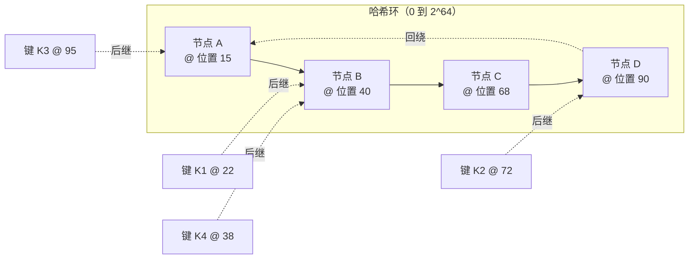
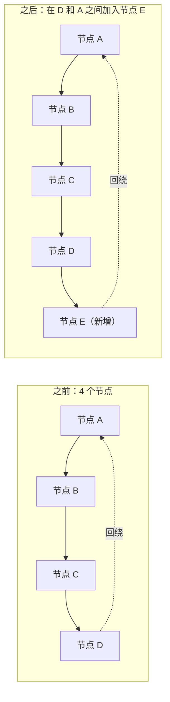
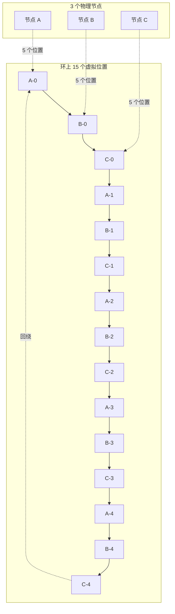
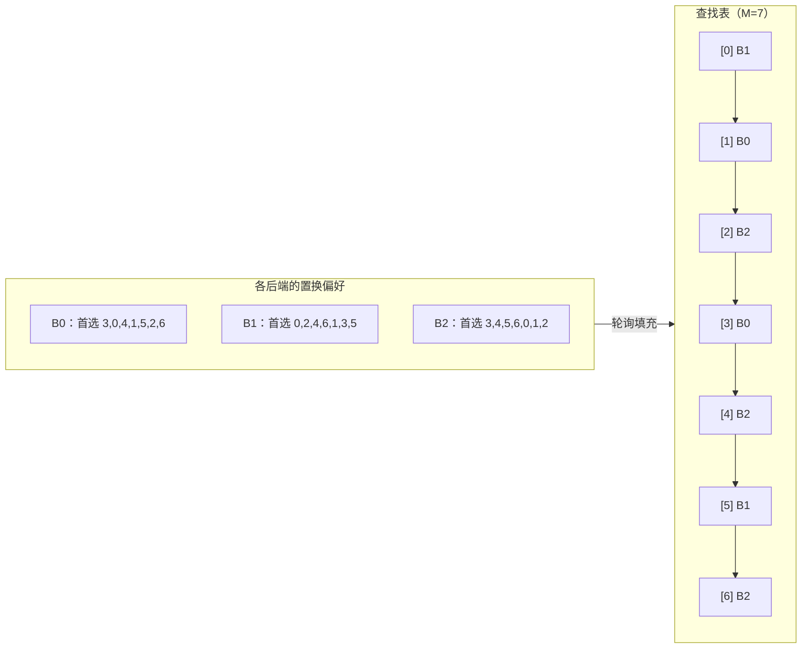

# 一致性哈希：把键分给节点，不必全局重排

> **TL;DR**: 一致性哈希（consistent hashing）把键映射到节点，使得增加或删除一个节点只搬动约 1/N 的键，而不是几乎全部。[^1] 在真实规模下虚拟节点（virtual node）不是可选项，它把负载波动从约 100% 压到 V=100 时约 10% 的标准差。[^2] 有界负载一致性哈希（bounded-load consistent hashing）把任一节点的负载压到平均值的 c 倍以内，彻底消除热点节点引发的级联。Rendezvous 哈希在 N 较小时更简单。Maglev 哈希让 L4 负载均衡器在 10 Gbps 线速下做到 O(1) 查表。[^3] 按你对内存、查找时间和任意节点摘除的约束来挑变体。

## 学习目标

学完本章，你将能够：

- [ ] 把键放到哈希环上，用后继查找（successor lookup）找到归属节点
- [ ] 解释为什么需要虚拟节点才能让负载分布均匀
- [ ] 实现有界负载一致性哈希，给单节点不均衡设上限
- [ ] 比较基于环的一致性哈希与 Rendezvous 哈希（HRW）
- [ ] 针对给定负载，在环哈希、Maglev、jump 哈希和 HRW 之间做选择
- [ ] 把一致性哈希用到缓存、分片数据库和会话保持式负载均衡上

## 直觉理解

想象一个轮盘，上面有四个编号的格子。每个格子代表一台服务器。你转出一颗球（键），它落进某个格子。简单、可预测。

现在赌场要加第五个格子。换成取模哈希（modulo hashing），你得给每个格子重新编号，再把每颗球重转一遍。几乎每颗球都落到新地方。赌客开始闹事。

用一致性哈希，你只是把新格子插进轮盘上两个已有格子之间。只有本来会落在那一段空档里的球才移到新格子，其余原地不动。移动的是五分之一的球，不是五分之四。

虚拟节点相当于给每台服务器在轮盘上撒好几个格子，而不是只给它一整块连续的扇区。某台服务器挂掉时，它那些分散的格子会把球分给许多不同的邻居，而不是一股脑倒给唯一的后继。

这就是它的全部价值主张：节点集合变化时，绝大多数键留在原地。本章余下部分拆解六种主要变体，以及各自适合的场景。

## 原理

### 为什么取模哈希会崩

最简单的键到节点映射是 `node = hash(key) % N`。它均匀、O(1)、零状态。只要 N 不变，它完美工作。

N 一变，几乎一切都得挪。把 memcached 集群从 9 台扩到 10 台，约 9/10 的键会被重映射。[^4] Last.fm 的 Richard Jones 在推出 Ketama 库时描述过这种失效方式：“所有东西都被哈希到了不同的服务器上，等于把整个缓存清空了。”[^4] 后端数据库要同时承接全量请求率砸下来的冷缓存风暴。

对分片数据库来说，同样的算术意味着一处拓扑变更就要搬动约 90% 的数据。这不是边角案例，而是取模哈希在任何成员变更下的必然行为。

只有当 N 固定、且在编译期就已知时才用取模哈希：并行 worker 分桶、内存里的锁表、永不增长的静态分片数。

### 哈希环（Karger 1997，后继查找）

Karger 等人在 STOC 1997 上提出了一致性哈希。[^1] 思路是：把键和节点都映射到一个整数环 `[0, 2^m)` 上。每个键归属于从它的哈希位置顺时针走遇到的第一个节点。



*每个键顺时针走到它遇到的第一个节点；节点 B 拥有从 A 的位置到 B 的位置这段弧上的键。*

**查找：** 在排好序的节点位置数组里二分查找第一个 >= 键哈希值的位置。若键哈希超过所有节点位置，就回绕到位置 0。复杂度 O(log(V * N))，其中 V 是每个物理节点的虚拟节点数。

**关键性质：** 增加一个节点，只夺走它与前驱之间的那段弧。期望搬动的键比例是 1/N。[^1] 摘掉一个节点，它的弧交给后继。其余键全部不动。

1997 年那篇论文证明，每个节点以高概率拿到 O((log N)/N) 比例的键。但每个物理节点只有一个哈希点时，方差很大。这就是实践中必须上虚拟节点的原因。



*在 D 和 A 之间加入节点 E，只夺走 D 到 E 这段弧；A、B、C 持有的键全部不动。期望搬动的键比例：1/N。*

### 虚拟节点（Ketama、Cassandra 默认 256、异构容量）

没有虚拟节点时，每个物理节点占一整段连续的弧。弧长高度不均匀。更糟的是，一个节点失效时它整段弧会砸到唯一后继上，可能把后继压垮，引发级联。

虚拟节点同时解决这两个问题。把每个物理节点哈希 V 次放到环上（例如 `nodeA-0`、`nodeA-1`、……、`nodeA-V`）。这样每个物理节点的负载是散布在环上 V 个小弧之和。故障时负载分给 V 个不同后继，而不是一个。



*每个物理节点映射到环上 V 个散开的虚拟位置；故障时负载分给 V 个不同后继，而不是一个。*

**实际数字：**

- Ketama（libketama）对每台服务器用 MD5 哈希 40 次，每次摘要里取出 4 个点，于是每台服务器有 160 个环上点位。[^5]
- Cassandra 的默认 `num_tokens` 在 2.x 到 3.x 版本是 256。从 Cassandra 4.0 起，配合令牌分配算法，默认值是 16。[^6][^7]
- Damian Gryski 的模拟显示，V=100 时标准差约 10%，V=1000 时约 3.2%。[^2]

**异构容量：** 给更壮的机器更多虚拟节点。Envoy 的 ring-hash 负载均衡器给权重 2 的主机的环上条目数是权重 1 的两倍。[^8]

> [!IMPORTANT]
> **虚拟节点不是越多越好。** Cassandra 把推荐的 `num_tokens` 从 256 降到 16，因为每个物理节点的虚拟节点越多，环上邻居就越多，多节点故障时出现相关性不可用的概率也就越高。[^6]

### 有界负载变体（Mirrokni 2016，容量上限 c）

经典一致性哈希均衡的是键，不是请求。如果 50% 的流量打向同一个键，那么不管你有多少虚拟节点，持有该键的节点都会看到 50% 的流量。

有界负载一致性哈希加了一条硬性容量上限：每个节点最多接受 `c * (total_load / N)` 个请求，其中 c > 1 是均衡系数（通常取 1.25 到 2）。当一个键的首选节点满了，就顺时针探测下一个还有余量的节点。[^10][^9]

Mirrokni、Thorup 和 Zadimoghaddam 证明，每次插入或删除只引起 O(1/e^2) 次键迁移（其中 e = c - 1），与 N 或键总数无关。[^9] e = 0 时算法退化为最少负载优先；e 趋于无穷时它变回朴素的一致性哈希。

这个算法保住了缓存局部性：对同一个首选主机，溢出时走的回退序列也是同一套。也就是说热点键的溢出流量仍然能在可预测的一组节点上吃到缓存。

### Rendezvous / HRW 哈希（O(N) 查找，N 小时更简单）

Rendezvous 哈希（Thaler 与 Ravishankar，1996）比 Karger 的环还早一年。[^11] 对键 k，为每个节点 i 计算 `h(k, node_i)`，把 k 分给 `argmax_i h(k, node_i)`。没有环，没有虚拟节点表，没有预处理。

**权衡：**

- 每次查找 O(N)，但内层循环很紧：每个节点一次 XOR 加一个廉价的整数哈希（xorshift-multiply）。N 到 1000 左右时，性能与环哈希的二分查找相当。[^2]
- 增加节点：只有新哈希胜过当前归属节点的键才会迁移（概率 1/N）。扰动可证明是最小的。[^12]
- 带权 HRW 用 `-weight / log(h)` 缩放每个分数，权重可以干净地叠加。[^12]

**生产环境用户：** GitHub 的负载均衡器、Apache Ignite、Apache Druid、Tahoe-LAFS、IBM Cloud Object Storage 以及 Apache Kafka 客户端。[^12]

当 N 较小（1000 以内）、你想要零预处理、并且更看重实现简单而非查找速度时，用 Rendezvous 哈希。

### Maglev 哈希（连接一致性的 L4 负载均衡，查表）

Google 的 Maglev（NSDI 2016）构建一张固定大小的查找表，大小 M 取质数，常见是 65,537。[^3] 每个后端按自己的置换序列去占它偏好的槽位，直到表被填满。查找时：对五元组做哈希，拿结果索引表。O(1)。



*每个后端按轮询轮流抢占自己最偏好的空槽位；查找就是拿结果去已填满的表里做一次数组下标访问。*

**性能：** Maglev 在单台商用服务器上用小包跑满 10 Gbps 链路。[^3] Envoy 的基准测试显示，与 256K 条目的环哈希相比，Maglev 的主机选择快约 5 倍，表构建快约 10 倍。[^8]

**扰动：** 后端变化时大约是环哈希的两倍。Envoy 文档称相比环哈希“大约会有两倍的键迁移”。[^8] 对 L4 负载均衡器来说这可以接受，因为常见情况由连接跟踪兜住。

**部署情况：** Google（2008 年起）、Meta 的 Katran（基于 XDP，`kDefaultChRingSize = 65537`）、Envoy（可配到 5,000,011）以及 Cilium 的 eBPF 数据面。[^13][^8][^14]

### Jump 哈希（Google 2014，O(1) 空间、O(log N) 时间）

Lamping 和 Veach 在 2014 年发表了 jump 一致性哈希。[^15] 它把键当作伪随机数种子，按概率在桶下标之间“跳跃”前进。五行代码。零内存。O(log N) 时间。桶大小的标准差约 0.000000764%。[^2]

```go
func Hash(key uint64, numBuckets int) int32 {
    var b int64 = -1
    var j int64
    for j < int64(numBuckets) {
        b = j
        key = key*2862933555777941757 + 1
        j = int64(float64(b+1) *
            (float64(int64(1)<<31) / float64((key>>33)+1)))
    }
    return int32(b)
}
```

**关键限制：** 桶的下标是 `0..N-1`，你只能在高端增加或删除。中间摘掉任意一个桶是不支持的。[^15] 这让 jump 哈希不适合任何节点都可能崩的缓存场景。它适合那种靠复制兜故障、分片集合只增不减的分片存储。

## 真实案例

**Vimeo 在 HAProxy 里落地的有界负载一致性哈希（2016）**

Vimeo 的 Skyfire 视频打包服务把请求打到一个共享的 memcached 层。用标准一致性哈希时，应用层自动扩缩容会让缓存命中率发抖：每次扩缩都搬动键，引发缓存未命中，逼着 memcached 回源重取。

Andrew Rodland 在 HAProxy 里实现了有界负载一致性哈希（随 HAProxy 1.7 于 2016 年 11 月发布）。[^16] 这个算法把每个后端的负载压到平均值的 c 倍以内。某个后端打满容量后，请求溢流到环上顺时针的下一台。

**结果：** 高峰期共享缓存的出网带宽从每台服务器 400 到 500 Mbit/s（全集群约 8 Gbit/s）降到每台 100 Mbit/s 以下，单机降了 4 到 5 倍（全集群约 8 倍）。[^16] 缓存命中率稳定下来，对自动扩缩带来的集群规模变化不再敏感。

关键在于：标准一致性哈希在拓扑变化时搬动约 1/N 的键，但如果这些键是热的，新节点上的冷缓存风暴就和搬动的比例完全不成比例。有界负载 CH 不让任何单节点吸走超过平均值 c 倍的负载，于是哪怕热点键溢出也是可预测地摊开。

Google 在 Google Cloud Pub/Sub 里部署了同一套算法。[^10] Envoy 的文档建议，对类 Redis 的缓存，Maglev “很可能就是环哈希的更优平替”，但当你同时需要缓存局部性和硬性负载上限时，有界负载环哈希仍然是最佳选择。[^8]

## 权衡

| 方案 | 查找 | 内存 | 变更时扰动 | 负载方差 | 任意摘除 | 我们的选择 |
|----------|--------|--------|---------------------|---------------|-------------------|----------|
| 取模哈希 | O(1) | 零 | 约 (N-1)/N 的键迁移 | 完美 | 可以 | N 永不改变的固定 worker 池和内存锁表 |
| 环哈希 + 虚拟节点 | O(log(V*N)) | O(V*N) | 约 1/N 的键迁移 | V=100 时约 10% | 可以 | **缓存与分片数据库的默认方案** |
| 有界负载 CH | O(log(V*N)) + 探测 | O(V*N) | O(1/e^2) 次迁移 | 上限 c*avg | 可以 | 存在热点键时 |
| Rendezvous / HRW | O(N) | O(N) | 约 1/N 的键迁移 | 良好 | 可以 | N 小、追求简单 |
| Maglev | O(1) | O(M) | 约 2/N 的键迁移 | 良好 | 可以 | 线速下的 L4 负载均衡器 |
| Jump 哈希 | O(log N) | O(1) | 约 1/N 的键迁移 | 接近完美 | **不行** | 分片存储、单调增长 |

## 常见陷阱

> [!WARNING]
> **虚拟节点太少导致负载不均。** V=1 时，某个节点可能拿到 3 倍于它应得的份额。V=100 时标准差仍有约 10%。缓存场景把 V 设到 100 以上（Ketama 默认 160）。盯住每后端的 QPS，不均衡持续存在就调高 V。[^2]

> [!WARNING]
> **热点键下忘了有界负载。** 一致性哈希均衡的是键，不是请求。幂律型的流量分布会把持有最热键的那个节点压垮，不管你上了多少虚拟节点。开启有界负载，c 取 1.25 到 2；对病态的单键再用显式的键复制。[^10][^16]

> [!WARNING]
> **N 很大时用 Rendezvous 哈希。** HRW 每次查找是 O(N)。N = 10,000 个节点、每秒 1M 次查找，就是每秒 100 亿次哈希运算。用基于骨架的层次化 HRW 降到 O(log N)，或者换成环哈希、Maglev。[^12]

> [!WARNING]
> **拓扑变化时 Maglev 表重建的开销。** 重建一张 65,537 条目的表很快（比构建环哈希快约 10 倍），但依然要花非零时间，而且扰动约为环哈希的两倍。对连接亲和性重要的、延迟敏感的 L7 缓存，选带界负载的环哈希而不是 Maglev。[^8]

> [!WARNING]
> **各客户端之间的哈希函数不一致。** 一致性哈希只在“客户端对节点列表和哈希函数达成一致”这个前提下才一致。如果客户端 A 用 MurmurHash3、客户端 B 用 xxHash，或者两者从过期的服务发现里看到不同的后端列表，那么同一个键会被路由到不同节点。节点列表要用强一致的源头（etcd、Consul）。[^3]

> [!WARNING]
> **迁移期间取模哈希和一致性哈希混用。** 如果上线过程中一半机器用 `hash % N`、一半用环哈希，同一个键会路由到两个不同节点。要原子迁移：把新路由藏在一个特性开关后面部署到所有客户端，然后一次性全量切换。

## 练习

你运维着一个 20 台 memcached 节点、承载 1M RPS 的分布式缓存。你计划在下个季度扩到 40 台。设计客户端路由：选一致性哈希还是 Rendezvous，定虚拟节点数、有界负载系数，并描述扩量过程中缓存命中率会怎么变。

<details>
<summary>提示</summary>

20 个节点时，Rendezvous 哈希意味着每次查找算 20 次哈希，足够快。但到 40 个节点，你光是路由每秒就要做 4000 万次哈希运算。想想在你的规模下这点 CPU 开销是否要紧。至于命中率的问题，想想每一步扩量搬走多少比例的键，以及缓存把这些键重新暖起来要多久。

</details>

<details>
<summary>解答</summary>

**算法选择：** 带虚拟节点的环哈希（Ketama 风格）。N=40 时 Rendezvous 哈希依然可行（每次查找 40 次哈希，约 200ns），但环哈希每次查找是 O(log(V*N)) = O(log 6400)，约 13 次比较，更快，而且如果你扩到 40 以上也更好扩展。

**虚拟节点数：** V = 160（Ketama 的默认值）。满规模时有 160 * 40 = 6,400 个环上点位。单节点负载的标准差约 8% 到 10%，对允许轻微不均的缓存来说可以接受。

**有界负载系数：** c = 1.5。这把任一单节点压在平均负载的 1.5 倍以内。40 个节点、1M RPS，平均值是每节点 25K RPS；没有节点会超过 37.5K RPS。这挡住了热点键，又不至于让溢出抖动太厉害。

**扩量时的表现：** 一次加一台（或者小批量加）。每加一台，约 1/N 的键迁到新节点。N=20 时加一台会搬走约 5% 的键（若缓存了 100 万个键就是 5 万个）。这 5 万个键首次访问会未命中，打到后端存储。1M RPS 下 5% 的未命中率，意味着后端会看到约 50K RPS 的瞬时尖峰。

**缓解手段：** 把扩容摊到低峰窗口。在缓存客户端上开请求合并（single-flight），让同一个键的重复未命中折叠成一次后端请求。还可以在把新节点加进环之前，用近期的访问日志对它预热。

**命中率曲线：** 20 次扩容（20 到 40 台）每一次都会造成约 1/N 的命中率下陷，并在一个缓存 TTL 窗口内（通常是秒到分钟级）恢复。下陷幅度随 N 增大而变小：1/20 = 5%、1/21 = 4.8%、……、1/39 = 2.6%。整轮扩量搬动的键总量约为 ln(40/20) * 总键数 = 69% 的键至少动过一次，但从不会一次性全动。

**接受的权衡：** c=1.5 的有界负载意味着有些键并不总落在它的“理想”节点上。相比无界 CH，缓存局部性略有下降。这笔交易划算，因为热点键保护避免了级联故障。

</details>

## 要点回顾

- 节点集合变化时，一致性哈希把数据搬动降到最低：每次增删约 1/N 的键迁移，而不是约 (N-1)/N。
- 在任何真实规模下虚拟节点都不是可选项。缓存场景从 V=100 到 200 起步，再按实测的负载方差调。
- 有界负载一致性哈希（c = 1.25 到 2）能挡住热点节点级联，并让缓存命中率在自动扩缩下保持稳定。
- N 较小时（1000 节点以内），Rendezvous 哈希比基于环的方案更简单。HRW 够用就别默认上环哈希。
- Maglev 哈希为 L4 负载均衡器提供 O(1) 查找，但拓扑变化时迁移的键约为环哈希的两倍。
- Jump 哈希分布近乎完美、零内存，但不能摘掉任意节点。只用于单调增长的分片集合。
- Ketama 风格的客户端库（libketama、Envoy ring_hash、Redis Cluster）已经把一致性哈希做好了。先读它们的文档，别急着自己造。

## 延伸阅读

- [Consistent Hashing and Random Trees (Karger et al., STOC 1997)](https://dl.acm.org/doi/10.1145/258533.258660) - 原始论文，证明了 K/N 界并定义了环的构造；至少读一下关于均衡性和分布范围的那条定理。
- [Consistent Hashing: Algorithmic Tradeoffs (Damian Gryski, 2018)](https://dgryski.medium.com/consistent-hashing-algorithmic-tradeoffs-ef6b8e2fcae8) - 从业者视角下对 jump、multi-probe、Maglev、HRW 和有界负载的最佳横向对比，带基准测试和标准差的实测数据。
- [Improving load balancing with a new consistent-hashing algorithm (Andrew Rodland, Vimeo 2016)](https://medium.com/vimeo-engineering-blog/improving-load-balancing-with-a-new-consistent-hashing-algorithm-9f1bd75709ed) - 有界负载 CH 如何进 HAProxy、并把 Vimeo 的缓存带宽砍到八分之一；最有说服力的生产案例。
- [Maglev: A Fast and Reliable Software Network Load Balancer (Eisenbud et al., NSDI 2016)](https://www.usenix.org/conference/nsdi16/technical-sessions/presentation/eisenbud) - Google 的 L4 负载均衡架构，含置换表算法。
- [A Fast, Minimal Memory, Consistent Hash Algorithm (Lamping and Veach, 2014)](https://arxiv.org/abs/1406.2294) - 五行代码的 jump 哈希；读它是为了那种优雅，也是为了那个限制。
- [Consistent Hashing with Bounded Loads (Mirrokni, Thorup, Zadimoghaddam, 2016)](https://arxiv.org/abs/1608.01350) - 有界负载 CH 的理论基础，含 O(1/e^2) 迁移量的证明。
- [Envoy supported load balancers](https://www.envoyproxy.io/docs/envoy/latest/intro/arch_overview/upstream/load_balancing/load_balancers) - 关于环哈希、Maglev、P2C 的运维建议，带配置示例。
- [libketama: Consistent Hashing library for memcached clients (Richard Jones, 2007)](https://metabrew.com/article/libketama-consistent-hashing-algo-memcached-clients) - 让一致性哈希在缓存领域流行起来的那篇博文；包含冷缓存风暴的动机说明。

## 记忆卡片

**Q：** 在一个 N 节点的一致性哈希环上加一个节点，多少比例的键会迁移？
**A：** 约 1/N 的键迁到新节点。其余键留在原来的节点上。

**Q：** 取模哈希（`hash % N`）在拓扑变化时为什么失效？
**A：** 改变 N 会重映射约 (N-1)/N 的全部键。从 9 台扩到 10 台会搬走约 90% 的键，引发冷缓存风暴。

**Q：** 虚拟节点解决了什么问题？
**A：** 没有虚拟节点时，每个物理节点占一整段连续的弧，方差很大。虚拟节点把每个节点的归属散到 V 个位置上，把负载方差降到 V=100 时约 10%，并把故障恢复摊给 V 个后继而不是一个。

**Q：** 有界负载一致性哈希的不变式是什么？
**A：** 没有节点收到超过 c * (total_load / N) 个请求，其中 c > 1 是均衡系数。溢出时顺时针探测下一个还有余量的节点。

**Q：** 什么时候该用 Rendezvous（HRW）哈希而不用环哈希？
**A：** N 较小（1000 以内）、想要零预处理和最少代码、且能接受每次查找 O(N) 的时候。HRW 没有环、没有虚拟节点表，扰动可证明最小。

**Q：** Maglev 哈希相比环哈希的核心优势是什么？
**A：** 靠预建表做到 O(1) 查找（环哈希是 O(log(V*N))）。Maglev 的主机选择快约 5 倍，非常适合线速下的 L4 负载均衡器。

**Q：** jump 哈希的关键限制是什么？
**A：** 桶按 0..N-1 编号，只能在高端增删。中间摘掉任意一个桶是不支持的，所以它不适合任何节点都可能崩的缓存。

**Q：** Cassandra 为什么把默认 num_tokens 从 256 降到 16？
**A：** 每个物理节点的虚拟节点越多，环上邻居越多。丢掉任何一个节点都会影响更多令牌区间，从而抬高多节点故障时出现相关性不可用的概率。

**Q：** Vimeo 部署有界负载 CH 后系统有哪些改善？
**A：** 共享缓存出网带宽从每台服务器 400 到 500 Mbit/s 降到 100 Mbit/s 以下，约 8 倍降幅。缓存命中率稳定下来，对自动扩缩事件不再敏感。

**Q：** Maglev 查找表多大，为什么取质数？
**A：** 默认 65,537（质数）。取质数能保证每个后端的置换序列 (offset + j * skip) mod M 在重复之前恰好走遍每个槽位一次，从而保证表被完全填满。

**Q：** Envoy 怎么比较 Maglev 和环哈希？
**A：** Maglev 查找快约 5 倍、构建快约 10 倍，但后端变化时迁移的键大约翻倍。Envoy 认为对多数缓存场景 Maglev 是“更优的平替”。

**Q：** 是什么让一致性哈希“一致”？
**A：** 键到节点的映射在成员变更之间保持稳定。只要那个节点在，同一个键就映射到同一个节点，不管别的节点加入还是离开。

## 参考文献

[^1]: Karger, Lehman, Leighton, Panigrahy, Levine, Lewin. "Consistent Hashing and Random Trees: Distributed Caching Protocols for Relieving Hot Spots on the World Wide Web." STOC 1997. https://dl.acm.org/doi/10.1145/258533.258660
[^2]: Gryski, Damian. "Consistent Hashing: Algorithmic Tradeoffs." 2018. https://dgryski.medium.com/consistent-hashing-algorithmic-tradeoffs-ef6b8e2fcae8 (archived: https://web.archive.org/web/20241231130852/https://dgryski.medium.com/consistent-hashing-algorithmic-tradeoffs-ef6b8e2fcae8)
[^3]: Eisenbud et al. "Maglev: A Fast and Reliable Software Network Load Balancer." NSDI 2016. https://www.usenix.org/conference/nsdi16/technical-sessions/presentation/eisenbud
[^4]: Jones, Richard. "libketama: Consistent Hashing library for memcached clients." Metabrew, April 10 2007. https://metabrew.com/article/libketama-consistent-hashing-algo-memcached-clients
[^5]: RJ/ketama. libketama/ketama.c (table construction and ring-hash lookup). https://github.com/RJ/ketama/blob/master/libketama/ketama.c
[^6]: Apache Cassandra. "Architecture: Dynamo" (Murmur3Partitioner, vnodes, token ring). https://cassandra.apache.org/doc/latest/cassandra/architecture/dynamo.html
[^7]: Apache Cassandra. "cassandra.yaml file configuration" (num_tokens default). https://cassandra.apache.org/doc/latest/cassandra/managing/configuration/cass_yaml_file.html
[^8]: Envoy Project. "Supported load balancers" (ring hash, Maglev). https://www.envoyproxy.io/docs/envoy/latest/intro/arch_overview/upstream/load_balancing/load_balancers
[^9]: Mirrokni, Thorup, Zadimoghaddam. "Consistent Hashing with Bounded Loads." arXiv:1608.01350, 2016. https://arxiv.org/abs/1608.01350
[^10]: Mirrokni, Thorup, Zadimoghaddam. "Consistent Hashing with Bounded Loads." Google Research Blog, April 3 2017. https://research.google/blog/consistent-hashing-with-bounded-loads/
[^11]: Thaler, Ravishankar. "A Name-Based Mapping Scheme for Rendezvous." University of Michigan CSE-TR-316-96, 1996. https://web.archive.org/web/20241217195251/https://www.eecs.umich.edu/techreports/cse/96/CSE-TR-316-96.pdf
[^12]: Wikipedia. "Rendezvous hashing" (HRW history, systems using it, weighted variant). https://en.wikipedia.org/wiki/Rendezvous_hashing
[^13]: Meta. "Katran" (facebookincubator/katran) README and katran/lib/CHHelpers.h. https://github.com/facebookincubator/katran
[^14]: Cilium. "cilium-dbg bpf lb" (Maglev lookup table in eBPF datapath). https://docs.cilium.io/en/latest/cmdref/cilium-dbg_bpf_lb/
[^15]: Lamping, Veach. "A Fast, Minimal Memory, Consistent Hash Algorithm." arXiv:1406.2294, 2014. https://arxiv.org/abs/1406.2294
[^16]: Rodland, Andrew. "Improving load balancing with a new consistent-hashing algorithm." Vimeo Engineering Blog, December 19 2016. https://medium.com/vimeo-engineering-blog/improving-load-balancing-with-a-new-consistent-hashing-algorithm-9f1bd75709ed (archived: https://web.archive.org/web/20250101010558/https://medium.com/vimeo-engineering-blog/improving-load-balancing-with-a-new-consistent-hashing-algorithm-9f1bd75709ed)
