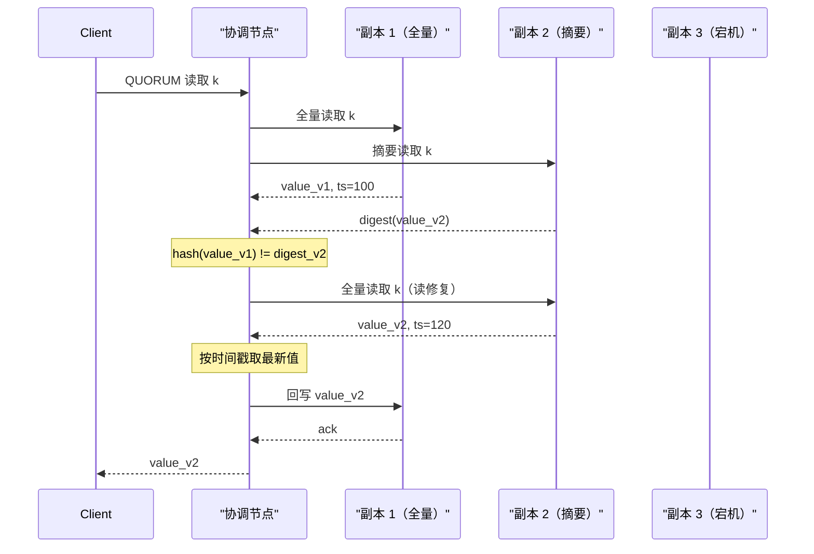
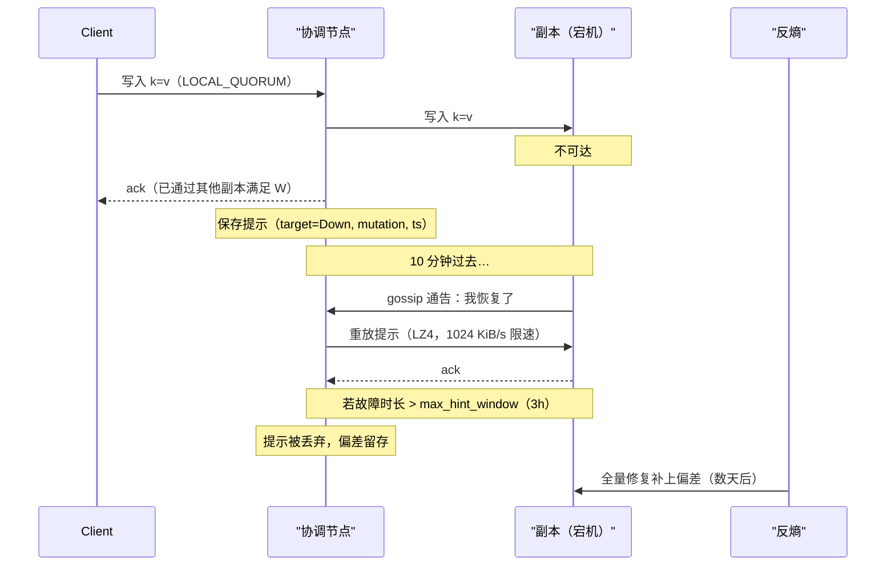
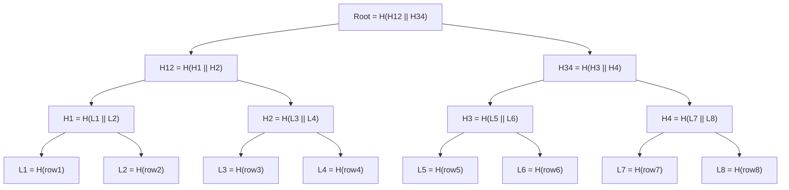
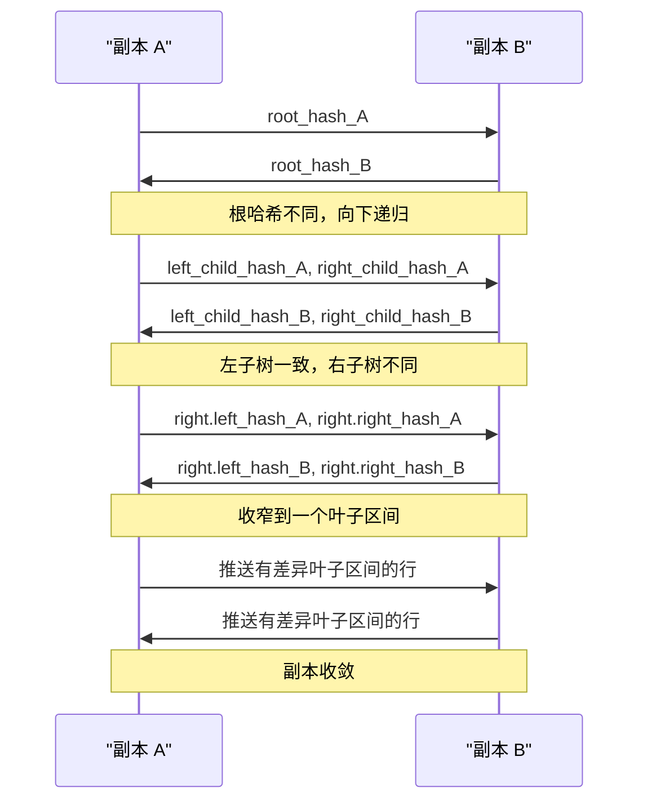

# Merkle 树与反熵：低成本保持副本同步

> **TL;DR**: 反熵（anti-entropy）是最终一致性存储的后台免疫系统。在 Dynamo 风格的系统里，写入落到 N 个副本中的 W 个，其余副本会慢慢偏离。有三种机制把副本重新推向一致：读修复（read repair，负责热 key）、提示移交（hinted handoff，负责短暂故障，默认窗口 3 小时[^1]），以及基于 Merkle 树的全量修复（负责其余一切）。一棵 Merkle 树用单个 32 字节的根哈希[^2]概括数十亿个 key。比较两个副本从这个根开始；根相同，就 O(1) 收工。根不同，就递归进入子节点，用 O(log N) 次比较把范围收窄到那少数几个有差异的区间，而不是把每个 key 都传一遍[^3]。修复的 I/O 开销很大（通常每节点 10 到 100 MB/s[^4]），所以要像对待运维任务一样给它排期：限速、分段，并且必须在 `gc_grace_seconds`（默认 10 天[^5]）内跑完，否则被删除的数据会复活。

## 学习目标

学完本模块，你将能够：

- [ ] 在一个 key 区间上构造 Merkle 树，并用它找出有差异的区间
- [ ] 区分读修复、提示移交和后台反熵
- [ ] 分析运行中的集群里反熵的带宽与 CPU 开销
- [ ] 为运维上的可控性调整修复的节奏和并发度
- [ ] 在其他场景中认出 Merkle 树（Git、区块链、内容寻址存储）

## 直觉理解

想象两位图书管理员，各自管着同一套 1 万本书的馆藏，分处两栋楼。每天都有书进进出出。偶尔送货车抛锚，某一家就漏收了一批书。他们怎么在不逐本翻书脊的前提下找出哪些书不一样？

他们把每座图书馆分成 100 个书架。每位管理员为每个书架算出一个摘要码（该架上所有 ISBN 的哈希）。他们打电话比对这 100 个码。第 47 号书架相同就跳过；不同就下钻：把它再切成 10 个小格，比对这些码，一路收窄到真正不同步的那 2 本书。他们只寄这 2 本书，而不是全部 1 万本。

这就是 Merkle 树。“摘要码”是密码学哈希，“书架”是树节点，“打电话比对码”是反熵协议。关键洞察是：先比根，大多数时候根相同，一次交互就结束。

现在把“图书管理员”换成数据库副本，把“书”换成行，把“送货车抛锚”换成网络分区。这就是 Cassandra、Riak 和 DynamoDB 里的反熵。

## 原理

### 分歧问题

在无主（leaderless）系统中，复制因子为 N、写一致性为 W < N 时，一次成功的写入只需 W 个副本确认。剩下的 N-W 个副本理应追上来，但很多事会拦住它们：协调节点在投递前就崩了、提示队列写满了、分区持续时间超过了提示窗口、磁盘位翻转损坏了 SSTable，或者软件 bug 丢掉了一次变更[^3][^1]。

“最终一致”不等于“自动一致”。没有一套主动把副本推向一致的协议，偏差就会不断累积。更糟的是，如果墓碑（删除标记）在删除传播到所有副本之前就被垃圾回收，被删除的数据可能重新冒出来[^5]。你需要主动的收敛机制。

Dynamo 系系统叠了三层这样的机制，各自覆盖不同的故障形态：

1. **读修复**在读取过程中修掉热 key 的分歧。
2. **提示移交**覆盖短暂的、瞬时的故障。
3. **Merkle 树反熵**覆盖其余一切：冷 key、过期的提示、位腐（bit rot）以及人为误操作。

### 读修复

在一次 quorum 读中，协调节点向最近的副本发一次全量读，向其他副本发摘要读（只读哈希）。摘要一致，数据立刻返回。摘要不一致，协调节点从所有副本拉全量读，按时间戳挑出最新值，把胜出的值写回每个陈旧副本，然后才回复客户端[^6]。

*读修复会阻塞客户端响应，直到陈旧副本被更新，从而在 Cassandra 4.0+ 中保证单调 quorum 读。*

Cassandra 4.0 把阻塞式读修复变成唯一模式（CASSANDRA-13910 移除了旧的概率式 `read_repair_chance`）[^6]。这带来了“单调 quorum 读”：连续的读不会在时间上倒退。

**局限：** 读修复只覆盖客户端真正读过的 key。冷 key——写过一次就再没被查询过的 key——对它来说是不可见的。Riak 的文档称这是纯读修复系统的“主要缺陷”[^7]。

### 提示移交

当写入某个宕机副本失败时，协调节点在本地存一条“提示”：序列化后的变更加上目标节点 ID。等目标节点通过 gossip 宣告自己恢复，协调节点就把提示重放给它[^1]。

*提示移交以很低的成本覆盖短暂故障；超过 3 小时窗口的提示会被丢弃，留下的偏差交给全量修复处理。*

Cassandra 的默认值：`max_hint_window` = 3 小时，`hinted_handoff_throttle` = 每条投递线程 1024 KiB/s，投递线程 2 条[^1]。一次 10 分钟的故障，若期间以 100 Mbps 持续写入，大约产生 7 GB 提示，按默认限速要花约 2 小时才能重放完[^1]。

**关键局限：** 节点宕机时间超过提示窗口后，新的提示会被丢弃。协调节点不可能无限缓冲（那会写满自己的磁盘）。由此产生的偏差只能靠全量修复消除。

### Merkle 树

Merkle 树（Merkle, CRYPTO 1987[^8]）是一棵哈希二叉树。每个叶子是一个数据块的哈希，每个内部节点是其两个子节点拼接后的哈希。单个根哈希即对所有叶子的承诺。

*一棵覆盖 8 行的 Merkle 树：每个叶子对一行做哈希，内部节点对自己的子节点做哈希，单个根承诺了全部数据。*

**为什么这对反熵重要：** 比较两个副本，就是交换它们的根哈希。根相同，两个副本完全一致，一次往返结束。根不同，就递归进入哈希不一致的子树，收窄到确切的有差异区间。N 个 key 中有 K 处差异时，代价是 O(K log N) 次哈希比较，而不是 O(N) 次数据传输[^3][^9]。

**哈希算法的选择很关键。** RFC 6962（Certificate Transparency）使用带域分隔（domain separation）的 SHA-256：叶子按 `SHA-256(0x00 || data)` 哈希，内部节点按 `SHA-256(0x01 || left || right)` 哈希，以防第二原像攻击[^9]。Cassandra 走的是另一条路：每个节点存一个 32 字节哈希，由两个 MurmurHash3_128 摘要拼接而成（`HASH_SIZE = 32; // 2xMM3_128 = 32 bytes`），内部节点用 XOR 组合子节点，而不是重新哈希[^2]。这里 XOR 之所以安全，只是因为这些叶子哈希本身已经抗碰撞；XOR 只是一个快速、可交换的组合器，不是隐藏函数。在对抗性场景（区块链、CT 日志）里，每一层都必须用密码学哈希。

### 全量反熵

Cassandra 的 `nodetool repair` 会触发完整协议。对每个 token 区间，它在每个副本上跑一次校验压缩（validation compaction），在 SSTable 之上构建 Merkle 树。副本之间交换树、算出差异，只流式传输有差异的区间[^4]。

*两个副本自上而下交换树哈希，只递归进不一致的子树，然后为少数有差异的叶子区流式传数据。*

Cassandra 有三种修复变体：

- **全量修复（full repair）：** 在所有 SSTable 上重建 Merkle 树。I/O 开销高，但能兜住一切。
- **增量修复（incremental repair，2.2 起为默认，4.0 起可靠）：** 只考虑尚未标记为已修复的 SSTable。4.0 的重设计（CASSANDRA-9143）把会话包进一个事务性 prepare 阶段，将候选 SSTable 反合并（anti-compact）进一个“待修复”池，从而消除了困扰 4.0 之前增量修复的过度流式传输（overstreaming）bug[^10]。
- **子区间修复（subrange repair）：** 把修复限制在特定 token 区间（`-st`/`-et`），降低每次会话的内存和 I/O 开销[^4]。

**Riak 的主动反熵（Active Anti-Entropy, AAE）** 走的是另一条路：它作为后台进程持续运行，把 Merkle 树持久化到磁盘（通过 LevelDB），并在每次写入时实时更新叶子。每周它从头重建一次树，以捕获磁盘上的静默损坏[^7]。

### 数据库之外的 Merkle 树

只要系统需要对大数据集做紧凑、防篡改的承诺，这种“哈希之树”的模式就会出现：

- **Git：** 每个 commit 都是一棵 Merkle 树的根。blob、tree 和 commit 都以内容的 SHA-1 寻址。一个 commit 的哈希间接承诺了它整棵目录子树[^11]。
- **比特币：** 区块内交易的 Merkle 根放在 80 字节的区块头里。SPV（轻）客户端只下载区块头（约 4.2 MB/年），再用一条 O(log N) 的 Merkle 分支验证任意交易是否被打包[^12]。
- **以太坊：** 使用修改版 Merkle Patricia Trie，在每个区块头中承诺全局状态、存储、交易和收据[^13]。
- **Certificate Transparency（RFC 6962）：** 一棵只追加的 TLS 证书 Merkle 树。审计者用 `ceil(log2(n))` 个节点的审计路径验证包含性，并在 Signed Tree Head 之间用最多 `ceil(log2(n)) + 1` 个节点的一致性证明验证只追加性[^9]。
- **IPFS：** 每个对象都是一个 Merkle DAG 节点。默认的 UnixFS 分块器使用 256 KiB 的块，DAG 宽度为 174[^14]。
- **BitTorrent v2（BEP 52）：** 按文件生成 Merkle 根，叶子块 16 KiB，使用 SHA-256，取代了 v1 的扁平 SHA-1 分片列表[^15]。

背后是同一个想法：单个根哈希充当对任意规模数据的紧凑承诺。轻客户端不必下载完整数据集就能验证包含性。

## 真实案例

### Cassandra Reaper：把大规模修复管起来

在 100 节点的 Cassandra 集群上手工跑 `nodetool repair` 是运维上的酷刑。每次修复会话都要在内存里建 Merkle 树、在副本之间流式传数据，还要跟生产读写抢磁盘 I/O。没有编排，运维会撞上连锁的压缩风暴、流式传输超时，以及永远跑不完的修复周期。

[Cassandra Reaper](https://cassandra-reaper.io/)（最初由 Spotify 创建，后由 The Last Pickle 维护，如今归 DataStax）通过把修复切成小的、可管理的段来解决这个问题。一个每节点 256 个 vnode 的 3 节点集群，至少产生 768 个段[^16]。Reaper 对每个副本一次只调度一个段，目标是每段 10 到 15 分钟[^16]。

**背压：** Reaper 会监控每个节点上待处理的压缩。待处理压缩超过 20 个，它就暂停调度，等集群追上来。这避免修复把生产负载饿死[^17]。

**强度控制：** `intensity` 设置控制整个集群上并行跑多少个段。强度为 1.0 时，每个副本并发跑一个段。更小的值会进一步限速。

**关键不变式：** 一个完整的修复周期必须在 `gc_grace_seconds`（默认 10 天）内完成。否则，在已经收到删除的副本上墓碑可能被垃圾回收，而某个陈旧副本仍持有那行活数据。下一次修复就会把陈旧行推回去，“复活”已删除的数据[^5][^18]。Reaper 按表暴露“最后修复时间”时间戳，让运维能确认这个不变式成立。

**典型运维节奏：** 每 1 到 3 天做一次增量修复，每 1 到 3 周做一次全量修复，整个全量周期要在 10 天宽限窗口内完成。流式传输期间，运维通常观察到每节点 10 到 100 MB/s 的修复带宽，具体取决于硬件和 `stream_throughput_outbound` 设置[^4]。

## 纵深防御：反熵机制

Dynamo 系存储不会只挑一种反熵机制；它们叠加三层（读修复、提示移交、基于 Merkle 的全量修复），因为每种覆盖不同的故障模式，单靠任何一种都不够用。下表列出的是各机制在体系中的角色，而不是让你在它们之间做选择。

| 机制 | 在体系中的角色 | 触发时机 | 关键可调项 | 说明 |
|---|---|---|---|---|
| 读修复（同步 / BLOCKING） | 在用户读的过程中修掉热 key 的分歧 | 每次副本间存在分歧的 QUORUM 读 | `read_repair` 选项；Cassandra 4.0+ 的阻塞模式（CASSANDRA-13910） | 所有 QUORUM 读的默认行为；提供单调读保证，但增加读延迟 |
| 读修复（异步 / NONE） | 读取时尽力清理，不付延迟代价 | 低重要性读（例如 ONE） | `read_repair_chance`（仅 Cassandra <4.0） | 可能破坏单调性；不要依赖它保证正确性；只用于非关键路径 |
| 提示移交 | 兜住短暂的瞬时故障（滚动重启、网络抖动） | 协调节点为暂时宕机的副本排队写入，并在其恢复后重放 | `max_hint_window`（默认 3 小时[^1]）；提示磁盘配额 | 常开的补充手段；受窗口和磁盘配额限制，更长的故障仍需全量修复 |
| 全量反熵（Merkle） | 兜住冷 key、被丢弃的提示、位腐 | 按计划节奏（通常每周）或事故后 | `gc_grace_seconds`（默认 10 天[^5]）；修复并行度；Reaper 的 20 个待处理压缩阈值[^17] | 唯一能捕获无人读取的 key 上的分歧的机制；必须在 `gc_grace_seconds` 内完成 |

## 常见陷阱

> [!WARNING]
> **修复慢于 gc_grace 会导致墓碑复活。** 如果修复周期要 12 天，而 `gc_grace_seconds` 是 10 天，墓碑就会在删除传播到所有副本之前被垃圾回收。下一次修复把陈旧的行推回去，复活已删除的数据。永远让一个完整修复周期在 gc_grace 内结束，并留出运维余量（每 7 天修一次，宽限期 10 天）[^5]。

> [!WARNING]
> **不限速的修复会造成 I/O 风暴。** 校验压缩会读取被修复区间内的每个 SSTable。没有背压，修复可能让磁盘读速率翻倍并塞满压缩队列。用 Reaper，配合它的 20 个待处理压缩阈值和有界并行度[^17]。

> [!WARNING]
> **提示窗口短于分区时长。** 如果节点宕机 4 小时而 `max_hint_window` 是 3 小时，最后一小时的写入会悄悄丢在提示里。读修复只覆盖被读到的 key。任何超过提示窗口的故障之后，都要安排一次全量修复[^1]。

> [!WARNING]
> **4.0 之前的增量修复会过度流式传输。** 在 4.0 之前的 Cassandra 中，某个 SSTable 若在修复中途被压缩掉，就永远得不到 `RepairedAt` 时间戳。下一轮会把它当未修复数据，产生连锁的虚假差异，显著放大流式 I/O。升级到 4.0+，那里的 CASSANDRA-9143 引入了事务性 prepare 阶段[^10]。

> [!WARNING]
> **以为只靠读修复就能覆盖冷 key。** 读修复对没人读的 key 是隐形的。一个写过一次就再没被查询的 key 可以无限期地保持分歧。全量反熵是唯一能捕获它们的机制[^7]。

> [!WARNING]
> **在对抗性场景里用弱哈希。** BitTorrent v1 用 SHA-1；SHA-1 碰撞变得可行之后，v2 迁到了 SHA-256。在非对抗性的数据库修复场景（Cassandra）中，MurmurHash3 够用。在对抗性场景（CT 日志、区块链）中，用 SHA-256 或更强，并加域分隔[^9][^15]。

## 练习

你的 Cassandra 集群有 30 个节点、每节点 5 TB、RF=3，两个 AZ 之间偶尔出现 1 小时的分区。请设计修复策略：何时做全量修复、用子区间修复还是增量修复、如何限制修复期间的带宽，以及如何处理提示窗口。

提示

想想这几件事：(1) 10 天的 `gc_grace_seconds` 截止期；(2) 30 节点 × 5 TB 对 Merkle 树内存意味着什么；(3) 1 小时分区期间提示的处境，与默认 3 小时窗口的关系；(4) Reaper 的分段如何让单次修复会话保持小规模。

答案

**修复类型：** 以增量修复（Cassandra 4.0+）为主，每月做一次全量修复，兜住边界情况累积的偏差。

**用 Reaper 排期：**

- 部署 Cassandra Reaper，使用基于分段的调度。
- 目标每段 10 到 15 分钟。30 个节点、每节点 256 个 vnode、RF=3，一个完整周期会有数千个段。
- 把 intensity 设为 1.0（每个副本并发一个段），背压阈值设为 20 个待处理压缩。
- 安排增量修复每 5 到 7 天完成一个完整周期，远在 10 天 `gc_grace_seconds` 之内。

**带宽控制：**

- Reaper 的 intensity 设置加上待处理压缩背压，会自然限制 I/O。
- 要显式限制带宽，用 Cassandra 的 `stream_throughput_outbound`（默认 200 Mbps）限制每个节点的流式传输速率。
- 每节点 5 TB，校验压缩开销很大。子区间修复（每段更小的 token 区间）能让内存占用保持有界，并允许失败的段重试而不必重做整个区间。

**提示窗口：**

- 1 小时的分区远在 3 小时的默认 `max_hint_window` 之内。提示会累积，并在分区恢复后成功重放。
- 分区期间若以 100 Mbps 写入，每个协调节点大约积累 4.2 GB 提示。按 1024 KiB/s 限速、2 条线程，重放约需 35 分钟。可以接受。
- 如果计划内维护可能超过 3 小时，用 `nodetool setmaxhintwindow`（Cassandra 4.0+）临时调大 `max_hint_window`。

**读修复：** 保持阻塞式读修复开启（4.0 的默认）。它以零运维成本自动处理热 key 的收敛。

**监控：** 按 keyspace 跟踪修复完成时间，对照 `gc_grace_seconds`。任何表的“最后修复时间”超过 7 天就告警。

## 要点回顾

- 反熵是最终一致性存储的后台免疫系统。你看不看它，它都在跑。
- 差异很小时，Merkle 树把副本比较从 O(N) 降到 O(log N)。根哈希是数十亿个 key 的 32 字节摘要。
- 读修复、提示移交和基于 Merkle 的全量修复并存。每种覆盖不同的故障模式，单靠任何一种都不够。
- 修复必须在 `gc_grace_seconds`（默认 10 天）内完成，否则墓碑会让已删除的数据复活。
- 修复的 I/O 开销很大（通常每节点 10 到 100 MB/s）。像对待任何运维任务那样规划速率、窗口和并发度。用 Reaper。
- Cassandra 4.0 用事务性 prepare 阶段修掉了增量修复的过度流式传输 bug。依赖增量修复之前先升级。
- Merkle 树随处可见：数据库、Git、比特币、以太坊、Certificate Transparency、IPFS 和 BitTorrent v2。统一的想法是：对大数据集做紧凑承诺。

## 延伸阅读

- [Dynamo: Amazon's Highly Available Key-value Store (SOSP 2007)](https://www.allthingsdistributed.com/files/amazon-dynamo-sosp2007.pdf) - 第 4.7 节为 Dynamo 系存储引入了基于 Merkle 树的反熵；这是整章的基础论文。
- [Apache Cassandra Repair Documentation](https://cassandra.apache.org/doc/stable/cassandra/managing/operating/repair.html) - 全量、增量、子区间修复机制的权威参考，含 `nodetool` 参数和 gc_grace 不变式。
- [Riak Active Anti-Entropy](https://docs.riak.com/riak/kv/latest/learn/concepts/active-anti-entropy/) - 关于持久化磁盘 Merkle 树、持续 AAE 和每周从 K/V 后端重建的最清晰的生产级说明。
- [A Digital Signature Based on a Conventional Encryption Function (Merkle, CRYPTO 1987)](https://link.springer.com/chapter/10.1007/3-540-48184-2_32) - 原始论文；Merkle 树本身只是用一次性签名构造多消息签名的副产品。
- [RFC 6962: Certificate Transparency](https://datatracker.ietf.org/doc/html/rfc6962) - 关于 Merkle 审计路径、一致性证明和域分隔叶子哈希最干净的标准级写作。
- [Incremental Repair Improvements in Cassandra 4 (The Last Pickle)](https://thelastpickle.com/blog/2018/09/10/incremental-repair-improvements-in-cassandra-4.html) - 讲清了 4.0 之前的过度流式传输 bug 和事务性修法；重要的生产背景。
- [Cassandra Reaper](https://cassandra-reaper.io/) - 调度修复的运维工具；读 Concepts 页面了解分段大小、背压和强度调优。
- [Bitcoin Whitepaper, Section 7](https://nakamotoinstitute.org/static/docs/bitcoin.pdf) - 80 字节区块头里的 Merkle 根让 SPV 轻客户端成为可能；Merkle 树最经典的非数据库应用。

## 记忆卡片

**Q:** Merkle 树在副本同步中解决什么问题？
**A:** 它把找出两个副本之间差异 key 的代价，从 O(N)（逐个比 key）降到 O(K log N)（自上而下比哈希、只递归进不一致的子树），其中 K 是差异数量。

**Q:** Dynamo 系系统里有哪三种反熵机制？
**A:** 读修复（读取时修热 key）、提示移交（覆盖不超过提示窗口的短暂故障），以及基于 Merkle 树的全量修复（覆盖冷 key、过期提示、位腐和人为误操作）。

**Q:** Cassandra 默认的 `max_hint_window` 是多少，过期后会发生什么？
**A:** 3 小时。节点宕机更久，协调节点就停止生成提示。节点回来时，在其缺席期间写入的 key 上带有永久性偏差；只有全量修复能修。

**Q:** 为什么修复必须在 `gc_grace_seconds` 内完成？
**A:** 墓碑在 gc_grace（默认 10 天）之后被垃圾回收。如果某个副本错过了墓碑，而修复没能在 GC 之前把删除传过去，下一次修复就会看到那行陈旧的活数据并把它推回来，复活已删除的数据。

**Q:** Cassandra 在 Merkle 树里如何组合子哈希？
**A:** 对两个 32 字节的子哈希做按位 XOR，而不是把拼接结果再哈希一遍。这之所以安全，是因为叶子哈希本身已经是抗碰撞的 MurmurHash3 摘要。在对抗性场景（CT 日志、区块链）中，每一层都必须做密码学重哈希。

**Q:** Cassandra 4.0+ 中全量修复和增量修复有什么区别？
**A:** 全量修复在所有 SSTable 上构建 Merkle 树。增量修复只考虑尚未标记为已修复的 SSTable，并使用事务性 prepare 阶段把候选反合并进“待修复”池，以防过度流式传输。

**Q:** Riak 的主动反熵与 Cassandra 的修复有什么不同？
**A:** Riak AAE 在后台持续运行（不由运维触发），把 Merkle 树持久化在磁盘上（而非内存里），每次写入时实时更新叶子，并每周从头重建一次树以捕获静默损坏。

**Q:** 比特币区块头里的 Merkle 根是什么？
**A:** 一个 32 字节的 SHA-256 哈希，承诺区块内所有交易。它位于 80 字节的区块头中，让 SPV 客户端用 O(log N) 的 Merkle 分支验证交易是否被包含，而不必下载完整区块。

**Q:** Merkle 树哈希里的域分隔是什么，为什么重要？
**A:** RFC 6962 在哈希前给叶子加 `0x00` 前缀、给内部节点加 `0x01` 前缀。没有这个前缀，攻击者可以伪造一个与叶子碰撞的内部节点哈希，破坏第二原像抗性。

**Q:** Cassandra Reaper 做什么？
**A:** 它把 token 环切成小段（目标每段 10 到 15 分钟）来编排修复，带背压地调度（待处理压缩超过 20 个就暂停），并确保完整修复周期在 `gc_grace_seconds` 内完成。

**Q:** 举出三个使用 Merkle 树的非数据库系统。
**A:** Git（commit 是项目内容的 Merkle 树根）、比特币（区块头里的交易 Merkle 根，用于 SPV 验证）、Certificate Transparency（TLS 证书的只追加 Merkle 树，提供可审计的包含证明）。

**Q:** 4.0 之前的增量修复过度流式传输 bug 是什么？
**A:** 如果某个 SSTable 在修复的数据流传输阶段被压缩掉，生成的新 SSTable 永远得不到 `RepairedAt` 时间戳。下一轮把它当成未修复，产生虚假的 Merkle 不一致和连锁传输，把 I/O 显著放大。

## 参考文献

[^1]: Apache Cassandra, "Hints" documentation (Cassandra 5.0). https://cassandra.apache.org/doc/stable/cassandra/managing/operating/hints.html
[^2]: Apache Cassandra source, `org.apache.cassandra.utils.MerkleTree`. https://github.com/apache/cassandra/blob/trunk/src/java/org/apache/cassandra/utils/MerkleTree.java
[^3]: DeCandia et al., "Dynamo: Amazon's Highly Available Key-value Store", SOSP 2007. https://dl.acm.org/doi/10.1145/1294261.1294281
[^4]: Apache Cassandra, "Repair" documentation (Cassandra 5.0). https://cassandra.apache.org/doc/stable/cassandra/managing/operating/repair.html
[^5]: Apache Cassandra, "Repair" docs, gc_grace section. https://cassandra.apache.org/doc/stable/cassandra/managing/operating/repair.html
[^6]: Apache Cassandra, "Read repair" documentation (Cassandra 5.0). https://cassandra.apache.org/doc/stable/cassandra/managing/operating/read_repair.html
[^7]: Basho, "Active Anti-Entropy", Riak KV documentation. https://docs.riak.com/riak/kv/latest/learn/concepts/active-anti-entropy/
[^8]: Merkle, "A Digital Signature Based on a Conventional Encryption Function", CRYPTO 1987. https://link.springer.com/chapter/10.1007/3-540-48184-2_32
[^9]: Laurie, Langley, Kasper, "Certificate Transparency", RFC 6962, IETF, June 2013. https://datatracker.ietf.org/doc/html/rfc6962
[^10]: Alex Dejanovski, "Incremental Repair Improvements in Cassandra 4", The Last Pickle, 10 Sep 2018. https://thelastpickle.com/blog/2018/09/10/incremental-repair-improvements-in-cassandra-4.html
[^11]: Chacon and Straub, "Pro Git, 2nd Edition", Chapter 10.2: Git Internals - Git Objects. https://git-scm.com/book/en/v2/Git-Internals-Git-Objects
[^12]: Nakamoto, "Bitcoin: A Peer-to-Peer Electronic Cash System", 2008, section 7. https://nakamotoinstitute.org/static/docs/bitcoin.pdf
[^13]: Ethereum Foundation, "Patricia Merkle Trie." https://ethereum.org/en/developers/docs/data-structures-and-encoding/patricia-merkle-trie/ (see also the reference implementation at https://github.com/ethereum/execution-specs).
[^14]: IPFS boxo source, `DefaultLinksPerBlock` and `DefaultBlockSize` (UnixFS importer). https://github.com/ipfs/boxo/blob/main/ipld/unixfs/importer/helpers/helpers.go
[^15]: BitTorrent.org, "BEP 52: The BitTorrent Protocol Specification v2". https://www.bittorrent.org/beps/bep_0052.html
[^16]: Cassandra Reaper, "Easy Repair Management for Apache Cassandra" and Concepts page. https://cassandra-reaper.io/docs/concepts/
[^17]: Cassandra Reaper, "Core Concepts" (segments, back-pressure, concurrency, intensity). https://cassandra-reaper.io/docs/concepts/
[^18]: k8ssandra, "Reaper for Cassandra repairs". https://docs.k8ssandra.io/components/reaper/
