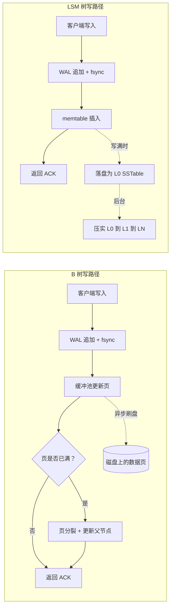
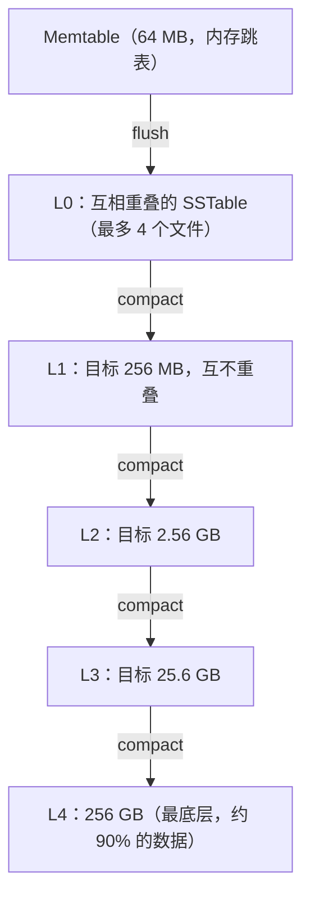
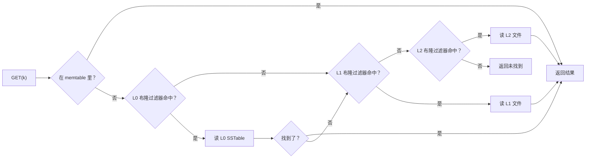
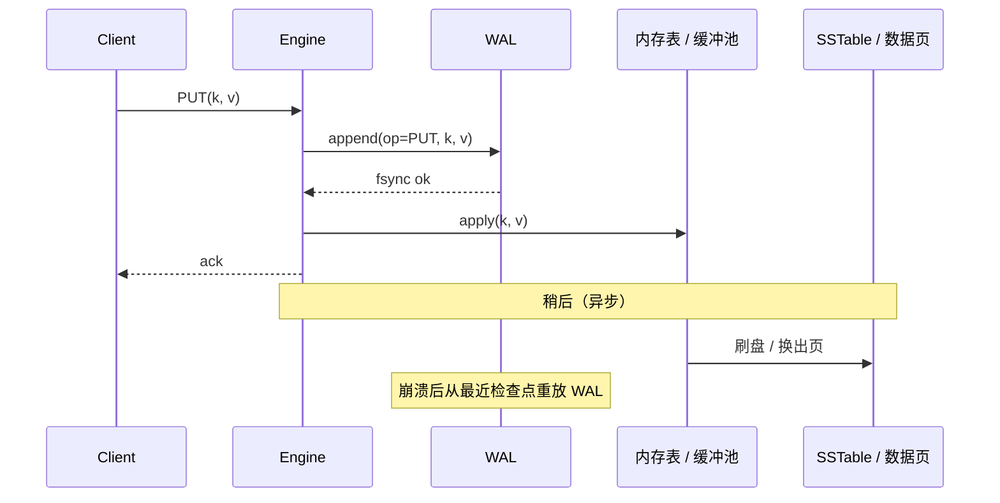

# 存储引擎：B 树、LSM 树，以及你的数据库为何如此表现

> **TL;DR**: 存储引擎决定字节如何变成行，也决定行如何在断电后活下来。两大主流流派是 B 树（原地更新、读优化）和 LSM 树（只追加、写优化）。你不可能同时把写放大、读放大和空间放大都压到最低[^1]。B 树接受 16-256 倍的写放大，换来一次寻址就能读到的点查。LSM 树接受压实带来的 10-30 倍写放大，换来顺序写。Facebook 从 InnoDB 迁到 MyRocks（一种 LSM）后把存储减半[^2]。Discord 在两种 LSM 引擎之间迁移，把 P99 读延迟从 125 ms 降到 15 ms[^3]。你选的引擎会一路传导到备份策略、复制模型和值班负担上。

## 学习目标

学完本章，你将能够：

- [ ] 从读放大、写放大、空间放大三个角度解释 B 树与 LSM 树的机制
- [ ] 论证为什么 OLTP 数据库多用 B 树，而写密集的存储多用 LSM 树
- [ ] 就 WAL、检查点、布隆过滤器与压实策略展开推理
- [ ] 针对某个负载选出一款存储引擎，并用数字为这个选择辩护
- [ ] 诊断由压实、页分裂或 vacuum 引起的性能断崖

## 直觉理解

想象两种整理书架的方式。

**图书管理员式书架（B 树）。** 书按字母顺序排列。新书到了，你找到正确的位置，把后面的书统统往旁边挪一格腾出空间。找任何一本书都很快：你清楚该往哪儿看。但插入很贵，因为你得亲手搬动已有的书。书架满了就拆成两层，再去楼上更新目录卡片。

**堆叠合并式书架（LSM 树）。** 新书先放在一张“新到”桌上。桌子放满了，你把这一堆排序，装进一个封好的箱子放到地上。隔一段时间，有个帮手把几个箱子合并成一个更大的有序箱子。找书时先看桌子，再依次查每个箱子。你可以在箱子外面贴一张“不在本箱内的书”清单（布隆过滤器）来加速。插入毫不费力：把书扔到桌上就行。

两种方式都能让书找得到。图书管理员式书架奖励查询、惩罚插入；堆叠合并式书架奖励插入、惩罚查询。没有哪一种绝对更好。选哪种，取决于你的负载读得多还是写得多。

这就是存储引擎的根本权衡。[Data Structures for Systems](../part-0-prerequisites/02-data-structures-for-systems.md) 把 B 树和跳表当作抽象结构介绍过。本章讲生产数据库如何在它们之上搭出真正的引擎，以及这个选择为什么会一路影响到长尾延迟和磁盘账单。

## 原理

### 存储引擎是什么

存储引擎是负责把行持久化到持久存储、为它们建索引、并在崩溃后把它们恢复出来的那一层。它位于查询层之下，向上暴露一个有序键值 API。

MySQL 的可插拔引擎架构，让同一套 SQL 前端可以同时坐在 InnoDB（B 树，默认）、MyISAM（老式 B 树）或 MyRocks（基于 RocksDB 的 LSM）上，客户端协议完全不变[^2]。PostgreSQL 没有公开的可插拔接口，但同样把堆存储、nbtree 索引，以及面向 GiST、GIN、BRIN 和 hash 的访问方法接口分了开来。

有三个原语在两个流派中都是通用的：

1. **预写日志（WAL）：** 每次变更在被应用之前，先顺序追加到一条持久日志里。任何瞬间崩溃，都能靠重放已提交记录恢复。
2. **MVCC：** 多版本让读操作不必阻塞写操作。PostgreSQL 把版本内联存（每个元组带 xmin/xmax）。InnoDB 把旧版本放在回滚段里。
3. **后台回收：** B 树是页分裂和 VACUUM；LSM 是压实。这两种税你总得缴一种。

### B 树的机制

B 树引擎把数据存在固定大小的页里。InnoDB 用 16 KB 的页[^4]，PostgreSQL 用 8 KB。每个内部页装几百个键和子指针，扇出高到即使十亿行的表，树深也只有 4-5 层[^5]。

**写是原地进行的。** 要更新一行，引擎在缓冲池里找到叶子页，改掉它，标记为脏页。这个页最终会被刷回磁盘上它固定的位置。页装不下就分裂：一半的键搬到新页，父节点的指针跟着更新。分裂还可能层层向上传导。

**InnoDB 的聚簇索引**把行数据直接放在主键 B 树的叶子页里。二级索引存的是主键作为指针，而不是堆表偏移量。这意味着走二级索引查一行要做两次树遍历：先在二级索引里找，再回主键树里取行。

**PostgreSQL 的堆表模型**把职责切得不一样。行数据放在一个无序的堆里，B 树索引存 (key, heap-tuple-ID) 对。一次 UPDATE 会在堆里写一个新元组，并在旧元组上设置 `xmax`。死元组不断累积，直到 VACUUM 把它们回收。在持续写密集、又不调 vacuum 的情况下，一张 10 GB 的表可以占到磁盘 50 GB[^6]。

**写放大**在 B 树上来自“为一点小改动重写整页”。更新一行 100 字节的数据要重写一个 16 KB 的页：在页这一级就是 160 倍放大。实践中缓冲池会把多个更新攒在一次刷页里，所以真实写放大会低一些，但对随机写负载仍然可观。

*B 树在写完 WAL 之后原地重写页；LSM 只把写追加进 WAL 并插入内存 memtable，把所有磁盘上的组织工作都推给后台压实。*

### LSM 树的机制

LSM 树引擎把写缓冲在一个内存中的有序结构里（memtable，通常是一个跳表）。memtable 达到阈值（RocksDB 默认 64 MB[^7]）后变为不可变，并作为一个有序字符串表（SSTable）刷到磁盘。

SSTable 按层组织。第 0 层（L0）比较特殊：文件之间的键范围可能重叠，因为每个文件都是一次 memtable 刷盘的直接产物。L0 攒够文件（RocksDB 默认 4 个）后就被压实进 L1。之后每一层都是上一层的 10 倍大[^8]。

**所有落到持久存储上的写都是顺序的。** WAL 追加、SSTable 刷盘、压实的输出，全是顺序 I/O。这就是 LSM 引擎在同样硬件上能跑到比 B 树更高的持续写吞吐的原因。

**代价是压实。** 分层压实会让数据每穿过一层就被重写一次。在扇出为 10、共 5 层的情况下，写放大通常是 10-30 倍[^1][^9]。Universal（分层归并）压实用更高的空间放大换更低的写放大（约 9 倍）：一次大压实会“临时把磁盘占用翻倍”[^14]，所以要按约 100% 的瞬时额外开销做规划，并让磁盘占用保持在 50% 以下。

**读更贵。** 一次点查要查 memtable，然后可能要把每个 L0 文件都查一遍，再在每个非零层最多查一个文件。没有布隆过滤器的话，这意味着每次查询都要读好几次盘。

*RocksDB 使用 dynamic-level-bytes 时的分层压实布局。每一层是上一层的 10 倍大，约 90% 的数据住在最底层。*

### 布隆过滤器与读优化

布隆过滤器是一个概率型位数组，用来回答“键 k 在不在这张 SSTable 里”，它没有假阴性，假阳性率可调。每键 10 位时，假阳性率约为 1%；每键 16 位时降到 0.05%[^10]。

RocksDB 给每张 SSTable 挂一个布隆过滤器。点查时，引擎先查过滤器，再决定要不要加载数据块。如果过滤器说“肯定不在这里”，引擎就整个跳过这个文件。对不存在的键，这能消掉大约 99% 的无用磁盘读。

Monkey 论文（SIGMOD 2017）证明，最优的内存分配是给更小（更浅）的层按指数级分配更多每键位数，因为这些层最先被查，那里出现假阳性的代价最高[^11]。

布隆过滤器帮不上范围扫描。如果你的负载以范围扫描为主，LSM 引擎每次查询都要付满额的读放大。

*带布隆过滤器的 LSM 点查路径。每一层都先查过滤器再加载数据；否定结果直接跳过该层，从而把读放大限制住。*

### 压实策略

压实策略决定哪些 SSTable 在什么时候合并。主流的有三种：

**分层（RocksDB 默认，Cassandra LCS）。** 小的定长 SSTable 按层组织，每层大 10 倍。合并很激进：第 N 层的一个 SSTable 会和第 N+1 层所有键范围重叠的文件合并。结果是有界的读放大（每个非零层只查一个文件）和低空间放大（最坏约 10%）。代价是 10-30 倍的写放大。

**按大小分层（Cassandra STCS）。** 把大小相近的 SSTable 合并成一个更大的文件。逻辑更简单，写放大更低（典型约 9 倍）。代价是一次大压实会临时把磁盘占用翻倍（约 100% 的瞬时空间开销，因为输入文件和输出文件在合并结束前同时存在[^14]）；运维经验是让 STCS 节点的磁盘使用率保持在 50% 以下。由于多个有序段可能重叠，读放大更高。

**时间窗口（Cassandra TWCS）。** 按插入时间窗口给 SSTable 分组。窗口内用按大小分层，窗口关闭时每个窗口产出一个文件。对带 TTL、老窗口可以整块丢弃的时序数据非常合适。如果迟到写入会改动老时间窗口，这套策略就失效了。

### WAL 与崩溃恢复

每个存储引擎都用预写日志。规则很简单：先把变更写进日志并 fsync，再在内存里应用它。进程崩了，就从最近的检查点开始重放日志。

B 树引擎用 ARIES 风格的恢复，分三个阶段：分析（从日志重建脏页表和事务表）、重做（重放所有已记录的操作，把数据库带到崩溃那一刻的状态）、撤销（用补偿日志记录回滚未提交的事务）[^12]。

LSM 引擎的恢复更简单。RocksDB 把每个写批次追加到 WAL，并附一个 CRC32C 校验和。恢复时从最近的检查点开始重放。默认模式（`kPointInTimeRecovery`）在遇到第一条损坏记录时停下，接受最后一个在途写入可能丢失。

对运维的含义：每次提交至少需要一次 fsync。这把写吞吐上限压在设备的同步写速率上。标准缓解手段是组提交（把多个事务攒成一次 fsync）。

*每次变更都先写日志并 fsync，然后才在内存中应用并返回确认。恢复时从最近的检查点重放日志，保证已确认的写不会丢。*

## 真实案例

### Facebook 从 InnoDB 迁到 MyRocks

Facebook 的用户数据库（UDB）存着社交图谱。它跑在启用压缩的 InnoDB（B 树）上。到 2016 年，整个集群被空间卡住了：CPU 和 I/O 还有余量，但压缩后的 InnoDB 在压缩比上已经到顶。团队需要在不添硬件的前提下把存储成本减半。

MyRocks 把 RocksDB 包装成 MySQL 的存储引擎。它保留了 InnoDB 的聚簇索引语义（行按主键顺序存放）和二级索引行为（二级索引把主键作为值存）。事务通过 MySQL binlog 和 RocksDB WAL 的两阶段提交完成，所以复制和崩溃一致性都保住了[^2]。

迁移策略很保守。MyRocks 可以从 InnoDB 复制，反过来也行，因此能按副本集逐批切换并随时回滚。影子查询把生产流量在 MyRocks 副本上重放，用来在正式切换前把并发 bug 冲出来。文件删除被限速到 128 MB/s，避免 Flash 上的 TRIM 卡顿。

**结果：** 相比压缩后的 InnoDB，存储占用减半。经过此后数年的优化，实例规格又降低了大约 62%[^13]。整个 UDB 集群用大约一年完成迁移。

**Discord 从 Cassandra 迁到 ScyllaDB**讲的是互补的另一面：当你选对了引擎流派（LSM），却选错了实现，会发生什么。Discord 的 Cassandra 集群长到 177 个节点，存着数万亿条消息。压实积压严重到需要跳“gossip 舞”（摘掉节点、让它压完、再加回来）。Java GC 停顿造成不可预测的延迟尖峰。读 P99 在 40 到 125 ms 之间波动[^3]。

ScyllaDB 用同一套 LSM 数据模型，但换成每核一分片的 C++ 架构，彻底消除了 GC 停顿。迁移后：72 个节点（原来 177 个），读 P99 为 15 ms（原来 125 ms），迁移过程本身通过一个 Rust 工具跑到了每秒 320 万条消息[^3]。

教训是：选存储引擎不只是“B 树还是 LSM”的问题。实现细节（GC、压实调度、线程模型）和数据结构流派同样重要。

## 权衡

| 方案 | 写放大 | 读放大 | 空间放大 | 适用场景 | 我们的选择 |
|----------|-----------|----------|-----------|-----------|----------|
| B 树（InnoDB、PostgreSQL） | 小随机写在页这一级是 16-256 倍[^2]；有缓冲池批量合并时摊薄后更低 | 每次点查约 1 次逻辑寻址（缓冲池通常缓存了内部节点） | VACUUM 之后接近 1 倍；Postgres 不调优时膨胀可达约 5 倍，10 GB 的表变成 50 GB[^6] | 读写混合、需要事务和二级索引的 OLTP | **通用 OLTP 的默认选择** |
| LSM 分层（RocksDB、Cassandra LCS） | 典型 10-30 倍；RocksDB 文档称其“常常大于 10”[^8] | 每个非零层一个 SSTable，外加布隆过滤器未命中检查；再加约 L0 个文件[^8] | 开启 `level_compaction_dynamic_level_bytes=true` 时约 1.1 倍（最坏约 10%）[^8] | 写密集或以写入吞吐为主、读能容忍布隆过滤器开销的负载 | **写密集存储的默认选择** |
| LSM 分层归并（Cassandra STCS、RocksDB universal） | RocksDB 在 `max_size_amplification_percent=25` 的示例中约 9 倍[^14] | 更高：最坏情况下每个有序段一次读，没有按层的上界[^14] | 大压实期间瞬时可达约 2 倍（输入输出文件并存）；“临时把磁盘占用翻倍”[^14] | 对写放大敏感、又有 100% 瞬时空间余量的负载；配合 TWCS 的时序数据 | 当写放大是硬约束时 |
| 键值分离（WiscKey、RocksDB BlobDB、Titan） | 大 value 下逼近 1 倍：压实只重写键和 blob 指针 | 多一次间接寻址：热读要多读一次 blob 文件 | blob 文件 GC 带来额外开销；对 value 频繁变更敏感 | 大 value（平均 >= 1 KB）、追加式写入为主的摄取 | 小众但在增长 |

## 常见陷阱

> [!WARNING]
> **突发写入下的压实卡顿。** L0 文件超过减速阈值（RocksDB 默认 20 个）时，引擎开始限速写入；超过停止阈值（36 个）时，写入完全停住。盯着 `rocksdb.num-files-at-level-0`，在撞墙之前把压实并行度调上去。

> [!WARNING]
> **autovacuum 调不到位导致的 PostgreSQL 膨胀。** 每次 UPDATE 都会留下一个死元组。如果 autovacuum 跟不上，10 GB 的表会在磁盘上长到 50 GB，索引指向死行，最终事务 ID 回卷触发紧急 vacuum，把整个集群冻住。把 `autovacuum_vacuum_scale_factor` 调小，并监控 `n_dead_tup`。

> [!WARNING]
> **UUIDv4 主键引起页分裂。** 随机顺序的插入打散在整个 B 树键空间上，导致持续不断的页分裂。每次分裂要重写半个页并更新父指针。改用有序键（自增、ULID、UUIDv7），让插入打在树的右边缘。

> [!WARNING]
> **墓碑标记拖垮读。** 在 LSM 引擎里，删除是墓碑标记，不是物理删除。墓碑会一直留到压实把它们在最底层丢掉。持续的删除流如果配上不够激进的压实，读就要一路扫过这些死标记。Discord 最后一次迁移卡住，就是因为有巨大的墓碑区间从未被压实掉[^3]。

> [!WARNING]
> **布隆过滤器被挤出内存。** 如果布隆过滤器没有被固定在块缓存里，内存压力一大就会被驱逐。此后每次点查都要付重新加载过滤器的 I/O 成本。在 RocksDB 里设 `cache_index_and_filter_blocks = true` 和 `pin_l0_filter_and_index_blocks_in_cache = true`。

## 练习

你跑着一个服务，每秒摄取 200,000 条小的事件记录（平均 200 字节），偶尔按 ID 做点查，很少做范围扫描。选一款存储引擎，给 memtable 和块缓存定容量，选一种压实策略，并用它来对抗“直接用 Postgres 就行了”这个朴素基线。

提示

先算写带宽：200,000 * 200 字节 = 40 MB/s 的用户数据。再想写放大会把它放大多少倍。想清楚你的读是点查（对布隆过滤器友好）还是范围扫描（不友好）。再想想每秒 20 万次更新下 PostgreSQL 的 VACUUM 会怎样。

解答

**引擎选择：RocksDB + 分层压实。**

**为什么不用 PostgreSQL？** 在每秒 20 万条 200 字节记录的写入下，PostgreSQL 每秒会产生 20 万个死元组。autovacuum 得持续回收约 40 MB/s 的死空间。实践中，持续写压下 vacuum 会落后，造成表膨胀、索引膨胀，最终引发事务 ID 回卷的紧急状况。随机 ID 带来的 B 树页分裂成本还会再加一层写放大。

**memtable 容量：** 以 40 MB/s 的摄取速度，64 MB 的 memtable 大约每 1.6 秒就刷一次盘。这频率偏高但还能管。加到 128 MB 可以降低刷盘频率和 L0 文件数，给压实留出更多喘息空间。

**块缓存：** 按 ID 的点查对布隆过滤器友好。把可用内存的 70% 分给块缓存，并把布隆过滤器钉住。每键 10 位、每秒 20 万个键的话，布隆过滤器内存每秒增长约 250 KB，可以忽略。

**压实策略：** 分层压实给出有界的读放大（对点查很重要）和低空间放大（约 10%）。10-30 倍的写放大意味着设备要承受 400 MB/s 到 1.2 GB/s。现代 NVMe SSD 轻松扛得住。

**为什么不用分层归并（tiered/universal）？** 你的读是点查，不是范围扫描。分层压实保证每个非零层只有一个文件，也就是每次读要检查的文件更少。更高的写放大可以接受，因为你的摄取速率（40 MB/s）即使放大 30 倍也远在设备带宽之内。

**接受的权衡：** 你放弃了 PostgreSQL 丰富的查询层（join、事务、SQL），换来 5-10 倍更好的写吞吐和没有 vacuum 压力。如果确实需要 SQL，可以考虑 CockroachDB（底层用 Pebble，一种 LSM）或 MyRocks。

## 要点回顾

- 存储引擎掌管磁盘布局、索引、持久性和恢复。它位于查询层之下，塑造你关心的每一项运维属性。
- B 树优化读（每次点查一次寻址），为写买单（页分裂、随机 I/O、页级 16-256 倍写放大）。
- LSM 树优化写（顺序 I/O、高吞吐），为读买单（多层查找），也为后台工作买单（压实带来的 10-30 倍写放大）。
- 你不可能同时把写放大、读放大和空间放大都压到最低。选引擎就是选你愿意花掉哪一种放大。
- 布隆过滤器（每键 10 位对应 1% 假阳性率）消掉 99% 的无用 SSTable 读，让 LSM 的点查变得实用。
- 存储引擎的选择会层层传导：Facebook 用 MyRocks 把存储减半；Discord 换掉 LSM 实现，把 P99 从 125 ms 降到 15 ms。
- 压实的调参、vacuum 的调参、布隆过滤器的内存管理，正是存储引擎运维者拿工资的地方。

## 延伸阅读

- [The Log-Structured Merge-Tree (O'Neil et al., 1996)](https://www.cs.umb.edu/~poneil/lsmtree.pdf) - 定义 LSM 树及其放大成本的开山论文；读第 3 节看原始成本模型。
- [Designing Data-Intensive Applications, Ch. 3](https://dataintensive.net/) - Kleppmann 对 B 树与 LSM 的经典教学式综述；建立直觉最好的一章。
- [RocksDB Wiki: Leveled Compaction](https://github.com/facebook/rocksdb/wiki/Leveled-Compaction) - 最常见的 LSM 压实策略的权威参考，包含 dynamic-level-bytes。
- [How Discord Stores Trillions of Messages](https://discord.com/blog/how-discord-stores-trillions-of-messages) - 当代最好的 LSM 迁移案例；从 Cassandra 到 ScyllaDB，有具体的 P99 数字和运维教训。
- [Migrating a Database from InnoDB to MyRocks (Meta, 2017)](https://engineering.fb.com/2017/09/25/core-infra/migrating-a-database-from-innodb-to-myrocks/) - Meta 在 UDB 上从 B 树迁到 LSM 的实践，含复制、影子查询和 TRIM 限速的运维技巧。
- [Monkey: Optimal Navigable Key-Value Store (SIGMOD 2017)](https://stratos.seas.harvard.edu/publications/monkey-optimal-navigable-key-value-store) - 证明每层布隆过滤器位数的最优分配；调 LSM 读性能时必读。
- [Introducing Pebble (Cockroach Labs, 2020)](https://www.cockroachlabs.com/blog/pebble-rocksdb-kv-store) - CockroachDB 为什么用 Go 原生 LSM 替换 RocksDB；讲了 cgo 边界的成本和变形测试。
- [PostgreSQL B-Tree Indexes Documentation](https://www.postgresql.org/docs/current/btree.html) - nbtree 内部结构、页布局和去重的权威来源。

## 记忆卡片

**Q:** 制约存储引擎权衡的三个放大因子是什么？
**A:** 写放大（每字节用户数据写入设备的字节数）、读放大（每次逻辑读对应的磁盘读次数）、空间放大（磁盘占用除以活数据大小）。三者不可能同时压到最低。

**Q:** InnoDB 和 PostgreSQL 的默认页大小是多少？
**A:** InnoDB 用 16 KB 的页，PostgreSQL 用 8 KB 的页。它们是 I/O 的原子单位，也是小更新会带来大写入放大的原因。

**Q:** RocksDB 的分层压实是怎么工作的？
**A:** memtable 刷成 SSTable 进 L0。L0 攒到 4 个文件就压实进 L1。每层是上一层的 10 倍大。第 N 层的一个 SSTable 和第 N+1 层所有重叠文件合并。这把读放大限制在每个非零层一个文件。

**Q:** 每键 10 位的布隆过滤器假阳性率是多少？
**A:** 约 1%。也就是说，点查不存在的键时，99% 的不必要 SSTable 读被省掉了。

**Q:** Facebook 为什么从 InnoDB 迁到 MyRocks？
**A:** UDB 被空间卡住，但 CPU/IO 还有余量。压缩后的 InnoDB 压缩比已经到顶。MyRocks（把 RocksDB 作为 MySQL 引擎）把存储占用减半，因为 LSM 压实产生的压缩比比 B 树的页级压缩更好。

**Q:** Discord 在 Cassandra 上的核心问题是什么，ScyllaDB 又是怎么解决的？
**A:** Cassandra 的 Java GC 停顿和压实积压造成不可预测的延迟（P99 在 40-125 ms）。ScyllaDB 用每核一分片的 C++ 架构、没有 GC，把 P99 降到 15 ms，集群从 177 个节点降到 72 个。

**Q:** 实践中分层压实的写放大是多少？
**A:** 通常 10-30 倍。压实过程中每字节用户数据会随它穿层被反复重写。扇出为 10、共 5 层时理论上限很高，但 dynamic-level-bytes 等优化把它压在 10-30 倍这个区间。

**Q:** 为什么 PostgreSQL 在写密集负载下会出现表膨胀？
**A:** PostgreSQL 的 MVCC 每次 UPDATE 都写一个新元组，把旧元组留成死空间。VACUUM 必须回收死元组。如果更新速率超过 vacuum 的回收速率，死元组就堆积起来。不调优的话，10 GB 的表在磁盘上能长到 50 GB。

**Q:** 分层压实和按大小分层压实有什么区别？
**A:** 分层：激进地合并进互不重叠的层，读放大和空间放大都低，但写放大高（10-30 倍）。按大小分层：合并大小相近的文件，写放大更低（约 9 倍），但空间放大更高（压实期间可达 50%），读放大也更高。

**Q:** 什么时候该选 B 树引擎而不是 LSM 树引擎？
**A:** 当负载是读密集，或读写混合且对事务、二级索引和可预测的 P99 有强要求时。B 树能给出一次寻址的点查，也不会有压实卡顿。

**Q:** RocksDB 的 L0 文件数超过停止写入阈值时会发生什么？
**A:** 写入完全停住，直到压实把 L0 文件数降到阈值以下。这就是“压实卡顿”，也是生产环境 LSM 系统写延迟尖峰的来源。

**Q:** 所有存储引擎共享的三个通用原语是什么？
**A:** 预写日志（确认前先持久化）、MVCC（读不阻塞写）、后台回收（B 树用 vacuum，LSM 用压实）。

## 参考文献

[^1]: O'Neil, Cheng, Gawlick, O'Neil, "The Log-Structured Merge-Tree (LSM-Tree)", 1996. https://www.cs.umb.edu/~poneil/lsmtree.pdf
[^2]: Matsunobu, "Migrating a database from InnoDB to MyRocks", Meta Engineering, 2017. https://engineering.fb.com/2017/09/25/core-infra/migrating-a-database-from-innodb-to-myrocks/
[^3]: Ingram, "How Discord Stores Trillions of Messages", Discord Engineering, 2023. https://discord.com/blog/how-discord-stores-trillions-of-messages
[^4]: Oracle, "The Physical Structure of an InnoDB Index", MySQL 8.0 Reference Manual. https://docs.oracle.com/cd/E17952_01/mysql-8.0-en/innodb-physical-structure.html
[^5]: Bartunov, Postgres Professional, "Indexes in PostgreSQL - 4 (Btree)", 2019. https://habr.com/ru/companies/postgrespro/articles/443284/
[^6]: Tanaskovic, "PostgreSQL MVCC and Vacuum Internals". https://nemanjatanaskovic.com/blog/postgresql-mvcc-vacuum-internals
[^7]: RocksDB, `include/rocksdb/options.h` in facebook/rocksdb repository. https://github.com/facebook/rocksdb/blob/main/include/rocksdb/options.h
[^8]: RocksDB Wiki, "Leveled Compaction". https://github.com/facebook/rocksdb/wiki/Leveled-Compaction
[^9]: RocksDB Wiki, "RocksDB Tuning Guide", Level Style Compaction section. https://github.com/facebook/rocksdb/wiki/RocksDB-Tuning-Guide
[^10]: Wikipedia, "Bloom filter". https://en.wikipedia.org/wiki/Bloom_filter
[^11]: DASlab Harvard, "Monkey: Optimal Navigable Key-Value Store" project page. http://daslab.seas.harvard.edu/monkey
[^12]: Mohan et al., "ARIES: A Transaction Recovery Method Supporting Fine-Granularity Locking and Partial Rollbacks Using Write-Ahead Logging", ACM TODS, 1992. See also Sookocheff, "Write-ahead logging and the ARIES crash recovery algorithm", 2022. https://sookocheff.com/post/databases/write-ahead-logging/
[^13]: Matsunobu et al., "MyRocks: LSM-Tree Database Storage Engine Serving Facebook's Social Graph", VLDB 2020. https://www.vldb.org/pvldb/vol13/p3217-matsunobu.pdf
[^14]: RocksDB Wiki, "Universal Compaction". See "Double Size Issue" and "A major compaction can take a long time and temporarily double the amount of disk space used for the column family." https://github.com/facebook/rocksdb/wiki/Universal-Compaction
