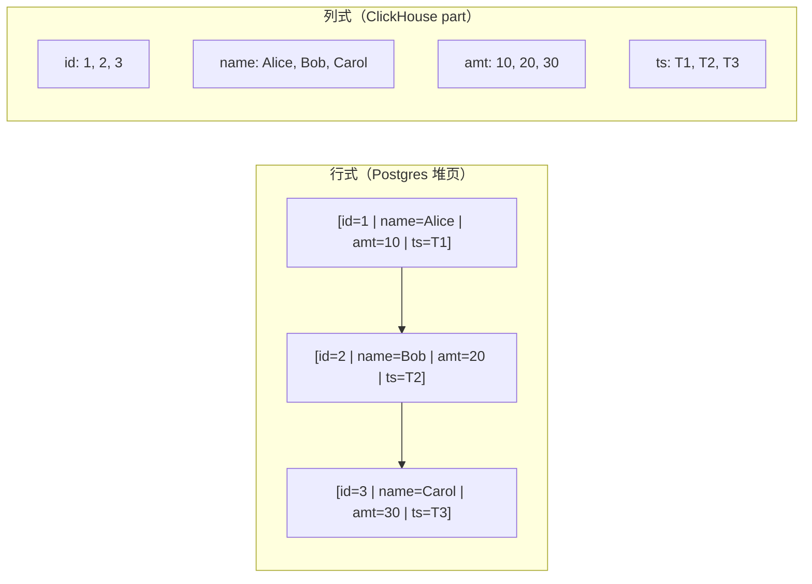
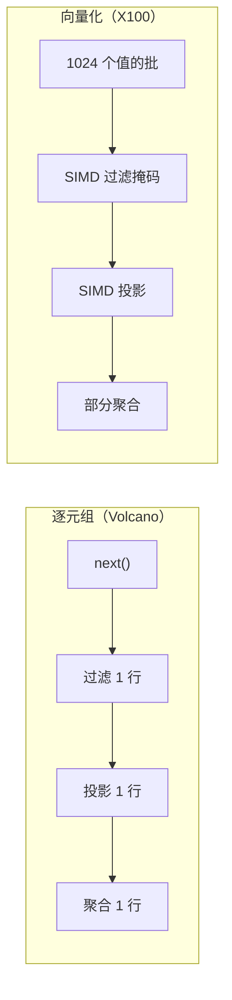
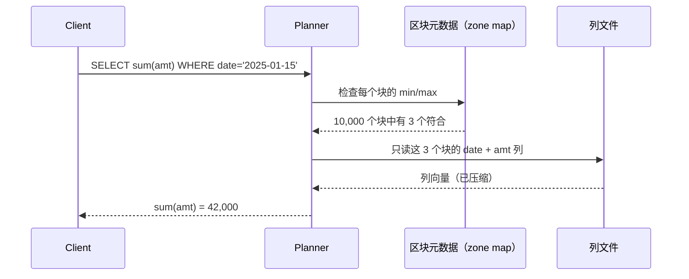
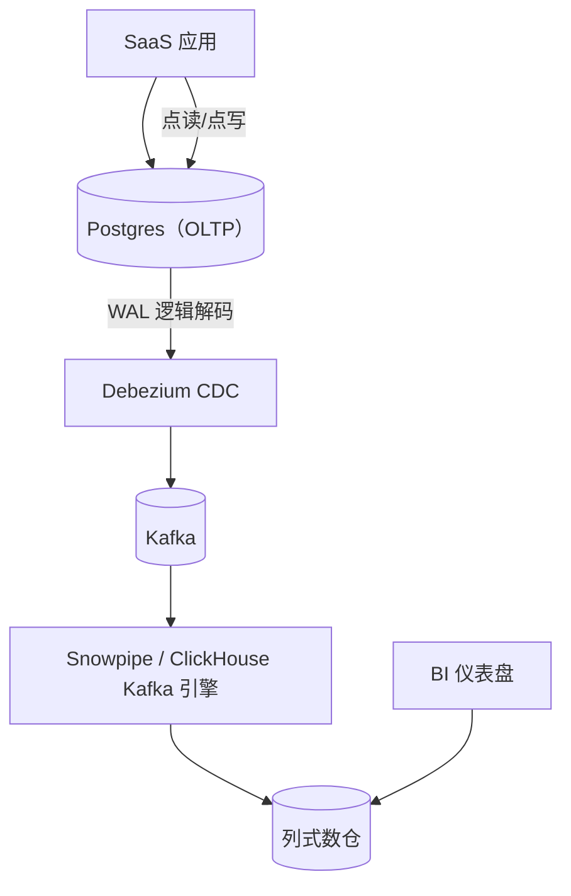

# OLTP vs OLAP：行式存储、列式存储与负载形态匹配

> **TL;DR**: OLTP 负载每秒发起数千个短事务，每个事务按主键访问少量行。OLAP 负载每分钟只发几条查询，每条都要扫描数百万到数十亿行并做聚合。行式存储（Postgres、MySQL）把完整元组连续放在一起，点查极快。列式存储（Redshift、BigQuery、ClickHouse、Snowflake）把每个属性连续放在一起，压缩率高出 5 到 20 倍[^1]，聚合速度快 10 到 100 倍[^2]。把存储布局匹配到负载形态，是你所能做的最有杠杆效应的数据架构决策。做错了，仪表盘查询在 Postgres 上要跑 30 秒；做对了，Cloudflare 在 ClickHouse 上不到 2 秒就能扫完 1.61 千万亿（quadrillion）条事件[^3]。

## 学习目标

学完本模块，你将能够：

- [ ] 按访问模式而不仅是名字来区分 OLTP 与 OLAP 负载
- [ ] 解释列式存储在聚合上为何取胜、在按行查找上为何落败
- [ ] 认识各种压缩技巧：字典编码、游程编码、位打包、增量编码、基准帧编码
- [ ] 描述向量化执行，以及它为何取代了逐元组处理
- [ ] 针对给定负载在 Postgres、Redshift、BigQuery、ClickHouse 和 Snowflake 之间做选择
- [ ] 设计一套把事务流量与分析流量路由到正确引擎的系统

## 直觉理解

想象一间会计办公室里的档案柜。

**行式存储**就像每个文件夹里装一张完整发票。每个文件夹把客户名、明细项、金额、日期钉在一起。客户打电话来问 #4,827 号发票，你抽出那一个文件夹，什么都齐了。很快。但 CFO 问“上季度总收入是多少”，你就得打开每一个文件夹，找到金额字段，逐个相加。几千个文件夹，每次只取一个字段。慢得让人难受。

**列式存储**则像分开装订的活页册：一本装所有客户名，一本装所有金额，一本装所有日期。现在 CFO 的问题变得轻而易举：抽出金额那本，从头翻到尾，全部相加。一本册子，顺序读。可当那位客户问起 #4,827 号发票时，你需要在每一本册子里翻到第 4,827 个位置，再把字段拼回去。对这一个请求来说更慢。

两种布局没有绝对的高下。正确的选择取决于你的负载更像“找一张发票”（OLTP）还是“把所有发票加起来”（OLAP）。本章余下部分会把这份直觉讲精确，展示让列式存储在分析场景快 10 到 100 倍的压缩与执行技巧，并给你一套把查询路由到正确引擎的决策框架。

[存储引擎](./00-storage-engines.md) 介绍了作为底层引擎的 B 树与 LSM 树。本章往上走一层：假定你已经有了一个存储引擎，那么磁盘上列与行的物理排布方式，究竟如何决定哪些查询跑得快？

## 原理

### 负载形态

OLTP 和 OLAP 不是数据库品牌，而是由访问模式定义的负载形态。

| 维度 | OLTP | OLAP |
|-----------|------|------|
| 查询类型 | 点查、插入、按主键更新 | 扫描、连接、GROUP BY、聚合 |
| 每查询行数 | 1 到 100 | 数百万到数十亿 |
| 并发 | 数千用户 | 几十个分析师 |
| 延迟目标 | 1-10 ms | 秒级到分钟级 |
| 写入模式 | 事务内的单行变更 | 批量追加（ETL、流式写入） |
| 示例 | “给用户 7 的卡扣 42.50 美元” | “最近 90 天按国家统计收入” |

两者之间的灰色地带是 HTAP（hybrid transactional/analytical processing，混合事务分析处理）。TiDB 配合 TiFlash、SingleStore 这类系统试图两头兼顾：维护两份物理副本，一份行存给事务，一份列存副本给分析，通过复制日志保持一致[^4]。实践中，HTAP 在中小规模可用。热分析数据超过大约 100 GB 之后，多数正经架构都会拆成专用引擎，用变更数据捕获（CDC）连接。

### 行式与列式布局

差别是物理层面的。看一张四列三行的表：

```text
id | name  | amount | timestamp
1  | Alice | 10     | T1
2  | Bob   | 20     | T2
3  | Carol | 30     | T3
```

**行式存储**（Postgres、MySQL）写到磁盘上的字节是：

```text
[1|Alice|10|T1] [2|Bob|20|T2] [3|Carol|30|T3]
```

每个元组连续存放。取第 2 行只需一次寻道，更新第 2 行只需重写一个页。

**列式存储**（ClickHouse、Redshift、Parquet）写到磁盘上的字节是：

```text
id:     [1, 2, 3]
name:   [Alice, Bob, Carol]
amount: [10, 20, 30]
ts:     [T1, T2, T3]
```

每个属性连续存放。查询 `SELECT SUM(amount)` 只读 amount 列：12 字节，而不是所有行的 60 多字节。在 50 到 500 列的宽事实表上，一条典型的分析查询只碰 3 到 6 列。列式存储读的字节数大约比行式少 10 倍[^2]。



*图 1：同一张表，行主序把完整元组放在一起以支持快速点查；列主序把每个属性放在一起以支持快速扫描与压缩。*

压缩带来的收益会和 I/O 节省叠加。同类型的列里往往是大段相似值。一列只有三个不同取值的状态字段，用字典编码几乎能压到零。单调递增的时间戳列可以用增量编码压缩。行式存储把异构类型交错在一起，让大多数压缩方案失效。数仓数据上典型的列式压缩比是 5 到 20 倍[^1]。

### 列式存储的压缩工具箱

五种轻量编码占主导，全都按列块施加：

1. **字典编码（dictionary encoding）。** 把不同取值映射成小整数，存整数而不是原始字符串。在低基数列（国家代码、状态枚举）上效果最好。Parquet 默认使用字典编码，当字典变得过大时回退到 plain 编码（parquet-mr 实现默认以 1 MB 页大小为阈值）[^5]。

2. **游程编码（run-length encoding，RLE）。** 存 (值, 计数) 对。一列排好序的数据里有 10,000 个连续的 "US"，就变成一个对：("US", 10000)。适用于已排序或接近有序的列。

3. **位打包（bit-packing）。** 只用刚好能表示观测范围所需的位数来存整数。如果某个块里所有值都能用 5 位表示，就每个值存 5 位而不是 32 位。

4. **增量编码（delta encoding）。** 存相邻差值。时间戳列 [1000, 1001, 1002, 1003] 变成 [1000, 1, 1, 1]。差值很小，再用位打包或 LZ4 还能继续压。

5. **基准帧编码（frame-of-reference）。** 位打包之前先减去一个块级基准值。如果某块的值落在 1,000,000 到 1,000,100 之间，就减去 1,000,000，再把残差（0 到 100）每个用 7 位打包。

这些技术可以叠加。Parquet 的 `DELTA_BINARY_PACKED` 先做增量，再对每个 miniblock 做基准帧，最后按每个 miniblock 的位宽打包[^5]。ClickHouse 的 Delta 编解码器作为预处理器减去相邻值，再把结果喂给 LZ4 或 ZSTD。结果是：单调递增的列（时间戳、自增 ID）压缩到近乎零开销。

> [!TIP]
> 许多操作（等值过滤、范围谓词）可以直接在编码后的数据上执行，不必先解码。这被称为“在压缩数据上运算”，由 Abadi 等人在 SIGMOD 2006 上形式化[^6]。

### 向量化执行

经典数据库引擎用 Volcano 迭代器模型：每个算子调一次 `next()`，拿到一个元组。每元组一次的虚函数调用、分支预测失败和指针追逐，开销远大于实际计算。

MonetDB/X100（Boncz 等，CIDR 2005）用向量化执行取代了它：算子一次处理 1,024 到 8,192 个值的批[^7]。每批能塞进 L1/L2 缓存。热点循环变成对解码后稠密数组的一趟紧凑、对 SIMD 友好的迭代。一条 AVX-512 指令同时处理 16 个 INT32 值。

结果是：在分析查询上，相比逐元组处理，CPU 开销降低 10 到 100 倍[^7]。2024 年 CIDR Test of Time Award 委员会选定 X100 为几乎所有现代分析引擎的奠基之作。ClickHouse、DuckDB、Snowflake、Databricks Photon 以及 Meta 的 Velox 都采用向量化（vector-at-a-time）执行[^8]。



*图 2：Volcano 迭代器为每个元组付一次解释开销；向量化引擎每次调用处理 1,024 个以上的值，把热路径变成对缓存友好的 SIMD 循环。*

为什么选向量化而不是 JIT 编译执行（HyPer、Umbra）？向量化原语仍是可读的 C++，可移植、可调试，运行时不需要编译器。Kersten 等人（VLDB 2018）证明，在现代硬件上向量化与编译两条路线性能趋同，但向量化在工程简洁性上胜出。

### Zone map 与数据跳过

每个列式引擎都把数据切成块。每块记录各列的元数据：最小值、最大值、空值数量，有时还有布隆过滤器。查询时，规划器拿 `WHERE` 谓词与块元数据比对，跳过不可能包含匹配行的块。

- **Redshift：** 1 MB 块，带 zone map[^9]。
- **Snowflake：** 50 到 500 MB 微分区（micro-partition），每列带 min/max[^10]。
- **ClickHouse：** 8,192 行的 granule，配稀疏主索引加数据跳过索引（minmax、bloom_filter、set）[^11]。
- **Parquet：** Row group（Spark 默认 128 MB；规范建议 512 MB-1 GB），列统计信息放在 footer 里。

在按日期排序的表上执行 `WHERE event_date = '2025-01-15'`，只会读 min/max 覆盖该日期的那几个块。在聚簇良好的表上，100 到 1,000 倍的裁剪比很常见[^10]。



*图 3：zone map 裁剪在读取任何列数据之前就跳过 99.97% 的块，这是列式存储在有序数据上的核心效率手段。*

代价是：只有当数据按谓词列聚簇时裁剪才有效。随机插入会让它失效。Snowflake 的 Automatic Clustering 和 ClickHouse MergeTree 引擎上的 `ORDER BY` 存在的意义就是维持排序顺序，让 zone map 持续有效。

## 真实案例

### Cloudflare 从 Postgres/Citus 迁移到 ClickHouse

Cloudflare 的 HTTP 分析流水线处理流经其网络的每一个 HTTP 请求。到 2018 年，系统平均每秒处理 600 万请求（峰值 800 万/秒），所有流水线合计每秒产生 1,100 万行的插入吞吐，写入一个 36 节点的 ClickHouse 集群[^12]。

**用 ClickHouse 之前**，Cloudflare 用 PostgreSQL 加 Citus 做分片。对数十亿行日志的分析查询很慢。存储成本很高，因为行式 Postgres 把每条日志存成完整元组。

**用 ClickHouse 之后**，每行平均占 36.74 字节（含 3 副本），而原始 Cap'n Proto 格式是 1,630 字节。这是 44 倍的缩减。一年日志的年度存储成本从 2,800 万美元（原始）降到 190 万美元（ClickHouse 压缩后）[^12]。

架构使用 ClickHouse 的 MergeTree 引擎，配合：

- **稀疏主索引：** 每 8,192 行的 granule 一个索引项，因此即使表有数千亿行，索引也能全放内存[^11]。
- **数据跳过索引：** 高基数列上的布隆过滤器与 minmax 索引，让查询能跳过整段 granule 区间。
- **向量化执行：** 列按 1,024 个以上的值分块处理，留在 L1/L2 缓存里，可用时走 SIMD。
- **不可变 part + 后台合并：** 插入生成新 part，后台进程像 LSM 压缩那样合并它们，用牺牲细粒度更新换取写入吞吐。

到 2025 年，Cloudflare 演示了单条查询在不到 2 秒内扫描 1.61 千万亿条事件[^3]。教训是：列式存储配上向量化执行和 zone map 裁剪，能把“不可能”的分析查询变成日常操作，但前提是负载以扫描为主、以追加为主。点更新依然昂贵。

## 权衡

| 方案 | 优点 | 缺点 | 适用场景 | 我们的选择 |
|----------|------|------|-----------|----------|
| 行式存储（Postgres、MySQL） | 单行读写快，ACID 强，工具链成熟 | 宽表扫描慢，宽表压缩效果差 | OLTP 应用、运营型数据库 | **事务型负载的默认选择** |
| 列式 MPP（Redshift、Snowflake、BigQuery） | 聚合快，5-20 倍压缩，算力弹性 | 单行查找昂贵，更新慢 | 数据仓库、BI、报表 | **分析型负载的默认选择** |
| 列式实时（ClickHouse、Druid） | 新数据上亚秒级分析，写入速率高 | 运维复杂，连接能力有限，事务支持少 | 仪表盘、实时分析、可观测性 | 当数据新鲜度比 SQL 丰富度更重要时 |
| HTAP（TiDB、SingleStore） | 一套系统兼顾两类负载 | 规模上去后两头都不如专用系统 | 数据量小、运维简单、新鲜度要求强 | 仅在热分析数据低于约 100 GB 时 |
| 列式嵌入式（DuckDB） | 进程内运行，与 Arrow/Pandas 零拷贝，无需服务器 | 单机，不适合多用户并发写 | 数据科学、边缘分析、本地探索 | 当你需要分析能力但不想搭基础设施时 |

## 常见陷阱

> [!WARNING]
> **在 OLTP 数据库上跑聚合。** 在 5 亿行的 Postgres 表上执行 `SELECT COUNT(*) ... GROUP BY`，会把整个堆拖过缓冲池，耗时 30 秒以上，还挤掉 OLTP 的热页。把分析挪走：用 CDC 写入列式数仓，至少也要放到专用的只读副本上。

> [!WARNING]
> **在列式存储里做单行更新。** 一句 `UPDATE events SET status='ok' WHERE id=42` 会重写整个微分区或 8,192 行的 granule，写放大飙升。列式存储在设计上就是只追加的。要么批量更新，要么把变更留在 OLTP 系统里，再把收敛后的状态复制到数仓。

> [!WARNING]
> **插入乱序毁掉 zone map 裁剪。** 如果插入到达顺序是乱的，每个微分区的日期 min/max 都会横跨好几周。规划器无法裁剪，退化成全表扫描。在主谓词列上定义聚簇键或排序键，并定期触发重新聚簇。

> [!WARNING]
> **高基数把字典撑爆。** UUID 或自由文本列在第一个页就会超过字典大小阈值，回退到 plain 编码。压缩后体积翻倍，查询成本也翻倍。把高基数标识符哈希成定宽列，或对有序字符串使用 `DELTA_BYTE_ARRAY` 这类专用编码。

> [!WARNING]
> **忘了 BigQuery 按字节计费。** 在 50 TiB 的表上执行 `SELECT *`，按按需计费 $6.25/TiB 算，每次约 $312[^13]。只投影需要的列，用分区与聚簇过滤，并设置最大扫描字节数（max-bytes-billed）护栏。

## 练习

你在 Postgres 上跑一个 SaaS 产品，如今被跨 5 亿行的 30 秒仪表盘查询拖住了。设计一套双系统架构：决定什么留在哪边、数据怎么流动、可接受的延迟是多少，以及在每月 1 万美元预算下选哪个数仓。

<details>
<summary>提示</summary>

想想什么留在 Postgres（事务写入、按用户 ID 的点查），什么迁到列式引擎（聚合、GROUP BY、时间范围扫描）。把 CDC 当作桥梁。估算存储：5 亿行、每行约 200 字节，约 100 GB 原始数据，在列式存储里压缩后是 20-30 GB。

</details>

<details>
<summary>参考答案</summary>

**架构：**



*图 4：Postgres 承担事务流量；CDC 把变更流式送到列式数仓，仪表盘在那里查询，不影响 OLTP 性能。*

**留在 Postgres 的：** 所有事务写入、面向用户的点查，以及任何需要 ACID 事务的东西。Postgres 仍是事实来源。

**迁到数仓的：** 所有分析查询（聚合、GROUP BY、时间范围扫描、仪表盘查询）。那张导致 30 秒查询的 5 亿行表，在列式存储上会跑 1-3 秒。

**数据流动：** Debezium 捕获 Postgres WAL 变更并发到 Kafka。数仓从 Kafka 摄入，延迟低于一分钟。对大多数仪表盘来说，30-60 秒的陈旧度可以接受。

**每月 1 万美元预算下的数仓选择：**

- 100 GB 原始数据在列式存储里压缩到约 20-30 GB。
- **ClickHouse Cloud：** 这个规模每月约 $2-4k，查询亚秒级。如果你需要实时新鲜度，这是最好的选择。
- **Snowflake：** 用 XS 规格仓库每天跑几小时，每月约 $3-5k。如果团队偏好托管 SQL，这是最好的选择。
- **BigQuery：** 如果查询选择性好（分区裁剪），按需计费每月约 $1-3k。如果分析师爱跑 `SELECT *`，就有风险。

**接受的权衡：** 你增加了运维复杂度（Kafka、CDC、第二套系统），换来快 10-100 倍的分析能力和对事务性能的零影响。那 30-60 秒的延迟对仪表盘用户是不可见的——他们原先本来就要等 30 秒拿一份陈旧结果。

</details>

## 要点回顾

- 决定你需要行式还是列式的是访问模式，不是数据量。1 TB 但以点查为主的表该放 Postgres；10 GB 但跑 GROUP BY 的表该放列式存储。
- 列式存储靠跳过不需要的列少读 10 倍字节，再用字典、RLE、增量、位打包和基准帧编码把剩下的字节压掉 5-20 倍。
- 向量化执行（每批 1,024 个以上的值）在每个现代分析引擎里取代了逐元组处理，带来 10-100 倍的 CPU 改善。
- Zone map 与数据跳过把 O(N) 扫描变成 O(命中块数) 的查找，但前提是数据按谓词列有序。
- HTAP 系统是一种折中。热分析数据超过约 100 GB 后，拆成由 CDC 连接的 OLTP 与 OLAP 专用引擎。
- 云数仓按扫描字节（BigQuery）或计算秒（Snowflake、Redshift）计费。一句不小心的 `SELECT *` 可能几百美元就没了。
- 如果你对 OLTP 数据库写 `SELECT COUNT(*) ... GROUP BY ...` 而且要跑好几秒以上，就把它挪到列式存储去。

## 延伸阅读

- [Column-Stores vs. Row-Stores: How Different Are They Really?](https://dl.acm.org/doi/10.1145/1376616.1376712) - Abadi 等，SIGMOD 2008。这项权威研究逐一分离了每种列式技术的效果；读它就能明白为什么“给 Postgres 加个列索引”不管用。
- [MonetDB/X100: Hyper-Pipelining Query Execution](https://cidrdb.org/cidr2005/papers/P19.pdf) - Boncz 等，CIDR 2005。每个现代 OLAP 引擎都建立其上的向量化执行论文；2024 年 CIDR Test of Time Award 得主。
- [HTTP Analytics for 6M requests per second using ClickHouse](https://blog.cloudflare.com/http-analytics-for-6m-requests-per-second-using-clickhouse/) - Cloudflare 工程博客，2018。从 Postgres/Citus 迁到 ClickHouse、存储缩减 44 倍的具体数字。
- [The Snowflake Elastic Data Warehouse](https://dl.acm.org/doi/10.1145/2882903.2903741) - Dageville 等，SIGMOD 2016。由架构师本人讲解微分区、虚拟仓库与存算分离。
- [Dremel: Interactive Analysis of Web-Scale Datasets](https://research.google/pubs/dremel-interactive-analysis-of-web-scale-datasets/) - Melnik 等，VLDB 2010。BigQuery 的基础；提出嵌套列式数据的定义层级/重复层级，后来被 Parquet 采纳。
- [The Design and Implementation of Modern Column-Oriented Database Systems](https://www.cs.umd.edu/~abadi/papers/abadi-column-stores.pdf) - Abadi、Boncz、Harizopoulos，FTDB 2013。专著长度的综述，覆盖列式存储的压缩、执行与系统设计。
- [DuckDB: an Embeddable Analytical Database](https://duckdb.org/pdf/SIGMOD2019-demo-duckdb.pdf) - Raasveldt 与 Muhleisen，SIGMOD 2019。“分析界的 SQLite”这一主张；解释了嵌入式列式为何对数据科学重要。
- [Apache Parquet Encodings Specification](https://parquet.apache.org/docs/file-format/data-pages/encodings/) - 全生态通用的字典、RLE、增量与基准帧编码的位级精确细节。

## 记忆卡片

**Q:** OLTP 与 OLAP 负载的根本区别是什么？
**A:** OLTP 每秒发起数千个短事务，每个按主键碰几行（点访问）。OLAP 每分钟发几条查询，每条扫描数百万到数十亿行并做聚合（宽扫描）。定义负载的是访问模式，不是数据量。

**Q:** 列式存储为什么让聚合更快？
**A:** 列式存储只读查询涉及的列（50-500 列里通常 3-6 列），I/O 降低约 10 倍。同质的列数据压缩率高 5-20 倍，还能装进 CPU 缓存供 SIMD 处理。

**Q:** 说出列式存储用的五种核心压缩技术。
**A:** 字典编码（把取值映射成小整数）、游程编码（存值与计数对）、位打包（每个值用最少位数）、增量编码（存相邻差值）、基准帧编码（位打包前减掉块级基准值）。

**Q:** 什么是向量化执行，它为什么重要？
**A:** 向量化执行每次算子调用处理 1,024-8,192 个值的批，而不是一次一个元组。这消除了每元组的虚调用开销，让数据留在 L1/L2 缓存，并可用 SIMD 指令。相比 Volcano 式迭代器，CPU 开销改善 10-100 倍。

**Q:** 什么是 zone map，它在什么时候失效？
**A:** Zone map 是每个块的最小/最大元数据，让查询规划器跳过取值范围与 WHERE 谓词不匹配的块。当数据没有按谓词列排序时它失效，因为每个块的 min/max 都横跨全部取值，什么都裁不掉。

**Q:** 什么时候该用 HTAP 而不是分开的 OLTP 与 OLAP 系统？
**A:** 只有在热分析数据低于约 100 GB、运维简单、且需要写入到读取之间亚秒级新鲜度时才用 HTAP（TiDB、SingleStore）。超过这个规模，由 CDC 连接的专用系统在两个维度上都优于 HTAP。

**Q:** BigQuery 按需计价的成本风险是什么？
**A:** BigQuery 按需计费每扫描 1 TiB 收 $6.25。在 50 TiB 的表上 `SELECT *` 每次约 $312。缓解办法：只投影需要的列，用分区/聚簇过滤，设置最大扫描字节数护栏。

**Q:** Cloudflare 如何用 ClickHouse 把存储缩减了 44 倍？
**A:** 从行式存储（Cap'n Proto 每行 1,630 字节）迁到 ClickHouse 的列式 MergeTree 引擎（含 3 副本每行 36.74 字节）。列式布局加上字典、增量与 LZ4 压缩，消除了同质日志列之间的冗余。

**Q:** 列式存储里的延迟物化（late materialization）是什么？
**A:** 延迟物化在查询执行过程中尽可能久地保持按列格式，只为最终输出投影才重建完整行。这样过滤与连接都能在压缩的列向量上做，避免为那些会被过滤掉的行付拼接成本。

**Q:** 分离 OLTP 与 OLAP 负载的标准架构是什么？
**A:** OLTP 数据库（Postgres/MySQL）承担事务。CDC（Debezium）把 WAL 变更捕获到 Kafka。加载器把数据摄入列式数仓（Snowflake/BigQuery/ClickHouse）。BI 工具查数仓。分析流量永远不碰事务数据库。

**Q:** 为什么单行 UPDATE 在列式存储里很昂贵？
**A:** 列式存储用不可变块（微分区或 granule）。一次 UPDATE 必须把旧块标记为墓碑并写一个含修改行的新块，重写数千个同处一地的行。这就是列式存储在设计中只追加、单行变更该归行式存储的原因。

**Q:** 2024 年 CIDR Test of Time Award 颁给了哪些引擎，为什么？
**A:** MonetDB/X100 因 2005 年提出向量化查询执行而获奖。委员会认定它是 ClickHouse、DuckDB、Snowflake、Databricks Photon 和 Meta Velox 的共同基础，是过去二十年最有影响力的分析执行模型。

## 参考文献

[^1]: Abadi, Boncz, Harizopoulos, "The Design and Implementation of Modern Column-Oriented Database Systems", FTDB 2013. https://www.cs.umd.edu/~abadi/papers/abadi-column-stores.pdf
[^2]: Abadi, Madden, Hachem, "Column-Stores vs. Row-Stores: How Different Are They Really?", SIGMOD 2008. https://dl.acm.org/doi/10.1145/1376616.1376712
[^3]: ClickHouse, "How Cloudflare uses ClickHouse to scale analytics at quadrillion-row scale", 2026. https://clickhouse.com/blog/cloudflare
[^4]: Huang et al., "TiDB: A Raft-based HTAP Database", VLDB 2020. https://dl.acm.org/doi/10.14778/3415478.3415535
[^5]: Apache Parquet, "Encodings" specification. https://parquet.apache.org/docs/file-format/data-pages/encodings/
[^6]: Abadi, Madden, Ferreira, "Integrating Compression and Execution in Column-Oriented Database Systems", SIGMOD 2006. https://15721.courses.cs.cmu.edu/spring2016/papers/abadi-sigmod2006.pdf
[^7]: Boncz, Zukowski, Nes, "MonetDB/X100: Hyper-Pipelining Query Execution", CIDR 2005. https://cidrdb.org/cidr2005/papers/P19.pdf
[^8]: CWI, "Test of Time Award for paper on vectorized execution", CIDR 2024. https://www.cwi.nl/en/news/test-of-time-award-for-paper-on-vectorized-execution/
[^9]: AWS Documentation, "Columnar storage" (Amazon Redshift). https://docs.aws.amazon.com/redshift/latest/dg/c_columnar_storage_disk_mem_mgmnt.html
[^10]: Snowflake Documentation, "Micro-partitions & Data Clustering". https://docs.snowflake.com/en/user-guide/tables-clustering-micropartitions
[^11]: ClickHouse Documentation, "MergeTree" (primary index, granules, data-skipping indices). https://clickhouse.com/docs/engines/table-engines/mergetree-family/mergetree
[^12]: Bocharov, "HTTP Analytics for 6M requests per second using ClickHouse", Cloudflare Engineering blog, 2018. https://blog.cloudflare.com/http-analytics-for-6m-requests-per-second-using-clickhouse/
[^13]: Google Cloud, "BigQuery pricing: On-demand compute pricing". https://cloud.google.com/bigquery/pricing#on-demand-compute-pricing
