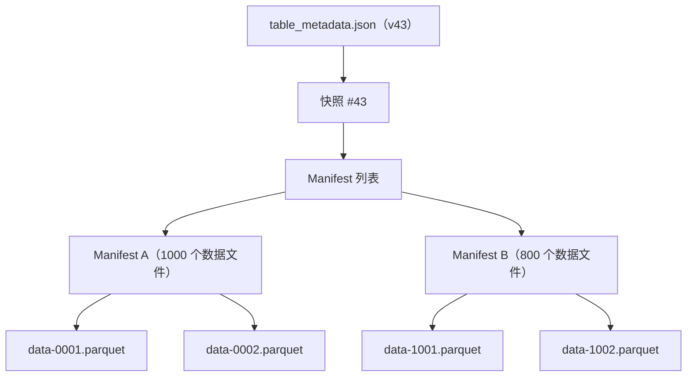
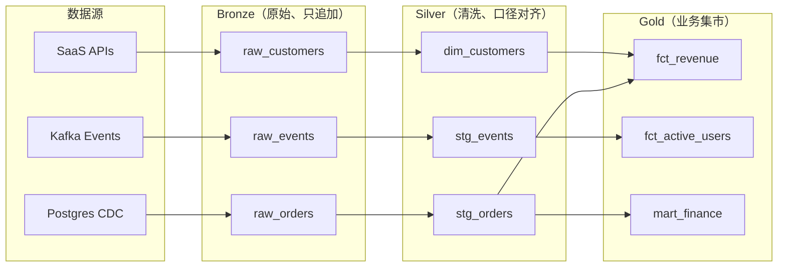
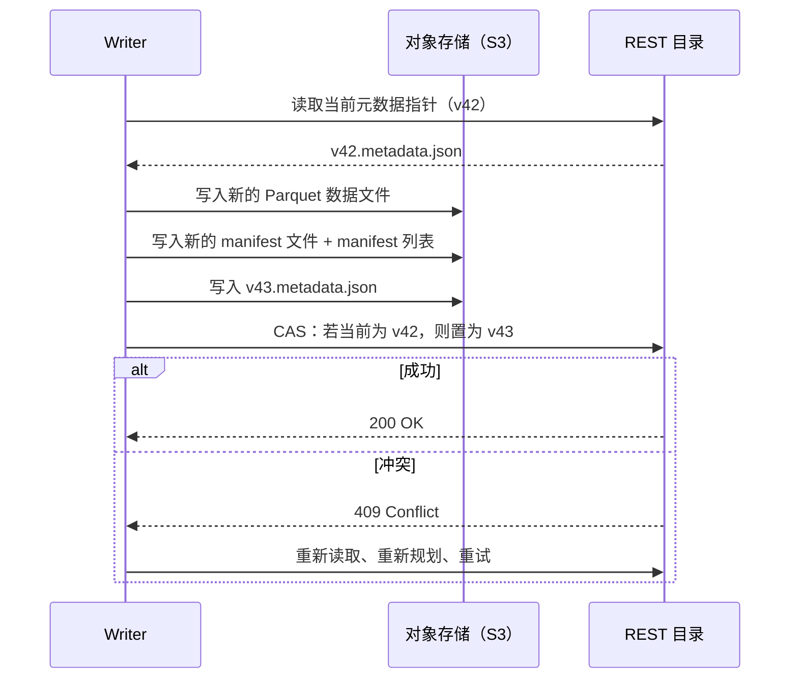
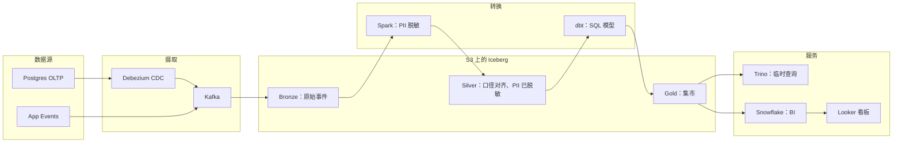

# 数据仓库与数据湖：结构、Schema 与湖仓一体

> **TL;DR**：数据仓库是 schema 优先（schema-first）的列式数据库，存储格式归厂商所有。数据湖是对象存储上的原始 Parquet 文件，价格约 $0.023/GB-月[^1]，任何引擎都能读这些文件。湖仓一体（lakehouse）通过开放表格式（Iceberg、Delta Lake、Hudi），把 ACID 事务、时间旅行（time travel）和 schema 演进加到湖上，同时不放弃多引擎访问和廉价存储。Netflix 把上百万张 Hive 表迁到了 Iceberg[^2]；Uber 在数个 PB 的规模上跑着 4,000 多张 Hudi 表[^3]。湖仓一体不是一个营销词。它是化解“仓库 vs 湖”这对矛盾的架构模式，而理解它的元数据层，如今已是任何数据密集型系统设计的入场券。

## 学习目标

学完本模块，你将能够：

- [ ] 从存储、计算和 schema 模型三个维度区分数据仓库、数据湖与湖仓一体
- [ ] 依据工作负载和运维模式，在 Redshift、BigQuery、Snowflake 之间做出选择
- [ ] 解释 Iceberg、Delta Lake、Hudi 如何为对象存储补上 ACID
- [ ] 设计一套 medallion（bronze、silver、gold）架构，包含摄取层、转换层和服务层
- [ ] 估算成本驱动项：存储、计算、出口流量（egress）和查询单元

## 直觉理解

你在经营一座图书馆。

**数据仓库的做法**像一座配有严格编目体系的传统图书馆。每本书上架之前先拿到自己的杜威十进制编号。找东西很快，因为图书管理员掌控着格式。但你只能用这家馆自己的卡片目录，要为一栋高档建筑付租金，而且想把书借给隔壁物理实验室，得先复印一份给人。

**数据湖的做法**像把所有书、小册子、餐巾纸上的草稿一股脑倒进一个租金极便宜的巨型仓库。存储几乎免费。谁拿个手电筒就能进去读。但没有目录。两个人可以同时对同一本书的不同版本上架，而没人会察觉，直到某个研究员引用了错的那本。

**湖仓一体的做法**保留这栋便宜的仓库，但请了一位带账本的图书管理员。账本精确记录哪些书在哪个书架上、哪个版本是当前版本、谁借走了什么。书还放在同一栋便宜楼里，任何研究员照样能走进去。但现在你有了单一事实来源、原子的入库登记，以及每一次变更的历史。

那本账本就是开放表格式。那栋便宜的楼是对象存储。那些研究员是你的查询引擎。本章剩下的部分就是把这些说清楚。

[OLTP 与 OLAP](./01-oltp-vs-olap.md) 已经说明，分析型负载需要列式存储和扫描为主的引擎。本章回答下一个问题：在云时代，这些列式数据存放在哪里，又由谁掌控？

## 原理

### 数据仓库、数据湖与湖仓一体的第一性原理

**数据仓库（data warehouse）**把存储格式、元数据目录（catalog）、计算引擎和 SQL 接口打包在一个厂商背后。你在加载数据之前就要定义好 schema（写时建模，schema-on-write）。物理格式归系统所有。Snowflake 把数据存成私有的不可变微分区（micro-partition）；BigQuery 用 Capacitor；Redshift 用自己的列式块。只有厂商自己的引擎能原生读取它们。[^4]

**数据湖（data lake）**正好相反：原始文件（Parquet、ORC、Avro、JSON）躺在廉价对象存储里。任何引擎——Spark、Trino、Flink、DuckDB、Python——都能读。schema 只是读取时才套上去的约定（读时建模，schema-on-read）。便宜、灵活，但没有 ACID 保证，而且一旦出现并发写入方或 schema 变更，就会掉下那道众所周知的悬崖。

**湖仓一体（lakehouse）**在湖之上叠了一层开放表格式。数据仍然以 Parquet 形式存在 S3 或 GCS 上。一棵元数据树（快照、manifest 清单、事务日志）记录哪些文件属于表的哪个版本。提交就是原子的指针替换。结果是：在廉价对象存储上获得 ACID 事务、时间旅行和 schema 演进，而且任何支持该格式的引擎都能读。[^4]

```mermaid
flowchart TB
    subgraph Warehouse["数据仓库（Snowflake / BigQuery / Redshift）"]
        W1["SQL 客户端"] --> W2["厂商私有查询引擎"]
        W2 --> W3["厂商私有元数据 + 目录"]
        W3 --> W4["厂商私有存储格式"]
        W4 --> W5["对象存储"]
    end
    subgraph Lake["原始数据湖（S3 + Parquet + Trino）"]
        L1["任意引擎"] --> L2["Hive Metastore"]
        L2 --> L3["Parquet / ORC 文件"]
        L3 --> L4["对象存储"]
    end
    subgraph Lakehouse["湖仓一体（Iceberg / Delta）"]
        H1["任意引擎"] --> H2["开放 REST 目录"]
        H2 --> H3["开放表格式元数据"]
        H3 --> H4["Parquet 文件"]
        H4 --> H5["对象存储"]
    end
```

*三种栈的底座都是同一层对象存储，分歧在于哪些层是厂商私有的。湖仓一体把除计算之外的所有层都开放了。*

核心矛盾在这里：数据仓库在小到中等规模下，纯 SQL 场景运维最省、速度最快，但把数据锁进私有格式，并按计算量狠狠收钱。数据湖每 TB 成本最低、开放程度最高，但缺少纪律就会烂成“数据沼泽”。湖仓一体保留开放存储，同时补上仓库级的正确性保证——用成熟度换灵活性。

### 三大托管数据仓库

**Redshift**（AWS，2012）起初是计算与存储按节点耦合的 shared-nothing MPP 架构。RA3 系列把两者解耦：计算节点用本地 SSD 承载热数据，S3 负责持久化保存全部数据。Redshift Spectrum 能把查询延伸到湖里的数据，不需要另起引擎。代价是：分布键（`DISTKEY`）和排序键（`SORTKEY`）的选择对性能影响极大。事实表关联上选错分布键，每一条碰到它的查询都会多花 30 到 60 秒。[^5]

**BigQuery**（GCP，2011）是真正的无服务器。Dremel 是查询引擎，Colossus 是存储，Jupiter 提供 petabit 级的对分带宽网络，Borg 负责分配计算资源。[^6] 按 slot 计价把并发度和容量解耦。你永远不需要开通节点。权衡是：计价模型不透明、难以预测，在 50 TB 的表上一个不小心的 `SELECT *`，按按需价格算就是约 $312。

**Snowflake**（多云，2014）把存储（50 到 500 MB 未压缩、约 16 MB 压缩的不可变微分区）与计算（可独立启停的“虚拟仓库”）分开。[^7][^8] 关键特性：零拷贝克隆（纯元数据操作，不复制数据）、最长 90 天的时间旅行、自动聚簇、按秒计费。Snowflake 的架构论文（Dageville 等，SIGMOD 2016）至今仍是这套设计的权威参考。[^8]

三者现在都以不同程度支持读取开放表格式（Iceberg、Delta）。仓库与湖仓之间的墙正在变薄。

### 表格式：Iceberg、Delta Lake 与 Hudi

开放表格式是一份规范：它规定如何追踪哪些文件构成一张逻辑表，外加一层元数据，用来在对象存储的不可变 Parquet 文件之上实现 ACID 提交、时间旅行、schema 演进和分区演进。

三种格式共享同一个核心技巧：表状态是指向一棵元数据文件树的指针，提交就是对这个指针的原子置换。

**Apache Iceberg**（Netflix，2018 年开源）用四级元数据树：`table_metadata.json` 指向一个快照，快照指向 manifest 列表，manifest 列表指向 manifest 文件，manifest 文件列出数据文件。每次提交都生成新的元数据根；对目录指针做一次原子 compare-and-swap 就让它成为当前版本。[^9] 关键创新：隐藏分区（分区是对源列施加的派生变换，例如 `day(event_ts)`，因此用户从不在 SQL 里引用分区列，改分区方案也不会弄坏查询）、通过 manifest 列表实现 O(1) 扫描规划、完整 schema 演进且无需重写数据。

**Delta Lake**（Databricks，2019 年开源，VLDB 2020 论文）用 `_delta_log/` 目录存放带编号的 JSON 日志条目。每次提交追加一个新文件（`00000000000000000042.json`）。检查点（Parquet）把日志状态压缩成单个快照文件；协议允许在任意已提交版本上打检查点。[^10] Spark 参考实现默认每 10 次提交打一个（`delta.checkpointInterval`）。关键创新：用于多列数据跳读的 Z-ordering、基于日志冲突检测的乐观并发，以及 UniForm——它现在通过 Iceberg REST API 暴露 Delta 表，供跨引擎读取。

**Apache Hudi**（Uber，2020 年成为 Apache 顶级项目）是为 CDC 摄取而生的。它支持两种表类型：写时复制（Copy-on-Write，每次更新重写文件，读优化）和读时合并（Merge-on-Read，把更新写进 delta 日志，读取时再合并，写优化）。记录级索引让 upsert 变便宜，不必重写整个分区。在 Uber，Hudi 管理着 4,000 多张表、数个 PB 的数据，把摄取延迟从数小时降到 30 分钟以内。[^3]

*Iceberg 的元数据树：每次提交都生成一个新的根指针。读者看到的是一致快照；写入方在冲突时重试。Manifest 文件记录每个文件的列统计信息，用于裁剪。*

**2026 年该选哪个格式：** Iceberg 已经成为事实上的互操作标准。Databricks 于 2024 年 6 月收购了 Tabular（由 Iceberg 作者创立的公司），如今大力投入 Delta UniForm 作为双向兼容层。Snowflake 在同一周开源了 Polaris Catalog。两家具分量的厂商现在都把 Iceberg 当作互操作标准来支持。可以站得住的建议是：Databricks 原生栈就用 Delta（UniForm 让 Iceberg 也能读）；要多引擎或厂商中立就用 Iceberg；CDC 密集、需要记录级 upsert 就先评估 Hudi。

| 格式 | 来源 | 提交机制 | 最适合 | 目录 |
|--------|--------|-----------------|----------|---------|
| Iceberg | Netflix（2018） | 通过目录做原子元数据指针替换 | 多引擎读取、分区演进 | REST Catalog（Polaris、Glue、Nessie） |
| Delta Lake | Databricks（2019） | `_delta_log/` 中带编号的 JSON 日志 | Spark/Databricks 生态、Z-ordering | Unity Catalog、Glue |
| Hudi | Uber（2016） | commit/compact/clean 动作组成的时间线 | CDC 摄取、记录级 upsert | Hive Metastore、Glue |

### Medallion 架构与现代分析栈

**Medallion 架构**（由 Databricks 提出）把湖仓中的表组织成三个质量层级：

- **Bronze**：原始摄取数据，只追加，与源系统一致。保留可重放性。
- **Silver**：清洗过、口径对齐（conformed）、去重、关联后的数据。施加 schema 强制。
- **Gold**：面向业务的聚合、维度模型、KPI、ML 特征表。

层与层之间的转换通常用 **dbt**（SQL 原生、纳入版本管理、内置测试与血缘）或 Spark SQL 编写，由 **Airflow**、Dagster 或 Prefect 编排。从业务系统摄取数据，可以用托管连接器（Fivetran、Airbyte），或用 Debezium 做[变更数据捕获](./04-change-data-capture.md)落进 Kafka。

*Bronze 保留原始输入以便重放；silver 负责清洗与口径对齐；gold 物化面向业务的集市。dbt 模型把每一次转换定义为一个受版本管理的 SQL SELECT。*

什么时候 medallion 比 Kimball 星型模型更合适？Medallion 是数据分层的质量模式，Kimball 是 schema 设计模式。两者可以叠加：gold 表常常就是星型模型。当你需要可重放性、并且要为多个下游做增量处理时，用 medallion。当你的仓库很小、数据源稳定、只想要最简的 BI 层时，直接用 Kimball（跳过 bronze/silver）。

湖层的查询引擎包括 Trino（分布式 SQL，原名 Presto）、Athena（AWS 上的无服务器 Trino）、Spark SQL，以及 DuckDB（嵌入式、单机，做本地探索极好）。[流处理与批处理](./03-stream-vs-batch.md) 讲了 Flink 和 Spark Streaming 如何把数据喂进这些湖仓模式。

## 真实案例

### Netflix 的 Iceberg 迁移

Netflix 运营着地球上最大的分析型数据湖之一：S3 上数 PB 的 Parquet 和 ORC 文件。[^2] 问题出在规模化的 Hive 上。Hive 的分区模型要求用 S3 的 `LIST` 操作去发现文件。当表长到几百万个分区，规划一条查询就要花上几分钟，因为列举的复杂度是分区数的 O(n)。

Ryan Blue 和 Dan Weeks 造出 Iceberg，用文件级 manifest 取代基于目录的分区发现方式。元数据树追踪的是单个数据文件，不是目录。规划成本随匹配到的文件数增长，而不是随分区总数增长。到 2024 年，Netflix 已经把上百万张 Hive 表迁到 Iceberg 格式。[^2]

关键工程决策：

- **隐藏分区**消灭了“忘了在 partition_date 上过滤”这一整类 bug。按 `day(event_ts)` 分区的表，会自动从 `WHERE event_ts > '2024-01-01'` 推导出分区谓词。[^9]
- **快照隔离**靠原子元数据替换实现。读者看到钉在某个快照上的一致视图。写入方在冲突时重试。没有分布式锁。
- **多引擎访问。** 同一批 Iceberg 表被 Spark（批处理）、Trino（临时 SQL）、Flink（流处理）读取，全程不复制数据。

*Iceberg 的一次提交就是对目录指针的一次原子 compare-and-swap。写数据文件的过程中不持有任何锁；冲突在元数据替换时以乐观方式解决。*

这里的教训是：到了 PB 级，瓶颈会落在元数据层，而不是数据层。Iceberg 的设计洞见在于——按文件（而非目录）追踪、用原子提交（而非锁）——正是它让基于对象存储的分析变得可行。Airbnb 独立得出了同样的结论，从 Hive 迁到 Iceberg，以解决 Hive Metastore 的扩展性瓶颈、S3 一致性问题，以及跨多个计算引擎的 schema 演进难题。[^11]

## 权衡

| 方案 | 优点 | 缺点 | 适用场景 | 我们的选择 |
|----------|------|------|-----------|----------|
| 托管数据仓库（Snowflake、BigQuery） | 开箱即用、快、运维少、SQL 能力强 | 规模化后昂贵、厂商锁定、ML 负载受限 | 数据工程师少于约 100 人、纯分析用途的团队 | **中小分析团队的默认选项** |
| 原始数据湖（S3 + Parquet + Trino） | 最便宜（约 $0.023/GB-月）、格式开放、任意引擎 | 无 ACID、schema 漂移、小文件问题、治理负担 | 超大规模（PB 以上）、多引擎、成本敏感 | 只有愿意承担运维负担时才选 |
| 湖仓一体（Iceberg/Delta + Trino/Spark） | 廉价存储上有 ACID、开放目录、时间旅行、PB 级已被验证 | 工具仍在成熟、合并（compaction）开销、目录碎片化 | 需要跨引擎统一标准、想避开锁定的大型组织 | **规模化数据密集型组织的默认选项** |
| 混合（仓库 + 湖） | 兼得两者：湖放原始数据/ML，仓库存管好的 BI 数据 | 两套系统、数据重复、同步复杂 | 现实中大多数企业；可分步迁移 | 务实的起点 |

## 常见陷阱

> [!WARNING]
> **小文件问题。** 提交间隔很短（比如每 30 秒一次）的流式写入会产生成千上万个远低于最优区间 256 到 512 MB 的小文件。查询规划的时间压过执行时间。修法：调度合并任务（Iceberg 的 `rewrite_data_files`、Delta 的 `OPTIMIZE`、Hudi 的异步 compaction），并拉长提交间隔。

> [!WARNING]
> **不用表格式导致的 schema 漂移。** S3 里的裸 Parquet 没有任何 schema 演进契约。Hive 按位置套类型；上游新增一列，下游读出来就是 null 或错误的类型。下游查询会安静地返回错误结果。修法：采用表格式。Iceberg 用整数 field ID 追踪列，增、删、改名、放宽类型都安全，无需重写数据。[^9]

> [!WARNING]
> **过于激进的 VACUUM 删掉活跃快照。** 用太短的保留期跑清理（Delta 的 `VACUUM`、Iceberg 的 `expire_snapshots`），会删掉仍被旧快照引用的文件。长时运行的读者会以“file not found”失败。修法：至少保留 7 天，并与预期的最长作业运行时间对齐。

> [!WARNING]
> **Redshift 中的分布键失误。** 大事实表上选错 `DISTKEY`，每次关联都要搬移 TB 级数据做重分布。`EXPLAIN` 计划里会出现 `DS_BCAST_INNER` 或 `DS_DIST_BOTH` 步骤。修法：把 `DISTKEY` 设成最常用的关联列；小维度表用 `DISTSTYLE ALL`。

> [!WARNING]
> **在高基数列上过度分区。** 按 `user_id` 分区会造出几百万个分区、每个只装一个小文件。规划比全表扫描还慢。修法：按日期截断（天、月）分区，高基数聚簇改用 Iceberg 的 `bucket[N]` 变换。

## 练习

为一家每天处理 5 亿事件的金融科技公司设计分析平台。在 Snowflake、BigQuery 和 S3 上的 Iceberg 湖仓之间做选择。说明摄取路径、转换层（dbt？Spark？）、如何把数据供给 BI 工具，以及如何保证 PII 合规。

提示

从三个维度想：每天 5 亿事件的成本（原始数据约 50 GB/天，约 18 TB/年）、多引擎需求（ML 团队要 Spark，分析师要 SQL）、PII 要求（在 silver 层做列级脱敏，用时间旅行留审计轨迹）。考虑混合方案：湖仓承担存储和重计算，数据仓库负责 BI 服务。

参考答案

**架构：**

**推理：**

- **存储：** S3 上的 Iceberg。压缩后 50 GB/天，一年存储约 18 TB，按 $0.023/GB-月 算约 $5,000/年。数据仓库存同样的数据要贵 3 到 5 倍。
- **摄取：** Debezium 把 Postgres 的 WAL 抓进 Kafka。应用事件直接写 Kafka。Flink 或 Spark Streaming 作业以 5 分钟的提交间隔写入 bronze Iceberg 表（避开小文件问题）。
- **转换：** Spark 在 bronze 到 silver 的边界做 PII 脱敏（令牌化、列级加密）。dbt 把 silver 到 gold 的模型写成 SQL SELECT，由 Airflow 按 15 分钟调度。
- **PII 合规：** silver 表对 PII 列做脱敏。bronze 保留原始数据但限制访问（IAM + 目录级的行/列安全）。Iceberg 的时间旅行提供审计轨迹。
- **服务：** Trino 直接在 Iceberg 上跑分析师的临时查询。Snowflake（XS 规格仓库，每天跑几小时）服务那些需要在预聚合 gold 表上获得亚秒响应的 BI 看板。Snowflake 总成本约 $2-3k/月。
- **ML 访问：** 数据科学家用 Spark 或 Python（PyIceberg）直接读 silver/gold 的 Iceberg 表，不产生仓库计算费用。

**接受的权衡：** 承受运维复杂度（Kafka、Spark、Airflow、Trino、Snowflake），换来约 60% 更低的存储成本、多引擎灵活性，以及数据层不被厂商锁定。

## 要点回顾

- 数据仓库买的是方便和速度；数据湖买的是灵活和成本；湖仓一体通过开放表格式给廉价对象存储加上 ACID，从而取两者中间。
- 表格式（Iceberg、Delta、Hudi）是分析基础设施里那场安静的变革。它们把 S3 变成事务型数据库，同时不放弃多引擎访问。
- Iceberg 已成为事实上的互操作标准。Databricks 和 Snowflake 现在都把它当互操作标准来支持。Databricks 原生选 Delta，多引擎选 Iceberg，CDC 密集的 upsert 选 Hudi。
- 存储很便宜（S3 上 $0.023/GB-月），计算不便宜。每一个架构选择，本质都是一个计算成本的选择。
- 小文件问题是湖仓落地中最常见的生产故障。要么调度合并，要么查询性能崩掉。
- 读时建模能撑到你撑不住为止。schema 这笔税迟早要交；表格式让你通过演进一点点交，而不是靠重写一次性交。
- Medallion 模式（bronze/silver/gold）是数据分层的质量策略，不是维度建模的替代品。gold 表常常就是 Kimball 星型模型。

## 延伸阅读

- [Lakehouse: A New Generation of Open Platforms](https://www.databricks.com/research/lakehouse-a-new-generation-of-open-platforms-that-unify-data-warehousing-and-advanced-analytics) - Armbrust 等，CIDR 2021。系统阐述湖仓论纲的奠基论文；在做任何“仓库 vs 湖”的架构决策之前都该读。
- [The Snowflake Elastic Data Warehouse](https://dl.acm.org/doi/10.1145/2882903.2903741) - Dageville 等，SIGMOD 2016。讲清微分区、虚拟仓库与存算分离的原始架构论文。
- [Apache Iceberg Table Spec](https://iceberg.apache.org/spec/) - 关于快照、manifest 列表、分区变换和 schema 演进规则的权威规范。
- [Delta Lake Transaction Log Protocol](https://github.com/delta-io/delta/blob/master/PROTOCOL.md) - 解释带编号 JSON 日志、检查点和冲突解决的协议规范。
- [BigQuery under the hood](https://cloud.google.com/blog/products/bigquery/bigquery-under-the-hood) - Google 对 Dremel、Colossus、Borg、Jupiter 的架构综述；解释了 BigQuery 为什么能做到真正的无服务器。
- [Setting Uber's Transactional Data Lake in Motion with Apache Hudi](https://www.uber.com/blog/ubers-lakehouse-architecture/) - Uber 公开的复盘，讲 COW 与 MOR 的权衡，以及为什么规模化的 CDC 必须靠记录级索引。
- [Databricks + Tabular announcement](https://www.databricks.com/blog/databricks-tabular) - 2024 年 6 月那笔收购，标志着 Iceberg 成为共同标准；文中解释了 UniForm 与趋同的判断。
- [Introducing Polaris Catalog](https://www.snowflake.com/en/blog/introducing-polaris-catalog/) - Snowflake 开源的 Iceberg REST 目录；解释了“无锁定”的定位与多引擎互操作。

## 记忆卡片

**Q:** 数据仓库和数据湖的根本区别是什么？
**A:** 数据仓库是 schema 优先，存储格式私有、只归某家厂商的引擎使用。数据湖是读时建模，对象存储上的开放文件（Parquet/ORC）任何引擎都能读。数据仓库用灵活性换方便；数据湖用正确性保证换成本和开放。

**Q:** 湖仓一体解决了什么单靠仓库或单靠湖都解决不了的问题？
**A:** 湖仓一体在廉价对象存储上加了 ACID 事务、时间旅行和 schema 演进，且不被厂商锁定。它消除了“两层”问题——数据在湖（供 ML/原始数据）和仓库（供 BI）之间重复存放，导致数据陈旧和同步复杂。

**Q:** Iceberg 如何在对象存储上实现原子提交？
**A:** Iceberg 先把新数据文件和新元数据写入 S3，然后对目录指针做一次原子 compare-and-swap（从 v42.metadata.json 到 v43.metadata.json）。如果别的写入方先提交成功，这次置换就以冲突失败，写入方重试。写的过程中不持有分布式锁。

**Q:** Iceberg 里的隐藏分区是什么？
**A:** 分区是通过变换从源列派生出来的（例如 `day(event_ts)`、`bucket(16, id)`），而不是单独的分区列。用户照常查询源列，引擎自动推导分区谓词。这消灭了“忘了在 partition_date 上过滤”这类 bug，也让分区方案的变更不会弄坏查询。

**Q:** Medallion 架构的三个层级是什么？
**A:** Bronze（原始摄取数据，只追加，与源一致以便重放）、Silver（清洗、口径对齐、去重、强制 schema）、Gold（面向业务的聚合、维度模型、KPI）。每一层都是一批表格式的表，数据质量逐级提升。

**Q:** 什么时候该选 Delta Lake 而不是 Iceberg？
**A:** 当你是 Databricks 原生栈，希望与 Spark、Photon、Unity Catalog 紧密集成时选 Delta。Delta 的 UniForm 现在通过 Iceberg REST API 暴露表，下游引擎照样能读。当你需要真正的多引擎访问、且不想依赖兼容层时选 Iceberg。

**Q:** 湖仓落地中的小文件问题是什么？
**A:** 提交间隔很短的流式写入会产生成千上万个小文件（远低于最优的 256-512 MB）。查询规划时间随文件数增长，并压过执行时间。修法是调度合并（Iceberg 的 `rewrite_data_files`、Delta 的 `OPTIMIZE`），把小文件合并到目标大小。

**Q:** Snowflake 如何把存储与计算分开？
**A:** 数据以不可变微分区（50-500 MB 未压缩）存放在对象存储（S3/GCS/Azure Blob）里。计算跑在可独立启停的“虚拟仓库”中，热微分区缓存在本地 SSD。多个虚拟仓库可以并发读同一份数据而不争用。

**Q:** 湖存储与仓库存储的成本差多少？
**A:** S3 Standard 约 $0.023/GB-月。仓库存储（含私有索引和元数据）通常贵 3 到 5 倍。到 PB 级，这个差距一年就是几百万美元，这也是 Netflix、Uber、Airbnb 都选了湖仓架构的原因。

**Q:** Hudi 的读时合并（MOR）表类型是什么，什么时候该用？
**A:** MOR 把更新写进 delta 日志文件，而不是重写基础 Parquet 文件。读取时在查询阶段把基础文件与 delta 日志合并。写密集的 CDC 摄取、写延迟比读延迟更重要时用它。后台的异步 compaction 会把 delta 日志合并回基础文件。

**Q:** Netflix 为什么要自造 Iceberg 而不用 Hive？
**A:** Hive 的分区模型要求用 S3 的 LIST 操作发现文件。在 Netflix 的规模下（几百万分区），列举复杂度是分区数的 O(n)，每次查询规划要花几分钟。Iceberg 在 manifest 元数据里追踪单个文件，规划成本是 O(1)，且随匹配文件数增长而非分区总数。

**Q:** 目录（catalog）在湖仓架构中扮演什么角色？
**A:** 目录把表名映射到元数据文件指针，并协调并发提交（提供那次原子 compare-and-swap）。它是唯一的协调点。可选方案包括 AWS Glue、Snowflake 的 Polaris（开源）、Databricks 的 Unity Catalog，以及任何 Iceberg REST Catalog 实现。

## 参考文献

[^1]: AWS, "S3 Pricing". https://aws.amazon.com/s3/pricing/
[^2]: Netflix, "Netflix's Apache Iceberg Data Lake Migration", AWS re:Invent 2024 (NFX306). https://aws.amazon.com/video/watch/3db41488539/
[^3]: Uber Engineering, "Uber Submits Hudi, an Open Source Big Data Library, to The Apache Software Foundation". https://www.uber.com/blog/apache-hudi/
[^4]: Armbrust et al., "Lakehouse: A New Generation of Open Platforms that Unify Data Warehousing and Advanced Analytics", CIDR 2021. https://www.databricks.com/research/lakehouse-a-new-generation-of-open-platforms-that-unify-data-warehousing-and-advanced-analytics
[^5]: AWS, "Choose the best distribution style", Amazon Redshift Database Developer Guide. https://docs.aws.amazon.com/redshift/latest/dg/c_best-practices-best-dist-key.html
[^6]: Google Cloud, "BigQuery under the hood", Tereshko and Tigani, Jan 2016. https://cloud.google.com/blog/products/bigquery/bigquery-under-the-hood
[^7]: Snowflake Documentation, "Micro-partitions & Clustering" (explains micro-partition design, 50-500 MB uncompressed, immutable). https://docs.snowflake.com/en/user-guide/tables-clustering-micropartitions
[^8]: Dageville et al., "The Snowflake Elastic Data Warehouse", SIGMOD 2016. https://dl.acm.org/doi/10.1145/2882903.2903741
[^9]: Apache Iceberg, "Iceberg Table Spec". https://iceberg.apache.org/spec/
[^10]: Delta Lake, "Delta Transaction Log Protocol", PROTOCOL.md. https://github.com/delta-io/delta/blob/master/PROTOCOL.md
[^11]: Airbnb Engineering, "Upgrading Data Warehouse Infrastructure at Airbnb". https://medium.com/airbnb-engineering/upgrading-data-warehouse-infrastructure-at-airbnb-a4e18f09b6d5
