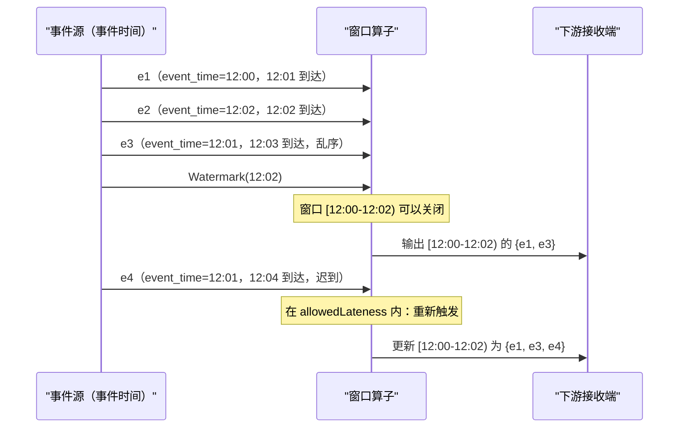
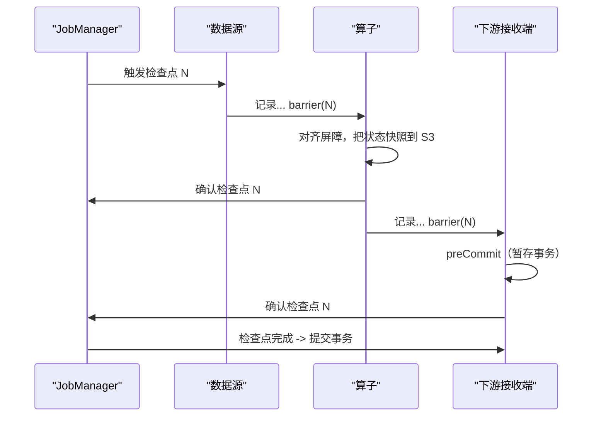
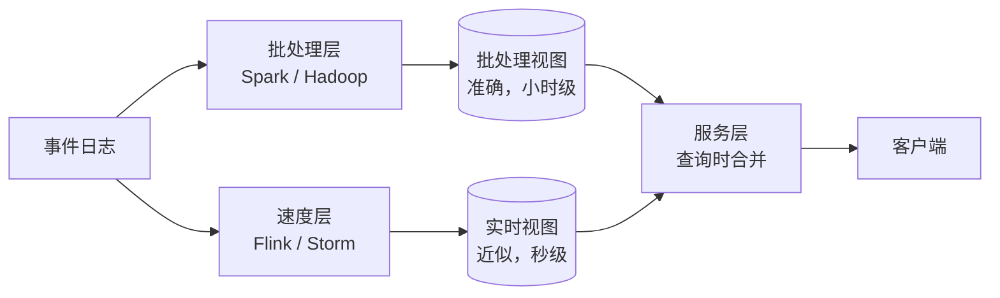
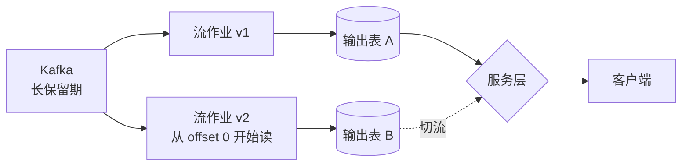

# 流处理与批处理：Lambda、Kappa，以及那场争论的终结

> **TL;DR**: 批处理与流处理的分野不在延迟，而在你的数据集有没有已知的终点。批处理处理的是静止的有界数据，流处理处理的是流动的无界数据。2010 年代的大部分时间，团队得两条链路并行跑（Lambda 架构），因为单靠哪一种都不完整。Dataflow Model 论文（2015）把事件时间语义形式化[^1]，Flink 用分布式快照做到了精确一次[^2]，Kafka 补上了事务[^3]。三件事凑齐，单链路的 Kappa 架构才变得可行。今天 Netflix 每天通过 Flink 处理数万亿条事件[^4]。批处理没有死，只是不再是默认选项。

## 学习目标

学完这一章，你应当能够：

- [ ] 解释事件时间与处理时间的区别，以及这个差别为什么会让最直白的代码算出错的结果
- [ ] 设计带正确水印的窗口聚合（滚动窗口、滑动窗口、会话窗口）
- [ ] 说清流处理里精确一次、至少一次、至多一次三种投递的含义
- [ ] 针对给定负载，在 Kafka Streams、Flink、Spark Streaming 之间做选择
- [ ] 为一条真实的管道，在 Lambda 与 Kappa 架构之间做决定

## 直觉理解

你管着一家连锁咖啡店。顾客付款时，每台收银机会打出一张带时间戳的小票。每天打烊后，一个快递员把所有门店的小票收齐，开车送到总部。会计按日期分拣，汇总每店营收，归档出报表。这就是批处理（batch processing）：有界的输入（今天的小票）、明确的开始和结束、作业跑完就得到一个完整的答案。

现在设想你要一块实时看板，按分钟显示营收。你在每台收银机上方装一个摄像头，把小票图像实时传回总部。但摄像头会滞后。一张盖着 14:03 的小票，可能 14:05 才到，因为上传太慢；另一张 14:07 才到，却盖着 14:02，因为门店 WiFi 断了五分钟。如果你按小票到达的那一分钟分组（处理时间），看板就是错的。如果你按小票上印的时间戳分组（事件时间），答案是对的，但你必须决定：等落后者多久，才可以宣布某一分钟“结束”。

这个“等多久”的决定就是水印（watermark）。小票上的时间戳和它到达时间之间的差距，就是事件时间偏差（event-time skew）。流处理的全部复杂度，都活在这条缝里。批处理靠“等所有小票到齐”绕开了它；流处理必须正面应对。

[消息队列与流处理](../part-2-building-blocks/08-message-queues-streaming.md) 把 Kafka 作为传输层介绍过。[数据仓库与数据湖](./02-data-warehouses-lakes.md) 讲了批处理结果最终落在哪儿。本章讲的是从摄入到存储之间发生的事：处理引擎、正确性模型，以及把它们串起来的架构模式。

## 原理

### 批处理的基础

批处理是在有界输入上跑一次有限的计算。作业启动、读完全部数据、产出结果、退出。

**MapReduce**（Dean 与 Ghemawat，OSDI 2004）定义了这个模型：你写一个 `map` 函数和一个 `reduce` 函数，框架负责分区、洗牌、容错，以及在数千台机器上并行[^5]。Hadoop 是它的开源实现。**Spark**（NSDI 2012）用弹性分布式数据集（RDD）替换了 MapReduce 那种重度落盘的洗牌：RDD 是只读、带血缘（lineage）的集合，失败后可以沿转换图重建，于是内存中的迭代计算成为可能——原论文里迭代型负载最高快 20 倍（后来的多轮分析基准中最高快 100 倍）[^6]。Spark DataFrame 加上 Catalyst 优化器，又把 Spark 从一套 RDD API 变成了以 SQL 为先的分析引擎。

对复杂的分析型 SQL、需要全量洗牌的机器学习训练、周期性对账，以及任何“小时级延迟可以接受、运维简单更要紧”的场景，批处理仍然是正确答案。Airflow、Dagster、Prefect 这类编排器把这些作业当作 DAG 来调度，负责重试、回刷（backfill）和血缘。

### 事件时间与处理时间

这是流处理的核心问题。搞错了，下游每一个数字都会微妙地不正确。

- **事件时间（event time）**：事件真正发生的时刻（在源头就打进数据里的时间戳）。
- **处理时间（processing time）**：流算子看到这条事件的时刻。
- **摄入时间（ingestion time）**：事件进入系统边界的时刻。

手机上 14:03:12 的一次点击，穿过网络队列、缓冲区、重试，可能要好几秒甚至几分钟才走完。`groupBy(minute(now()))` 会把这次点击算进算子恰好正在处理的那一分钟，于是回刷、网络延迟、乱序到达都会产出错误答案。按事件时间分组，结果与到达顺序无关、是确定性的，代价是要等落后者[^1]。

Dataflow 论文（Akidau 等，VLDB 2015）主张，任何正确的流系统都必须回答四个问题[^1]：

1. **算什么**？（转换逻辑）
2. **在事件时间的哪里算**？（窗口）
3. **在处理时间的何时输出结果**？（触发器）
4. **后续修正如何关联**？（累积模式：丢弃、累积、撤回）

Flink、Beam、Spark Structured Streaming 实现的都是这个模型的不同变体。

*事件 e3 在 e2 之后到达，却属于更早的窗口。水印宣布“12:02 之前不会再有事件”，这个窗口随即关闭。迟到的事件 e4 只要落在允许迟到期内，仍然会被吸收进来。*

### 窗口与水印

窗口是无界流上的一段有限切片。没有窗口，“统计所有事件”在无限时间上根本不是一个数字。

**滚动窗口（tumbling window）** 大小固定、互不重叠。每个事件恰好属于一个窗口。对 12:01、12:02、12:06、12:07 四个事件开 5 分钟滚动窗口，得到 `[12:00-12:05) = {12:01, 12:02}` 和 `[12:05-12:10) = {12:06, 12:07}`。

**滑动窗口（sliding window）** 大小固定，但按步长重叠。10 分钟窗口、每 5 分钟滑动一次，意味着每个事件同时属于两个窗口。适合“最近 10 分钟的滚动均值，每 5 分钟更新一次”这类需求。

**会话窗口（session window）** 由不活动的间隔来定义，长度不固定。12:01、12:03、12:20、12:22 四个事件、间隔阈值 5 分钟，会形成两个会话：`{12:01, 12:03}` 和 `{12:20, 12:22}`。会话窗口能优雅地建模用户行为（站点会话、行程会话）——边界由数据自己决定。

**水印（watermark）** 是单调推进的事件时间标记，声明“（概率上）不会再有早于该水印的事件到达”。Flink 在数据源处生成水印，通常取 `max(observed_event_time) - N seconds`。水印到达某个算子时，会推进算子内部的事件时间时钟，并触发窗口定时器。多输入的算子上，水印取所有输入的最小值——也就是说，一个落后的分区会拖住整个作业，这是设计使然。

完美的水印（可证明没有迟到事件）几乎不可能实现。启发式水印加上**允许迟到（allowed lateness）** 才是务实的答案：水印越过后，窗口再保持开放一段时间，吸收迟到事件，并用更新后的结果重新触发[^1]。

### 投递语义与精确一次

三种保证，描述故障下一条消息会几次影响下游状态：

- **至多一次（At-most-once）**：不重试。失败就丢。
- **至少一次（At-least-once）**：失败重试。可能重复，下游必须自己去重。
- **精确一次（Exactly-once）**：每条消息恰好影响状态一次。需要协调。

Kafka 0.11 之前只提供至少一次：ACK 超时后重试会导致重复写入。Kafka 0.11（2017）带来了两个原语[^3][^7]：**幂等生产者**（每个批次带生产者 ID + 序列号，broker 据此去重）和**事务**（生产者原子地写入多个分区，并在同一个事务里提交消费者位点）。两者合起来，在 Kafka 的“读—处理—写”闭环内给出精确一次；1 KB 消息、acks=all 的情况下，相比至少一次投递，吞吐开销只有约 3%[^3]。

Flink 用的是基于 Chandy-Lamport 的分布式快照。Carbone 等人 2015 年的论文描述了异步屏障快照（ABS）：屏障在数据源注入，随记录流过算子，屏障到达某个算子时，该算子把自己的状态快照到持久存储[^2]。检查点是异步做的，作业不会因此停顿。端到端精确一次还需要事务型 sink：在当前的 Sink V2 API 里，sink 实现 `SupportsCommitter` 接口（它是旧 `TwoPhaseCommittingSink` / `TwoPhaseCommitSinkFunction` 的继任者），在每次检查点时预提交，等 JobManager 确认全局检查点完成后才真正提交。

*Flink 的异步屏障快照：屏障随记录一起流动，算子在所有输入上的屏障对齐后对状态做快照，事务型 sink 要等整个检查点成功之后才提交。*

> [!IMPORTANT]
> 精确一次有作用域限制。它的意思是“在框架管理的状态和输出里，每条记录的影响恰好体现一次”。调用外部服务（HTTP API、邮件、短信）不在覆盖范围内，除非那些系统支持以事务 ID 为键的幂等操作。[幂等性与精确一次](../part-3-distributed-systems-theory/07-idempotency-exactly-once.md) 讲了应用层的兜底办法。

### 流处理引擎对比

| 引擎 | 模型 | 状态 | 精确一次 | 延迟 | 适用场景 |
|--------|-------|-------|--------------|---------|----------|
| Kafka Streams | 库（无独立集群） | 内嵌 RocksDB + changelog topic | Kafka 事务 | 低（逐条处理） | 嵌在服务里的处理 |
| Apache Flink | 真流处理 | RocksDB，TB 级，增量检查点到 S3 | Chandy-Lamport + 两阶段提交 sink | 低（毫秒） | 大状态作业、复杂事件时间逻辑 |
| Spark Structured Streaming | 微批（默认） | 由 Driver 管理 | 幂等写入 | 中（100ms 以上） | 已经在用 Spark 的团队、吞吐优先于延迟 |
| Apache Beam | 统一 API（不是引擎） | 取决于 Runner | 取决于 Runner | 取决于 Runner | 在 Flink/Spark/Dataflow 之间可移植 |

**Kafka Streams** 是一个嵌进你 JVM 服务里的库。状态放在内嵌的 RocksDB 实例里，再加一个压缩过的 Kafka changelog topic 做容错。重启时通过重放 changelog 重建状态。没有额外集群要运维，但并行度受 Kafka 分区数限制。

**Apache Flink** 是大规模有状态流处理的行业选择。一等公民的事件时间、水印、键控状态与广播状态，以及支持 TB 级状态和增量检查点的 RocksDB 后端。Netflix、Uber、阿里巴巴都在大规模跑 Flink。

**Spark Structured Streaming** 默认走微批：引擎每隔一个触发间隔醒来，把新数据当作有界批读进来，跑标准的 Spark SQL。对已经在用 Spark 的团队来说 API 很眼熟。Spark 2.3 引入的实验性连续处理模式已被弃用，并在 Spark 4.0（2024）中移除；现在的部署改用亚秒级的微批触发间隔。

还有一些更新的选项值得关注：**Materialize** 和 **RisingWave**（提供 PostgreSQL 兼容接口的流式 SQL 数据库），以及 **Apache Flink SQL**（Confluent 在 2024 年实质关停 ksqlDB 之后推荐的路线）。

### Lambda 与 Kappa 架构

**Lambda 架构**（Nathan Marz，2011）并行跑两条链路：批处理层从全量历史产出全面、准确的视图；速度层从近期数据产出近似的实时视图；服务层在查询时把两者合并[^8]。

*Lambda 把同一份输入拆成批处理（准确、慢）和速度层（新鲜、近似），查询时合并。两条链路等于把同一套逻辑实现了两遍。*

致命缺陷：两套代码库，用不同的框架实现同一套逻辑。Jay Kreps 在 2014 年写道：“让写在不同系统里的代码保持完全同步，真的、真的很难”[^8]。

**Kappa 架构**（Kreps，2014）只跑一条流处理链路。重算靠的是从更早的位点重放输入日志，用同一个作业的第二个实例跑一遍，然后切换[^8]：

1. 用 Kafka，保留期设长（数周或数月）。
2. 要重算时，启动第二个实例，从 offset 0 开始读，写到新的输出表。
3. 第二个作业追上进度后，把读流量切到新表。
4. 下线旧作业和旧表。

*Kappa 在一条可重放的日志上只跑一条流处理链路。重算就是同一个作业的第二个实例从更早的位点开始读；追上之后切换。*

Kappa 变得可行，是因为三件事凑齐了：Flink 交付了精确一次的检查点，Kafka 补上了事务，Dataflow 模型把事件时间语义形式化——于是重放能给出和实时处理一样的答案。

**Lambda 仍然胜出的场合：** 需要全量洗牌的负载（训练一个大模型、跑 ALS 推荐、周期性的大表 join）即使能重放，也套不进流处理。很多生产栈其实是诚实的混合体：Flink 走实时路径，夜间 Spark SQL 做分析报表。这没什么不好。

## 真实案例

### Netflix Keystone

Netflix 的 Keystone 平台通过数千个流作业，每天处理数万亿条事件[^4]。

架构分两层。**Data Pipeline**（基于 Kafka）摄入微服务事件，过滤并路由到各类存储端（Elasticsearch、Hive、下游 Kafka topic）。**Stream Processing as a Service（SPaaS）** 给内部团队提供托管的 Flink 作业，每个作业都部署成 Netflix Titus 容器运行时上一个隔离的 Flink 集群。

几个关键工程决策：

- **作业级集群隔离。** 每个 Flink 作业独占一个集群，只共享 ZooKeeper 和 S3。这是拿资源效率换故障影响面的收敛。一个行为异常的作业拖不垮邻居。
- **声明式对账。** 用户只声明意图（作业配置存在 RDS 里），控制面负责把实际状态推向声明状态。自愈逻辑处理 ZooKeeper 损坏、容器丢失和网络分区。
- **TB 级状态。** 单个 Flink 作业用 RocksDB 维护几十 TB 的本地状态，增量检查点写到 S3。Savepoint 支持零停机升级。
- **把权衡暴露给用户。** 团队自己选择精确一次还是至少一次、延迟还是重复、从 savepoint 恢复还是全新启动，而不是藏在一套“一刀切”的默认值后面。

这个平台同时喂实时看板和数仓。[变更数据捕获](./04-change-data-capture.md) 讲的是业务数据库如何汇入同一条 Kafka 主干。

## 权衡

| 方案 | 优点 | 缺点 | 适用场景 | 我们的选择 |
|----------|------|------|-----------|----------|
| 批处理（Spark、数仓上的 SQL） | 简单、便宜、认知成熟 | 延迟以小时计，不是分钟级 | 报表、模型训练、对账 | 用于分析与机器学习 |
| 流处理（Flink、Kafka Streams） | 低延迟、数据新鲜 | 复杂、有状态、运维成本高 | 实时告警、反欺诈、个性化 | 用于亚秒级热路径 |
| Lambda（批 + 流） | 准确 + 新鲜 | 两套代码、逻辑漂移、运维噩梦 | 准确度要求高的历史系统迁移 | 只在存量系统里用：批处理链路早于流处理，无法在一个周期内重写 |
| Kappa（只做流，靠重放回刷） | 一套代码、运维更简单 | 需要可重放的日志和成熟的流团队 | 已具备流处理能力的全新栈 | 新实时管道的默认选择 |

## 常见陷阱

> [!WARNING]
> **业务问题问的是事件时间，你却按处理时间分组。** 你的夜间报表和实时看板会互相矛盾。回刷跑出来的结果和当初实时跑的不一样。始终在源头抽取事件时间，用事件时间窗口。

> [!WARNING]
> **空闲分区拖住水印。** Flink 取所有输入里最小的水印。一个没有事件的分区会冻住整个作业的事件时间时钟。生产环境的每个数据源都要配 `WatermarkStrategy.withIdleness(Duration)`。

> [!WARNING]
> **以为“精确一次”是框架里的一个勾选框。** Kafka 和 Flink 的精确一次，作用范围是托管状态和 Kafka 到 Kafka 的管道。写外部数据库、调 HTTP 接口、触发副作用，仍然要在应用层用幂等键。

> [!WARNING]
> **状态无界增长。** 有状态算子（会话化、join、去重集合）会无限累积 key，没有 TTL。一个“覆盖所有历史事件”的去重集合是无界的。在 Flink 里设 `StateTtlConfig`，或者给去重窗口划边界，接受窗口外的偶发重复。

> [!WARNING]
> **检查点间隔太长。** 每 10 分钟一次检查点，意味着恢复时最多要重读 10 分钟的输入。按每秒 100 万事件算，那是 6 亿条事件要重放。用 RocksDB 增量检查点，间隔压到秒级，恢复才快。

## 练习

设计一条反欺诈管道：卡交易要在 200 ms 内打分，模型重训后要回刷三个月的数据，每晚还要和数仓对账。选一个处理框架，指定状态存储，并说明为什么选 Lambda 或 Kappa。

提示

想一想哪些部分需要亚秒级延迟（打分），哪些可以容忍小时级（对账）。再想想打分逻辑和回刷逻辑是同一份代码，还是两份代码。

参考答案

**框架：** 实时打分路径用 Apache Flink。Flink 的键控状态把每张卡的特征（近 1 小时消费额、交易笔数、地理速度）存在 RocksDB 里，增量检查点写到 S3。

**打分路径：** 原始交易的 Kafka topic 喂给一个 Flink 作业，作业用键控状态给每笔交易补上特征，调用模型（内嵌，或者通过 async I/O 打到模型服务），200 ms 内输出风险分。精确一次靠 Flink 检查点加上对下游决策 topic 的幂等写入。

**重训后回刷：** Kappa 式。启动同一个 Flink 作业的第二个实例，从 Kafka 的 90 天保留期 offset 0 开始读，把分数写到新的输出表。追上后切换过去。同一份代码、同一套逻辑，没有单独的批处理链路。

**夜间对账：** 数仓里一个 Spark SQL 作业，把流式打出的分数和权威账本对一遍，标出差异，并把修正结果回灌。这是整套栈里唯一的批处理作业，理由很充分：对账需要在上百万行上做全外连接。

**架构：** 打分和回刷用 Kappa（一套代码），配一个轻量的批处理对账作业。既不是纯 Kappa，也不是 Lambda，而是务实的混合体——批处理只承担真正需要它的那部分负载。

**状态存储：** RocksDB 后端，每 30 秒一次增量检查点到 S3。每张卡的状态 TTL 设 90 天，防止无界增长。

## 要点回顾

- 只有事件时间才关乎正确性。处理时间是给运维看板用的。
- 水印是启发式的，不是完美的。允许迟到要按场景调：看板设短，计费设长。
- 精确一次是系统级属性，需要框架、数据源、sink 三方协同。外部副作用仍然需要幂等键。
- 对团队已经具备流处理成熟度的新实时管道，Kappa 是默认选择。Lambda 仍然存在于全量洗牌的批处理负载（模型训练、复杂 join）无法用流来表达的地方。
- Flink 是大规模有状态流处理的行业标准（Netflix、Uber、阿里巴巴）。Kafka Streams 胜在嵌进服务、不需要独立集群。Spark Structured Streaming 胜在团队已经在用 Spark、且 100 ms 以上的延迟可以接受。
- 批处理没过时。对大多数分析型负载、模型训练和对账，它仍然是正确答案。
- 生产流处理里最难的运维问题不是吞吐，而是状态管理（大小、检查点、TTL、schema 演进）。

## 延伸阅读

- [The Dataflow Model (Akidau et al., VLDB 2015)](https://research.google/pubs/the-dataflow-model-a-practical-approach-to-balancing-correctness-latency-and-cost-in-massive-scale-unbounded-out-of-order-data-processing/)：事件时间、窗口、水印、触发器的基础论文；设计任何流处理管道之前先读它。
- [Questioning the Lambda Architecture (Kreps, 2014)](https://www.oreilly.com/radar/questioning-the-lambda-architecture/)：Kappa 的宣言书；篇幅短、观点鲜明，今天仍然是在两种架构之间做选择的人的必读。
- [Lightweight Asynchronous Snapshots for Distributed Dataflows (Carbone et al., 2015)](https://arxiv.org/abs/1506.08603)：讲清 Flink 的检查点算法；理解有状态流处理的精确一次必读。
- [Netflix Keystone Real-Time Stream Processing Platform](https://netflixtechblog.com/keystone-real-time-stream-processing-platform-a3ee651812a)：每天数万亿事件的案例，展示作业隔离、声明式对账和 TB 级状态。
- [Exactly-Once Semantics in Apache Kafka (Confluent, 2017)](https://www.confluent.io/blog/exactly-once-semantics-are-possible-heres-how-apache-kafka-does-it/)：幂等生产者和事务是如何端到端工作的。
- [Streaming Systems (Akidau, Chernyak, Lax, O'Reilly 2018)](https://www.oreilly.com/library/view/streaming-systems/9781491983867/)：Dataflow 论文的书版；窗口与水印的权威参考。
- [Designing a Production-Ready Kappa Architecture (Uber, 2020)](https://www.uber.com/en-DE/blog/kappa-architecture-data-stream-processing/)：Uber 规模的真实 Kappa 部署，Flink 与 Spark 并存。
- [Apache Flink: Timely Stream Processing](https://nightlies.apache.org/flink/flink-docs-stable/docs/concepts/time/)：Flink 中事件时间、水印、迟到数据的参考文档。

## 记忆卡片

**Q:** 事件时间和处理时间有什么区别？
**A:** 事件时间是事件真正发生的时刻（写在源头的时间戳）。处理时间是流算子看到它的时刻。网络延迟、重试、乱序投递会让两者分叉。

**Q:** 为什么按处理时间分组会算出错误答案？
**A:** 因为迟到的事件会被归进错误的时间桶。回刷和重放跑出的结果和当初实时跑的不一样，管道因此变得不确定。

**Q:** 什么是水印？
**A:** 一个单调推进的事件时间标记，声明“（概率上）不会再有早于它的事件到达”。它推进算子的事件时间时钟，并触发窗口定时器。

**Q:** 说出三种标准窗口，以及各自什么时候用。
**A:** 滚动窗口（固定、不重叠）用于周期性聚合。滑动窗口（固定、重叠）用于滚动均值。会话窗口（按间隔切分）用于边界由数据决定的用户活动分析。

**Q:** Flink 怎么做到有状态的精确一次处理？
**A:** 异步屏障快照（Chandy-Lamport 的变体）：屏障随记录流动，算子在所有输入上的屏障对齐后对状态做快照，事务型 sink 要等整个检查点成功后才提交。

**Q:** Kafka 事务型精确一次的开销有多大？
**A:** 1 KB 消息下，幂等生产者大约损失 3% 吞吐。Kafka Streams 若用 100 ms 提交间隔，开销是 15–30%；间隔放到 30 秒、消息不小于 1 KB 时，开销几乎归零。

**Q:** Lambda 架构是什么，它的致命缺陷在哪？
**A:** Lambda 并行跑批处理层和速度层，在服务层合并。致命缺陷是要维护两套代码库、用不同框架实现同一套逻辑，而它们必然会漂移。

**Q:** Kappa 架构的重算策略是什么？
**A:** 启动同一个流作业的第二个实例，从更早的 Kafka 位点开始读，写到新的输出表。追上后切换过去。同一份代码，没有单独的批处理链路。

**Q:** 什么情况下还应该用批处理而不是流处理？
**A:** 需要全量洗牌的负载（模型训练、大表 join）、周期性对账、复杂分析型 SQL，以及任何“小时级延迟可接受、运维简单比新鲜度更重要”的场景。

**Q:** 流作业里状态无界增长的成因是什么？
**A:** 有状态算子（会话化、join、去重集合）没有 TTL 或清理机制，key 会无限累积。解法是状态 TTL、给去重窗口划边界，或者在能用滚动窗口的地方不用会话窗口。

## 参考文献

[^1]: Akidau, T. et al. "The Dataflow Model: A Practical Approach to Balancing Correctness, Latency, and Cost in Massive-Scale, Unbounded, Out-of-Order Data Processing." VLDB 2015. https://research.google/pubs/the-dataflow-model-a-practical-approach-to-balancing-correctness-latency-and-cost-in-massive-scale-unbounded-out-of-order-data-processing/
[^2]: Carbone, P. et al. "Lightweight Asynchronous Snapshots for Distributed Dataflows." arXiv:1506.08603, 2015. https://arxiv.org/abs/1506.08603
[^3]: Narkhede, N. and Wang, G. "Exactly-Once Semantics Are Possible: Here's How Kafka Does It." Confluent Blog, June 2017. https://www.confluent.io/blog/exactly-once-semantics-are-possible-heres-how-apache-kafka-does-it/
[^4]: Xu, Z. "Keystone Real-time Stream Processing Platform." Netflix Tech Blog, September 2018. https://netflixtechblog.com/keystone-real-time-stream-processing-platform-a3ee651812a
[^5]: Dean, J. and Ghemawat, S. "MapReduce: Simplified Data Processing on Large Clusters." OSDI 2004. https://research.google/pubs/mapreduce-simplified-data-processing-on-large-clusters/
[^6]: Zaharia, M. et al. "Resilient Distributed Datasets: A Fault-Tolerant Abstraction for In-Memory Cluster Computing." NSDI 2012. https://www.usenix.org/conference/nsdi12/technical-sessions/presentation/zaharia
[^7]: Apache Kafka. "KIP-98: Exactly Once Delivery and Transactional Messaging." https://cwiki.apache.org/confluence/display/KAFKA/KIP-98+-+Exactly+Once+Delivery+and+Transactional+Messaging
[^8]: Kreps, J. "Questioning the Lambda Architecture." O'Reilly Radar, July 2014. https://www.oreilly.com/radar/questioning-the-lambda-architecture/
