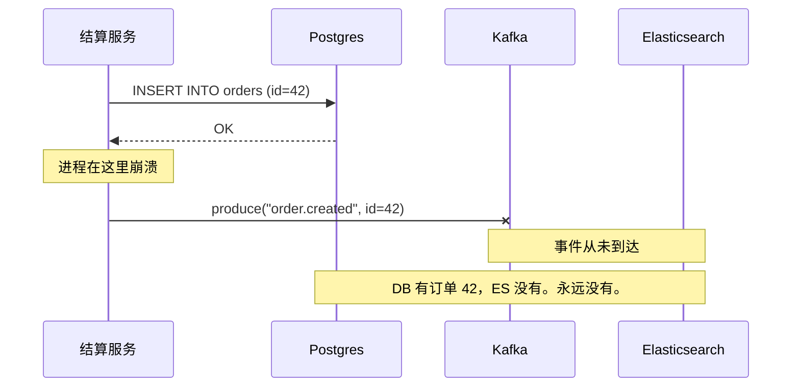
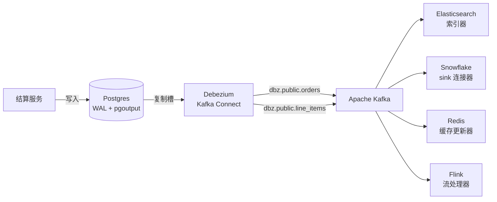
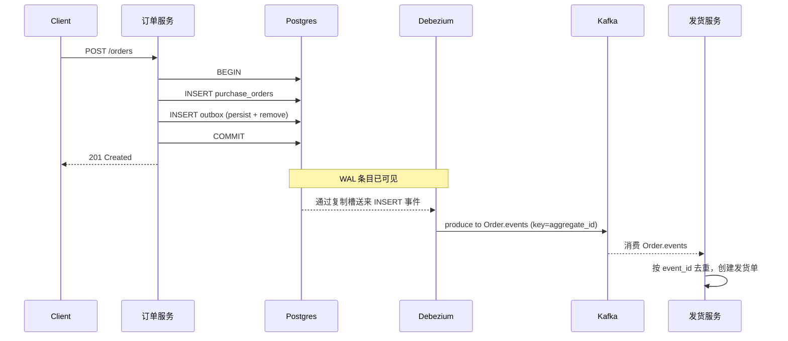
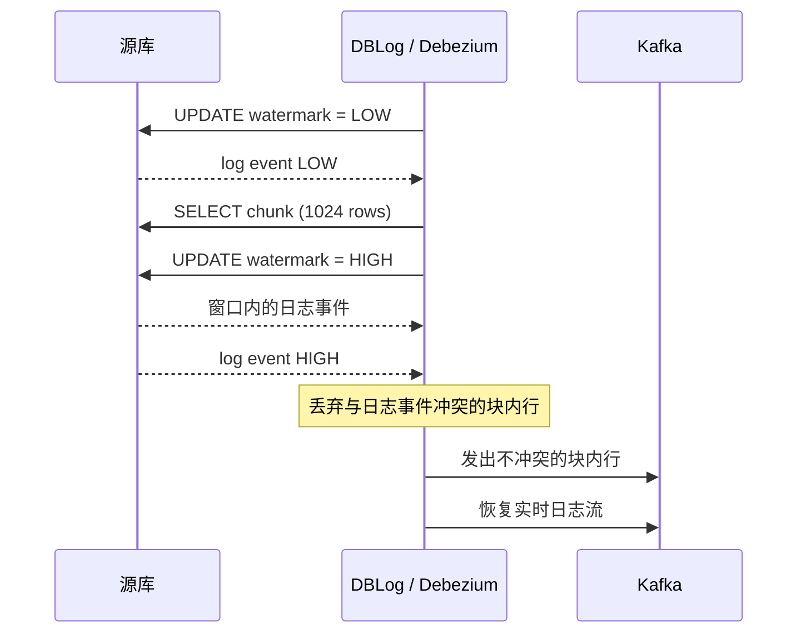

# 变更数据捕获：流式输出数据库的内心独白

> **TL;DR**: 每一次已提交的行变更，其实早已写进一份持久日志（Postgres WAL、MySQL binlog）。变更数据捕获（Change Data Capture，CDC）把这份日志暴露成公开的事件流，让下游系统（数仓、搜索、缓存、审计）不必由应用逐个双写也能保持同步。对多数团队来说，基于日志的 CDC（Debezium）就是默认选择。当你掌控应用代码、既想要原子性又不想引入连接器基础设施时，事务性 outbox 模式是替代方案。Shopify 用 outbox 驱动的 CDC，在峰值时每秒处理数千万条 Kafka 消息[^1]。Netflix 的 DBLog 引入了基于水位线的增量快照，让你在不锁定源库的情况下回填新的消费者[^2]。双写是敌人，数据库日志是解药。

## 学习目标

学完本模块，你将能够：

- [ ] 解释基于日志的 CDC，以及 Debezium 如何读取 Postgres WAL 或 MySQL binlog
- [ ] 比较基于日志、基于触发器、基于查询这三种 CDC 方案
- [ ] 实现事务性 outbox 模式，作为 CDC 的替代方案
- [ ] 处理 schema 演进、回填与顺序保证
- [ ] 设计一条 CDC 管道，同时供给数仓、缓存与搜索索引

## 直觉理解

你有一本私人日记。每天晚上你写下当天发生的事。你的伴侣读这本日记了解近况，你的会计读它记账，你的心理医生读它找规律。

这些人没有一个要求你把说过的话重复一遍，也没有一个需要你在每件事发生后单独打电话通知。他们都在按自己的节奏消费同一本日记。你的会计休假一周回来，只要补读漏掉的那几页就追上了。

你的数据库早就在记这本日记了。Postgres 管它叫预写日志（write-ahead log，WAL），MySQL 管它叫二进制日志（binary log，binlog）。每一条 INSERT、UPDATE、DELETE 都记录在那里，用于崩溃恢复和复制。变更数据捕获要做的，就是把这本日记向外部世界打开，让搜索索引、数据仓库、缓存、审计系统各自按自己的速度独立阅读，而你不需要分别写给它们。

另一种做法是：每次写完数据库，你自己去挨个通知每个消费者。这就是双写问题（dual-write problem），也是微服务架构里静默数据不一致最常见的来源。本章讲清双写为什么会坏、CDC 怎么修好它，以及什么情况下该改用 outbox 模式。

## 原理

### 双写问题

看结算服务里的这段伪代码：

```python
def place_order(order):
    db.execute("INSERT INTO orders ...", order)
    kafka.produce("order.created", order)
```

两次写入，两个系统，没有共享事务。可能出三种问题：

1. **部分失败。** INSERT 提交了，进程在 `kafka.produce` 之前崩溃，事件静默丢失。数仓永远看不到这笔订单。
2. **竞态。** 两个并发请求往同一笔订单写入 `status=shipped` 和 `status=cancelled`。数据库和 Kafka 看到这两次写入的顺序不同，于是永久地各说各话。[^3]
3. **无人察觉。** 从应用视角看两个操作都“成功”了，没有任何报错。这种分歧会一直隐形，直到客户投诉。

Martin Kleppmann 在 2015 年把这个问题讲透了：双写造成的是永久不一致，而不是最终一致性。[^3] 靠重试修不好，靠分布式事务也修不好（Kafka 不支持 XA）。唯一的解法是选出唯一的事实来源，其余一切都从它派生。



*双写失败的典型形态：数据库提交与 Kafka 发送之间的一次崩溃静默丢掉了事件，下游系统从此永久失步。*

CDC 消除双写的办法，是把数据库日志变成唯一的事实来源。下游系统消费这份日志，应用只写一个地方，其余全是派生。

### 基于日志的 CDC

基于日志的 CDC 工具会假扮成一个数据库副本。它打开一个复制槽（Postgres）或注册成 binlog 客户端（MySQL），按提交顺序读取已提交的变更，补上 schema 元数据，再发布到 Kafka。[^4]

**Postgres 逻辑解码。** 从 Postgres 10 起，`pgoutput` 插件能把 WAL 条目解码成逻辑上的行变更流。Debezium 打开一个复制槽，消费这个流，每行变更发布一条 Kafka 消息。复制槽记录消费者的位置（`restart_lsn`），因此 Postgres 会一直保留 WAL 段，直到消费者确认。[^5]

**MySQL binlog。** MySQL 的二进制日志在 ROW 格式下记录每个被修改行的改前与改后镜像。Debezium 以带 `REPLICATION SLAVE` 权限的复制客户端身份注册，实时读取 binlog。和 Postgres 不同，MySQL 按时间保留（`binlog_expire_logs_seconds`），而不是由消费者决定保留。

**Debezium 信封。** 每个变更事件都带一个标准信封：

```json
{
  "before": null,
  "after": {"id": 1, "email": "anne@example.com"},
  "source": {"connector": "postgresql", "txId": 555, "lsn": 24023128},
  "op": "c",
  "ts_ms": 1559033904863
}
```

`op` 字段表示操作类型：`c`（create）、`u`（update）、`d`（delete）、`r`（snapshot read）。更新时，`before` 是改前的行（前提是设了 `REPLICA IDENTITY FULL`），`after` 是新行。删除时 `before` 有值、`after` 为 null，随后还会发一条墓碑消息供 Kafka 日志压实使用。[^4]



*Debezium 通过复制槽读取 Postgres WAL，按表发布 Kafka 主题；相互独立的消费者从同一份事件流派生出搜索索引、数仓、缓存与流处理作业。*

### 基于触发器和基于查询的 CDC

不是每个数据库都提供可消费的日志。两种更老的策略填补这个空缺：

**基于触发器的 CDC。** 在 INSERT、UPDATE、DELETE 上挂数据库触发器，把一行写进影子变更表。一个 worker 轮询变更表并发布事件。Uber 的 Schemaless Triggers 用的就是这个套路：每次变更触发一个触发器，把数据喂给行程处理、计费和数仓管道。[^6] 代价是实打实的：每次写入都要在提交路径上多付延迟（调用触发器再加一次影子表 INSERT），写入开销显著上升。

**基于查询的 CDC（轮询）。** 一个 worker 定时执行 `SELECT * FROM t WHERE updated_at > :checkpoint`，发布结果并推进检查点。LinkedIn 最早那套 Oracle 数据捕获在转向 Oracle GoldenGate 流式方案之前，用的就是基于 SQL 的轮询。[^7] 它除了一个 cron 作业不需要任何基础设施，还能跑在只读副本上。但它抓不到删除（被删的行不再满足 WHERE 条件），查询负载与轮询频率成正比，而且会在检查点时间戳上产生竞态。

| 方案 | 能捕获删除？ | 对源库影响 | 基础设施 | 适合场景 |
|----------|:-:|---|---|---|
| 基于日志 | 能 | 极小（只读已有日志） | Kafka Connect + Schema Registry | 绝大多数生产场景 |
| 基于触发器 | 能 | 大（每次变更多一次写入） | 影子表 + 轮询器 | 拿不到日志访问权限的老库 |
| 基于查询 | 不能 | 中等（周期性查询） | 一个 cron 作业 | 小规模、低频同步 |

数据库支持就用基于日志的 CDC。不支持才用触发器。轮询只留给原型和低频批量同步。

### 事务性 outbox 模式

outbox 模式把协调工作推进到应用侧。在业务写入所在的同一个本地 ACID 事务里，往 `outbox` 表插一行。再由一个中继（relay）把 outbox 行异步发布到 Kafka。[^8]

```sql
BEGIN;
INSERT INTO purchase_orders (id, customer_id, total) VALUES (...);
INSERT INTO outbox (aggregate_type, aggregate_id, type, payload)
  VALUES ('Order', '42', 'OrderCreated', '{"total": 99.95}');
COMMIT;
```

两行原子提交，所以 outbox 行存在当且仅当业务行存在。没有分布式事务，也没有双写。

中继可以是一个简单的轮询器，更漂亮的做法是让 Debezium 直接读 outbox 表的 WAL 条目。Gunnar Morling 的实现用了一个巧妙的把戏：应用在同一个事务里 `persist()` 这条 outbox 行，然后立刻 `remove()` 它。Debezium 从 WAL 读到 INSERT（发布完整事件），并忽略那条 DELETE（由 Outbox Event Router SMT 过滤 `op == 'd'`）。outbox 表在磁盘上始终是空的，不需要任何清理 cron。[^8]



*outbox 模式：业务写入与事件写入在同一个本地事务里提交。Debezium 把 outbox 的 INSERT 从 WAL 中继到 Kafka，既不需要分布式事务，又能保证下游可靠投递。*

`aggregate_id` 字段会成为 Kafka 消息键，于是一笔订单的所有事件都哈希到同一个分区。这样不用全局协调就保住了单聚合内的顺序。

### 顺序、分区与 schema 演进

**顺序。** [消息队列与流处理](../part-2-building-blocks/08-message-queues-streaming.md) 已经讲过，Kafka 只保证分区内有序，不保证跨分区有序。CDC 工具拿主键（outbox 场景下是 `aggregate_id`）当消息键，同一行的所有事件落到同一分区，于是每个实体内部全序，而实体之间还能并行消费。[^4]

**事务边界。** Debezium 可以选择输出事务元数据（带 `txId:LSN` 和各表事件计数的 BEGIN/END 事件），让消费者在需要时重建跨表事务。

**schema 演进。** 逻辑解码不复制 DDL。[^4] 一次加 NOT NULL 列或删列的迁移，可能直接打挂下游消费者。防线是 Schema Registry 配 Avro 序列化和 `BACKWARD` 兼容模式：新消费者要能读旧数据，因此你只能加带默认值的可空字段，或删字段。每次迁移上线前，先拿注册中心的兼容性规则跑一遍。

**TOAST 列。** 在 Postgres 默认的 `REPLICA IDENTITY` 下，更新事件会省略未发生变化的 TOASTed（大字段）列。Debezium 用占位符 `__debezium_unavailable_value` 顶上。如果下游需要完整的改前镜像，对相关表执行 `ALTER TABLE t REPLICA IDENTITY FULL`（预期源库 CPU 会适度上升；有基准测试显示峰值 CPU 从 30% 升到 35%）。[^5]

### 增量快照与回填

一个新消费者（比如一个全新的 Elasticsearch 索引）需要全量数据，而不只是未来的变更。最笨的办法是 `SELECT *` 导一份，这会锁表，并把流式同步卡住几小时。

Netflix 的 DBLog 用基于水位线的分块快照解决了这个问题。[^2] 算法如下：

1. 往专门的水位线表写入 LOW 水位线。
2. 选一块行（在 Debezium 的移植版里默认 1,024 行）。[^9]
3. 写入 HIGH 水位线。
4. LOW 与 HIGH 之间、与块内行冲突的日志事件胜出。丢弃这些过期的块内行。
5. 发出不冲突的块内行，然后恢复实时流。



*DBLog 的水位线算法把快照分块与实时日志流交织在一起。日志事件永远压过过期的快照行，因此流的语义始终一致。*

这套流程不加表锁，可以随时按表或按主键触发，并在 Debezium 1.6+ 中通过信号表落地为增量快照。[^9]

## 真实案例

### Shopify：outbox 驱动的 CDC 如何撑住电商规模

Shopify 的模块化单体 Rails 应用用事务性 outbox 模式可靠地发出领域事件。服务在自己的按 shop 分片的 MySQL 集群上，把业务行和 outbox 行放在同一个事务里写入。再由一个中继（Kafka Connect 配 Debezium，或 Shopify 内部的读取器）把 outbox 事件发布到 Kafka。[^1]

**规模。** 2024 年黑五 / 网一期间，Shopify 迁移了 57.3 PB 数据，处理了 10.5 万亿次数据库查询和 1.17 万亿次写入，应用服务器上持续承受每分钟 8000 万请求。Kafka 在峰值时每秒处理数千万条消息。[^1]

**架构。** 区域 Kafka 集群镜像进一个聚合计群，由它供给数据仓库。各业务专属消费者（搜索索引、分析、库存流）订阅聚合主题。Pods 架构把店铺分片到相互隔离的 pod 里，每个 pod 有自己的数据库集群，因此 outbox 可以按 `shop_id` 横向扩展。

**关键决策：**

- **聚合计群模式。** 区域集群镜像到一个聚合点，下游数仓和分析只需消费一个主题，消费者扇出因此简单许多。
- **Kubernetes 上的 StatefulSet。** Broker 跑在持久卷上，并配置 pod 间反亲和，保证它们绝不共用节点。机架感知把 broker 铺到不同可用区。就绪探针卡住滚动重启，保证一次只有一个 broker 重启。
- **自建 Kafka 镜像。** Shopify 自己构建 Kafka 容器镜像，而不是依赖第三方镜像仓库，因为在支付关键链路上，上游镜像被改动是不可接受的。

结论：outbox 模式配上横向分片和一个运维得当的 Kafka 层，可以撑住万亿次写入的负载。

## 权衡

| 方案 | 优点 | 缺点 | 何时适用 | 我们的选择 |
|----------|------|------|-----------|----------|
| 基于日志的 CDC（Debezium） | 源库开销小，能捕获包括删除在内的全部变更，近实时 | 运维复杂（复制槽、schema registry、连接器监控） | 你需要一个自己并不拥有的数据库的全部变更 | **多数团队的默认选择** |
| 基于触发器的 CDC | 任何支持触发器的数据库都能用 | 写路径延迟翻倍，对 DDL 脆弱 | 拿不到日志访问权限的老系统 | 只在无法用日志方案时 |
| 基于查询的轮询 | 零基础设施，能跑在只读副本上 | 抓不到删除，增加查询负载，时间戳有竞态 | 原型、低频批量同步 | 仅限原型和小规模批量同步 |
| 事务性 outbox | 与业务写入原子，事件是稳定契约 | 需要改应用，中继有运维负担 | 你掌控应用，且想解耦事件 schema | **当你拥有这个服务时** |

## 常见陷阱

> [!WARNING]
> **Postgres 复制槽膨胀。** 一个不活跃或跟不上的复制槽会阻止 Postgres 回收 WAL 段，磁盘就这么被悄悄写满。设 `max_slot_wal_keep_size = 50GB`（Postgres 13+），让服务端在失控的复制槽吃满磁盘之前把它作废。开启心跳（`heartbeat.interval.ms = 60000`），让低流量库的复制槽也能推进。当某个槽保留超过 10-20 GB 或超过 30 分钟不活跃时告警。[^5]

> [!WARNING]
> **MySQL binlog 保留期到期。** MySQL 按时间清理 binlog，而不是按消费者确认。如果连接器离线时间超过 `binlog_expire_logs_seconds`（MySQL 8.0 默认 2,592,000 秒，即 30 天），需要的文件已经没了，只能重新做一次快照。监控 `MilliSecondsBehindSource`，持续增长就呼叫值班。

> [!WARNING]
> **大事务卡住逻辑解码。** 一句 `UPDATE ... WHERE created_at < '2020-01-01'` 修改上百万行，会在内存里缓冲到提交，然后作为一个巨大批次流出去。调大 `logical_decoding_work_mem`（默认 64 MB），并在应用代码里把批量操作切块（每个事务 1,000 行，而不是一千万行）。[^5]

> [!WARNING]
> **消费者没有幂等性。** CDC 管道默认是至少一次投递。连接器重启后会重放少量事件，天真的消费者因此重复扣款或重复应用。应该传递一个稳定的事件 UUID，并在消费端维护一张以该 UUID 为键的 `MessageLog`。完整模式见 [幂等性与精确一次](../part-3-distributed-systems-theory/07-idempotency-exactly-once.md)。[^8]

> [!WARNING]
> **TOAST 列制造幻影 null。** 在 Postgres 默认的 `REPLICA IDENTITY` 下，未变化的 TOASTed 列在更新事件里会显示为 `__debezium_unavailable_value`。把它当成 null 的消费者会污染下游数据。对需要完整改前镜像、又带大字段的表设 `REPLICA IDENTITY FULL`。

## 练习

你运维一个 Postgres 集群，为结算服务承载每秒 5,000 次写入。请设计一条 CDC 管道，让 Elasticsearch、Snowflake 数仓和 Redis 缓存保持同步。说明各环节的延迟预算、失败处理方式，以及如何在不影响生产的前提下回填一个新消费者。

<details>
<summary>提示</summary>

想想哪些下游能容忍几分钟延迟（数仓），哪些需要亚秒级新鲜度（缓存）。再想想 Elasticsearch 索引器落后时会发生什么：它会堵住其他消费者吗？回填那部分，考虑 Debezium 的增量快照功能。

</details>

<details>
<summary>解答</summary>

**架构：** Debezium Postgres 连接器通过复制槽读 WAL，发布到按表划分的 Kafka 主题。三个相互独立的消费组：一个给 Redis，一个给 Elasticsearch，一个给 Snowflake（走 Kafka Connect sink 连接器）。

**延迟预算：**

- Redis 缓存：p50 < 2s，p99 < 10s。缓存超过 10 秒不新鲜，用户就能看出来。
- Elasticsearch：p50 < 5s，p99 < 60s。搜索结果能容忍短暂延迟。
- Snowflake：< 1 小时。按小时微批导入对分析场景足够。

**失败处理：**

- 每个消费组有自己的已提交位点。Elasticsearch 落后不影响 Redis 和 Snowflake。
- 设 `max_slot_wal_keep_size = 50GB`，防止一个挂掉的消费者写满磁盘。
- 在 Prometheus 里监控各消费组的延迟，达到延迟预算的 2 倍就告警。
- 消费者幂等：Redis 按主键 UPSERT，Elasticsearch 按文档 ID，Snowflake 在 merge 时去重。

**回填策略：**

- 用 Debezium 的增量快照，通过信号表触发：`INSERT INTO dbz_signal VALUES ('backfill-es', 'execute-snapshot', '{"data-collections": ["public.orders"], "type": "incremental"}')`。
- 把分块大小限到 2,048 行，让主库 CPU 保持在 60% 以下。
- 在业务低谷期执行。快照与实时流交织进行，回填期间不会丢事件。
- Elasticsearch 消费者把快照事件（`op = 'r'`）和创建事件（`op = 'c'`）同样处理：按文档 ID upsert。

**接受的权衡：** 我们接受至少一次投递，把幂等性推给消费者，而不是为 Kafka 的精确一次语义买单——后者会束缚消费者的实现方式。

</details>

## 要点回顾

- 双写（数据库加消息总线，且没有共享事务）造成的是永久不一致，不是最终一致性。CDC 通过把数据库日志变成唯一事实来源来消除双写。
- 基于日志的 CDC 读的是已有的复制流（WAL、binlog），对源库影响很小。应当把它当默认方案。
- 事务性 outbox 模式把一个业务行和一个事件行写在同一个本地事务里，从而在没有连接器基础设施的情况下拿到原子性。
- Debezium 的增量快照（移植自 Netflix DBLog）让你在不锁表、不中断实时流的情况下回填新消费者。
- 按键分区（把主键或聚合 ID 作为 Kafka 消息键）让每个实体内部全序，同时实体之间仍可并行消费。
- schema 演进需要带兼容性规则的 Schema Registry。迁移先对着注册中心测过再上线。
- Postgres 复制槽膨胀是最常见的运维故障。设好 `max_slot_wal_keep_size`、开启心跳、对保留的 WAL 大小告警。

## 延伸阅读

- [Using logs to build a solid data infrastructure (or: why dual writes are a bad idea)](http://www.kleppmann.com/2015/05/27/logs-for-data-infrastructure.html) - Kleppmann 在 2015 年 Craft 大会的演讲，点明了双写问题并把 CDC 立为解法；本章的思想源头。
- [DBLog: A Generic Change-Data-Capture Framework](https://netflixtechblog.com/dblog-a-generic-change-data-capture-framework-69351fb9099b) - Netflix 用图讲清了基于水位线的快照算法；想弄懂无锁增量快照就读这篇。
- [Reliable Microservices Data Exchange With the Outbox Pattern](https://debezium.io/blog/2019/02/19/reliable-microservices-data-exchange-with-the-outbox-pattern/) - Morling 的 outbox 实现指南，含 persist-then-remove 技巧与消费端去重。
- [Mastering Postgres Replication Slots](https://www.morling.dev/blog/mastering-postgres-replication-slots/) - 防治 WAL 膨胀、监控复制槽健康、在 Postgres 17+ 上配置故障切换槽的权威指南。
- [Debezium connector for PostgreSQL](https://debezium.io/documentation/reference/stable/connectors/postgresql.html) - 信封格式、replica identity、主题命名、TOAST 处理以及全部连接器属性的参考文档。
- [Open sourcing Databus: LinkedIn's low latency CDC system](http://engineering.linkedin.com/data-replication/open-sourcing-databus-linkedins-low-latency-change-data-capture-system) - 最早的三层 CDC 架构（relay、bootstrap、client），影响了此后包括 DBLog 在内的所有系统。
- [Incremental Snapshots in Debezium](https://debezium.io/blog/2021/10/07/incremental-snapshots/) - DBLog 的水位线算法如何带着信号表触发与分块协调被移植进 Debezium 1.6+。
- [Pattern: Transactional outbox](https://microservices.io/patterns/data/transactional-outbox.html) - Chris Richardson 精炼的模式参考，快速复习机制时很好用。

## 记忆卡片

**Q:** 什么是双写问题？
**A:** 在应用代码里同时写数据库和消息总线，两者没有共享事务。如果进程在两次写入之间崩溃，或两个客户端竞争，系统就会永久分歧，而且不报任何错。

**Q:** CDC 的三种抽取策略是什么？
**A:** 基于日志（读 WAL/binlog）、基于触发器（由数据库触发器写入影子表）、基于查询（用 `WHERE updated_at > checkpoint` 轮询）。生产环境默认用基于日志的方案。

**Q:** Debezium 如何从 Postgres 读取变更？
**A:** 它用 `pgoutput` 插件打开一个逻辑复制槽，按提交顺序消费解码后的 WAL 流，给事件补上 schema 元数据，再发布到按表划分的 Kafka 主题。

**Q:** Debezium 变更事件信封里有哪些字段？
**A:** `before`（改前行状态）、`after`（新行状态）、`op`（c/u/d/r）、`source`（连接器元数据，含 txId 与 LSN）、`ts_ms`（时间戳）。删除时 `after` 为 null；创建时 `before` 为 null。

**Q:** 事务性 outbox 模式如何避开双写？
**A:** 应用把业务行和 outbox 事件行写在同一个本地 ACID 事务里。中继（轮询器，或读 outbox 表 WAL 的 Debezium）异步发布事件。原子性由本地事务保证。

**Q:** Debezium 版 outbox 实现里的 persist-then-remove 技巧是什么？
**A:** 应用在同一个事务里持久化 outbox 行，随即删除它。Debezium 从 WAL 读到 INSERT 并发布，但通过 Outbox Event Router SMT 忽略那条 DELETE。outbox 表在磁盘上始终是空的。

**Q:** 增量快照如何做到不锁源表？
**A:** DBLog/Debezium 的算法往专用表写 LOW 和 HIGH 水位线，在其间取一块行，然后丢弃那些与水位线窗口内日志事件冲突的块内行。日志事件永远压过过期的快照行。

**Q:** Postgres CDC 最危险的运维陷阱是什么？
**A:** 复制槽膨胀。不活跃的复制槽会阻止 WAL 回收，磁盘被写满。用 `max_slot_wal_keep_size`（Postgres 13+）、低流量库的心跳查询、以及对保留 WAL 大小的告警来缓解。

**Q:** CDC 为什么用主键当 Kafka 消息键？
**A:** Kafka 只保证分区内有序。把主键哈希到分区后，同一行的所有事件落在同一分区，既保住单实体的因果顺序，又允许实体之间并行消费。

**Q:** 在默认 REPLICA IDENTITY 下，TOAST 列在 Postgres CDC 里会怎样？
**A:** 未变化的 TOASTed 列会从更新事件里省略，Debezium 用 `__debezium_unavailable_value` 替代。要拿到完整改前镜像，得对表设 `REPLICA IDENTITY FULL`（代价是源库 CPU 适度上升）。

**Q:** 什么时候该选 outbox 模式而不是基于日志的 CDC？
**A:** 当你掌控应用代码、希望事件成为与内部表结构解耦的稳定契约、并且更愿意显式设计事件而不是直接暴露裸的行变更流时。还有，当你希望源服务对事件具备读己之写语义时。

**Q:** Shopify 如何扩展它 outbox 驱动的 CDC 管道？
**A:** 按 shop 分片的 MySQL 集群（每个 pod 自己的库）、区域 Kafka 集群镜像到聚合计群、每个下游独立的消费组。这套架构在 2024 年 BFCM 期间扛住了每秒数千万条消息和 1.17 万亿次写入。

## 参考文献

[^1]: Shopify Engineering. "How we prepare Shopify for BFCM (2025)." https://www.shopify.engineering/bfcm-readiness-2025
[^2]: Andreakis, Andreas, and Ioannis Papapanagiotou. "DBLog: A Generic Change-Data-Capture Framework." Netflix TechBlog, 17 Dec 2019. https://netflixtechblog.com/dblog-a-generic-change-data-capture-framework-69351fb9099b
[^3]: Kleppmann, Martin. "Using logs to build a solid data infrastructure (or: why dual writes are a bad idea)." Craft Conference 2015. http://www.kleppmann.com/2015/05/27/logs-for-data-infrastructure.html
[^4]: Debezium Community. "Debezium connector for PostgreSQL (stable)." Debezium documentation. https://debezium.io/documentation/reference/stable/connectors/postgresql.html
[^5]: Morling, Gunnar. "Mastering Postgres Replication Slots: Preventing WAL Bloat and Other Production Issues." morling.dev, 8 Jul 2025. https://www.morling.dev/blog/mastering-postgres-replication-slots/
[^6]: Uber Engineering. "Using Triggers On Schemaless, Uber Engineering's Datastore Using MySQL." 2016. https://www.uber.com/en-MA/blog/schemaless-part-three-datastore-triggers/
[^7]: LinkedIn Engineering. "Incremental Data Capture for Oracle Databases at LinkedIn - then and now." 2017. https://engineering.linkedin.com/blog/2017/11/incremental-data-capture-for-oracle-databases-at-linkedin--then-
[^8]: Morling, Gunnar. "Reliable Microservices Data Exchange With the Outbox Pattern." Debezium blog, 19 Feb 2019. https://debezium.io/blog/2019/02/19/reliable-microservices-data-exchange-with-the-outbox-pattern/
[^9]: Pechanec, Jiri. "Incremental Snapshots in Debezium." Debezium blog, 7 Oct 2021. https://debezium.io/blog/2021/10/07/incremental-snapshots/
