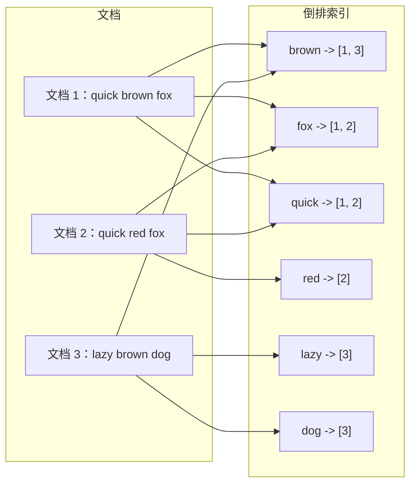
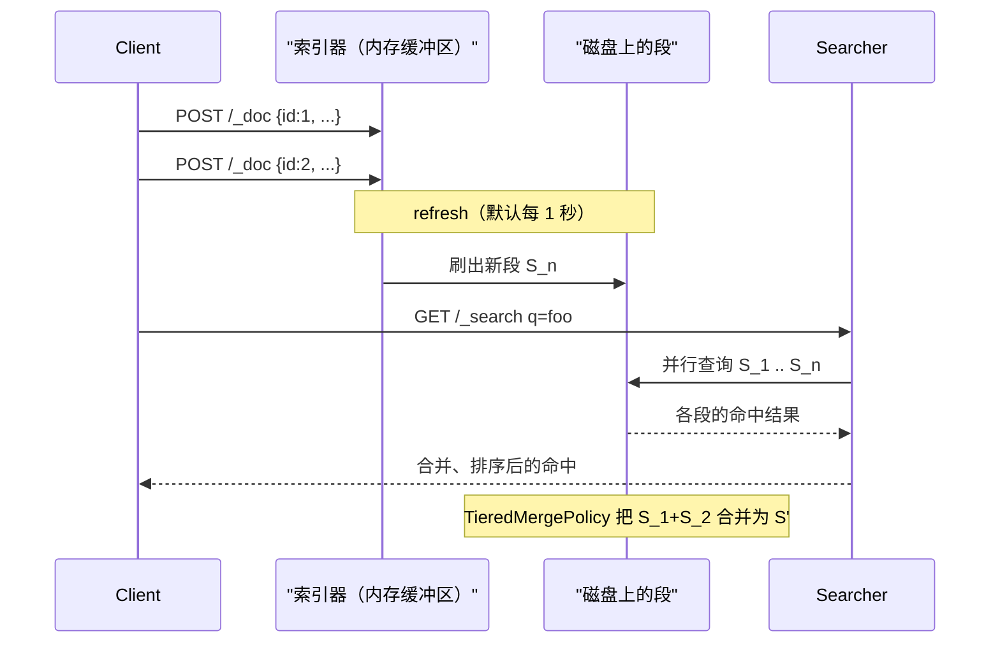
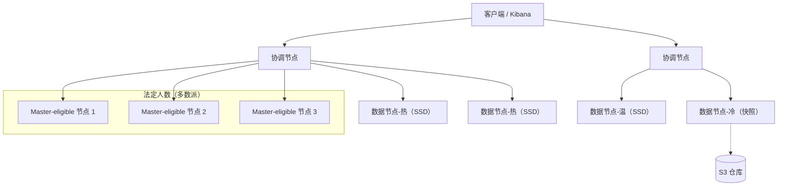
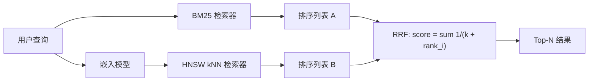

# 搜索系统：倒排索引、BM25 与生产环境中的 Elasticsearch

> **TL;DR**: 搜索引擎是一种专用数据库，它的主索引是倒排的：词项指向文档，而不是反过来。BM25 把词项稀有度、词频饱和与文档长度归一化合在一起给候选文档打分，默认参数（`k1=1.2`、`b=0.75`）开箱即用的效果出奇地好[^1]。Apache Lucene 提供检索与打分引擎；Elasticsearch、OpenSearch 和 Solr 在它外面包上分片、REST API 和聚合。生产上最难的不是相关性调优，而是运维：映射爆炸、fielddata 带来的堆压力、深度分页和分片热点[^2]。一千万文档以内先用 Postgres 全文检索；等你需要 BM25 排序、分面聚合或写入的横向扩展时，再升级到专用引擎。

## 学习目标

学完本章，你将能够：

- [ ] 解释倒排索引、倒排列表（posting list），以及它们为何不同于 B 树
- [ ] 推理 BM25 打分的机制，判断何时该调相关性、何时该接受默认值
- [ ] 为多语言或结构化文本设计分析器与分词器
- [ ] 用聚合和 doc values 建模分面搜索
- [ ] 运维 Elasticsearch：分片、副本、ILM 层级与容量规划

## 直觉理解

你收藏了一万本食谱书。朋友问：“哪些书同时提到 saffron（藏红花）和 risotto（意式烩饭）？”

如果只有普通书架（一棵 B 树），你得把每本书从头到尾翻一遍找这两个词。这就是全表扫描，能耗掉整个下午。

换一种做法：你搭一套索引卡片，一个词一张卡。“saffron”那张卡列出 saffron 出现过的每一本书、每一页：“第 42 本第 7 页，第 891 本第 3 页，第 2044 本第 12 页……”。“risotto”那张卡有自己的一份清单。要回答朋友的问题，你抽出两张卡，找出同时出现在两份清单上的书。两次卡片查找，一次求交，几秒钟搞定。

这套卡片系统就是倒排索引。之所以叫“倒排”，是因为普通索引把书映射到词（目录），而它把词映射到书。每张卡上的清单叫倒排列表（posting list），求交就是有序列表归并。搜索引擎在几百万文档上之所以感觉是瞬时的，就是因为倒排列表做了差分编码和位打包之后，这次求交是亚毫秒级的[^3]。

但找到匹配的书只是问题的一半。朋友不想看 47 条命中随便堆在一起，她要最好的排在前面。这是排序问题，BM25 就是解它的算法。本章余下的部分把这两半都搭起来：检索（倒排索引）和排序（BM25），再看 Elasticsearch 如何把它们包成一个能在生产上运维的分布式系统。

## 原理

### 倒排索引基础

倒排索引有两层。词典（term dictionary）把语料里每个不同的词元映射到一条词项记录，每条记录指向一个倒排列表：该词元出现过的文档 ID 的有序序列，可选地附带词频和位置[^4]。

[分布式系统常用的数据结构](../part-0-prerequisites/02-data-structures-for-systems.md)介绍过跳表和有限状态转换器。Lucene 用有限状态转换器（FST）做词典，无论词表多大，查找都是 O(|term|)。倒排列表按 128 个文档 ID 一块做差分编码：Lucene 算出块内差分所需的最大位数，把剩下的位打包。这种 Frame-of-Reference（FOR）编码把倒排列表压到每个文档 ID 只要几个比特[^3]。倒排列表之上还叠着跳表，让 `A AND B` 这类合取查询能跳过不匹配的块，而不是逐个 ID 扫描。

关键判断：B 树擅长单列上的等值和范围查找。但“找出同时包含 `caching` 和 `strategy` 的所有文档”不是等值查找，它是两个倒排列表之间的集合求交，而倒排索引是唯一能让这种操作在大规模下保持亚毫秒的结构。



*词典里每个词项都指向一个由文档 ID 组成的倒排列表；查询对倒排列表求交，而不是扫描文档。*

### Lucene 的段、合并与删除

[存储引擎](./00-storage-engines.md)讲过 LSM 树如何用不可变的有序文件和后台合并工作。Lucene 的架构惊人地相似。一个索引就是一堆不可变的段（segment）。每个段是一个自带词典、倒排列表、存储字段和 doc values 的独立迷你倒排索引。

新文档先在内存里缓冲。到 refresh（默认每 1 秒）时，缓冲区刷成一个新的磁盘段，立刻可被搜索。删除并不移除数据，而是在 `.del` 文件里写一个墓碑位。`TieredMergePolicy` 会周期性地把小段合并成大段，过程中清掉墓碑。

这个设计有几项后果：

- **近实时搜索很便宜。** 一次 refresh 只创建新段，不用等 fsync。文档在写入后 1 秒内默认可搜。
- **删除在合并之前都很贵。** 一个积了大量删除文档的分片既浪费磁盘又拖慢查询，因为搜索器仍会访问被打了墓碑的条目。
- **合并风暴吃资源。** 按默认 1 秒 refresh 做批量导入，会产生成千上万个必须合并的小段。批量重建索引时，把 `refresh_interval: -1`，导入完再恢复。



*写入先在内存缓冲，refresh 时刷成新的不可变段，与已有段一起对外提供搜索，直到合并把它们收拢。*

### BM25 打分

BM25（Best Matching 25）是 Lucene、Elasticsearch、OpenSearch 和 Solr 的默认打分函数。对查询 Q 和文档 D，分数为：

```text
score(D, Q) = SUM over q_i in Q of:
  IDF(q_i) * [ f(q_i, D) * (k1 + 1) ] / [ f(q_i, D) + k1 * (1 - b + b * |D| / avgdl) ]
```

其中：

- `IDF(q_i) = log(1 + (N - n + 0.5) / (n + 0.5))` 度量词项稀有度。N 是文档总数，n 是包含该词项的文档数。
- `f(q_i, D)` 是文档 D 中该词项的频次。
- `|D|` 是文档的长度（以词元计），`avgdl` 是语料平均值。
- `k1 = 1.2` 控制词频饱和。出现几次之后，再重复也几乎不涨分。这挡住了靠堆关键词取胜的文档。
- `b = 0.75` 控制长度归一化。更长的文档会被惩罚，因为它们天然含有更多词元[^1]。

**BM25 为什么强于朴素 TF-IDF：** 最简单的 TF-IDF 变体直接用原始词频，它无上界地增长，于是一篇把“caching”重复 50 次的文档得分是只提一次的 50 倍。次线性变体（用 1 + log(tf)）能部分缓解，但 BM25 的饱和曲线更讲道理，还可调。BM25 同时做了文档长度归一化，所以一篇一万字的长文不会自动压过一篇 500 字但说到点上的回答。

默认参数（`k1=1.2`、`b=0.75`）在通用英文散文上表现很强。多数团队应该先投精力做相关性评估（衡量点击率、NDCG 或 MRR），再考虑动这两个旋钮[^1]。

> [!TIP]
> BM25 是词袋模型。用户打“k8s”时，它匹配不到“kubernetes”。这种词汇不匹配，正是混合 BM25 + 向量检索（见下文）要解决的问题。

### 分析器与分词

分析器（analyzer）是一条三阶段流水线，在索引时和查询时都会跑：

1. **字符过滤器**剥掉 HTML、归一化 Unicode，或做字符映射（例如把 `&` 映射为 `and`）。
2. **分词器**把文本切成词元。`standard` 分词器按空白和标点切分。edge-n-gram 分词器生成前缀，用于自动补全。
3. **词元过滤器**做小写化、去停用词、词干提取（英文用 Porter，欧洲语言用 Snowball），或应用同义词。

Elasticsearch 区分 `text` 字段（会分析，用于 `match` 查询）和 `keyword` 字段（不分析，用于 `term` 查询、聚合和排序）。同一个原始字符串通常以 multi-field 映射同时索引进两者。

语言这件事很关键。中日韩文本词与词之间没有空白，标准分词完全失效。Kuromoji 处理日文形态分析，SmartCN 处理中文分词。GitHub 的 Blackbird 代码搜索明确关掉了词干提取和去停用词，因为 `for`、`int`、`var` 这类代码词元本身有含义[^5]。

**关键约束：** 在已有数据的字段上更换分析器必须全量重建索引，因为现有倒排记录编码的是旧分析器切出的词元。第一份生产文档落地之前，把分析器流水线想清楚。

### 查询 DSL、过滤与聚合

Elasticsearch 的查询 DSL 把两种上下文分开：

- **查询上下文**（计分）：`match`、`multi_match`、`function_score`。文档会拿到 BM25 相关性分数。
- **过滤上下文**（缓存，不计分）：`term`、`range`、`bool.filter`。结果按段缓存为位集，后续查询直接复用，等于免费。

`bool` 查询用来组合子句：`must`（计分的 AND）、`should`（计分的 OR）、`must_not`（排除）、`filter`（不计分的 AND）。常见错误是把过滤条件放进 `must` 而不是 `filter`，白白付出计分成本又丢弃结果。

**聚合（aggregation）**在查询时计算分组统计。它读的是 doc values——Lucene 在倒排记录之外按字段写的一份列式存储。之所以需要 doc values，是因为倒排索引是词项到文档的映射，而聚合需要它的转置：文档到词项。

主要聚合类型：

- `terms` 按字段值给文档分桶（分面导航）。
- `date_histogram` 按时间区间分组（时序看板）。
- `cardinality` 用 HyperLogLog++ 估算去重计数，在恒定内存下典型误差 1-6%（取决于 `precision_threshold`）。

> [!IMPORTANT]
> 绝不要在 `text` 字段上开 `fielddata: true`。它会把整个分析后词元的列加载进 JVM 堆，是 Elasticsearch 集群里最常见的 OOM 诱因。要做排序和聚合，用 `keyword` 类型的 multi-field。

### 分片、副本与 ILM

一个分片就是一个 Lucene 索引。一个 Elasticsearch 索引是若干主分片加副本的逻辑分组。当前的容量建议：主分片控制在 10 GB 到 50 GB 之间，每个不超过两亿文档[^2]。

**索引生命周期管理（ILM）**随索引变老把它在各层级间搬动：

| 层级 | 硬件 | 使用场景 |
|------|----------|----------|
| 热（Hot） | 高速 NVMe SSD | 活跃写入与高频查询 |
| 温（Warm） | 较慢的 SSD | 只读、查询频率较低 |
| 冷（Cold） | 对象存储上的可搜索快照 | 极少查询，成本低 |
| 冻结（Frozen） | 部分挂载的快照 | 归档，可接受秒级延迟 |
| 删除（Delete） | 不适用 | TTL 到期，清除 |

滚动索引（按天或按月）让 ILM 能随每个索引变老依次执行 `rollover`、`shrink`、`force_merge` 和 `delete`。这个模式让你每个周期都能改分片数，而不必重建历史数据。

**运维经验法则：**

- 每 GB 主节点堆内存对应少于 3,000 个索引[^2]。
- 一个分片是单线程的搜索单元（每次查询每个分片一个线程）。分片太多会打满搜索线程池。
- 小于 1 GB 的分片浪费集群状态元数据。合并小索引。



*生产集群把主节点、协调节点和分层数据节点分开；ILM 随索引变老把分片从热 SSD 搬到冷可搜索快照。*

### Elasticsearch、OpenSearch 与 Solr 的对比

三者都是套在 Lucene 外面的分布式外壳。许可证的变迁解释了为什么本该一个产品够用的地方出现了三个：

- **2021 年：** Elastic 把 Elasticsearch 从 Apache 2.0 改为 SSPL + Elastic License v2 双许可（未获 OSI 认可）。
- **2021 年：** AWS 从 ES 7.10.2 分叉出 OpenSearch，采用 Apache 2.0。
- **2024 年：** Elastic 增加 AGPL v3 作为第三种选择，让 Elasticsearch 在 OSI 认可的许可证下重新“开源”。

针对 7.11 之后 ES API 写的代码无法原样跑在 OpenSearch 上，而且两者的差距还在拉大。Solr 仍是 Apache 2.0，截至 2020 年 Slack 在用[^6]，但相对 Elasticsearch，它的社区推进速度慢了下来。

**要功能迭代速度、Kibana 和托管的 Elastic Cloud，选 Elasticsearch。** Apache 2.0 许可不可让步，或者你已经在 AWS 上，选 OpenSearch。**已有 Solr 专长和 ZooKeeper 基础设施，选 Solr。**

### Postgres 全文检索与专用引擎的对比

PostgreSQL 自带 `tsvector`、`tsquery` 类型和 GIN 索引。单节点上大约一千万文档以内，用 GIN 索引的全文检索就能给出百毫秒以内的带排序结果，不引入任何额外基础设施。

**继续用 Postgres 的情形：**

- 匹配需求简单（不要分面，不要复杂加权）。
- 搜索与事务数据之间的 ACID 一致性比排序质量更重要。
- 你没法为一个独立集群的运维负担找到理由。

**该升级的情形：**

- 你需要 BM25 级别的排序和多字段加权。
- 分面聚合是产品需求。
- 写入吞吐超过单写入者的 Postgres 能承受的量。
- 你需要跨分片的读横向扩展。

对“我们真的需要 Elasticsearch 吗”这个问题，诚实的答案是：暂时不需要，直到你需要为止。信号是 `ts_rank` 开始满足不了用户，而你发现自己在应用代码里手搓打分流水线。

### 词法检索与向量检索的混合

BM25 在词汇不匹配上会失手（“k8s”对“kubernetes”）。稠密向量嵌入在精确关键词匹配上会失手（“错误码 E-4012”）。混合检索并行跑两路召回，再融合它们的排序列表。

Elasticsearch 8.x 支持在与标准 `query` 子句并列的位置写 `knn` 子句。向量索引用 Lucene 的 HNSW 实现。结果通过倒数排名融合（RRF）合并：

```text
RRF_score(doc) = sum over retrievers of 1 / (k + rank_i)
```

其中 `k` 是一个常数（默认 60），用来压低排名靠后的结果的影响力。RRF 不需要做分数归一化，对 BM25 与余弦相似度之间的分数量纲差异也不敏感。

[向量数据库](./08-vector-databases.md)讲 HNSW 的内部结构和专用向量库。那一章和这一章之间的桥就是混合检索：用 BM25 保证已知词项的精确性，用向量保证语义匹配的召回，用 RRF 做合并。



*混合检索并行跑 BM25 和 kNN，用倒数排名融合把两路排序列表合并，捡回任何单路召回漏掉的文档。*

## 真实案例

### GitHub 代码搜索（Blackbird，2023）

GitHub 早先的搜索跑在 Elasticsearch 上。仅仅索引 800 万个仓库就花了几个月。代码搜索有些需求会击穿通用文本引擎的假设：标点有含义（`!=`、`->`、`::` 都是搜索词元），必须关掉词干提取（用户搜的是 `fmt` 而不是 `format`），而且要支持正则[^5]。

2023 年，GitHub 上线 Blackbird，一个自研的 Rust 搜索引擎，索引 4,500 万个仓库、115 TB 源码、155 亿文档，集群只有 32 台机器（每台 64 核，共 2,048 核）[^5]。

**关键设计决策：**

- **按 blob SHA 分片。** 文档按 Git blob SHA 分片，而不是按仓库。这样跨 fork 天然去重（同一个文件在 1,000 个 fork 里只索引一次），也避免了热门仓库造成的分片热点。
- **稀疏 n-gram。** 纯三元组对 `for` 这类常见序列没有选择性。Blackbird 用“稀疏 gram”算法，按 bigram 频率权重决定 n-gram 的长度，提升选择性。
- **不做词干提取，不去停用词。** `int`、`for`、`var` 这类代码词元是有含义的。关掉标准 NLP 预处理是必须的。
- **Kafka 支撑的一致性。** 摄入事件流经 Kafka。你翻页浏览结果时，视图被钉在一致的提交级快照上。

**结果：** 摄入吞吐约每秒 120,000 文档。单分片 p99 延迟约 100 ms。单机最大吞吐约 640 QPS。得益于把抓取量削减一半以上的增量索引，全部 155 亿文档约 18 小时可重建索引[^5]。

教训：对多数搜索问题，Elasticsearch 是正确的默认选择。但当你的领域有特殊的切词需求、规模又超出通用引擎的能力时，直接在 Lucene（或 Rust 生态里的等价物 Tantivy）上自研是一条正当路径。GitHub 之前“索引 800 万仓库要几个月”，就是这个重写的正当理由。

## 权衡

| 方案 | 优点 | 缺点 | 适用场景 | 我们的选择 |
|----------|------|------|-----------|----------|
| Postgres 全文检索（tsvector + GIN） | 无额外基础设施，与业务数据同库 ACID，备份只需一份 | 排序能力有限，分面无低成本方案，单写入者 | 小规模目录、简单匹配、约 1,000 万文档以内 | **从这里起步** |
| Elasticsearch、OpenSearch | 排序能力强、可扩展、聚合丰富、生态成熟 | 运维负担、JVM 调优、映射爆炸风险、成本 | 大多数 GB 到 TB 级语料的生产搜索 | **严肃搜索的默认选择** |
| 托管服务（Algolia、Typesense） | 开箱即用，全球 p99 低于 100 ms，没有 JVM | 按查询计费、厂商锁定、自定义分析器受限 | 没有搜索专长的中小团队 | 运维预算为零时 |
| 自研（Lucene、Tantivy、Rust） | 最大控制力、可做领域专属特性 | 工程成本高，分片与协调得自己重造 | 超大规模或需求特殊（GitHub Blackbird） | 只有 GitHub/Google 那种量级才值得 |

## 常见陷阱

> [!WARNING]
> **动态映射导致的映射爆炸。** 动态映射每见到一个 JSON 键就建一个字段。日志管道如果把用户 ID 当对象键（而不是值）用，会造出成千上万个字段路径，把集群状态撑到在默认 1,000 字段上限处拒绝写入。用显式映射，或用动态模板把新键转成带 `ignore_above` 的 `keyword`。

> [!WARNING]
> **用 from + size 做深度分页。** `from` 超过 10,000 的查询会失败，因为每个分片都要加载 `from + size` 条 top-N 结果，协调节点还要把它们全部合并，堆开销随 `from` 线性增长。深度遍历用 `search_after` 加一个唯一的排序兜底字段；`from + size` 只留给前几页。

> [!WARNING]
> **text 字段开 fielddata 带来的堆压力。** 在 `text` 字段上排序或聚合会把整个分析后词元的列加载进 JVM 堆，导致 OOM 和节点被踢出集群。它默认关闭是有充分理由的。排序和聚合一律用 `keyword` multi-field。

> [!WARNING]
> **refresh 间隔吃掉批量吞吐。** 默认 1 秒 refresh 意味着每个分片每秒产生一个新段。批量导入期间这会造出成千上万个小段，触发合并风暴。批量重建索引时设 `refresh_interval: -1` 和 `number_of_replicas: 0`，导入完成后再恢复。

> [!WARNING]
> **路由倾斜导致分片热点。** Elasticsearch 通过 `hash(routing_value) mod num_primary_shards` 路由文档。如果你的路由值分布不均（例如某个默认客户 ID 承担了大部分流量），一个分片吃掉大部分写入，其余空转。用高熵的文档 ID，或显式限制每节点的分片分配。

## 练习

为一个电商站点设计商品搜索：1,000 万个 SKU、50 种查询类型、多租户店铺、容错拼写、分面筛选。在 Elasticsearch、Algolia 和 Typesense 之间做选择。给出索引流水线、可接受的更新延迟，以及你会如何对相关性改动做 A/B 测试。

<details>
<summary>提示</summary>

想一想：每个商品有多少字段需要分析（标题、描述、品牌、分类）？多租户怎么处理（一租户一索引，还是单索引加过滤）？写入速率是多少（商品目录更新是突发性的，但 QPS 比日志摄入低得多）？容错拼写用 edge-n-gram 还是模糊查询？相关性 A/B 测试如何切流量、如何衡量点击率与 NDCG。

</details>

<details>
<summary>参考答案</summary>

**选择：Elasticsearch**（或 OpenSearch）。1,000 万 SKU 的语料放进单个索引、2 到 3 个主分片（每个 50 GB 以下）绰绰有余。Algolia 按记录计费，在 1,000 万 SKU 且频繁更新的场景下会变得很贵。Typesense 可行，但缺少复杂分面导航所需的聚合深度。

**多租户：** 单索引用 `tenant_id` keyword 字段，每个查询加 `filter` 子句。这样避免了成千上万个小索引（一店一个）的开销，也让 ILM 能管好这一个索引的生命周期。如果各租户的 schema 差异极大，就用一租户一索引配索引模板。

**索引流水线：** 商品从目录库经 CDC（Debezium）进 Kafka，再由消费者写入 Elasticsearch。可接受延迟：价格变动 30 秒内，新商品 5 分钟内。把 `refresh_interval` 设为 `5s`（不是默认的 `1s`），因为购物者能容忍几秒钟的陈旧。

**分析器设计：** 自定义分析器用 `standard` 分词器、`lowercase` 过滤器、`synonym` 过滤器（映射品牌缩写），以及在 `title.autocomplete` 子字段上做容错前缀匹配的 `edge_ngram` 过滤器（min 2、max 10）。保留一个 `title.exact` keyword 字段供聚合用。

**分面筛选：** 在 `brand`、`category`、`color`、`price_range` 这些 keyword 字段上做 `terms` 聚合。采用后置过滤模式：先不带分面过滤跑查询，算出全局分面计数，再对结果集应用已选过滤条件。

**相关性 A/B 测试：** 部署两个索引别名（`search-v1`、`search-v2`）指向同一个索引，但挂不同的 `function_score` 包装或加权配置。把 10% 流量导到 v2。7 天内观察 NDCG@10 和点击率。胜出的那个扶正。

**接受的权衡：** 放弃了 Algolia 的零运维体验和内置容错拼写，换来在 1,000 万 SKU 规模下对分析器、聚合和成本的完全掌控。

</details>

## 要点回顾

- 倒排索引把词项映射到由文档 ID 组成的倒排列表。它是唯一能让多词求交在大规模下保持亚毫秒的结构。
- Lucene 的段不可变：写入产生新段，删除是墓碑，合并负责收拢。这与 LSM 树在结构上相似。
- BM25 的默认参数（`k1=1.2`、`b=0.75`）在英文散文上很强。调参之前先投精力做相关性评估。
- 过滤上下文按段缓存，重复查询免费。不计分的约束一律放 `filter`，不要放 `must`。
- 分片大小（10-50 GB、两亿文档以内）和 ILM 分层（热/温/冷/冻结）是控制大规模下成本与性能的两个杠杆。
- 1,000 万文档以内，Postgres 全文检索是正确的起点。等你需要 BM25 排序、分面或横向扩展时再升级到 Elasticsearch。
- 用 RRF 融合的 BM25 + 向量混合检索是生产搜索的方向。它修好了词汇不匹配，又没有丢掉关键词的精确性。

## 延伸阅读

- [Practical BM25 Part 2: The BM25 Algorithm and its Variables](https://www.elastic.co/blog/practical-bm25-part-2-the-bm25-algorithm-and-its-variables) - 关于 k1 和 b 最清晰的应用型解释，带可运行示例；调相关性之前先读这篇。
- [The technology behind GitHub's new code search](https://github.blog/engineering/the-technology-behind-githubs-new-code-search/) - 超大规模自研搜索引擎最好的公开记录；想搞清楚什么时候该离开 Elasticsearch，这篇必读。
- [Elasticsearch: Size your shards](https://www.elastic.co/guide/en/elasticsearch/reference/current/size-your-shards.html) - Elastic 当前的容量建议，含 10-50 GB 和两亿文档两条规则；做容量规划时收藏。
- [Introduction to Information Retrieval (Manning, Raghavan, Schutze)](https://nlp.stanford.edu/IR-book/) - 倒排索引、分词与打分的奠基教材；在线免费。
- [Frame of Reference and Roaring Bitmaps](https://www.elastic.co/blog/frame-of-reference-and-roaring-bitmaps) - Lucene 如何把倒排列表压到每个文档 ID 几个比特；从字节层面解释了搜索为什么快。
- [Search at Slack](https://slack.engineering/search-at-slack/) - Solr 两阶段排序加学习排序；把 BM25 当第一阶段召回的生产案例。
- [Elasticsearch is open source, again](https://www.elastic.co/blog/elasticsearch-is-open-source-again) - 2024 年加入 AGPL 的那一步；做 ES 与 OpenSearch 许可决策的必要背景。
- [PostgreSQL Full-Text Search documentation](https://www.postgresql.org/docs/current/textsearch-indexes.html) - tsvector、tsquery 和 GIN 索引的官方指南；认定自己需要独立搜索集群之前先读。

## 记忆卡片

**Q:** 什么是倒排索引，它与 B 树索引有何不同？
**A:** 倒排索引把词项映射到有序的文档 ID 列表（倒排列表）。B 树把键映射到行位置，用于等值和范围查找。倒排索引能支撑多词求交查询，而这正是 B 树无法高效服务的。

**Q:** Lucene/Elasticsearch 中 BM25 的默认参数是什么，各自控制什么？
**A:** `k1=1.2` 控制词频饱和（额外的出现多快就不再起作用）。`b=0.75` 控制文档长度归一化（更长的文档被惩罚多少）。这两个默认值在通用英文散文上表现很好。

**Q:** BM25 为什么强于朴素 TF-IDF？
**A:** BM25 让词频饱和，堆关键词的文档无法占优；它还做文档长度归一化，长文档不会仅因为词多就赢。TF-IDF 的词频无上界，也没有长度归一化。

**Q:** 什么是 Lucene 的段，段为什么不可变？
**A:** 段是一个自包含的迷你倒排索引（词典、倒排列表、doc values）。不可变带来无锁并发读、操作系统页缓存的高效利用和简单的崩溃恢复。新数据产生新段，合并收拢旧段。

**Q:** Elasticsearch 推荐的分片大小是多少？
**A:** 主分片应在 10 GB 到 50 GB 之间，每个不超过两亿文档。小于 1 GB 的分片浪费集群状态元数据；大于 50 GB 的分片拖慢恢复和合并。

**Q:** Elasticsearch 中查询上下文与过滤上下文的区别是什么？
**A:** 查询上下文用 BM25 给文档打分（相关性排序）。过滤上下文只产出是/否位集，不计分，结果按段缓存可免费复用。不计分的约束一律放过滤上下文。

**Q:** 在 text 字段上开 fielddata 为什么危险？
**A:** 它为了排序或聚合把整个分析后词元的列加载进 JVM 堆。这部分通常比磁盘上的倒排记录大几个数量级，是 Elasticsearch 集群 OOM 最常见的原因。

**Q:** 什么是倒数排名融合（RRF），什么时候用它？
**A:** RRF 把多路召回（例如 BM25 和 kNN 向量）的排序列表合并，每个文档的分数是各路 `1/(k + rank_i)` 之和。它不需要分数归一化，用于词法加向量的混合检索。

**Q:** 什么时候该用 Postgres 全文检索而不是 Elasticsearch？
**A:** 大约 1,000 万文档以内，需求是简单匹配、要与事务数据保持 ACID 一致性，且无法为一个独立搜索集群的运维负担找到理由时。等你需要 BM25 排序、分面聚合或横向扩展时再升级。

**Q:** GitHub 的 Blackbird 替换了什么，为什么？
**A:** Blackbird 替换了一套基于 Elasticsearch 的代码搜索，那套系统索引 800 万仓库要花几个月。代码搜索需要感知标点的分词、不做词干提取、支持正则，这些击穿了通用文本引擎的假设。Blackbird 在 32 台机器上索引 155 亿文档。

**Q:** Elasticsearch 的五个 ILM 层级是什么？
**A:** 热（活跃写入、高速 SSD）、温（只读、较慢 SSD）、冷（对象存储上的可搜索快照）、冻结（部分挂载的快照，秒级延迟）、删除（TTL 到期，清除）。

**Q:** 深度分页在 Elasticsearch 里为什么会崩，怎么修？
**A:** `from + size` 要求每个分片加载 `from + size` 条 top-N 结果，协调节点再全部合并，堆开销随 `from` 线性增长。默认上限是 10,000。修法是 `search_after` 加唯一排序兜底字段，做游标式分页。

## 参考文献

[^1]: Elastic, "Practical BM25 Part 2: The BM25 Algorithm and its Variables", 2018 年 4 月. https://www.elastic.co/blog/practical-bm25-part-2-the-bm25-algorithm-and-its-variables
[^2]: Elastic, "Size your shards". https://www.elastic.co/guide/en/elasticsearch/reference/current/size-your-shards.html
[^3]: Apache Lucene, "Lucene90PostingsFormat: PackedBlockSize is currently fixed as 128", Lucene 9.0 Javadoc. https://lucene.apache.org/core/9_0_0/core/org/apache/lucene/codecs/lucene90/Lucene90PostingsFormat.html
[^4]: Manning, Raghavan, Schutze, "Introduction to Information Retrieval", Cambridge University Press 2008. https://nlp.stanford.edu/IR-book/
[^5]: Timothy Clem, "The technology behind GitHub's new code search", GitHub Blog, 2023 年 2 月. https://github.blog/engineering/the-technology-behind-githubs-new-code-search/
[^6]: Tromba, Gallagher, Liszka, "Search at Slack", Slack Engineering, 2017 年 2 月（2020 年 6 月更新）. https://slack.engineering/search-at-slack/
