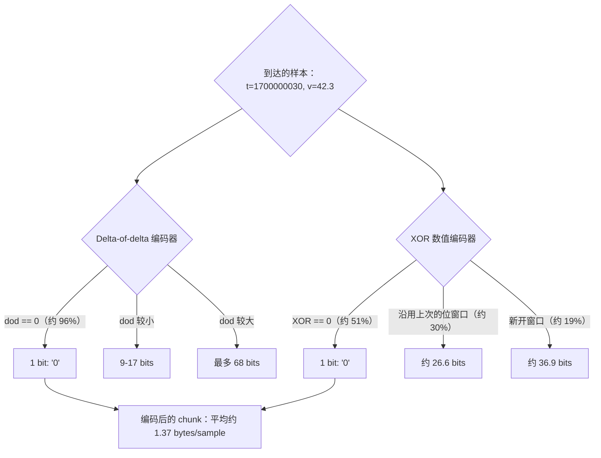
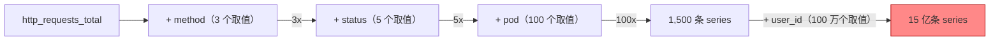
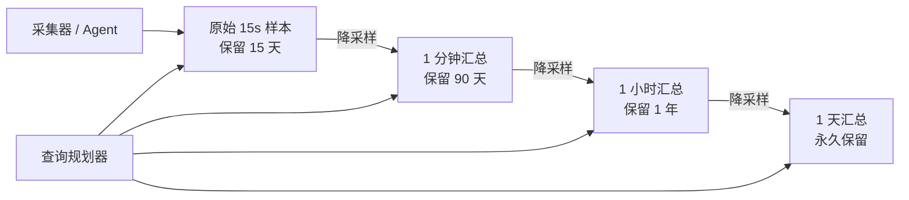
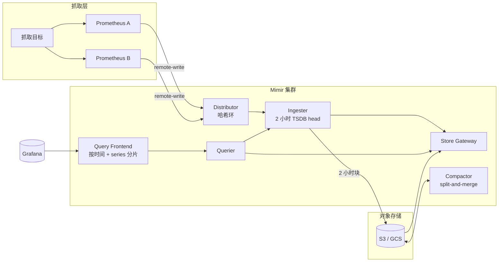

# 时序数据库：大规模场景下的指标、事件与数据保留

> **TL;DR**: 时序数据库利用“只追加写入、按时间有序”这种规律性，用 delta-of-delta 时间戳加 XOR 浮点编码，把 16 字节的原始样本压到约 1.37 字节[^1]。真正卡住扩展的维度不是数据量，而是**基数（cardinality）**：`(metric_name, label_set)` 的唯一组合数。一个没有上界的标签，比如 `user_id`，能在一夜之间把 series 数量放大百万倍——在 VictoriaMetrics 上每百万条 series 要吃掉 850 MB 内存，在 Prometheus 上则是 6.5 GB[^2]。降采样不是可选项，它是让长期保留变得负担得起的经济基础。

## 学习目标

学完本模块，你将能够：

- [ ] 解释时序负载为什么需要专门的存储
- [ ] 设计避免基数爆炸的标签（tag）schema
- [ ] 配置降采样、保留与压缩（compaction）策略
- [ ] 针对具体场景比较 Prometheus、InfluxDB、TimescaleDB 与 VictoriaMetrics
- [ ] 估算一个指标负载的存储成本

## 直觉理解

想象一座气象站，每 15 秒记录一次温度。每条读数就是一个数字加一个时间戳。你永远不会回头改昨天的温度。你也几乎不会去查某一条单独的读数。你问的是这类问题：“上周二的平均气温是多少？”或者“把过去一个月每小时最高温给我看看。”

现在把它放大到 10,000 座气象站，每座上报 500 种不同的测量（温度、湿度、风速、气压、紫外线指数……）。这就是每秒 500 万条读数。每条读数很小（一个时间戳加一个数字），但总量极其庞大。而关键洞察在于：昨天的秒级数据几乎毫无价值。一周之后你只需要分钟级均值，一个月之后只需要小时级均值，一年之后只需要天级汇总。

服务器监控正是这么运作的。你的机群每秒吐出数百万个指标样本。数据只追加、按时间有序、按范围查询、价值随年龄衰减。通用数据库也能处理，但专门打造的时序数据库（TSDB）利用这种规律性，把存储效率与查询性能提升 10 倍到 100 倍。

[存储引擎](./00-storage-engines.md) 介绍过作为底层引擎的 LSM 树与 WAL。[OLTP vs OLAP](./01-oltp-vs-olap.md) 展示了列式存储在扫描密集型负载下如何取胜。时序数据库站在一个独特的位置：它借用 LSM 风格的追加写入、列式风格的压缩，再加上 OLTP 和 OLAP 引擎都不原生具备的时间分块与降采样。

## 原理

### 时序数据特殊在哪里

时序负载有四个决定性特征：

1. **只追加写入。** 样本到达后就再也不更新。你不会去改上周二的 CPU 读数。
2. **按时间有序。** 时间戳单调递增（或近似单调）。这种规律性可以拿来做压缩。
3. **范围扫描查询。** 你几乎不会取单个数据点。查询都是“把 T1 到 T2 之间的所有值按标签分组给我做聚合”。
4. **价值衰减。** 半年前的秒级数据一文不值。小时级汇总就够了。

这些特征让 TSDB 能做出通用数据库不敢做的假设。因为写入只追加，所以没有 B 树页分裂带来的随机写放大。因为时间戳等间隔，所以它们能压到几乎零开销。因为数据会老去，引擎可以直接丢掉整段连续的时间块，不必逐行删除[^3]。

结果是：Prometheus 平均每个样本只存 1 到 2 字节[^3]，而朴素的 `(int64 timestamp, float64 value)` 元组需要 16 字节。这还没算标签索引，就已经是 8 倍到 12 倍的缩减。

### 存储技术：Gorilla 压缩

经典的 TSDB 存储布局分三层：保证持久性的预写日志（WAL）、承接近期写入的内存 head block、以及磁盘上不可变的时间分区块。每个块内部，Gorilla 论文（Pelkonen 等，VLDB 2015）里的两种压缩算法承担了主要工作[^1]。

**时间戳用 delta-of-delta。** 如果你的抓取间隔是 15 秒，那么相邻时间戳之差恰好是 15,000 ms。delta 是常数。delta-of-delta（变化量的变化量）就是零。一个零只占一位。在 Facebook 的生产负载上，约 96% 的时间戳 delta-of-delta 都被压成了一位[^1]。

**浮点值用 XOR 编码。** 相邻的指标值往往很接近（CPU 42.3%、42.5%、42.1%）。把当前浮点数的二进制位与上一个浮点数的二进制位做 XOR。如果 XOR 为零（值完全相同），存一位。如果有效位落在与上一次 XOR 相同的位窗口内，就复用那个窗口。在 Facebook 的负载上，51% 的值压成一位，30% 压到约 26.6 位，其余约 36.9 位，端到端平均每个样本 1.37 字节[^1]。



*Gorilla 的两级压缩利用等间隔抓取和缓慢变化的浮点值这两种规律性，相比原始存储实现 12 倍缩减。*

Prometheus 把样本按 2 小时一个块分组。每个块是一个目录，里面放 chunk 文件（最大 512 MB 的段）、把标签映射到 series 的索引、以及元数据。当前的块待在内存里，由 128 MB 一个段的 WAL 保护。写完的块在后台压缩成更大的块，上限是 31 天或保留时长的 10%[^3]。

InfluxDB 1.x 用的是它的 TSM（Time Structured Merge）引擎，基本形态相同。InfluxDB 3.0（IOx）用 Rust 在 Apache Arrow、DataFusion 和 Parquet 之上全部重写。TimescaleDB 走的是另一条路：它是一个 Postgres 扩展，把表按时间范围自动分区成“hypertable chunk”，再在每个 chunk 内部做列式压缩，存储能降 90% 以上。

### 基数：成本的主要驱动因素

基数就是唯一时间序列的条数。指标名加上各标签值的每一种唯一组合，算作一条 series：

```text
http_requests_total{method="GET", status="200", route="/api/users"}  -> 1 series
http_requests_total{method="POST", status="500", route="/api/orders"} -> 1 series
```

每条活跃 series 都需要一条倒排索引记录、内存中的一条 chunk 链，以及标签值字典里的若干条目。成本随 series 数量线性增长。



*一个没有上界的标签，会让 series 数量乘以它的唯一取值个数。把 user_id 加进标签，一条本来可控的指标就变成了基数炸弹。*

各系统的单条内存开销对比非常刺眼（数据来自 VictoriaMetrics 2022 年的基准测试）[^2]：

| 系统 | 每 100 万条唯一 series 的 RAM |
|--------|--------------------------|
| VictoriaMetrics | 约 850 MB |
| InfluxDB（1.x/2.x） | 约 5 GB |
| Prometheus | 约 6.5 GB（启动时），约 14 GB（稳定态） |

业界普遍的说法是，单实例 Prometheus 在常规硬件上大约能扛 200 万条活跃 series[^4]。VictoriaMetrics 单机版能扛 1 亿条活跃 series[^4]。而 Grafana Mimir 那个 10 亿条活跃 series 的测试，需要 1,500 个副本、7,000 个 CPU 核和 30 TiB 内存[^5]。

常见的基数爆炸都来自没有上界的标签：`user_id`、`request_id`、`trace_id`、原始 URL 路径、IP 地址，或者自由格式的错误信息。解法是：把高基数标识符挪到 exemplar 或日志里，不要放进指标标签。设置按租户的基数上限。用 relabel 规则在写入前丢掉或哈希掉有问题的标签。

### 写入模型：拉取与推送

**拉取（Prometheus 抓取模型）。** 服务端定期对每个目标的 `/metrics` 端点发 HTTP GET。抓取间隔由中心统一控制。抓取失败本身就变成 `up == 0` 这个天然的健康信号。服务发现（Kubernetes、Consul、EC2）决定监控谁。代价是网络必须双向可达——Prometheus 服务端得能连上每一个目标。

**推送（InfluxDB line protocol、OTLP、StatsD）。** 目标通过无状态 agent 把指标发出去。穿防火墙更容易。短命负载（批处理任务、serverless 函数）可以在退出前把数据刷出去。代价是服务端分不清“agent 挂了”和“没有数据要发”。

**远程写（remote write）作为联邦的黏合剂。** Prometheus 或 vmagent 在本地抓取，然后把 Snappy 压缩的 protobuf 批次推给中心集群（Mimir、Cortex、Thanos、VictoriaMetrics）。这种混合模型让你在边缘拿到拉取模式的存活检测，在中心拿到推送模式的扩展能力。

### 主流系统

**Prometheus** 是运维监控的事实标准。本地 TSDB，2 小时一个块，PromQL 查询语言，默认保留 15 天[^3]。设计上不做集群。要扩展就得靠联邦或远程写把数据送到独立后端。

**InfluxDB** 有三代互不兼容的版本。1.x 引入 TSM 和 InfluxQL。2.x 加了 Flux（一门函数式查询语言）。3.0（IOx）是用 Rust 全量重写，跑在 Arrow + DataFusion + Parquet 上，设计目标是“基数无上限”，并支持 SQL。

**TimescaleDB** 是一个 Postgres 扩展。hypertable 按时间自动分区。连续聚合（continuous aggregate）做增量刷新。完整 SQL、ACID、JOIN 和二级索引全都从 Postgres 免费继承。适合已经在跑 Postgres、想要时序能力但不想新增运维负担的团队。

**VictoriaMetrics** 用 Go 从零写起，存储布局借鉴了 ClickHouse 的思路[^4]。单机版在每秒 200 万样本的写入下能扛 1 亿条活跃 series。集群模式拆成 vminsert（无状态分发器）、vmstorage（有状态写入器）和 vmselect（无状态查询层）。官方称同等负载下 CPU 和内存用量比 Prometheus 低 2 到 10 倍。

### 降采样与数据保留

原始样本很贵，而且过几天基本就没用了。所有生产级 TSDB 都用分层保留来解决这件事：



*原始样本逐级老去、变成越来越粗的汇总。查询规划器根据请求的时间范围，透明地挑选合适的层级。*

每一层为每个时间窗口存 `avg`、`min`、`max` 和 `count`。一个 30 天的看板查询打到 1 分钟层（每条 series 每天 2,880 个点），而不是原始层（15 秒间隔下每条 series 每天 5,760 个点）。存储节省是会叠加的：100 万条 series、15 秒间隔、30 天，压缩后约 350 GB。7 天之后做 1 分钟降采样，就降到 150 GB 以下。

降采样不是锦上添花，它是这个产品的经济基础。

## 真实案例

### Grafana Mimir：把 Prometheus 扩展到 10 亿条活跃 series

Grafana Mimir（Cortex 的分支，2022 年 3 月发布）是公开资料最详尽的 Prometheus 兼容 TSDB 规模测试[^5]。

**架构。** Mimir 拆成无状态层和有状态层，两者靠一致性哈希环连接：

- **Distributor：** 接收来自各 Prometheus 实例的远程写，按 series 哈希分片。
- **Ingester：** 每个租户持有一个 TSDB head，把 2 小时的块刷到兼容 S3 的对象存储。
- **Store Gateway：** 从对象存储提供历史块的读取。
- **Querier + Query Frontend：** 用时间切分和 series 分片来规划和并行化 PromQL 查询。
- **Compactor：** 合并并降采样块。Mimir 的 split-and-merge 压缩器把压缩任务打散到多个副本，以避开了 4 GB TSDB 索引段的上限。



*Mimir 在 10 亿条活跃 series 下的样子：distributor 把写入哈希分片路由到 ingester，ingester 把 2 小时的块刷进对象存储，compactor 把压缩任务分片以避开了 4 GB TSDB 索引段上限，查询则扇出到 ingester 和 store gateway。*

**规模数字。** Grafana 在单租户下把 Mimir 压到 10 亿条活跃 series[^5]：

- 1,500 个副本、7,000 个 CPU 核、30 TiB 内存
- 约 5,000 万样本/秒的写入速率（20 秒抓取间隔）
- SLO：99.9% 的写入在 10 秒内完成，99.9% 的读取平均在 2 秒内完成

**关键工程收益：**

- 查询分片让高基数查询的执行时间降低了 10 倍[^5]。
- 异步 chunk 写入把 P99 写入延迟从 45 秒降到 3 秒（在此之前，所有 chunk 都在 2 小时块边界同时关闭，引发写风暴）[^5]。
- 光是传播哈希环变更，memberlist 就要为每个副本吃掉 1.6 到 1.9 个核（全集群 2,500 个核）。一系列 dskit 补丁把这部分降了 90%。

教训是：Prometheus 的本地 TSDB 用在单机上很优雅，但横向扩展需要一套专门打造的分布式层。Mimir、Thanos 和 VictoriaMetrics 集群模式各自给出了不同的解法。

## 权衡

| 方案 | 优点 | 缺点 | 适用场景 | 我们的选择 |
|----------|------|------|-----------|----------|
| Prometheus（单机） | 简单、生态庞大、久经考验、格式标准 | 单机实际天花板在数百万条活跃 series（取决于硬件）、不支持集群、默认只留 15 天 | 单集群、运维指标、不想多跑服务的团队 | **中小规模监控的默认选择** |
| InfluxDB（1.x/2.x/3.x） | 推送友好、IoT 集成丰富、IOx 有“基数无上限”的设计 | 三代版本互不兼容、老引擎每 100 万条 series 吃 5 GB 内存、集群版收费 | IoT、产品分析、愿意把 IOx 跑在对象存储上的团队 | 当推送写入和 SQL 比生态更重要时 |
| TimescaleDB | 完整 SQL、ACID、JOIN、复用 Postgres 运维经验、90%+ 压缩 | 压缩率不如专用引擎、受 Postgres 单写入者模型限制 | 已经在用 Postgres、分析场景需要混用时序与关系数据 | **当你拒绝再加一个数据库时** |
| VictoriaMetrics | 号称内存比 Prometheus 少 2-10 倍、比 Thanos/Cortex 简单、单个二进制 | 生态较小、MetricsQL 有些怪癖、产品取向偏单机 | 指标量大、对成本敏感 | **大规模下每条 series 成本最优** |
| Mimir / Thanos（分布式） | 横向扩到数十亿条 series、多租户、对象存储后端 | 运维复杂（哈希环、WAL、compactor）；如果 ingester 副本也挂了，最坏情况会丢掉 2 小时的 head block | 多租户 SaaS、跨区域联邦、超出单机容量 | 当你超出单机 Prometheus 的能力时 |

## 常见陷阱

> [!WARNING]
> **无上界标签引发基数爆炸。** 一个取值没有上界的标签（`user_id`、`request_id`、原始 URL 路径），会让 series 数量乘以该标签的基数。你的 ingester 一夜之间 OOM。把高基数标识符挪到 exemplar 或日志里。按指标设基数上限。像盯贼一样盯住 `prometheus_tsdb_head_series`。

> [!WARNING]
> **计数器忘了套 `rate()`。** 计数器只增不减（重置除外）。直接画 `http_requests_total`，看到的就是一条单调上升的线，中间一次重启看起来像流量掉到了零。计数器永远要包在 `rate()` 或 `increase()` 里。千万别对 gauge 用 `rate()`。

> [!WARNING]
> **直方图分桶避开了你的 SLO。** 经典 Prometheus 直方图在桶内做线性插值[^6]。如果你的 P95 落在 200-300 ms 这个桶里，估算值是 295 ms，哪怕真实值只有 220 ms。在 SLO 阈值附近补上桶边界，或者换成原生指数直方图（Prometheus 2.40+），它会动态调整桶宽。

> [!WARNING]
> **跨实例平均 summary 的分位数。** 在三个副本上算 `avg(http_duration{quantile="0.95"})` 在统计上毫无意义[^6]。summary 在客户端就把分位数算好了，能聚合的只有原始观测值，而那些已经被丢掉了。改用直方图：桶计数是可加的。

> [!WARNING]
> **忘了保留策略把磁盘写满。** Prometheus 默认留 15 天，但 WAL 加上 head chunk 同样占盘。高基数频繁变动的模式会让索引比样本数据涨得还快。把 `--storage.tsdb.retention.size` 设成分配磁盘的 80-85%。同时盯住 `prometheus_tsdb_storage_blocks_bytes` 和 WAL 目录大小。

## 练习

为一个 10,000 台服务器的机群设计监控，每台每秒上报 500 个指标、带 20 个标签。选一套技术栈，决定保留策略（原始、5 分钟汇总、1 小时汇总），对基数做告警，并估算 90 天保留期的存储成本。

<details>
<summary>提示</summary>

先算数：10,000 台 × 500 个指标/秒 = 每秒 500 万个样本。带 20 个标签，可能有多少条唯一 series？按每样本压缩后 2 字节算，每天要多少存储？单个 Prometheus 实例扛得住吗，还是需要分布式方案？

</details>

<details>
<summary>解答</summary>

**容量估算：**

- 写入速率：10,000 × 500 = 5,000,000 samples/sec
- 基数：取决于标签的唯一性。如果标签都有上界（method、status、region、service），预期 200 万到 500 万条唯一 series。只要有一个标签没上界，就会炸。
- 每天存储（原始）：5M samples/sec × 86,400 sec × 2 bytes = 约 864 GB/天
- 90 天原始保留：约 78 TB（承担不起）

**保留分层：**

| 层级 | 精度 | 保留期 | 每日存储 |
|------|-----------|-----------|---------------|
| 原始 | 15s | 7 天 | 约 864 GB |
| 5 分钟汇总 | 5 分钟 | 90 天 | 约 43 GB |
| 1 小时汇总 | 1 小时 | 1 年 | 约 3.6 GB |

90 天总成本：7 天原始（约 6 TB）+ 83 天 5 分钟粒度（约 3.6 TB）= 压缩后约 9.6 TB。

**技术栈选择：** 单实例 Prometheus 上限约 200 万条 series。面对 200 万到 500 万条 series，你需要：

- **VictoriaMetrics 集群：** vminsert 分片到 3-5 个 vmstorage 节点。单机能扛 1 亿条 series，所以 500 万条在一个节点上很轻松。最便宜的选择。
- **Prometheus + Mimir：** 多个 Prometheus 实例分别抓取机群的一部分，远程写到由 S3 支撑的 Mimir。多租户隔离更好，但运维更复杂。

**基数告警：** 当某个 job 的 `sum(scrape_series_added)` 超过阈值时告警。用 VictoriaMetrics 的基数浏览器，或者 Mimir 的按租户上限，把 series 卡在 500 万条。

**结论：** 这个量级用 VictoriaMetrics 单机版。它用约 4.25 GB 内存就能处理 500 万条 series，成本只是分布式部署的一小部分，而且拉取和推送两种写入都支持。再加个 vmagent 负责抓取和边缘的流式聚合。

</details>

## 要点回顾

- 杀死 TSDB 的是基数（唯一 series 条数），不是样本量。一个坏标签能在一夜之间把内存用量放大 100 倍。
- Gorilla 压缩（delta-of-delta 时间戳加 XOR 浮点值）做到每样本约 1.37 字节，相比 16 字节的原始元组是 12 倍缩减。
- 降采样是长期保留的经济基础。15 秒原始数据留 90 天承担不起；5 分钟汇总能把存储砍掉 20 倍。
- Prometheus 赢下了运维指标这块地盘，但单实例卡在约 200 万条 series。再往上，按诉求选 VictoriaMetrics（成本）、Mimir（多租户规模）或 Thanos（配合对象存储的简洁）。
- 拉取式写入（Prometheus 抓取）自带免费的存活检测。推送式写入（OTLP、InfluxDB line protocol）能穿防火墙、能处理短命负载。用远程写把两者接起来。
- 计数器永远套 `rate()`，永远不要跨实例平均预计算好的分位数，并且在 SLO 阈值附近补上直方图桶边界。
- 如果团队已经在跑 Postgres 且拒绝再往技术栈里加一个数据库，TimescaleDB 就是正确答案。

## 延伸阅读

- [Gorilla: A Fast, Scalable, In-Memory Time Series Database](http://www.vldb.org/pvldb/vol8/p1816-teller.pdf) - Pelkonen 等，VLDB 2015。现代每个 TSDB chunk 格式背后的奠基论文；读 delta-of-delta 和 XOR 那两节，就能明白 1.37 字节/样本是怎么来的。
- [Prometheus Storage documentation](https://prometheus.io/docs/prometheus/latest/storage/) - 2 小时块、WAL 段、压缩和保留配置的权威参考。
- [How we scaled Grafana Mimir to 1 billion active series](https://grafana.com/blog/2022/04/08/how-we-scaled-our-new-prometheus-tsdb-grafana-mimir-to-1-billion-active-series/) - Marco Pracucci，2022。关于极端规模下 TSDB 瓶颈最好的公开深度剖析，包括那个从 45 秒到 3 秒的 P99 修复。
- [VictoriaMetrics FAQ](https://docs.victoriametrics.com/faq/) - 与 Cortex、Thanos、InfluxDB、TimescaleDB 的鲜明对比，附带具体的内存和 CPU 数字。
- [Thanos Quick Tutorial](https://thanos.io/tip/thanos/quick-tutorial.md/) - 一页讲清 Sidecar、Querier、Store Gateway 和 Compactor；通往 Prometheus 长期存储最简单的一条路。
- [Prometheus Histograms and Summaries](https://prometheus.io/docs/practices/histograms/) - 关于原生直方图、分位数估算误差，以及 summary 为什么无法跨实例聚合的权威资料。
- [Understanding InfluxDB IOx](https://www.influxdata.com/blog/understanding-influxdb-iox-commitment-open-source/) - 支撑 InfluxDB 3.0 的 Rust + Arrow + DataFusion + Parquet 架构；讲清了“FDAP 栈”和基数无上限的设计。
- [M3: Uber's Open Source, Large-scale Metrics Platform](https://www.uber.com/blog/m3/) - Uber 如何用 M3DB、M3Coordinator 和 M3Query，每秒聚合 5 亿个指标，并在全球 66 亿条时间序列中把 2,000 万个持久化到存储。

## 记忆卡片

**Q:** TSDB 里的基数是什么，为什么它比样本量更要紧？
**A:** 基数是唯一时间序列的条数，指标名加标签值的每一种唯一组合算一条 series。每条 series 都需要一条倒排索引记录和内存里的 chunk 链。一个没有上界的标签（user_id）能把 series 数放大几百万倍，把 ingester 撑爆，而原始样本量本身靠压缩就能很便宜地处理。

**Q:** Gorilla 的 delta-of-delta 编码怎么压缩时间戳？
**A:** 它存的是相邻时间戳差值的变化量。在固定抓取间隔下（比如 15 秒），delta 是常数，delta-of-delta 就是零，编成一位。在规整的抓取负载上，约 96% 的时间戳压成 1 位。

**Q:** XOR 编码怎么压缩 TSDB 里的浮点值？
**A:** 把当前浮点数的二进制位与上一个做 XOR。结果为零（值相同）就存 1 位。有效位能落进上一次 XOR 的位窗口就复用（约 26.6 位）。否则写一个新的窗口头（约 36.9 位）。平均 1.37 字节/样本。

**Q:** 单实例 Prometheus 实际的 series 上限是多少？
**A:** 常规硬件上大约 200 万条活跃 series。再往上就需要分布式方案（Mimir、Thanos、VictoriaMetrics 集群或 M3）。

**Q:** 为什么不能跨多个实例平均 summary 的分位数？
**A:** summary 在客户端就把分位数算好并丢掉了原始观测值。预计算的分位数不可加。要改用直方图：桶计数可加，可以先跨实例求和再算 `histogram_quantile()`。

**Q:** TSDB 里拉取式和推送式写入有什么区别？
**A:** 拉取（Prometheus 抓取）：服务端按固定间隔对目标的 /metrics 发 HTTP GET。好处是中心化控制速率，且天然有存活检测（抓取失败 = 目标挂了）。推送（InfluxDB、OTLP）：目标把指标发给收集器。能穿防火墙、能处理短命任务，但丢掉了内建的健康信号。

**Q:** 为什么说降采样是时序存储的“经济基础”？
**A:** 100 万条 series 的 15 秒原始样本留 30 天要约 350 GB。分钟级汇总能减到四分之一，小时级能减到 240 分之一。没有降采样，长期保留在经济上不可行。所有生产级 TSDB 都实现了分层保留。

**Q:** Prometheus 怎么处理保留和块删除？
**A:** Prometheus 把样本按 2 小时一个不可变块分组。保留策略靠整块删除实现——删掉超过配置时长（默认 15 天）或超出配置大小的整块。因为块是按时间分区的，不需要逐行 DELETE。

**Q:** Grafana Mimir 的异步 chunk 写入解决了什么问题？
**A:** 每 2 小时，所有 chunk 会在块边界同时关闭，引发写风暴，把 P99 延迟顶到 45 秒。把 chunk 写入挪到异步队列后，P99 降到 3 秒。

**Q:** 每 100 万条唯一 series，VictoriaMetrics 的内存占用与 Prometheus 相比如何？
**A:** VictoriaMetrics 每 100 万条 series 约 850 MB。同样负载下 Prometheus 是 6.5 GB（启动）到 14 GB（稳定态），大约是 8-16 倍。

**Q:** VictoriaMetrics 集群模式的三个组件是什么？
**A:** vminsert（无状态分发器，接收远程写、OTLP、InfluxDB line protocol）、vmstorage（有状态写入器，在块设备上持有本地数据）、vmselect（无状态查询层，提供 MetricsQL/PromQL）。

**Q:** 什么时候该选 TimescaleDB 而不是专用 TSDB？
**A:** 当团队已经在跑 Postgres、需要带 JOIN 和 ACID 事务的完整 SQL、想把时序查询和关系数据混着用，并且更愿意复用现有运维经验而不是往技术栈里再加一个数据库时。

## 参考文献

[^1]: T. Pelkonen et al., "Gorilla: A Fast, Scalable, In-Memory Time Series Database", Proceedings of the VLDB Endowment, vol. 8, no. 12, 2015. http://www.vldb.org/pvldb/vol8/p1816-teller.pdf
[^2]: Dmytro Kozlov, "Cardinality explorer", VictoriaMetrics blog, 2022-10-04. https://victoriametrics.com/blog/cardinality-explorer/
[^3]: Prometheus project, "Storage" documentation. https://prometheus.io/docs/prometheus/latest/storage/
[^4]: VictoriaMetrics FAQ. https://docs.victoriametrics.com/faq/
[^5]: Marco Pracucci, "How we scaled our new Prometheus TSDB Grafana Mimir to 1 billion active series", Grafana Labs, 2022-04-09. https://grafana.com/blog/2022/04/08/how-we-scaled-our-new-prometheus-tsdb-grafana-mimir-to-1-billion-active-series/
[^6]: Prometheus Documentation, "Histograms and summaries". https://prometheus.io/docs/practices/histograms/
