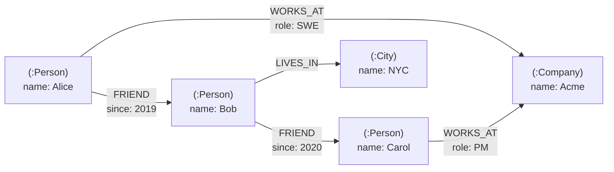
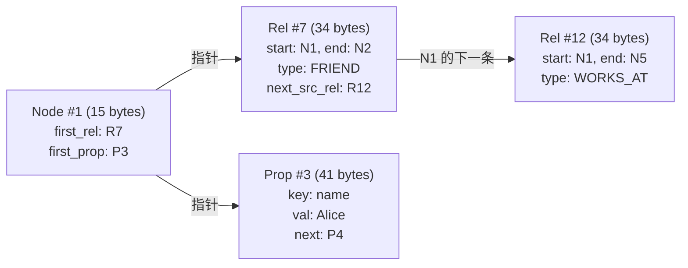
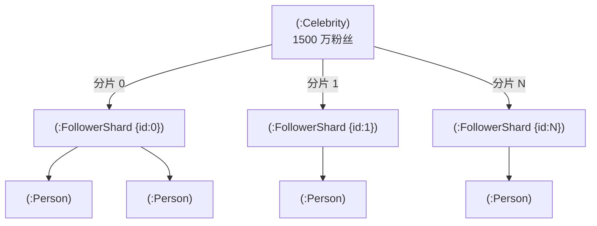
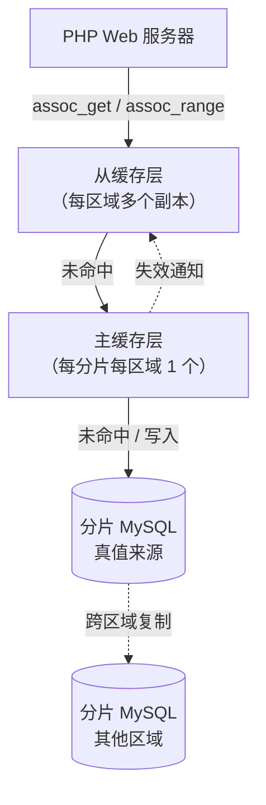

# 图数据库：属性图、Cypher，以及何时 JOIN 才是问题所在

> **TL;DR**: 图数据库把关系当成一等存储原语。节点和边都携带属性；遍历沿着指针走，而不是去计算 JOIN。这让多跳查询（朋友的朋友、权限链、欺诈团伙）在超过 3-4 跳之后，比递归 SQL CTE 快上几个数量级。Neo4j 的无索引邻接（index-free adjacency）让每跳的代价是 O(degree)，而不是每次 JOIN 的 O(log N)[^1]。Meta TAO 通过架在分片 MySQL 之上的窄图 API，每秒处理超过 100 亿次图读取[^2]。当查询需要遍历深层关系时，用图数据库；深度是 2 或更浅时，用 Postgres。

## 学习目标

学完本模块，你将能够：

- [ ] 用带标签的节点、带类型的边和属性，把一个业务领域建模成属性图
- [ ] 写出带模式匹配和变长路径的基础 Cypher 查询
- [ ] 区分属性图与 RDF 三元组存储，并在两者之间做出选择
- [ ] 识别哪些负载下图数据库能赢过关系型数据库
- [ ] 推理扩展性边界：超级节点、分片难题，以及横向扩展的几种策略

## 直觉理解

想象你在城里给人指路。如果有人问“从图书馆怎么走到面包房？”，你不会去翻一张列着全城每个路口的巨大表格。你会从图书馆出发，看看从它延伸出去的街道，挑一条走过去，到了下一个路口再看从那里延伸出去的街道，如此重复。每一步的代价只是看一眼当前路口，跟全城有多少个路口毫无关系。

关系型数据库回答“谁是 Alice 朋友的朋友？”时，走的是查表格那条路。它扫描一张 `friendships` 表（可能有几十亿行），把它跟自己 JOIN，再过滤。每多一跳，中间结果集就乘一层。在一个平均度数为 250 的社交图上做四跳查询，过滤前最多要碰 250^4 条候选路径。

图数据库走的是在城里步行那条路。它从 Alice 的节点出发，沿着她的出向 FRIEND 指针走（就那么几条），再依次沿着每个朋友的 FRIEND 指针走。每一跳的代价与该节点的邻居数量成正比，跟整张图有多大无关。这就是核心洞见：当你的问题是“什么东西跟这个东西相连？”时，追指针胜过查索引。

本章剩下的部分要把这个直觉讲精确：数据模型、查询语言、让它变快的物理存储技巧，以及让它变难的扩展性问题。

## 原理

### 属性图模型

属性图是一张有向、带标签的多重图，节点和边都携带键值属性[^3]。每个节点有零个或多个标签（比如 `:Person`、`:Company`）。每条边只有一个类型（比如 `:FRIEND`、`:WORKS_AT`）、一个方向，以及自己的属性 map。同一对节点之间可以有多条不同类型的边。



*一段属性图片段：节点带标签和属性；边带类型、方向，以及自己的属性。*

另一种模型是 **RDF 三元组存储**：每个事实是一个（主语、谓语、宾语）三元组，受 W3C 标准约束。查询语言是 SPARQL。RDF 擅长通过全局 URI 把来自众多数据源的数据组合起来（Wikidata 就这样存了 166 亿条三元组[^4]），并通过 OWL/SHACL 支持形式化推理。代价是：边的属性需要具体化（reification），属性图里一条带三个属性的边会变成 4-7 条三元组；而 Blazegraph 这类单机 RDF 引擎在约 160 亿条三元组时就开始不稳定（Wikidata 的 166 亿条不得不把图拆成分片）[^4]。

**怎么选：**

| 模型 | 适用场景 | 应避免的场景 |
|-------|-------------|------------|
| 属性图 | 边属性丰富的领域建模；面向开发者的应用；Cypher/Gremlin 生态 | 需要形式化推理、关联数据组合，或 W3C 互操作 |
| RDF 三元组存储 | 知识图谱、语义网、多源数据联邦、推理驱动的查询 | 高吞吐事务型负载；边需要大量内联属性 |

本章接下来的内容里，属性图是默认模型。

### 无索引邻接

让图遍历变快的物理技巧叫 **无索引邻接**（index-free adjacency）：每个节点记录里存一个直接指针（文件偏移量或内存地址）指向它的第一条关系记录，每条关系记录再链到同一个节点的下一条关系[^1]。

在 Neo4j 的原生存储格式里，节点记录 15 字节，关系记录 34 字节，属性记录 41 字节。这些定长记录在磁盘上组成链表。要找出 Alice 的所有朋友，引擎读取 Alice 的节点记录，顺着指针找到她的第一条关系，然后沿着链表走。不查索引，不扫全表。代价：O(Alice 的度数)[^1]。



*定长记录组成链表；遍历顺着指针走，不必查任何全局索引。*

拿它跟关系型 JOIN 比：数据库每一跳都得去查 `friendships` 表的 B 树索引。在一张几十亿行的表上，每次 B 树查找是 O(log N)。四跳时，每条路径要付 4 * O(log N)，而且中间结果集会随扇出成倍膨胀。

LinkedIn 的工程团队把这个说得很具体：一个典型会员的二度人脉有 5 万多个实体，“大到无法预先物化并存储”，而要生成它的那条 JOIN“令人望而生畏，尤其是在你得去一张存了几十亿条边、用传统有序存储组织的表里检索的时候”[^5]。

### 查询语言：Cypher、Gremlin、SPARQL 和 GQL

**Cypher** 是声明式的，读起来像 ASCII 艺术。节点是圆括号，边是方括号，箭头表示方向：

```cypher
-- Alice 朋友的朋友，且还不是 Alice 的朋友
MATCH (alice:Person {name: 'Alice'})-[:FRIEND]->(f)-[:FRIEND]->(fof:Person)
WHERE NOT (alice)-[:FRIEND]->(fof) AND alice <> fof
RETURN DISTINCT fof.name
LIMIT 20
```

变长路径让递归查询变得平淡无奇：

```cypher
-- Alice 到 Bob 的最短路径，最多 6 跳
MATCH p = shortestPath(
  (a:Person {name: 'Alice'})-[:FRIEND*..6]-(b:Person {name: 'Bob'})
)
RETURN [n IN nodes(p) | n.name] AS chain, length(p) AS hops
```

**Gremlin** 是命令式的。流水线里的每一步都在变换遍历状态：

```groovy
g.V().has('Person','name','Alice')
  .out('FRIEND').out('FRIEND')
  .where(neq('alice'))
  .values('name').dedup().limit(20)
```

Gremlin 可以跑在任何兼容 TinkerPop 的存储上（JanusGraph、Neptune、ArangoDB）。它更灵活（带闭包后是图灵完备的），但更难优化，因为引擎不容易重排命令式的步骤[^6]。

**SPARQL** 面向 RDF 三元组，支持跨端点联邦查询。要查 Wikidata、DBpedia 这类关联数据源，它是唯一选择。

**GQL（ISO/IEC 39075:2024）** 是 SQL 之后第一个新的 ISO 数据库查询语言[^7]。它把 Cypher、PGQL 和 G-CORE 共有的模式匹配内核标准化了。SQL/PGQ 在 SQL 内部复刻了同一套模式。就当下的选型决策而言，Cypher 是务实之选；GQL 的意义在于面向未来。

### 主流系统

| 系统 | 数据模型 | 查询语言 | 存储 | 扩展路径 |
|--------|-------|---------------|---------|---------------|
| Neo4j | 属性图 | Cypher | 原生定长记录 | 先纵向扩展；靠 Fabric/复合数据库做联邦 |
| Amazon Neptune | 属性图 + RDF | Gremlin、openCypher、SPARQL | 托管分布式存储 | 全托管，读自动扩展 |
| Dgraph | 属性图 | DQL（类 GraphQL） | Badger（LSM 树），谓词分片 | 每分片 Raft，写入可横向扩展 |
| JanusGraph | 属性图 | Gremlin | 可插拔（Cassandra、HBase、Bigtable） | 继承后端的扩展能力 |
| NebulaGraph | 属性图 | nGQL | RocksDB，顶点哈希分片 | 每分片 Raft |
| TigerGraph | 属性图 | GSQL | 原生 C++ 引擎 | MPP 并行，分布式 |
| ArangoDB | 多模型 | AQL | 基于 RocksDB | 分片集群 |

Neo4j 的标准存储格式最多支持 340 亿个节点和 340 亿条关系[^8]。更大的图要靠 Dgraph 这类分布式系统，它用 **基于谓词的分片**：`friend` 谓词的所有实例都落在同一个 Raft 组上，所以沿单一谓词类型做 N 跳遍历，无论数据量多大都只需要 N 次网络跳转[^9]。

### 图算法与通往 ML 的桥

图数据库不只是用来做 CRUD 查询的。常见的分析类算法包括：

- **最短路径 / Dijkstra** —— 路径规划、社交距离
- **PageRank** —— 影响力评分、搜索排序
- **社区发现（Louvain）** —— 欺诈团伙识别、市场分层
- **节点嵌入（node2vec、GraphSAGE）** —— 把图结构转成特征向量，喂给下游 ML 模型

通往 ML 的这座桥很重要：有了节点嵌入，你就能把图的拓扑结构喂进推荐引擎、异常检测器和分类模型，不必手工设计特征。Neo4j 的 Graph Data Science 库、TigerGraph 的库内分析，以及 PyTorch Geometric 这类独立工具，都在这个方向上发力。

### 扩展：难啃的骨头

**超级节点问题。** 真实图服从幂律度数分布。一个有 1500 万粉丝的名人，就是一个带 1500 万条出边的节点。遍历这个节点的邻居不再是 O(1)，而是 O(1500 万)。拥有该节点的分片就成了热点[^10]。



*超级节点的缓解手段：把高度数节点拆成一棵扇出子树，给单节点的边数设上界，并让遍历可以并行。*

缓解手段有三种：(1) 把超级节点的边哈希分片到元节点上（“扇出模式”）；(2) 用顶点中心索引，按属性在边表内部定位；(3) 预计算最近或最热子集的缓存（TAO 对每个关联列表只缓存有上限的边数[^11]）。

**分片之难。** 图天然抗拒分片，因为边会跨越分片边界。基于顶点的分片（NebulaGraph、跑在 Cassandra 上的 JanusGraph）把每个顶点的边都存在本地，但一次跨分片边界的四跳遍历要花 4 次网络往返。基于谓词的分片（Dgraph）对单谓词路径避开了这个问题，但把跨谓词的查询搞复杂了。

**Neo4j Fabric**（现在叫“复合数据库”）在持有图的不同部分的各个组成分片之间协调联邦查询。它是真实可用的，但也只是部分解决：你得自己决定怎么分区，跨分片查询要付协调开销。

## 真实案例

### Meta TAO：行星级的图服务层

Meta 的 TAO（The Associations and Objects store）是 Facebook 社交图背后的系统。它不是通用图数据库。它是架在分片 MySQL 之上、只有窄 API 的图服务层，专为社交网络的负载形状而生：压倒性地读多写少（读写比 500:1）[^2]。

**规模：** 2013 年 TAO 每秒服务 10 亿次读取，从节点层缓存命中率 96.4%[^11]。到 2021 年，它超过了每秒 100 亿次读取[^2]。到 2022 年，Meta 报告每天“超过一千万亿次”查询[^12]。

**数据模型：** 只有两个原语。节点用 `Object(id, otype, fields)`。边用 `Association(id1, atype, id2, time, fields)`。查询被限制在 `assoc_get`、`assoc_count`、`assoc_range` 和写操作上。没有通用模式匹配。没有变长路径。

**架构：** 每个区域两层缓存，夹在 PHP Web 服务器和 MySQL 之间。众多从节点层承接读请求；每个分片在每个区域有一个主节点协调写。反向边自动维护，所以“谁关注我？”和“我关注了谁？”一样快。MySQL 仍然是真值来源，因为围绕它的运维工具链（备份、迁移、监控）成熟且广为人知[^11]。



*TAO 每区域的两层缓存：从节点层以 96.4% 的命中率吸收 99.8% 的读负载；每分片唯一的那个主节点协调写往 MySQL，而 MySQL 仍是真值来源。*

**关键一课：** 超大规模社交图（TAO、Twitter 的 FlockDB、LinkedIn 的 LIquid）都不是通用图数据库。它们牺牲查询表达力换取横向扩展。如果你的负载只落在一组固定查询模式里，那么一个架在成熟存储引擎（MySQL、Cassandra）之上的窄图 API，扩展性会比任何通用图数据库高出几个数量级。

## 权衡

| 方案 | 优点 | 缺点 | 最佳场景 | 我们的选择 |
|----------|------|------|-----------|----------|
| 图数据库（Neo4j） | 靠无索引邻接做快速深遍历；Cypher 表达力强；工具链成熟 | 单主写入；纵向扩展有天花板；社区比 Postgres 小 | 中等规模（< 100 亿条边）的关系密集查询 | **图形态问题的默认选择** |
| 关系型 + 递归 CTE | 熟悉；只用一个系统；ACID；社区庞大 | 超过 3-4 跳后查询规划器就退化；写法啰嗦；没有一等公民的路径输出 | 关系浅（深度 <= 2）；已有 SQL 技术栈 | **深度为 2 或更浅时** |
| 架在 KV 上的图层（Dgraph、JanusGraph） | 横向扩展；复用久经验证的 KV 基础设施 | 组件更多；功能更少；调优更难 | 超大图（>> 1 亿条边）；高写入速率 | 当 Neo4j 的纵向天花板不够时 |
| RDF 三元组存储（Virtuoso、Neptune RDF） | W3C 标准；关联数据组合；推理 | 具体化让边膨胀；单机引擎在约 160 亿条三元组时不稳定 | 公共知识图谱；语义网；推理驱动的查询 | 需要形式化本体推理时 |
| 窄图 API（TAO、FlockDB） | 每秒几十亿次读取；横向扩展 | 没有通用模式匹配；查询集固定；自研工具链 | 负载已知的超大规模社交图 | 你在 Meta 这个量级、且养得起定制基础设施时 |

## 常见陷阱

> [!WARNING]
> **超级节点热点。** 一个带几百万条边的顶点就能打满它所在的分片，并让遍历开销随度数线性增长。监控节点度数直方图。在上生产之前就应用扇出模式（把边哈希分片到元节点）或用顶点中心索引。

> [!WARNING]
> **拿递归 CTE 当图查询的替代品。** SQL 规划器缺少针对变深递归的代价模型。一条 2 跳时 50 毫秒的查询，5 跳时可能要跑 50 秒。如果你的关系深度超过 2-3 层，就换图数据库，别跟规划器死磕。

> [!WARNING]
> **把图数据库当通用 OLTP 存储用。** 大量跟关系无关的写入（属性更新、事件日志、计数器）会被逐条边的额外开销拖垮。如果你那些热查询只等价于零个或一个 JOIN，那你就是在为图引擎交税却毫无收益。扁平数据用 Postgres 或 KV 存储。

> [!WARNING]
> **以为横向扩展已经被解决了。** Neo4j 先纵向扩展。Fabric/复合数据库需要人工做分区决策。Dgraph 和 JanusGraph 能横向扩展，但跨分片遍历每跳都要多付网络延迟。在你证明自己确实需要更多之前，按单台配置充足的实例来规划容量。

> [!WARNING]
> **忽视反向边带来的写放大。** 一次“Alice 关注 Bob”的写入会产生两条物理边（正向和反向），可能落在不同分片上。一次逻辑写变成两次物理写，还要跨分片协调。要么接受非原子的反向边并配后台修复，要么在设计 schema 时尽量避免双向边。

## 练习

为一个 B2B SaaS 设计权限系统，涉及组织、团队、项目、角色和资源。用户通过嵌套的组成员关系继承权限，最深 6 层。在 Postgres、Neo4j 和专用授权服务（SpiceDB、OpenFGA）之间做选择，并用查询模式来论证。

<details>
<summary>提示</summary>

核心查询是“用户 X 对资源 R 是否拥有权限 P？”。这需要从用户到资源，遍历成员关系和角色继承链。数一数跳数。考虑读写比（权限检查是极度读多的）。再想想当一个组成员关系变化、成千上万条派生权限需要重算时会发生什么。

</details>

<details>
<summary>参考答案</summary>

**分析：** 权限检查要遍历：User -> Team -> Parent Team -> ... -> Organization -> Role -> Permission -> Resource。6 层嵌套下，这是一次 6 跳遍历。负载压倒性地是读（每次 API 调用都查权限），写很少（改角色、调整团队结构）。

**方案一：Postgres + 递归 CTE。** 2-3 层时能用。6 层加几千个组时，递归 CTE 就退化了。你需要一张闭包表（预先物化的传递闭包），而每次成员关系变动都得重建它。可行，但运维上很复杂。

**方案二：Neo4j。** 它能自然地建模权限图。像 `MATCH (u:User {id: $uid})-[:MEMBER_OF*1..6]->(:Group)-[:HAS_ROLE]->(:Role)-[:GRANTS]->(p:Permission {name: $perm})-[:ON]->(r:Resource {id: $rid}) RETURN count(p) > 0` 这样的 Cypher 查询，一次遍历就能回答。典型图上亚毫秒级。但 Neo4j 是一个新的运维依赖，而权限检查发生在每个请求上（上规模后是几百万 QPS）。

**方案三：SpiceDB/OpenFGA。** 专为这个问题而生。实现 Google 的 Zanzibar 模型：关系元组存在可扩展的后端里，check API 在内部遍历这张图。缓存、一致性（Zookie/快照令牌）和横向扩展都是开箱即有的。

**我们的选择：SpiceDB/OpenFGA**，用于上规模的生产权限系统。查询模式是固定的（“check”和“expand”），读写比极端，一个专用系统的运维成熟度胜过为一个查询形状去跑 Neo4j。如果你的权限模型还需要临时的图分析（比如“列出 Engineering 里任何人都能访问的所有资源”），那就用 Neo4j。如果你不超过 3 层、又不想引入新依赖，就用 Postgres 加闭包表。

</details>

## 要点回顾

- 图数据库在查询要遍历 3 跳以上时才发光。深度 1-2 时，Postgres 加一个 JOIN 更简单也够用。
- 无索引邻接让邻居访问每跳是 O(degree)，而不是每次 JOIN 的 O(log N)。这就是图在深遍历上取胜的物理原因。
- Cypher（以及正在成型的 GQL 标准）是最易上手的图查询语言。Gremlin 更强但可读性更差。SPARQL 只面向 RDF。
- 超级节点问题是生产环境里的头号病症。监控度数分布，在某个名人节点把你的集群烧穿之前就应用扇出模式。
- 图数据库的横向扩展依然是真的难。超大规模下的多数生产系统（TAO、FlockDB、LIquid）用的是架在成熟存储引擎之上的窄图 API，而不是通用图数据库。
- 应用开发默认该选属性图。需要推理、关联数据组合或 W3C 互操作的知识图谱，才该选 RDF 三元组存储。
- 当你的图查询模式固定、规模又极端时，去建一个专用服务层，而不是部署一个通用图数据库。

## 延伸阅读

- [TAO: Facebook's Distributed Data Store for the Social Graph (Bronson et al., USENIX ATC 2013)](https://www.usenix.org/system/files/conference/atc13/atc13-bronson.pdf) - 行星级窄 API 图服务的参考论文；想理解“图数据库”和“图服务层”之间的差距，这篇是必读。
- [Neo4j Graph Database Concepts](https://neo4j.com/docs/getting-started/appendix/graphdb-concepts/) - 权威的属性图入门读物；从没建过图模型的话从这里开始。
- [Understanding Neo4j's data on disk](https://neo4j.com/developer/kb/understanding-data-on-disk/) - 讲清定长记录的内部结构，让无索引邻接落地；读它能明白为什么遍历是 O(degree)。
- [ISO/IEC 39075:2024 GQL Standard](https://www.iso.org/standard/76120.html) - SQL 之后第一个新的 ISO 数据库查询语言；它定义了声明式图查询的未来。
- [Apache TinkerPop / Gremlin Documentation](https://tinkerpop.apache.org/docs/current/) - 可移植的遍历机及其命令式查询语言；用 JanusGraph 或 Neptune 的话值得一看。
- [Dgraph Architecture](https://docs.dgraph.io/v24.1/installation/dgraph-architecture) - 谓词分片、每组 Raft 共识、Badger 存储，一份文档讲全；分布式图数据库架构最清晰的参考。
- [LIquid: The Soul of a New Graph Database, Part 1 (LinkedIn Engineering, 2020)](https://engineering.linkedin.com/blog/2020/liquid-the-soul-of-a-new-graph-database-part-1) - LinkedIn 为什么要为一个 6.75 亿会员的经济图谱自建图引擎，用无等待读取和日志结构存储。
- [Wikidata Query Service graph database reload at home, 2025 edition](https://techblog.wikimedia.org/2025/04/08/wikidata-query-service-graph-database-reload-at-home-2025-edition/) - 真实世界里 RDF 扩展之痛最清晰的一手运维记录；166 亿条三元组跑在单机 Blazegraph 上，已经逼近上限。

## 记忆卡片

**Q:** 什么是无索引邻接？
**A:** 一种存储设计：每个节点记录直接存一个指向其第一条关系记录的指针，关系记录再链到同一节点的下一条关系。遍历顺着指针走，不查全局索引，于是邻居访问是每跳 O(degree)。

**Q:** 两种主流的图数据模型是什么？
**A:** 带标签的属性图（节点和边带标签/类型与键值属性，Neo4j、Dgraph、JanusGraph 用之）和 RDF 三元组存储（主语-谓语-宾语三元组，受 W3C 标准约束，用 SPARQL 查询）。

**Q:** 图数据库什么时候能赢过关系型数据库？
**A:** 当查询要遍历 3 跳以上的关系时。深度 1-2 时 SQL JOIN 更简单。超过 3-4 跳后递归 CTE 就退化，因为规划器缺少变深递归的代价模型，而中间结果集会成倍膨胀。

**Q:** 什么是超级节点问题？
**A:** 一个带几百万条边的顶点（比如名人的粉丝），它让遍历开销随度数线性增长、打满所属分片，并打破“邻居访问是常数时间”的假设。缓解手段包括扇出模式、顶点中心索引和边子集缓存。

**Q:** Cypher 的关键语法特征是什么？
**A:** ASCII 艺术式模式匹配：节点在圆括号 `()` 里，边在方括号 `[]` 里，箭头表示方向。一条两跳的朋友查询读作 `(a)-[:FRIEND]->(b)-[:FRIEND]->(c)`，它既是查询，也是这个模式的示意图。

**Q:** Dgraph 如何为横向扩展切分图？
**A:** 基于谓词分片：同一类边（谓词）的所有实例都落在同一个 Raft 组上。沿单一谓词类型做 N 跳遍历只需 N 次网络跳转，与总数据量无关，因为遍历走的是谓词路径，而不是散到基于顶点的多个分片上。

**Q:** Meta TAO 在什么量级上运行？
**A:** 每秒超过 100 亿次读取（2021 年），每天超过一千万亿次查询（2022 年），从节点层缓存命中率 96.4%。数据集横跨数十万个分片、总量达数 PB。

**Q:** GQL（ISO/IEC 39075:2024）是什么？
**A:** SQL 之后第一个新的 ISO 数据库查询语言，2024 年 4 月发布。它把此前分散在 Cypher、PGQL 和 G-CORE 里的声明式图模式匹配统一标准化了。SQL/PGQ 在 SQL 内部复刻了同一套模式匹配内核。

**Q:** 什么情况下不该用图数据库？
**A:** 关系很浅（深度 <= 2）时；负载主要跟关系无关的 OLTP（属性更新、计数器、事件日志）时；热查询只碰单个实体、不做遍历时。这些场景下 Postgres 或 KV 存储更简单也更快。

**Q:** Neo4j Fabric 和 Dgraph 的分片有何不同？
**A:** Neo4j Fabric（复合数据库）在人工分区、互不重叠的子图之间做联邦查询，带协调开销。Dgraph 按谓词（边类型）自动分片，每组一套 Raft 共识，写入横向扩展对用户透明，但跨谓词查询变复杂。

**Q:** 举出图数据库的三个常见用例。
**A:** （1）欺诈检测：找出由共同属性连接起来的账户团伙。（2）权限/授权：遍历 *** 的成员层级。（3）知识图谱：表示并查询互相连接的事实，并支持推理（比如 Wikidata 的 166 亿条三元组）。

**Q:** LinkedIn 的 LIquid 团队认为关系型图查询的核心扩展问题是什么？
**A:** 一个典型的二度人脉有 5 万多个实体，大到无法预先物化；而生成它的 JOIN 需要在有序存储里检索一张几十亿条边的表（TB 级 B 树），相比在图原生结构里追指针，代价高到不可接受。

## 参考文献

[^1]: Rocha, J. "Understanding Neo4j's data on disk." Neo4j Knowledge Base. https://neo4j.com/developer/kb/understanding-data-on-disk/
[^2]: Cheng, A. et al. "RAMP-TAO: Layering Atomic Transactions on Facebook's Online TAO Data Store." PVLDB 14(12), 2021. https://www.vldb.org/pvldb/vol14/p3014-cheng.pdf
[^3]: Neo4j, "Graph database concepts." https://neo4j.com/docs/getting-started/appendix/graphdb-concepts/
[^4]: Baso, A. "Wikidata Query Service graph database reload at home, 2025 edition." Wikimedia Technology Blog, April 2025. https://techblog.wikimedia.org/2025/04/08/wikidata-query-service-graph-database-reload-at-home-2025-edition/
[^5]: Meyer, S., Carter, A., and Rodriguez, A. "LIquid: The soul of a new graph database, Part 1." LinkedIn Engineering, July 2020. https://engineering.linkedin.com/blog/2020/liquid-the-soul-of-a-new-graph-database-part-1
[^6]: Apache TinkerPop Documentation. https://tinkerpop.apache.org/docs/current/
[^7]: ISO, "ISO/IEC 39075:2024 Information technology - Database languages - GQL." April 2024. https://www.iso.org/standard/76120.html
[^8]: Neo4j, "Store Format Versions Reference Guide." https://neo4j.com/developer/kb/store-format-versions/
[^9]: Dgraph, "Architecture." https://docs.dgraph.io/v24.1/installation/dgraph-architecture
[^10]: Neo4j, "How to avoid costly traversals with join hints." https://www.neo4j.com/developer/kb/how-to-avoid-costly-traversals-with-join-hints/
[^11]: Bronson, N. et al. "TAO: Facebook's Distributed Data Store for the Social Graph." USENIX ATC 2013. https://www.usenix.org/system/files/conference/atc13/atc13-bronson.pdf
[^12]: Meta Engineering, "Cache made consistent: Meta's cache invalidation solution." June 2022. https://engineering.fb.com/2022/06/08/core-infra/cache-made-consistent/
